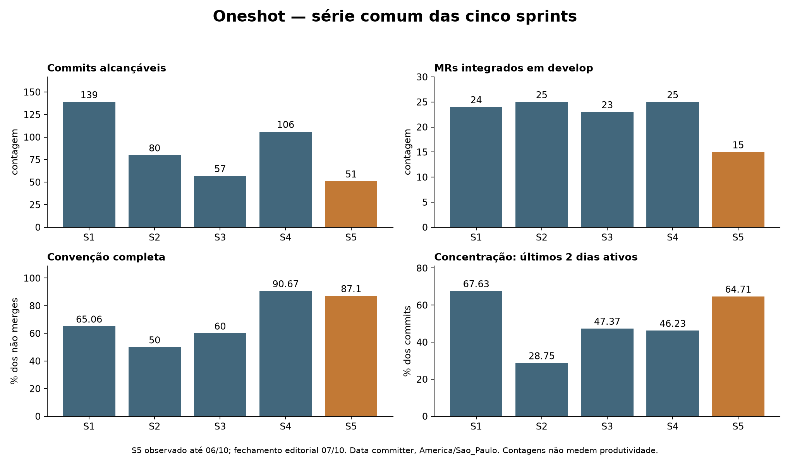

<table>
  <tr>
    <td><a href="https://www.metro.sp.gov.br/"></a></td>
    <td><a href="https://www.inteli.edu.br/"></a></td>
  </tr>
</table>

# Agente de IA para o Portfólio de Projetos do Metrô

## Nome do grupo: Oneshot

## Integrantes:

- <a href="https://www.linkedin.com/in/ntsfelipe/">Felipe Neves</a>
- <a href="https://www.linkedin.com/in/henrique-rodrigues-diniz-b7b011319/">Henrique Diniz</a>
- <a href="https://www.linkedin.com/in/jaimeandradedealmeida/">Jaime Almeida</a>
- <a href="https://www.linkedin.com/in/leonardoramosvieira">Leonardo Ramos</a>
- <a href="https://www.linkedin.com/in/pedro-uchoaa/">Pedro Uchoa</a>
- <a href="https://www.linkedin.com/in/wendel-feitosa-975bb1346/">Wendel Feitosa</a>

# Sumário

- [1. Introdução](#1-introdução)
  - [1.1 Objetivo do documento](#11-objetivo-do-documento)
  - [1.2 Escopo do documento](#12-escopo-do-documento)
- [2. Análise das sprints](#2-análise-das-sprints)
  - [2.1 Sprint 1](#21-sprint-1)
    - [2.1.1 Contexto da sprint](#211-contexto-da-sprint)
    - [2.1.2 Linha de base medida](#212-linha-de-base-medida)
    - [2.1.3 Pontos fortes](#213-pontos-fortes)
    - [2.1.4 Pontos de melhoria](#214-pontos-de-melhoria)
    - [2.1.5 Ações de melhoria definidas para a Sprint 2](#215-ações-de-melhoria-definidas-para-a-sprint-2)
  - [2.2 Sprint 2](#22-sprint-2)
    - [2.2.1 Contexto da sprint](#221-contexto-da-sprint)
    - [2.2.2 Indicadores medidos e resultado das metas](#222-indicadores-medidos-e-resultado-das-metas)
    - [2.2.3 Pontos fortes](#223-pontos-fortes)
    - [2.2.4 Pontos de melhoria](#224-pontos-de-melhoria)
    - [2.2.5 Ações de melhoria para a Sprint 3](#225-ações-de-melhoria-para-a-sprint-3)
  - [2.3 Sprint 3](#23-sprint-3)
    - [2.3.1 Contexto e critério de apuração](#231-contexto-e-critério-de-apuração)
    - [2.3.2 Indicadores medidos e resultado das metas](#232-indicadores-medidos-e-resultado-das-metas)
    - [2.3.3 Entregas e pendências](#233-entregas-e-pendências)
    - [2.3.4 Pontos fortes](#234-pontos-fortes)
    - [2.3.5 Pontos de melhoria](#235-pontos-de-melhoria)
    - [2.3.6 Efetividade das ações da Sprint 2](#236-efetividade-das-ações-da-sprint-2)
    - [2.3.7 Ações de melhoria para a Sprint 4](#237-ações-de-melhoria-para-a-sprint-4)
  - [2.4 Sprint 4](#24-sprint-4)
    - [2.4.1 Contexto e critério de apuração](#241-contexto-e-critério-de-apuração)
    - [2.4.2 Indicadores medidos e resultado das metas](#242-indicadores-medidos-e-resultado-das-metas)
    - [2.4.3 Entregas e pendências](#243-entregas-e-pendências)
    - [2.4.4 Pontos fortes](#244-pontos-fortes)
    - [2.4.5 Pontos de melhoria](#245-pontos-de-melhoria)
    - [2.4.6 Efetividade das ações da Sprint 3](#246-efetividade-das-ações-da-sprint-3)
    - [2.4.7 Ações de melhoria para a Sprint 5](#247-ações-de-melhoria-para-a-sprint-5)
  - [2.5 Sprint 5](#25-sprint-5-fechamento-de-07102026)
  - [2.6 Histórico comparável](#26-histórico-comparável-das-cinco-sprints)
- [3. Matriz de risco](#3-matriz-de-risco)
  - [3.1 Critérios de avaliação](#31-critérios-de-avaliação)
  - [3.2 Registro consolidado e status na Sprint 2](#32-registro-consolidado-e-status-na-sprint-2)
  - [3.3 Histórico de acompanhamento e justificativa das reavaliações](#33-histórico-de-acompanhamento-e-justificativa-das-reavaliações)
  - [3.4 Efetividade das ações aplicadas](#34-efetividade-das-ações-aplicadas)
  - [3.5 Matriz probabilidade × impacto](#35-matriz-probabilidade-impacto)
  - [3.6 Análise dos três itens mais críticos](#36-análise-dos-três-itens-mais-críticos)
  - [3.7 Mecanismo contínuo de acompanhamento](#37-mecanismo-contínuo-de-acompanhamento)
  - [3.8 Registro consolidado e status na Sprint 3](#38-registro-consolidado-e-status-na-sprint-3)
  - [3.9 Histórico acrescido na Sprint 3](#39-histórico-acrescido-na-sprint-3)
  - [3.10 Efetividade das respostas aos riscos](#310-efetividade-das-respostas-aos-riscos)
  - [3.11 Matriz probabilidade × impacto da Sprint 3](#311-matriz-probabilidade-impacto-da-sprint-3)
  - [3.12 Três riscos mais críticos no fechamento](#312-três-riscos-mais-críticos-no-fechamento)
  - [3.13 Registro consolidado e status na Sprint 4](#313-registro-consolidado-e-status-na-sprint-4)
  - [3.14 Histórico acrescido na Sprint 4](#314-histórico-acrescido-na-sprint-4)
  - [3.15 Efetividade das respostas aos riscos na Sprint 4](#315-efetividade-das-respostas-aos-riscos-na-sprint-4)
  - [3.16 Matriz probabilidade × impacto da Sprint 4](#316-matriz-probabilidade-impacto-da-sprint-4)
  - [3.17 Três riscos mais críticos no fechamento da Sprint 4](#317-três-riscos-mais-críticos-no-fechamento-da-sprint-4)
  - [3.18 Matriz final S5](#318-matriz-final-s5-e-avaliação-dos-impactos)
- [4. Matriz de papéis e responsabilidades](#4-matriz-de-papéis-e-responsabilidades)
  - [4.1 Matriz da Sprint 1](#41-matriz-da-sprint-1)
  - [4.2 Matriz da Sprint 2](#42-matriz-da-sprint-2)
  - [4.3 Rotação de papéis entre as sprints](#43-rotação-de-papéis-entre-as-sprints)
  - [4.4 Matriz da Sprint 3](#44-matriz-da-sprint-3)
  - [4.5 Rotação e equilíbrio após três sprints](#45-rotação-e-equilíbrio-após-três-sprints)
  - [4.6 Matriz da Sprint 4](#46-matriz-da-sprint-4)
  - [4.7 Rotação e equilíbrio após quatro sprints](#47-rotação-e-equilíbrio-após-quatro-sprints)
  - [4.8 Papéis das cinco sprints](#48-papéis-das-cinco-sprints-e-competências)
- [5. Contrato de convivência, SLA e rituais](#5-contrato-de-convivência-sla-e-rituais)
  - [5.1 Regra de ouro](#51-regra-de-ouro)
  - [5.2 Dailies](#52-dailies)
  - [5.3 Evidências de entrega](#53-evidências-de-entrega)
  - [5.4 Entrega, revisão e fechamento](#54-entrega-revisão-e-fechamento)
  - [5.5 Resolução de impasses](#55-resolução-de-impasses)
  - [5.6 Gestão de conflitos](#56-gestão-de-conflitos)
  - [5.7 Comunicação oficial](#57-comunicação-oficial)
  - [5.8 Registro de revisões do contrato](#58-registro-de-revisões-do-contrato)
  - [5.9 Revisão após a Sprint 3](#59-revisão-após-a-sprint-3)
  - [5.10 Revisão após a Sprint 4](#510-revisão-após-a-sprint-4)
  - [5.11 Avaliação final dos acordos](#511-avaliação-final-dos-acordos)
- [6. Planejamento das Sprints 3, 4 e 5](#6-planejamento-das-sprints-3-4-e-5)
  - [6.1 Visão geral da Sprint 3](#61-visão-geral-da-sprint-3)
  - [6.2 Backlog planejado da Sprint 3](#62-backlog-planejado-da-sprint-3)
    - [Artefato 1 — Desenvolvimento e Documentação Técnica do Projeto](#artefato-1-desenvolvimento-e-documentação-técnica-do-projeto)
    - [Artefato 2 — Planejamento de Testes Sistêmicos](#artefato-2-planejamento-de-testes-sistêmicos)
    - [Artefato 3 — Gestão de Projetos Evolutiva](#artefato-3-gestão-de-projetos-evolutiva)
    - [Sequenciamento](#sequenciamento)
    - [Distribuição das estimativas](#distribuição-das-estimativas)
  - [6.3 Escala de estimativa](#63-escala-de-estimativa)
  - [6.4 Planejamento da Sprint 4](#64-planejamento-da-sprint-4)
    - [6.4.1 Premissas, capacidade e limites](#641-premissas-capacidade-e-limites)
    - [6.4.2 Backlog refinado por resultado](#642-backlog-refinado-por-resultado)
    - [6.4.3 Sequenciamento e dependências](#643-sequenciamento-e-dependências)
    - [6.4.4 Distribuição da capacidade](#644-distribuição-da-capacidade)
  - [6.5 Planejamento da Sprint 5](#65-planejamento-da-sprint-5)
    - [6.5.1 Premissas, capacidade e limites](#651-premissas-capacidade-e-limites)
    - [6.5.2 Backlog refinado por resultado](#652-backlog-refinado-por-resultado)
    - [6.5.3 Sequenciamento e dependências](#653-sequenciamento-e-dependências)
    - [6.5.4 Distribuição da capacidade](#654-distribuição-da-capacidade)
- [7. Gestão do processo de desenvolvimento do grupo](#7-gestão-do-processo-de-desenvolvimento-do-grupo)
  - [7.1 Fluxo de trabalho no Kanban](#71-fluxo-de-trabalho-no-kanban)
  - [7.2 Regras obrigatórias para issues](#72-regras-obrigatórias-para-issues)
  - [7.3 Critérios de Ready e Done](#73-critérios-de-ready-e-done)
  - [7.4 Commits, merge requests e evidências](#74-commits-merge-requests-e-evidências)
  - [7.5 SLA operacional](#75-sla-operacional)
  - [7.6 Função do scrum master no merge](#76-função-do-scrum-master-no-merge)
  - [7.7 Revisão das políticas após a Sprint 3](#77-revisão-das-políticas-após-a-sprint-3)
  - [7.8 Revisão das políticas após a Sprint 4](#78-revisão-das-políticas-após-a-sprint-4)
  - [7.9 Registro final de configuração e validação](#79-registro-final-de-configuração-e-validação)
- [8. Post mortem do projeto](#8-post-mortem-do-projeto)
  - [8.1 Rastreabilidade](#81-rastreabilidade-das-entregas-de-gestão)


# 1. Introdução

Este documento consolida as práticas de gestão de projeto do G05, cobrindo a evolução das Sprints 1 a 4, a matriz de riscos, a rotação de papéis, o contrato de convivência, o planejamento das Sprints 4 e 5 e a gestão do processo de desenvolvimento do grupo.

O arquivo `docs/GestaoConfiguracao.md` centraliza GitFlow, políticas de branches, hooks, gates de integração e versionamento de artefatos técnicos.

## 1.1 Objetivo do documento

O objetivo deste documento é estabelecer uma forma clara de organização do trabalho da equipe, garantindo visibilidade das tarefas, previsibilidade de entregas, revisão por pares e comunicação objetiva ao longo da sprint.

Além de registrar o processo, este documento também funciona como acordo operacional do grupo: as regras aqui descritas devem orientar dailies, uso do Kanban, revisões, fechamento semanal e atuação do Scrum Master.

## 1.2 Escopo do documento

Este documento contempla:

- Retrospectivas das Sprints 1 a 4, com indicadores comparáveis e ações verificáveis;
- Matriz de riscos atualizada, com histórico, responsável e data da última revisão;
- Matrizes de papéis e responsabilidades das quatro sprints;
- Contrato de convivência, SLA e rituais;
- Registro histórico do planejamento das Sprints 3 e 4 e planejamento atômico da Sprint 5;
- Gestão do processo de desenvolvimento, incluindo Kanban, dailies, revisão e merge.

# 2. Análise das sprints

Esta seção acumula a análise de cada sprint. As sprints anteriores permanecem registradas para que a evolução dos indicadores seja verificável, e não afirmada.

## 2.1 Sprint 1

### 2.1.1 Contexto da sprint

A Sprint 1 teve como foco principal a construção dos primeiros artefatos de entendimento do negócio, especificação de requisitos e organização do processo de trabalho do grupo. De forma geral, a equipe apresentou boa produtividade, conseguiu desenvolver as entregas dentro do prazo estipulado e manteve uma divisão clara das frentes individuais.

Cada integrante assumiu uma frente principal, mas o grupo também conseguiu revezar apoios pontuais entre as tarefas. Esse revezamento foi importante para evitar que as entregas ficassem isoladas demais e para permitir que os membros acompanhassem minimamente o que estava sendo produzido fora da própria frente.

Ao longo da sprint, o grupo também utilizou horários de desenvolvimento no Inteli para discutir ideias, fazer brainstorm de features e alinhar a visão inicial do produto. Esses momentos presenciais foram relevantes porque ajudaram a transformar percepções individuais em decisões coletivas, principalmente nas discussões sobre escopo, funcionalidades possíveis e forma de organização da equipe.

### 2.1.2 Linha de base medida

Os pontos fortes e os pontos de melhoria descritos a seguir são acompanhados dos números que os sustentam. A finalidade é prática: sem linha de base não há como saber, no fim da Sprint 2, se as ações de melhoria funcionaram. Todos os indicadores abaixo foram apurados sobre o histórico do repositório no período da Sprint 1 (05/08/2026 a 14/08/2026) e são reprodutíveis pelos comandos indicados.

| Indicador | Sprint 1 | Como foi apurado | Meta para a Sprint 2 |
| --- | :---: | --- | :---: |
| Commits no período | 69 | `git rev-list --count --until=2026-08-15 HEAD` | — |
| Merge requests integrados | 27 | `git rev-list --count --merges --until=2026-08-15 HEAD` | — |
| Commits nos dois últimos dias da sprint | 45 de 69 (65%) | distribuição diária obtida de `git log --date=short --format=%ad` | ≤ 40% |
| MRs integrados nos dois últimos dias | 19 de 27 (70%) | mesma apuração, restrita a merges | ≤ 40% |
| Commits no dia de maior concentração (13/08) | 29 de 69 (42%) | mesma apuração | ≤ 25% |
| Commits locais dentro da convenção | 22 de 23 (96%) | commits em que autor e committer coincidem | 100% |
| Commits de squash dentro da convenção | 6 de 19 (32%) | commits gerados no servidor pelo merge com squash | 100% |
| Integrantes que tocaram mais de um artefato | 3 de 6 | arquivos `.md` distintos alterados por autor | ≥ 5 de 6 |
| Amplitude de commits entre integrantes | 23 contra 5 (4,6×) | commits por autor no período | ≤ 2,5× |

### 2.1.3 Pontos fortes

**Entrega dentro do prazo, com volume distribuído entre todas as frentes.** Os seis integrantes produziram commits no período e todos os artefatos planejados foram entregues. O grupo integrou 27 merge requests em oito dias de atividade.

**Aproveitamento dos momentos presenciais de desenvolvimento.** O grupo usou esses períodos para discutir ideias de features, alinhar entendimento sobre o problema e formalizar combinados de trabalho. Isso foi especialmente importante porque a Sprint 1 ainda tinha um caráter exploratório, exigindo consenso sobre o caminho inicial do projeto.

**Aderência real à convenção de commits.** Dos 23 commits criados nas máquinas do grupo, 22 seguem o padrão `<tipo>: <descrição> (#issue)` — 96%. O número é consequência direta do hook `commit-msg` documentado na Seção 7 do `GestaoConfiguracao.md`: a regra não ficou no papel, ela bloqueia.

**Formalização do contrato de convivência.** Esse contrato surgiu a partir de uma dinâmica de liderança conduzida na aula do professor Filipe, em que o grupo refletiu sobre a própria aprendizagem em equipe. Durante essa reflexão, ficou claro que os integrantes estavam trabalhando de forma muito separada, o que dificultava o fluxo de desenvolvimento, a troca de contexto e a colaboração. A partir dessa percepção, o grupo definiu boas práticas de convivência, prazos de entrega, critérios de revisão e formato das dailies, transformando um problema percebido em um acordo operacional verificável.

### 2.1.4 Pontos de melhoria

**Revisão concentrada no fim da sprint.** Este é o ponto mais nítido dos dados: 45 dos 69 commits (65%) e 19 dos 27 merge requests (70%) ocorreram nos dois últimos dias do período, sendo 29 commits (42%) apenas em 13/08. Uma revisão que chega junto com o prazo tem pouco espaço para gerar correção, e é isso que explica as inconsistências entre seções encontradas na entrega. A meta da Sprint 2 é reduzir a concentração dos dois últimos dias para no máximo 40% dos commits.

**Trabalho isolado entre frentes.** Três dos seis integrantes alteraram apenas um arquivo `.md` durante toda a sprint, e a diferença entre quem mais e quem menos commitou foi de 4,6 vezes (23 contra 5). Os dois números medem a mesma coisa por ângulos diferentes: cada frente evoluiu dentro do seu próprio arquivo, com pouca troca durante o desenvolvimento. A meta é que ao menos cinco dos seis integrantes toquem mais de um artefato e que a amplitude caia para 2,5 vezes.

**Rituais pouco aproveitados.** O contrato de convivência, com o formato de registro da daily, só foi formalizado durante a própria Sprint 1, de modo que a maior parte do período correu sem o combinado em vigor. As dailies funcionaram como atualização de status, e não como sincronização: impedimentos e dependências entre frentes não eram levantados no ritual, mas descobertos depois, na revisão.

**Efeito colateral do squash sobre a rastreabilidade.** Dos 19 commits gerados pelo servidor ao aplicar squash nos merge requests, apenas 6 seguem a convenção — 32%. O commit de squash nasce no GitLab, não passa pelos hooks locais e herda o título do merge request, que por padrão vem do nome da branch. O efeito não é apenas cosmético: como o squash grava no campo de committer o nome de quem aprovou o merge, parte do trabalho de integrantes deixa de aparecer como autoria própria no histórico. A ação correspondente está na Seção 2.1.5.

**Visão coletiva sobre o projeto.** Mesmo que cada integrante tenha uma frente principal, todos devem conhecer minimamente o estado das entregas centrais, os riscos ativos e as decisões tomadas. Esse ponto é o que os dois primeiros indicadores produzem como consequência.

### 2.1.5 Ações de melhoria definidas para a Sprint 2

Com base na retrospectiva da Sprint 1, o grupo definiu as seguintes ações de melhoria para a Sprint 2:

| Ação de melhoria | Problema tratado | Como será verificada |
| --- | --- | --- |
| Usar as dailies para registrar o que foi feito, evidências, próximos passos e impedimentos. | Rituais pouco aproveitados e baixa visibilidade entre frentes. | Registro diário seguindo o modelo do contrato de convivência. |
| Antecipar entregas para quinta-feira e reservar tempo para revisão por pares. | Risco de revisão concentrada no fim da sprint. | Tarefas em revisão até quinta-feira, com evidências anexadas. |
| Promover maior integração entre frentes de trabalho. | Desenvolvimento muito separado entre integrantes. | Pelo menos um momento semanal de alinhamento coletivo sobre artefatos e dependências. |
| Registrar decisões relevantes em canal oficial ou issue do GitLab. | Perda de contexto e dificuldade de rastrear decisões. | Decisões importantes vinculadas a issues, documentos ou mensagens formais do grupo. |
| Reforçar o uso de DoR, DoD, labels, milestones e assignee nas issues. | Necessidade de aderência às regras do Dashboard Ágil. | Issues da sprint revisadas antes de avançarem de `Open` para `Backlog`. |
| Manter o contrato de convivência como referência prática. | Falta de combinados explícitos no início da sprint. | Contrato consultado durante dailies, revisões e fechamento semanal. |
| Padronizar o título do merge request na convenção de commit antes de aprovar o merge. | 32% dos commits de squash fora do padrão, por herdarem o nome da branch. | Verificação do título do MR pelo revisor antes do merge; ao fim da sprint, 100% dos commits de squash na convenção. |
| Distribuir revisão entre frentes diferentes daquela em que o revisor trabalhou. | Três integrantes tocaram um único artefato na Sprint 1. | Ao menos cinco dos seis integrantes com alteração em mais de um artefato ao fim da sprint. |

Essas ações conectam a análise da Sprint 1 ao planejamento da Sprint 2 e buscam tornar o processo menos individualizado, mais rastreável e mais consistente com as boas práticas exigidas pelo módulo.

## 2.2 Sprint 2

### 2.2.1 Contexto da sprint

A Sprint 2 teve três artefatos: Prototipação Exploratória, Estratégia Técnica da Solução e Gestão de Projetos Evolutiva. Diferente da Sprint 1, que foi integralmente documental, esta sprint produziu código: o pipeline de classificação de intenções, uma bancada de teste para o caminho de consulta do RAG e os primeiros scripts de dados.

A sprint também absorveu uma frente não planejada. O feedback da Sprint 1 chegou em 24/08, com apontamentos de recorte e coerência nos artefatos de entendimento do negócio e de gestão, e a correção foi tratada dentro desta sprint, na issue [#111](https://git.inteli.edu.br/graduacao/2026-2a/t17/g05/-/issues/111).

### 2.2.2 Indicadores medidos e resultado das metas

A Sprint 1 fechou com nove indicadores medidos e uma meta para cada um. Esta é a apuração contra aquelas metas, no período de 15/08/2026 a 27/08/2026, sobre o histórico de `origin/develop`.

**Apuração final, com a sprint encerrada e todos os merge requests integrados.** Os números abaixo substituem a apuração parcial feita em 27/08, que considerava a sprint ainda aberta e superestimava o resultado de dois indicadores.

| Indicador | Sprint 1 | Meta da Sprint 2 | Sprint 2 | Resultado |
| --- | :---: | :---: | :---: | :---: |
| Commits no período | 69 | — | 49 | — |
| Merge requests integrados | 27 | — | 23 | — |
| Commits nos dois últimos dias | 45 de 69 (65%) | ≤ 40% | 26 de 49 (53%) | ❌ não atingida |
| Commits no dia de maior concentração | 29 de 69 (42%) | ≤ 25% | 15 de 49 (30%) | ❌ não atingida |
| Commits locais dentro da convenção | 22 de 23 (96%) | 100% | 6 de 6 (100%) | ✅ atingida |
| Commits de squash com tipo válido | 6 de 19 (32%) | 100% | 8 de 22 (36%) | ❌ não atingida |
| Amplitude de commits entre integrantes | 23 contra 5 (4,6×) | ≤ 2,5× | 11 contra 5 (2,2×) | ✅ atingida |
| Integrantes que tocaram mais de um arquivo | 3 de 6 | ≥ 5 de 6 | 6 de 6 | ✅ atingida |
| Merge requests abertos no fechamento | não medido | — | 0 | novo indicador |

Duas ressalvas de método, para que a comparação não afirme mais do que os dados sustentam.

A primeira é que o indicador de dispersão mudou de definição. Na Sprint 1 ele contava arquivos `.md` distintos por integrante, porque a sprint era só documentação. Na Sprint 2 existe código, e contar apenas `.md` distorceria o resultado — o Felipe, por exemplo, tocou 44 arquivos, todos em `src/`, e apareceria como zero. O indicador passou a contar arquivos distintos em `docs/` e `src/`, e é assim que deve ser lido daqui em diante.

A segunda diz respeito à revisão desta própria seção. Uma apuração parcial, feita antes do fechamento, indicava 34% dos commits nos dois últimos dias e concluía que a meta de 40% havia sido atingida. Com a sprint encerrada e os quatro merge requests pendentes integrados, o número subiu para 53%. O registro do erro fica aqui porque ele ensina algo sobre o método: apurar indicador de concentração antes do fim do período mede o meio da sprint, não a sprint.

### 2.2.3 Pontos fortes

**A dispersão do trabalho aumentou e a meta foi superada.** Os seis integrantes tocaram mais de um arquivo, contra três na Sprint 1, e a amplitude entre quem mais e quem menos commitou caiu de 4,6× para 2,2×, abaixo da meta de 2,5×. O trabalho deixou de se concentrar em duas ou três pessoas, e foi a única meta de processo efetivamente cumprida na sprint.

**A convenção de commits locais chegou a 100%.** Os seis commits criados nas máquinas do grupo seguem o padrão, contra 96% na sprint anterior. O hook `commit-msg` continua sendo o que sustenta esse número.

**A sprint produziu decisão técnica com evidência, e não com preferência.** Tanto a escolha da API de transcrição quanto a do algoritmo de PLN foram registradas com benchmark, critério de comparação e limitações declaradas. A seção de PLN, em particular, publica a tabela completa das quatorze combinações avaliadas, declara que o resultado de 0,7401 de F1-macro na intenção específica fica abaixo do mínimo de 0,80 exigido pelo RNF06 e nomeia nove ressalvas antes de tratar a escolha como definitiva.

### 2.2.4 Pontos de melhoria

**O squash continua quebrando a rastreabilidade, e a ação definida não resolveu.** A recontagem final encontrou 22 commits de squash: 8 possuem tipo válido (36%) e apenas 5 atendem à regra completa com referência `#N` à issue (23%), desempenho próximo dos 32% da Sprint 1. A ação registrada na Sprint 1 foi "padronizar o título do merge request antes de aprovar o merge", e ela não foi cumprida. Dos títulos gerados, aparecem casos como `feat/implementar-frontend-inicial-mockado` e `Docs/comparacao das alternativas e documentação`, que são nomes de branch e não mensagens de commit. A ação precisa deixar de depender de lembrança e virar verificação no fluxo.

**Quatro merge requests seguem abertos no fechamento da sprint.** São entregas prontas que não estão em `develop`: o modelo lógico de dados, a atualização dos requisitos funcionais, os requisitos das APIs de voz e a correção do feedback da Sprint 1. O trabalho existe, mas quem avalia o repositório em `develop` não o encontra. Este é um risco novo, registrado como R11 na Seção 3.2.

**Documentação e implementação divergiram dentro da mesma sprint.** A Seção 5.2 do `Projeto.md` foi entregue descrevendo uma interface própria de chat como ponto de entrada da arquitetura, sem citar o Microsoft Teams em nenhum ponto da seção, enquanto a Seção 2.4.3, a matriz de priorização da 2.8 e o RNF08 mantinham o Teams como canal do produto. A mesma seção nomeava o provedor de LLM usado na bancada de teste como se fosse decisão de produto. Ambos foram corrigidos, mas só depois de uma revisão cruzada — não foram detectados por quem escreveu nem por quem revisou o merge request. É o risco R10 se materializando dentro da equipe, e não com o parceiro.

**A carga por integrante ficou desigual, e os indicadores de commit não capturam isso.** Os números da Seção 2.2.2 mostram distribuição melhor que a Sprint 1, mas medem volume de commit, não carga de entrega. A divisão por task da Seção 4.2 mostra outra coisa: dois integrantes absorveram a prototipação inteira além de suas frentes técnicas, enquanto quatro itens da Estratégia Técnica seguiam em andamento na data desta apuração, três deles sob o mesmo responsável. Independente de fecharem até o prazo, a concentração já indica que a carga não foi conferida durante a sprint. A planning da Sprint 3 precisa ter um ponto de verificação de carga no meio do período, e não só no fechamento.

**A antecipação de entregas não se sustentou até o fim.** A concentração nos dois últimos dias caiu de 65% para 53%, melhor que a Sprint 1 mas longe da meta de 40%. O dia de maior concentração ficou em 30%, contra a meta de 25%. A ação de adotar quinta-feira como marco de revisão produziu efeito na primeira metade da sprint, mas os quatro merge requests que ficaram abertos até o último dia concentraram 26 dos 49 commits em 48 horas. A causa é a mesma da Sprint 1: tarefas que só começam depois que a anterior fecha, em vez de avançarem em paralelo, agora somadas à revisão que se acumulou no fim.

### 2.2.5 Ações de melhoria para a Sprint 3

| Ação de melhoria | Problema tratado | Como será verificada |
| --- | --- | --- |
| Renomear o merge request para o formato `<tipo>: <descrição> (#issue)` como item obrigatório do checklist de revisão, antes da aprovação. | Apenas 36% dos commits de squash com tipo válido e 23% na regra completa; a ação da Sprint 1 dependia de lembrança. | Ao fim da sprint, 100% dos commits de squash na convenção, apurado por `git log --no-merges` comparando autor e committer. |
| Definir quarta-feira como marco de integração: todo MR aberto até lá deve ser revisado e mergeado ou ter bloqueio declarado na issue. | Quatro MRs abertos no fechamento da Sprint 2. | Nenhum MR com mais de 48h sem revisão no fechamento da sprint. |
| Revisão cruzada obrigatória entre artefatos que se referenciam: quem revisa uma seção técnica confere a coerência com as seções de escopo que ela cita. | Divergência entre a Seção 5.2 e as Seções 2.4.3, 2.8 e RNF08. | Comentário de revisão citando explicitamente as seções conferidas, registrado no MR. |
| Quebrar tasks em unidades de até 60 minutos (faixa M) e permitir que frentes independentes avancem em paralelo. | 31% dos commits concentrados em um único dia. | Distribuição diária de commits, com no máximo 25% em um único dia. |
| Apurar os indicadores somente após o fechamento da sprint e a integração de todos os merge requests. | A apuração parcial da Sprint 2 indicou meta atingida em um indicador que, no fechamento, não foi. | Tabela comparativa das três sprints na análise da Sprint 3, com data de apuração declarada. |

## 2.3 Sprint 3

### 2.3.1 Contexto e critério de apuração

A Sprint 3 transformou as definições das duas primeiras sprints em implementação: entrada por áudio, transcrição, pré-processamento e classificação de intenções, interface modular, expansão do modelo de dados e planejamento dos testes sistêmicos. O recorte temporal adotado é de **31/08/2026 a 10/09/2026**, sobre `origin/develop`, com apuração final realizada em **10/09/2026**. Não houve commit em 31/08 nem em 10/09; a atividade versionada ocorreu de 01/09 a 09/09.

Para não confundir evidência com premissa, esta análise usa três estados:

- **Entregue no Git:** há código, teste ou documentação incorporado a `origin/develop`;
- **Estado funcional informado pelo grupo:** considera-se operante a integração do frontend com o classificador de intenções e com o banco Supabase, embora os pontos de ligação não estejam todos isolados em commits rastreáveis;
- **Pendente:** áudio ainda não percorre o PLN até a resposta, e permanecem pendentes o RAG/resposta ponta a ponta, webhooks, mensageria, deploy e a integração com o Copilot Studio. Os fluxos essenciais do Copilot entram explicitamente no planejamento da Sprint 4.

O ponto de partida é `ca455b3`, de 28/08, e o estado final da apuração é `490d7ba`, de 09/09. O saldo contém 121 arquivos alterados, 24.227 inserções e 3.042 remoções. Arquivos gerados, como `package-lock.json`, notebooks e binários de modelo, ampliam o volume de linhas e não devem ser interpretados como esforço individual.

Comandos de reprodução do recorte:

```bash
git log origin/develop --since="2026-08-31 00:00:00 -0300" --until="2026-09-10 23:59:59 -0300" --date=short --pretty=format:"%h|%ad|%an|%s"
git log origin/develop --no-merges --since="2026-08-31 00:00:00 -0300" --until="2026-09-10 23:59:59 -0300" --pretty=format:"%h|%an|%s"
git diff --shortstat ca455b3..490d7ba
```

### 2.3.2 Indicadores medidos e resultado das metas

| Indicador | Sprint 1 | Sprint 2 | Meta da Sprint 3 | Sprint 3 | Resultado |
| --- | :---: | :---: | :---: | :---: | :---: |
| Commits no período | 69 | 49 | — | 30 | — |
| Commits de entrega sem merge | 23 locais | 22 squash | — | 15 | — |
| Commits de merge | 27 | 23 | — | 15 | — |
| Commits nos dois últimos dias ativos | 45 de 69 (65%) | 26 de 49 (53%) | ≤ 40% | 17 de 30 (56,7%) | ❌ não atingida |
| Commits no dia de maior concentração | 29 de 69 (42%) | 15 de 49 (30%) | ≤ 25% | 10 de 30 (33,3%) em 08/09 | ❌ não atingida |
| Commits de entrega com tipo válido | — | 8 de 22 (36%) | 100% | 8 de 15 (53,3%) | ❌ não atingida |
| Commits de entrega na regra completa do hook | — | 5 de 22 (23%) | 100% | 6 de 15 (40%) | ❌ não atingida |
| MRs integrados nos dois últimos dias ativos | — | 4 retidos até o fechamento | nenhum MR por mais de 48 h sem revisão | 9 de 15 merges (60%) em 08–09/09 | ⚠️ parcial; idade dos MRs não recuperável pelo Git |
| Tasks na faixa G no planejamento | — | 48 de 48 (100%) | minoria do backlog | 16 de 26 (62%) | ❌ não atingida |
| Tasks com prioridade Alta | — | não comparável | prioridade deve ordenar o trabalho | 23 de 26 (88%) | ❌ não atingida |
| Marcadores de conflito em arquivos versionados | não apurado | não apurado | 0 | presentes em 5 arquivos | ❌ não atingida |

Os dois últimos dias **do calendário** teriam 7 de 30 commits (23,3%), porque 10/09 não teve atividade. Essa leitura seria enganosa. Como a concentração mede a antecedência real de integração, o indicador passa a usar os dois últimos **dias ativos**, 08 e 09/09, resultando em 56,7%. A definição fica fixada para as próximas sprints.

Os 15 commits de entrega foram auditados pela regra efetiva de `.githooks/commit-msg`: tipo Conventional Commit aceito, primeira linha de até 72 caracteres e referência `#N`. Oito possuem ao menos tipo válido e apenas seis atendem a todos os critérios. Houve melhora sobre os 5 de 22 da Sprint 2, mas a meta de 100% permaneceu distante.

A coluna da Sprint 2 nesta comparação usa a recontagem informada no feedback da avaliação apenas como linha de base analítica. A Seção 2.2 permanece com os valores publicados no fechamento daquela sprint e não é reescrita por esta entrega.

Os registros de daily disponibilizados são de 27/08, 02/09 e 08/09; o primeiro é tratado como preparação da sprint. Nos dois registros dentro do recorte houve 9 presenças em 12 observações (75%). Os três relatórios registram presença e trabalho previsto, mas nenhum contém simultaneamente feito, evidência, próximo passo e impedimento, os quatro campos exigidos pelo contrato. Não se conclui que outras dailies não ocorreram; conclui-se apenas que não há registro fornecido que permita verificá-las.

### 2.3.3 Entregas e pendências

| Issue | Entrega prevista | Situação no fechamento | Evidência ou limite |
| :---: | --- | --- | --- |
| [#119](https://git.inteli.edu.br/graduacao/2026-2a/t17/g05/-/issues/119) | Endpoint de upload de áudio | ✅ Entregue | Endpoint e serviço incorporados em `c909696` |
| [#120](https://git.inteli.edu.br/graduacao/2026-2a/t17/g05/-/issues/120) | Validação e tratamento de erros do áudio | ✅ Entregue | Validação WAV/OGG, duração, frequência, silêncio e erros em `c909696` |
| [#121](https://git.inteli.edu.br/graduacao/2026-2a/t17/g05/-/issues/121) | Documentar API de áudio | ✅ Entregue | `Projeto.md` atualizado em `40c0496` |
| [#122](https://git.inteli.edu.br/graduacao/2026-2a/t17/g05/-/issues/122) | Integrar Speech-to-Text | ✅ Entregue | Azure AI Speech, timeout, retry e erros em `05aea08`; não implica áudio ligado ao PLN |
| [#123](https://git.inteli.edu.br/graduacao/2026-2a/t17/g05/-/issues/123) | Pré-processamento textual | ✅ Entregue | Código, léxico, notebook e testes em `b1d46df` |
| [#124](https://git.inteli.edu.br/graduacao/2026-2a/t17/g05/-/issues/124) | Classificador de intenções | ✅ Entregue | Inferência hierárquica e artefato carregável em `04c2713` |
| [#125](https://git.inteli.edu.br/graduacao/2026-2a/t17/g05/-/issues/125) | Medir acurácia | ✅ Coberta pelo conteúdo | Métricas e testes de fidelidade constam do classificador e da documentação; não há commit isolado com `#125` |
| [#126](https://git.inteli.edu.br/graduacao/2026-2a/t17/g05/-/issues/126) | Integrar PLN à API de entrada | ✅ Estado informado | Fluxo textual do frontend ao classificador de intenções considerado funcional pelo grupo; áudio permanece fora desse encadeamento |
| [#127](https://git.inteli.edu.br/graduacao/2026-2a/t17/g05/-/issues/127) | Integrar PLN ao banco | ✅ Estado informado | Persistência em Supabase considerada funcional pelo grupo; falta evidência isolada de commit/teste ponta a ponta |
| [#128](https://git.inteli.edu.br/graduacao/2026-2a/t17/g05/-/issues/128) | Atualizar decisão de algoritmo | ✅ Entregue | `e97e725` |
| [#129](https://git.inteli.edu.br/graduacao/2026-2a/t17/g05/-/issues/129) | Documentar PLN | ✅ Entregue | `2f8104a` |
| [#130](https://git.inteli.edu.br/graduacao/2026-2a/t17/g05/-/issues/130) e [#145](https://git.inteli.edu.br/graduacao/2026-2a/t17/g05/-/issues/145) | Desenhar e implementar frontend | ✅ Entregue | Interface modular em `c8425c9` |
| [#131](https://git.inteli.edu.br/graduacao/2026-2a/t17/g05/-/issues/131) | Integrar frontend às APIs | ⚠️ Parcial | Classificação de intenção e Supabase considerados integrados; áudio, RAG/resposta e demais fluxos permanecem pendentes |
| [#132](https://git.inteli.edu.br/graduacao/2026-2a/t17/g05/-/issues/132) | Documentar frontend | ✅ Coberta pelo conteúdo | `src/frontend/README.md` evoluiu junto de `c8425c9`; não há commit isolado com `#132` |
| [#146](https://git.inteli.edu.br/graduacao/2026-2a/t17/g05/-/issues/146) | Atualizar modelagem com conteúdos do Drive | ✅ Entregue com falha de rastreabilidade | Modelo físico, scripts e diagramas em `e08c3e5`, cujo título não referencia a issue; `c909696` cita `#146` indevidamente em alteração de áudio |
| [#133](https://git.inteli.edu.br/graduacao/2026-2a/t17/g05/-/issues/133) | Definir ferramentas de teste | ✅ Entregue | `bc48894` |
| [#134](https://git.inteli.edu.br/graduacao/2026-2a/t17/g05/-/issues/134) | Planejar testes funcionais | ✅ Entregue | `a5cd3dd` e refinamento `8776384` |
| [#135](https://git.inteli.edu.br/graduacao/2026-2a/t17/g05/-/issues/135) | Planejar testes não funcionais | ✅ Entregue | `bb00e6a`, `0037404` e `8776384` |
| [#136](https://git.inteli.edu.br/graduacao/2026-2a/t17/g05/-/issues/136) | Planejar testes do módulo VHS/cache | ❌ Pendente | Não foi localizado plano específico nem implementação de VHS/cache |
| [#137](https://git.inteli.edu.br/graduacao/2026-2a/t17/g05/-/issues/137) | Roteiro de usabilidade | ✅ Planejado | Roteiro e evidências preparatórias em `d5e4b13`; execução permanece pendente |
| [#138](https://git.inteli.edu.br/graduacao/2026-2a/t17/g05/-/issues/138) a [#144](https://git.inteli.edu.br/graduacao/2026-2a/t17/g05/-/issues/144) | Gestão evolutiva | 🟡 Consolidada nesta entrega | Análise, riscos, papéis, contrato, backlog, processo e GitFlow são atualizados neste artefato; os cards da Sprint 4 ainda devem ser materializados no Kanban |

O conjunto entregue sustenta um caminho funcional restrito: interface → classificação de intenção → Supabase. Não se declara concluído um fluxo completo de resposta do agente. Essa distinção impede que uma interface navegável ou um esquema SQL sejam usados como evidência de integração que ainda não foi testada.

### 2.3.4 Pontos fortes

**Implementação modular com testes automatizados.** A sprint introduziu módulos separados para áudio, PLN e frontend. A documentação técnica registra 158 testes aprovados, dos quais 87 cobrem o núcleo de PLN. Os resultados não foram reexecutados nesta apuração, mas permanecem como evidência versionada no `Projeto.md`.

**Decisões de PLN sustentadas por medidas.** A macrointenção atingiu F1 de 0,9477, a extração de entidades 0,998 e os limiares de 0,550 e 0,700 foram incorporados ao serviço. A intenção específica ficou em 0,7401, abaixo do RNF06, e a limitação foi publicada em vez de omitida.

**Documentação posterior ao comportamento observado.** A documentação da API de áudio e do PLN entrou depois dos commits de implementação. Isso segue a ação de evitar descrever comportamento apenas previsto e reduziu o risco de contrato fictício.

**Controle de escopo.** O grupo concentrou a integração atual no classificador de intenções e no Supabase. Webhooks, deploy, RAG completo e Copilot Studio continuam identificados como pendência; nenhum deles é apresentado como entregue na Sprint 3. Os fluxos essenciais do Copilot passam a compor a Sprint 4.

**Evolução do modelo de dados.** O banco passou a representar 25 tabelas, 43 índices e 25 triggers, cobrindo portfólio, acompanhamento de projetos, artefatos, permissões, intenções, conversas, fontes e auditoria.

### 2.3.5 Pontos de melhoria

**Integração voltou a se concentrar no fechamento.** Dez dos 30 commits ocorreram em 08/09 e nove dos 15 merges ocorreram em 08–09/09. O marco de quarta-feira não produziu um fluxo nivelado; ele permaneceu uma regra manual sem alarme ou bloqueio.

**O título de MR ainda contamina o histórico de squash.** Apenas 6 dos 15 commits de entrega atendem à regra completa. Mensagens como `resolve merge`, `Feat/integrar-api-stt-upload` e `Docs/atualizar-modelagem-dados-drive` mostram que revisão humana não foi um controle suficiente.

**Conflitos foram versionados.** No corte histórico da Sprint 3 havia marcadores nos cinco arquivos; foram removidos em 11/09, conforme as auditorias posteriores. Os arquivos eram: `README.md`, `.gitignore`, `.githooks/pre-commit`, `docs/diagrams/componentes-metro-5.2.puml` e `src/notebooks/classificador_intencoes_metro.ipynb`. O problema materializa especificamente o risco de integridade R13, além de poder alterar o funcionamento do hook, do `.gitignore`, do diagrama e do notebook; R10 permanece reservado a contradições semânticas entre requisito, contrato e comportamento.

**A daily registrada não cumpre o próprio contrato.** Os relatórios disponíveis informam presença e trabalho previsto, mas não registram feito, evidência e impedimento. A política precisa ser aplicada por template e gatilho, não apenas descrita.

**Planejamento não ordenou capacidade.** O backlog entrou com 62% das tasks em G e 88% em prioridade Alta. Além de contrariar a ação de atomização, a soma pelo teto da escala ocupava apenas cerca de metade das 96 horas, sem reserva ou justificativa explícita.

**A integração funcional permanece estreita.** O frontend chega à classificação de intenções e ao Supabase, mas o áudio não segue até o PLN, o RAG/resposta não fecha o caminho ponta a ponta e não há deploy controlado. Esses itens formam a cadeia crítica da Sprint 4.

**A distribuição nominal não coincide integralmente com a evidência.** Há tarefas cobertas por commits de outra frente, itens sem referência no título e uma citação indevida de `#146` no commit de áudio. A matriz de papéis deve expor essas diferenças em vez de inferir autoria pelo título da issue.

### 2.3.6 Efetividade das ações da Sprint 2

| Ação definida para a Sprint 3 | Efetividade | Evidência e conclusão |
| --- | :---: | --- |
| Padronizar título do MR no checklist | ❌ Não efetiva | 6 de 15 commits na regra completa. Continuou dependente da atenção do revisor |
| Marco de integração na quarta-feira | ⚠️ Parcial | Tudo chegou a `develop`, mas 60% dos merges ficaram nos dois últimos dias ativos; o Git não permite verificar sozinho o SLA de 48 h |
| Revisão cruzada entre artefatos relacionados | ⚠️ Parcial | Não foi localizada nova contradição semântica equivalente à da Sprint 2, mas as integrações `#126` e `#127` não receberam evidência isolada que permitisse conferir completamente contrato e comportamento |
| Quebrar tasks até M e paralelizar frentes | ❌ Não efetiva | 16 de 26 tasks continuaram em G; 56,7% dos commits ficaram nos dois últimos dias ativos |
| Apurar indicadores somente após o fechamento | ✅ Efetiva | Apuração feita em 10/09, após o último commit de 09/09, distinguindo dias de calendário de dias ativos |

Quatro das cinco ações falharam total ou parcialmente pelo mesmo motivo identificado na Sprint 2: exigiam lembrança no momento certo. A única ação plenamente efetiva possuía um gatilho objetivo — a data de fechamento. As ações seguintes transformam as demais em gate, agenda ou checklist verificável.

### 2.3.7 Ações de melhoria para a Sprint 4

| Ação | Gatilho | Responsável pelo acionamento | Critério verificável |
| --- | --- | --- | --- |
| Configurar validação automática do título do MR; se o recurso do GitLab não estiver disponível, criar job equivalente no pipeline | Criação ou atualização de MR | Autor e revisor do MR | 100% dos commits de squash no formato completo |
| Bloquear marcadores de conflito em arquivos rastreados | `pre-commit`, pipeline e checklist de revisão | Autor; pipeline como segunda barreira | `git grep` sem ocorrências de marcadores antes de cada merge |
| Publicar inventário de MRs e bloqueios no marco de quarta-feira | Quarta-feira, antes da daily | Scrum Master | Nenhum MR com mais de 48 h sem revisão ou bloqueio registrado |
| Tornar obrigatório o template completo da daily no Slack, inclusive para ausentes | Início de cada daily; registro assíncrono no mesmo dia | Cada integrante | Pelo menos 90% dos registros com feito, evidência, próximo passo e impedimento |
| Refinar antes de mover `Open → Backlog` | Mudança de coluna no Kanban | Responsável pelo refinamento | 0 task maior que G; no máximo 55% em G e 50% em Alta; implementação, teste direto e documentação específica do mesmo resultado permanecem no mesmo card |
| Criar teste de contrato e ponta a ponta para cada ligação da cadeia mínima | Antes do MR que declara uma integração concluída | Autor e revisor | Evidência separada para frontend→API, áudio→STT→PLN, PLN→Supabase e resposta→frontend |
| Registrar evidência de execução dos testes planejados | Antes de mover a issue para `Closed` | Responsável pela task | Log, resultado e falha/correção anexados à issue; plano sem execução não conta como teste concluído |

## 2.4 Sprint 4

### 2.4.1 Contexto e critério de apuração

A Sprint 4 teve três artefatos: Desenvolvimento e Documentação Técnica do Projeto, Execução de Testes Sistêmicos e Gestão de Projetos Evolutiva, esta acompanhada da viabilidade financeira. O planejamento da Seção 6.4 comprometeu 58 tasks em 88,5 horas, com uma cadeia de marcos que ia da integridade do repositório ao diagnóstico de qualidade, passando por dados auditáveis, caminho de consulta integrado, ambiente em nuvem e fluxos essenciais do Copilot.

Dois fatos externos mudaram o percurso. O primeiro foi a informação do Metrô de que não disponibilizaria acesso ao Copilot Studio: os fluxos `transacao_gerar_relatorio` e `alerta_prazo_atraso` passaram a ser implementados como workflow guiado no frontend e no backend, com o relatório gerado em DOCX pelo backend e o alerta processado por filas no RabbitMQ. A decisão está registrada na Frente D da Seção 6.4.2 (`b071f16`). O segundo foi a cota diária do provedor gratuito de LLM, que bloqueou a primeira coleta do RNF04 em 21/09 e levou as rodadas de RNF04 e RNF05 a um provedor pago.

O recorte adotado é de **11/09/2026 a 25/09/2026**, sobre `origin/develop`, com apuração final em **25/09/2026, depois da integração do último merge request da sprint** ([!108](https://git.inteli.edu.br/graduacao/2026-2a/t17/g05/-/merge_requests/108), às 16h32). O ponto de partida é `2170a8e`, último commit da linha principal de `develop` antes do recorte, e o estado final é `964cd8c`. O saldo contém 617 arquivos alterados, 90.673 inserções e 8.791 remoções. Evidências versionadas — CSVs das rodadas de carga, respostas coletadas em JSON e relatórios de execução — respondem pela maior parte desse volume e não devem ser lidas como esforço.

Os commits de 10/09 posteriores à apuração da Sprint 3 pertencem ao fechamento daquela sprint e ficam fora dos dois recortes. Em 11/09 entraram quatro merge requests de issues da Sprint 3 ([!79](https://git.inteli.edu.br/graduacao/2026-2a/t17/g05/-/merge_requests/79), [!80](https://git.inteli.edu.br/graduacao/2026-2a/t17/g05/-/merge_requests/80), [!82](https://git.inteli.edu.br/graduacao/2026-2a/t17/g05/-/merge_requests/82) e [!83](https://git.inteli.edu.br/graduacao/2026-2a/t17/g05/-/merge_requests/83)); eles contam nos indicadores por data, mas não como entrega da Sprint 4.

As datas estão convertidas para o fuso de São Paulo, porque os commits de merge gerados pelo GitLab são gravados em UTC e, sem conversão, parte deles mudaria de dia. Os dados de merge request — criação, integração, revisor, squash e primeira revisão — foram extraídos da API do GitLab. Comandos de reprodução do recorte:

```bash
TZ=America/Sao_Paulo git log origin/develop --since="2026-09-11 00:00:00 -0300" --until="2026-09-25 23:59:59 -0300" --date=format-local:"%Y-%m-%d %H:%M" --pretty=format:"%h|%ad|%an|%P|%s"
TZ=America/Sao_Paulo git log origin/develop --no-merges --since="2026-09-11 00:00:00 -0300" --until="2026-09-25 23:59:59 -0300" --pretty=format:"%h|%an|%s"
git diff --shortstat 2170a8e 964cd8c
```

### 2.4.2 Indicadores medidos e resultado das metas

As metas da Sprint 4 são as que a Seção 2.3.7 manteve ou definiu. Os dois últimos indicadores da tabela são novos e respondem a fatos da própria sprint.

| Indicador | Sprint 1 | Sprint 2 | Sprint 3 | Meta da Sprint 4 | Sprint 4 | Resultado |
| --- | :---: | :---: | :---: | :---: | :---: | :---: |
| Commits no período | 69 | 49 | 30 | — | 107 | — |
| Commits de entrega sem merge | 23 locais | 22 squash | 15 | — | 75 (58 locais e 17 de squash) | — |
| Commits de merge | 27 | 23 | 15 | — | 32 (26 MRs e 6 atualizações de branch) | — |
| Commits nos dois últimos dias ativos | 45 de 69 (65%) | 26 de 49 (53%) | 17 de 30 (56,7%) | ≤ 40% | 41 de 107 (38,3%), em 24–25/09 | ✅ atingida |
| Commits no dia de maior concentração | 29 de 69 (42%) | 15 de 49 (30%) | 10 de 30 (33,3%) | ≤ 25% | 30 de 107 (28,0%), em 23/09 | ❌ não atingida |
| Commits de entrega com tipo válido | — | 8 de 22 (36%) | 8 de 15 (53,3%) | 100% | 69 de 75 (92,0%) | ❌ não atingida |
| Commits de entrega na regra completa do hook | — | 5 de 22 (23%) | 6 de 15 (40%) | 100% | 65 de 75 (86,7%) | ❌ não atingida |
| Commits de squash na regra completa | 6 de 19 (32%)¹ | 5 de 22 (23%) | não separado | 100% | 8 de 17 (47,1%) | ❌ não atingida |
| Títulos de MR no padrão da Seção 5.3.1 do `GestaoConfiguracao.md` | — | — | — | validação automática | 7 de 26 (26,9%) | ❌ não atingida |
| MRs integrados nos dois últimos dias ativos | — | 4 retidos até o fechamento | 9 de 15 (60%) | — | 15 de 26 (57,7%) | ⚠️ leve queda |
| MRs com primeira revisão depois de 48 h | — | — | não recuperável | 0 | 4 de 26 ([!88](https://git.inteli.edu.br/graduacao/2026-2a/t17/g05/-/merge_requests/88), [!90](https://git.inteli.edu.br/graduacao/2026-2a/t17/g05/-/merge_requests/90), [!91](https://git.inteli.edu.br/graduacao/2026-2a/t17/g05/-/merge_requests/91), [!93](https://git.inteli.edu.br/graduacao/2026-2a/t17/g05/-/merge_requests/93)) | ❌ não atingida |
| Tasks na faixa G no planejamento | — | 48 de 48 (100%) | 16 de 26 (62%) | ≤ 55% | 31 de 58 (53,4%) | ✅ atingida |
| Tasks com prioridade Alta | — | não comparável | 23 de 26 (88%) | ≤ 50% | 29 de 58 (50%) | ✅ atingida |
| Marcadores de conflito em arquivos versionados | não apurado | não apurado | 5 arquivos | 0 | 0 | ✅ atingida |
| Registros de daily com os quatro campos | — | — | 0 de 3 relatórios | ≥ 90% | registros não fornecidos | ⚪ não verificável |
| Tasks planejadas excluídas do board | — | — | — | — | 11 de 58 (19%) | novo indicador |
| Issues com entrega integrada e ainda abertas no corte | — | — | — | — | 6 (5 planejadas e 1 extra) | novo indicador |

¹ Na Sprint 1, o critério contava apenas o tipo; a referência `#N` só passou a compor a regra na Sprint 2.

**A meta dos dois últimos dias foi atingida, mas o indicador deixou de medir o que pretendia.** Pela primeira vez a concentração ficou abaixo de 40%. O trabalho, porém, continuou chegando tarde: de 11 a 21/09 foram 16 commits (15%), nove deles em 11/09 e ligados ao fechamento da Sprint 3; de 22 a 25/09, 91 commits (85%) e 18 dos 26 merge requests (69%). A concentração não diminuiu, mudou de janela — de dois para quatro dias. Por isso a Sprint 5 passa a medir também a fração do trabalho integrada na primeira metade da sprint (Seção 2.4.7).

**A convenção melhorou por um caminho que ninguém planejou.** Nove merge requests foram integrados sem squash e trouxeram para `develop` 58 commits criados localmente, dos quais 57 passam na regra completa do hook — o único fora dela, `ba5f5af`, excede 72 caracteres. Os 17 commits gerados pelo squash no servidor ficaram em 8 na regra completa. O salto de 40% para 86,7% vem, portanto, dos commits que passaram pelo hook, e não de uma melhora no título dos merge requests: apenas 7 dos 26 seguem o padrão da Seção 5.3.1 do `GestaoConfiguracao.md`. O problema, que já se repete há três sprints, está localizado no título do MR, e a ação correspondente — a validação automática — não foi executada.

**A revisão atrasou em quatro merge requests.** [!88](https://git.inteli.edu.br/graduacao/2026-2a/t17/g05/-/merge_requests/88) esperou 65 horas pela primeira revisão, [!91](https://git.inteli.edu.br/graduacao/2026-2a/t17/g05/-/merge_requests/91) 69 horas, [!93](https://git.inteli.edu.br/graduacao/2026-2a/t17/g05/-/merge_requests/93) 52 horas e [!90](https://git.inteli.edu.br/graduacao/2026-2a/t17/g05/-/merge_requests/90) 169 horas, com conflito, até ser integrado em 24/09. Não há registro no GitLab do inventário de quarta-feira que deveria ter exposto esses casos.

**As dailies continuam sem evidência.** Nenhum registro de daily da Sprint 4 foi fornecido para esta apuração. Assim como na Sprint 3, não se conclui que as dailies não ocorreram; conclui-se que o contrato não produziu registro verificável, pela segunda sprint consecutiva.

### 2.4.3 Entregas e pendências

A tabela confronta as 58 tasks planejadas na Seção 6.4.2 com o estado no GitLab e em `origin/develop` no corte. "Excluída" indica issue apagada do GitLab; nenhuma das exclusões tem comentário, decisão registrada ou redistribuição associada.

| Task | Issue | Situação no corte | Evidência ou limite |
| :---: | :---: | --- | --- |
| S4-01 | [#191](https://git.inteli.edu.br/graduacao/2026-2a/t17/g05/-/issues/191) | ✅ Entregue | [!81](https://git.inteli.edu.br/graduacao/2026-2a/t17/g05/-/merge_requests/81) removeu os marcadores do `README.md`, do diagrama de componentes e do notebook do classificador |
| S4-02 | #192 | 🗑️ Excluída; coberta | Marcadores do `.gitignore` removidos em `7503050` ([#131](https://git.inteli.edu.br/graduacao/2026-2a/t17/g05/-/issues/131)) e do `pre-commit` em `531caa2` ([!79](https://git.inteli.edu.br/graduacao/2026-2a/t17/g05/-/merge_requests/79)), fora da issue; uma regra do `.gitignore` perdida numa resolução posterior foi restaurada em `fb15994` |
| S4-03A | [#193](https://git.inteli.edu.br/graduacao/2026-2a/t17/g05/-/issues/193) | ✅ Entregue | [!81](https://git.inteli.edu.br/graduacao/2026-2a/t17/g05/-/merge_requests/81) |
| S4-03B | [#194](https://git.inteli.edu.br/graduacao/2026-2a/t17/g05/-/issues/194) | ✅ Entregue | [!81](https://git.inteli.edu.br/graduacao/2026-2a/t17/g05/-/merge_requests/81); o notebook é JSON válido no corte |
| S4-04 | #195 | ❌ Não entregue; excluída | Nem o `pre-commit` nem a pipeline verificam marcadores; a `develop` fechou sem marcadores por revisão manual |
| S4-05 | #196 | ❌ Não entregue; excluída | Validação de título inexistente; 7 de 26 títulos de MR no padrão |
| S4-07 | #197 | 🗑️ Excluída; coberta | Conexão exercida pela integração do [!80](https://git.inteli.edu.br/graduacao/2026-2a/t17/g05/-/merge_requests/80) e pela aplicação do esquema no [!94](https://git.inteli.edu.br/graduacao/2026-2a/t17/g05/-/merge_requests/94) |
| S4-08 | [#198](https://git.inteli.edu.br/graduacao/2026-2a/t17/g05/-/issues/198) | ✅ Entregue | [!94](https://git.inteli.edu.br/graduacao/2026-2a/t17/g05/-/merge_requests/94) |
| S4-09 | [#199](https://git.inteli.edu.br/graduacao/2026-2a/t17/g05/-/issues/199) | ✅ Entregue | [!94](https://git.inteli.edu.br/graduacao/2026-2a/t17/g05/-/merge_requests/94) |
| S4-11 | [#200](https://git.inteli.edu.br/graduacao/2026-2a/t17/g05/-/issues/200) | ✅ Executada | [!98](https://git.inteli.edu.br/graduacao/2026-2a/t17/g05/-/merge_requests/98): 5 aprovados, 3 falharam (D-02, D-03 e D-04) e 4 bloqueados pelo D-01 |
| S4-12 | [#201](https://git.inteli.edu.br/graduacao/2026-2a/t17/g05/-/issues/201) | ✅ Entregue | [!88](https://git.inteli.edu.br/graduacao/2026-2a/t17/g05/-/merge_requests/88) |
| S4-13 | [#202](https://git.inteli.edu.br/graduacao/2026-2a/t17/g05/-/issues/202) | ✅ Entregue | [!90](https://git.inteli.edu.br/graduacao/2026-2a/t17/g05/-/merge_requests/90), integrado após sete dias e resolução de conflito |
| S4-14A | #203 | 🗑️ Excluída; coberta em parte | Contrato 1.1.0, com `trace_id`, publicado pelo [!100](https://git.inteli.edu.br/graduacao/2026-2a/t17/g05/-/merge_requests/100) |
| S4-14B | #204 | 🗑️ Excluída; coberta em parte | Frontend passou a consumir as referências no [!106](https://git.inteli.edu.br/graduacao/2026-2a/t17/g05/-/merge_requests/106) |
| S4-15 | [#205](https://git.inteli.edu.br/graduacao/2026-2a/t17/g05/-/issues/205) | ✅ Entregue | [!102](https://git.inteli.edu.br/graduacao/2026-2a/t17/g05/-/merge_requests/102) |
| S4-16 | #206 | 🗑️ Excluída; coberta | Consulta com recuperação e fontes exercitada no E2E da S4-20 ([!100](https://git.inteli.edu.br/graduacao/2026-2a/t17/g05/-/merge_requests/100)) e no CT-RF05-01 ([!99](https://git.inteli.edu.br/graduacao/2026-2a/t17/g05/-/merge_requests/99)) |
| S4-17A | [#207](https://git.inteli.edu.br/graduacao/2026-2a/t17/g05/-/issues/207) | ✅ Entregue | [!106](https://git.inteli.edu.br/graduacao/2026-2a/t17/g05/-/merge_requests/106) |
| S4-19 | [#208](https://git.inteli.edu.br/graduacao/2026-2a/t17/g05/-/issues/208) | ⚠️ Renomeada para "Issue duplicada (ignorar)" e fechada | Cenários de ausência cobertos por CT-RF04-02 e CT-RF05-02 ([!99](https://git.inteli.edu.br/graduacao/2026-2a/t17/g05/-/merge_requests/99)) e por CT-RNF04-N ([!96](https://git.inteli.edu.br/graduacao/2026-2a/t17/g05/-/merge_requests/96)) |
| S4-20 | [#209](https://git.inteli.edu.br/graduacao/2026-2a/t17/g05/-/issues/209) | ✅ Entregue; issue aberta | [!100](https://git.inteli.edu.br/graduacao/2026-2a/t17/g05/-/merge_requests/100): 5 aprovados e 2 bloqueados |
| S4-21A | [#210](https://git.inteli.edu.br/graduacao/2026-2a/t17/g05/-/issues/210) | ⚠️ Resultado registrado; issue aberta | Metrô sem acesso ao Copilot Studio, registrado na Frente D (`b071f16`) |
| S4-22 | [#211](https://git.inteli.edu.br/graduacao/2026-2a/t17/g05/-/issues/211) | ⚠️ Fechada sem MR | `feat/configurar-connector-openapi` não foi integrada e ficou obsoleta com a decisão acima |
| S4-23A | [#212](https://git.inteli.edu.br/graduacao/2026-2a/t17/g05/-/issues/212) | ✅ Entregue, replanejada | Fluxo guiado do relatório no frontend e no backend ([!92](https://git.inteli.edu.br/graduacao/2026-2a/t17/g05/-/merge_requests/92)), Seção 8.5.10 do `Projeto.md` |
| S4-23B | [#213](https://git.inteli.edu.br/graduacao/2026-2a/t17/g05/-/issues/213) | ✅ Entregue, replanejada | DOCX gerado pelo backend no lugar do Power Automate ([!92](https://git.inteli.edu.br/graduacao/2026-2a/t17/g05/-/merge_requests/92)) |
| S4-24A | [#214](https://git.inteli.edu.br/graduacao/2026-2a/t17/g05/-/issues/214) | ✅ Entregue | [!93](https://git.inteli.edu.br/graduacao/2026-2a/t17/g05/-/merge_requests/93) |
| S4-24B | [#215](https://git.inteli.edu.br/graduacao/2026-2a/t17/g05/-/issues/215) | ✅ Entregue, replanejada | Regra e notificação com scheduler, RabbitMQ e central de notificações ([!93](https://git.inteli.edu.br/graduacao/2026-2a/t17/g05/-/merge_requests/93)), Seção 8.5.11 |
| S4-25A | #216 | 🗑️ Excluída; obsoleta | O roteamento determinístico `guided_workflow` substituiu o roteamento ao Copilot |
| S4-25B | #217 | ❌ Não entregue; excluída | Nenhum webhook implementado; o relatório é gerado no backend |
| S4-25C | #218 | ❌ Não entregue; excluída | O alerta trocou o webhook por AMQP; o barema exige dois webhooks, que voltam na Sprint 5 |
| S4-26A | [#219](https://git.inteli.edu.br/graduacao/2026-2a/t17/g05/-/issues/219) | ✅ Entregue | [!92](https://git.inteli.edu.br/graduacao/2026-2a/t17/g05/-/merge_requests/92) |
| S4-26B | [#220](https://git.inteli.edu.br/graduacao/2026-2a/t17/g05/-/issues/220) | ✅ Entregue | [!93](https://git.inteli.edu.br/graduacao/2026-2a/t17/g05/-/merge_requests/93); evidências em `src/backend/evidencias/alerta-prazo-atraso` |
| S4-27 | [#221](https://git.inteli.edu.br/graduacao/2026-2a/t17/g05/-/issues/221) | ✅ Entregue | [!105](https://git.inteli.edu.br/graduacao/2026-2a/t17/g05/-/merge_requests/105): AWS EC2 com Docker Compose, RabbitMQ e CloudWatch |
| S4-28 | [#222](https://git.inteli.edu.br/graduacao/2026-2a/t17/g05/-/issues/222) | ✅ Entregue; issue aberta | [!105](https://git.inteli.edu.br/graduacao/2026-2a/t17/g05/-/merge_requests/105) e [!108](https://git.inteli.edu.br/graduacao/2026-2a/t17/g05/-/merge_requests/108); `/health` e `POST /api/chat` pelo túnel (Seção 10.2.10) |
| S4-29 | [#223](https://git.inteli.edu.br/graduacao/2026-2a/t17/g05/-/issues/223) | ✅ Entregue; issue aberta | [!105](https://git.inteli.edu.br/graduacao/2026-2a/t17/g05/-/merge_requests/105); `GET /` com HTTP 200 pelo túnel |
| S4-30 | [#224](https://git.inteli.edu.br/graduacao/2026-2a/t17/g05/-/issues/224) | ⚠️ Parcial; issue aberta | Smoke test registrado na Seção 10.2.10; rollback implementado em `scripts/aws/rollback.ps1`, sem execução intencional registrada |
| S4-30B | #225 | 🗑️ Excluída; coberta | CloudWatch Agent e runbook `aws-operacao.md` ([!105](https://git.inteli.edu.br/graduacao/2026-2a/t17/g05/-/merge_requests/105) e [!108](https://git.inteli.edu.br/graduacao/2026-2a/t17/g05/-/merge_requests/108)) |
| S4-31 | [#226](https://git.inteli.edu.br/graduacao/2026-2a/t17/g05/-/issues/226) | ✅ Entregue; issue aberta | [!107](https://git.inteli.edu.br/graduacao/2026-2a/t17/g05/-/merge_requests/107): cache VHS implementado e testado localmente; homologação com o Azure real não executada |
| S4-32A | [#227](https://git.inteli.edu.br/graduacao/2026-2a/t17/g05/-/issues/227) | ✅ Executada | [!99](https://git.inteli.edu.br/graduacao/2026-2a/t17/g05/-/merge_requests/99): 16 casos aprovados e 4 que falharam |
| S4-32B | [#228](https://git.inteli.edu.br/graduacao/2026-2a/t17/g05/-/issues/228) | ✅ Executada | [!104](https://git.inteli.edu.br/graduacao/2026-2a/t17/g05/-/merge_requests/104): 210 aprovados e 6 `xfail` na confirmação; VHS bloqueado na data da rodada |
| S4-33 | [#229](https://git.inteli.edu.br/graduacao/2026-2a/t17/g05/-/issues/229) | ✅ Executada | [!103](https://git.inteli.edu.br/graduacao/2026-2a/t17/g05/-/merge_requests/103): 2 aprovados, 2 reprovados e 2 bloqueados |
| S4-34 | [#230](https://git.inteli.edu.br/graduacao/2026-2a/t17/g05/-/issues/230) | ✅ Executada | [!96](https://git.inteli.edu.br/graduacao/2026-2a/t17/g05/-/merge_requests/96): CT-RNF04-P 12 de 12 e CT-RNF04-N 10 de 12 |
| S4-35 | [#231](https://git.inteli.edu.br/graduacao/2026-2a/t17/g05/-/issues/231) | ✅ Executada | [!96](https://git.inteli.edu.br/graduacao/2026-2a/t17/g05/-/merge_requests/96): 3ª rodada aprovada, com P95 de até 8,4 s |
| S4-36 | [#232](https://git.inteli.edu.br/graduacao/2026-2a/t17/g05/-/issues/232) | ✅ Executada; RNF06 reprovado | [!95](https://git.inteli.edu.br/graduacao/2026-2a/t17/g05/-/merge_requests/95): F1-macro 0,8327 e *recall*@3 0,5556 |
| S4-39 a S4-42 | [#233](https://git.inteli.edu.br/graduacao/2026-2a/t17/g05/-/issues/233) a [#236](https://git.inteli.edu.br/graduacao/2026-2a/t17/g05/-/issues/236) | ✅ Executadas, com ressalvas | [!101](https://git.inteli.edu.br/graduacao/2026-2a/t17/g05/-/merge_requests/101): seis sessões, SUS com mediana 83,75; vagas de gestão e de ferramentas Microsoft vazias |
| S4-46 e S4-47 | [#237](https://git.inteli.edu.br/graduacao/2026-2a/t17/g05/-/issues/237) e [#238](https://git.inteli.edu.br/graduacao/2026-2a/t17/g05/-/issues/238) | ⚠️ Em revisão; sem artefato versionado | Material da Sprint Review fora do repositório |
| S4-48A a S4-51B | [#239](https://git.inteli.edu.br/graduacao/2026-2a/t17/g05/-/issues/239) a [#245](https://git.inteli.edu.br/graduacao/2026-2a/t17/g05/-/issues/245) | 🟡 Nesta entrega | — |
| S4-52A a S4-52C | [#246](https://git.inteli.edu.br/graduacao/2026-2a/t17/g05/-/issues/246) a [#248](https://git.inteli.edu.br/graduacao/2026-2a/t17/g05/-/issues/248) | ⚠️ Em revisão; não integradas | Nenhum commit de viabilidade financeira em `origin/develop` no corte |

> **Nota de atualização — Sprint 5 (25/09/2026).** As linhas S4-25B e
> S4-25C preservam o estado verdadeiro no fechamento da Sprint 4: naquele
> corte, nenhum webhook havia sido entregue. Depois desse registro histórico,
> a Sprint 5 implementou `POST /api/integrations/power-automate/report-results`
> e `POST /api/integrations/notifications/delivery-results`. O segundo grava
> outbox e é processado pelo RabbitMQ; o scheduler e AMQP continuam não sendo
> classificados como webhook. Contratos e evidências: Seção 8.5.12 do
> `Projeto.md`.

Das 58 tasks, **31 foram entregues ou executadas** com evidência integrada, **9 ficaram parciais ou sem evidência versionada**, **4 não foram entregues**, **7 foram excluídas por estarem cobertas por outra entrega ou obsoletas** e **7 compõem esta entrega de gestão**.

Entraram também cinco issues fora do plano: [#250](https://git.inteli.edu.br/graduacao/2026-2a/t17/g05/-/issues/250) e [#251](https://git.inteli.edu.br/graduacao/2026-2a/t17/g05/-/issues/251) ([!91](https://git.inteli.edu.br/graduacao/2026-2a/t17/g05/-/merge_requests/91) e [!89](https://git.inteli.edu.br/graduacao/2026-2a/t17/g05/-/merge_requests/89)), de acurácia e intenções secundárias; [#253](https://git.inteli.edu.br/graduacao/2026-2a/t17/g05/-/issues/253) ([!97](https://git.inteli.edu.br/graduacao/2026-2a/t17/g05/-/merge_requests/97)), de economia de tokens; [#254](https://git.inteli.edu.br/graduacao/2026-2a/t17/g05/-/issues/254) ([!108](https://git.inteli.edu.br/graduacao/2026-2a/t17/g05/-/merge_requests/108)), de documentação do deploy, integrada e ainda aberta; e [#252](https://git.inteli.edu.br/graduacao/2026-2a/t17/g05/-/issues/252), em revisão e sem MR.

O conjunto sustenta um caminho demonstrável de ponta a ponta: interface → API → classificação → recuperação → resposta → Supabase, por texto e por áudio, com relatório e alerta guiados, publicado na AWS. Três lacunas ficam declaradas e seguem para a Sprint 5: não há controle de acesso por perfil (D-01), não há webhooks e a comparação entre projetos sai parcial, porque a base consultada pelo chat não tem documentos de todos os projetos.

> **Leitura temporal.** A frase anterior é a retrospectiva do corte da Sprint
> 4 e não descreve mais o estado atual. Na Sprint 5, os dois webhooks foram
> implementados e testados; a confirmação de entrega foi integrada à outbox e
> aos handlers RabbitMQ. Integrações reais com Power Automate, Teams e tenant
> Microsoft continuam opcionais/não homologadas e foram validadas somente com
> simulador ou double controlado.

### 2.4.4 Pontos fortes

**Testes sistêmicos executados com método e reprodutíveis.** Todos os tipos planejados foram executados: RF01 a RF10 (20 casos, 16 aprovados e 4 que falharam), RNF01 a RNF06, integração (210 aprovados e 6 defeitos conhecidos marcados como `xfail`), E2E textual com RAG e usabilidade com seis participantes externos. Cada rodada tem congelamento prévio, evidência versionada e comando de reprodução. As reprovações foram publicadas como diagnóstico, e não escondidas: o RNF06 reprovou na recuperação com uma massa prospectiva construída justamente para não reaproveitar os casos usados no ajuste.

**O caminho ponta a ponta passou a existir e está publicado.** O risco mais grave da Sprint 3, R14, foi mitigado. Texto e áudio atravessam classificação, recuperação e resposta com persistência correlacionada no Supabase (S4-11, S4-13 e S4-20), relatório e alerta rodam de ponta a ponta, e a aplicação responde na AWS com backend, frontend, RabbitMQ e workers saudáveis (Seção 10.2.10 do `Projeto.md`).

**A arquitetura absorveu a perda do Copilot Studio sem reescrita.** Quando o Metrô informou que não haveria acesso ao ambiente, os dois fluxos essenciais foram reimplementados como workflow guiado sobre o mesmo pipeline de classificação, e o alerta ganhou mensageria real com filas duráveis, *dead-letter queues* e outbox. A troca de provedor de LLM também não alterou as camadas anteriores: no CT-E2E-04, intenção, confiança e fontes ficaram idênticas nos dois modelos.

**O classificador atingiu a meta que faltava.** O F1-macro da intenção específica subiu de 0,7401 para 0,8327 com a [#251](https://git.inteli.edu.br/graduacao/2026-2a/t17/g05/-/issues/251), acima do mínimo de 0,80 do RNF06, e o benchmark de economia de tokens ([#253](https://git.inteli.edu.br/graduacao/2026-2a/t17/g05/-/issues/253)) passou a orientar quais intenções chamam o LLM.

**A autoria ficou distribuída.** Os seis integrantes têm merge requests integrados no recorte, entre três e seis cada, e todos revisaram MRs de outros integrantes.

### 2.4.5 Pontos de melhoria

**O plano deixou de corresponder ao board, sem registro.** Onze tasks planejadas foram apagadas do GitLab, uma foi renomeada para "Issue duplicada (ignorar)" e cinco foram criadas durante a sprint. Parte das exclusões tem justificativa técnica visível no código — cobertura por outra task ou obsolescência depois da decisão sobre o Copilot —, mas nenhuma tem decisão registrada. Duas delas eram as ações de melhoria mais importantes da Sprint 3 (S4-04 e S4-05) e duas eram os webhooks exigidos pelo barema (S4-25B e S4-25C). Excluir uma issue apaga também a evidência de que ela existiu, e a Seção 6.4.2 passou a listar tasks que o board não tem.

**Os controles automáticos prometidos não foram construídos.** Pela terceira sprint consecutiva, a ação sobre o título do MR falhou: a validação não foi configurada e só 7 dos 26 títulos seguem o padrão. O gate de marcadores também não existe. A `develop` fechou sem marcadores porque a revisão manual funcionou nesta sprint, não porque haja uma barreira.

**A distribuição executada divergiu da planejada.** Das 47 tasks planejadas que ainda existem no board, apenas 5 ficaram com o executor previsto na Seção 6.4.4. A carga estimada por responsável no corte vai de 3 h a 20,5 h, contra 14 a 15 h no plano, e as sete tasks de gestão voltaram a se concentrar em uma pessoa, como na Sprint 3. A regra da Seção 6.4.1 — "a atribuição só muda quando a redistribuição e seu efeito na carga forem registrados" — não foi aplicada (Seção 4.6).

**O fechamento administrativo ficou incompleto.** Seis issues com entrega já integrada seguiam abertas no corte, uma foi fechada sem merge request ([#211](https://git.inteli.edu.br/graduacao/2026-2a/t17/g05/-/issues/211)) e um merge request foi integrado sem nenhum comentário ou aprovação registrada ([!100](https://git.inteli.edu.br/graduacao/2026-2a/t17/g05/-/merge_requests/100)). Outros dois foram aprovados sem comentário ([!83](https://git.inteli.edu.br/graduacao/2026-2a/t17/g05/-/merge_requests/83) e [!101](https://git.inteli.edu.br/graduacao/2026-2a/t17/g05/-/merge_requests/101)), contra o checklist do template, e sete não marcaram a exclusão da branch de origem.

**A gestão e a viabilidade financeira ficaram para o último dia.** As tasks de gestão só puderam começar depois do último merge, no próprio dia da release, e a viabilidade financeira (S4-52A a S4-52C) não estava em `develop` no corte. O material da Sprint Review (S4-46 e S4-47) também não tem evidência versionada.

**Defeitos relevantes de produto seguem abertos.** Não há controle de acesso por perfil (D-01), o que bloqueia o RNF02 e derruba o elemento "perfil" do RNF03. A auditoria não grava fora de escopo (D-02) nem `correlation_id` (D-03), e respostas documentais saem sem fonte registrada (D-04). O fluxo guiado viola uma restrição do schema (D-05), dados sensíveis não são bloqueados antes do provedor (D-06), a recuperação reprovou no RNF06 (*recall*@3 de 0,556) e, na usabilidade, perguntas curtas foram recusadas (O1) e o controle da proatividade não foi percebido sem ajuda (O8).

**A documentação voltou a se contradizer.** A Seção 9.2.7 do `Projeto.md` afirma, no DEF-RNF05-01, que "o ambiente do Metrô usará o Copilot Studio com modelos GPT", enquanto a Frente D da Seção 6.4.2 registra que o Metrô não disponibilizará o Copilot Studio. O RNF08 ainda cita o Teams como canal previsto. É o risco R10 materializado outra vez.

### 2.4.6 Efetividade das ações da Sprint 3

| Ação definida na Seção 2.3.7 | Efetividade | Evidência e conclusão |
| --- | :---: | --- |
| Configurar validação automática do título do MR | ❌ Não efetiva | A task S4-05 foi excluída do board sem ser executada; 7 de 26 títulos no padrão e 8 de 17 commits de squash na regra completa |
| Bloquear marcadores de conflito em arquivos rastreados | ⚠️ Parcial | Zero marcadores nos 764 arquivos versionados em `964cd8c`, depois das limpezas de [!79](https://git.inteli.edu.br/graduacao/2026-2a/t17/g05/-/merge_requests/79) e [!81](https://git.inteli.edu.br/graduacao/2026-2a/t17/g05/-/merge_requests/81); o gate não existe (S4-04 excluída) e uma regra do `.gitignore` se perdeu numa resolução de conflito (`fb15994`) |
| Publicar inventário de MRs e bloqueios na quarta-feira | ❌ Não efetiva | Nenhum inventário registrado no GitLab; quatro MRs esperaram mais de 48 h pela primeira revisão, e [!90](https://git.inteli.edu.br/graduacao/2026-2a/t17/g05/-/merge_requests/90) esperou sete dias |
| Tornar obrigatório o template completo da daily | ⚪ Não verificável | Nenhum registro de daily fornecido |
| Refinar antes de mover `Open → Backlog` | ✅ Efetiva no planejamento | Nenhuma task acima de G, 53,4% em G e 50% em Alta; o refinamento, porém, não foi aplicado às mudanças feitas durante a sprint |
| Criar teste de contrato e ponta a ponta para cada ligação da cadeia mínima | ✅ Efetiva | Contrato da rota textual (S4-12), áudio → STT → PLN (S4-13), PLN → Supabase (S4-11 e CT-E2E-02), resposta → frontend (CT-E2E-01, E2E do frontend na pipeline e testes de referências do [!106](https://git.inteli.edu.br/graduacao/2026-2a/t17/g05/-/merge_requests/106)) |
| Registrar evidência de execução antes de mover para `Closed` | ⚠️ Parcial | Todas as tasks de teste fechadas têm relatório e evidência versionados; mas seis issues com entrega integrada ficaram abertas, uma foi fechada sem MR e as quatro issues de usabilidade fecharam com DoR e DoD desmarcados |

Duas das sete ações funcionaram, duas em parte e duas falharam; uma não pôde ser verificada. O padrão das sprints anteriores se confirma com um agravante. As ações que dependiam de ser **construídas** (validação de título e gate) não saíram porque as tasks que as construiriam foram apagadas, e não apenas adiadas. As ações que dependiam de **rotina** (inventário e daily) não deixaram evidência. As que funcionaram estavam embutidas no próprio DoD das tasks técnicas. A lição para a Sprint 5 é que ação de processo precisa virar task com critério de aceite no board, e task do board não pode ser excluída sem registro.

### 2.4.7 Ações de melhoria para a Sprint 5

| Ação | Gatilho | Responsável pelo acionamento | Critério verificável |
| --- | --- | --- | --- |
| Construir a validação do título do MR e o gate de marcadores como tasks do primeiro dia (S5-01 e S5-02) | Início da sprint, antes do primeiro MR funcional | Executores das tasks | Pipeline falha com título inválido e com marcador real; 100% dos commits de squash na regra completa |
| Proibir a exclusão de issue planejada: tarefa cancelada é fechada com o motivo e o destino | Mudança de escopo ou identificação de duplicidade | Scrum Master | 0 issues planejadas retornando 404 no fechamento; toda mudança com comentário datado na issue de gestão |
| Fechar a issue pelo MR com `Closes #N` e conferir no inventário | Abertura do MR | Autor e revisor | 0 issues com MR integrado abertas no corte |
| Publicar o inventário de MRs como comentário na issue de gestão | Quarta-feira, 30/09, antes da daily | Scrum Master | Comentário publicado; nenhum MR com mais de 48 h sem primeira revisão |
| Medir a fração do trabalho integrada na primeira metade da sprint | Apuração do fechamento | Responsável pela análise da Sprint 5 | Pelo menos 40% dos merge requests integrados até 01/10 |
| Registrar a redistribuição de tasks com a nova soma de carga | Troca de assignee | Quem assume a task | Comentário na issue com origem, destino e carga resultante; carga final por pessoa com amplitude de no máximo 2× |
| Anexar à issue de gestão o registro semanal das dailies | Sexta-feira, 02/10, e fechamento da sprint | Scrum Master | Dois registros semanais anexados, com os quatro campos por integrante |
| Exigir ao menos um comentário do revisor antes da aprovação | Aprovação do MR | Revisor | 100% dos MRs com comentário de revisão registrado |
| Adiantar a documentação final e a gestão para antes do último dia | Congelamento de funcionalidades, 02/10 | Executores das Frentes I e J do plano da Sprint 5 | Rascunhos integrados a `develop` até 05/10; o fechamento só acrescenta os dados da própria Sprint 5 |

## 2.5 Sprint 5 — fechamento de 07/10/2026

Este documento consolida o encerramento da Sprint 5 e as entregas de gestão
das issues #302–#307. A análise abrange alteração pelo chat, tabela Microsoft,
testes RNF07/RNF09, blocos estruturados, testes de componentes, síntese de voz,
gate de integração e auditoria do fluxo guiado. Seis dessas frentes têm
integração confirmada no Git. Para escrita pelo chat e blocos estruturados,
não há merge correspondente na base analisada; sua integração permanece
pendente de comprovação.

O fechamento é datado de 07/10/2026. A base de análise é o commit
`1ff5927a75b79219314068291b1aa43de3fe9674` de `develop`, obtido em 06/10.
As métricas da Sprint 5 abrangem os registros disponíveis até essa base e
permanecem provisórias até o fechamento administrativo. O fuso adotado é
America/Sao_Paulo.

Fontes: [gestão histórica](GestaoProjeto.md), [configuração](GestaoConfiguracao.md),
[produto](Projeto.md), [feedbacks](RevisaoFeedbacks.md), [backlog S5](backlog/sprint-05-issues.csv),
histórico Git e consulta autenticada ao GitLab, com método descrito abaixo,
[VHS real](evidencias/sprint-05/vhs-azure-real/README.md),
[barreira de dados sensíveis](evidencias/sprint-05/s5-27-dado-sensivel.md) e
[contrato de escrita](evidencias/sprint-05/s5-05-contrato-alteracao-chat.md).
As fontes disponíveis abrangem documentos de gestão e produto, testes e
histórico Git. Não há registros exportados das dailies da Sprint 5 nas fontes
analisadas; seu cumprimento não pôde ser verificado.

### Evolução do projeto nas cinco sprints

| Sprint | Objetivo e realização | Dificuldade e resposta | Consequência para a seguinte |
|---|---|---|---|
| S1 | Problema de informação dispersa no PMO; personas, requisitos, SWOT, riscos, GitFlow e hooks. Produto ainda documental. | Trabalho concentrado no encerramento; mensagens de squash menos padronizadas que commits locais. | Antecipar integração e revisar semântica de documentação, não apenas existência dos arquivos. |
| S2 | Protótipos exploraram consulta e iniciativa do agente; RF09/RF10 formalizaram sugestões e controle. Modelagem de dados e estratégia de voz; classificador com 5.353 exemplos sintéticos. | Intenção específica com F1 0,7401; documentação confundia bancada, provedor LLM e canal Teams. Quatro MRs chegaram ao fechamento. | Limiar/fallback protege roteamento; provedor desacoplado; integração real passa a ser prioridade. |
| S3 | Frontend, classificação e Supabase; áudio Azure e plano VHS; planejamento de testes. | Não havia cadeia completa de áudio/PLN/RAG no corte histórico; resíduos de conflito e concentração da gestão. | Gates, ligação entre componentes e evidência ponta a ponta, em vez de inferir integração pela presença dos módulos. |
| S4 | Texto/áudio, relatórios guiados, alertas autônomos, mensageria e deploy AWS; testes sistêmicos, integração, RNFs e usabilidade. Classificação específica chega a 0,8327. | Copilot Studio indisponível; workflows próprios absorvem restrição. Recall@3 0,5556 reprova recuperação; falta de autorização bloqueia testes. Onze issues apagadas e redistribuição pouco rastreável. | Identidade/perfis antes de escrita pelo chat; melhorar base e revisão; preservar trilha de decisões. |
| S5 | Supabase Auth/perfis, proteção de dados antes do LLM, contrato de alteração com confirmação; VHS real Azure/Supabase e documentação final. Voz de saída, gate, auditoria, tabela Microsoft e testes finais integrados; integração de escrita pelo chat e blocos estruturados ainda não comprovada. RNF07 reprovado em 30%. | Ecossistema corporativo continua dependendo do parceiro; controles de processo melhoram, mas registros de daily/inventário e distribuição de gestão não sustentam todos os acordos. | Handoff com requisitos de homologação, limites e evidências para o parceiro. |

O produto deixou de ser uma proposta de agente dentro do Teams e tornou-se uma
aplicação web própria, com API, PLN autoral, recuperação fundamentada,
workflows de relatório/alerta e trilhas de auditoria. A disponibilidade de
Microsoft Entra, Teams, SharePoint corporativo e Copilot não é consequência
automática da integração real do Azure Speech. A solução atual preserva o
objetivo de consultar e acompanhar o portfólio, mas o canal corporativo depende
de homologação externa. A [arquitetura atual](Projeto.md) delimita esses estados.

### 2.5.1 Resultados e dificuldades

O avanço mais relevante foi transformar R04 de bloqueio conhecido em controle
implementado: !119 incorpora autenticação Supabase e regras de acesso. !127
acrescenta filtragem de dados sensíveis; !132 formaliza o contrato para alterar
dados pelo chat. O VHS real registrou cinco solicitações do mesmo áudio, uma
chamada ao Azure, um miss, quatro hits e nenhum erro: 80% de acerto no cenário
de repetição. O miss levou 1.540,27 ms e os hits 0,19/0,13/0,12/0,11 ms.
É evidência de cache no ensaio local, sem extrapolação para áudio diferente,
múltiplos workers ou ambiente publicado.

A documentação técnica final foi integrada em !122; o ensaio real do VHS em
!121. A configuração exige pipeline aprovado para merge. O histórico Git
confirma a integração de !117, !120, !131, !124, !130 e !123, respectivamente
auditoria, gate, tabela Microsoft, testes unitários, RNFs e TTS. As evidências
versionadas de RNF07–RNF09 registram três casos aprovados e três reprovados:
RNF07 compreendeu 6/20 frases (30%, meta 80%); RNF08 positivo reprovou por
dependência de Copilot no critério; RNF08 negativo e ambos os casos RNF09 passaram.
A integração do relatório não transforma esses resultados em aprovação. Ver
[consolidação S5-31](testes/sprint5/consolidacao-s5-31.md).

A distribuição registrada S5 concentra #303–#307 e #302 em Jaime. As estimativas
atribuídas variam de 5,5 a 16 h: amplitude 2,91×, acima do acordo 2×. Estimativa
do card não é tempo trabalhado. Há oito issues sem executor no snapshot e
53 issues no milestone diante de 54 no plano: o destino de #294 precisa de
registro, sem presumir exclusão indevida a partir apenas da ausência.

### 2.5.2 Efetividade das nove ações de 2.4.7

| Ação anterior e meta | Evidência S5 | Resultado e decisão |
|---|---|---|
| Gate de título e marcadores desde o primeiro dia; squash 100% válido | !118 e !120 integrados; conflict-markers reúne gate e validação do título, antes dos testes. Série comum: 87,10% dos não merges na convenção, sem medir só squash. | Parcial. Integração confirmada; não prova entrada no primeiro dia nem pipeline remota atual aprovada. Testes locais do gate e limitações do runner são discriminados em Projeto.md, Seção 14.1. |
| Nenhuma issue planejada desaparece; cancelamento com motivo/destino | 53 no milestone contra 54 no plano; #294 não consta. | Não comprovada. Registrar destino específico; não converter ausência em cancelamento auditado. |
| Zero issue com MR integrado permanece aberta; `Closes` | Consulta API anterior, restrita aos nove MRs então integrados: #256 continua aberta apesar de !118 declarar `Closes #256`. | Meta não atingida na consulta anterior. Os estados de fechamento após os seis merges novos não foram reconsultados; revalidar no encerramento. Implementação não fecha card automaticamente em qualquer branch-alvo. |
| Inventário em 30/09 e nenhuma primeira revisão >48h | Não há comentário não sistêmico nas issues de gestão consultadas que comprove o inventário. | Não verificável. Ausência de evidência não prova ausência de conversa; export é condição de auditoria. |
| Pelo menos 40% dos MRs integrados até 01/10 | Cálculo reproduzível em histórico Git e datas de merge consultadas no GitLab; janela comum inclui marcos administrativos, não só entregas funcionais. | 2/15 = 13,33% até 01/10; meta de 40% não atingida neste recorte. Não contar MRs abertos como integrados. |
| Redistribuição comentada e amplitude <=2× | Cargas atribuídas 16/5,5 h, amplitude 2,91×; gestão em uma pessoa. | Meta de equilíbrio não atingida no registro. Separar execução real, apoio e assignee. |
| Dois exports de dailies com quatro campos | Exports não disponíveis. | Não verificável; não atribuir percentual de presença S5. |
| Todo MR tem comentário do revisor | Na consulta anterior, 6/9 MRs integrados tinham comentário não sistêmico de alguém diferente do autor; !119, !118 e !115 não têm. | Meta universal não comprovada: a consulta anterior cobriu nove MRs; comentários dos seis novos não foram reconsultados. Não extrapolar 6/9 para os 15 atuais. |
| Rascunhos final/gestão integrados até 05/10 | !122 integrado em 05/10; esta gestão está em branch local posterior. | Parcial: técnica antecipada, gestão ainda concentrada no fechamento. |

### 2.5.3 Recomendações sem novo backlog

| Gatilho | Responsável recomendado | Prazo relativo | Evidência de conclusão |
|---|---|---|---|
| Handoff ou promoção da release | Responsável pelo deploy e revisor distinto | Antes da promoção | SHA da imagem, ambiente, smoke autenticado de leitura/escrita e rollback. |
| Fechamento administrativo | Responsável de gestão | Antes de declarar encerramento no GitLab | Destino de cada card, vínculo de MR e comentário para cancelamento/redistribuição. |
| Primeiro ciclo de operação do parceiro | PMO e responsável de integração | Antes de uso com dados reais | Homologação de fontes, perfis e canal; cenários positivos/negativos com massa representativa. |
| Rotina semanal futura, se adotada | Scrum Master do ciclo | No próprio dia da rotina | Daily com quatro campos, inventário e primeira revisão em <=48h. |

## 2.6 Histórico comparável das cinco sprints



As janelas comuns usam datas inclusivas de encerramento: S1 01–14/08, S2
15–28/08, S3 29/08–11/09, S4 12–25/09 e S5 26/09–07/10. A janela de observação
pedida começa em 01/08; as datas de planning e os cortes originais continuam
nas retrospectivas históricas. A série usa todos os commits alcançáveis do HEAD
congelado, data do committer no fuso local, não merges como denominador da
convenção e merges de MRs com destino develop para a contagem administrativa.
Atualizações de branch, squash e commits locais podem aumentar contagem sem
produzir resultado novo. Essas contagens não medem produtividade individual.

| Sprint / janela | Commits | Não merge | MRs em develop | Convenção completa | Últimos dois dias ativos |
|---|---:|---:|---:|---:|---:|
| S1 (2026-08-01–2026-08-14) | 139 | 83 | 24 | 65.06% | 67.63% |
| S2 (2026-08-15–2026-08-28) | 80 | 40 | 25 | 50% | 28.75% |
| S3 (2026-08-29–2026-09-11) | 57 | 30 | 23 | 60% | 47.37% |
| S4 (2026-09-12–2026-09-25) | 106 | 75 | 25 | 90.67% | 46.23% |
| S5 (2026-09-26–2026-10-07) | 51 | 31 | 15 | 87.10% | 64.71% |

| Indicador | Eficiência/eficácia e conclusão |
|---|---|
| Commits alcançáveis | Esforço de alteração registrado, sem medida de horas ou valor. Aumento S4 acompanha integração/testes; menor S5 observado não significa queda de produtividade. |
| MRs integrados | Visibilidade administrativa do incremento. Contagem deve ser combinada com requisito e teste; 15 S5 no HEAD atualizado; os seis merges novos foram confirmados no Git, sem inferir aprovação dos testes. |
| Convenção completa | Eficiência da comunicação: 65,06%, 50%, 60%, 90,67%, 87,10%. Melhora forte na S4, com queda de 3,57 pontos percentuais na S5 após os novos merges; limite: mede mensagem e não qualidade da entrega nem 100% dos squash. |
| Concentração nos dois últimos dias ativos | Risco de retrabalho e revisão tardia: 67,63%, 28,75%, 47,37%, 46,23%, 64,71%. Melhora relativa S1–S4 não elimina o problema; S5 continua concentrada no recorte observado. |
| Qualidade do classificador | Eficácia técnica: F1 específico 0,7401 S2/S3 para 0,8327 S4, sobre massa sintética. RNF06 do classificador atingido; não confundir com recuperação recall@3 0,5556 reprovada. |
| Evidência ponta a ponta | Evolui de documentação/protótipo para fluxos testados em S4 e fronteiras reais em S5. É avanço de eficácia; não equivale a homologação corporativa. |
| Rotação e equilíbrio | Todos atravessam especificação, implementação e qualidade, mas gestão se concentra e amplitude S5 2,91× excede acordo. Competência cresce sem evidência de equilíbrio pleno. |
| Usabilidade | Mediana SUS 83,75 em seis participantes técnicos externos S4. Bom sinal exploratório; eficácia para gestores do Metrô não foi medida. |

Os números antigos (69/49/30/107 commits) usam recortes e contadores distintos.
A nova série não os substitui silenciosamente: inclui histórico alcançável,
mudanças nas datas de corte, 28/08 e 11/09 e o fuso uniforme. A diferença é de
método, não evidência isolada de erro de autoria. O HEAD congelado e o método abaixo permitem recontagem sem depender de exportações JSON.

### 2.6.1 Método de recontagem

Na referência congelada, listar os commits alcançáveis com SHA, parents, data
do committer, autoria e assunto; converter a data para America/Sao_Paulo e
filtrar pelas cinco janelas da tabela. Não usar a data do autor ou considerar
MR aberto como integrado.

```powershell
git log 1ff5927a75b79219314068291b1aa43de3fe9674 --format="%H%x09%P%x09%cI%x09%an%x09%s"
```

Commit não merge tem um parent. A convenção completa usa
`tipo(escopo): descrição` ou `tipo: descrição`, com os tipos definidos na
política de commits. Dividir válidos por não merges. Para concentração, somar
os commits nas duas últimas datas com atividade da janela e dividir pelo total.
Na série comum, o campo “Convenção completa” verifica o padrão de tipo/escopo
e descrição (`tipo(escopo): descrição` ou `tipo: descrição`); não verifica o
limite de 72 caracteres nem a referência obrigatória de issue. Portanto, não
equivale à taxa de aprovação do hook completo das retrospectivas históricas.
No GitLab, contar MRs merged com target develop pela data de merge no mesmo
fuso/janela. No recorte S5 atualizado: 15 merges de MRs em develop, dois até 01/10
(13,33%). São os nove da consulta API anterior mais seis merges confirmados
por mensagem, parents e diff no pull. Para recontar a integração sem API,
filtrar `git log --merges` pelas mensagens `Merge branch ... into 'develop'`
na mesma janela, conferindo os diffs; merges internos de branches não contam.
Comentários e estados de issues continuam restritos à consulta API anterior
(6/9 com comentário não sistêmico de outra pessoa); não há nova taxa de revisão.
A issue #256 continua aberta apesar do Closes em !118. As contagens não medem horas
trabalhadas ou produtividade individual. Exportações intermediárias ficam
fora da entrega; os resultados e seus limites estão neste documento.


# 3. Matriz de risco

A partir da Sprint 2, a matriz de risco atualizada passa a ser mantida neste documento. A versão original, produzida no artefato de entendimento de negócio, permanece registrada na Seção 2.7 do `Projeto.md` e não é alterada — é contra ela que a evolução dos itens pode ser conferida.

## 3.1 Critérios de avaliação

Probabilidade e impacto são avaliados de 1 a 5, e a severidade é o produto entre os dois.

| Faixa de severidade | Criticidade | Tratamento esperado |
| :---: | --- | --- |
| 20 a 25 | 🔴 Crítica | Ação de mitigação ativa e acompanhamento em toda daily |
| 12 a 16 | 🟠 Alta | Ação definida com responsável e verificação semanal |
| 6 a 10 | 🟡 Moderada | Monitoramento, com ação preparada mas não acionada |
| 1 a 5 | 🟢 Baixa | Registro, sem ação dedicada |

Os status possíveis são **Aberto**, **Em Monitoramento**, **Mitigado**, **Materializado** e **Encerrado**.

## 3.2 Registro consolidado e status na Sprint 2

As colunas P, I e Sev. trazem a avaliação vigente. A coluna de variação indica a mudança em relação à avaliação original do `Projeto.md`.

| ID | Tipo | Risco / Oportunidade | P | I | Sev. | Variação | Criticidade | Responsável | Status |
| :---: | :---: | --- | :---: | :---: | :---: | :---: | --- | --- | --- |
| **R01** | 🔴 | Indisponibilidade ou baixa qualidade das informações e documentos para a base de conhecimento | 3 | 5 | **15** | ↓ de 20 | 🟠 Alta | Jaime Almeida | Em Monitoramento |
| **R02** | 🔴 | Dificuldades ou limitações nas integrações com o ecossistema Microsoft | 4 | 5 | **20** | = | 🔴 Crítica | Felipe Neves | Em Monitoramento |
| **R03** | 🔴 | Respostas inadequadas, imprecisas ou não fundamentadas geradas pelo agente | 3 | 5 | **15** | ↓ de 20 | 🟠 Alta | Henrique Diniz | Em Monitoramento |
| **R04** | 🔴 | Limitações no controle de autenticação, permissões e acesso por perfil | 3 | 5 | **15** | = | 🟠 Alta | Wendel Feitosa | Em Monitoramento |
| **R05** | 🔴 | Alterações, inconsistências ou desatualização das fontes utilizadas | 3 | 4 | **12** | ↓ de 16 | 🟠 Alta | Leonardo Ramos | Em Monitoramento |
| **R06** | 🔴 | Indisponibilidade ou baixa participação dos representantes do Metrô | 3 | 4 | **12** | = | 🟠 Alta | Jaime Almeida | Aberto |
| **R07** | 🔴 | Ampliação do escopo por incorporação de novas funcionalidades | 4 | 4 | **16** | = | 🟠 Alta | Pedro Uchoa | Em Monitoramento |
| **R08** | 🔴 | Tempo insuficiente para implementar, validar e documentar o previsto | 4 | 4 | **16** | = | 🟠 Alta | Felipe Neves | Em Monitoramento |
| **R09** | 🔴 | Sobrecarga ou indisponibilidade de integrantes | 3 | 4 | **12** | = | 🟠 Alta | Henrique Diniz | Em Monitoramento |
| **R10** | 🔴 | Divergência de entendimento sobre requisitos e comportamento esperado | 4 | 3 | **12** | ↑ de 9 | 🟠 Alta | Pedro Uchoa | **Materializado** |
| **R11** | 🔴 | Entregas concluídas que permanecem em merge requests não integrados ao `develop` | 4 | 4 | **16** | novo | 🟠 Alta | Leonardo Ramos | **Materializado** |
| **R12** | 🔴 | Provedor de LLM ainda não definido nem homologado, com integração exigida na Sprint 3 | 4 | 4 | **16** | novo | 🟠 Alta | Henrique Diniz | Aberto |
| **O1** | 🟢 | Aproveitamento do ecossistema Microsoft já utilizado pelo parceiro | 4 | 4 | **16** | = | 🟢 Alta | Wendel Feitosa | Em Monitoramento |
| **O2** | 🟢 | Disponibilização de fontes oficiais e conhecimento do PMO | 3 | 5 | **15** | = | 🟢 Alta | Leonardo Ramos | Em Monitoramento |
| **O3** | 🟢 | Arquitetura modular e escalável para incorporar novos fluxos | 4 | 5 | **20** | ↑ de 15 | 🟢 Alta | Henrique Diniz | Em Monitoramento |
| **O4** | 🟢 | Automação proativa de pendências e acompanhamentos recorrentes | 4 | 4 | **16** | = | 🟢 Alta | Jaime Almeida | Em Monitoramento |
| **O5** | 🟢 | Reutilização estruturada do conhecimento institucional | 3 | 4 | **12** | = | 🟠 Alta | Leonardo Ramos | Em Monitoramento |
| **O6** | 🟢 | Ampliação da capacidade analítica do PMO | 3 | 5 | **15** | = | 🟢 Alta | Pedro Uchoa | Em Monitoramento |
| **O7** | 🟢 | Pipeline autoral de PLN com desempenho suficiente para sustentar o roteamento já na Sprint 3 | 4 | 4 | **16** | novo | 🟢 Alta | Pedro Uchoa | Em Monitoramento |

## 3.3 Histórico de acompanhamento e justificativa das reavaliações

Cada linha abaixo registra o que foi observado na sprint e o que sustentou a mudança de avaliação. Itens sem alteração não aparecem.

| ID | Sprint | O que foi observado | Decisão |
| :---: | :---: | --- | --- |
| R01 | 2 | O MVP passou a operar sobre dados sintéticos e mockados por decisão de escopo, e não por indisponibilidade. O classificador foi treinado com 5.353 exemplos gerados pela equipe. A dependência de dados reais deslocou-se para a fase de integração. | Probabilidade de 4 para 3. Severidade de 20 para 15 |
| R03 | 2 | O caminho de RAG passou a citar a fonte de cada resposta, e o classificador adotou limiares calibrados de 0,550 e 0,700 justamente para não acionar um handler com baixa confiança: no conjunto de teste, 26,9% dos pedidos são desviados para o fluxo genérico e a acurácia entre os aceitos sobe de 0,7383 para 0,8775. A mitigação foi implementada e medida, não apenas planejada. | Probabilidade de 4 para 3. Severidade de 20 para 15 |
| R05 | 2 | Não exercido na sprint, uma vez que a base utilizada é sintética e controlada pela própria equipe. | Probabilidade de 4 para 3. Severidade de 16 para 12 |
| R07 | 2 | Dois requisitos funcionais novos entraram no escopo, RF09 e RF10, tratando de sugestão proativa e controle da proatividade. A ampliação decorreu do artefato de prototipação exploratória, cuja questão era exatamente o regime de iniciativa do agente, e portanto foi deliberada. | Avaliação mantida. Registrado que a ampliação foi controlada |
| R08 | 2 | Quatro itens da Estratégia Técnica — deploy em nuvem, diagrama de classes, API de recebimento de áudio e detalhamento da API de Text-to-Speech — só fecharam nas últimas 48 horas da sprint. Todos entraram, mas a concentração no fim do prazo é exatamente o sinal que o risco descreve, e ela se confirmou nos indicadores: 26 dos 49 commits nos dois últimos dias. | Avaliação mantida em 16. Acompanhamento elevado para verificação diária até o fechamento |
| R10 | 2 | A Seção 5.2 do `Projeto.md` foi entregue descrevendo uma interface própria de chat como ponto de entrada da arquitetura, sem citar o Teams, enquanto as Seções 2.4.3 e 2.8 e o RNF08 mantinham o Teams como canal do produto. A mesma seção tratava o provedor de LLM da bancada de teste como decisão de produto. Nenhum dos dois foi detectado na revisão do merge request. | **Materializado.** Probabilidade de 3 para 4. Severidade de 9 para 12 |
| R11 | 2 | Quatro merge requests com entregas prontas — modelo lógico de dados, atualização dos requisitos funcionais, requisitos das APIs de voz e correção do feedback da Sprint 1 — permaneceram abertos até o último dia. O risco se concretizou: durante a maior parte da sprint esse trabalho existia e não era visível em `develop`. Os quatro foram integrados na revisão de fechamento. | **Materializado**, com contingência aplicada. Registrado com severidade 16. A mitigação estrutural é o marco de integração de quarta-feira definido na Seção 2.2.5 |
| R12 | 2 | A documentação passou a referir-se ao componente de geração como LLM genérico, sem provedor definido, após a constatação de que o provedor usado na bancada não constituía decisão de produto. A Sprint 3 exige integração funcional do STT com o algoritmo de PLN. | Risco novo, registrado com severidade 16 |
| O3 | 2 | A separação entre canal, núcleo de PLN, RAG e orquestração permitiu trocar o provedor de LLM na documentação sem alterar nenhum outro componente, e permitiu construir a bancada de teste sem depender da homologação do canal corporativo. A modularidade deixou de ser projeto e passou a ter demonstração. | Impacto de 4 para 5. Severidade de 15 para 20 |
| O7 | 2 | O pipeline autoral atingiu F1-macro de 0,9477 na macrointenção no conjunto de teste, suficiente para sustentar o roteamento entre consulta, transação e alerta, ainda que a intenção específica permaneça em 0,7401 — abaixo do mínimo de 0,80 do RNF06. | Oportunidade nova, registrada com severidade 16 |

## 3.4 Efetividade das ações aplicadas

A Sprint 1 definiu seis ações de melhoria. Esta é a apuração de cada uma.

| Ação definida na Sprint 1 | Efetividade | Evidência |
| --- | :---: | --- |
| Antecipar entregas para quinta-feira e reservar tempo para revisão | ⚠️ Parcial | Concentração nos dois últimos dias caiu de 65% para 53%, sem atingir a meta de 40%. Reduziu, mas não resolveu |
| Promover maior integração entre frentes | ✅ Efetiva | Integrantes tocando mais de um arquivo subiu de 3 para 6 de 6; amplitude caiu de 4,6× para 2,2×, abaixo da meta |
| Reforçar DoR, DoD, labels, milestones e assignee nas issues | ✅ Efetiva | Os merge requests da sprint trazem checklist e milestone `Sprint 02` preenchidos |
| Padronizar o título do merge request antes do merge | ❌ Não efetiva | 8 de 22 commits de squash com tipo válido (36%) e somente 5 de 22 na regra completa (23%), contra 6 de 19 (32%) na Sprint 1. Ação reformulada na Seção 2.2.5 |
| Usar as dailies para registrar feito, evidências, próximos passos e impedimentos | ✅ Efetiva | Registro mantido no Slack, canal oficial definido na Seção 5.7 |
| Registrar decisões relevantes em canal oficial ou issue | ⚠️ Parcial | Decisões técnicas ficaram registradas nas seções 8.6 e 8.7 com benchmark, mas a mudança de provedor de LLM e de canal não teve registro até ser detectada em revisão cruzada |

Das seis ações, três foram efetivas, duas foram parciais e uma não produziu efeito. A que falhou — padronizar o título do merge request — e as duas parciais têm a mesma causa: dependiam de alguém lembrar no momento certo, sem ponto de verificação no fluxo. As ações da Seção 2.2.5 foram reescritas para ter gatilho — item de checklist antes da aprovação, marco de integração na quarta-feira — em vez de intenção.

O contraste com o registro da daily é útil: essa ação funcionou porque o Slack já era o canal onde o grupo trabalha, e o registro não dependeu de disciplina adicional. Ações que se apoiam no fluxo existente sobrevivem; as que exigem um passo novo, não.

## 3.5 Matriz probabilidade × impacto

Posição vigente de cada item. Riscos em vermelho, oportunidades em verde.

| P \ I | 1 | 2 | 3 | 4 | 5 |
| :---: | :---: | :---: | :---: | :---: | :---: |
| **5** | | | | | |
| **4** | | | 🔴 R10 | 🔴 R07 · 🔴 R08 · 🔴 R11 · 🔴 R12 · 🟢 O1 · 🟢 O4 · 🟢 O7 | 🔴 R02 · 🟢 O3 |
| **3** | | | | 🔴 R06 · 🔴 R09 · 🔴 R05 · 🟢 O5 | 🔴 R01 · 🔴 R03 · 🔴 R04 · 🟢 O2 · 🟢 O6 |
| **2** | | | | | |
| **1** | | | | | |

## 3.6 Análise dos três itens mais críticos

Aplicando severidade = probabilidade × impacto, o único risco em 20 é **R02**. Cinco itens empatam em 16, e os dois escolhidos como críticos são **R08** e **R11**, por serem os que já produziram efeito observável nesta sprint.

**R02 — Integrações com o ecossistema Microsoft.** Permanece em 20 e torna-se determinante na Sprint 3, que exige a API de recebimento de áudio integrada ao Speech-to-Text. A disponibilidade do Azure AI Speech no ambiente do parceiro continua dependendo de confirmação com a GTI, conforme registrado na Seção 3.4.2.1 do `Projeto.md`. A bancada de teste construída na Sprint 2 reduziu a exposição, por permitir validar o pipeline sem o canal homologado, mas não elimina a dependência: a entrega final precisa do ambiente.

**R08 — Tempo insuficiente.** A avaliação permanece em 16, mas o acompanhamento subiu. Quatro itens da Estratégia Técnica só fecharam nas últimas 48 horas, e o mais pesado deles — o deploy em nuvem com registro reproduzível e capturas de tela — é também o que menos se comprime em cima da hora. Tudo entrou, mas entrou no limite: 26 dos 49 commits da sprint estão nesses dois dias. A Sprint 3 acrescenta a implementação do backend de áudio e a integração do Speech-to-Text com o PLN. O tratamento não é trabalhar mais rápido: é dimensionar o que entra na sprint pela capacidade real e declarar cedo o que ficar fora, em vez de descobrir no fechamento.

**R11 — Entregas retidas em merge requests abertos.** É novo e materializou-se dentro da própria sprint em que foi identificado. O efeito é específico: o trabalho existe e não é contabilizado, porque quem avalia o repositório olha `develop`. Quatro merge requests com entregas concluídas — modelo lógico de dados, atualização dos requisitos funcionais, requisitos das APIs de voz e correção do feedback da Sprint 1 — ficaram retidos até o último dia. Nenhum deles era trabalho pendente; todos eram trabalho pronto e invisível.

A contingência funcionou: os quatro foram integrados na revisão de fechamento, e nenhum item da Estratégia Técnica ficou fora de `develop`. Mas a contingência é uma correção de última hora, não um controle — ela dependeu de alguém varrer os MRs abertos no dia do fechamento. A mitigação estrutural é o marco de integração de quarta-feira definido na Seção 2.2.5, com bloqueio declarado na issue quando a revisão não puder acontecer no prazo. O item segue em acompanhamento na Sprint 3 justamente porque o que resolveu na Sprint 2 não foi o processo, e sim a varredura manual.

## 3.7 Mecanismo contínuo de acompanhamento

O acompanhamento dos riscos será feito de forma contínua durante a sprint, com registro simples e verificável:

| Momento | Responsável | Ação esperada | Evidência |
| --- | --- | --- | --- |
| Daily | Responsável pela tarefa | Informar impedimentos, dependências e mudanças de probabilidade ou impacto. | Mensagem no canal oficial ou comentário na issue. |
| Revisão semanal | Responsável pelo risco | Confirmar ou alterar P, I, status e data da última revisão, mesmo quando a avaliação permanecer igual. | Linha atualizada na matriz ou comentário datado informando “sem alteração”. |
| Revisão de quinta-feira | Revisor da entrega | Verificar se a tarefa possui risco aberto, evidência suficiente e pendências de integração. | Comentário de revisão ou checklist atualizado. |
| Fechamento da sprint | Scrum Master | Consolidar riscos materializados, riscos reduzidos e novos riscos para a sprint seguinte. | Atualização da seção de riscos em `GestaoProjeto.md` ou issue de retrospectiva. |

Um risco deve ser atualizado quando houver aumento de probabilidade, aumento de impacto, materialização do problema, remoção da causa ou definição de nova ação de mitigação. Mesmo sem mudança, a data de revisão deve avançar a cada verificação semanal. Quando o risco afetar prazo, escopo ou qualidade da entrega, ele deve ser comunicado no mesmo dia no canal oficial e vinculado à issue correspondente.

## 3.8 Registro consolidado e status na Sprint 3

Esta é a posição vigente no fechamento de 10/09/2026. A coluna **Última revisão** corrige a lacuna apontada no feedback da Sprint 2: além de saber quem acompanha o item, passa a ser possível identificar há quanto tempo ele não é revisto. A variação compara a avaliação com a posição da Sprint 2.

| ID | Tipo | Risco / oportunidade | P | I | Sev. | Variação | Responsável | Status | Última revisão |
| :---: | :---: | --- | :---: | :---: | :---: | :---: | --- | --- | :---: |
| **R01** | 🔴 | Indisponibilidade ou baixa qualidade das informações e documentos para a base | 3 | 5 | **15** | = | Jaime Almeida | Em Monitoramento | 10/09/2026 |
| **R02** | 🔴 | Limitações nas integrações com Teams, Power Platform e ecossistema Microsoft | 4 | 5 | **20** | = | Felipe Neves | Em Monitoramento | 10/09/2026 |
| **R03** | 🔴 | Respostas ou classificações inadequadas, imprecisas ou sem fundamento | 4 | 5 | **20** | ↑ de 15 | Henrique Diniz | **Materializado** | 10/09/2026 |
| **R04** | 🔴 | Limitações de autenticação, permissões e acesso por perfil | 4 | 5 | **20** | ↑ de 15 | Wendel Feitosa | Em Monitoramento | 10/09/2026 |
| **R05** | 🔴 | Alterações, inconsistências ou desatualização das fontes | 3 | 4 | **12** | = | Leonardo Ramos | Em Monitoramento | 10/09/2026 |
| **R06** | 🔴 | Indisponibilidade ou baixa participação dos representantes do Metrô | 3 | 4 | **12** | = | Jaime Almeida | Aberto | 10/09/2026 |
| **R07** | 🔴 | Ampliação do escopo por novas funcionalidades | 3 | 4 | **12** | ↓ de 16 | Pedro Uchoa | Mitigado | 10/09/2026 |
| **R08** | 🔴 | Tempo insuficiente para implementar, validar e documentar | 4 | 4 | **16** | = | Felipe Neves | **Materializado** | 10/09/2026 |
| **R09** | 🔴 | Sobrecarga ou indisponibilidade de integrantes | 4 | 4 | **16** | ↑ de 12 | Henrique Diniz | **Materializado** | 10/09/2026 |
| **R10** | 🔴 | Divergência semântica entre requisitos, documentação, contratos e comportamento | 4 | 3 | **12** | = | Pedro Uchoa | **Materializado** | 10/09/2026 |
| **R11** | 🔴 | Entregas prontas retidas fora de `develop` ou integradas tarde | 4 | 4 | **16** | = | Leonardo Ramos | **Materializado** | 10/09/2026 |
| **R12** | 🔴 | Provedor de LLM não definido nem homologado | 4 | 4 | **16** | = | Henrique Diniz | Aberto | 10/09/2026 |
| **R13** | 🔴 | Marcadores de conflito ou resíduos de merge aceitos no repositório | 4 | 4 | **16** | novo | Pedro Uchoa | **Materializado** | 10/09/2026 |
| **R14** | 🔴 | Ausência de fluxo ponta a ponta demonstrável no fechamento da sprint | 5 | 5 | **25** | novo | Leonardo Ramos | **Materializado** | 10/09/2026 |
| **O1** | 🟢 | Aproveitamento do ecossistema Microsoft do parceiro | 4 | 4 | **16** | = | Wendel Feitosa | Em Monitoramento | 10/09/2026 |
| **O2** | 🟢 | Fontes oficiais e conhecimento do PMO | 3 | 5 | **15** | = | Leonardo Ramos | Em Monitoramento | 10/09/2026 |
| **O3** | 🟢 | Arquitetura modular para incorporar novos fluxos | 4 | 5 | **20** | = | Henrique Diniz | Em Monitoramento | 10/09/2026 |
| **O4** | 🟢 | Automação proativa de pendências | 4 | 4 | **16** | = | Jaime Almeida | Em Monitoramento | 10/09/2026 |
| **O5** | 🟢 | Reutilização estruturada do conhecimento institucional | 3 | 4 | **12** | = | Leonardo Ramos | Em Monitoramento | 10/09/2026 |
| **O6** | 🟢 | Ampliação da capacidade analítica do PMO | 3 | 5 | **15** | = | Pedro Uchoa | Em Monitoramento | 10/09/2026 |
| **O7** | 🟢 | Pipeline autoral de PLN sustentar roteamento | 4 | 4 | **16** | = | Pedro Uchoa | Em Monitoramento | 10/09/2026 |
| **O8** | 🟢 | Supabase fornecer base única para integração e testes | 4 | 5 | **20** | novo | Jaime Almeida | Em Monitoramento | 10/09/2026 |

Os três itens novos recebem responsáveis a partir das frentes exercidas na Sprint 3: qualidade e integração para R13 e R14, e banco de dados para O8. Mudança futura de responsável deve ser registrada na matriz com nome e nova data de revisão; o item nunca fica sem dono.

## 3.9 Histórico acrescido na Sprint 3

Somente itens cuja avaliação mudou ou que receberam fato novo aparecem abaixo; o histórico da Sprint 2 permanece na Seção 3.3.

| ID | Sprint | Fato observado | Decisão |
| :---: | :---: | --- | --- |
| R02 | 3 | Azure AI Speech foi integrado ao upload, mas Teams, Power Platform e Copilot Studio ainda não foram exercitados. | Mantido em 20; a integração parcial reduz incerteza do STT, não a dependência do ecossistema. Os fluxos essenciais do Copilot entram na Sprint 4 |
| R03 | 3 | A intenção específica obteve F1 de 0,7401, abaixo do mínimo 0,80 do RNF06. Os limiares elevam a acurácia entre pedidos aceitos para 0,8775, mas rejeitam parte das solicitações. | Probabilidade de 3 para 4; severidade de 15 para 20; status Materializado no componente de classificação |
| R04 | 3 | O endpoint de áudio usa identidade simulada e o esquema prevê `access_rules`, mas não há evidência de autorização ponta a ponta por perfil. | Probabilidade de 3 para 4; severidade de 15 para 20 |
| R07 | 3 | O grupo delimitou o funcionamento atual ao classificador de intenções e Supabase e manteve Copilot Studio e fluxos não integrados como pendência. | Probabilidade de 4 para 3; status Mitigado pela transparência de escopo. A Sprint 4 limita o Copilot a dois fluxos funcionais e mantém RF09–RF10 fora do MVP |
| R08 | 3 | 56,7% dos commits e 60% dos merges ocorreram nos dois últimos dias ativos. | Status Materializado; severidade mantida em 16 |
| R09 | 3 | A distribuição inicial concentrou todas as sete tasks de gestão em uma pessoa, enquanto frentes técnicas também agruparam quatro ou cinco tasks. Um integrante esteve ausente nos três registros fornecidos e outro em um dos três. | Probabilidade de 3 para 4; severidade de 12 para 16; status Materializado |
| R11 | 3 | Nove dos quinze merges foram integrados em 08–09/09. O trabalho chegou a `develop`, mas novamente de forma concentrada. | Permanece Materializado em 16; contingência de fechamento funcionou, mitigação preventiva não |
| R13 | 3 | `README.md`, `.gitignore`, `.githooks/pre-commit`, `docs/diagrams/componentes-metro-5.2.puml` e `src/notebooks/classificador_intencoes_metro.ipynb` continham resíduos no corte S3; corrigidos em 11/09. | Novo risco materializado, severidade 16 |
| R14 | 3 | Apenas o fluxo frontend → intenção → Supabase é considerado integrado; áudio → PLN, RAG/resposta, webhooks e deploy permanecem pendentes. | Novo risco materializado, severidade 25 |
| O3 | 3 | Áudio, PLN, frontend e banco evoluíram em módulos separados, permitindo completar as ligações sem reescrever todos os componentes. | Mantida em 20 com evidência adicional |
| O7 | 3 | Macrointenção atingiu F1 de 0,9477 e entidades 0,998, com inferência aproximada de 2 ms. | Mantida em 16; oportunidade confirmada, condicionada à melhoria da intenção específica |
| O8 | 3 | O grupo informa integração do classificador e frontend ao Supabase, apoiada por modelo físico de 25 tabelas. | Nova oportunidade em 20 |

## 3.10 Efetividade das respostas aos riscos

| Item | Resposta aplicada | Efetividade | Evidência / próxima decisão |
| :---: | --- | :---: | --- |
| R02 | Isolar integrações e implementar primeiro o STT | ⚠️ Parcial | STT funciona isoladamente; iniciar na Sprint 4 os fluxos essenciais do Copilot Studio com contrato, autenticação e fallback testáveis |
| R03 | Limiar de 0,550/0,700 e fallback conservador | ⚠️ Parcial | Melhora a acurácia aceita para 0,8775, mas F1 geral da intenção continua em 0,7401 |
| R07 | Delimitar escopo implementado e separar pendências | ✅ Efetiva | Copilot Studio e fluxos incompletos não foram declarados prontos na Sprint 3 e receberam tasks verificáveis na Sprint 4 |
| R08 | Marco manual de integração na quarta-feira | ❌ Não efetiva | 56,7% dos commits ficaram nos dois últimos dias ativos; substituir por inventário agendado e gate |
| R09 | Distribuição inicial por frentes | ❌ Não efetiva | Gestão e PLN continuaram concentrados; redistribuir só após comparar carga estimada, não quantidade de títulos |
| R10 | Revisão cruzada declarada no contrato | ⚠️ Parcial | Não foi localizada nova contradição semântica equivalente à da Sprint 2, mas as integrações `#126` e `#127` ainda carecem de evidência isolada; manter a conferência entre requisito, contrato e comportamento |
| R11 | Varredura final de MRs | ⚠️ Contingência efetiva | Tudo chegou a `develop`, mas tarde; o mecanismo corrige depois e não previne |
| R13 | Nenhuma, risco identificado no fechamento | — | Corrigir resíduos e introduzir gate antes do primeiro merge funcional da Sprint 4 |
| R14 | Manter arquitetura modular e registrar estado parcial | ⚠️ Parcial | Evitou sobredeclarar a entrega; falta fechar e testar cada ligação do fluxo |

## 3.11 Matriz probabilidade × impacto da Sprint 3

Posição vigente dos riscos e oportunidades após a revisão de 10/09/2026.

| P \ I | 1 | 2 | 3 | 4 | 5 |
| :---: | :---: | :---: | :---: | :---: | :---: |
| **5** | | | | | 🔴 R14 |
| **4** | | | 🔴 R10 | 🔴 R08 · 🔴 R09 · 🔴 R11 · 🔴 R12 · 🔴 R13 · 🟢 O1 · 🟢 O4 · 🟢 O7 | 🔴 R02 · 🔴 R03 · 🔴 R04 · 🟢 O3 · 🟢 O8 |
| **3** | | | | 🔴 R05 · 🔴 R06 · 🔴 R07 · 🟢 O5 | 🔴 R01 · 🟢 O2 · 🟢 O6 |
| **2** | | | | | |
| **1** | | | | | |

## 3.12 Três riscos mais críticos no fechamento

**R14 — ausência de fluxo ponta a ponta demonstrável no fechamento da sprint (25).** É o único item em severidade 25 e já está materializado: há componentes funcionais, mas não existe evidência de um único cenário atravessando entrada, processamento, recuperação/resposta, persistência e retorno à interface. A Sprint 4 deve fechar ligações em incrementos demonstráveis, cada um com teste de contrato e evidência, em vez de aguardar uma integração total no fim.

**R02 — dependência do ecossistema Microsoft (20).** A integração com Azure AI Speech reduziu uma parcela do risco. Teams, Power Platform e demais componentes continuam sem validação. A Sprint 4 inicia e busca concluir o recorte essencial do Copilot Studio — conector, autenticação, um fluxo transacional e um fluxo de alerta, com webhook de retorno e auditoria — mantendo contratos desacoplados e fallbacks. Consultas e comparações permanecem na rota RAG definida pela arquitetura. O canal corporativo só poderá ser apresentado como disponível após teste ponta a ponta.

**R03 — qualidade de classificação e resposta (20).** O risco deixou de ser apenas prospectivo porque a intenção específica ficou abaixo do RNF06. A resposta é manter os limiares e o fallback, executar os casos funcionais planejados e tratar a melhoria do classificador com dados de falha reais. A meta não deve ser alcançada reduzindo artificialmente o conjunto de teste ou ocultando rejeições.

R04 também possui severidade 20, mas fica imediatamente abaixo dos três escolhidos porque o uso atual é controlado e sintético. Isso não reduz seu impacto potencial; apenas diferencia urgência de tratamento no próximo incremento.

## 3.13 Registro consolidado e status na Sprint 4

Posição vigente no fechamento de 25/09/2026. A variação compara cada item com a posição da Seção 3.8. As reavaliações foram preparadas a partir das evidências da Seção 2.4 e são confirmadas pelos responsáveis de cada item na revisão do merge request desta entrega; divergência apontada nessa revisão altera a linha antes do merge. Quando um risco se concretiza, a probabilidade passa a 5 apenas se o fato ainda estiver ativo no fechamento — um risco materializado e já contornado mantém a probabilidade de voltar a ocorrer.

| ID | Tipo | Risco / oportunidade | P | I | Sev. | Variação | Responsável | Status | Última revisão |
| :---: | :---: | --- | :---: | :---: | :---: | :---: | --- | --- | :---: |
| **R01** | 🔴 | Indisponibilidade ou baixa qualidade das informações e documentos para a base | 4 | 5 | **20** | ↑ de 15 | Jaime Almeida | **Materializado** | 25/09/2026 |
| **R02** | 🔴 | Limitações nas integrações com Teams, Power Platform e ecossistema Microsoft | 5 | 4 | **20** | = | Felipe Neves | **Materializado** | 25/09/2026 |
| **R03** | 🔴 | Respostas ou classificações inadequadas, imprecisas ou sem fundamento | 4 | 5 | **20** | = | Henrique Diniz | **Materializado** | 25/09/2026 |
| **R04** | 🔴 | Limitações de autenticação, permissões e acesso por perfil | 5 | 5 | **25** | ↑ de 20 | Wendel Feitosa | **Materializado** | 25/09/2026 |
| **R05** | 🔴 | Alterações, inconsistências ou desatualização das fontes | 3 | 4 | **12** | = | Leonardo Ramos | Em Monitoramento | 25/09/2026 |
| **R06** | 🔴 | Indisponibilidade ou baixa participação dos representantes do Metrô | 3 | 4 | **12** | = | Jaime Almeida | Em Monitoramento | 25/09/2026 |
| **R07** | 🔴 | Ampliação do escopo por novas funcionalidades | 4 | 4 | **16** | ↑ de 12 | Pedro Uchoa | **Materializado** | 25/09/2026 |
| **R08** | 🔴 | Tempo insuficiente para implementar, validar e documentar | 4 | 4 | **16** | = | Felipe Neves | **Materializado** | 25/09/2026 |
| **R09** | 🔴 | Sobrecarga ou indisponibilidade de integrantes | 4 | 4 | **16** | = | Henrique Diniz | **Materializado** | 25/09/2026 |
| **R10** | 🔴 | Divergência semântica entre requisitos, documentação, contratos e comportamento | 4 | 3 | **12** | = | Pedro Uchoa | **Materializado** | 25/09/2026 |
| **R11** | 🔴 | Entregas prontas retidas fora de `develop` ou integradas tarde | 4 | 4 | **16** | = | Leonardo Ramos | **Materializado** | 25/09/2026 |
| **R12** | 🔴 | Provedor de LLM não definido nem homologado | 3 | 4 | **12** | ↓ de 16 | Henrique Diniz | Em Monitoramento | 25/09/2026 |
| **R13** | 🔴 | Marcadores de conflito ou resíduos de merge aceitos no repositório | 3 | 4 | **12** | ↓ de 16 | Pedro Uchoa | Em Monitoramento | 25/09/2026 |
| **R14** | 🔴 | Ausência de fluxo ponta a ponta demonstrável no fechamento da sprint | 2 | 5 | **10** | ↓ de 25 | Leonardo Ramos | Mitigado | 25/09/2026 |
| **R15** | 🔴 | Mudança de escopo ou exclusão de tasks sem registro de decisão | 4 | 3 | **12** | novo | Felipe Neves | **Materializado** | 25/09/2026 |
| **R16** | 🔴 | Ambiente de demonstração dependente de credenciais temporárias e de URL efêmera | 3 | 4 | **12** | novo | Leonardo Ramos | Aberto | 25/09/2026 |
| **R17** | 🔴 | Alteração indevida ou não auditada de dados do projeto por meio do chat | 4 | 5 | **20** | novo | Wendel Feitosa | Aberto | 25/09/2026 |
| **R18** | 🔴 | Cota ou custo do provedor externo de LLM interrompendo testes e demonstração | 4 | 3 | **12** | novo | Henrique Diniz | **Materializado** | 25/09/2026 |
| **O1** | 🟢 | Aproveitamento do ecossistema Microsoft do parceiro | 3 | 4 | **12** | ↓ de 16 | Wendel Feitosa | Em Monitoramento | 25/09/2026 |
| **O2** | 🟢 | Fontes oficiais e conhecimento do PMO | 4 | 5 | **20** | ↑ de 15 | Leonardo Ramos | Em Monitoramento | 25/09/2026 |
| **O3** | 🟢 | Arquitetura modular para incorporar novos fluxos | 5 | 5 | **25** | ↑ de 20 | Henrique Diniz | **Materializado** | 25/09/2026 |
| **O4** | 🟢 | Automação proativa de pendências | 5 | 4 | **20** | ↑ de 16 | Jaime Almeida | **Materializado** | 25/09/2026 |
| **O5** | 🟢 | Reutilização estruturada do conhecimento institucional | 3 | 4 | **12** | = | Leonardo Ramos | Em Monitoramento | 25/09/2026 |
| **O6** | 🟢 | Ampliação da capacidade analítica do PMO | 3 | 5 | **15** | = | Pedro Uchoa | Em Monitoramento | 25/09/2026 |
| **O7** | 🟢 | Pipeline autoral de PLN sustentar o roteamento | 5 | 4 | **20** | ↑ de 16 | Pedro Uchoa | **Materializado** | 25/09/2026 |
| **O8** | 🟢 | Supabase fornecer base única para integração e testes | 5 | 5 | **25** | ↑ de 20 | Jaime Almeida | **Materializado** | 25/09/2026 |
| **O9** | 🟢 | Servidor MCP como via de acesso do agente pelo Copilot, sem depender de acesso da equipe ao Copilot Studio | 3 | 4 | **12** | nova | Jaime Almeida | Aberto | 25/09/2026 |

Para oportunidades, **Materializado** indica que o ganho previsto ocorreu e está evidenciado. Os responsáveis dos itens existentes foram mantidos. Os itens novos seguem as frentes exercidas na Sprint 4: gestão para R15, deploy para R16, banco de dados e acesso para R17, testes de RNF para R18 e integrações funcionais para O9.

## 3.14 Histórico acrescido na Sprint 4

Somente itens cuja avaliação mudou ou que receberam fato novo aparecem abaixo. Os históricos anteriores permanecem nas Seções 3.3 e 3.9.

| ID | Sprint | Fato observado | Decisão |
| :---: | :---: | --- | --- |
| R01 | 4 | A base consultada pelo chat tem nove extratos recuperáveis e documentos de um único projeto. A comparação do CT-RF06-01 saiu parcial porque o `PRJ-0510` não tem documento na base, e a recuperação reprovou no RNF06 (*recall*@3 de 0,556 nas 72 consultas prospectivas) | Probabilidade de 3 para 4; severidade de 15 para 20; **Materializado** na base sintética. A ampliação do SharePoint simulado com a estrutura disponibilizada pelo Metrô entra na Sprint 5 |
| R02 | 4 | O Metrô informou que não disponibilizará o Copilot Studio. Os dois fluxos essenciais foram entregues como workflow guiado, e Teams e Power Platform não foram exercitados | Probabilidade de 4 para 5, porque o fato está ativo; impacto de 5 para 4, porque a arquitetura absorveu a mudança sem perda dos fluxos; severidade mantida em 20; **Materializado** |
| R03 | 4 | A classificação passou do mínimo (F1-macro de 0,8327), mas a recuperação reprovou. O RNF04 aprovou com uma alucinação em 12 casos negativos, e a usabilidade registrou perguntas curtas recusadas (O1) e sugestões sem sustentação nas fontes (O2) | Mantido em 20. O risco migrou da classificação para a recuperação e a fundamentação das sugestões |
| R04 | 4 | `users` e `access_rules` estão vazias e o backend nunca consulta as regras (D-01). Os casos CV-09 a CV-12 e CT-RNF02-P/N ficaram bloqueados, e o elemento "perfil" do RNF03 reprovou | Probabilidade de 4 para 5; severidade de 20 para 25; **Materializado** |
| R06 | 4 | O Metrô respondeu sobre o Copilot Studio e disponibilizou a estrutura de SharePoint que servirá de base para a Sprint 5; nenhum representante do parceiro participou da usabilidade, e as vagas de gestão e de ferramentas Microsoft ficaram vazias | Mantido em 12; status de Aberto para Em Monitoramento |
| R07 | 4 | Entraram tarefas fora do plano ([#250](https://git.inteli.edu.br/graduacao/2026-2a/t17/g05/-/issues/250), [#251](https://git.inteli.edu.br/graduacao/2026-2a/t17/g05/-/issues/251), [#253](https://git.inteli.edu.br/graduacao/2026-2a/t17/g05/-/issues/253) e [#254](https://git.inteli.edu.br/graduacao/2026-2a/t17/g05/-/issues/254)); RF09 e RF10, que a Seção 3.9 mantinha fora do MVP, foram implementados e testados; mensageria e Docker, previstos para a Sprint 5, foram antecipados. O parceiro pediu dez novas capacidades para a Sprint 5 | Probabilidade de 3 para 4; severidade de 12 para 16; **Materializado** |
| R08 | 4 | 85% dos commits e 69% dos MRs ocorreram entre 22 e 25/09; a gestão só começou depois do último merge, e a viabilidade financeira não entrou em `develop` no corte | Mantido em 16 e **Materializado** |
| R09 | 4 | Apenas 5 das 47 tasks planejadas que seguem no board ficaram com o executor previsto; a carga estimada no corte variou de 3 h a 20,5 h por responsável, e as sete tasks de gestão voltaram a uma pessoa | Mantido em 16 e **Materializado** |
| R10 | 4 | O DEF-RNF05-01, na Seção 9.2.7 do `Projeto.md`, afirma que o Metrô usará o Copilot Studio, contrariando a Frente D da Seção 6.4.2; o RNF08 ainda cita o Teams como canal previsto | Mantido em 12 e **Materializado**; conciliação na revisão da arquitetura da Sprint 5 |
| R11 | 4 | [!90](https://git.inteli.edu.br/graduacao/2026-2a/t17/g05/-/merge_requests/90) esperou sete dias, com conflito; quatro MRs passaram de 48 h sem primeira revisão; 15 dos 26 MRs entraram nos dois últimos dias ativos | Mantido em 16 e **Materializado** |
| R12 | 4 | A abstração de provedor foi implementada; a bancada usa `gemini-3.7-flash` direto ou pelo OpenRouter, e a troca de modelo não alterou classificação nem fontes (CT-E2E-04). O provedor de produção continua dependendo do Metrô | Probabilidade de 4 para 3; severidade de 16 para 12; status de Aberto para Em Monitoramento |
| R13 | 4 | Nenhum marcador nos 764 arquivos versionados no corte. O gate não foi implementado, e uma regra do `.gitignore` se perdeu numa resolução de conflito, restaurada em `fb15994` | Probabilidade de 4 para 3; severidade de 16 para 12; Em Monitoramento enquanto não houver barreira automática |
| R14 | 4 | Texto e áudio atravessam classificação, recuperação e resposta com persistência correlacionada; relatório e alerta rodam de ponta a ponta; a aplicação responde na AWS | Probabilidade de 5 para 2; severidade de 25 para 10; **Mitigado** |
| R15 | 4 | Onze tasks planejadas foram apagadas e uma foi renomeada, sem decisão registrada | Novo risco materializado, severidade 12 |
| R16 | 4 | O deploy usa credenciais temporárias do Learner Lab, SSH liberado apenas para o IPv4 do operador e URL efêmera do Cloudflare Quick Tunnel (Seção 10.2.11) | Novo risco, severidade 12; relevante para a apresentação final |
| R17 | 4 | O parceiro pediu, com ênfase, a alteração de dados diretamente pelo chat, e hoje não há controle de acesso por perfil | Novo risco, severidade 20. A escrita pelo chat só entra depois do controle de acesso (Seção 6.5) |
| R18 | 4 | A cota do provedor gratuito bloqueou a coleta do RNF04 em 21/09 (13 de 24 perguntas com HTTP 429), e as rodadas foram repetidas com provedor pago | Novo risco materializado, severidade 12 |
| O1 | 4 | Sem Copilot Studio, o aproveitamento direto do ecossistema Microsoft ficou restrito ao Azure AI Speech | Probabilidade de 4 para 3; severidade de 16 para 12 |
| O2 | 4 | O Metrô disponibilizou a estrutura de SharePoint usada nas fontes do projeto | Probabilidade de 3 para 4; severidade de 15 para 20 |
| O3 | 4 | A arquitetura absorveu a troca do Copilot por workflow guiado e a troca de provedor de LLM sem reescrever PLN, RAG ou persistência | Probabilidade de 4 para 5; severidade de 20 para 25; **Materializado** |
| O4 | 4 | O alerta de prazo passou a rodar de forma autônoma, com scheduler, filas e central de notificações, e a proatividade de RF09 e RF10 foi aprovada nos testes | Probabilidade de 4 para 5; severidade de 16 para 20; **Materializado** |
| O7 | 4 | F1-macro da intenção específica em 0,8327, acima do mínimo do RNF06 | Probabilidade de 4 para 5; severidade de 16 para 20; **Materializado** |
| O8 | 4 | Esquema físico aplicado, carga sintética idempotente e persistência correlacionada verificada (CV-01 a CV-04 e CT-E2E-02) | Probabilidade de 4 para 5; severidade de 20 para 25; **Materializado** |
| O9 | 4 | O parceiro pediu a conexão do agente com o Copilot por MCP | Nova oportunidade, severidade 12 |

## 3.15 Efetividade das respostas aos riscos na Sprint 4

| Item | Resposta definida nas Seções 3.10 e 3.12 | Efetividade | Evidência e próxima decisão |
| :---: | --- | :---: | --- |
| R02 | Iniciar o recorte essencial do Copilot com contratos desacoplados e fallback | ⚠️ Parcial | Os contratos desacoplados permitiram entregar relatório e alerta sem o Copilot; o canal corporativo continua indisponível. Na Sprint 5, servidor MCP e avaliação do Teams (Seção 6.5) |
| R03 | Manter limiares e fallback, executar os casos funcionais e melhorar o classificador com dados reais | ⚠️ Parcial | Classificação aprovada; recuperação reprovada. Na Sprint 5, ampliar a base e reexecutar o RNF06 com massa prospectiva nova |
| R04 | Diferenciar a urgência, mantendo o uso controlado e sintético | ❌ Não efetiva | O controle nunca foi construído e bloqueou três tasks de teste. Na Sprint 5, identidade e controle de acesso abrem a cadeia crítica |
| R07 | Limitar o Copilot a dois fluxos e manter RF09 e RF10 fora do MVP | ⚠️ Parcial | O limite de dois fluxos foi respeitado; RF09, RF10 e quatro tarefas fora do plano entraram sem registro. Na Sprint 5, critérios de corte explícitos |
| R08 | Substituir o marco manual por inventário agendado e gate | ❌ Não efetiva | Nem o inventário nem o gate existiram; a concentração migrou para os quatro últimos dias |
| R09 | Redistribuir só após comparar a carga estimada | ⚠️ Parcial | O plano estava equilibrado, entre 14 e 15 h por pessoa; a execução divergiu sem registro |
| R10 | Manter a conferência entre requisito, contrato e comportamento | ⚠️ Parcial | Contradição sobre o Copilot entre `Projeto.md` e `GestaoProjeto.md`, e RNF08 desatualizado |
| R11 | Varredura final de MRs | ⚠️ Contingência efetiva | Tudo entrou em `develop` até o corte, mas [!90](https://git.inteli.edu.br/graduacao/2026-2a/t17/g05/-/merge_requests/90) ficou sete dias aberto |
| R13 | Corrigir resíduos e introduzir gate antes do primeiro merge funcional | ⚠️ Parcial | Resíduos corrigidos em 11/09, antes dos merges funcionais; gate não construído |
| R14 | Fechar ligações em incrementos demonstráveis, com teste de contrato e evidência | ✅ Efetiva | Cada ligação da cadeia mínima tem teste e evidência, e o conjunto está publicado |

## 3.16 Matriz probabilidade × impacto da Sprint 4

Posição vigente dos riscos e oportunidades após a revisão de 25/09/2026.

| P \ I | 1 | 2 | 3 | 4 | 5 |
| :---: | :---: | :---: | :---: | :---: | :---: |
| **5** | | | | 🔴 R02 · 🟢 O4 · 🟢 O7 | 🔴 R04 · 🟢 O3 · 🟢 O8 |
| **4** | | | 🔴 R10 · 🔴 R15 · 🔴 R18 | 🔴 R07 · 🔴 R08 · 🔴 R09 · 🔴 R11 | 🔴 R01 · 🔴 R03 · 🔴 R17 · 🟢 O2 |
| **3** | | | | 🔴 R05 · 🔴 R06 · 🔴 R12 · 🔴 R13 · 🔴 R16 · 🟢 O1 · 🟢 O5 · 🟢 O9 | 🟢 O6 |
| **2** | | | | | 🔴 R14 |
| **1** | | | | | |

## 3.17 Três riscos mais críticos no fechamento da Sprint 4

**R04 — autenticação, permissões e acesso por perfil (25).** É o único risco em 25. O defeito D-01 deixou de ser hipótese: não existem perfis no banco nem verificação de autorização no código, e três tasks de teste registraram bloqueio pelo mesmo motivo. O efeito se estende à Sprint 5, porque a capacidade que o parceiro pediu com mais ênfase — alterar dados pelo chat — depende dele. A resposta é abrir a Sprint 5 com a carga de identidades e o controle de acesso, antes de qualquer escrita.

**R17 — alteração indevida ou não auditada de dados pelo chat (20).** É novo e nasce do pedido do parceiro. Sem controle de acesso, confirmação explícita e trilha de alteração, uma escrita pelo chat pode mudar o status ou o prazo de um projeto sem que se saiba quem mudou e por quê. A mitigação está no desenho da Sprint 5: a alteração só é implementada depois do controle de acesso e exige prévia, confirmação, gravação em `change_records` e `audit_events` e teste com perfil negado.

**R03 — respostas inadequadas ou sem fundamento (20).** O risco mudou de lugar: a classificação atingiu o RNF06, mas a recuperação acertou a fonte em apenas 56% das consultas prospectivas, e a usabilidade mostrou sugestões oferecidas sem sustentação nas fontes. A resposta combina a ampliação da base com a estrutura real do SharePoint, a exigência de fonte registrada em toda resposta documental (D-04) e a reexecução do RNF06 com massa nova, sem reaproveitar os casos usados no ajuste.

R01 e R02 também estão em 20. R01 fica abaixo porque sua causa principal, a base com um único projeto, é tratada pela mesma ação que responde a R03. R02 fica abaixo porque a arquitetura já absorveu o impacto nos dois fluxos essenciais, e o que resta é o canal corporativo.

## 3.18 Matriz final S5 e avaliação dos impactos

A tabela abaixo reúne todos os 27 itens. O impacto previsto é a nota ordinal
inicial (1–5), não dinheiro ou dias. Impacto observado é consequência concreta;
sem medida financeira/temporal não há conversão artificial para uma nota
"real". As avaliações S1–S4 permanecem nas matrizes históricas e em Projeto 2.7.
O status de fechamento considera as evidências da base analisada. Integrações
sem comprovação permanecem identificadas como pendentes.

| ID / item / responsável | Trajetória S1→S4 (severidade) | Impacto previsto inicial | Impacto observado / evidência | Status final 07/10 / resposta |
|---|---|---|---|---|
| R01: Indisponibilidade ou baixa qualidade das informações e documentos para a base; Jaime Almeida | 20 → 15 → 20; ver histórico por sprint | 5 / 5 | Base sintética e recall 40/72; expansão não prova dados reais | Materializado; residual. Melhorar massa/recuperação; homologar PMO. |
| R02: Limitações nas integrações com Teams, Power Platform e ecossistema Microsoft; Felipe Neves | 20; ver histórico por sprint | 5 / 5 | Sem Copilot Studio; workflows próprios entregam relatório/alerta | Materializado; contornado. Contratos desacoplados; canal externo ainda pendente. |
| R03: Respostas ou classificações inadequadas, imprecisas ou sem fundamento; Henrique Diniz | 20 → 15 → 20; ver histórico por sprint | 5 / 5 | F1 0,7401→0,8327; recall 0,5556 ainda insuficiente; RNF07 S5 6/20 (30%) | Materializado; residual. Fallback, fontes e reensaio de recuperação/compreensão. |
| R04: Limitações de autenticação, permissões e acesso por perfil; Wendel Feitosa | 15 → 20 → 25; ver histórico por sprint | 5 / 5 | S4 bloqueou RNF02/03; !119 traz bearer e regras de acesso | Mitigação implementada. Testes positivos/negativos; homologar perfis reais. |
| R05: Alterações, inconsistências ou desatualização das fontes; Leonardo Ramos | 16 → 12; ver histórico por sprint | 4 / 5 | Sem evidência de alteração real das fontes; massa controlada | Em monitoramento. Versionar fonte/ingestão e registrar atualização. |
| R06: Indisponibilidade ou baixa participação dos representantes do Metrô; Jaime Almeida | 12; ver histórico por sprint | 4 / 5 | Parceiro forneceu estrutura SharePoint; não participou da amostra SUS | Em monitoramento. Validar com gestores; sem atribuir ausência pessoal. |
| R07: Ampliação do escopo por novas funcionalidades; Pedro Uchoa | 16 → 12 → 16; ver histórico por sprint | 4 / 5 | RF09/10, mensageria e demandas adicionais ampliaram escopo | Materializado; controlado no fechamento. Congelar MVP e explicitar limite; sem novo backlog. |
| R08: Tempo insuficiente para implementar, validar e documentar; Felipe Neves | 16; ver histórico por sprint | 4 / 5 | Concentração e gestão no fechamento; S5 64,71% nos dois dias finais ativos | Materializado. Revisão/inventário antecipados. |
| R09: Sobrecarga ou indisponibilidade de integrantes; Henrique Diniz | 12 → 16; ver histórico por sprint | 4 / 5 | Redistribuição S4 pouco rastreada; S5 2,91× e gestão em Jaime | Materializado. Carga antes/depois e apoio rastreável. |
| R10: Divergência semântica entre requisitos, documentação, contratos e comportamento; Pedro Uchoa | 9 → 12; ver histórico por sprint | 3 / 5 | Teams/Copilot confundidos com bancada; manual tinha banco não conectado | Materializado; correção documental. A S5-43 ([#297](https://git.inteli.edu.br/graduacao/2026-2a/t17/g05/-/issues/297)) conciliou diagramas, RNF08 e as seções do `Projeto.md` sobre o canal: Copilot Studio fora da arquitetura e Copilot via MCP previsto. |
| R11: Entregas prontas retidas fora de `develop` ou integradas tarde; Leonardo Ramos | 16; ver histórico por sprint | 4 / 5 | S4 quatro revisões >48h; S5 MRs implementados ainda abertos no snapshot | Materializado; residual administrativo. Reconciliar entrega, merge, issue e promoção. |
| R12: Provedor de LLM não definido nem homologado; Henrique Diniz | 16 → 12; ver histórico por sprint | 4 / 5 | Abstração de provedor funciona; escolha produtiva depende do parceiro | Em monitoramento. Manter contrato e teste de substituição. |
| R13: Marcadores de conflito ou resíduos de merge aceitos no repositório; Pedro Uchoa | 16 → 12; ver histórico por sprint | 4 / 5 | Marcadores S3 corrigidos S4; !120 integrado; gate e testes versionados | Gate implementado; execução local verificada, resultado remoto atual não reconsultado. |
| R14: Ausência de fluxo ponta a ponta demonstrável no fechamento da sprint; Leonardo Ramos | 25 → 10; ver histórico por sprint | 5 / 5 | E2E texto/áudio/relatório/alerta e demo AWS S4; VHS real S5 | Mitigado no MVP. Preservar ensaios e smoke por release. |
| R15: Mudança de escopo ou exclusão de tasks sem registro de decisão; Felipe Neves | 12; ver histórico por sprint | 3 / 5 | Onze cards apagados S4; #294 ausente do snapshot S5 | Materializado; destino a registrar. Cancelar com causa e destino; não excluir trilha. |
| R16: Ambiente de demonstração dependente de credenciais temporárias e de URL efêmera; Leonardo Ramos | 12; ver histórico por sprint | 4 / 5 | Learner Lab e tunnel efêmero; estabilidade sustentada não medida | Aberto; residual. Smoke, credencial válida, rollback e URL de contingência. |
| R17: Alteração indevida ou não auditada de dados do projeto por meio do chat; Wendel Feitosa | 20; ver histórico por sprint | 5 / 5 | Contrato !132 integrado; fluxo de escrita !133 sem merge na base analisada | Contrato definido; integração do fluxo pendente de comprovação. Validar autorização, confirmação, auditoria e negação. |
| R18: Cota ou custo do provedor externo de LLM interrompendo testes e demonstração; Henrique Diniz | 12; ver histórico por sprint | 3 / 5 | 13/24 HTTP429 na rodada gratuita S4; repetição paga | Materializado; residual. Quota e orçamento antes de ensaio/demo. |
| O1: Aproveitamento do ecossistema Microsoft do parceiro; Wendel Feitosa | 16 → 12; ver histórico por sprint | 4 / 5 | Azure real utilizado; tenant/canal corporativo não homologados | Parcialmente materializada. Preservar adapter e validar canal com parceiro. |
| O2: Fontes oficiais e conhecimento do PMO; Leonardo Ramos | 20 → 15 → 20; ver histórico por sprint | 5 / 5 | Estrutura oficial SharePoint disponível; conteúdo real PMO não validado | Parcialmente materializada. Homologar fontes e relevância. |
| O3: Arquitetura modular para incorporar novos fluxos; Henrique Diniz | 15 → 20 → 25; ver histórico por sprint | 5 / 5 | Trocas de canal/provedor e workflows absorvidas sem reescrever núcleo | Materializada. Manter limites de componente/contratos. |
| O4: Automação proativa de pendências; Jaime Almeida | 16 → 20; ver histórico por sprint | 4 / 5 | Scheduler/alertas/proatividade funcionais; ganho de horas PMO não medido | Materializada no MVP. Medir efeito em operação após homologação. |
| O5: Reutilização estruturada do conhecimento institucional; Leonardo Ramos | 12; ver histórico por sprint | 4 / 5 | Modelo de dados reusável; adoção institucional não medida | Em monitoramento. Teste com acervo real e regras de permissão. |
| O6: Ampliação da capacidade analítica do PMO; Pedro Uchoa | 15; ver histórico por sprint | 5 / 5 | Comparações/sugestões existem; produtividade do PMO não medida | Em monitoramento. Avaliar tarefas com gestores representativos. |
| O7: Pipeline autoral de PLN sustentar o roteamento; Pedro Uchoa | 16 → 20; ver histórico por sprint | 4 / 5 | F1 específico 0,8327 acima de 0,80; tendência continua fraca | Materializada em massa sintética. Validar generalização; não extrapolar treino sintético. |
| O8: Supabase fornecer base única para integração e testes; Jaime Almeida | 20 → 25; ver histórico por sprint | 5 / 5 | Schema/seed/rastros, Auth e VHS com Supabase real | Materializada. Documentar modos runtime e rollback. |
| O9: Servidor MCP como via de acesso do agente pelo Copilot, sem depender de acesso da equipe ao Copilot Studio; Jaime Almeida | 12; ver histórico por sprint | 4 / 5 | MCP proposto como ponte ao Copilot; homologação não comprovada | Aberta / dependência externa. Tratar como continuidade condicionada ao parceiro. |

Os imprevistos mais relevantes foram: falta de acesso ao Copilot, quotas HTTP
429, controles de perfil ausentes na S4, redistribuição não rastreada e exclusão
de cards. R02/R04/R08/R09/R10 haviam sido antecipados: o problema foi ativar
mitigações cedo e verificar resultado. R15–R18 tornaram consequências concretas
visíveis; O9 nasceu da tentativa de preservar acesso pelo ecossistema Microsoft.
Na conciliação final, apareceu ainda um bloqueio de inicialização do backend
(`Header` não importado). Ele materializa o risco de integração R14: merges e
relatórios históricos aprovados não dispensam smoke no HEAD final. O achado
e sua verificação estão em Projeto.md, Seção 14.1.
Conclusão: detectar riscos cedo orientou modularidade e contingência, mas não
garantiu disciplina de processo. Preservar a base sintética e os resultados
reprovados é necessário para que o handoff não prometa prontidão inexistente.

# 4. Matriz de papéis e responsabilidades

A matriz varia a cada sprint. A intenção não é fixar cargos permanentes para o módulo, mas registrar qual frente cada integrante assumiu na sprint corrente, deixando claro quem respondeu por cada artefato e reduzindo centralização de trabalho. As sprints anteriores permanecem registradas para que a rotação seja verificável.

## 4.1 Matriz da Sprint 1

Artefatos da Sprint 1:

- Entendimento do negócio;
- Especificação de requisitos funcionais e não funcionais;
- Gestão de projeto e configuração.

A coluna de issues liga cada integrante ao trabalho efetivamente registrado no board, e é por ela que a distribuição de carga pode ser conferida sem depender da descrição da frente.

| Integrante | Frente principal na Sprint 1 | Artefato relacionado | Issues no board | Responsabilidades e entregas esperadas |
| --- | --- | --- | --- | --- |
| Felipe Neves | Design: personas, jornadas do usuário e requisitos não funcionais | Entendimento do negócio / Requisitos | [#5](https://git.inteli.edu.br/graduacao/2026-2a/t17/g05/-/issues/5), [#6](https://git.inteli.edu.br/graduacao/2026-2a/t17/g05/-/issues/6), [#16](https://git.inteli.edu.br/graduacao/2026-2a/t17/g05/-/issues/16) | Mapear perfis de usuário, consolidar personas, descrever jornadas e especificar os requisitos não funcionais da solução. |
| Henrique Diniz | Problema, análise SWOT e visão técnica da solução | Entendimento do negócio / base técnica | [#2](https://git.inteli.edu.br/graduacao/2026-2a/t17/g05/-/issues/2), [#26](https://git.inteli.edu.br/graduacao/2026-2a/t17/g05/-/issues/26) | Descrever o problema e a SWOT, explicar a visão técnica inicial, as tecnologias previstas e a relação entre arquitetura e necessidade do parceiro. |
| Jaime Almeida | Visão estratégica, ideação e estruturação do documento | Entendimento do negócio | [#4](https://git.inteli.edu.br/graduacao/2026-2a/t17/g05/-/issues/4), [#37](https://git.inteli.edu.br/graduacao/2026-2a/t17/g05/-/issues/37) | Estruturar a visão estratégica, registrar o brainstorm de features e organizar a estrutura do documento de projeto. |
| Leonardo Ramos | Gestão de projeto, configuração e automações do repositório | Gestão de projeto e configuração | [#9](https://git.inteli.edu.br/graduacao/2026-2a/t17/g05/-/issues/9), [#20](https://git.inteli.edu.br/graduacao/2026-2a/t17/g05/-/issues/20), [#22](https://git.inteli.edu.br/graduacao/2026-2a/t17/g05/-/issues/22), [#24](https://git.inteli.edu.br/graduacao/2026-2a/t17/g05/-/issues/24), [#25](https://git.inteli.edu.br/graduacao/2026-2a/t17/g05/-/issues/25), [#26](https://git.inteli.edu.br/graduacao/2026-2a/t17/g05/-/issues/26), [#27](https://git.inteli.edu.br/graduacao/2026-2a/t17/g05/-/issues/27) | Estruturar `GestaoProjeto.md` e `GestaoConfiguracao.md`, implementar os hooks de qualidade e garantir aderência ao GitFlow e ao contrato de trabalho. |
| Pedro Uchoa | Requisitos funcionais, modelagem UML e business drivers | Requisitos / Entendimento do negócio | Sem vínculo recuperável¹ | Consolidar RF01–RF08 e as user stories, produzir a modelagem estática e dinâmica e documentar os business drivers e o contexto da indústria. |
| Wendel Feitosa | Modelagem do fluxo de negócio e matriz de riscos | Entendimento do negócio | [#10](https://git.inteli.edu.br/graduacao/2026-2a/t17/g05/-/issues/10), [#34](https://git.inteli.edu.br/graduacao/2026-2a/t17/g05/-/issues/34), [#35](https://git.inteli.edu.br/graduacao/2026-2a/t17/g05/-/issues/35), [#36](https://git.inteli.edu.br/graduacao/2026-2a/t17/g05/-/issues/36) | Modelar cadeia de valor e fluxos AS-IS e TO-BE, registrar riscos, classificar probabilidade e impacto e propor tratamento. |

¹ Os quatro commits de autoria do Pedro na Sprint 1 foram integrados por merge com squash e herdaram o título do merge request, sem o número da issue. O trabalho está no repositório e é atribuído a ele no campo de autor, mas não é recuperável pela busca por issue. É a mesma causa descrita na Seção 2.1.4, e a ação de correção está na Seção 2.1.5.


## 4.2 Matriz da Sprint 2

Artefatos da Sprint 2: Prototipação Exploratória, Estratégia Técnica da Solução e Gestão de Projetos Evolutiva. Quando a matriz original registra o número da issue, ele é mantido como link verificável; entregas sem vínculo recuperável permanecem descritas sem atribuição inventada.

| Integrante | Frente principal | Tasks sob sua responsabilidade | Situação da entrega |
| --- | --- | --- | --- |
| Felipe Neves | APIs de voz e planejamento | API de Text-to-Speech ([#59](https://git.inteli.edu.br/graduacao/2026-2a/t17/g05/-/issues/59)); API de recebimento de áudios; planejamento da Sprint 3 | ✅ Entregues. API de Text-to-Speech na Seção 8.9 e especificação da API de recebimento de áudios na Seção 8.7, ambas mergeadas. A implementação do endpoint de áudio permanece na Sprint 3, conforme o barema. Parte do esforço foi para a bancada de teste em React, que não constava da divisão inicial |
| Henrique Diniz | Prototipação exploratória e gestão evolutiva | Questão de projeto ([#97](https://git.inteli.edu.br/graduacao/2026-2a/t17/g05/-/issues/97)); construção do Protótipo 1 e diário ([#99](https://git.inteli.edu.br/graduacao/2026-2a/t17/g05/-/issues/99)); comparação das alternativas ([#104](https://git.inteli.edu.br/graduacao/2026-2a/t17/g05/-/issues/104), com Wendel); análise da Sprint 2; matriz de papéis; contrato de convivência; gestão do processo; gestão de configuração | ✅ Entregues. Assumiu também a atualização da documentação da Sprint 1, originalmente do Pedro |
| Jaime Almeida | Prototipação e projeto arquitetural | Definição das duas alternativas e formatos ([#98](https://git.inteli.edu.br/graduacao/2026-2a/t17/g05/-/issues/98)); construção do Protótipo 2 e diário ([#100](https://git.inteli.edu.br/graduacao/2026-2a/t17/g05/-/issues/100)); execução do Protótipo 2 ([#102](https://git.inteli.edu.br/graduacao/2026-2a/t17/g05/-/issues/102)); registro visual do Protótipo 2 ([#103](https://git.inteli.edu.br/graduacao/2026-2a/t17/g05/-/issues/103)); projeto técnico e arquitetural | ✅ Entregues. Diagrama de componentes e cinco diagramas de sequência mergeados |
| Leonardo Ramos | Modelagem de dados e planejamento das sprints | Modelagem conceitual ([#64](https://git.inteli.edu.br/graduacao/2026-2a/t17/g05/-/issues/64)) e lógica dos dados (com Wendel); processo de deploy em nuvem comercial ([#66](https://git.inteli.edu.br/graduacao/2026-2a/t17/g05/-/issues/66)); estratégia de entrega das Sprints 3, 4 e 5 | ✅ Todos entregues. Modelo conceitual, estratégia de entrega e a Seção 6 completa, com 17 subseções cobrindo hospedagem, banco, artefatos, fallback, desempenho, segurança e pendências de provisionamento |
| Pedro Uchoa | APIs de transcrição e algoritmo de PLN | API de Speech-to-Text ([#58](https://git.inteli.edu.br/graduacao/2026-2a/t17/g05/-/issues/58)); algoritmo de NLP e sua implementação ([#61](https://git.inteli.edu.br/graduacao/2026-2a/t17/g05/-/issues/61) e [#62](https://git.inteli.edu.br/graduacao/2026-2a/t17/g05/-/issues/62)); atualização da documentação da Sprint 1 | ✅ STT e algoritmo mergeados. A atualização da documentação da Sprint 1 foi redistribuída para o Henrique durante a sprint |
| Wendel Feitosa | Prototipação e dados | Execução do Protótipo 1 ([#101](https://git.inteli.edu.br/graduacao/2026-2a/t17/g05/-/issues/101)); registro visual do Protótipo 1; comparação das alternativas ([#104](https://git.inteli.edu.br/graduacao/2026-2a/t17/g05/-/issues/104), com Henrique); inventário de decisões em aberto ([#105](https://git.inteli.edu.br/graduacao/2026-2a/t17/g05/-/issues/105)); repertório de situações ([#106](https://git.inteli.edu.br/graduacao/2026-2a/t17/g05/-/issues/106)); pilha de tecnologias; modelagem lógica dos dados | ✅ Todos entregues e mergeados, incluindo o modelo lógico na Seção 4.3 |

Com a sprint encerrada e os merge requests integrados, os dez itens da Estratégia Técnica entraram em `develop`, incluindo a especificação da API de recebimento de áudios, que fechou na revisão final. O que a distribuição mostra é a concentração da prototipação em Wendel e Jaime, que a acumularam além de suas frentes técnicas. É isso que sustenta a reavaliação do risco R09 na Seção 3.2 e orienta a redistribuição da Sprint 3.

## 4.3 Rotação de papéis entre as sprints

A rotação é obrigatória. A tabela confronta a frente de cada integrante nas duas sprints.

| Integrante | Sprint 1 | Sprint 2 | Rotação |
| --- | --- | --- | :---: |
| Felipe Neves | Design: personas, jornadas e requisitos não funcionais | APIs de voz e planejamento de sprint | ✅ Mudança de frente |
| Henrique Diniz | Problema, análise SWOT e visão técnica da solução | Prototipação exploratória e gestão de projeto | ✅ Mudança de frente |
| Jaime Almeida | Visão estratégica, ideação e estruturação do documento | Prototipação e projeto arquitetural em UML | ✅ Mudança de frente |
| Leonardo Ramos | Gestão de projeto, configuração e hooks do repositório | Modelagem de dados, deploy e planejamento das sprints | ✅ Mudança de frente |
| Pedro Uchoa | Requisitos funcionais, modelagem UML e business drivers | APIs de transcrição e seleção do algoritmo de PLN | ⚠️ Rotação parcial: mudou o objeto, manteve a natureza de especificação técnica |
| Wendel Feitosa | Fluxo de negócio e matriz de riscos | Prototipação, pilha de tecnologias e modelo lógico de dados | ✅ Mudança de frente |

Duas observações para a distribuição da Sprint 3.

A rotação do Pedro é a única parcial: ele saiu da escrita de requisitos para a especificação técnica de APIs e algoritmos, o que muda o objeto mas mantém a natureza do trabalho. Na Sprint 3 ele deve ser alocado em implementação ou testes, e não em especificação.

O Henrique assumiu cinco dos seis itens da Gestão Evolutiva mais a atualização da documentação da Sprint 1, que era do Pedro. Concentrar um artefato inteiro em uma pessoa contraria o próprio objetivo da matriz, e a Sprint 3 deve distribuir os itens de gestão entre ao menos dois integrantes.

## 4.4 Matriz da Sprint 3

A matriz separa a responsabilidade planejada da evidência encontrada. A primeira vem da distribuição registrada no início da sprint; a segunda vem de `origin/develop` e do estado funcional informado pelo grupo. Essa separação evita atribuir uma entrega apenas porque o nome de uma pessoa aparece na issue ou no merge.

| Integrante | Papel principal na Sprint 3 | Issues planejadas | Entregas e evidências |
| --- | --- | --- | --- |
| Felipe Neves | Design e implementação do frontend; gestão evolutiva | [#130](https://git.inteli.edu.br/graduacao/2026-2a/t17/g05/-/issues/130), [#145](https://git.inteli.edu.br/graduacao/2026-2a/t17/g05/-/issues/145), [#138](https://git.inteli.edu.br/graduacao/2026-2a/t17/g05/-/issues/138)–[#144](https://git.inteli.edu.br/graduacao/2026-2a/t17/g05/-/issues/144) | Frontend modular entregue em `c8425c9`. Os sete itens de gestão são consolidados neste documento; sua autoria versionada só poderá ser confirmada após o MR desta entrega |
| Henrique Diniz | Implementação e documentação do núcleo de PLN | [#120](https://git.inteli.edu.br/graduacao/2026-2a/t17/g05/-/issues/120), [#123](https://git.inteli.edu.br/graduacao/2026-2a/t17/g05/-/issues/123), [#124](https://git.inteli.edu.br/graduacao/2026-2a/t17/g05/-/issues/124), [#128](https://git.inteli.edu.br/graduacao/2026-2a/t17/g05/-/issues/128), [#129](https://git.inteli.edu.br/graduacao/2026-2a/t17/g05/-/issues/129) | Pré-processamento, classificador, discussão e documentação em quatro commits materiais, além da referência `#148`. A validação de áudio `#120` foi incorporada no commit de Wendel, indicando redistribuição não registrada na matriz inicial |
| Jaime Almeida | Integração STT, estratégia de testes e modelagem de dados | [#122](https://git.inteli.edu.br/graduacao/2026-2a/t17/g05/-/issues/122), [#133](https://git.inteli.edu.br/graduacao/2026-2a/t17/g05/-/issues/133), [#146](https://git.inteli.edu.br/graduacao/2026-2a/t17/g05/-/issues/146) | Azure Speech em `05aea08`, ferramentas de teste em `bc48894` e modelo de dados em `e08c3e5`. O último commit não cita `#146`, e o commit de áudio `c909696` a cita indevidamente |
| Leonardo Ramos | Métricas e integrações do pipeline; usabilidade | [#125](https://git.inteli.edu.br/graduacao/2026-2a/t17/g05/-/issues/125), [#126](https://git.inteli.edu.br/graduacao/2026-2a/t17/g05/-/issues/126), [#127](https://git.inteli.edu.br/graduacao/2026-2a/t17/g05/-/issues/127), [#137](https://git.inteli.edu.br/graduacao/2026-2a/t17/g05/-/issues/137) | Roteiro de usabilidade em `d5e4b13`; métricas aparecem no pacote PLN. Integração textual ao classificador e Supabase é estado informado pelo grupo, sem commit isolado com `#126` ou `#127` |
| Pedro Uchoa | Planejamento de testes e integração do frontend | [#131](https://git.inteli.edu.br/graduacao/2026-2a/t17/g05/-/issues/131), [#132](https://git.inteli.edu.br/graduacao/2026-2a/t17/g05/-/issues/132), [#134](https://git.inteli.edu.br/graduacao/2026-2a/t17/g05/-/issues/134), [#135](https://git.inteli.edu.br/graduacao/2026-2a/t17/g05/-/issues/135) | Planos funcionais e não funcionais em quatro commits materiais. A integração é parcial e a documentação do frontend foi incorporada junto do commit de Felipe, sem rastreabilidade isolada para `#131` e `#132` |
| Wendel Feitosa | Backend de áudio e planejamento de integração VHS/cache | [#119](https://git.inteli.edu.br/graduacao/2026-2a/t17/g05/-/issues/119), [#121](https://git.inteli.edu.br/graduacao/2026-2a/t17/g05/-/issues/121), [#136](https://git.inteli.edu.br/graduacao/2026-2a/t17/g05/-/issues/136) | Endpoint, validações e documentação de áudio em `c909696` e `40c0496`. O plano de VHS/cache `#136` não foi localizado e permanece pendente |

## 4.5 Rotação e equilíbrio após três sprints

| Integrante | Sprint 1 | Sprint 2 | Sprint 3 | Avaliação da rotação |
| --- | --- | --- | --- | --- |
| Felipe Neves | Design e requisitos não funcionais | APIs de voz e planejamento | Implementação de frontend e gestão evolutiva | ✅ Mudou de especificação para implementação; a gestão, porém, concentrou sete tasks adicionais |
| Henrique Diniz | Problema, SWOT e visão técnica | Prototipação e gestão | Implementação e documentação de PLN | ✅ Rotação completa para desenvolvimento do núcleo inteligente |
| Jaime Almeida | Estratégia e estrutura documental | Prototipação e arquitetura | STT, testes e banco | ✅ Rotação multidisciplinar entre integração, qualidade e dados |
| Leonardo Ramos | Gestão, configuração e hooks | Dados, deploy e planejamento | Integração, métricas e usabilidade | ⚠️ Parcial: ampliou para testes, mas manteve parte da natureza de dados/integração |
| Pedro Uchoa | Requisitos e UML | APIs e especificação de PLN | Planejamento de testes e integração | ✅ Saiu da especificação do produto para verificação e integração |
| Wendel Feitosa | Fluxos de negócio e riscos | Prototipação e dados | Backend de áudio e teste de integração | ✅ Mudança para implementação de serviço e qualidade |

A distribuição **não foi equilibrada no planejamento**. Felipe recebeu nove identificadores de task, Henrique cinco, Leonardo e Pedro quatro cada, Jaime e Wendel três cada. No histórico de entregas sem merge, Henrique e Pedro aparecem com quatro commits materiais, Jaime com três, Wendel com dois e Felipe e Leonardo com um cada. Nenhuma das duas contagens mede esforço diretamente, mas ambas sinalizam que quantidade de tasks e volume de commit não foram usados juntos para revisar carga.

Na Sprint 4, a matriz recebe nomes somente após a comparação da carga estimada. A distribuição registrada na Seção 6.4 é a base para a criação dos cards: qualquer mudança deve manter a capacidade, registrar a redistribuição e preservar executor e revisor de frentes diferentes. Nenhuma pessoa recebe uma segunda task G simultânea enquanto outra estiver sem task pronta.

## 4.6 Matriz da Sprint 4

A matriz confronta três fontes que não se confundem: a distribuição planejada na Seção 6.4.4, o responsável registrado em cada issue do GitLab no corte de 25/09 e os merge requests de autoria de cada integrante integrados no recorte. A autoria de uma entrega é lida pelo MR e pelos commits, e não pelo responsável da issue. As horas são o teto da estimativa de cada task (G = 2 h, M = 1 h, P = 0,5 h), e não esforço medido.

| Integrante | Frente planejada na Seção 6.4.4 | Issues sob sua responsabilidade no corte | MRs de autoria integrados | Entregas e evidências |
| --- | --- | --- | --- | --- |
| Felipe Neves | Copilot e publicação: S4-14B, S4-21A, S4-22, S4-23A, S4-24A, S4-29, S4-39, S4-40 e S4-47 (9 tasks, 14,5 h) | [#191](https://git.inteli.edu.br/graduacao/2026-2a/t17/g05/-/issues/191), [#193](https://git.inteli.edu.br/graduacao/2026-2a/t17/g05/-/issues/193), [#194](https://git.inteli.edu.br/graduacao/2026-2a/t17/g05/-/issues/194), [#200](https://git.inteli.edu.br/graduacao/2026-2a/t17/g05/-/issues/200), [#209](https://git.inteli.edu.br/graduacao/2026-2a/t17/g05/-/issues/209), [#228](https://git.inteli.edu.br/graduacao/2026-2a/t17/g05/-/issues/228), [#229](https://git.inteli.edu.br/graduacao/2026-2a/t17/g05/-/issues/229) e [#239](https://git.inteli.edu.br/graduacao/2026-2a/t17/g05/-/issues/239) a [#245](https://git.inteli.edu.br/graduacao/2026-2a/t17/g05/-/issues/245) (14 issues, 20 h) | [!81](https://git.inteli.edu.br/graduacao/2026-2a/t17/g05/-/merge_requests/81), [!98](https://git.inteli.edu.br/graduacao/2026-2a/t17/g05/-/merge_requests/98), [!100](https://git.inteli.edu.br/graduacao/2026-2a/t17/g05/-/merge_requests/100), [!103](https://git.inteli.edu.br/graduacao/2026-2a/t17/g05/-/merge_requests/103) e [!104](https://git.inteli.edu.br/graduacao/2026-2a/t17/g05/-/merge_requests/104); [!82](https://git.inteli.edu.br/graduacao/2026-2a/t17/g05/-/merge_requests/82) é da Sprint 3 | Limpeza dos marcadores de conflito, validação de persistência e auditoria (S4-11), E2E textual com RAG (S4-20), testes de integração (S4-32B), RNF01 a RNF03 (S4-33) e esta gestão evolutiva |
| Henrique Diniz | Integridade e deploy: S4-01 a S4-05 (exceto S4-03B), S4-27, S4-28, S4-30, S4-30B, S4-50B e S4-52C (11 tasks, 15 h) | [#230](https://git.inteli.edu.br/graduacao/2026-2a/t17/g05/-/issues/230), [#231](https://git.inteli.edu.br/graduacao/2026-2a/t17/g05/-/issues/231) e [#233](https://git.inteli.edu.br/graduacao/2026-2a/t17/g05/-/issues/233) a [#236](https://git.inteli.edu.br/graduacao/2026-2a/t17/g05/-/issues/236) (6 issues, 11 h) | [!96](https://git.inteli.edu.br/graduacao/2026-2a/t17/g05/-/merge_requests/96) e [!101](https://git.inteli.edu.br/graduacao/2026-2a/t17/g05/-/merge_requests/101); [!79](https://git.inteli.edu.br/graduacao/2026-2a/t17/g05/-/merge_requests/79) é da Sprint 3 | RNF04 e RNF05 em três rodadas, com correções de RAG, pool de conexões e provedor, e usabilidade com seis sessões e reteste do truncamento |
| Jaime Almeida | Supabase, áudio e Power Automate: S4-07, S4-08, S4-13, S4-23B, S4-25B, S4-26A, S4-31, S4-35 e S4-36 (9 tasks, 15 h) | [#201](https://git.inteli.edu.br/graduacao/2026-2a/t17/g05/-/issues/201), [#202](https://git.inteli.edu.br/graduacao/2026-2a/t17/g05/-/issues/202), [#210](https://git.inteli.edu.br/graduacao/2026-2a/t17/g05/-/issues/210) a [#215](https://git.inteli.edu.br/graduacao/2026-2a/t17/g05/-/issues/215), [#219](https://git.inteli.edu.br/graduacao/2026-2a/t17/g05/-/issues/219), [#220](https://git.inteli.edu.br/graduacao/2026-2a/t17/g05/-/issues/220), [#237](https://git.inteli.edu.br/graduacao/2026-2a/t17/g05/-/issues/237) e [#238](https://git.inteli.edu.br/graduacao/2026-2a/t17/g05/-/issues/238) (12 issues, 20,5 h) | [!88](https://git.inteli.edu.br/graduacao/2026-2a/t17/g05/-/merge_requests/88), [!90](https://git.inteli.edu.br/graduacao/2026-2a/t17/g05/-/merge_requests/90), [!92](https://git.inteli.edu.br/graduacao/2026-2a/t17/g05/-/merge_requests/92) e [!93](https://git.inteli.edu.br/graduacao/2026-2a/t17/g05/-/merge_requests/93) | Classificação na rota textual, áudio → STT → PLN, fluxos de relatório e de alerta com RabbitMQ, e material da Sprint Review em revisão |
| Leonardo Ramos | Dados, RAG e testes: S4-09, S4-11, S4-16, S4-17A, S4-20, S4-34, S4-41 e S4-46 (8 tasks, 14 h) | [#221](https://git.inteli.edu.br/graduacao/2026-2a/t17/g05/-/issues/221) a [#224](https://git.inteli.edu.br/graduacao/2026-2a/t17/g05/-/issues/224) e [#246](https://git.inteli.edu.br/graduacao/2026-2a/t17/g05/-/issues/246) a [#248](https://git.inteli.edu.br/graduacao/2026-2a/t17/g05/-/issues/248) (7 issues, 11 h), além de [#252](https://git.inteli.edu.br/graduacao/2026-2a/t17/g05/-/issues/252) e [#254](https://git.inteli.edu.br/graduacao/2026-2a/t17/g05/-/issues/254), fora do plano | [!105](https://git.inteli.edu.br/graduacao/2026-2a/t17/g05/-/merge_requests/105) e [!108](https://git.inteli.edu.br/graduacao/2026-2a/t17/g05/-/merge_requests/108); [!80](https://git.inteli.edu.br/graduacao/2026-2a/t17/g05/-/merge_requests/80) e [!83](https://git.inteli.edu.br/graduacao/2026-2a/t17/g05/-/merge_requests/83) são da Sprint 3 | Deploy na AWS com Docker Compose, RabbitMQ e CloudWatch, documentação do deploy e viabilidade financeira em revisão, sem integração no corte |
| Pedro Uchoa | Integrações cruzadas: S4-03B, S4-12, S4-14A, S4-15, S4-24B, S4-25A, S4-25C, S4-26B, S4-32B e S4-33 (10 tasks, 15 h) | [#205](https://git.inteli.edu.br/graduacao/2026-2a/t17/g05/-/issues/205), [#208](https://git.inteli.edu.br/graduacao/2026-2a/t17/g05/-/issues/208) e [#232](https://git.inteli.edu.br/graduacao/2026-2a/t17/g05/-/issues/232) (3 issues, 3 h), além de [#250](https://git.inteli.edu.br/graduacao/2026-2a/t17/g05/-/issues/250), [#251](https://git.inteli.edu.br/graduacao/2026-2a/t17/g05/-/issues/251) e [#253](https://git.inteli.edu.br/graduacao/2026-2a/t17/g05/-/issues/253), fora do plano (6 h) | [!89](https://git.inteli.edu.br/graduacao/2026-2a/t17/g05/-/merge_requests/89), [!91](https://git.inteli.edu.br/graduacao/2026-2a/t17/g05/-/merge_requests/91), [!95](https://git.inteli.edu.br/graduacao/2026-2a/t17/g05/-/merge_requests/95), [!97](https://git.inteli.edu.br/graduacao/2026-2a/t17/g05/-/merge_requests/97) e [!102](https://git.inteli.edu.br/graduacao/2026-2a/t17/g05/-/merge_requests/102) | Fallback de baixa confiança, RNF06 prospectivo, acurácia da intenção específica, intenções secundárias e economia de tokens |
| Wendel Feitosa | Gestão, testes funcionais e viabilidade: S4-19, S4-32A, S4-42, S4-48A a S4-51B e S4-52A/B (11 tasks, 15 h) | [#198](https://git.inteli.edu.br/graduacao/2026-2a/t17/g05/-/issues/198), [#199](https://git.inteli.edu.br/graduacao/2026-2a/t17/g05/-/issues/199), [#207](https://git.inteli.edu.br/graduacao/2026-2a/t17/g05/-/issues/207), [#226](https://git.inteli.edu.br/graduacao/2026-2a/t17/g05/-/issues/226) e [#227](https://git.inteli.edu.br/graduacao/2026-2a/t17/g05/-/issues/227) (5 issues, 9 h) | [!94](https://git.inteli.edu.br/graduacao/2026-2a/t17/g05/-/merge_requests/94), [!99](https://git.inteli.edu.br/graduacao/2026-2a/t17/g05/-/merge_requests/99), [!106](https://git.inteli.edu.br/graduacao/2026-2a/t17/g05/-/merge_requests/106) e [!107](https://git.inteli.edu.br/graduacao/2026-2a/t17/g05/-/merge_requests/107) | Esquema físico e carga sintética, referências no schema de resposta, RF01 a RF10 e cache VHS |

**Redistribuição observada.** Das 47 tasks planejadas que seguem no board, apenas cinco ficaram com o executor previsto: S4-13, S4-23B e S4-26A com Jaime, S4-15 com Pedro e S4-32A com Wendel. As principais transferências foram:

- a Frente D inteira, planejada para Felipe e Pedro, foi para Jaime, que também assumiu a preparação da Sprint Review;
- as tasks de integridade e deploy, planejadas para Henrique, foram para Felipe e Leonardo, e Henrique assumiu RNF04, RNF05 e a usabilidade;
- as tasks de gestão, planejadas para Wendel, foram para Felipe, e a viabilidade financeira foi para Leonardo;
- persistência, E2E e testes de integração, planejados para Leonardo e Pedro, foram para Felipe, e o banco e o VHS, planejados para Jaime, foram para Wendel.

Nenhuma dessas transferências tem registro de causa ou de efeito na carga.

**Concentração.** No plano, a carga ia de 14 a 15 horas. No corte, a carga das tasks planejadas vai de 3 h (Pedro) a 20,5 h (Jaime); com as tarefas fora do plano, de 9 h a 20,5 h, uma amplitude de 2,3×. Os merge requests contam outra história: entre três e seis por pessoa, com os seis integrantes revisando trabalho de outros. As duas leituras não se contradizem. A carga estimada mostra que o board não foi mantido como fonte de verdade da distribuição, e os MRs mostram que a produção efetiva ficou distribuída. Registra-se também que Pedro concentrou suas horas em tarefas criadas durante a sprint ([#250](https://git.inteli.edu.br/graduacao/2026-2a/t17/g05/-/issues/250), [#251](https://git.inteli.edu.br/graduacao/2026-2a/t17/g05/-/issues/251) e [#253](https://git.inteli.edu.br/graduacao/2026-2a/t17/g05/-/issues/253)), que responderam diretamente ao RNF06, reprovado na Sprint 3.

**Revisão.** Os 26 MRs do recorte tiveram como revisores Leonardo e Wendel (6 cada), Jaime (5), Felipe (4), Henrique (3) e Pedro (2).

## 4.7 Rotação e equilíbrio após quatro sprints

| Integrante | Sprint 1 | Sprint 2 | Sprint 3 | Sprint 4 | Avaliação da rotação |
| --- | --- | --- | --- | --- | --- |
| Felipe Neves | Design e requisitos não funcionais | APIs de voz e planejamento | Implementação de frontend e gestão evolutiva | Qualidade (persistência, E2E, integração e RNF01 a RNF03) e gestão evolutiva | ⚠️ Mudou de implementação para qualidade, mas a gestão evolutiva concentrou-se nele pela segunda sprint seguida |
| Henrique Diniz | Problema, SWOT e visão técnica | Prototipação e gestão | Implementação e documentação de PLN | Desempenho, fundamentação e usabilidade | ✅ Rotação completa para qualidade e experiência do usuário |
| Jaime Almeida | Estratégia e estrutura documental | Prototipação e arquitetura | STT, testes e banco | Integrações funcionais (relatório e alerta) e Sprint Review | ✅ Rotação para integração e comunicação |
| Leonardo Ramos | Gestão, configuração e hooks | Dados, deploy e planejamento | Integração, métricas e usabilidade | Deploy em nuvem e viabilidade financeira | ⚠️ Parcial: voltou ao deploy, que já havia planejado na Sprint 2, desta vez como implementação |
| Pedro Uchoa | Requisitos e UML | APIs e especificação de PLN | Planejamento de testes e integração | Qualidade do PLN, RNF06 e proatividade | ⚠️ Parcial: voltou ao PLN da Sprint 2, desta vez como implementação e medição |
| Wendel Feitosa | Fluxos de negócio e riscos | Prototipação e dados | Backend de áudio e plano do VHS | Banco, carga sintética, testes funcionais e implementação do VHS | ⚠️ Parcial: continuidade de dados e do VHS, planejado por ele na Sprint 3 |

Após quatro sprints, todos os integrantes passaram por especificação, implementação e qualidade, e nenhum ficou restrito a uma única natureza de trabalho. O desequilíbrio persistente está em duas frentes: a **gestão evolutiva**, executada por uma única pessoa na Sprint 3 e de novo na Sprint 4, e a **continuidade técnica**, em que três integrantes voltaram na Sprint 4 a temas que já tinham conduzido. A continuidade tem justificativa técnica — quem desenhou o VHS o implementou, e quem reprovou no RNF06 corrigiu a acurácia —, mas reduz a rotação exigida pela matriz.

Para a Sprint 5, a atribuição é feita na planning, a partir da Seção 6.5.4. Três regras se aplicam: as tasks de gestão final são divididas entre pelo menos três integrantes, com executores diferentes de quem conduziu a gestão nas Sprints 3 e 4; ninguém recebe tasks do tema que conduziu na Sprint 4 sem justificativa registrada; e a carga final por pessoa não pode ter amplitude maior que 2×.

## 4.8 Papéis das cinco sprints e competências

| Integrante | S1 | S2 | S3 | S4 | S5 registrada | Competência e avaliação |
|---|---|---|---|---|---|---|
| Felipe Neves | Design/RNF | Voz/planning | Frontend/gestão | Persistência, E2E/RNF, gestão | UI, filtro sensível, contrato/escrita chat; 9 cards, 11,5h | Da especificação à segurança e interação; gestão S3/S4 concentrada, troca de frente S5 positiva. |
| Henrique Diniz | Negócio/SWOT | Protótipo/gestão | PLN | RNF04/05 e usabilidade | VHS real e documentação final; 6 cards, 5,5h | Pesquisa, implementação e qualidade; síntese técnica amplia competência, menor carga estimada não demonstra menor contribuição. |
| Jaime Almeida | Estratégia | Arquitetura | STT/banco/testes | Workflows/review | TTS, auditoria, componentes, gestão final; 11 cards, 16h | Integração e comunicação; absorve seis cards de conformidade/gestão, contrariando divisão por três pessoas. |
| Leonardo Ramos | Gestão/hooks | Banco/deploy | Integração/usabilidade | AWS/finanças | Auth/perfis e integração; 7 cards, 10h | Infraestrutura passa a segurança; continuidade favorece implantação mas exige revisão cruzada. |
| Pedro Uchoa | RF/UML | Voz/PLN | Testes/frontend | PLN/RNF06/proatividade | Gates/blocos de resposta; 6 cards, 8h | Qualidade do núcleo passa a contrato/UI; revisão e rastreabilidade são competências transversais. |
| Wendel Feitosa | Fluxos/riscos | Protótipo/dados | Áudio/plano VHS | Banco/RF/VHS | RNF07/09 e backend; 6 cards, 10h | Continuidade técnica e medição; crescimento incremental, sem assumir rotação total só por mudar número de sprint. |

Os links de issues/MRs e nomes de responsáveis estão na consulta ao GitLab.
Oito cards sem assignee são excluídos do cálculo individual; o plano S5 tinha
73h em 54 tasks para 77h disponíveis, reserva 4h. As 61h atribuídas no snapshot
não são consumo real nem novo planejamento. Não há timesheet para inferir
horas trabalhadas, eficiência por pessoa ou ausência.

# 5. Contrato de convivência, SLA e rituais

O contrato define as regras práticas de trabalho do grupo. Ele prioriza comunicação clara, evidências objetivas, revisão antecipada e fechamento controlado da sprint.

## 5.1 Regra de ouro

Nenhuma entrega é considerada pronta sem evidência e revisão por outro integrante.

Isso vale para código, documentação, scripts, artefatos visuais e qualquer ajuste que impacte a entrega. A evidência pode ser um link, print, log de execução, trecho do GitLab, resumo de validação ou referência direta ao arquivo alterado.

## 5.2 Dailies

As dailies devem ser curtas, objetivas e focadas em visibilidade real do trabalho. Cada integrante deve responder aos quatro pontos abaixo:

1. O que fez desde a última daily;
2. Quais evidências comprovam o que foi feito;
3. O que vai fazer até a próxima daily;
4. Quais impedimentos existem.

Modelo de registro:

```text
Integrante:
O que fiz:
Evidências:
O que vou fazer:
Impedimentos:
```


Regras:

- A daily deve durar no máximo 15 minutos quando síncrona;
- O Slack é o registro oficial para todos, inclusive para quem participou da conversa síncrona;
- Cada integrante publica os quatro campos do modelo até o início da daily; quem estiver ausente registra no mesmo dia;
- Tarefas sem evidência não devem ser tratadas como concluídas;
- Impedimentos devem ser sinalizados no mesmo dia em que forem identificados;
- A daily não é usada apenas para anunciar trabalho previsto: ausência de “O que fiz”, “Evidências” ou “Impedimentos” torna o registro incompleto;
- O Scrum Master confere o checklist ao final do ritual e menciona os registros incompletos no mesmo tópico, que é o gatilho da correção;
- Toda sexta-feira, o Scrum Master anexa à issue de gestão da sprint o registro semanal das dailies exportado do Slack, que é a evidência usada na apuração.

## 5.3 Evidências de entrega

Toda entrega deve ter evidência associada. O objetivo é reduzir ambiguidades como "finalizado" sem comprovação.

São evidências válidas:

- Link da issue no GitLab;
- Link do Merge Request;
- Print da tela ou do resultado;
- Log de execução;
- Arquivo alterado no repositório;
- Commit relacionado;
- Comentário de revisão;
- Checklist de DoD preenchido;
- Resultado de `git grep` sem marcador de conflito nos arquivos alterados;
- Para integração, log ou teste que atravesse os dois componentes ligados — a existência isolada de ambos não comprova integração;
- Comentário do revisor no MR indicando o que foi conferido — aprovação sem comentário não conta como revisão.

Critério mínimo: uma tarefa só pode avançar para revisão quando houver evidência suficiente para outro integrante validar o resultado.

## 5.4 Entrega, revisão e fechamento

A equipe adota a seguinte regra de fechamento:

| Marco | Prazo | Regra |
| --- | --- | --- |
| Inventário de integração | Quarta-feira, antes da daily | Publicar como comentário na issue de gestão da sprint os MRs abertos, com idade, revisor e bloqueio, e as issues com MR integrado que seguem abertas; MR com mais de 48 h sem primeira revisão recebe outro revisor no mesmo dia. |
| Entrega das tarefas | Até quinta-feira | Cada responsável deve concluir sua parte e disponibilizar evidências. |
| Encerramento da issue | No merge do MR | O MR declara `Closes #N` para cada issue que entrega; issue com entrega integrada não fica aberta. |
| Revisão por pares | Até quinta-feira | Outro integrante deve revisar a entrega antes do fechamento. |
| Ajustes finais | Quinta-feira, após revisão | Correções pequenas podem ser feitas após apontamentos. |
| Merge para main | Sexta-feira, como cadência padrão | O Scrum Master coordena o merge final da versão validada. Entregas prontas podem ser promovidas antes, desde que sigam MR, pipeline, aprovação e DoD. |
| Fechamento formal | Só se necessário | O fechamento deve ocorrer apenas quando houver necessidade real de consolidar versão, resolver pendências ou registrar decisão final. |

Essa regra existe para evitar acúmulo de revisão na sexta-feira e reduzir risco de merge apressado sem validação.

## 5.5 Resolução de impasses

Quando houver discordância técnica ou de escopo, o grupo deve seguir a ordem abaixo:

1. Discussão objetiva entre os envolvidos, usando evidências e critérios do barema;
2. Consulta ao responsável pela frente afetada;
3. Decisão por maioria simples quando houver mais de uma alternativa aceitável;
4. Em caso de empate ou risco relevante, consulta ao orientador.

A decisão final deve ser registrada no canal oficial ou na issue relacionada.

## 5.6 Gestão de conflitos

Atrasos, falta de engajamento ou ausência de evidências devem ser tratados cedo.

Fluxo de gestão:

1. Feedback direto na daily ou no canal oficial;
2. Redistribuição ou apoio na tarefa, se houver risco de atraso;
3. Registro formal na retrospectiva da sprint, quando o problema se repetir;
4. Escalonamento ao orientador se o comportamento comprometer a entrega do grupo.

O foco da gestão de conflitos é proteger a entrega e a colaboração, não expor integrantes.

## 5.7 Comunicação oficial

Os canais oficiais de comunicação da equipe são o **grupo do WhatsApp** e o **Slack do grupo**. O WhatsApp será usado para alinhamentos rápidos, avisos urgentes, confirmação de presença e sinalização imediata de impedimentos. O Slack será usado para registros mais estruturados, decisões de trabalho, links de evidências, acompanhamento assíncrono e organização de discussões por tema quando necessário.

As decisões relevantes devem ser registradas em um desses canais oficiais ou na própria issue do GitLab. Quando uma conversa começar de forma informal, a decisão final precisa ser consolidada no WhatsApp, no Slack ou na issue relacionada para manter rastreabilidade.

Devem ser registrados:

- Mudanças de escopo;
- Cancelamento, duplicidade ou substituição de task planejada, com o motivo e a issue de destino — a issue é fechada, e nunca excluída;
- Impedimentos;
- Decisões técnicas;
- Alteração de responsável;
- Critérios de aceite;
- Evidências de entrega;
- Aprovações e revisões.

Discussões informais podem acontecer em outros canais, mas a decisão final precisa ficar rastreável. Para conflitos entre registros, prevalece a ordem: issue do GitLab, Slack do grupo e, por fim, WhatsApp, desde que a mensagem identifique a decisão tomada, os responsáveis e a data do acordo.


## 5.8 Registro de revisões do contrato

O contrato firmado na Sprint 1 foi revisado ao fim da Sprint 2. Três regras foram alteradas, todas a partir de indicador medido, e não de percepção.

| Regra | Redação anterior | Nova redação | Motivo |
| --- | --- | --- | --- |
| Registro da daily (5.2) | Registro assíncrono no canal oficial apenas para quem não puder participar da daily síncrona | **O Slack passa a ser o canal de registro da daily para todos**, independentemente de participação na daily síncrona, que permanece como momento de alinhamento | Formalização da prática já adotada. O registro vinha sendo mantido no Slack por todo o grupo, e não apenas por quem faltava, mas o contrato ainda descrevia o registro como exceção |
| Fechamento semanal (5.4) | Antecipar entregas para quinta-feira e reservar tempo para revisão por pares | **Quarta-feira passa a ser o marco de integração:** todo merge request aberto até quarta deve estar revisado e mergeado, ou ter o bloqueio declarado na issue. Quinta permanece como marco de entrega | Quatro merge requests abertos no fechamento da Sprint 2, com entregas prontas invisíveis em `develop`. Antecipar a entrega não bastou, porque a integração continuou no fim |
| Evidências de entrega (5.3) | Lista do que conta como evidência | Acrescenta-se: **quem revisa uma seção que referencia outra deve conferir a coerência entre as duas e registrar no comentário de revisão quais seções conferiu** | A Seção 5.2 do `Projeto.md` foi aprovada contradizendo as Seções 2.4.3, 2.8 e o RNF08, sem que a revisão detectasse |

As demais regras foram mantidas sem alteração: a regra de ouro de 5.1, a resolução de impasses de 5.5, a gestão de conflitos de 5.6 e a comunicação oficial de 5.7 não apresentaram problema durante a Sprint 2 e seguem vigentes.

## 5.9 Revisão após a Sprint 3

As regras foram novamente confrontadas com os indicadores da Sprint 3. Quatro ajustes foram necessários; as demais cláusulas permanecem vigentes por não haver evidência que justifique alteração.

| Regra | Redação vigente até a Sprint 3 | Redação para a Sprint 4 | Fato que motivou a mudança |
| --- | --- | --- | --- |
| Daily (5.2) | Slack como canal de registro, sem gate de completude | Cada integrante publica os quatro campos até o início da daily; ausência é registrada no mesmo dia; Scrum Master confere o checklist ao fim do ritual | Os relatórios fornecidos registram presença e plano, mas nenhum contém os quatro campos completos |
| Evidência de integração (5.3) | Arquivo, commit, log ou comentário podiam sustentar conclusão | Integração exige teste ou log atravessando os componentes conectados; componentes isolados não bastam | Frontend, áudio, PLN e banco existem, mas somente frontend → intenção → Supabase é considerado integrado |
| Fechamento (5.4) | MR aberto até quarta deveria ser revisado/mergeado ou ter bloqueio | Antes da daily de quarta é publicado inventário com idade, revisor e bloqueio; o registro dispara redistribuição quando ultrapassar 48 h | 60% dos merges concentraram-se nos dois últimos dias ativos |
| Revisão de repositório (5.3/7.4) | Revisão cruzada manual de seções relacionadas | `git grep` de marcadores de conflito torna-se gate local e de pipeline antes do merge | Cinco arquivos chegaram a `develop` com resíduos de conflito |

Foram mantidas a regra de ouro, o limite de 15 minutos da daily síncrona, os canais oficiais, o SLA de resposta a impedimento, a revisão por pares, a resolução de impasses e a gestão de conflitos. Não houve evidência de que essas regras, em si, precisassem de nova redação. A alteração é de mecanismo: os pontos que falharam passam a possuir gatilho e evidência objetiva.

## 5.10 Revisão após a Sprint 4

As regras foram confrontadas com os fatos da Seção 2.4. Cinco ajustes foram necessários, todos pelo mesmo motivo que orientou a revisão da Sprint 3: onde a regra dependia de lembrança, ela não produziu evidência. A redação nova já está aplicada nas Seções 5.2, 5.3, 5.4 e 5.7.

| Regra | Redação vigente até a Sprint 4 | Redação para a Sprint 5 | Fato que motivou a mudança | Gatilho e evidência |
| --- | --- | --- | --- | --- |
| Registro de mudança de escopo (5.7) | Mudanças de escopo devem ser registradas em canal oficial ou issue | Task planejada **não é excluída**: cancelamento, duplicidade ou substituição é registrado na própria issue, com o motivo e a issue de destino, e a issue é fechada; a mudança é resumida na issue de gestão da sprint | Onze tasks planejadas apagadas e uma renomeada sem registro; duas eram ações de melhoria e duas eram exigência do barema | Gatilho: decisão de cancelar ou fundir uma task. Evidência: comentário datado na issue; 0 issues planejadas com 404 no fechamento |
| Encerramento de issue (5.4) | Nenhuma entrega é pronta sem evidência e revisão | O MR declara `Closes #N` para cada issue que entrega, e o inventário confere que nenhuma issue com MR integrado fica aberta | Seis issues com entrega integrada abertas no corte e uma fechada sem MR | Gatilho: abertura do MR e inventário de quarta-feira. Evidência: lista de issues fechadas pelo MR |
| Inventário de integração (5.4) | Lista de MRs antes da daily de quarta-feira | O inventário é publicado como **comentário na issue de gestão da sprint**; MR com mais de 48 h sem primeira revisão recebe outro revisor no mesmo dia | Nenhum inventário registrado; quatro MRs passaram de 48 h, e um esperou sete dias | Gatilho: quarta-feira, antes da daily. Evidência: comentário com MR, idade, revisor e ação |
| Registro da daily (5.2) | Cada integrante publica os quatro campos no Slack até o início da daily | Mantida, e o Scrum Master anexa à issue de gestão, toda sexta-feira, o registro semanal exportado do Slack | Pela segunda sprint consecutiva, nenhum registro verificável chegou à apuração | Gatilho: sexta-feira. Evidência: anexo na issue de gestão |
| Revisão por pares (5.3) | Revisão por outro integrante antes do fechamento | A aprovação só vale com ao menos um comentário do revisor que indique o que foi conferido | Um MR integrado sem comentário nem aprovação ([!100](https://git.inteli.edu.br/graduacao/2026-2a/t17/g05/-/merge_requests/100)) e dois aprovados sem comentário ([!83](https://git.inteli.edu.br/graduacao/2026-2a/t17/g05/-/merge_requests/83) e [!101](https://git.inteli.edu.br/graduacao/2026-2a/t17/g05/-/merge_requests/101)) | Gatilho: aprovação do MR. Evidência: comentário do revisor no MR |

Foram mantidas, por não haver fato que justificasse mudança:

- **Regra de ouro (5.1):** nenhuma entrega da sprint foi dada como pronta sem evidência. As issues abertas com entrega integrada são falha de encerramento, não de evidência.
- **Evidência de integração (5.3):** a regra criada na Sprint 3 funcionou, e cada ligação da cadeia mínima fechou com teste que a atravessa.
- **Resolução de impasses e gestão de conflitos (5.5 e 5.6):** não houve impasse que exigisse votação nem escalonamento.
- **Canais oficiais (5.7):** a decisão sobre o Copilot Studio chegou ao grupo e foi registrada no documento de gestão.
- **Limite de 15 minutos da daily e SLA de impedimento:** não há evidência contrária, até porque não há registro das dailies.

## 5.11 Avaliação final dos acordos

### 5.11.1 Avaliação de todos os acordos

| Acordo | Observação ao longo do projeto | Avaliação final; manter/ajustar |
|---|---|---|
| 5.1 Evidência e revisão distinta para toda entrega | Relatórios e MRs existem; aprovação visual e testes não demonstram revisão comentada universal. | Parcial; manter regra, tornar SHA/resultado e comentário obrigatório. |
| 5.2 Daily curta <=15min, quatro campos, Slack e registro de ausentes no dia | S3 registra participação parcial; sem exports S4/S5, tempo e quatro campos não verificáveis. | Não verificável; manter simplicidade, export semanal como artefato obrigatório. |
| 5.2 SM confere registros e anexa export semanal | Nenhum export S5 nas fontes e nenhum comentário humano nas issues de gestão consultadas. | Não verificável; manter responsável explícito e confirmação por artefato. |
| 5.3 Evidência por card; integração atravessa componentes | S4 E2E, S5 VHS real e trilhas sustentam avanços. Nem toda implementação considerada concluída tem ensaio novo. | Parcial; manter separação implementado/integrado/testado/publicado. |
| 5.3 Comentário do revisor; aprovação sem comentário insuficiente | Metadados de comentários disponíveis; leitura do comentário é necessária para classificar revisão. | Não comprovado universalmente; manter e evitar check visual como proxy. |
| 5.4 Inventário quarta, entrega/revisão quinta, promoção sexta | Concentração reaparece; não há inventário datado S5 apresentado. | Parcial/não verificável quanto ao ritual; ajustar gatilho automático de aging do MR. |
| 5.4 `Closes`, revisão antecipada e fechamento controlado | Desenvolvimento avança; cards e MRs abertos no snapshot impedem afirmar fechamento administrativo total. | Parcial; manter reconciliação de card/MR no fechamento. |
| 5.5 Decidir por evidência, líder/maioria e orientador em empate | Mudança Copilot tem motivo documentado; votos, empates e consulta ao orientador não estão registrados. | Parcial; manter regra, registrar decisão quando acionada; não afirmar conflitos pessoais. |
| 5.6 Feedback, redistribuição, retro e escalada na reincidência | Feedbacks têm destinos; redistribuição S4/S5 sem trilha suficiente e concentração recorrente. | Parcial; manter retro, acrescentar carga antes/depois e escalada verificável. |
| 5.7 WhatsApp urgência, Slack sistemático, GitLab fonte de tarefas/decisões | GitLab fornece evidências; canais privados não fornecidos. Ausência de decisões de mudança reduz confiabilidade do board. | Parcial; manter canais, exigir espelho de decisão no card. |
| SLA impedimento respondido <=24h | Sem timestamps de identificação e primeira resposta. | Não verificável; manter SLA e registrar início/resposta. |
| SLA primeira revisão <=48h | S4: quatro MRs excederam, um chegou a 169h. S5 não tem prova integral de comentário qualificado. | Meta não demonstrada; manter, medir primeira revisão humana e alertar antes de 48h. |
| Rotação, gestão em >=3 pessoas, amplitude <=2× | Passagem por frentes distintas; seis cards de gestão/conformidade em Jaime; amplitude S5 2,91×. | Divisão/equilíbrio não atingidos no registro; ajustar atribuição antes de execução e documentar apoio. |

### 5.11.2 O que mudou e o que preservar

O contrato inicial apoiava-se em combinados e fechamento final. Após S3/S4,
passou a exigir evidência de integração, comentário do revisor, inventário,
registro de redistribuição e fechamento por vínculo. O motivo foi concreto:
trabalho retido, conflitos, divergência semântica e concentração. A S5 acrescenta
barreiras técnicas; a documentação disponível ainda não comprova adoção plena
dos rituais. Manteríamos evidência/revisão distinta, canal oficial de tarefas,
daily curta, SLA e escalada. Ajustaríamos mecanismos de coleta para que o
cumprimento possa ser verificado sem reconstrução manual no último dia.

# 6. Planejamento das Sprints 3, 4 e 5

## 6.1 Visão geral da Sprint 3

A Sprint 3 tem três artefatos:

- Desenvolvimento e Documentação Técnica do Projeto, com os itens marcados para S3: API de recebimento de áudio, início da implementação do algoritmo de PLN integrado ao Speech-to-Text e frontend básico integrado ao backend;
- Planejamento de Testes Sistêmicos, com testes funcionais, de requisitos não funcionais, de integração com módulo de cache e roteiro de usabilidade;
- Gestão de Projetos Evolutiva, com a análise da Sprint 3 e o planejamento da Sprint 4.

A capacidade considera 6 integrantes com 16 horas cada, totalizando 96 horas. A Sprint 2 fechou sem pendências: os dez itens da Estratégia Técnica entraram em `develop` e os quatro merge requests retidos foram integrados na revisão de fechamento. O backlog abaixo é, portanto, inteiramente novo, e a capacidade não precisa ser reservada para dívida da sprint anterior.

**Estimativa.** Na Sprint 2 todas as 48 tasks foram estimadas como `G`, o que torna a escala inútil para sequenciar trabalho. A ação de melhoria da Seção 2.2.5 previa quebrar as tasks até a faixa `M`. O board da Sprint 3 avança pouco nesse ponto — 16 tasks em `G` contra 10 em `M` —, e a apuração está registrada na Seção 6.2.

## 6.2 Backlog planejado da Sprint 3

As 26 tasks abaixo estão criadas como issue no GitLab, vinculadas à milestone `Sprint 03`, com tipo, prioridade, estimativa, DoR e DoD preenchidos. A numeração desta seção é a numeração real do board: cada linha aponta para a issue correspondente, de modo que o documento e o Kanban possam ser conferidos um contra o outro sem tradução.

### Artefato 1 — Desenvolvimento e Documentação Técnica do Projeto

| Issue | Task | Tipo | Est. | Prioridade | DoR | DoD |
| :---: | --- | :---: | :---: | :---: | --- | --- |
| [#119](https://git.inteli.edu.br/graduacao/2026-2a/t17/g05/-/issues/119) | Implementar o endpoint de upload de áudio na API | Backend | G | Alta | Contrato da Seção 8.7 do `Projeto.md` mergeado em `develop` | Endpoint `POST /api/audio` recebendo `multipart/form-data` e devolvendo resposta estruturada |
| [#120](https://git.inteli.edu.br/graduacao/2026-2a/t17/g05/-/issues/120) | Implementar a validação de formatos e o tratamento de erros do upload | Backend | M | Alta | Endpoint da #119 funcional | Formato, duração e tamanho validados antes da chamada externa, com os códigos 400, 413, 422 e 429 da Seção 8.7.6 |
| [#121](https://git.inteli.edu.br/graduacao/2026-2a/t17/g05/-/issues/121) | Documentar a API de upload de áudio no Projeto.md | Documentação | M | Alta | Endpoint implementado e validações definidas | Seção 8.7 atualizada com o comportamento real, incluindo exemplos de requisição e resposta conferidos contra a implementação |
| [#122](https://git.inteli.edu.br/graduacao/2026-2a/t17/g05/-/issues/122) | Integrar a API de Speech-to-Text ao fluxo de upload de áudio | Backend | G | Alta | Credencial do Azure AI Speech disponível e endpoint da #119 funcional | Áudio enviado retorna transcrição em `pt-BR` pela API da aplicação, com tratamento de falha do provedor |
| [#123](https://git.inteli.edu.br/graduacao/2026-2a/t17/g05/-/issues/123) | Implementar o pré-processamento textual do pipeline de PLN | Código | G | Alta | `config_22` da Seção 8.10.3 confirmada como configuração vigente | `preprocess_text` reproduzindo no serviço exatamente a transformação ajustada no treino |
| [#124](https://git.inteli.edu.br/graduacao/2026-2a/t17/g05/-/issues/124) | Implementar o classificador de intenções do núcleo de PLN | Código | G | Alta | Artefatos de `src/notebooks/artefatos` carregáveis fora do notebook | Classificador hierárquico carregado no serviço, com `joblib`, Word2Vec e encoder BERT resolvidos no boot |
| [#125](https://git.inteli.edu.br/graduacao/2026-2a/t17/g05/-/issues/125) | Medir a acurácia do classificador de intenções com dados sintéticos | Teste | M | Alta | Classificador da #124 respondendo no serviço | Métricas do serviço comparadas às da Seção 8.10.3, com divergência explicada |
| [#126](https://git.inteli.edu.br/graduacao/2026-2a/t17/g05/-/issues/126) | Integrar o pipeline de PLN à API de entrada | Backend | G | Alta | Classificador da #124 e endpoint da #119 funcionais | Solicitação textual ou transcrita retorna macrointenção, intenção e confiança, aplicando os limiares de 0,550 e 0,700 |
| [#127](https://git.inteli.edu.br/graduacao/2026-2a/t17/g05/-/issues/127) | Integrar o pipeline de PLN ao banco de dados | Backend | G | Alta | Scripts de `src/database/sql` aplicados no ambiente | Cada interação grava em `ai_interactions`, `consulted_sources` e `audit_events`, atendendo ao RNF03 |
| [#128](https://git.inteli.edu.br/graduacao/2026-2a/t17/g05/-/issues/128) | Atualizar a discussão sobre a escolha do algoritmo de PLN | Documentação | M | Alta | Medição da #125 concluída | Seção 8.10 revisada com características, vantagens e limitações observadas na implementação |
| [#129](https://git.inteli.edu.br/graduacao/2026-2a/t17/g05/-/issues/129) | Documentar a implementação do PLN e a integração com exemplos e testes | Documentação | G | Alta | Integrações das #126 e #127 funcionais | Bibliotecas, processo de integração e exemplos de entrada e saída, com casos de sucesso e de falha |
| [#130](https://git.inteli.edu.br/graduacao/2026-2a/t17/g05/-/issues/130) | Implementar a interface básica de interação com o sistema | Frontend | G | Alta | Endpoints estáveis | Envio de texto e áudio pela interface, com exibição de resultado, erro e estado de carregamento |
| [#131](https://git.inteli.edu.br/graduacao/2026-2a/t17/g05/-/issues/131) | Integrar o frontend às APIs do backend com validações e feedback | Frontend | G | Alta | Interface da #130 navegável | Fluxo completo da interface ao PLN, com validação de entrada e mensagem de erro tratada |
| [#132](https://git.inteli.edu.br/graduacao/2026-2a/t17/g05/-/issues/132) | Documentar a estrutura do frontend e as instruções de uso e teste | Documentação | M | Média | Frontend integrado | Componentes, integração com as APIs e passo a passo de execução e teste |

### Artefato 2 — Planejamento de Testes Sistêmicos

| Issue | Task | Tipo | Est. | Prioridade | DoR | DoD |
| :---: | --- | :---: | :---: | :---: | --- | --- |
| [#133](https://git.inteli.edu.br/graduacao/2026-2a/t17/g05/-/issues/133) | Definir as ferramentas e bibliotecas de teste do projeto | Teste | M | Alta | Escopo de testes da sprint acordado | Lista com finalidade de cada ferramenta e onde é utilizada |
| [#134](https://git.inteli.edu.br/graduacao/2026-2a/t17/g05/-/issues/134) | Planejar os testes de funcionalidade dos requisitos funcionais | Teste | G | Alta | Requisitos funcionais atualizados em `develop` | Cada RF de RF01 a RF10 com ao menos um cenário positivo e um negativo, propósito e instrução de execução |
| [#135](https://git.inteli.edu.br/graduacao/2026-2a/t17/g05/-/issues/135) | Planejar os testes de requisitos não funcionais, incluindo desempenho | Teste | G | Alta | Critérios de aceitação dos RNFs revisados | Testes de desempenho com meta, ferramenta e critério de aprovação declarados, além dos demais RNFs |
| [#136](https://git.inteli.edu.br/graduacao/2026-2a/t17/g05/-/issues/136) | Planejar os testes de integração com o módulo de VHS | Teste | G | Alta | Integração com o provedor de transcrição funcionando | Cenários de comunicação e de falha, com o cache comprovando ausência de nova chamada externa em requisição repetida |
| [#137](https://git.inteli.edu.br/graduacao/2026-2a/t17/g05/-/issues/137) | Elaborar o roteiro de testes de usabilidade com usuários externos | Teste | G | Alta | Frontend integrado e navegável | Roteiro com cenários, perfis dos cinco participantes externos e questionário SUS |

### Artefato 3 — Gestão de Projetos Evolutiva

| Issue | Task | Tipo | Est. | Prioridade | DoR | DoD |
| :---: | --- | :---: | :---: | :---: | --- | --- |
| [#138](https://git.inteli.edu.br/graduacao/2026-2a/t17/g05/-/issues/138) | Registrar a análise da Sprint 3 com ações de melhoria para a Sprint 4 | Documentação | M | Alta | Sprint encerrada e merge requests integrados | Pontos fortes, pontos de melhoria e ações verificáveis, com indicadores apurados após o fechamento |
| [#139](https://git.inteli.edu.br/graduacao/2026-2a/t17/g05/-/issues/139) | Atualizar a matriz de risco com status, reavaliação e novos itens | Documentação | G | Alta | Retrospectiva realizada | Status revisado item a item, histórico acrescido e efetividade das ações apurada |
| [#140](https://git.inteli.edu.br/graduacao/2026-2a/t17/g05/-/issues/140) | Montar a matriz de papéis e responsabilidades da Sprint 3 | Documentação | M | Alta | Frentes da sprint definidas | Matriz com rotação conferida contra as Sprints 1 e 2 |
| [#141](https://git.inteli.edu.br/graduacao/2026-2a/t17/g05/-/issues/141) | Revisar o contrato de convivência, o SLA e os rituais da equipe | Documentação | M | Média | Retrospectiva realizada | Registro de revisões atualizado, com motivo de cada mudança |
| [#142](https://git.inteli.edu.br/graduacao/2026-2a/t17/g05/-/issues/142) | Planejar o backlog da Sprint 4 no Kanban | Documentação | G | Alta | Barema da Sprint 4 lido | Tasks criadas como issue, estimadas, priorizadas e detalhadas com DoR e DoD |
| [#143](https://git.inteli.edu.br/graduacao/2026-2a/t17/g05/-/issues/143) | Atualizar as políticas de dailies, uso do GitLab e commits | Documentação | M | Média | Práticas da sprint observadas | Políticas revisadas em coerência com o contrato de convivência |
| [#144](https://git.inteli.edu.br/graduacao/2026-2a/t17/g05/-/issues/144) | Atualizar o fluxo de GitFlow e as políticas de branch | Documentação | G | Alta | Práticas da Sprint 3 observadas | `GestaoConfiguracao.md` atualizado com exemplos praticados na sprint |

### Sequenciamento

A cadeia crítica é **#119 → #120 → #122 → #126 → #127**, porque cada elo depende do anterior estar funcional: sem endpoint não há o que integrar ao Speech-to-Text, sem transcrição não há o que classificar e sem classificação não há o que persistir. Ela deve começar no primeiro dia e é o que define se a entrega existe.

Em paralelo à cadeia, e sem depender dela, correm três frentes:

- **Núcleo de PLN** (#123, #124): o pré-processamento e o carregamento do classificador podem ser construídos antes de existir entrada de áudio, usando as solicitações textuais já suportadas. É pré-requisito de #126, e por isso não pode esperar.
- **Frontend** (#130, #131): a interface pode ser construída contra o endpoint textual existente e só depois apontar para o de áudio.
- **Planejamento de testes** (#133 a #137): depende apenas dos requisitos já integrados em `develop`, que a Sprint 2 deixou prontos. Pode começar no dia 1 e é a folga que absorve atraso da implementação.

As tasks de documentação técnica (#121, #128, #129, #132) fecham depois da implementação que descrevem, porque documentam comportamento observado e não previsto — é a correção da divergência entre documentação e implementação registrada na Seção 2.2.4.

As tasks de gestão (#138 a #144) só podem fechar com a sprint encerrada e os merge requests integrados, conforme a ação de melhoria sobre apuração de indicadores. A exceção é #142, que pode ser adiantada porque o barema da Sprint 4 já está disponível.

### Distribuição das estimativas

| Faixa | Quantidade | Participação |
| :---: | :---: | :---: |
| G (60 a 120 min) | 16 | 62% |
| M (30 a 60 min) | 10 | 38% |
| P (até 30 min) | 0 | 0% |
| PP (até 15 min) | 0 | 0% |

A ação de melhoria da Seção 2.2.5 previa quebrar as tasks até caberem majoritariamente na faixa M. O board mostra que isso **não foi cumprido**: 62% das tasks continuam em G, e nenhuma foi estimada em P ou PP. O registro fica aqui porque a ação é verificável e o resultado é conferível no próprio Kanban — a quebra precisa acontecer no refinamento, antes de a task sair de `Open`, e será reapurada na análise da Sprint 3.

O mesmo vale para a priorização: 23 das 26 tasks estão como Alta e apenas 3 como Média. Uma distribuição em que quase tudo é prioritário não ordena trabalho, e o sequenciamento acima existe justamente para suprir o que a coluna de prioridade não está diferenciando.

## 6.3 Escala de estimativa

| Tamanho | Critério |
| --- | --- |
| PP | Até 15 minutos |
| P | Até 30 minutos |
| M | De 30 a 60 minutos |
| G | De 60 a 120 minutos |

Tarefas maiores que G devem ser quebradas antes de entrarem na sprint.

## 6.4 Planejamento da Sprint 4

### 6.4.1 Premissas, capacidade e limites

O backlog abaixo parte somente do estado atual e das evoluções previstas no `Projeto.md`. Considera-se funcional, como premissa informada pelo grupo, o caminho **frontend → API → classificador de intenções → Supabase**. Permanecem pendentes o encadeamento do áudio ao PLN, a recuperação e resposta fundamentada, webhooks, execução dos testes sistêmicos, deploy controlado e Copilot Studio.

O roteamento respeita a arquitetura vigente: `consulta_status_projeto` deve fechar o primeiro caminho **RAG** ponta a ponta na Sprint 4; `comparacao_entre_projetos` conserva a mesma rota arquitetural, mas não integra o compromisso técnico desta sprint e deve ser ordenada no planejamento da Sprint 5. A renderização dedicada das referências no frontend acompanha o desenvolvimento completo da interface na Sprint 5; nesta sprint, a origem permanece obrigatória no contrato do backend e nas evidências do teste ponta a ponta. O Copilot Studio recebe o recorte funcional essencial formado por `transacao_gerar_relatorio` e `alerta_prazo_atraso`. Esses dois fluxos incluem conector, autenticação, Power Automate sobre dados sintéticos, dois webhooks de retorno, idempotência, auditoria e teste ponta a ponta. A disponibilidade do ambiente Copilot é verificada no primeiro dia. Se houver bloqueio externo, o contrato e o duplo controlado são concluídos e o impedimento é publicado; a integração real não pode ser declarada pronta sem execução no ambiente.

O deploy da sprint é **manual e controlado em nuvem**, com ambientes de desenvolvimento e produção separados em hospedagem temporária compatível com a estratégia do `Projeto.md`. Inclui configuração, scripts ou comandos versionados, manual de implantação e uso, monitoramento e rotina mínima de manutenção. Docker e pipeline de deploy permanecem fora do compromisso atual. O pipeline citado nas tasks de qualidade é somente um gate de validação do repositório, não uma automação de publicação.

A execução de RNF07 a RNF12 permanece integralmente planejada, mas sua rodada sistêmica é reservada à complementação de testes da Sprint 5. A Sprint 4 executa o núcleo de maior risco — confidencialidade, acesso, auditoria, fundamentação, desempenho, qualidade do classificador e usabilidade — e registra os demais casos como não executados, nunca como aprovados por planejamento. O RNF06 permanece porque sua meta de F1 já foi descumprida e o risco está materializado. Essa fronteira evita comprimir componentes obrigatórios para produzir volume de testes e usa exatamente a continuidade prevista no artefato técnico final.

A capacidade bruta é de 96 horas: seis integrantes × 16 horas. O backlog consome no máximo 88,5 horas, incluindo 3 horas para planejar e construir o material da Sprint Review, sem ensaio formal e sem contar a apresentação em si. Restam 7,5 horas para defeitos e bloqueios. Felipe e Leonardo foram definidos como apresentadores: Felipe possui 12,5 horas e Leonardo 13 horas de trabalho não relacionado à apresentação, e nenhum dos dois permanece em implementação crítica após terça-feira da segunda semana. A distribuição abaixo fixa um executor e um revisor de outra frente para cada task e mantém todos os integrantes entre 14 e 15 horas planejadas.

Regras de entrada no board:

- manter um ID provisório por task; quando o grupo materializar o plano, criar a issue correspondente e substituir o ID pelo link real;
- aplicar milestone `Sprint 04`, tipo, tamanho e prioridade;
- manter exatamente um executor e um revisor diferente em cada issue; a atribuição só muda quando a redistribuição e seu efeito na carga forem registrados;
- não mover para `Backlog` sem DoR atendida;
- nenhuma task pode crescer além de G; se crescer, volta para `Open` e é dividida;
- implementação, teste automatizado direto e documentação específica permanecem na mesma task quando produzem um único resultado verificável; o DoD deve atualizar o trecho correspondente do `Projeto.md`, exemplos de API e a fonte `.puml` e imagem do diagrama quando aplicável, sem abrir um card apenas para documentar a mesma implementação;
- uma integração só fecha com evidência que atravesse os componentes envolvidos;
- aplicar labels existentes no projeto: natureza (`FEATURE`, `BUG` ou `DOCS`, conforme a coluna **Tipo GitLab**), tamanho (`SIZE_P`, `SIZE_M` ou `SIZE_G`) e exatamente uma prioridade (`PRIORIDADE ALTA`, `PRIORIDADE MÉDIA` ou `PRIORIDADE BAIXA`), além da frente ou do artefato quando aplicável; `SIZE_PP` ainda não existe no GitLab e deve ser criado antes de uma estimativa PP ser materializada.

### 6.4.2 Backlog refinado por resultado

#### Frente A — integridade e linha de base

| ID | Task / descrição | Tipo GitLab | Est. | Prioridade | Executor | Revisor | DoR | DoD |
| :---: | --- | :---: | :---: | :---: | :---: | :---: | --- | --- |
| S4-01 | Resolver os conflitos do `README.md` | BUG | M | Alta | Henrique | Leonardo | Versões conflitantes comparadas com a execução atual | Texto único revisado, sem marcador e com instruções coerentes |
| S4-02 | Resolver os conflitos do `.gitignore` e do `pre-commit` | BUG | M | Alta | Henrique | Leonardo | Regras válidas identificadas | Arquivos sem marcador; exceções de arquivo e hook validadas |
| S4-03A | Resolver o diagrama de componentes e regenerar a imagem | BUG | M | Média | Henrique | Leonardo | Arquitetura vigente conferida no `Projeto.md` | `.puml` válido, sem marcador, e imagem correspondente atualizada |
| S4-03B | Resolver o conflito do notebook do classificador | BUG | M | Alta | Pedro | Jaime | Lados do conflito e execução de referência identificados | Notebook é JSON válido, abre sem erro e preserva a execução de referência |
| S4-04 | Implementar gate exato de marcadores e registrar a linha de base | FEATURE | G | Alta | Henrique | Leonardo | S4-01 a S4-03B concluídas | Hook e servidor bloqueiam marcadores reais, aceitam `================ 10 passed...` e registram comandos, versões, resultados e bloqueios de backend, frontend e banco |
| S4-05 | Configurar validação automática do título de MR | FEATURE | M | Média | Henrique | Leonardo | Acesso do projeto verificado | Regra do GitLab ativa ou job equivalente bloqueia título inválido e aceita o padrão documentado |

#### Frente B — Supabase e persistência

| ID | Task / descrição | Tipo GitLab | Est. | Prioridade | Executor | Revisor | DoR | DoD |
| :---: | --- | :---: | :---: | :---: | :---: | :---: | --- | --- |
| S4-07 | Validar variáveis e conexão do Supabase | FEATURE | M | Alta | Jaime | Pedro | Projeto Supabase disponível sem expor segredo | Health check confirma conexão; `.env.example` documenta apenas nomes |
| S4-08 | Aplicar e verificar o esquema físico | FEATURE | G | Alta | Jaime | Pedro | S4-07 e SQL revisado | Migração conclui; versão, 25 tabelas, 43 índices e 25 triggers são conferidos |
| S4-09 | Executar e verificar a carga sintética idempotente | FEATURE | G | Média | Leonardo | Henrique | S4-08 | Duas execuções concluem sem duplicação e registram contagens por domínio |
| S4-11 | Validar persistência, auditoria e acesso por perfil sintético | FEATURE | G | Alta | Leonardo | Henrique | S4-09, regras sintéticas e caminho informado como funcional | Conversa, interação, fontes e eventos ficam correlacionados; perfil permitido acessa seu escopo e perfil negado recebe erro controlado e auditável |

#### Frente C — fechamento do fluxo funcional

| ID | Task / descrição | Tipo GitLab | Est. | Prioridade | Executor | Revisor | DoR | DoD |
| :---: | --- | :---: | :---: | :---: | :---: | :---: | --- | --- |
| S4-12 | Confirmar classificação real na rota textual e automatizar seu contrato | FEATURE | G | Alta | Pedro | Jaime | Integração informada e classificador carregável | `/api/chat` retorna macro, intenção, confiança e rota sem stub; teste reproduzível confirma contrato, limiares e persistência mínima |
| S4-13 | Encadear e testar áudio → STT → PLN | FEATURE | G | Alta | Jaime | Pedro | STT e S4-12 funcionais | Áudio válido retorna transcrição e classificação reais; falha é controlada por teste automatizado |
| S4-14A | Unificar o schema de resposta do backend | FEATURE | M | Alta | Pedro | Jaime | S4-12 e S4-13 | Texto e áudio usam contrato compatível e versionado |
| S4-14B | Adaptar o frontend ao contrato unificado | FEATURE | M | Média | Felipe | Wendel | S4-14A | Interface consome texto e áudio com loading, sucesso e erro tratados |
| S4-15 | Aplicar fallback de baixa confiança e fora de escopo | FEATURE | M | Média | Pedro | Jaime | Limiares e catálogo confirmados | Entrada não confiável não aciona handler; limitação e `out_of_scope_requests` são registrados |
| S4-16 | Integrar `consulta_status_projeto` à rota RAG e validar as fontes | FEATURE | G | Alta | Leonardo | Henrique | S4-11 e recuperador testável | Consulta recupera dados sintéticos do projeto; teste comprova que as fontes pertencem ao projeto e sustentam a resposta |
| S4-17A | Incluir referências no schema de resposta | FEATURE | M | Média | Leonardo | Henrique | S4-14A e S4-16 | Resposta retorna artefato, trecho e identificadores disponíveis |
| S4-19 | Automatizar informação ausente e falha de recuperação | FEATURE | M | Média | Wendel | Felipe | S4-15 e S4-16 | Cenários retornam limitação controlada, sem fato não sustentado |
| S4-20 | Executar E2E textual com RAG e verificar sua persistência | FEATURE | G | Alta | Leonardo | Henrique | S4-12 a S4-17A e S4-19 | Cenário atravessa frontend, API, PLN, recuperação e resposta; referências do backend, conversa, fontes e auditoria são localizadas no Supabase |

#### Frente D — workflow web, Power Automate e webhooks essenciais

> **Atualização arquitetural:** o Metrô informou que não disponibilizará acesso
> ao Copilot Studio. As referências a tópico/conector Copilot nas tasks abaixo
> são preservadas como histórico do planejamento original; sua implementação
> vigente é o workflow guiado no frontend e backend. O Power Automate permanece
> como processamento assíncrono opcional, devolvendo JSON por webhook. O DOCX é
> gerado pelo backend, armazenado no Supabase e baixado no chat.

| ID | Task / descrição | Tipo GitLab | Est. | Prioridade | Executor | Revisor | DoR | DoD |
| :---: | --- | :---: | :---: | :---: | :---: | :---: | --- | --- |
| S4-21A | Verificar acesso e limitações do ambiente Copilot | FEATURE | P | Alta | Felipe | Wendel | Conta e responsável pelo ambiente identificados | Disponibilidade, permissões e bloqueios são registrados no primeiro dia |
| S4-22 | Configurar conector OpenAPI, autenticação e segredos do Copilot | FEATURE | G | Alta | Felipe | Wendel | S4-21A, catálogo vigente e contrato da API estável | Conector realiza chamada autorizada; credencial inválida falha sem exposição |
| S4-23A | Definir o contrato e implementar o tópico `transacao_gerar_relatorio` | FEATURE | G | Média | Felipe | Wendel | S4-22 e dados sintéticos disponíveis | Entrada, confirmação, saída, erro, fallback e callback ficam documentados; tópico envia parâmetros validados |
| S4-23B | Implementar o fluxo de relatório no Power Automate | FEATURE | G | Alta | Jaime | Pedro | S4-23A, modelo de relatório e ambiente disponíveis | **Concluída** somente se o fluxo real gerar resultado rastreável sobre dados sintéticos; sem ambiente, registrar bloqueio e validar o contrato com duplo, sem fechar a task |
| S4-24A | Definir o contrato e implementar o tópico `alerta_prazo_atraso` | FEATURE | G | Média | Felipe | Wendel | S4-22 e regra de atraso definida | Entrada, confirmação, saída, erro, fallback e callback ficam documentados; tópico valida projeto, limiar e confirmação necessária |
| S4-24B | Implementar regra e notificação no Power Automate | FEATURE | G | Média | Pedro | Jaime | S4-24A e ambiente disponíveis | **Concluída** somente se o fluxo real notificar o atraso elegível e ignorar a condição não atendida; sem ambiente, registrar bloqueio e validar o contrato com duplo, sem fechar a task |
| S4-25A | Rotear os handlers funcionais para o Copilot | FEATURE | M | Alta | Pedro | Jaime | S4-12 e tópicos disponíveis | Relatório e alerta acionam o tópico correto; consultas continuam no RAG |
| S4-25B | Implementar, documentar e testar o webhook de relatório | FEATURE | G | Alta | Jaime | Pedro | S4-22 e backend publicado | Rota, método, campos e tipos são documentados; payload válido recebe `200`, inválido é rejeitado, repetição é idempotente e tentativa, conclusão ou falha ficam correlacionadas no Supabase |
| S4-25C | Implementar, documentar e testar o webhook de alerta | FEATURE | G | Alta | Pedro | Jaime | S4-22 e backend publicado | Rota, método, campos e tipos são documentados; payload válido recebe `200`, inválido é rejeitado, repetição é idempotente e tentativa, conclusão ou falha ficam correlacionadas no Supabase |
| S4-26A | Executar E2E do fluxo de relatório | FEATURE | M | Alta | Jaime | Pedro | S4-23B, S4-25A e S4-25B | Classificação, confirmação, execução, retorno, armazenamento e auditoria possuem evidência |
| S4-26B | Executar E2E do fluxo de alerta | FEATURE | M | Média | Pedro | Jaime | S4-24B, S4-25A e S4-25C | Regra, notificação, retorno, repetição, armazenamento e auditoria possuem evidência |

#### Frente E — deploy em ambiente controlado

| ID | Task / descrição | Tipo GitLab | Est. | Prioridade | Executor | Revisor | DoR | DoD |
| :---: | --- | :---: | :---: | :---: | :---: | :---: | --- | --- |
| S4-27 | Configurar e documentar desenvolvimento e produção em nuvem | DOCS | G | Média | Henrique | Leonardo | Restrições da Seção 6 do `Projeto.md` e acessos conhecidos | Destino temporário, separação dos ambientes, procedimento de configuração, origem de cada variável e consumidores ficam reproduzíveis e sem segredo |
| S4-28 | Publicar e documentar o backend manualmente | FEATURE | G | Alta | Henrique | Leonardo | S4-04, S4-12 e S4-27 | URL temporária responde `/health` e um caso textual real; script ou comandos de implantação e limitações observadas ficam versionados |
| S4-29 | Publicar e documentar o frontend apontando para o backend | FEATURE | G | Média | Felipe | Wendel | S4-14B, S4-28 e build local válido | Interface publicada completa o caminho textual mínimo; configuração e execução ficam reproduzíveis |
| S4-30 | Executar smoke test e validar rollback manual | FEATURE | G | Alta | Henrique | Leonardo | S4-28, S4-29 e versão anterior identificada | Saúde, texto, persistência e erro controlado têm evidência; procedimento documentado restaura a versão anterior |
| S4-30B | Configurar observabilidade mínima e rotina de manutenção | FEATURE | M | Média | Henrique | Leonardo | S4-28 a S4-30 | Logs de erro e saúde ficam acessíveis; responsável, frequência de verificação, retenção, resposta a indisponibilidade e uso da PoC são documentados no manual operacional |

#### Frente F — execução dos testes sistêmicos

| ID | Task / descrição | Tipo GitLab | Est. | Prioridade | Executor | Revisor | DoR | DoD |
| :---: | --- | :---: | :---: | :---: | :---: | :---: | --- | --- |
| S4-31 | Implementar o módulo VHS/cache e finalizar seu plano de integração | FEATURE | G | Média | Jaime | Pedro | Fronteiras externas identificadas | Resposta externa é gravada e reproduzida; repetição não faz nova chamada, e miss, invalidação e erro do provedor possuem cenário, instrução, ferramenta e evidência documentados |
| S4-32A | Executar e consolidar os testes funcionais disponíveis | FEATURE | G | Alta | Wendel | Felipe | Requisitos vigentes e caminho demonstrável congelado | RF01–RF10 preservam propósito, positivo/negativo, instrução, ferramenta e resultado esperado; casos disponíveis têm resultado e evidência, e os ainda não implementados ficam identificados como não executados |
| S4-32B | Executar e consolidar os testes de integração disponíveis | FEATURE | G | Alta | Pedro | Jaime | Frentes B a E testáveis e S4-31 | Comunicação interna, serviços externos, VHS/cache e tratamento de erro possuem instrução, ferramenta, validação esperada, resultado e evidência; dependência indisponível é registrada como bloqueio |
| S4-33 | Executar RNF01–RNF03 | FEATURE | G | Alta | Pedro | Jaime | Massa, perfis e persistência disponíveis | Confidencialidade, acesso e auditoria têm casos positivos e negativos executados, com instruções, resultados e evidências |
| S4-34 | Executar RNF04 | FEATURE | G | Alta | Leonardo | Henrique | Amostra congelada com pelo menos 20 perguntas | Fundamentação e alucinação são calculadas nos cenários positivo e negativo, sem seleção posterior de casos |
| S4-35 | Executar desempenho RNF05 | FEATURE | G | Alta | Jaime | Pedro | Locust e ambiente estável | Rodadas positivas de 1 e 5 usuários e violação controlada registram P95, erros e comportamento com cache frio e quente |
| S4-36 | Reexecutar o benchmark do RNF06 | FEATURE | M | Alta | Jaime | Pedro | Dependências disponíveis e massa de avaliação congelada | Comando reproduz F1 e recall do classificador; versão, resultado e eventual valor abaixo de 0,80 são publicados sem alterar a amostra após a medição |
| S4-39 | Preparar participantes e instrumentos de usabilidade | DOCS | M | Média | Felipe | Wendel | Interface demonstrável e roteiro aprovado | Ao menos cinco participantes externos à turma, com diversidade de perfil e familiaridade tecnológica, são confirmados; cenários, consentimento, ambiente, planilha e SUS ficam prontos |
| S4-40 | Conduzir usabilidade com participantes 1 e 2 | FEATURE | G | Média | Felipe | Wendel | S4-39 | Duas sessões e respostas SUS anonimizadas registradas |
| S4-41 | Conduzir usabilidade com participantes 3 a 5 | FEATURE | G | Média | Leonardo | Henrique | S4-39 | Três sessões e respostas SUS anonimizadas registradas |
| S4-42 | Consolidar SUS, falhas e retestes críticos | FEATURE | G | Alta | Wendel | Felipe | S4-32A a S4-36 e S4-39 a S4-41 | Relatório separa aprovado, falhou, bloqueado e não executado; defeitos críticos são corrigidos ou têm impedimento e reteste |

#### Frente G — preparação da Sprint Review

| ID | Task / descrição | Tipo GitLab | Est. | Prioridade | Executor | Revisor | DoR | DoD |
| :---: | --- | :---: | :---: | :---: | :---: | :---: | --- | --- |
| S4-46 | Planejar narrativa, sequência, responsáveis, métricas e evidências da Sprint Review | DOCS | M | Média | Leonardo | Henrique | Incremento demonstrável e inventário preliminar de evidências | Objetivo, três mensagens, sequência e transições ficam definidos; cada evidência possui origem, versão e leitura correta |
| S4-47 | Construir o material e validar a contingência técnica | DOCS | G | Média | Felipe | Wendel | S4-46 | Material textual e visual apresenta incremento, resultados, riscos e próximos passos; capturas substituem dependências externas e links são verificados |

#### Frente H — gestão evolutiva e viabilidade financeira

| ID | Task / descrição | Tipo GitLab | Est. | Prioridade | Executor | Revisor | DoR | DoD |
| :---: | --- | :---: | :---: | :---: | :---: | :---: | --- | --- |
| S4-48A | Analisar a Sprint 4 e definir ações para a Sprint 5 | DOCS | G | Média | Wendel | Felipe | Sprint encerrada, MRs inventariados e evidências disponíveis | Indicadores finais, pontos fortes/fracos, entregue/falhou/bloqueado e ações com gatilho, responsável e critério verificável ficam registrados |
| S4-48B | Atualizar a matriz de riscos no fechamento da Sprint 4 | DOCS | G | Média | Wendel | Felipe | S4-48A e revisão dos responsáveis | Todos os itens têm status, P, I, severidade, responsável e data; novos itens, histórico, efetividade das respostas, matriz P×I e três críticos são atualizados |
| S4-49 | Registrar papéis, rotação e equilíbrio da Sprint 4 | DOCS | M | Média | Wendel | Felipe | Issues, estimativas e evidências por integrante disponíveis | Matriz liga cada integrante às issues e entregas, compara as quatro sprints e expõe rotação, redistribuições e concentração sem inferir autoria |
| S4-50A | Revisar contrato, SLA, rituais e políticas de desenvolvimento | DOCS | M | Média | Wendel | Felipe | S4-48A e indicadores de processo | Dailies, uso do GitLab e commits são coerentes com contrato, SLA e rituais; mudanças apresentam redação anterior, nova, fato, gatilho e evidência, e regras mantidas possuem justificativa |
| S4-50B | Revisar GitFlow, branches e integridade do repositório | DOCS | M | Média | Henrique | Leonardo | MRs integrados e S4-50A | `GestaoConfiguracao.md` documenta convenções e criação, merge e exclusão de `main`, `develop`, `feature`, `release` e `hotfix`, com exemplos do projeto; auditoria final não encontra conflito, segredo ou divergência sem justificativa |
| S4-51A | Delimitar capacidade, escopo e sequenciamento da Sprint 5 | DOCS | M | Média | Wendel | Felipe | Trabalho residual da Sprint 4 ordenado e baremas da Sprint 5 disponíveis | Objetivo, capacidade, cadeia crítica, paralelismo, reserva e critérios de corte incluem mensageria, frontend completo, integração total, documentação final e fechamento gerencial, sem ocultar pendências |
| S4-51B | Detalhar e materializar o backlog da Sprint 5 no Kanban | DOCS | M | Média | Wendel | Felipe | S4-51A | Tasks incorporam `comparacao_entre_projetos`, referências no frontend e complementação de RNF07–RNF12, além das entregas próprias da Sprint 5, com issue, tipo, PP/P/M/G, prioridade, DoR, DoD, milestone e sequenciamento |
| S4-52A | Definir escopo comercial e custos de trabalho | DOCS | M | Média | Wendel | Felipe | Escopo efetivamente desenvolvido e papéis históricos disponíveis | Descrição breve delimita o que é vendido; tempo de cada integrante, função exercida, valor-hora e subtotal são justificados e conciliados com os papéis do módulo |
| S4-52B | Estimar custos diretos e despesas operacionais | DOCS | M | Média | Wendel | Felipe | S4-52A e tecnologias efetivamente usadas identificadas | Materiais, insumos, licenças, plataformas, infraestrutura, domínio, ferramentas administrativas, atendimento e divulgação têm premissa, quantidade e valor |
| S4-52C | Calcular tributos, margem e preço final | DOCS | M | Alta | Henrique | Leonardo | S4-52A e S4-52B | Percentual único de imposto e margem são justificados; memória de cálculo demonstra custos, despesas, tributos, lucro e preço final sem dupla contagem |

### 6.4.3 Sequenciamento e dependências

A cadeia crítica é:

```text
S4-01..05
  → S4-07..09 → S4-11
  → S4-12..17A → S4-19..20
  → S4-27..30B
  → S4-21A → S4-22..25C → S4-26A/B
  → S4-31 → S4-32A/B → S4-33..36 → S4-39..42
  → S4-46..52C
```

Os intervalos representam portas de saída, não a execução serial de todas as linhas. `S4-21A`, que valida o acesso ao Copilot, e `S4-27`, que define o destino de deploy, começam no primeiro dia em paralelo à limpeza do repositório. Os contratos dos dois fluxos podem avançar em `S4-23A` e `S4-24A` antes da publicação; o conector e os testes reais dependem da API disponível em `S4-28`. Se o ambiente Microsoft estiver bloqueado, o impedimento é registrado imediatamente e a equipe executa o contrato com duplo controlado, sem declarar a integração externa concluída.

Os testes são deslocados para perto do incremento que validam: as Frentes B, C, D e E já produzem evidências de integração e RNFs associados; a Frente F preserva o plano completo, executa funcionalidade, integração, RNF01–RNF06 e usabilidade e separa com transparência o complemento RNF07–RNF12. A consulta de status fecha a primeira rota RAG nesta sprint; a comparação permanece definida como RAG, mas é encaminhada ao planejamento seguinte. Somente relatório e alerta seguem pelo Copilot e, quando disponível, Power Automate.

Cadência das duas semanas:

| Período | Resultado obrigatório |
| --- | --- |
| Primeiros dois dias | Repositório íntegro, baseline registrado, Supabase e acessos externos verificados |
| Restante da primeira semana | Caminho textual com RAG e backend publicado; áudio encadeado ao PLN |
| Segunda-feira e terça-feira da segunda semana | Dois fluxos essenciais do Copilot/webhook e interface demonstrável concluídos ou com bloqueio externo comprovado |
| Fim da terça-feira | Congelamento do caminho usado na demonstração; depois disso só entram correções, testes e documentação |
| A partir de quarta-feira | Duas pessoas concentram-se na construção do material da Sprint Review; as outras quatro concluem testes, correções, orçamento e insumos do fechamento |
| Quinta-feira | Evidências, documentação, material, orçamento e auditoria final concluídos; indicadores permanecem preliminares até o encerramento da janela da sprint |
| Após o encerramento da janela da sprint | Indicadores finais, retrospectiva, riscos, papéis e planejamento da Sprint 5 são consolidados sem substituir dados parciais por estimativas |

Não há task de ensaio formal. A preparação cobre planejamento, seleção de evidências, construção do material, sequência demonstrável e contingência técnica.

Marcos de controle:

| Marco | Condição de saída |
| --- | --- |
| M1 — repositório confiável | S4-01 a S4-05 concluídas; os cinco arquivos conflitantes corrigidos e os gates sem falso positivo |
| M2 — dados auditáveis | S4-07 a S4-09 e S4-11 concluídas com massa sintética, acesso e rastreabilidade |
| M3 — caminho de consulta integrado | S4-12 a S4-17A e S4-19 a S4-20 concluídas; texto/RAG e áudio/PLN com evidência |
| M4 — ambiente demonstrável | S4-27 a S4-30B concluídas em hospedagem temporária em nuvem, com desenvolvimento, produção, monitoramento e manual, sem exigir Docker |
| M5 — Copilot essencial integrado | S4-21A, S4-22 a S4-25C e S4-26A/B concluídas no ambiente real; relatório e alerta exercitados com seus webhooks e auditoria. Duplo ou simulação comprovam apenas a contingência e não atingem este marco |
| M6 — diagnóstico de qualidade | S4-31, S4-32A/B, S4-33 a S4-36 e S4-39 a S4-42 com planos, resultados, falhas, retestes e complementos publicados |
| M7 — material verificável | S4-46 e S4-47 concluídas sem ensaio formal |
| M8 — fechamento gerencial e financeiro | S4-48A a S4-52C concluídas após a janela de medição; riscos, rotação, acordos, Sprint 5 e preço final ficam verificáveis |

Se um marco atrasar, as tasks dependentes permanecem em `Open`; não recebem status fictício de avanço. A folga é usada primeiro em correções encontradas pelos testes, depois em documentação. Nenhuma funcionalidade nova entra antes de a cadeia mínima estar demonstrável.

### 6.4.4 Distribuição da capacidade

O refinamento consolida etapas que produzem um único resultado: implementação, teste direto e documentação específica; conector e autenticação; smoke test e rollback; publicação e instruções operacionais; e construção integrada do material da Review. Os webhooks e as categorias funcional e integração permanecem separados porque geram resultados independentes e não caberiam honestamente no teto G se reunidos. Assim, a Sprint 4 possui **58 tasks**, contra 26 no planejamento da Sprint 3, sem transformar cada passo técnico ou documental em um card independente. A maior quantidade decorre da inclusão conjunta dos três artefatos da sprint — desenvolvimento, testes sistêmicos e gestão com viabilidade financeira —, além da correção de pendências que bloqueiam a integração; não de documentação duplicada. O teto de 55% em G equilibra dois controles: reduz os 62% observados na Sprint 3 e impede recriar cards separados apenas para teste direto ou documentação específica da mesma implementação. A unidade de refinamento é o **resultado independentemente verificável**, não cada passo usado para produzi-lo.

| Faixa | Quantidade | Teto por task | Capacidade máxima |
| :---: | :---: | :---: | :---: |
| G | 31 | 2 h | 62 h |
| M | 26 | 1 h | 26 h |
| P | 1 | 0,5 h | 0,5 h |
| PP | 0 | 0,25 h | 0 h |
| **Total planejado** | **58** | — | **88,5 h** |
| **Reserva explícita** | — | — | **7,5 h** |
| **Capacidade bruta** | — | — | **96 h** |

O backlog ocupa no máximo 92,2% da capacidade e mantém 7,8% de reserva. São 31 de 58 tasks em G (53,4%), abaixo dos 62% da Sprint 3 e dentro do limite de 55%; 26 (44,8%) estão em M e uma (1,7%) em P. A distribuição de prioridade é equilibrada: 29 tasks Altas (50%) e 29 Médias (50%). Isso evita produzir cards artificiais apenas para elevar a proporção de M, mantém a prioridade Alta no teto estabelecido e preserva folga explícita para defeitos e bloqueios.

As 88,5 horas incluem **3 horas de preparação da Sprint Review**, distribuídas entre `S4-46` e `S4-47`; a apresentação e ensaios formais não entram no cálculo. Felipe executa `S4-47` e possui 12,5 horas fora da preparação; Leonardo executa `S4-46` e possui 13 horas fora dela. A reserva de 7,5 horas não é pré-atribuída: ela é acionada por falha de teste, bloqueio externo ou correção necessária ao caminho demonstrável.

| Integrante | Tasks como executor | Carga | Tasks como revisor | Situação |
| --- | :---: | :---: | :---: | --- |
| Felipe | 9 | 14,5 h | 11 | Apresentador; 12,5 h fora da preparação |
| Henrique | 11 | 15 h | 8 | Dentro da capacidade |
| Jaime | 9 | 15 h | 10 | Dentro da capacidade |
| Leonardo | 8 | 14 h | 11 | Apresentador; 13 h fora da preparação |
| Pedro | 10 | 15 h | 9 | Dentro da capacidade |
| Wendel | 11 | 15 h | 9 | Dentro da capacidade |
| **Total** | **58** | **88,5 h** | **58** | **7,5 h de reserva coletiva** |

A amplitude de carga é de apenas uma hora, entre 14 e 15 horas por pessoa. Todo executor possui revisor diferente: Felipe é revisado por Wendel; Henrique, por Leonardo; Jaime, por Pedro; Leonardo, por Henrique; Pedro, por Jaime; e Wendel, por Felipe. A revisão não altera a estimativa da task, pois ocorre dentro da capacidade de colaboração e do SLA; se exigir retrabalho material, consome primeiro a reserva explícita. Nenhuma frente técnica ou documental inteira fica sob uma única pessoa, e a rotação desloca Wendel para gestão e testes, Henrique para integridade e deploy, Felipe para Copilot e publicação, Leonardo para dados/RAG e Jaime e Pedro para integrações cruzadas.

## 6.5 Planejamento da Sprint 5

### 6.5.1 Premissas, capacidade e limites

A Sprint 5 vai de **28/09 a 07/10/2026**, data da release 0.5.0, e fecha o módulo. Ela tem três artefatos: Desenvolvimento e Documentação Técnica do Projeto, que consolida as Sprints 3 a 5; Documentação Técnica Final; e Gestão de Projetos Evolutiva com a apresentação final. O planejamento parte de quatro fontes, nesta ordem de precedência:

1. **Barema da Sprint 5.** Do desenvolvimento, só três itens ainda não têm entrega: os dois webhooks, que eram da Sprint 4 e foram excluídos sem execução; a mensageria integrada a eles; e o frontend completo com integração e testes. Somam-se a complementação dos testes, os onze itens da documentação técnica final — incluindo custos, análise financeira, revisão de feedbacks, ODS e o plano de adoção — e os seis itens da gestão final.
2. **Residual da Sprint 4**, conforme a Seção 2.4.3: controle de acesso por perfil (D-01), defeitos de auditoria e fonte (D-02 a D-06), ocorrências de usabilidade (O1 a O4 e O8), casos funcionais reprovados, RNF06 reprovado na recuperação, RNF07 a RNF12 ainda não executados, homologação do VHS com o provedor real e os controles de pipeline não construídos.
3. **Pedidos do parceiro:** alterar informações do banco diretamente pelo chat, com ênfase; integração com o Microsoft Teams, se possível; resposta em áudio; lembretes; SharePoint simulado com a estrutura que o Metrô disponibilizou; interface com menos informação na tela; tarefas e calendário do projeto; tabela de-para para reaproveitamento no ecossistema do Metrô; conversão do agente em servidor MCP para conexão com o Copilot; e respostas com elementos visuais, como tabelas e indicadores em destaque.
4. **Arquitetura vigente:** workflow guiado no frontend e no backend, RabbitMQ para processamento assíncrono, Supabase como base única e AWS EC2 como ambiente de demonstração. O Copilot Studio segue indisponível para a equipe.

**Capacidade.** A Sprint 5 tem oito dias úteis, contra os dez da Sprint 4. A capacidade é proporcional: **77 horas**, cerca de 12,8 horas por integrante. O backlog soma **73 horas** em 54 tasks, com **4 horas de reserva** (5,2%). A reserva é menor que a da Sprint 4 (7,8%) porque o barema e o residual não deixam folga maior sem corte de entrega obrigatória. Em compensação, o plano tem uma linha de corte explícita, que libera até 4,5 horas.

**Critérios de corte.** Se a cadeia crítica atrasar ou a reserva for consumida, as tasks são cortadas nesta ordem, e cada corte é registrado na própria issue e na issue de gestão, sem excluí-la:

1. **Prioridade Baixa (2,5 h):** avaliação do Teams (S5-19), homologação do VHS com o provedor real (S5-35) e usabilidade com perfis não cobertos (S5-34);
2. **Pedidos do parceiro que reaproveitam dados ou infraestrutura já existentes (2 h):** tarefas e calendário (S5-14) e lembretes (S5-13). Se cortados, entram como aperfeiçoamento futuro documentado (S5-41).

Nenhuma task exigida pelo barema nem a cadeia de alteração de dados pelo chat é cortada. Se o corte não bastar, o grupo registra o bloqueio no mesmo dia e decide o que sai por maioria, conforme a Seção 5.5.

**A alteração de dados pelo chat vem depois do controle de acesso.** É a capacidade que o parceiro pediu com mais ênfase e também a de maior risco (R17). Ela só é implementada depois da carga de identidades e do controle de acesso por perfil, e exige prévia, confirmação explícita, validação, gravação em `change_records` e `audit_events`, desfazer e teste com perfil negado. Essa ordem é a cadeia crítica da sprint.

**Teams e Copilot.** Sem acesso ao Copilot Studio, a conexão com o Copilot é oferecida por um servidor MCP que o próprio Metrô pode registrar no seu ambiente (S5-18). A integração com o Teams é avaliada em uma task curta (S5-19) e só é implementada se houver tenant e registro de aplicativo disponíveis. Em qualquer caso, o caminho fica documentado na tabela de-para (S5-44).

**Atualização do estado dos itens 3 e 4 do barema em 25/09/2026.** O estado
verificado no repositório é:

| Resultado | Estado comprovado | Limite da comprovação |
| --- | --- | --- |
| Webhook de resultado de relatório | Entregue: rota, token, correlação, idempotência e `automation_callbacks`; 24 testes de relatórios aprovados. | Power Automate real não foi executado; o contrato foi exercitado pelo simulador/double. |
| Webhook de confirmação de entrega | Entregue: rota, token, idempotência, `notification_delivery_callbacks` e outbox; 22 testes de alertas aprovados. | Provedor real não foi executado. |
| Integração RabbitMQ da confirmação de entrega | Entregue no escopo automatizado: routing key, fila/DLQ, publisher e handler do consumer testados. | Publisher usou double controlado; não houve broker externo nesta rodada. |
| Microsoft Teams, SharePoint corporativo e Copilot Studio | Não homologados; simulados, opcionais ou fora do runtime ativo. | Não há evidência de tenant real. |

O webhook de relatório permanece síncrono e não foi transformado em produtor
RabbitMQ. O fluxo assíncrono documentado para S5-11 é o da confirmação de
entrega: webhook → outbox → RabbitMQ → consumer → banco. O alerta regular ainda
nasce no scheduler; AMQP, scheduler e consulta REST do frontend não são
webhooks.

Regras de entrada no board, além das Seções 7.1 a 7.4:

- as issues nascem em `Open`, com milestone `Sprint 05`, natureza (`FEATURE`, `BUG` ou `DOCS`), tamanho, uma prioridade e a área, e **sem responsável**: a atribuição é feita na planning, pelas regras da Seção 6.5.4;
- não há label `SIZE_PP` no projeto, e nenhuma task foi estimada em PP;
- uma task cortada ou fundida é fechada com o motivo e o destino, e nunca excluída;
- implementação, teste direto e documentação específica do mesmo resultado ficam no mesmo card, como na Sprint 4;
- uma integração só fecha com evidência que atravesse os componentes envolvidos.

### 6.5.2 Backlog refinado por resultado

A materialização no Kanban foi feita pela importação do arquivo [`docs/backlog/sprint-05-issues.csv`](backlog/sprint-05-issues.csv), que usa o formato de importação do GitLab — colunas `title`, `description` e `milestone` — com as labels aplicadas por *quick action* na descrição. O arquivo é a fonte versionada da criação das issues.

A coluna **Origem** liga cada task ao item do barema, ao defeito ou ao pedido do parceiro que a justifica. Os IDs `S5-XX` são citados na descrição de cada issue, e a coluna **Issue** traz o número real do board.

A S5-40 está sem número: a #294, criada para ela na importação, foi excluída do board. Pela regra da Seção 7.1, a task volta ao board e, se tiver sido fundida em outra, é fechada com o motivo e o destino.

#### Frente A — Integridade do repositório e da pipeline

| ID | Issue | Task | Tipo GitLab | Área | Est. | Prioridade | Depende de | Origem | DoR | DoD |
| :---: | :---: | --- | :---: | :---: | :---: | :---: | :---: | --- | --- | --- |
| S5-01 | [#255](https://git.inteli.edu.br/graduacao/2026-2a/t17/g05/-/issues/255) | Adicionar o gate de marcadores e a suíte de integração à pipeline | FEATURE | DEVOPS | M | Média | — | Ação de melhoria da Seção 2.4.7; dívida da S4-04 | Regex da Seção 5.3.3 do GestaoConfiguracao revisada; marcador integration registrado no conftest (S4-32B) | Job e hook falham com marcador real e aceitam saídas como ================ 10 passed; backend-api executa pytest -m integration; evidência de pipeline vermelha e verde anexada ao MR |
| S5-02 | [#256](https://git.inteli.edu.br/graduacao/2026-2a/t17/g05/-/issues/256) | Validar automaticamente o título do merge request | FEATURE | DEVOPS | M | Média | — | Ação de melhoria da Seção 2.4.7; dívida da S4-05 | Padrão revisado na Seção 5.3.1 do GestaoConfiguracao | Título inválido reprova a pipeline e título válido, com uma ou mais issues, aprova; opção Pipelines must succeed ativada; evidência dos dois casos anexada ao MR |

#### Frente B — Identidade, acesso e alteração de dados pelo chat

| ID | Issue | Task | Tipo GitLab | Área | Est. | Prioridade | Depende de | Origem | DoR | DoD |
| :---: | :---: | --- | :---: | :---: | :---: | :---: | :---: | --- | --- | --- |
| S5-03 | [#257](https://git.inteli.edu.br/graduacao/2026-2a/t17/g05/-/issues/257) | Carregar identidades e regras de acesso sintéticas | FEATURE | DATABASE | M | Alta | — | Defeito D-01 (etapa 1); risco R04 | Modelo de users e access_rules conferido no esquema físico; perfis acordados com a frente de acesso | Duas execuções da carga sem duplicação; cada perfil tem regra por usuário ou papel e escopo verificável por consulta; perfis documentados |
| S5-04 | [#258](https://git.inteli.edu.br/graduacao/2026-2a/t17/g05/-/issues/258) | Aplicar o controle de acesso por perfil nas consultas e ações | FEATURE | BACKEND | G | Alta | S5-03 | Defeito D-01 (etapa 2); risco R04 | S5-03 concluída; identidade simulada da PoC documentada | Perfil permitido acessa seu escopo e perfil negado recebe erro controlado e auditado; testes automatizados dos dois casos; user_id preenchido nas interações novas |
| S5-05 | [#259](https://git.inteli.edu.br/graduacao/2026-2a/t17/g05/-/issues/259) | Definir o contrato de alteração de dados do projeto pelo chat | DOCS | BACKEND | M | Alta | S5-03 | Pedido do parceiro (ênfase); risco R17 | Tabelas de projeto, cronograma e riscos conferidas; perfis da S5-03 definidos | Contrato publicado no Projeto.md com entrada, prévia, confirmação, saída, erro e desfazer; cada campo editável tem regra de validação e perfis autorizados |
| S5-06 | [#260](https://git.inteli.edu.br/graduacao/2026-2a/t17/g05/-/issues/260) | Implementar a alteração de dados do projeto pelo chat com confirmação | FEATURE | BACKEND | G | Alta | S5-04, S5-05 | Pedido do parceiro (ênfase); riscos R04 e R17 | S5-04 integrada; contrato da S5-05 aprovado | Alteração confirmada é gravada com trilha completa; alteração sem permissão ou com valor inválido é recusada sem escrita; testes automatizados de sucesso, negação e desfazer |
| S5-07 | [#261](https://git.inteli.edu.br/graduacao/2026-2a/t17/g05/-/issues/261) | Exibir prévia, confirmação e histórico da alteração na interface | FEATURE | FRONTEND | M | Média | S5-06 | Pedido do parceiro (ênfase) | Contrato da API da S5-06 estável | Prévia, confirmação, cancelamento e erro tratados na interface; testes de componente dos quatro estados |
| S5-08 | [#262](https://git.inteli.edu.br/graduacao/2026-2a/t17/g05/-/issues/262) | Testar a alteração pelo chat com perfis permitido e negado | FEATURE | TEST | M | Alta | S5-06, S5-07 | Pedido do parceiro (ênfase); barema de integração frontend-backend | S5-06 e S5-07 integradas; massa sintética com perfis carregada | Quatro cenários com resultado e evidência; trilha localizada no Supabase para cada alteração |

#### Frente C — Webhooks e mensageria

| ID | Issue | Task | Tipo GitLab | Área | Est. | Prioridade | Depende de | Origem | DoR | DoD |
| :---: | :---: | --- | :---: | :---: | :---: | :---: | :---: | --- | --- | --- |
| S5-09 | [#263](https://git.inteli.edu.br/graduacao/2026-2a/t17/g05/-/issues/263) | Implementar o webhook de alteração de documentos do SharePoint simulado | FEATURE | BACKEND | G | Alta | S5-12 | Barema, item 3 (webhooks); risco R05 | Estrutura do SharePoint simulado da S5-12 definida | Payload válido recebe 2xx, inválido é rejeitado e repetição não duplica; rota e payload documentados no Projeto.md com exemplos; testes automatizados dos casos |
| S5-10 | [#264](https://git.inteli.edu.br/graduacao/2026-2a/t17/g05/-/issues/264) | Implementar o webhook de confirmação de entrega de notificações | FEATURE | BACKEND | M | Média | — | Barema, item 3 (webhooks) | Tabelas de notificação da migração 15 aplicadas | Payload válido recebe 200, assinatura inválida recebe 401 e repetição é idempotente; rota e payload documentados com exemplos; testes automatizados dos casos |
| S5-11 | [#265](https://git.inteli.edu.br/graduacao/2026-2a/t17/g05/-/issues/265) | Integrar os webhooks às filas do RabbitMQ com produtores e consumidores | FEATURE | BACKEND | G | Alta | S5-09, S5-10 | Barema, item 4 (mensageria) | S5-09 e S5-10 integradas; rabbitMQ disponível no ambiente local e na nuvem | Evento de webhook chega ao consumidor e produz o efeito esperado; mensagem inválida vai para a dead-letter queue; topologia e casos de uso documentados com testes |

**Realização da Frente C.** O planejamento acima é mantido como foi refinado,
mas a implementação final usa como primeiro webhook o retorno de relatório já
existente, e não um webhook de alteração do SharePoint. O segundo é a
confirmação de entrega da S5-10. A S5-11 integra ao RabbitMQ somente o webhook
de entrega, conforme a restrição de não tornar assíncrono o callback de
relatório. Foram aprovados 44 testes focados (22 de alertas e 22 de relatórios),
com publisher testado por double e sem alegação de execução real no ecossistema
Microsoft. Evidência: [`docs/evidencias/sprint-05/webhooks-rabbitmq.md`](evidencias/sprint-05/webhooks-rabbitmq.md).

#### Frente D — Capacidades pedidas pelo parceiro

| ID | Issue | Task | Tipo GitLab | Área | Est. | Prioridade | Depende de | Origem | DoR | DoD |
| :---: | :---: | --- | :---: | :---: | :---: | :---: | :---: | --- | --- | --- |
| S5-12 | [#266](https://git.inteli.edu.br/graduacao/2026-2a/t17/g05/-/issues/266) | Ampliar o SharePoint simulado com a estrutura disponibilizada pelo Metrô | FEATURE | DATABASE | G | Alta | — | Pedido do parceiro; DEF-RF06-01; riscos R01 e R03 | Material do Metrô disponível ao grupo | Todos os projetos da massa têm documentos recuperáveis; estrutura documentada com a correspondência ao material do Metrô; reindexação reproduzível por comando |
| S5-13 | [#267](https://git.inteli.edu.br/graduacao/2026-2a/t17/g05/-/issues/267) | Implementar lembretes do projeto sobre a infraestrutura de alertas | FEATURE | BACKEND | M | Média | — | Pedido do parceiro | Infraestrutura de alertas da Seção 8.5.11 funcionando | Lembrete criado pelo chat é entregue no horário; cancelamento e repetição tratados; teste automatizado do fluxo |
| S5-14 | [#268](https://git.inteli.edu.br/graduacao/2026-2a/t17/g05/-/issues/268) | Exibir tarefas e calendário do projeto no chat | FEATURE | FRONTEND | M | Média | — | Pedido do parceiro | Rotas de leitura do projeto disponíveis | Usuário abre tarefas e calendário a partir do chat; testes de componente das duas visões |
| S5-15 | [#269](https://git.inteli.edu.br/graduacao/2026-2a/t17/g05/-/issues/269) | Responder com áudio usando Text-to-Speech | FEATURE | BACKEND | G | Média | — | Pedido do parceiro | Credencial do Azure Speech disponível | Resposta textual gera áudio reproduzível; falha do provedor mantém a resposta em texto, com aviso; testes automatizados de sucesso e falha |
| S5-16 | [#270](https://git.inteli.edu.br/graduacao/2026-2a/t17/g05/-/issues/270) | Estruturar respostas com tabelas, indicadores e destaques | FEATURE | BACKEND | M | Média | — | Pedido do parceiro | Contrato de resposta vigente (1.1.0) conferido | Schema versionado com os novos blocos; testes de contrato para cada bloco |
| S5-17 | [#271](https://git.inteli.edu.br/graduacao/2026-2a/t17/g05/-/issues/271) | Renderizar tabelas, indicadores em destaque e alertas visuais nas respostas | FEATURE | FRONTEND | G | Média | S5-16 | Pedido do parceiro | Schema da S5-16 estável | Os três blocos são exibidos e acessíveis; testes de componente aprovados |
| S5-18 | [#272](https://git.inteli.edu.br/graduacao/2026-2a/t17/g05/-/issues/272) | Expor o agente como servidor MCP para conexão com o Copilot | FEATURE | BACKEND | G | Média | — | Pedido do parceiro; oportunidade O9 | Contratos das rotas de consulta, relatório e alerta estáveis | Cliente MCP lista e executa as ferramentas; chamada sem credencial é recusada; passo a passo de conexão com o Copilot documentado |
| S5-19 | [#273](https://git.inteli.edu.br/graduacao/2026-2a/t17/g05/-/issues/273) | Avaliar a viabilidade da integração com o Microsoft Teams | DOCS | RESEARCH | P | Baixa | — | Pedido do parceiro (se possível); risco R02 | Resposta do Metrô sobre o tenant solicitada | Decisão registrada com requisitos e bloqueios; caminho recomendado incorporado à tabela de-para |

#### Frente E — Frontend completo e integração

| ID | Issue | Task | Tipo GitLab | Área | Est. | Prioridade | Depende de | Origem | DoR | DoD |
| :---: | :---: | --- | :---: | :---: | :---: | :---: | :---: | --- | --- | --- |
| S5-20 | [#274](https://git.inteli.edu.br/graduacao/2026-2a/t17/g05/-/issues/274) | Simplificar a tela do chat e tornar visíveis os controles da proatividade | FEATURE | FRONTEND | G | Alta | — | Pedido do parceiro; ocorrência O8; barema, item 6 | Ocorrências da Seção 9.3.2 conferidas | Tela padrão sem detalhes técnicos visíveis; sugestão com ação de aceitar, recusar e desativar no mesmo lugar; testes de componente atualizados |
| S5-21 | [#275](https://git.inteli.edu.br/graduacao/2026-2a/t17/g05/-/issues/275) | Garantir responsividade e acessibilidade da interface | FEATURE | FRONTEND | G | Alta | — | Barema, item 6 | Telas da S5-20 definidas | Três larguras sem rolagem horizontal; nenhuma violação crítica na verificação automática; fluxo principal navegável só por teclado |
| S5-22 | [#276](https://git.inteli.edu.br/graduacao/2026-2a/t17/g05/-/issues/276) | Completar os testes unitários por componente com meta de cobertura | FEATURE | TEST | G | Alta | S5-20, S5-21 | Barema, item 6 | Componentes das S5-20 e S5-21 integrados | Todo componente tem ao menos um teste; cobertura mínima aplicada na pipeline e registrada no MR |
| S5-23 | [#277](https://git.inteli.edu.br/graduacao/2026-2a/t17/g05/-/issues/277) | Automatizar os testes E2E dos fluxos integrados e das falhas de comunicação | FEATURE | TEST | G | Alta | S5-07, S5-17, S5-20 | Barema, itens 6 e 7 | Funcionalidades congeladas em 02/10 | Fluxos principais aprovados no E2E; falhas de comunicação exibem mensagem controlada; relatório do E2E como artefato da pipeline |
| S5-24 | [#278](https://git.inteli.edu.br/graduacao/2026-2a/t17/g05/-/issues/278) | Documentar navegabilidade, estratégia de código e testes do frontend | DOCS | DOCUMENTAÇÃO | M | Média | S5-22, S5-23 | Barema, item 6 | Testes das S5-22 e S5-23 executados | Seção do Projeto.md atualizada com fluxos, estratégia e testes; cobertura registrada com a data da medição |

#### Frente F — Correções de qualidade do agente

| ID | Issue | Task | Tipo GitLab | Área | Est. | Prioridade | Depende de | Origem | DoR | DoD |
| :---: | :---: | --- | :---: | :---: | :---: | :---: | :---: | --- | --- | --- |
| S5-25 | [#279](https://git.inteli.edu.br/graduacao/2026-2a/t17/g05/-/issues/279) | Corrigir a auditoria de fora de escopo, correlation_id e fluxo guiado | BUG | BACKEND | G | Alta | — | Defeitos D-02, D-03 e D-05 | Casos xfail correspondentes identificados | Os três xfail passam a aprovar e o marcador é removido; nenhuma interação perdida por violação de restrição |
| S5-26 | [#280](https://git.inteli.edu.br/graduacao/2026-2a/t17/g05/-/issues/280) | Registrar as fontes das respostas documentais | BUG | BACKEND | M | Alta | — | Defeito D-04 | Ocorrências do D-04 inspecionadas | Nenhuma resposta documental nova sem fonte registrada; teste de regressão aprovado |
| S5-27 | [#281](https://git.inteli.edu.br/graduacao/2026-2a/t17/g05/-/issues/281) | Bloquear conteúdo sensível antes do envio ao provedor | BUG | BACKEND | M | Alta | — | Defeito D-06; RNF01 | Padrões de dado sensível acordados | CT-RNF01-N aprovado; bloqueio auditado sem expor o dado |
| S5-28 | [#282](https://git.inteli.edu.br/graduacao/2026-2a/t17/g05/-/issues/282) | Aceitar perguntas curtas e ajustar as fronteiras de intenção | BUG | BACKEND | G | Média | — | Ocorrência O1; DEF-RF02-01; DEF-RF03-01 | Casos O1, CT-RF02-01 e CT-RF03-02 congelados | Os casos congelados passam a ser tratados corretamente; F1-macro do classificador não cai abaixo de 0,80 |
| S5-29 | [#283](https://git.inteli.edu.br/graduacao/2026-2a/t17/g05/-/issues/283) | Condicionar as sugestões proativas às fontes recuperadas | BUG | BACKEND | M | Média | — | Ocorrências O2, O3 e O4 | Ocorrências O2, O3 e O4 reproduzidas | Os três cenários reproduzidos deixam de ocorrer; testes de regressão aprovados |

#### Frente G — Complementação dos testes sistêmicos

| ID | Issue | Task | Tipo GitLab | Área | Est. | Prioridade | Depende de | Origem | DoR | DoD |
| :---: | :---: | --- | :---: | :---: | :---: | :---: | :---: | --- | --- | --- |
| S5-30 | [#284](https://git.inteli.edu.br/graduacao/2026-2a/t17/g05/-/issues/284) | Reexecutar RNF01 a RNF03 após as correções | FEATURE | TEST | G | Alta | S5-04, S5-25, S5-26, S5-27 | Barema, item 10 | Correções integradas; perfis carregados | Seis casos com resultado e evidência; relatório atualizado sem reescrever a rodada 1 |
| S5-31 | [#285](https://git.inteli.edu.br/graduacao/2026-2a/t17/g05/-/issues/285) | Executar RNF07 a RNF09 | FEATURE | TEST | G | Média | — | Barema, item 10 | Casos da Seção 9.2.3 revisados; ambiente estável | Seis casos com resultado, ferramenta e evidência; casos não executados identificados com motivo |
| S5-32 | [#286](https://git.inteli.edu.br/graduacao/2026-2a/t17/g05/-/issues/286) | Executar RNF10 a RNF12 | FEATURE | TEST | G | Média | — | Barema, item 10 | Casos da Seção 9.2.3 revisados | Seis casos com resultado, ferramenta e evidência; casos não executados identificados com motivo |
| S5-33 | [#287](https://git.inteli.edu.br/graduacao/2026-2a/t17/g05/-/issues/287) | Reexecutar os casos funcionais reprovados e o RNF06 | FEATURE | TEST | M | Média | S5-12, S5-28 | Barema, item 10; RNF06 | Correções das S5-12 e S5-28 integradas | Quatro casos e RNF06 com resultado e evidência; massa do RNF06 congelada antes da medição |
| S5-34 | [#288](https://git.inteli.edu.br/graduacao/2026-2a/t17/g05/-/issues/288) | Conduzir usabilidade com os perfis ainda não cobertos | FEATURE | TEST | M | Baixa | — | Revisão do MR !101 | Participantes confirmados; interface congelada | Sessões registradas e anonimizadas; ocorrências novas classificadas por severidade |
| S5-35 | [#289](https://git.inteli.edu.br/graduacao/2026-2a/t17/g05/-/issues/289) | Homologar o cache VHS com o Azure Speech real | FEATURE | TEST | P | Baixa | — | Pendência da S4-31 | Credencial do Azure Speech disponível | Miss e hits medidos separadamente; saída sanitizada anexada às evidências |
| S5-36 | [#290](https://git.inteli.edu.br/graduacao/2026-2a/t17/g05/-/issues/290) | Consolidar os resultados finais dos testes sistêmicos | DOCS | TEST | M | Alta | S5-30, S5-31, S5-32, S5-33 | Barema, item 10 | Rodadas da Sprint 5 concluídas | Tabela final por requisito com status e evidência; defeitos remanescentes com destino declarado |

#### Frente H — Deploy da versão final

| ID | Issue | Task | Tipo GitLab | Área | Est. | Prioridade | Depende de | Origem | DoR | DoD |
| :---: | :---: | --- | :---: | :---: | :---: | :---: | :---: | --- | --- | --- |
| S5-37 | [#291](https://git.inteli.edu.br/graduacao/2026-2a/t17/g05/-/issues/291) | Publicar a versão final e atualizar o manual de implantação e uso | FEATURE | DEVOPS | M | Média | — | Barema, item 9; risco R16 | Versão congelada em 02/10; credenciais do Learner Lab válidas | Versão final responde na nuvem; rollback exercitado e registrado; manual atualizado |

#### Frente I — Documentação técnica final

| ID | Issue | Task | Tipo GitLab | Área | Est. | Prioridade | Depende de | Origem | DoR | DoD |
| :---: | :---: | --- | :---: | :---: | :---: | :---: | :---: | --- | --- | --- |
| S5-38 | [#292](https://git.inteli.edu.br/graduacao/2026-2a/t17/g05/-/issues/292) | Atualizar componentes, tecnologias e funcionalidades implementadas | DOCS | DOCUMENTAÇÃO | M | Alta | — | Barema da documentação final, itens 1 e 4 | Funcionalidades congeladas em 02/10 | Seções atualizadas no Projeto.md, coerentes com o código; nenhuma funcionalidade descrita sem evidência |
| S5-39 | [#293](https://git.inteli.edu.br/graduacao/2026-2a/t17/g05/-/issues/293) | Detalhar os custos de implementação da PoC e da solução final | DOCS | DOCUMENTAÇÃO | M | Alta | — | Barema da documentação final, item 2 | Material das S4-52A a S4-52C disponível | Custos de pessoal e tecnologia com premissa, quantidade e valor; poC e solução final separadas |
| S5-40 | — | Elaborar a análise financeira para o parceiro | DOCS | DOCUMENTAÇÃO | M | Alta | S5-39 | Barema da documentação final, item 3 | Custos da S5-39 consolidados | Projeção com premissas auditáveis; conclusão útil para a decisão do parceiro |
| S5-41 | [#295](https://git.inteli.edu.br/graduacao/2026-2a/t17/g05/-/issues/295) | Atualizar os benefícios e os aperfeiçoamentos futuros | DOCS | DOCUMENTAÇÃO | M | Média | — | Barema da documentação final, itens 5 e 7 | Resultados dos testes disponíveis | Benefícios ligados a funcionalidades e evidências; aperfeiçoamentos priorizados |
| S5-42 | [#296](https://git.inteli.edu.br/graduacao/2026-2a/t17/g05/-/issues/296) | Criar o documento de revisão de feedbacks das Sprints 1 a 4 | DOCS | DOCUMENTAÇÃO | M | Alta | — | Barema da documentação final, item 6 | Feedbacks das Sprints 1 a 4 disponíveis | Documento em docs/ com item, sprint e correção; todo item com correção ou justificativa |
| S5-43 | [#297](https://git.inteli.edu.br/graduacao/2026-2a/t17/g05/-/issues/297) | Revisar a arquitetura e a interação entre os componentes | DOCS | DOCUMENTAÇÃO | G | Alta | S5-11, S5-18 | Barema da documentação final, item 8; risco R10 | Mensageria e MCP integrados | Diagramas atualizados com fonte e imagem; nenhuma contradição entre as seções sobre o canal; RNF08 revisado |
| S5-44 | [#298](https://git.inteli.edu.br/graduacao/2026-2a/t17/g05/-/issues/298) | Elaborar a tabela de-para para o ecossistema Microsoft do Metrô | DOCS | DOCUMENTAÇÃO | M | Alta | S5-19 | Pedido do parceiro | Componentes da PoC listados | Tabela no Projeto.md com componente, equivalente, reaproveitamento e observação; coerência com a revisão da arquitetura |
| S5-45 | [#299](https://git.inteli.edu.br/graduacao/2026-2a/t17/g05/-/issues/299) | Revisar o Canvas de proposta de valor e a análise de ODS | DOCS | DOCUMENTAÇÃO | M | Média | — | Barema da documentação final, item 9 | Canvas da Sprint 1 disponível | Canvas atualizado; cada ODS justificado com elemento do projeto, inclusive os ameaçados |
| S5-46 | [#300](https://git.inteli.edu.br/graduacao/2026-2a/t17/g05/-/issues/300) | Elaborar o mapa de adoção e aculturamento organizacional | DOCS | DOCUMENTAÇÃO | M | Alta | — | Barema da documentação final, item 11.1 | Perfis de acesso da S5-03 definidos | Mapa específico ao Metrô, com públicos, barreiras e ações; seção própria no Projeto.md ou arquivo .md |
| S5-47 | [#301](https://git.inteli.edu.br/graduacao/2026-2a/t17/g05/-/issues/301) | Definir os mecanismos de incentivo e engajamento | DOCS | DOCUMENTAÇÃO | M | Média | S5-46 | Barema da documentação final, item 11.2 | Mapa da S5-46 disponível | Cada dimensão justificada no contexto do Metrô; indicadores de uso e qualidade propostos |
| S5-48 | [#302](https://git.inteli.edu.br/graduacao/2026-2a/t17/g05/-/issues/302) | Garantir a conformidade do repositório com o escritório de projetos | DOCS | GESTÃO DE PROJETO E CONFIGURAÇÃO | M | Alta | — | Barema da documentação final, item 10; issue #252 | Todos os MRs da Sprint 5 integrados | Checklist atendido ou com justificativa; nenhuma pendência da auditoria da Sprint 4 sem destino |

#### Frente J — Gestão final e apresentação

| ID | Issue | Task | Tipo GitLab | Área | Est. | Prioridade | Depende de | Origem | DoR | DoD |
| :---: | :---: | --- | :---: | :---: | :---: | :---: | :---: | --- | --- | --- |
| S5-49 | [#303](https://git.inteli.edu.br/graduacao/2026-2a/t17/g05/-/issues/303) | Analisar a Sprint 5 e fechar o acompanhamento do módulo | DOCS | GESTÃO DE PROJETO E CONFIGURAÇÃO | M | Média | — | Barema da gestão final, item 1 | Sprint encerrada e MRs integrados | Análise com indicadores, efetividade e ações verificáveis |
| S5-50 | [#304](https://git.inteli.edu.br/graduacao/2026-2a/t17/g05/-/issues/304) | Analisar a evolução das métricas das Sprints 1 a 5 | DOCS | GESTÃO DE PROJETO E CONFIGURAÇÃO | M | Média | — | Barema da gestão final, item 2 | Indicadores das Sprints 1 a 4 consolidados | Série com gráfico e conclusões por indicador |
| S5-51 | [#305](https://git.inteli.edu.br/graduacao/2026-2a/t17/g05/-/issues/305) | Consolidar o post mortem de riscos em tabela única | DOCS | GESTÃO DE PROJETO E CONFIGURAÇÃO | G | Média | — | Barema da gestão final, item 3 | Matriz da Sprint 5 atualizada | Tabela única com status final de cada item; análise de materialização, mitigação, oportunidades e eventos não previstos; conclusão sobre a identificação inicial |
| S5-52 | [#306](https://git.inteli.edu.br/graduacao/2026-2a/t17/g05/-/issues/306) | Redigir a análise post mortem do projeto | DOCS | GESTÃO DE PROJETO E CONFIGURAÇÃO | M | Média | — | Barema da gestão final, item 4 | Análises das S5-49 a S5-51 disponíveis | Post mortem com conquistas, desafios e sugestões |
| S5-53 | [#307](https://git.inteli.edu.br/graduacao/2026-2a/t17/g05/-/issues/307) | Fechar a matriz de papéis e o contrato de convivência | DOCS | GESTÃO DE PROJETO E CONFIGURAÇÃO | M | Média | — | Barema da gestão final, item 5 | Matriz da Sprint 5 registrada | Rotação e competências evidenciadas; avaliação final de cada acordo |
| S5-54 | [#308](https://git.inteli.edu.br/graduacao/2026-2a/t17/g05/-/issues/308) | Planejar e construir a apresentação final para stakeholders | DOCS | GESTÃO DE PROJETO E CONFIGURAÇÃO | G | Alta | S5-36, S5-37 | Barema da gestão final, item 6 | Resultados dos testes e versão final disponíveis | Material com objetivos, solução, resultados e aprendizados; contingência da demonstração validada |

### 6.5.3 Sequenciamento e dependências

A cadeia crítica é a alteração de dados pelo chat, porque junta a capacidade mais pedida pelo parceiro ao risco mais alto da matriz:

```text
S5-03 → S5-04 → S5-05 → S5-06 → S5-07 → S5-08 → S5-30 → S5-36 → S5-49
```

Em paralelo a ela, e sem depender dela, correm quatro cadeias:

- **Eventos externos e mensageria:** `S5-12 → S5-09`, `S5-10`, e as duas juntas em `S5-11`, que também alimenta a revisão da arquitetura (`S5-43`);
- **Interface:** `S5-16 → S5-17` e `S5-20 → S5-21 → S5-22 → S5-23 → S5-24`, com o E2E dependendo também das telas de alteração (`S5-07`);
- **Qualidade do agente:** `S5-25`, `S5-26` e `S5-27` antes de `S5-30`, e `S5-12` e `S5-28` antes de `S5-33`;
- **Documentação e gestão:** `S5-39 → S5-40`, `S5-46 → S5-47`, `S5-19 → S5-44`, `S5-11` e `S5-18 → S5-43`, e `S5-36` e `S5-37 → S5-54`.

As tasks sem dependência técnica começam no primeiro dia, para não repetir a concentração da Sprint 4: pipeline (S5-01 e S5-02), SharePoint simulado (S5-12), correções de auditoria e fonte (S5-25 a S5-27), revisão de feedbacks (S5-42), Canvas e ODS (S5-45), plano de adoção (S5-46) e os rascunhos da gestão final com os dados das Sprints 1 a 4.

Cadência dos oito dias úteis:

| Período | Resultado obrigatório |
| --- | --- |
| 28 e 29/09 | Pipeline com os dois gates; identidades e controle de acesso integrados; contrato de alteração aprovado; SharePoint ampliado; D-02 a D-06 corrigidos |
| 30/09 e 01/10 | Alteração pelo chat com interface e teste; webhooks integrados às filas; capacidades do parceiro; interface simplificada e acessível; inventário de MRs na quarta-feira, 30/09 |
| 02/10 | **Congelamento de funcionalidades.** Depois dele só entram correções, testes e documentação; versão final publicada na nuvem |
| 05/10 | Testes E2E, unitários e reexecuções concluídos e consolidados; documentação técnica final e conformidade do repositório |
| 06/10 | Apresentação final construída e contingência validada; revisão cruzada da documentação |
| 07/10 | Fechamento da gestão com os dados da Sprint 5 e release 0.5.0 |

Marcos de controle:

| Marco | Condição de saída |
| --- | --- |
| M1 — pipeline confiável | S5-01 e S5-02 concluídas; marcador real e título inválido reprovam o MR |
| M2 — acesso por perfil | S5-03 e S5-04 concluídas; perfil negado recebe erro controlado e auditado |
| M3 — escrita segura pelo chat | S5-05 a S5-08 concluídas; alteração permitida, negada, inválida e desfeita com evidência |
| M4 — eventos externos | S5-09 a S5-11 concluídas; o webhook de relatório produz o efeito síncrono documentado e o webhook de entrega percorre outbox, RabbitMQ e consumer com efeito verificável |
| M5 — interface completa | S5-14, S5-17 e S5-20 a S5-24 concluídas; responsiva, acessível e coberta por testes unitários e E2E |
| M6 — qualidade final | S5-25 a S5-36 concluídas; todos os requisitos com resultado final e evidência |
| M7 — versão final publicada | S5-37 concluída, com rollback exercitado |
| M8 — documentação final | S5-38 a S5-48 concluídas |
| M9 — gestão e apresentação | S5-49 a S5-54 concluídas depois do fechamento da janela |

Se um marco atrasar, as tasks dependentes permanecem em `Open`, e a linha de corte da Seção 6.5.1 é acionada antes de qualquer task obrigatória ser comprimida.

### 6.5.4 Distribuição da capacidade

| Faixa | Quantidade | Teto por task | Capacidade máxima |
| :---: | :---: | :---: | :---: |
| G | 20 | 2 h | 40 h |
| M | 32 | 1 h | 32 h |
| P | 2 | 0,5 h | 1 h |
| PP | 0 | 0,25 h | 0 h |
| **Total planejado** | **54** | — | **73 h** |
| **Reserva explícita** | — | — | **4 h** |
| **Capacidade da sprint** | — | — | **77 h** |

O backlog ocupa 94,8% da capacidade. Estão em G 20 das 54 tasks (37,0%), abaixo do teto de 55%; têm prioridade Alta 26 (48,1%), abaixo do teto de 50%; Média, 25 (46,3%); e Baixa, 3 (5,6%), que formam o primeiro degrau da linha de corte.

| Frente | Tasks | Carga |
| --- | :---: | :---: |
| A — Integridade do repositório e da pipeline | 2 | 2 h |
| B — Identidade, acesso e alteração de dados pelo chat | 6 | 8 h |
| C — Webhooks e mensageria | 3 | 5 h |
| D — Capacidades pedidas pelo parceiro | 8 | 11,5 h |
| E — Frontend completo e integração | 5 | 9 h |
| F — Correções de qualidade do agente | 5 | 7 h |
| G — Complementação dos testes sistêmicos | 7 | 9,5 h |
| H — Deploy da versão final | 1 | 1 h |
| I — Documentação técnica final | 11 | 12 h |
| J — Gestão final e apresentação | 6 | 8 h |
| **Total** | **54** | **73 h** |

**Atribuição.** As issues foram criadas sem responsável, e a atribuição acontece na planning de 28/09, antes de qualquer card sair de `Open`. A distribuição segue quatro regras, verificadas no inventário de quarta-feira:

- a carga de cada integrante fica entre 11 e 13,5 horas, e a amplitude entre o maior e o menor não passa de 2×;
- cada task tem um executor e um revisor de outra frente;
- ninguém é executor de task do tema que conduziu na Sprint 4 sem justificativa registrada na issue; os temas estão na Seção 4.7;
- as tasks de gestão final (Frente J) são divididas entre pelo menos três integrantes, com executores diferentes de quem conduziu a gestão nas Sprints 3 e 4.

Uma troca de responsável depois da planning exige comentário na issue com origem, destino e a nova carga das duas pessoas (Seção 7.8).

# 7. Gestão do processo de desenvolvimento do grupo

## 7.1 Fluxo de trabalho no Kanban

O Kanban do GitLab deve refletir o estado real das tarefas.

Fluxo recomendado:

```text
Open -> Backlog -> Doing -> Waiting Review -> Review -> Closed
```

Regras:

- Toda tarefa deve nascer como issue na coluna `Open`;
- A issue só deve avançar de `Open` para `Backlog` depois de refinada;
- A issue deve ter responsável único, tipo, estimativa, prioridade e milestone;
- A atribuição deve reproduzir a distribuição de carga aprovada no planejamento da sprint (Seções 6.4 e 6.5); alterações exigem comentário na issue com origem, destino e nova soma por integrante;
- Issue planejada não é excluída: quando cancelada, fundida ou substituída, é fechada com comentário que registra o motivo e o destino;
- O card deve ser atualizado sempre que houver mudança real de estado;
- Tarefas bloqueadas devem ser sinalizadas como impedimento na daily;
- Nenhuma tarefa deve ir para `Closed` sem evidência e revisão.

## 7.2 Regras obrigatórias para issues

As issues devem seguir as regras avaliadas pelo Dashboard Ágil do módulo.

| Critério | Regra |
| --- | --- |
| Coluna inicial | Toda issue nasce em `Open`. |
| Título | Deve usar verbo no infinitivo, por exemplo: `Criar diagrama de classes`. |
| Descrição | Deve conter contexto e objetivo, com mais de um parágrafo curto quando necessário. |
| Objetivo | Deve usar o cabeçalho `**Objetivo da tarefa:**`. |
| DoR | Deve usar `**DoR (Definition of Ready):**` com checklist de pré-condições. |
| DoD | Deve usar `**DoD (Definition of Done):**` com checklist verificável. |
| Assignee | Deve haver exatamente um responsável pela execução. |
| Labels | Deve usar labels existentes: natureza (`FEATURE`, `BUG` ou `DOCS`), tamanho (`SIZE_P`, `SIZE_M` ou `SIZE_G`), uma prioridade (`PRIORIDADE ALTA`, `PRIORIDADE MÉDIA` ou `PRIORIDADE BAIXA`) e, quando aplicável, a frente ou o artefato. Como `SIZE_PP` ainda não existe, deve ser criado antes do primeiro card PP. |
| Milestone | Deve estar vinculada à sprint correspondente, como `Sprint 03` ou `Sprint 04`. |

Template mínimo:

```markdown
**Objetivo da tarefa:** <1-2 linhas>

**Contexto:** <por que estamos fazendo isso>

**DoR (Definition of Ready):**
- [ ] Dependências mapeadas
- [ ] Critérios de aceite definidos
- [ ] Ambiente ou documento base disponível

**DoD (Definition of Done):**
- [ ] Implementado ou documentado
- [ ] Evidências registradas
- [ ] MR aprovado por 1 revisor, quando aplicável
- [ ] Documentação atualizada, quando aplicável
```

## 7.3 Critérios de Ready e Done

Definition of Ready mínima:

- Objetivo da tarefa claro;
- Escopo delimitado;
- Responsável definido;
- Dependências conhecidas;
- Critérios de aceite registrados;
- Estimativa em PP, P, M ou G;
- Labels obrigatórias configuradas;
- Milestone da sprint vinculada.

Definition of Done mínima:

- Entrega concluída conforme objetivo;
- Evidência registrada;
- Revisão feita por outro integrante;
- Documentação atualizada, quando necessário;
- Merge Request aprovado, quando houver alteração versionada;
- Card atualizado no Kanban.

## 7.4 Commits, merge requests e evidências

O Dashboard Ágil avalia a conexão entre issue, commit, branch, Merge Request, milestone e revisão. Por isso, todo trabalho versionado deve manter rastreabilidade.

Regras de commits:

- Usar Conventional Commits;
- Referenciar a issue da sprint com `#N`;
- Manter a primeira linha com até 72 caracteres;
- Usar uma intenção por commit;
- Usar descrição no infinitivo, como `adicionar`, `corrigir`, `documentar` ou `validar`.

Formato:

```text
<tipo>(<escopo opcional>): <descrição curta> (#<issue>)
```

Exemplos:

```text
docs(projeto): documentar personas e jornadas (#12)
docs(requisitos): consolidar requisitos funcionais (#18)
chore(config): ajustar template de issues (#27)
```

Critérios mínimos para Merge Request:

- Título no formato `<tipo>(<escopo opcional>): <descrição> (#N)` ou, quando o MR entrega mais de uma issue, `(#N, #M)`, com mais de três palavras e sem `WIP:` ou `Draft:`;
- `Closes #N` na descrição para cada issue entregue;
- Exclusão da branch de origem marcada na abertura;
- Descrição substantiva com as mudanças realizadas;
- Issue vinculada;
- Evidências registradas;
- Reviewer definido;
- Aprovação por pelo menos um revisor, precedida de comentário que indique o que foi conferido;
- Pipeline, testes, lint ou validação manual registrados conforme o tipo de entrega;
- DoD atendida antes do merge.

## 7.5 SLA operacional

| Situação | SLA | Responsável por acionar |
| --- | --- | --- |
| Atualização de daily | Até o início da daily; ausente registra no mesmo dia | Cada integrante |
| Registro de impedimento | No mesmo dia da identificação | Responsável pela tarefa |
| Primeira resposta a impedimento | Até 24 horas | Scrum Master ou responsável pela frente |
| Inventário de MRs, publicado na issue de gestão | Quarta-feira antes da daily | Scrum Master |
| Registro semanal das dailies na issue de gestão | Sexta-feira | Scrum Master |
| Primeira revisão de MR | Até 48 horas após abertura | Reviewer definido |
| Entrega para revisão | Até quinta-feira | Responsável pela tarefa |
| Revisão por pares | Até quinta-feira | Reviewer definido |
| Promoção para `hmg` | Quando a entrega estiver pronta e revisada | Responsável pela frente e Scrum Master |
| Merge final para `main` | Sexta-feira como cadência padrão, ou antes se houver entrega pronta e aprovada | Scrum Master |

## 7.6 Função do scrum master no merge

O Scrum Master não é o único responsável pela qualidade das entregas, mas é o responsável por coordenar o merge final da sprint.

Antes do merge para `main`, o Scrum Master deve verificar:

- Se as tarefas previstas para a versão estão revisadas;
- Se existem evidências mínimas de entrega;
- Se os Merge Requests necessários foram aprovados;
- Se não há impedimento crítico aberto;
- Se o conteúdo de `hmg` representa a versão que o grupo deseja entregar;
- Se a promoção seguiu o fluxo obrigatório `feature/* -> develop -> hmg -> main`.

Na sexta-feira, o Scrum Master executa ou coordena o merge para `main` e comunica o grupo sobre o estado final da entrega. Quando uma entrega estiver pronta antes da sexta-feira, o Scrum Master pode coordenar a promoção antecipada, desde que exista Merge Request, aprovação, evidência e validação.

## 7.7 Revisão das políticas após a Sprint 3

Esta revisão executa a issue [#143](https://git.inteli.edu.br/graduacao/2026-2a/t17/g05/-/issues/143) e mantém coerência com a revisão do contrato na Seção 5.9.

| Política | Diagnóstico da Sprint 3 | Ajuste obrigatório | Gatilho e evidência |
| --- | --- | --- | --- |
| Dailies | Os registros disponíveis contêm presença e previsão, mas não os quatro campos acordados | Usar template único no Slack para todos; ausente registra no mesmo dia | Scrum Master confere ao fim da daily; meta de 90% dos registros completos |
| Issues | 62% das tasks estavam em G e 88% em Alta | Não mover `Open → Backlog` com task acima de G; no máximo 55% em G e 50% em Alta; passos inseparáveis do mesmo resultado ficam no mesmo card | Checklist de refinamento e apuração na planning |
| Distribuição | A quantidade de tasks variou de três a nove por pessoa e não representou esforço real | Somar o teto das estimativas antes de definir assignee e limitar WIP a uma task G simultânea por pessoa | Tabela de capacidade no Kanban antes do início da execução |
| Commits | 6 de 15 atenderam à regra completa | Manter hooks e adicionar validação no servidor para cobrir squash | Relatório final de `origin/develop`; meta de 100% |
| Merge requests | 60% dos merges ocorreram nos dois últimos dias ativos | Inventário agendado na quarta e primeira revisão em até 48 h | Lista de MRs com idade, revisor e bloqueio registrada na issue de gestão |
| Revisão | Cinco arquivos integrados contêm marcadores de conflito | Rodar busca automática de conflito no hook e pipeline | Job verde e saída de `git grep` anexada ao MR |
| Integração | Componentes isolados foram confundidos com fluxo concluído | Exigir teste que atravesse cada fronteira declarada integrada | Log de contrato ou E2E anexado antes de fechar a issue |

As políticas de issue continuam exigindo objetivo, contexto, DoR, DoD, tipo, tamanho, prioridade e milestone. A mudança não reduz campos: acrescenta um gate de qualidade antes do Backlog. As políticas de commit também preservam a regra local existente; a evolução é cobrir o commit de squash criado pelo servidor, que não passa pelos hooks da máquina do autor.

## 7.8 Revisão das políticas após a Sprint 4

Esta revisão executa a issue [#242](https://git.inteli.edu.br/graduacao/2026-2a/t17/g05/-/issues/242) junto com a Seção 5.10, e os ajustes já estão aplicados nas Seções 7.1, 7.4 e 7.5. A política de branches, squash e títulos de MR é detalhada no `GestaoConfiguracao.md`, revisado pela issue [#243](https://git.inteli.edu.br/graduacao/2026-2a/t17/g05/-/issues/243).

| Política | Diagnóstico da Sprint 4 | Ajuste | Gatilho e evidência |
| --- | --- | --- | --- |
| Dailies | Nenhum registro fornecido para a apuração | Registro semanal anexado à issue de gestão | Sexta-feira; anexo com os quatro campos por integrante |
| Issues | Onze tasks planejadas apagadas, uma renomeada e cinco criadas durante a sprint | Proibida a exclusão de issue planejada; cancelamento fechado com motivo e destino; issue nova durante a sprint entra com a mesma DoR e com registro na issue de gestão | Decisão de mudança de escopo; comentário datado |
| Distribuição | Só 5 de 47 tasks ficaram com o executor planejado; a carga no corte variou de 3 h a 20,5 h | Troca de assignee acompanhada de comentário com origem, destino e nova carga; conferência da amplitude no inventário de quarta | Troca de assignee; amplitude de carga de no máximo 2× |
| Commits | 57 de 58 commits locais na regra completa, contra 8 de 17 commits de squash | Mantidos os hooks locais; validação do título do MR na pipeline (task S5-02); merge sem squash permitido quando todos os commits da branch passaram pelo hook | Pipeline do MR; relatório de `origin/develop` no fechamento |
| Merge requests | 7 de 26 títulos no padrão; seis issues abertas após o merge; sete MRs sem exclusão da branch de origem | `Closes #N` obrigatório; exclusão da branch marcada na abertura do MR; padrão de título aceita mais de uma issue | Checklist do template e pipeline; inventário de quarta |
| Revisão | Um MR integrado sem comentário nem aprovação e dois aprovados sem comentário | Aprovação só com comentário do revisor | Aprovação; comentário no MR |
| Integração | A regra de teste atravessando cada fronteira funcionou | Mantida | Relatório de teste anexado antes do fechamento |
| Concentração | Meta dos dois últimos dias atingida, mas 85% dos commits em 22–25/09 | Novo indicador: pelo menos 40% dos MRs da sprint integrados até a metade do período | Apuração do fechamento |

As políticas de issue continuam exigindo objetivo, contexto, DoR, DoD, tipo, tamanho, prioridade e milestone. A mudança da Sprint 4 é sobre o **ciclo de vida** da issue: ela nasce, muda de responsável e termina com registro, e não desaparece do board.

## 7.9 Registro final de configuração e validação

O feedback S3 relatou perda da autoria na main durante a sincronização.
O evento verificável é ff9675d869d68503e31d1d93670c0ef0b20005f9, de
11/09/2026 20:53:04-03:00, autor/committer Felipe Neves, com parents
c929f6c4c7a29e858b1d2429183109d8ca2787e5 e
81bd8197c489802488deee2f2aaa07696f21b49c. A mensagem contém literalmente
`chore: sincronizar o historico da main com a hmg (#NNN)`; a referência de issue
não está identificada nessa mensagem. O objeto é merge de dois parents, sem diferença
de conteúdo resumida por git show --shortstat. O snapshot atual não fornece
o estado completo anterior da referência main para provar apagamento ou
atribuir intenção; a perda de autoria permanece relato do feedback, não fato
inferido apenas de um título. O procedimento futuro é preservar ancestralidade
por merge sem squash nas promoções e registrar base/HEAD e decisão antes/depois.

No snapshot, main=bc30be264464e884c6ae0436b683814bfb8638bd e
hmg=9c11d9a5884a77210644a0e5f4bf44c51e04e533 têm conteúdo idêntico,
mas o merge-base é c929f6c4: conteúdo igual não significa histórico igual.
Develop=1ff5927a contém evolução posterior. `git tag --list` não retornou tags;
as versões do README são marcos documentais. Não há registro de tag ou
promoção final nessa base; o responsável pela release deve registrar esses eventos.

O inventário de branches da #302 permanece disponível para a conferência de
integração e nomenclatura. A limpeza de branches permanece pendente, preservando
branches permanentes, MRs abertos e conteúdo cuja integração não foi comprovada.

Os checks anteriores (14 arquivos/90 testes) pertenciam ao HEAD 9c7b6aa8.
A verificação do HEAD atualizado está registrada em Projeto.md, Seção 14.1.
O backend foi verificado com dotenv desabilitado e falhou na coleta de dois
módulos: `Header` não definido em `app/main.py:390`. Esse bloqueio de runtime
permanece pendente na base analisada. Resultados de versões anteriores não
comprovam a inicialização dessa versão.

# 8. Post mortem do projeto

**Conquistas.** A equipe transformou um problema de consulta documental em
fluxos funcionais de leitura, relatório e alerta. Criou um núcleo de PLN,
testou classificação e recuperação separadamente, construiu persistência e
mensageria e levou a aplicação à AWS. A arquitetura modular permitiu absorver
restrições do parceiro sem abandonar o resultado central. Autenticação,
filtragem e confirmação tornam a evolução para escrita mais controlada.

**Desafios.** Integração tardia e concentração da gestão reapareceram; o board
nem sempre acompanhou a execução. A documentação perdeu coerência durante a
transição de Teams/Copilot para aplicação própria. Resultados numéricos bons
em classificação/SUS não resolveram recuperação insuficiente nem validaram
usuários e dados reais do PMO. Uso de quotas gratuitas e infraestrutura
temporária exigiu contingência de teste e demonstração.
O RNF07 S5 atingiu apenas 30% e o HEAD final observado falhou na importação do
backend; ambos reforçam que integrar entregas não comprova prontidão de uso.

**Causas e aprendizados.** O progresso técnico veio de contratos desacoplados,
testes de fronteira e evidências. As dificuldades de gestão vieram de regras
sem coleta automática, mudança de assignee sem carga recalculada e avaliação
por fechamento em vez de fluxo. Em outro projeto, iniciaríamos com identidade,
fonte representativa e incremento vertical mínimo; mediríamos primeira revisão
e aging desde a primeira semana. Um requisito corporativo indisponível deveria
ter alternativa homologável e limite explicitado antes da implementação.

**Handoff.** Preservar fontes editáveis, lockfiles, SQL/rollback, ensaios e SHA
da release. Homologar canal/fontes/perfis corporativos e repetir testes com
dados representativos antes de operar com o parceiro. Registrar limites de
cache por worker, dados sintéticos, recall reprovado e infraestrutura efêmera.
Essas recomendações orientam a continuidade e a homologação com o parceiro.

## 8.1 Rastreabilidade das entregas de gestão

| Issue | Resultado | Evidência/validação | Estado documental |
|---|---|---|---|
| #302 S5-48 | Conformidade EP e destino da auditoria S4 | [Auditoria](Projeto.md#141-auditoria-dos-critérios-do-escritório-de-projetos), links, configuração, banco e arquitetura em Markdown | Critérios rastreados; pendências e ações administrativas externas discriminadas. |
| #303 S5-49 | Retrospectiva e nove ações | Seção 2.5 e consulta GitLab | Completo no recorte observado; métricas S5 não extrapoladas. |
| #304 S5-50 | Série, gráfico e conclusões | Seção 2.6; tabela, gráfico e método de apuração | Reproduzível. |
| #305 S5-51 | Matriz única, impacto e imprevistos | Seção 3.18 e matrizes históricas | 27/27 itens rastreados. |
| #306 S5-52 | Post mortem | Seção 8, apoiada nas análises anteriores | Produzido após as análises. |
| #307 S5-53 | Papéis/competências e contrato | Seções 4.8 e 5.11; issues e MRs | Sem afirmar rotação/equilíbrio inexistentes. |

### Checklist documental e artefatos relacionados

- [x] #302: 37 critérios EP rastreados e divergências S4 com destino, incluindo pendências justificadas.
- [x] #303: retrospectiva, indicadores, nove ações anteriores e recomendações verificáveis.
- [x] #304: série das cinco sprints, gráfico atualizado e conclusões com método/base reproduzíveis.
- [x] #305: 27 riscos/oportunidades, impactos previstos/observados, status e imprevistos consolidados.
- [x] #306: post mortem com conquistas, desafios e sugestões apoiadas nas análises.
- [x] #307: papéis/competências nas cinco sprints e avaliação de cada acordo do contrato.
- [x] Documentação compatível com a base de develop analisada; links, tabelas e formatação verificados.
- [ ] Aceite de qualidade do HEAD: backend bloqueado por Header não definido; frontend com nove falhas; RNF07/RNF08-P reprovados.
- [ ] Revisão independente, MR aprovado, Closes e encerramento administrativo das issues de gestão.

Artefatos relacionados ao fechamento: [README raiz](../README.md),
[Projeto.md](Projeto.md), [GestaoProjeto.md](GestaoProjeto.md),
[Index.md](Index.md), [guia de padrões](GuiaPadroesDesenvolvimento.md),
[README raiz do banco](../src/database/README.md) e
[gráfico das cinco sprints](img/gestao-sprints-01-05.png).

O aceite das issues de gestão depende da aprovação dos MRs por outro integrante,
do vínculo de encerramento (`Closes`) e da conferência dos critérios de prontidão
e conclusão. Esses registros administrativos permanecem pendentes de comprovação.
