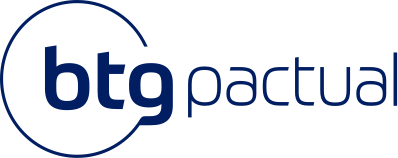

<Table>
  <tr>
    <td><a href= "https://www.btgpactual.com/"></td>
    <td>
      
    </td>
  </tr>
</table>

# Nome do Projeto: <nome do projeto>

## Nome do Grupo: <nome do grupo>

## Integrantes:

- <a href="https://www.linkedin.com/in/username/">Nome</a>
- <a href="https://www.linkedin.com/in/username/">Nome</a>
- <a href="https://www.linkedin.com/in/username/">Nome</a>
- <a href="https://www.linkedin.com/in/username/">Nome</a>
- <a href="https://www.linkedin.com/in/username/">Nome</a>
- <a href="https://www.linkedin.com/in/username/">Nome</a>
- <a href="https://www.linkedin.com/in/username/">Nome</a>
- <a href="https://www.linkedin.com/in/username/">Nome</a>

# Sumário

- [1. Introdução](#1-introdução)
  - [1.1 Termos e Abreviações](#11-termos-e-abreviações)
  - [1.2 Objetivo do Documento](#12-objetivo-do-documento)
- [2. Entendimento do Projeto e do Negócio](#2-entendimento-do-projeto-e-do-negócio)
  - [2.1 Contexto da Indústria do Parceiro](#21-contexto-da-indústria-do-parceiro)
  - [2.2 Problema](#22-problema)
  - [2.3 Visão do Projeto e do Produto](#23-visão-do-projeto-e-do-produto)
  - [2.4 Personas e Jornada do Usuário](#24-personas-e-jornada-do-usuário)
  - [2.5 Modelagem do Fluxo de Negócio](#25-modelagem-do-fluxo-de-negócio)
    - [2.5.1 Cadeia de Valor](#251-cadeia-de-valor)
    - [2.5.2 Fluxo de Negócio Proposto (AS-IS e TO-BE)](#252-fluxo-de-negócio-proposto-as-is-e-to-be)
  - [2.6 Matriz de Risco do Projeto](#26-matriz-de-risco-do-projeto)
  - [2.7 Ideação](#27-ideação)
  - [2.8 Canvas do Projeto](#28-canvas-do-projeto)
- [3. Requisitos do Projeto](#3-requisitos-do-projeto)
  - [3.1 Requisitos Funcionais (RFs)](#31-requisitos-funcionais-rfs)
  - [3.2 Requisitos Não Funcionais (RNFs)](#32-requisitos-não-funcionais-rnfs)
  - [3.3 Correlação RFs e RNFs](#33-correlação-rfs-e-rnfs)
  - [3.4 Casos de Uso](#34-casos-de-uso)
  - [3.5 Casos de Uso x Requisitos Funcionais](#35-casos-de-uso-x-requisitos-funcionais)
- [4. Modelagem de Dados](#4-modelagem-de-dados)
  - [4.1 Especificação da Base de Dados para Modelo de Recomendação](#41-especificação-da-base-de-dados-para-modelo-de-recomendação)
  - [4.2 Modelo Conceitual de Dados](#42-modelo-conceitual-de-dados)
  - [4.3 Modelo Lógico de Dados](#43-modelo-lógico-de-dados)
  - [4.4 Modelo Físico de Dados](#44-modelo-físico-de-dados)
- [5. Solução Técnica (Design)](#5-solução-técnica-design)
  - [5.1 Diagrama de Classes](#51-diagrama-de-classes)
  - [5.2 Diagrama de Componentes da UML](#52-diagrama-de-componentes-da-uml)
  - [5.3 Diagramas de Sequência da UML](#53-diagramas-de-sequência-da-uml)
- [6. Mapeamento Técnico de Infraestrutura e Implantação](#6-mapeamento-técnico-de-infraestrutura-e-implantação)
  - [6.1 Diagrama de Implantação da UML](#61-diagrama-de-implantação-da-uml)
  - [6.2 Justificativa das Escolhas de Implantação](#62-justificativa-das-escolhas-de-implantação)
  - [6.3 Considerações sobre Desempenho e Segurança](#63-considerações-sobre-desempenho-e-segurança)
- [7. Projeto Visual da Solução](#7-projeto-visual-da-solução)
  - [7.1 Desenvolvimento de Wireframes](#71-desenvolvimento-de-wireframes)
  - [7.2 Desenvolvimento de Mockups](#72-desenvolvimento-de-mockups)
  - [7.3 Guia Visual](#73-guia-visual)
- [8. Desenvolvimento do Projeto](#8-desenvolvimento-do-projeto)
  - [8.1 Arquitetura de Codificação e Estrutura de Diretórios](#81-arquitetura-de-codificação-e-estrutura-de-diretórios)
  - [8.2 Modelo de Recomendação](#82-modelo-de-recomendação)
  - [8.3 Desenvolvimento de Features](#83-desenvolvimento-de-features)
    - [8.3.1 Sprint 3](#831-sprint-3)
    - [8.3.2 Sprint 4](#832-sprint-4)
    - [8.3.3 Sprint 5](#833-sprint-5)
  - [8.4 Testes Unitários e de Integração](#84-testes-unitários-e-de-integração)
  - [8.5 Documentações automáticas](#85-documentações-automáticas)
- [9. Planejamento e Execução de Testes](#9-planejamento-e-execução-de-testes)
  - [9.1 Testes Funcionais](#91-testes-funcionais)
    - [9.1.1 Planejamento](#911-planejamento)
    - [9.1.2 Resultados](#912-resultados)
  - [9.2 Testes de RNFs](#92-testes-de-rnfs)
    - [9.2.1 Planejamento](#921-planejamento)
    - [9.2.2 Resultados](#922-resultados)
  - [9.3 Testes de Usabilidade](#93-testes-de-usabilidade)
    - [9.3.1 Planejamento](#931-planejamento)
    - [9.3.2 Resultados](#932-resultados)
- [10. Procedimentos de Implantação](#10-procedimentos-de-implantação)
  - [10.1 Implantação e Configuração do Banco de Dados](#101-implantação-e-configuração-do-banco-de-dados)
  - [10.2 Implantação do Protótipo para uso por equipe de desenvolvimento](#102-implantação-do-protótipo-para-uso-por-equipe-de-desenvolvimento)
- [Referências](#referências)

# 1. Introdução
Este documento apresenta a especificação da solução desenvolvida para a Plataforma Tecnológica do Metrô de São Paulo, no contexto do projeto acadêmico realizado em parceria entre o Instituto de Tecnologia e Liderança (Inteli) e a Companhia do Metropolitano de São Paulo (Metrô).

A proposta consiste no desenvolvimento de um agente inteligente para apoio à Gestão de Portfólio de Projetos (PMO), capaz de utilizar Inteligência Artificial e processamento de linguagem natural para facilitar o acesso às informações estratégicas do portfólio, apoiar consultas em linguagem natural e reduzir atividades operacionais atualmente realizadas de forma manual.

Ao longo deste documento são apresentados o contexto do problema, a visão do produto, os requisitos levantados junto ao parceiro, a arquitetura proposta, a modelagem da solução, os processos de desenvolvimento adotados e os resultados obtidos durante o projeto.

Além de servir como registro técnico do desenvolvimento realizado pela equipe, este documento busca consolidar as principais decisões arquiteturais, funcionais e estratégicas que fundamentam a construção da solução, permitindo sua compreensão, evolução e futura manutenção.

---
## 1.1 Termos e Abreviações
A Tabela 1 apresenta os principais termos e abreviações utilizados ao longo deste documento.

| Termo | Descrição |
|---------|-----------|
| AI | Artificial Intelligence (Inteligência Artificial). |
| Copilot | Assistente de Inteligência Artificial da Microsoft utilizado como interface conversacional da solução. |
| IA | Inteligência Artificial. |
| LLM | Large Language Model, modelo de linguagem utilizado para compreensão e geração de linguagem natural. |
| PLN | Processamento de Linguagem Natural, conjunto de técnicas utilizadas para interpretação das solicitações dos usuários. |
| PMO | Project Management Office (Escritório de Gestão de Projetos). |
| Portfólio | Conjunto de projetos gerenciados pela área de Gestão de Portfólio do Metrô. |
| Projeto | Iniciativa acompanhada pelo PMO, composta por cronograma, TAP, indicadores, documentos e demais artefatos de gestão. |
| TAP | Termo de Abertura do Projeto. |
| Teams | Plataforma Microsoft Teams utilizada como principal interface de interação com o agente. |
| MVP | Minimum Viable Product (Produto Mínimo Viável), correspondente à primeira versão funcional da solução. |
| RAG | Retrieval-Augmented Generation, abordagem utilizada para geração de respostas fundamentadas em bases documentais. |
| SharePoint | Plataforma Microsoft utilizada para armazenamento e organização de documentos corporativos. |
| Power Platform | Conjunto de ferramentas Microsoft utilizado para desenvolvimento da solução, incluindo Power Automate, Copilot Studio e demais componentes do ecossistema. |

---

## 1.2 Objetivo do Documento
Este documento tem como objetivo especificar a solução proposta para o desenvolvimento do Agente Inteligente para Gestão de Portfólio de Projetos do Metrô, consolidando os aspectos estratégicos, funcionais e técnicos necessários para sua compreensão e implementação.

Além de apoiar o desenvolvimento da solução ao longo das diferentes etapas do projeto, este documento também estabelece uma base de referência para validação junto aos representantes do Metrô, registro das decisões tomadas pela equipe e documentação das principais características da plataforma desenvolvida, favorecendo sua evolução e futura manutenção.

---

# 2. Entendimento do Projeto e do Negócio
_conteúdo_

---

## 2.1 Contexto da Indústria do Parceiro

O transporte metroviário desempenha um papel estratégico na mobilidade urbana das grandes metrópoles, sendo responsável pelo deslocamento diário de milhões de passageiros com elevados requisitos de segurança, confiabilidade e eficiência. Além da operação da infraestrutura ferroviária, o setor envolve projetos contínuos de expansão da malha, modernização tecnológica, manutenção e renovação de ativos, acessibilidade e melhoria da experiência dos passageiros. Nesse cenário, destacam-se tendências como a digitalização das operações, o uso crescente de dados e Inteligência Artificial (IA) como apoio à gestão, a automação de processos e a busca por maior integração das informações organizacionais.

Ao mesmo tempo, o setor enfrenta desafios relacionados à complexidade e ao alto custo dos projetos de infraestrutura, à necessidade de modernização contínua dos sistemas, ao gerenciamento de grandes volumes de informações e à coordenação de projetos com diferentes objetivos, prazos e partes interessadas. No contexto de organizações públicas, somam-se ainda requisitos de governança, transparência, prestação de contas e uso eficiente dos recursos públicos. Dessa forma, a capacidade de organizar, consultar e utilizar informações confiáveis sobre projetos torna-se relevante tanto para a eficiência operacional quanto para a tomada de decisões estratégicas.

Inserida nesse setor, a Companhia do Metropolitano de São Paulo (Metrô) é uma empresa pública vinculada ao Governo do Estado de São Paulo e possui papel relevante no sistema de transporte de alta capacidade da Região Metropolitana de São Paulo. A companhia atua na operação de parte da rede metroviária e no planejamento e execução de investimentos estratégicos relacionados à expansão, modernização e melhoria da infraestrutura de transporte. Seu posicionamento não se caracteriza por uma participação de mercado tradicional, mas por sua relevância como operador público e agente de desenvolvimento da infraestrutura metroviária paulista, atendendo diariamente uma parcela significativa da demanda por transporte coletivo da região e administrando projetos de elevada complexidade e impacto social.

Nesse contexto, o Escritório Corporativo de Projetos (PMO) desempenha a função de coordenar e acompanhar o portfólio de projetos da organização, lidando com informações relacionadas a objetivos, cronogramas, riscos, indicadores e documentação técnica. Conforme identificado junto ao parceiro, a quantidade de projetos e a dispersão das informações em diferentes documentos dificultam a localização e a consolidação do conhecimento necessário para consultas e análises. Além disso, experiências anteriores com ferramentas de IA generativa apresentaram limitações relacionadas à confiabilidade das respostas, reforçando a necessidade de uma solução que utilize como referência a documentação oficial do Metrô.

Diante desse cenário, o projeto propõe o desenvolvimento de um agente inteligente baseado em Processamento de Linguagem Natural (PLN) para apoiar o PMO na gestão e consulta das informações do portfólio de projetos. A solução busca permitir consultas rápidas e contextualizadas sobre a documentação disponibilizada, reduzindo o esforço necessário para localizar informações e aumentando a confiabilidade das respostas. Dessa forma, o projeto se alinha às tendências de digitalização e aplicação de IA no setor, ao mesmo tempo em que atende às necessidades específicas de governança, gestão do conhecimento e apoio à tomada de decisão do Metrô de São Paulo.

---

## 2.2 Problema
_conteúdo_

---

## 2.3 Visão do Projeto e do Produto
Este tópico apresenta a visão estratégica do produto proposto, sua proposta de valor e os objetivos que orientam seu desenvolvimento, estabelecendo o alinhamento entre a solução, os desafios identificados pela área de Gestão de Portfólio de Projetos (PMO) do Metrô e as necessidades do negócio. A definição desses elementos busca orientar as decisões arquiteturais, funcionais e de priorização do projeto, delimitando claramente seu escopo, as capacidades esperadas e o valor agregado aos diferentes perfis de usuários.

A proposta surge em um contexto de evolução da plataforma tecnológica utilizada pelo PMO, que já dispõe de ferramentas corporativas para armazenamento, organização e acompanhamento das informações do portfólio, mas ainda depende de atividades manuais para localizar documentos, consolidar informações, interpretar normativos, produzir relatórios e acompanhar o andamento dos projetos. Como consequência, parte significativa do conhecimento institucional permanece distribuída entre diferentes repositórios e depende da experiência dos profissionais para ser acessada de forma eficiente.

Nesse cenário, o produto busca transformar a forma como gestores e colaboradores interagem com esse conjunto de informações, incorporando recursos de Inteligência Artificial capazes de compreender solicitações em linguagem natural, interpretar diferentes intenções de uso e disponibilizar respostas contextualizadas, seguras e fundamentadas nas fontes oficiais da organização.

Mais do que introduzir um novo canal de consulta, a solução propõe uma camada inteligente de apoio à gestão do portfólio, capaz de integrar diferentes fontes de conhecimento, reduzir esforços operacionais, apoiar processos de acompanhamento dos projetos e ampliar a capacidade analítica das equipes responsáveis pela tomada de decisão. Ao mesmo tempo, preserva o ecossistema tecnológico já adotado pela organização, permitindo que a evolução da plataforma ocorra de forma incremental, escalável e alinhada às práticas de governança existentes.

---

### 2.3.1 Visão do Produto

A visão do produto é transformar a interação entre os colaboradores e o portfólio de projetos do Metrô em uma experiência conversacional inteligente, integrada e orientada ao contexto de cada usuário, permitindo que informações estratégicas sejam acessadas por meio de linguagem natural de forma rápida, segura, rastreável e aderente às diretrizes de governança da organização.

Atualmente, embora a gestão do portfólio seja suportada por um conjunto consolidado de ferramentas corporativas, atividades relacionadas ao acompanhamento do avanço dos projetos, consulta a cronogramas, Termos de Abertura do Projeto (TAP), indicadores, documentos normativos e demais registros institucionais ainda exigem navegação entre diferentes plataformas, buscas manuais e interpretação de informações distribuídas em múltiplas fontes. Como consequência, essas atividades tornam-se mais demoradas, suscetíveis a inconsistências e dependentes do conhecimento especializado das equipes.

O produto propõe a criação de um agente inteligente integrado ao ambiente corporativo da organização, atuando como principal ponto de interação entre os usuários e o ecossistema de informações do portfólio. Por meio dessa interface conversacional, gestores e equipes poderão consultar informações dos projetos, esclarecer dúvidas sobre processos e normativos, localizar documentos, acompanhar cronogramas e obter respostas contextualizadas utilizando linguagem natural, reduzindo significativamente a necessidade de navegar entre diferentes sistemas ou conhecer previamente onde cada informação está armazenada.

Conceitualmente, a solução funciona como uma camada de inteligência sobre os ativos informacionais já existentes, estruturando, relacionando e disponibilizando conhecimentos provenientes de diferentes fontes de maneira unificada. Como núcleo da solução, será desenvolvido um mecanismo responsável por compreender a intenção das solicitações, interpretar o contexto das interações e direcionar automaticamente cada consulta aos fluxos de negócio mais adequados.

---

### 2.3.2 Proposta de Valor

A proposta de valor do produto fundamenta-se na utilização de Inteligência Artificial para transformar a maneira como gestores e equipes acessam, interpretam e utilizam as informações do portfólio de projetos, reduzindo barreiras operacionais e ampliando a capacidade de tomada de decisão baseada em dados.

O produto entrega valor ao:

- Centralizar o acesso às informações do portfólio em uma única interface conversacional integrada ao ambiente corporativo;
- Reduzir o tempo necessário para localizar documentos, cronogramas, indicadores, normativos e demais informações relevantes para a gestão dos projetos;
- Diminuir a dependência de consultas distribuídas entre diferentes plataformas e documentos institucionais;
- Facilitar a interpretação de processos e normativos por meio de respostas contextualizadas em linguagem natural;
- Disponibilizar informações fundamentadas em fontes oficiais, promovendo maior confiabilidade e rastreabilidade das respostas;
- Adaptar automaticamente o nível de detalhamento das informações conforme o perfil, as responsabilidades e as permissões de cada usuário;
- Apoiar gestores e equipes na obtenção rápida de informações estratégicas para acompanhamento do portfólio e tomada de decisão;
- Favorecer a padronização das consultas, reduzindo a dependência do conhecimento tácito das equipes;
- Estabelecer uma base evolutiva preparada para incorporar novas funcionalidades inteligentes conforme a maturidade da plataforma.

Mais do que responder perguntas, o agente busca atuar como uma camada inteligente de apoio à gestão do portfólio, reduzindo esforços operacionais, aumentando a disponibilidade das informações e contribuindo para uma gestão mais eficiente, padronizada e orientada à tomada de decisão.

### 2.3.3 O que o Produto Faz e Não Faz

#### O que o Produto Faz

O produto implementa um agente inteligente de apoio à Gestão de Portfólio de Projetos do Metrô, concebido para centralizar o acesso às informações institucionais e apoiar gestores e equipes por meio de uma interface conversacional integrada ao ecossistema Microsoft.

Ao invés de substituir as plataformas atualmente utilizadas pela organização, a solução atua como uma camada inteligente de interação, permitindo que os usuários acessem informações, consultem documentos e obtenham análises por meio de linguagem natural, reduzindo a necessidade de navegar entre diferentes sistemas corporativos.

#### O que o Produto Não Faz

Embora proponha uma evolução significativa na forma como os usuários interagem com o portfólio de projetos, a solução possui um escopo claramente delimitado para esta etapa de desenvolvimento.

O produto não tem como objetivo:

- Substituir as plataformas corporativas atualmente utilizadas para gerenciamento do portfólio;
- Alterar os processos de governança, metodologias ou fluxos organizacionais adotados pelo PMO;
- Executar decisões de negócio ou substituir a atuação dos gestores responsáveis pelos projetos;
- Disponibilizar informações incompatíveis com as permissões de acesso definidas para cada perfil de usuário;
- Integrar-se, nesta etapa, a sistemas externos que não façam parte do ambiente tecnológico disponibilizado pela organização;
- Realizar implantação definitiva em ambiente produtivo, restringindo-se ao desenvolvimento e validação de uma prova de conceito no contexto acadêmico.

Da mesma forma, funcionalidades que envolvam automações de maior complexidade, ampliação das integrações entre processos corporativos ou expansão do escopo funcional do agente serão implementadas de forma incremental, respeitando o roadmap do produto e as prioridades definidas em conjunto com o PMO.

### 2.3.4 Objetivos Estratégicos e Mensuráveis

O sucesso do produto será acompanhado por indicadores relacionados à eficiência operacional, qualidade das informações disponibilizadas, experiência dos usuários e capacidade de apoiar a gestão do portfólio de projetos.

Os objetivos apresentados representam os resultados estratégicos esperados para a solução e servirão como referência para avaliação de sua contribuição à evolução da plataforma tecnológica do PMO.

#### Eficiência Operacional

- Reduzir em **50%** o tempo médio necessário para localizar informações relacionadas aos projetos do portfólio;
- Reduzir em **40%** o número de consultas manuais realizadas em diferentes plataformas para obtenção de uma mesma informação;
- Diminuir o esforço operacional associado à busca, consolidação e interpretação de documentos institucionais;
- Reduzir o tempo necessário para elaboração de consultas recorrentes realizadas pelo PMO.

#### Qualidade da Informação

- Disponibilizar respostas fundamentadas em fontes oficiais para **100%** das consultas suportadas pelo agente;
- Garantir rastreabilidade das respostas por meio da apresentação das respectivas referências documentais;
- Promover maior padronização das informações disponibilizadas aos diferentes perfis de usuários;
- Reduzir inconsistências decorrentes da consulta manual a documentos distribuídos entre diferentes repositórios.

#### Apoio à Gestão do Portfólio

- Facilitar o acompanhamento do avanço dos projetos por meio de consultas rápidas e contextualizadas;
- Disponibilizar acesso simplificado a cronogramas, TAPs, indicadores, documentos normativos e demais informações estratégicas;
- Disponibilizar respostas compatíveis com o nível de responsabilidade e as permissões de cada perfil de usuário;
- Apoiar gestores na identificação de informações relevantes para acompanhamento dos projetos e tomada de decisão.

#### Experiência dos Usuários

- Diminuir a dependência do conhecimento tácito das equipes para localização de documentos e interpretação de processos;
- Aumentar a autonomia dos usuários na obtenção de informações relacionadas ao portfólio;
- Favorecer maior adoção dos recursos de Inteligência Artificial no contexto da gestão de projetos.

#### Evolução da Plataforma

- Estabelecer uma arquitetura escalável preparada para incorporar novas capacidades inteligentes de forma incremental;
- Facilitar a manutenção da solução utilizando recursos aderentes ao ecossistema Microsoft e acessíveis a equipes com perfil predominantemente funcional;
- Promover uma solução sustentável, preparada para acompanhar a evolução das necessidades da Gestão de Portfólio de Projetos ao longo do tempo.

---

### 2.3.5 Ownership e Accountability Estratégico

O desenvolvimento da solução envolve responsabilidades compartilhadas entre os representantes do Metrô e a equipe responsável pelo projeto, garantindo que as decisões técnicas permaneçam alinhadas às necessidades de negócio e às diretrizes institucionais da organização.

**Representantes do Metrô**

Os representantes da organização exercem o papel de patrocinadores e especialistas de negócio, sendo responsáveis por:

- Disponibilizar informações, documentos e dados necessários ao desenvolvimento da solução;
- Avaliar a aderência das funcionalidades desenvolvidas aos processos organizacionais;

**Equipe do Projeto**

A equipe de desenvolvimento é responsável por:

- Definir a arquitetura da solução;
- Projetar os componentes responsáveis pela interpretação das solicitações e pelo processamento das informações;
- Implementar as funcionalidades previstas para o MVP;
- Conduzir testes técnicos e validações funcionais;
- Documentar decisões arquiteturais, funcionais e técnicas;
- Propor evoluções que agreguem valor ao produto, respeitando as prioridades estabelecidas pelos representantes do Metrô.

---

A visão e os objetivos apresentados consolidam o direcionamento estratégico da solução proposta, evidenciando seu papel como uma camada inteligente de apoio à gestão do portfólio de projetos. Mais do que automatizar consultas ou simplificar o acesso às informações, o produto busca estabelecer uma nova forma de interação entre usuários, processos e conhecimento organizacional, permitindo que gestores e equipes obtenham informações confiáveis, contextualizadas e alinhadas às suas responsabilidades.

Ao preservar o ecossistema tecnológico já adotado pelo Metrô e incorporar recursos de Inteligência Artificial de maneira integrada e escalável, a solução contribui para fortalecer a governança das informações, reduzir esforços operacionais e ampliar a capacidade analítica do PMO. 

## 2.4 Personas e Jornada do Usuário
_conteúdo_

---

## 2.5 Modelagem do Fluxo de Negócio

A modelagem do fluxo de negócio tem como objetivo representar o processo de elaboração do Mapa de Benefícios, permitindo compreender o funcionamento atual da atividade e as mudanças propostas com a utilização do agente inteligente. Para isso, foram utilizados três artefatos complementares: a Cadeia de Valor, que apresenta uma visão consolidada do processo atual e futuro, e os diagramas BPMN dos fluxos AS-IS e TO-BE.

O modelo AS-IS representa o processo atualmente realizado, caracterizado principalmente pela execução manual das atividades de levantamento, definição e preenchimento das informações. Já o modelo TO-BE representa o processo proposto pelo projeto, no qual o agente inteligente passa a apoiar o responsável pelo projeto na coleta, organização e geração das informações necessárias para elaboração do Mapa de Benefícios.

A modelagem também evidencia a mudança no papel do responsável pelo projeto. No cenário atual, grande parte do esforço está concentrada na execução operacional do processo, enquanto no cenário futuro o agente inteligente assume parte dessas atividades, permitindo que o responsável concentre sua atuação na interação com o sistema, revisão e validação do resultado.

Dessa forma, o fluxo proposto não busca retirar a participação humana do processo, mas utilizar a inteligência artificial como mecanismo de apoio à elaboração do artefato, mantendo a validação final sob responsabilidade do usuário.

---

## 2.5.1 Cadeia de Valor

A cadeia de valor evidencia como o processo de elaboração do mapa de benefícios evolui entre o cenário atual **(AS-IS)** e o cenário futuro **(TO-BE)**. No processo atual, grande parte das informações necessárias para construir o mapa é obtida manualmente, exigindo consulta a múltiplos documentos, interpretação do conhecimento tácito do gestor e preenchimento manual do artefato. No processo futuro, essas atividades continuam sendo responsabilidade do líder do projeto, porém passam a ser apoiadas por um agente inteligente capaz de consultar a documentação corporativa, recuperar informações relevantes, sugerir relações entre entregas, resultados e benefícios e gerar automaticamente o mapa para validação final do usuário.

 

No cenário **AS-IS**, o processo é composto pelas etapas de **Identificação do Projeto**, **Definição das Entregas**, **Identificação dos Resultados**, **Definição dos Benefícios**, **Alinhamento Estratégico**, **Preenchimento Manual do Mapa** e **Revisão e Armazenamento**.

Nesse cenário, o processo depende principalmente da atuação manual do responsável pelo projeto. A identificação das informações necessárias ocorre por meio da consulta e análise de diferentes fontes, exigindo que o responsável localize, interprete e organize os dados relevantes para a elaboração do mapa. A definição dos benefícios e o alinhamento estratégico também dependem do conhecimento e da análise do responsável. Ao final, o Mapa de Benefícios é preenchido manualmente e posteriormente revisado e armazenado, sem o mesmo nível de padronização proposto no cenário futuro.

No cenário **TO-BE**, o objetivo do processo permanece o mesmo: elaborar um **Mapa de Benefícios relacionado a um projeto**. A principal mudança está na forma como as informações são obtidas, organizadas e transformadas no artefato final. O agente inteligente passa a atuar como apoio ao responsável pelo projeto, principalmente na **consulta da documentação corporativa, recuperação de informações relevantes, geração de sugestões e estruturação do mapa**.

A primeira etapa passa a ser a **Identificação do Projeto com apoio documental e do agente**, permitindo que as informações necessárias para contextualizar o mapa sejam obtidas com auxílio da base corporativa. Em seguida, a **Definição das Entregas** passa a contar com um levantamento assistido, reduzindo a necessidade de realizar manualmente a busca e organização das informações.

Na etapa de **Identificação dos Resultados**, o agente apoia a consulta à base corporativa para localizar informações relacionadas ao projeto e aos seus resultados esperados. A partir dessas informações, também são apresentadas **sugestões de benefícios baseadas nos documentos consultados**, auxiliando o responsável na identificação das relações entre resultados e benefícios.

O **Alinhamento Estratégico** também passa a receber apoio do agente por meio da sugestão de objetivos estratégicos relacionados às informações levantadas. Entretanto, essas sugestões possuem caráter de apoio e não substituem a análise ou a decisão do responsável pelo projeto.

A principal transformação ocorre na etapa de **Geração Automática do Mapa**, que substitui o preenchimento manual do artefato pela geração estruturada do Mapa de Benefícios a partir das informações coletadas e das relações identificadas durante o processo. Dessa forma, o agente reduz o esforço operacional necessário para transformar as informações levantadas em um documento estruturado.

Por fim, a etapa de **Revisão e Armazenamento** do cenário atual é transformada em uma etapa de **Validação Padronizada** no cenário futuro. O responsável continua realizando a conferência e aprovação do conteúdo gerado, porém o processo passa a estabelecer uma forma mais estruturada e padronizada para a validação e publicação do documento.

Dessa forma, a Cadeia de Valor demonstra que o agente inteligente **não tem como objetivo criar ou gerenciar projetos**, mas apoiar o processo de elaboração do Mapa de Benefícios. Seu impacto está concentrado na redução do esforço manual necessário para **consultar documentos, localizar informações, organizar conhecimento, gerar sugestões e estruturar o artefato final**. A responsabilidade pelas decisões e pela validação das informações permanece com o responsável pelo projeto.

A comparação evidenciada na imagem da cadeia, mostra que a proposta **não altera a finalidade do processo**, que continua sendo a elaboração de um Mapa de Benefícios válido e relacionado ao projeto analisado. A transformação ocorre principalmente na maneira como o conhecimento necessário é obtido e utilizado: atividades que anteriormente dependiam de buscas e organização manuais passam a contar com o apoio do agente inteligente, enquanto a geração e a validação do artefato tornam-se mais estruturadas e padronizadas.

Assim, a Cadeia de Valor complementa os fluxos **AS-IS** e **TO-BE**, demonstrando de forma visual e operacional **onde o agente agrega valor ao processo e quais atividades são impactadas pela sua utilização**.

---

## 2.5.2 Fluxo de Negócio Proposto (AS-IS e TO-BE)

Os fluxos de negócio apresentados a seguir detalham operacionalmente o processo de elaboração do Mapa de Benefícios nos cenários **AS-IS** e **TO-BE**. Enquanto a Cadeia de Valor apresentada na seção anterior evidencia as principais transformações entre os cenários, os diagramas BPMN detalham a sequência das atividades, os responsáveis pela execução, as consultas ao repositório corporativo e os pontos de decisão existentes em cada fluxo.

## 2.6 Matriz de Risco do Projeto
_conteúdo_

## 2.7 Ideação
_conteúdo_
Obs.: Seção dedicada a discussão sobre ideias e priorização de features.

## 2.8 Canvas do Projeto
_conteúdo_

# 3. Requisitos do Projeto
_conteúdo_

## 3.1 Requisitos Funcionais (RFs)
_conteúdo_ 

## 3.2 Requisitos Não Funcionais (RNFs)
_conteúdo_

## 3.3 Correlação RFs e RNFs
_conteúdo_

## 3.4 Casos de Uso
_conteúdo_

## 3.5 Casos de Uso x Requisitos Funcionais
_conteúdo_

# 4. Modelagem de Dados
_conteúdo_

## 4.1 Especificação da Base de Dados para Modelo de Recomendação
_conteúdo_
Obs.: Insira aqui informações sobre a construção do artefato da Sprint 1. 

## 4.2 Modelo Conceitual de Dados
_conteúdo_

## 4.3 Modelo Lógico de Dados
_conteúdo_

## 4.4 Modelo Físico de Dados
_conteúdo_

**Nota:** Insira uma explicação e direcionamento para o readme.md da pasta database.

# 5. Solução Técnica (Design)
_conteúdo_

## 5.1 Diagrama de Classes
_conteúdo_

## 5.2 Diagrama de Componentes da UML
_conteúdo_

## 5.3 Diagramas de Sequência da UML
_conteúdo_

# 6. Mapeamento Técnico de Infraestrutura e Implantação
_conteúdo_

## 6.1 Diagrama de Implantação da UML
_conteúdo_

## 6.2 Justificativa das Escolhas de Implantação
_conteúdo_

## 6.3 Considerações sobre Desempenho e Segurança
_conteúdo_

# 7. Projeto Visual da Solução
_conteúdo_

## 7.1 Desenvolvimento de Wireframes
_conteúdo_

## 7.2 Desenvolvimento de Mockups
_conteúdo_

## 7.3 Guia Visual
_conteúdo_

# 8. Desenvolvimento do Projeto
_conteúdo_

## 8.1 Arquitetura de Codificação e Estrutura de Diretórios
_conteúdo_

## 8.2 Modelo de Recomendação
_conteúdo_

## 8.3 Desenvolvimento de Features
_conteúdo_

**Nota:** Insira uma explicação de entregas em cada Sprint.

## 8.3.1 Sprint 3
_conteúdo_

## 8.3.2 Sprint 4
_conteúdo_

## 8.3.3 Sprint 5
_conteúdo_

## 8.4 Testes Unitários e de Integração
_conteúdo_
Obs.: Insira informações sobre estratégias para realização dos testes

## 8.5 Documentações automáticas
_conteúdo_
Obs.: Insira informações sobre quais frameworks foram usados e como acessar.

# 9. Planejamento e Execução de Testes
_conteúdo_

## 9.1 Testes Funcionais
_conteúdo_

## 9.1.1 Planejamento
_conteúdo_

## 9.1.2 Resultados
_conteúdo_

## 9.2 Testes de RNFs
_conteúdo_

## 9.2.1 Planejamento
_conteúdo_

## 9.2.2 Resultados
_conteúdo_

## 9.3 Testes de Usabilidade
_conteúdo_

## 9.3.1 Planejamento
_conteúdo_

## 9.3.2 Resultados
_conteúdo_

# 10. Procedimentos de Implantação
_conteúdo_

## 10.1 Implantação e Configuração do Banco de Dados
_conteúdo_

## 10.2 Implantação do Protótipo para uso por equipe de desenvolvimento
_conteúdo_

# Referências
_conteúdo_

