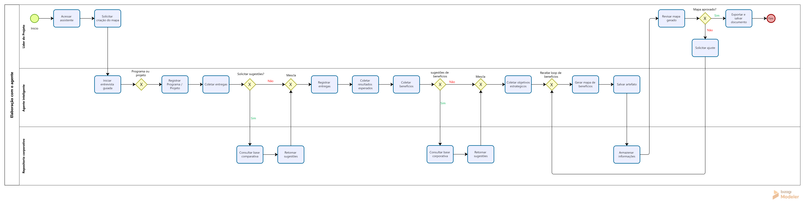
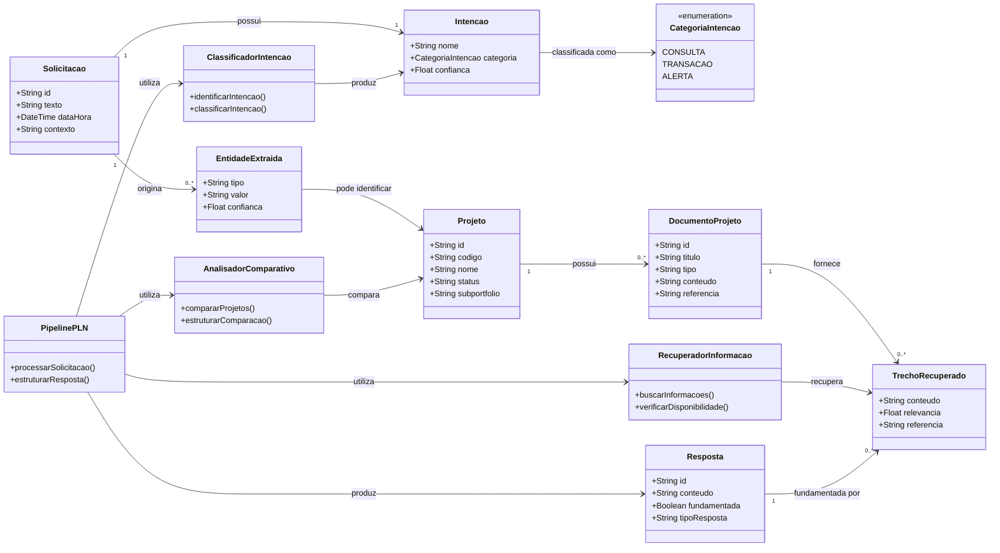
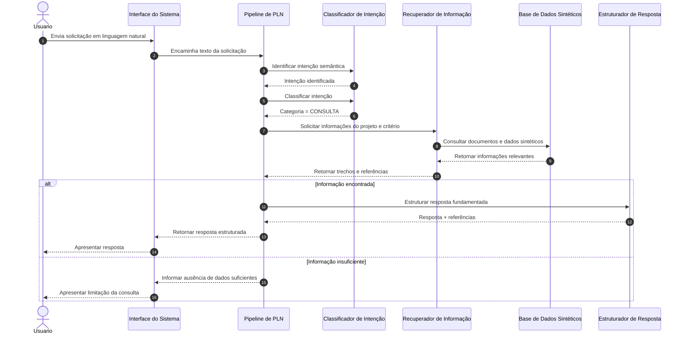
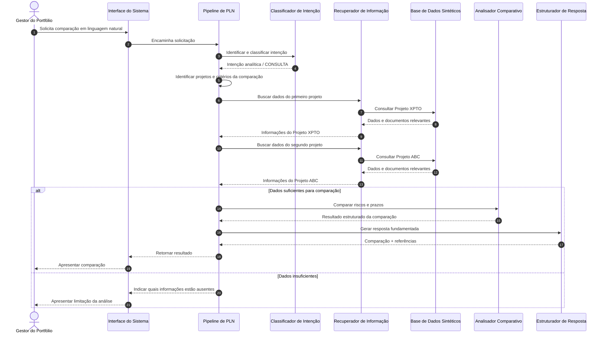
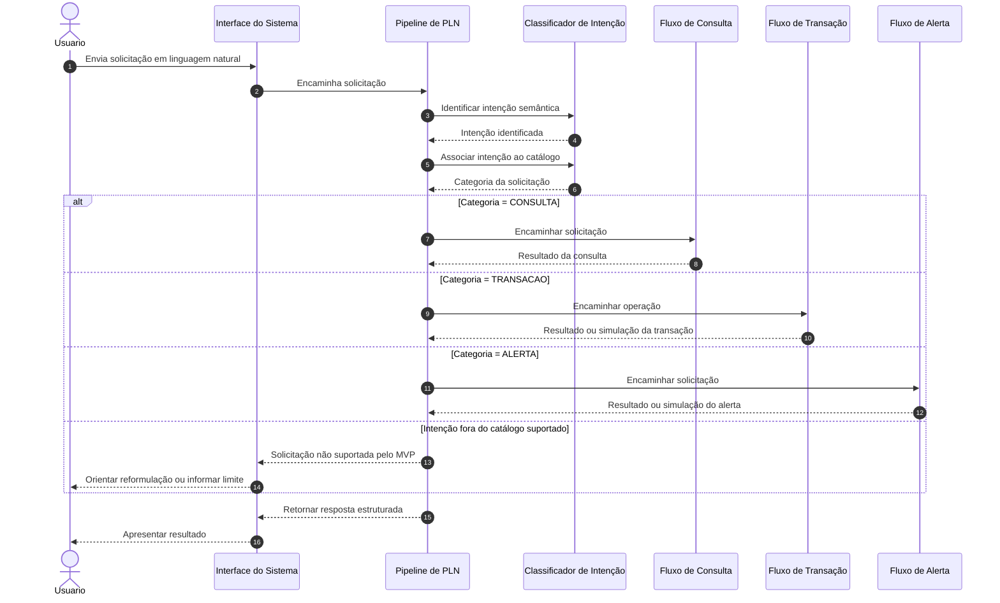

<table>
  <tr>
    <td><a href="https://www.metro.sp.gov.br/"></a></td>
    <td><a href="https://www.inteli.edu.br/"></a></td>
  </tr>
</table>

# Nome do Projeto: <nome do projeto>

## Nome do grupo: Oneshot

## Integrantes:

- <a href="https://www.linkedin.com/in/ntsfelipe/">Felipe Neves</a>
- <a href="https://www.linkedin.com/in/henrique-rodrigues-diniz-b7b011319/">Henrique Diniz</a>
- <a href="https://www.linkedin.com/in/jaimeandradedealmeida/">Jaime Almeida</a>
- <a href="https://www.linkedin.com/in/leonardoramosvieira">Leonardo Ramos</a>
- <a href="https://www.linkedin.com/in/pedro-uchoaa/">Pedro Uchoa</a>
- <a href="https://www.linkedin.com/in/wendel-feitosa-975bb1346/">Wendel Feitosa</a>

# Sumário

- [1. Introdução](#1-introdução)
  - [1.1 Termos e Abreviações](#11-termos-e-abreviações)
  - [1.2 Objetivo do Documento](#12-objetivo-do-documento)
- [2. Entendimento do Projeto e do Negócio](#2-entendimento-do-projeto-e-do-negócio)
  - [2.1 Contexto da Indústria do Parceiro](#21-contexto-da-indústria-do-parceiro)
  - [2.2 Problema](#22-problema)
  - [2.3 Análise SWOT](#23-análise-swot)
    - [2.3.1 Forças](#231-forças)
    - [2.3.2 Fraquezas](#232-fraquezas)
    - [2.3.3 Oportunidades](#233-oportunidades)
    - [2.3.4 Ameaças](#234-ameaças)
  - [2.4 Visão do Projeto e do Produto](#24-visão-do-projeto-e-do-produto)
  - [2.5 Personas e Jornada do Usuário](#25-personas-e-jornada-do-usuário)
  - [2.6 Modelagem do Fluxo de Negócio](#26-modelagem-do-fluxo-de-negócio)
    - [2.6.1 Cadeia de Valor](#261-cadeia-de-valor)
    - [2.6.2 Fluxo de Negócio Proposto (AS-IS e TO-BE)](#262-fluxo-de-negócio-proposto-as-is-e-to-be)
  - [2.7 Matriz de Risco do Projeto](#27-matriz-de-risco-do-projeto)
  - [2.8 Ideação](#28-ideação)
  - [2.9 Canvas de Proposta de Valor](#29-canvas-de-proposta-de-valor)
  - [2.10 Business Drivers](#210-business-drivers)
- [3. Requisitos do Projeto](#3-requisitos-do-projeto)
  - [3.1 Requisitos Funcionais (RFs)](#31-requisitos-funcionais-rfs)
  - [3.2 Requisitos Não Funcionais (RNFs)](#32-requisitos-não-funcionais-rnfs)
    - [3.2.1 RNFs descritos como histórias de usuário](#321-rnfs-descritos-como-histórias-de-usuário)
  - [3.3 Visão Inicial sobre a Solução Técnica de Engenharia](#33-visão-inicial-sobre-a-solução-técnica-de-engenharia)
  - [3.4 Visão Inicial sobre Tecnologias e Ferramentas](#34-visão-inicial-sobre-tecnologias-e-ferramentas)
  - [3.5 Correlação RFs e RNFs](#35-correlação-rfs-e-rnfs)
  - [3.6 Casos de Uso](#36-casos-de-uso)
  - [3.7 Casos de Uso x Requisitos Funcionais](#37-casos-de-uso-x-requisitos-funcionais)
- [4. Modelagem de Dados](#4-modelagem-de-dados)
  - [4.1 Especificação da Base de Dados para Modelo de Recomendação](#41-especificação-da-base-de-dados-para-modelo-de-recomendação)
  - [4.2 Modelo Conceitual de Dados](#42-modelo-conceitual-de-dados)
  - [4.3 Modelo Lógico de Dados](#43-modelo-lógico-de-dados)
  - [4.4 Modelo Físico de Dados](#44-modelo-físico-de-dados)
- [5. Solução Técnica (Design)](#5-solução-técnica-design)
  - [5.1 Diagrama de Classes](#51-diagrama-de-classes)
  - [5.2 Diagrama de Componentes da UML](#52-diagrama-de-componentes-da-uml)
  - [5.3 Diagramas de Sequência da UML](#53-diagramas-de-sequência-da-uml)
- [6. Mapeamento Técnico de Infraestrutura e Implantação](#6-mapeamento-técnico-de-infraestrutura-e-implantação)
  - [6.1 Diagrama de Implantação da UML](#61-diagrama-de-implantação-da-uml)
  - [6.2 Justificativa das Escolhas de Implantação](#62-justificativa-das-escolhas-de-implantação)
  - [6.3 Considerações sobre Desempenho e Segurança](#63-considerações-sobre-desempenho-e-segurança)
- [7. Projeto Visual da Solução](#7-projeto-visual-da-solução)
  - [7.1 Desenvolvimento de Wireframes](#71-desenvolvimento-de-wireframes)
  - [7.2 Desenvolvimento de Mockups](#72-desenvolvimento-de-mockups)
  - [7.3 Guia Visual](#73-guia-visual)
- [8. Desenvolvimento do Projeto](#8-desenvolvimento-do-projeto)
  - [8.1 Arquitetura de Codificação e Estrutura de Diretórios](#81-arquitetura-de-codificação-e-estrutura-de-diretórios)
  - [8.2 Modelo de Recomendação](#82-modelo-de-recomendação)
  - [8.3 Desenvolvimento de Features](#83-desenvolvimento-de-features)
    - [8.3.1 Sprint 3](#831-sprint-3)
    - [8.3.2 Sprint 4](#832-sprint-4)
    - [8.3.3 Sprint 5](#833-sprint-5)
  - [8.4 Testes Unitários e de Integração](#84-testes-unitários-e-de-integração)
  - [8.5 Documentações automáticas](#85-documentações-automáticas)
- [9. Planejamento e Execução de Testes](#9-planejamento-e-execução-de-testes)
  - [9.1 Testes Funcionais](#91-testes-funcionais)
    - [9.1.1 Planejamento](#911-planejamento)
    - [9.1.2 Resultados](#912-resultados)
  - [9.2 Testes de RNFs](#92-testes-de-rnfs)
    - [9.2.1 Planejamento](#921-planejamento)
    - [9.2.2 Resultados](#922-resultados)
  - [9.3 Testes de Usabilidade](#93-testes-de-usabilidade)
    - [9.3.1 Planejamento](#931-planejamento)
    - [9.3.2 Resultados](#932-resultados)
- [10. Procedimentos de Implantação](#10-procedimentos-de-implantação)
  - [10.1 Implantação e Configuração do Banco de Dados](#101-implantação-e-configuração-do-banco-de-dados)
  - [10.2 Implantação do Protótipo para uso por equipe de desenvolvimento](#102-implantação-do-protótipo-para-uso-por-equipe-de-desenvolvimento)
- [Referências](#referências)


# 1. Introdução
Este documento apresenta a especificação da solução desenvolvida para a Plataforma Tecnológica do Metrô de São Paulo, no contexto do projeto acadêmico realizado em parceria entre o Instituto de Tecnologia e Liderança (Inteli) e a Companhia do Metropolitano de São Paulo (Metrô).

A proposta consiste no desenvolvimento de um agente inteligente para apoio à Gestão de Portfólio de Projetos (PMO), capaz de utilizar Inteligência Artificial e processamento de linguagem natural para facilitar o acesso às informações estratégicas do portfólio, apoiar consultas em linguagem natural e reduzir atividades operacionais atualmente realizadas de forma manual.

Ao longo deste documento são apresentados o contexto do problema, a visão do produto, os requisitos levantados junto ao parceiro, a arquitetura proposta, a modelagem da solução, os processos de desenvolvimento adotados e os resultados obtidos durante o projeto.

Além de servir como registro técnico do desenvolvimento realizado pela equipe, este documento busca consolidar as principais decisões arquiteturais, funcionais e estratégicas que fundamentam a construção da solução, permitindo sua compreensão, evolução e futura manutenção.

---
## 1.1 Termos e Abreviações
A Tabela 1 apresenta os principais termos e abreviações utilizados ao longo deste documento.

| Termo | Descrição |
|---------|-----------|
| AI | Artificial Intelligence (Inteligência Artificial). |
| Copilot | Assistente de Inteligência Artificial da Microsoft utilizado como interface conversacional da solução. |
| IA | Inteligência Artificial. |
| LLM | Large Language Model, modelo de linguagem utilizado para compreensão e geração de linguagem natural. |
| PLN | Processamento de Linguagem Natural, conjunto de técnicas utilizadas para interpretação das solicitações dos usuários. |
| PMO | Project Management Office (Escritório de Gestão de Projetos). |
| Portfólio | Conjunto de projetos gerenciados pela área de Gestão de Portfólio do Metrô. |
| Projeto | Iniciativa acompanhada pelo PMO, composta por cronograma, TAP, indicadores, documentos e demais artefatos de gestão. |
| TAP | Termo de Abertura do Projeto. |
| TAPI | Termo de Abertura do Projeto Inteli, documento que formaliza o escopo, as restrições e as premissas acordadas entre o Metrô e o Inteli. |
| GTI | Gerência de Tecnologia da Informação do Metrô, responsável pelo provisionamento e homologação dos recursos tecnológicos. |
| NOR-00-223 | Normativo interno do Metrô que define a Gestão do Portfólio Organizacional. |
| Subportfólio | Categoria de agrupamento dos projetos e programas do portfólio organizacional. |
| Teams | Plataforma Microsoft Teams utilizada como principal interface de interação com o agente. |
| MVP | Minimum Viable Product (Produto Mínimo Viável), correspondente à primeira versão funcional da solução. |
| RAG | Retrieval-Augmented Generation, abordagem utilizada para geração de respostas fundamentadas em bases documentais. |
| SharePoint | Plataforma Microsoft utilizada para armazenamento e organização de documentos corporativos. |
| Power Platform | Conjunto de ferramentas Microsoft utilizado para desenvolvimento da solução, incluindo Power Automate, Copilot Studio e demais componentes do ecossistema. |

---

## 1.2 Objetivo do Documento
Este documento tem como objetivo especificar a solução proposta para o desenvolvimento do Agente Inteligente para Gestão de Portfólio de Projetos do Metrô, consolidando os aspectos estratégicos, funcionais e técnicos necessários para sua compreensão e implementação.

Além de apoiar o desenvolvimento da solução ao longo das diferentes etapas do projeto, este documento também estabelece uma base de referência para validação junto aos representantes do Metrô, registro das decisões tomadas pela equipe e documentação das principais características da plataforma desenvolvida, favorecendo sua evolução e futura manutenção.

---

# 2. Entendimento do Projeto e do Negócio
_conteúdo_

---

## 2.1 Contexto da Indústria do Parceiro

O transporte metroviário desempenha um papel estratégico na mobilidade urbana das grandes metrópoles, sendo responsável pelo deslocamento diário de milhões de passageiros com elevados requisitos de segurança, confiabilidade e eficiência. Além da operação da infraestrutura ferroviária, o setor envolve projetos contínuos de expansão da malha, modernização tecnológica, manutenção e renovação de ativos, acessibilidade e melhoria da experiência dos passageiros. Nesse cenário, destacam-se tendências como a digitalização das operações, o uso crescente de dados e Inteligência Artificial (IA) como apoio à gestão, a automação de processos e a busca por maior integração das informações organizacionais.

Ao mesmo tempo, o setor enfrenta desafios relacionados à complexidade e ao alto custo dos projetos de infraestrutura, à necessidade de modernização contínua dos sistemas, ao gerenciamento de grandes volumes de informações e à coordenação de projetos com diferentes objetivos, prazos e partes interessadas. No contexto de organizações públicas, somam-se ainda requisitos de governança, transparência, prestação de contas e uso eficiente dos recursos públicos. Dessa forma, a capacidade de organizar, consultar e utilizar informações confiáveis sobre projetos torna-se relevante tanto para a eficiência operacional quanto para a tomada de decisões estratégicas.

Inserida nesse setor, a Companhia do Metropolitano de São Paulo (Metrô) é uma empresa pública vinculada ao Governo do Estado de São Paulo e possui papel relevante no sistema de transporte de alta capacidade da Região Metropolitana de São Paulo. A companhia atua na operação de parte da rede metroviária e no planejamento e execução de investimentos estratégicos relacionados à expansão, modernização e melhoria da infraestrutura de transporte. Seu posicionamento não se caracteriza por uma participação de mercado tradicional, mas por sua relevância como operador público e agente de desenvolvimento da infraestrutura metroviária paulista, atendendo diariamente uma parcela significativa da demanda por transporte coletivo da região e administrando projetos de elevada complexidade e impacto social.

Nesse contexto, o Escritório Corporativo de Projetos (PMO) desempenha a função de coordenar e acompanhar o portfólio de projetos da organização, lidando com informações relacionadas a objetivos, cronogramas, riscos, indicadores e documentação técnica. Conforme identificado junto ao parceiro, a quantidade de projetos e a dispersão das informações em diferentes documentos dificultam a localização e a consolidação do conhecimento necessário para consultas e análises. Além disso, experiências anteriores com ferramentas de IA generativa apresentaram limitações relacionadas à confiabilidade das respostas, reforçando a necessidade de uma solução que utilize como referência a documentação oficial do Metrô.

Diante desse cenário, o projeto propõe o desenvolvimento de um agente inteligente baseado em Processamento de Linguagem Natural (PLN) para apoiar o PMO na gestão e consulta das informações do portfólio de projetos. A solução busca permitir consultas rápidas e contextualizadas sobre a documentação disponibilizada, reduzindo o esforço necessário para localizar informações e aumentando a confiabilidade das respostas. Dessa forma, o projeto se alinha às tendências de digitalização e aplicação de IA no setor, ao mesmo tempo em que atende às necessidades específicas de governança, gestão do conhecimento e apoio à tomada de decisão do Metrô de São Paulo.

---


## 2.2 Problema

O Escritório Corporativo de Projetos (PMO) do Metrô de São Paulo é responsável por estabelecer e gerir a governança de estratégia, portfólio, programas, projetos e indicadores estratégicos da companhia, acompanhando iniciativas de expansão da malha, modernização tecnológica, manutenção de ativos e melhoria da experiência dos passageiros. As informações necessárias a esse acompanhamento — Termos de Abertura do Projeto (TAP), cronogramas, mapas de benefícios, entregas e marcos, riscos, mudanças, indicadores e normativos institucionais — encontram-se distribuídas entre o SharePoint, listas corporativas, relatórios do Power BI e documentos produzidos em Word, Excel e PowerPoint. Atualmente, a localização, a interpretação e a consolidação dessas informações ocorrem de forma predominantemente manual, sem uma camada unificada de consulta que relacione as diferentes fontes.

A ausência dessa camada faz com que responder a perguntas rotineiras de gestão — qual o avanço de um projeto, qual o prazo vigente, quais riscos estão em aberto, o que determina um normativo específico — exija navegação entre múltiplas plataformas e conhecimento prévio sobre onde cada informação está armazenada. Como consequência, atividades como a elaboração dos balanços mensais, o acompanhamento do andamento dos projetos e a consolidação dos relatórios de partida e de encerramento consomem parte significativa do tempo da equipe do PMO em tarefas administrativas de busca e compilação, reduzindo a capacidade de atuação analítica e estratégica da área e retardando a resposta às demandas de gestão.

Além da perda de eficiência, a consulta manual a fontes dispersas introduz riscos à confiabilidade da informação. Documentos com versões distintas, dados desatualizados e interpretações divergentes de um mesmo normativo podem gerar inconsistências entre os registros consultados e os efetivamente vigentes, comprometendo a rastreabilidade das informações utilizadas nas decisões. Conforme identificado junto ao parceiro, experiências anteriores com ferramentas de Inteligência Artificial generativa apresentaram limitações justamente nesse aspecto: as respostas obtidas nem sempre estavam fundamentadas na documentação oficial da companhia, o que reduziu a confiança das equipes no uso desse tipo de recurso. Soma-se a isso a restrição de confidencialidade, que impede que dados sensíveis de projeto sejam processados por serviços externos não homologados pelas áreas técnicas e de compliance.

O problema afeta tanto usuários internos quanto os processos de governança da organização. Internamente, a equipe do PMO e os gestores responsáveis pelos projetos permanecem sujeitos a processos manuais, retrabalho e forte dependência do conhecimento tácito de profissionais experientes, o que concentra a capacidade de consulta em poucas pessoas e fragiliza a continuidade das atividades. Externamente ao PMO, as demais áreas e instâncias que dependem dessas informações encontram maior dificuldade para acompanhar o portfólio de forma autônoma, o que reduz a agilidade da prestação de contas e do suporte à tomada de decisão. Em conjunto, esses fatores tornam a gestão do portfólio mais lenta, menos padronizada e mais suscetível a inconsistências, limitando o aproveitamento do conhecimento institucional já produzido pela companhia.

---

## 2.3 Análise SWOT

A Análise SWOT é uma ferramenta de planejamento estratégico utilizada para avaliar os fatores internos (forças e fraquezas) e externos (oportunidades e ameaças) que influenciam a posição competitiva e o desempenho de uma organização no longo prazo. No contexto deste projeto, a análise oferece uma visão estruturada do posicionamento da Companhia do Metropolitano de São Paulo no setor de mobilidade urbana sobre trilhos e evidencia como a melhoria da gestão e da consulta às informações do portfólio de projetos atua diretamente sobre suas fragilidades internas, apoiando os objetivos de eficiência, governança e modernização tecnológica.

<div align="center">
<sub>Figura 01 - Análise SWOT</sub><br>
  <br>
  <sup>Fonte: Material produzido pelos autores, 2026.</sup>
</div>

### 2.3.1 Forças

- **Operador consolidado de alta capacidade:** o Metrô opera quatro linhas próprias, somando 71,4 km de extensão e 63 estações, por onde circulam cerca de 3 milhões de passageiros por dia, com reconhecimento internacional pelos resultados de produção e qualidade do serviço prestado.

- **Governança de portfólio estruturada:** o PMO Corporativo (GPM) é responsável pela governança de estratégia, portfólio, programas, projetos e indicadores estratégicos, apoiado por normativo próprio (NOR-00-223) e por processos padronizados de partida, acompanhamento e encerramento.

- **Base tecnológica corporativa madura:** a companhia já dispõe de um ecossistema Microsoft implantado e sustentado pela equipe interna — SharePoint, Power Automate, Power BI e Copilot Studio —, o que reduz o custo de adoção de novas soluções e favorece a autonomia técnica da organização.

### 2.3.2 Fraquezas

- **Fragmentação da informação:** os dados do portfólio estão distribuídos entre listas, documentos, planilhas e normativos, sem uma camada unificada de consulta que relacione as diferentes fontes e permita acesso integrado ao conhecimento institucional.

- **Processos manuais e dependência de conhecimento tácito:** a consolidação de status, balanços mensais e relatórios de fechamento depende de esforço humano e da experiência de profissionais específicos, concentrando a capacidade de consulta e fragilizando a continuidade das atividades.

- **Ciclo de homologação restritivo:** a adoção de novas tecnologias depende do provisionamento de ambiente pela Gerência de Tecnologia da Informação (GTI) e da aprovação das áreas de compliance, o que alonga o tempo entre a concepção de uma solução e sua disponibilização efetiva.

### 2.3.3 Oportunidades

- **Maturidade do Processamento de Linguagem Natural e da IA generativa:** recursos já disponíveis e homologáveis no ecossistema Microsoft viabilizam interfaces de consulta em linguagem natural com baixo custo de sustentação, aproveitando a plataforma tecnológica existente.

- **Digitalização do setor metroviário:** a automação de processos e o uso de dados como apoio à gestão consolidam-se como tendência entre operadores de transporte de alta capacidade, criando referências e fornecedores maduros para iniciativas dessa natureza.

- **Agenda de transparência e eficiência no setor público:** a exigência crescente de prestação de contas, rastreabilidade e uso eficiente dos recursos públicos favorece investimentos em governança da informação e em ferramentas de apoio à decisão.

### 2.3.4 Ameaças

- **Exigências de confidencialidade e proteção de dados:** dados sensíveis de projeto não podem trafegar por serviços externos não homologados pelas áreas técnicas e de compliance, o que restringe o uso direto de soluções de mercado e impõe requisitos adicionais de arquitetura.

- **Dependência de orçamento público:** restrições fiscais e mudanças de prioridade governamental podem postergar investimentos em modernização tecnológica e em projetos de expansão, afetando a continuidade das iniciativas do portfólio.

- **Evolução acelerada das plataformas de mercado:** a eventual substituição ou complementação da plataforma atual de gestão de portfólio — por exemplo, pela adoção do Dynamics Project Operations — pode exigir readequação das soluções construídas sobre o ambiente vigente.

---

## 2.4 Visão do Projeto e do Produto
Este tópico apresenta a visão estratégica do produto proposto, sua proposta de valor e os objetivos que orientam seu desenvolvimento, estabelecendo o alinhamento entre a solução, os desafios identificados pela área de Gestão de Portfólio de Projetos (PMO) do Metrô e as necessidades do negócio. A definição desses elementos busca orientar as decisões arquiteturais, funcionais e de priorização do projeto, delimitando claramente seu escopo, as capacidades esperadas e o valor agregado aos diferentes perfis de usuários.

A proposta surge em um contexto de evolução da plataforma tecnológica utilizada pelo PMO, que já dispõe de ferramentas corporativas para armazenamento, organização e acompanhamento das informações do portfólio, mas ainda depende de atividades manuais para localizar documentos, consolidar informações, interpretar normativos, produzir relatórios e acompanhar o andamento dos projetos. Como consequência, parte significativa do conhecimento institucional permanece distribuída entre diferentes repositórios e depende da experiência dos profissionais para ser acessada de forma eficiente.

Nesse cenário, o produto busca transformar a forma como gestores e colaboradores interagem com esse conjunto de informações, incorporando recursos de Inteligência Artificial capazes de compreender solicitações em linguagem natural, interpretar diferentes intenções de uso e disponibilizar respostas contextualizadas, seguras e fundamentadas nas fontes oficiais da organização.

Mais do que introduzir um novo canal de consulta, a solução propõe uma camada inteligente de apoio à gestão do portfólio, capaz de integrar diferentes fontes de conhecimento, reduzir esforços operacionais, apoiar processos de acompanhamento dos projetos e ampliar a capacidade analítica das equipes responsáveis pela tomada de decisão. Ao mesmo tempo, preserva o ecossistema tecnológico já adotado pela organização, permitindo que a evolução da plataforma ocorra de forma incremental, escalável e alinhada às práticas de governança existentes.

---

### 2.4.1 Visão do Produto

A visão do produto é transformar a interação entre os colaboradores e o portfólio de projetos do Metrô em uma experiência conversacional inteligente, integrada e orientada ao contexto de cada usuário, permitindo que informações estratégicas sejam acessadas por meio de linguagem natural de forma rápida, segura, rastreável e aderente às diretrizes de governança da organização.

Atualmente, embora a gestão do portfólio seja suportada por um conjunto consolidado de ferramentas corporativas, atividades relacionadas ao acompanhamento do avanço dos projetos, consulta a cronogramas, Termos de Abertura do Projeto (TAP), indicadores, documentos normativos e demais registros institucionais ainda exigem navegação entre diferentes plataformas, buscas manuais e interpretação de informações distribuídas em múltiplas fontes. Como consequência, essas atividades tornam-se mais demoradas, suscetíveis a inconsistências e dependentes do conhecimento especializado das equipes.

O produto propõe a criação de um agente inteligente integrado ao ambiente corporativo da organização, atuando como principal ponto de interação entre os usuários e o ecossistema de informações do portfólio. Por meio dessa interface conversacional, gestores e equipes poderão consultar informações dos projetos, esclarecer dúvidas sobre processos e normativos, localizar documentos, acompanhar cronogramas e obter respostas contextualizadas utilizando linguagem natural, reduzindo significativamente a necessidade de navegar entre diferentes sistemas ou conhecer previamente onde cada informação está armazenada.

Conceitualmente, a solução funciona como uma camada de inteligência sobre os ativos informacionais já existentes, estruturando, relacionando e disponibilizando conhecimentos provenientes de diferentes fontes de maneira unificada. Como núcleo da solução, será desenvolvido um mecanismo responsável por compreender a intenção das solicitações, interpretar o contexto das interações e direcionar automaticamente cada consulta aos fluxos de negócio mais adequados.

---

### 2.4.2 Proposta de Valor

A proposta de valor do produto fundamenta-se na utilização de Inteligência Artificial para transformar a maneira como gestores e equipes acessam, interpretam e utilizam as informações do portfólio de projetos, reduzindo barreiras operacionais e ampliando a capacidade de tomada de decisão baseada em dados.

O produto entrega valor ao:

- Centralizar o acesso às informações do portfólio em uma única interface conversacional integrada ao ambiente corporativo;
- Reduzir o tempo necessário para localizar documentos, cronogramas, indicadores, normativos e demais informações relevantes para a gestão dos projetos;
- Diminuir a dependência de consultas distribuídas entre diferentes plataformas e documentos institucionais;
- Facilitar a interpretação de processos e normativos por meio de respostas contextualizadas em linguagem natural;
- Disponibilizar informações fundamentadas em fontes oficiais, promovendo maior confiabilidade e rastreabilidade das respostas;
- Adaptar automaticamente o nível de detalhamento das informações conforme o perfil, as responsabilidades e as permissões de cada usuário;
- Apoiar gestores e equipes na obtenção rápida de informações estratégicas para acompanhamento do portfólio e tomada de decisão;
- Favorecer a padronização das consultas, reduzindo a dependência do conhecimento tácito das equipes;
- Estabelecer uma base evolutiva preparada para incorporar novas funcionalidades inteligentes conforme a maturidade da plataforma.

Mais do que responder perguntas, o agente busca atuar como uma camada inteligente de apoio à gestão do portfólio, reduzindo esforços operacionais, aumentando a disponibilidade das informações e contribuindo para uma gestão mais eficiente, padronizada e orientada à tomada de decisão.

### 2.4.3 O que o Produto Faz e Não Faz

#### O que o Produto Faz

O produto implementa um agente inteligente de apoio à Gestão de Portfólio de Projetos do Metrô, concebido para centralizar o acesso às informações institucionais e apoiar gestores e equipes por meio de uma interface conversacional integrada ao ecossistema Microsoft.

Ao invés de substituir as plataformas atualmente utilizadas pela organização, a solução atua como uma camada inteligente de interação, permitindo que os usuários acessem informações, consultem documentos e obtenham análises por meio de linguagem natural, reduzindo a necessidade de navegar entre diferentes sistemas corporativos.

#### O que o Produto Não Faz

Embora proponha uma evolução significativa na forma como os usuários interagem com o portfólio de projetos, a solução possui um escopo claramente delimitado para esta etapa de desenvolvimento.

O produto não tem como objetivo:

- Substituir as plataformas corporativas atualmente utilizadas para gerenciamento do portfólio;
- Alterar os processos de governança, metodologias ou fluxos organizacionais adotados pelo PMO;
- Executar decisões de negócio ou substituir a atuação dos gestores responsáveis pelos projetos;
- Disponibilizar informações incompatíveis com as permissões de acesso definidas para cada perfil de usuário;
- Integrar-se, nesta etapa, a sistemas externos que não façam parte do ambiente tecnológico disponibilizado pela organização;
- Realizar implantação definitiva em ambiente produtivo, restringindo-se ao desenvolvimento e validação de uma prova de conceito no contexto acadêmico.

Da mesma forma, funcionalidades que envolvam automações de maior complexidade, ampliação das integrações entre processos corporativos ou expansão do escopo funcional do agente serão implementadas de forma incremental, respeitando o roadmap do produto e as prioridades definidas em conjunto com o PMO.

### 2.4.4 Objetivos Estratégicos e Mensuráveis

O sucesso do produto será acompanhado por indicadores relacionados à eficiência operacional, qualidade das informações disponibilizadas, experiência dos usuários e capacidade de apoiar a gestão do portfólio de projetos.

Os objetivos apresentados representam os resultados estratégicos esperados para a solução e servirão como referência para avaliação de sua contribuição à evolução da plataforma tecnológica do PMO.

#### Eficiência Operacional

- Reduzir em **50%** o tempo médio necessário para localizar informações relacionadas aos projetos do portfólio;
- Reduzir em **40%** o número de consultas manuais realizadas em diferentes plataformas para obtenção de uma mesma informação;
- Diminuir o esforço operacional associado à busca, consolidação e interpretação de documentos institucionais;
- Reduzir o tempo necessário para elaboração de consultas recorrentes realizadas pelo PMO.

#### Qualidade da Informação

- Disponibilizar respostas fundamentadas em fontes oficiais para **100%** das consultas suportadas pelo agente;
- Garantir rastreabilidade das respostas por meio da apresentação das respectivas referências documentais;
- Promover maior padronização das informações disponibilizadas aos diferentes perfis de usuários;
- Reduzir inconsistências decorrentes da consulta manual a documentos distribuídos entre diferentes repositórios.

#### Apoio à Gestão do Portfólio

- Facilitar o acompanhamento do avanço dos projetos por meio de consultas rápidas e contextualizadas;
- Disponibilizar acesso simplificado a cronogramas, TAPs, indicadores, documentos normativos e demais informações estratégicas;
- Disponibilizar respostas compatíveis com o nível de responsabilidade e as permissões de cada perfil de usuário;
- Apoiar gestores na identificação de informações relevantes para acompanhamento dos projetos e tomada de decisão.

#### Experiência dos Usuários

- Diminuir a dependência do conhecimento tácito das equipes para localização de documentos e interpretação de processos;
- Aumentar a autonomia dos usuários na obtenção de informações relacionadas ao portfólio;
- Favorecer maior adoção dos recursos de Inteligência Artificial no contexto da gestão de projetos.

#### Evolução da Plataforma

- Estabelecer uma arquitetura escalável preparada para incorporar novas capacidades inteligentes de forma incremental;
- Facilitar a manutenção da solução utilizando recursos aderentes ao ecossistema Microsoft e acessíveis a equipes com perfil predominantemente funcional;
- Promover uma solução sustentável, preparada para acompanhar a evolução das necessidades da Gestão de Portfólio de Projetos ao longo do tempo.

#### Consolidação dos objetivos por métrica

Para reduzir ambiguidades entre objetivo estratégico, indicador e validação do MVP, os objetivos foram consolidados na matriz abaixo.

| Objetivo | Métrica de acompanhamento | Meta inicial do MVP | Forma de verificação | Relação com o escopo |
| --- | --- | --- | --- | --- |
| Reduzir esforço de localização de informações | Tempo médio para encontrar uma informação de projeto | Redução esperada de 50% em cenário controlado | Comparação entre busca manual e consulta ao agente usando os mesmos casos sintéticos | Consulta de informações dos projetos |
| Aumentar confiabilidade das respostas | Percentual de respostas fundamentadas em fontes disponíveis | 100% das respostas do escopo devem indicar base documental ou limitação | Testes com perguntas de consulta, comparação e ausência de informação | Respostas estruturadas e fundamentadas |
| Melhorar autonomia dos usuários | Percentual de solicitações compreendidas sem sintaxe técnica | Pelo menos 80% das solicitações em português devem ser compreendidas ou orientadas para reformulação | Casos de teste com variações de linguagem natural | Entrada textual e interpretação de intenção |
| Apoiar decisões do PMO | Capacidade de comparar projetos, riscos, marcos e indicadores | Consultas analíticas demonstráveis com dados sintéticos | Cenários de comparação entre dois ou mais projetos | Fluxos de consulta e análise comparativa |
| Preservar governança e confidencialidade | Uso de dados sintéticos/anonimizados e rastreio das interações | 100% da prova de conceito sem dados sensíveis reais | Auditoria da base utilizada e dos registros gerados pelo pipeline | Segurança, rastreabilidade e aderência tecnológica |

---

### 2.4.5 Ownership e Accountability Estratégico

O desenvolvimento da solução envolve responsabilidades compartilhadas entre os representantes do Metrô e a equipe responsável pelo projeto, garantindo que as decisões técnicas permaneçam alinhadas às necessidades de negócio e às diretrizes institucionais da organização.

**Representantes do Metrô**

Os representantes da organização exercem o papel de patrocinadores e especialistas de negócio, sendo responsáveis por:

- Disponibilizar informações, documentos e dados necessários ao desenvolvimento da solução;
- Avaliar a aderência das funcionalidades desenvolvidas aos processos organizacionais;

**Equipe do Projeto**

A equipe de desenvolvimento é responsável por:

- Definir a arquitetura da solução;
- Projetar os componentes responsáveis pela interpretação das solicitações e pelo processamento das informações;
- Implementar as funcionalidades previstas para o MVP;
- Conduzir testes técnicos e validações funcionais;
- Documentar decisões arquiteturais, funcionais e técnicas;
- Propor evoluções que agreguem valor ao produto, respeitando as prioridades estabelecidas pelos representantes do Metrô.

---

A visão e os objetivos apresentados consolidam o direcionamento estratégico da solução proposta, evidenciando seu papel como uma camada inteligente de apoio à gestão do portfólio de projetos. Mais do que automatizar consultas ou simplificar o acesso às informações, o produto busca estabelecer uma nova forma de interação entre usuários, processos e conhecimento organizacional, permitindo que gestores e equipes obtenham informações confiáveis, contextualizadas e alinhadas às suas responsabilidades.

Ao preservar o ecossistema tecnológico já adotado pelo Metrô e incorporar recursos de Inteligência Artificial de maneira integrada e escalável, a solução contribui para fortalecer a governança das informações, reduzir esforços operacionais e ampliar a capacidade analítica do PMO. 

---


## 2.5 Personas e Jornada do Usuário

As personas desenvolvidas representam diferentes perfis de usuários envolvidos na gestão do portfólio de projetos do Metrô. Elas ajudam a compreender como a solução proposta impacta rotinas distintas, desde a tomada de decisão estratégica até o acompanhamento operacional e a consolidação de informações. Considerando que o projeto propõe um agente inteligente para consulta, análise e apoio à gestão do portfólio, as personas evidenciam necessidades relacionadas à confiabilidade das respostas, redução de tarefas manuais, acesso rápido a indicadores e melhor organização das informações distribuídas entre documentos e plataformas corporativas.

### 2.5.1 Personas

### 2.5.1.1 Roberto

<div align="center">
  
  <p><strong>Figura X</strong> - Persona Roberto.</p>
</div>

Roberto é Diretor de Planejamento e Gestão Estratégica, tem 54 anos e atua em São Paulo. Sua rotina é marcada pelo acompanhamento executivo do portfólio de projetos, com foco em decisões estratégicas, riscos, resultados e alinhamento das iniciativas às prioridades organizacionais do Metrô. Por ocupar uma posição de diretoria, Roberto não dispõe de tempo para analisar documentos extensos ou acompanhar detalhes operacionais de cada projeto. Ele precisa receber informações sintetizadas, confiáveis e apresentadas em linguagem executiva, com destaque para projetos críticos, tendências, decisões pendentes e impactos organizacionais. No dia a dia, utiliza ferramentas como Word, Excel, PowerPoint, Teams e SharePoint, mas prefere soluções integradas ao ambiente corporativo que já utiliza.

### 2.5.1.2 Mariana

<div align="center">
  
  <p><strong>Figura X</strong> - Persona Mariana.</p>
</div>

Mariana é Analista Sênior de Gestão de Portfólio no PMO do Metrô, tem 38 anos e atua diretamente na qualidade, atualização e desempenho das informações do portfólio. Seu dia a dia envolve consolidar dados de diferentes projetos, identificar inconsistências, acompanhar indicadores e produzir análises para gestores e diretoria. Por ser organizada, analítica e orientada a processos, Mariana valoriza informações claras, rastreáveis e confiáveis, especialmente porque suas entregas dependem da consistência dos dados disponíveis. Entre seus principais desafios estão o esforço manual para comparar projetos, produzir relatórios e obter respostas rápidas sobre status, riscos, marcos e pendências. Ela possui alta afinidade tecnológica, domina o ecossistema Microsoft e utiliza diariamente Power BI, SharePoint, Excel e PowerPoint, embora dependa de ferramentas intuitivas e confiáveis para reduzir retrabalho.

### 2.5.1.3 Carlos

<div align="center">
  
  <p><strong>Figura X</strong> - Persona Carlos.</p>
</div>

Carlos é Gerente de Portfólio de Projeto, tem 44 anos e coordena um conjunto de projetos relacionados à sua área de atuação. Sua rotina envolve acompanhar o desempenho do subportfólio, identificar dependências entre projetos, orientar líderes, priorizar recursos e reportar informações ao PMO. Por atuar em uma posição intermediária entre a operação dos projetos e a gestão corporativa, Carlos precisa transformar informações dispersas em uma visão consolidada que apoie decisões táticas. No dia a dia, enfrenta desafios como dependências difíceis de acompanhar, disputa de recursos e demora para reunir informações sobre desvios e impactos. Ele utiliza SharePoint, Power BI, Excel e ferramentas corporativas, interpreta dashboards com facilidade e possui familiaridade intermediária com automações e agentes de IA, valorizando alertas, informações consolidadas e apoio para priorizar ações.

### 2.5.2 Jornadas do Usuário

As jornadas do usuário foram desenvolvidas para representar como diferentes perfis interagem com o processo de gestão e consulta das informações do portfólio de projetos. Elas evidenciam objetivos, ações, pensamentos, dores, emoções e oportunidades em cada etapa da experiência, permitindo compreender com mais clareza onde a solução proposta pode gerar valor. No contexto do agente inteligente para apoio à Gestão de Portfólio de Projetos do Metrô, as jornadas ajudam a identificar momentos em que a centralização das informações, a geração de respostas confiáveis e a redução de consultas manuais podem melhorar a tomada de decisão e a rotina dos usuários.

Além dos mapas visuais, as jornadas foram sintetizadas em etapas funcionais para explicitar a relação entre necessidade do usuário, dor observada e oportunidade de produto.

| Persona | Etapa da jornada | Necessidade principal | Dor observada | Oportunidade para a solução |
| --- | --- | --- | --- | --- |
| Roberto | Identificar temas críticos do portfólio | Obter visão executiva rápida sobre riscos, atrasos e decisões pendentes | Relatórios extensos e pouco tempo para análise | Resumo executivo fundamentado em fontes disponíveis |
| Roberto | Avaliar cenários antes de decidir | Comparar impactos e priorizar ações estratégicas | Dependência de consolidação manual pelo PMO | Consulta analítica com diferenciação entre fato recuperado e interpretação |
| Roberto | Acompanhar efeitos das decisões | Verificar mudanças relevantes após direcionamentos anteriores | Dificuldade de recuperar histórico e mudanças recentes | Respostas rastreáveis com referência aos documentos consultados |
| Carlos | Preparar reunião de acompanhamento | Consolidar status, riscos e dependências do subportfólio | Informações distribuídas em diferentes fontes | Consulta por linguagem natural sobre projetos e subportfólios |
| Carlos | Investigar desvios | Aprofundar atrasos, riscos e impactos antes de acionar líderes | Retrabalho para cruzar Power BI, documentos e relatos | Comparação estruturada entre projetos e recuperação de evidências |
| Carlos | Coordenar ações do subportfólio | Direcionar responsáveis com base em informação confiável | Baixa confiança em respostas sem contexto | Respostas com fonte, limitação explícita e indicação de dados ausentes |

#### 2.5.2.1 Mapa de jornada - Roberto

<div align="center">
  
  <p><strong>Figura X</strong> - Mapa de jornada do usuário Roberto.</p>
</div>

A jornada de Roberto representa a experiência de um usuário com perfil executivo, que precisa compreender rapidamente quais temas exigem sua atenção e quais decisões estratégicas devem ser tomadas. No início da jornada, Roberto consulta indicadores, verifica pendências e acompanha projetos, mas enfrenta muitas demandas simultâneas e pouco tempo para análise. Em seguida, busca compreender o cenário antes de decidir, recorrendo a relatórios, dashboards, ao Copilot atual e ao apoio do PMO para obter contexto, o que evidencia sua dependência de sínteses e a dificuldade de lidar com relatórios extensos.

Com a introdução da solução, Roberto passa a buscar uma síntese rápida e confiável por meio de consultas ao novo agente, fazendo perguntas por texto ou voz e aprofundando pontos críticos conforme necessário. Nessa etapa, a principal oportunidade está em evidenciar a confiabilidade das fontes, oferecer respostas objetivas e guiar aprofundamentos. Ao avançar para a definição de prioridades e direcionamentos, Roberto compara cenários, discute com gestores e define ações com maior segurança, utilizando a solução para compreender impactos e apoiar decisões de alta responsabilidade. Por fim, ao verificar os impactos das decisões tomadas, ele acompanha mudanças relevantes, indicadores e direcionamentos anteriores, com a expectativa de antecipar novos riscos e avaliar se as decisões produziram os efeitos esperados.

#### 2.5.2.2 Mapa de jornada - Carlos

<div align="center">
  
  <p><strong>Figura X</strong> - Mapa de jornada do usuário Carlos.</p>
</div>

A jornada de Carlos representa a experiência de um gerente de portfólio que precisa acompanhar os projetos sob sua responsabilidade e se preparar para reuniões com líderes do subportfólio. Na primeira fase, Carlos busca entender quais projetos exigem atenção, analisando indicadores, verificando entregas e prazos e preparando reuniões. Suas principais dores estão relacionadas à distribuição das informações entre diferentes projetos e à dificuldade de visualizar dependências, o que torna sua rotina mais complexa e exige esforço constante de consolidação.

Ao tentar obter rapidamente o status do subportfólio, Carlos consulta o agente atual, pergunta sobre riscos e atrasos e reformula perguntas para encontrar respostas mais úteis. Nesse momento, surgem frustrações associadas a respostas pouco contextualizadas e à baixa confiança nos resultados. Em seguida, ao confirmar riscos e desvios antes de agir, ele consulta Power BI, documentos e líderes de projeto, além de consolidar informações manualmente, o que revela retrabalho e dificuldade para cruzar fontes distintas. Com a nova solução, Carlos passa a consultar por texto ou voz, aprofundar riscos e dependências e comparar projetos de forma mais integrada. A jornada termina com a antecipação de problemas e a coordenação dos projetos, etapa em que alertas relevantes, histórico de riscos e identificação proativa de desvios ajudam Carlos a direcionar líderes e recursos com mais controle e confiança.


---

## 2.6 Modelagem do Fluxo de Negócio

A modelagem do fluxo de negócio tem como objetivo representar o processo de elaboração do Mapa de Benefícios, permitindo compreender o funcionamento atual da atividade e as mudanças propostas com a utilização do agente inteligente. Para isso, foram utilizados três artefatos complementares: a Cadeia de Valor, que apresenta uma visão consolidada do processo atual e futuro, e os diagramas BPMN dos fluxos AS-IS e TO-BE.

O modelo AS-IS representa o processo atualmente realizado, caracterizado principalmente pela execução manual das atividades de levantamento, definição e preenchimento das informações. Já o modelo TO-BE representa o processo proposto pelo projeto, no qual o agente inteligente passa a apoiar o responsável pelo projeto na coleta, organização e geração das informações necessárias para elaboração do Mapa de Benefícios.

A modelagem também evidencia a mudança no papel do responsável pelo projeto. No cenário atual, grande parte do esforço está concentrada na execução operacional do processo, enquanto no cenário futuro o agente inteligente assume parte dessas atividades, permitindo que o responsável concentre sua atuação na interação com o sistema, revisão e validação do resultado.

Dessa forma, o fluxo proposto não busca retirar a participação humana do processo, mas utilizar a inteligência artificial como mecanismo de apoio à elaboração do artefato, mantendo a validação final sob responsabilidade do usuário.

---

## 2.6.1 Cadeia de Valor

A cadeia de valor evidencia como o processo de elaboração do mapa de benefícios evolui entre o cenário atual **(AS-IS)** e o cenário futuro **(TO-BE)**. No processo atual, grande parte das informações necessárias para construir o mapa é obtida manualmente, exigindo consulta a múltiplos documentos, interpretação do conhecimento tácito do gestor e preenchimento manual do artefato. No processo futuro, essas atividades permanecem sob condução do líder do projeto, mas passam a contar com o apoio de um agente inteligente capaz de consultar a documentação corporativa, recuperar informações relevantes, sugerir relações entre entregas, resultados e benefícios e gerar automaticamente o mapa para validação final do usuário.

<br>

No cenário **AS-IS**, o processo é composto pelas etapas de **Identificação do Projeto**, **Definição das Entregas**, **Identificação dos Resultados**, **Definição dos Benefícios**, **Alinhamento Estratégico**, **Preenchimento Manual do Mapa** e **Revisão e Armazenamento**.

Nesse cenário, o processo depende principalmente da atuação manual do líder do projeto. A identificação das informações necessárias ocorre por meio da consulta e análise de diferentes fontes, exigindo a localização, a interpretação e a organização dos dados relevantes para a elaboração do mapa. A definição dos benefícios e o alinhamento estratégico também dependem de seu conhecimento e de sua análise. Ao final, o Mapa de Benefícios é preenchido manualmente e posteriormente revisado e armazenado, sem o mesmo nível de padronização proposto no cenário futuro.

No cenário **TO-BE**, o objetivo do processo permanece o mesmo: elaborar um **Mapa de Benefícios relacionado a um projeto**. A principal mudança está na forma como as informações são obtidas, organizadas e transformadas no artefato final. O agente inteligente passa a apoiar o líder do projeto, principalmente na **consulta da documentação corporativa, recuperação de informações relevantes, geração de sugestões e estruturação do mapa**.

A primeira etapa passa a ser a **Identificação do Projeto com apoio documental e do agente**, permitindo que as informações necessárias para contextualizar o mapa sejam obtidas com auxílio da base corporativa. Em seguida, a **Definição das Entregas** passa a contar com um levantamento assistido, reduzindo a necessidade de realizar manualmente a busca e organização das informações.

Na etapa de **Identificação dos Resultados**, o agente apoia a consulta à base corporativa para localizar informações relacionadas ao projeto e aos seus resultados esperados. A partir dessas informações, também são apresentadas **sugestões de benefícios baseadas nos documentos consultados**, auxiliando o usuário na identificação das relações entre resultados e benefícios.

O **Alinhamento Estratégico** também passa a receber apoio do agente por meio da sugestão de objetivos estratégicos relacionados às informações levantadas. Entretanto, essas sugestões possuem caráter de apoio e não substituem a análise ou a decisão do líder do projeto.

A principal transformação ocorre na etapa de **Geração Automática do Mapa**, que substitui o preenchimento manual do artefato pela geração estruturada do Mapa de Benefícios a partir das informações coletadas e das relações identificadas durante o processo. Dessa forma, o agente reduz o esforço operacional necessário para transformar as informações levantadas em um documento estruturado.

Por fim, a etapa de **Revisão e Armazenamento** do cenário atual é transformada em uma etapa de **Validação Padronizada** no cenário futuro. O líder do projeto continua realizando a conferência e a aprovação do conteúdo gerado, porém o processo passa a estabelecer uma forma mais estruturada e padronizada para a validação e publicação do documento.

Dessa forma, a Cadeia de Valor demonstra que o agente inteligente **não tem como objetivo criar ou gerenciar projetos**, mas apoiar o processo de elaboração do Mapa de Benefícios. Seu impacto está concentrado na redução do esforço manual necessário para **consultar documentos, localizar informações, organizar conhecimento, gerar sugestões e estruturar o artefato final**. As decisões e a validação das informações permanecem sob condução do líder do projeto.


A comparação evidenciada na imagem da cadeia, mostra que a proposta **não altera a finalidade do processo**, que continua sendo a elaboração de um Mapa de Benefícios válido e relacionado ao projeto analisado. A transformação ocorre principalmente na maneira como o conhecimento necessário é obtido e utilizado: atividades que anteriormente dependiam de buscas e organização manuais passam a contar com o apoio do agente inteligente, enquanto a geração e a validação do artefato tornam-se mais estruturadas e padronizadas.

Assim, a Cadeia de Valor complementa os fluxos **AS-IS** e **TO-BE**, demonstrando de forma visual e operacional **onde o agente agrega valor ao processo e quais atividades são impactadas pela sua utilização**.


---

## 2.6.2 Fluxo de Negócio Proposto (AS-IS e TO-BE)

Os fluxos de negócio apresentados a seguir detalham o processo de elaboração do Mapa de Benefícios nos cenários **AS-IS** e **TO-BE**, evidenciando como as atividades são executadas em cada contexto. A modelagem em BPMN complementa a Cadeia de Valor apresentada anteriormente ao representar a sequência das atividades, os participantes envolvidos, as interações com o repositório corporativo e os pontos de decisão que orientam a execução do processo. Dessa forma, os diagramas permitem visualizar as diferenças operacionais entre o processo atual e o processo proposto com o apoio do agente inteligente.

### AS-IS — Fluxo Atual

<br>

O fluxo **AS-IS** representa a elaboração manual do Mapa de Benefícios pelo líder do projeto ou usuário responsável. O processo inicia-se com a **identificação da necessidade do mapa**, seguida pela **consulta de documentos e normativos** que fornecem as informações necessárias para contextualizar a iniciativa.

Após essa consulta, o responsável realiza a **identificação do programa ou projeto** que será analisado e, posteriormente, define as **entregas**, os **resultados esperados** e os **benefícios** relacionados à iniciativa. Na sequência, são definidos os **objetivos estratégicos** associados ao mapa.

Com essas informações levantadas, o responsável realiza o **preenchimento manual do mapa**. Após o preenchimento, o documento passa pela etapa de **revisão**.

O fluxo possui um gateway de decisão **XOR** representado pela pergunta **"Mapa aprovado?"**. Caso a resposta seja **"Sim"**, o documento é armazenado e o processo é encerrado. Caso a resposta seja **"Não"**, o documento é encaminhado para **correção** e retorna ao fluxo de revisão, permitindo que o responsável realize novos ajustes até que o mapa seja aprovado.

### TO-BE — Fluxo Proposto

<br>

O fluxo **TO-BE** representa o processo de elaboração do Mapa de Benefícios com a participação do **agente inteligente** e do **repositório corporativo**. O processo é distribuído entre o líder do projeto, o agente e o repositório, representando a interação entre o usuário e a solução proposta.

O processo inicia-se no fluxo do **líder do projeto**, que acessa o assistente e **solicita a criação do mapa**. Essa solicitação corresponde à elaboração do Mapa de Benefícios para um programa ou projeto existente, não à criação ou desenvolvimento do próprio projeto.

Após a solicitação, o agente inicia uma **entrevista guiada** para coletar as informações necessárias. O fluxo verifica inicialmente se o objeto analisado corresponde a um **programa ou projeto** e realiza seu registro para contextualizar as informações que serão utilizadas na elaboração do mapa.

Na sequência, o agente realiza a coleta das **entregas**. Nesse ponto, existe um gateway XOR para verificar se são necessárias **sugestões**. Quando a resposta é **"Sim"**, o agente consulta a **base corporativa**, recebe as informações retornadas e utiliza essas sugestões para complementar o registro das entregas. Quando a resposta é **"Não"**, o fluxo segue sem a consulta adicional.

O processo continua com o registro das entregas e a coleta dos **resultados esperados** e dos **benefícios**. Para os benefícios, existe novamente uma decisão sobre a necessidade de obter **sugestões**. Quando necessário, o agente consulta o repositório corporativo e recebe as informações que podem apoiar a definição dos benefícios.

Após essa etapa, são coletados os **objetivos estratégicos** e ocorre a verificação sobre a existência de novos benefícios que possam complementar o mapa. Com as informações consolidadas, o agente realiza a **geração do Mapa de Benefícios** e salva o artefato no repositório.

A partir desse ponto, o fluxo retorna ao **líder do projeto**, que realiza a **revisão do mapa gerado**. O resultado da revisão é definido por meio de um gateway XOR com a pergunta **"Mapa aprovado?"**.

Caso o mapa seja aprovado, o líder realiza a ação de **exportar e salvar o documento**, encerrando o processo. Caso não seja aprovado, o líder **solicita ajustes**. O fluxo de ajustes retorna ao processo de elaboração, permitindo que as informações sejam complementadas ou modificadas e que um novo mapa seja gerado para posterior revisão.

---

## 2.7 Matriz de Risco do Projeto


A matriz de risco do projeto tem como objetivo registrar, avaliar e acompanhar eventos que possam afetar positiva ou negativamente a execução do desenvolvimento do **Agente Inteligente para Gestão de Portfólio de Projetos do Metrô**.

A identificação dos riscos foi realizada considerando o contexto atual do projeto, suas dependências técnicas e organizacionais, as características do produto proposto e o estágio de desenvolvimento da solução. Entre os principais fatores considerados estão a dependência de informações e documentos disponibilizados pelo parceiro, a utilização do ecossistema Microsoft, a necessidade de integração com diferentes fontes de conhecimento, o controle de acesso às informações e a necessidade de garantir respostas fundamentadas para os usuários.

A matriz também contempla **oportunidades**, representadas por eventos de natureza positiva que, caso ocorram ou sejam adequadamente explorados, podem contribuir para a evolução, qualidade ou eficiência da solução.

Como o projeto encontra-se em etapa de desenvolvimento e consolidação da documentação, os riscos identificados deverão ser revisados periodicamente conforme novas decisões arquiteturais, validações com o parceiro, disponibilização de dados e evolução do escopo.

---

### 2.7.1 Critérios de Avaliação

A avaliação dos riscos utiliza uma escala de **1 a 5** para probabilidade e impacto.

### Probabilidade

| Valor | Classificação | Descrição |
| :---: | --- | --- |
| **1** | Muito baixa | Evento improvável de ocorrer durante o projeto. |
| **2** | Baixa | Evento pouco provável, mas possível. |
| **3** | Média | Evento com possibilidade moderada de ocorrência. |
| **4** | Alta | Evento provável de ocorrer durante o projeto. |
| **5** | Muito alta | Evento muito provável ou recorrente durante o projeto. |

### Impacto

| Valor | Classificação | Descrição |
| :---: | --- | --- |
| **1** | Muito baixo | Consequências praticamente desprezíveis para o projeto. |
| **2** | Baixo | Pequeno impacto sobre uma atividade ou entrega, sem comprometer significativamente o projeto. |
| **3** | Médio | Impacto relevante sobre uma atividade, entrega ou prazo, exigindo intervenção da equipe. |
| **4** | Alto | Pode comprometer uma entrega importante, gerar retrabalho significativo ou afetar o cronograma. |
| **5** | Muito alto | Pode comprometer diretamente objetivos do projeto, funcionalidades centrais ou a viabilidade de uma entrega. |

A **severidade** é calculada pela seguinte regra:

> **Severidade = Probabilidade × Impacto**

A classificação resultante segue as seguintes faixas:

| Severidade | Criticidade | Interpretação |
| :---: | --- | --- |
| **1–4** | 🟢 Baixa | Risco deve ser acompanhado, mas não exige intervenção prioritária. |
| **5–9** | 🟡 Moderada | Requer acompanhamento e ações preventivas quando aplicável. |
| **10–14** | 🟠 Alta | Deve possuir acompanhamento ativo e ações planejadas. |
| **15–25** | 🔴 Crítica | Deve receber tratamento prioritário pela equipe. |

Para as oportunidades, a mesma pontuação é utilizada para representar o **potencial de aproveitamento** do evento positivo.

---

### 2.7.2 Registro dos Riscos e Oportunidades

A matriz abaixo consolida os riscos identificados para o projeto, contemplando riscos negativos e positivos, suas categorias, avaliação, responsáveis, ações planejadas e status.

| ID | Tipo | Categoria | Risco / Oportunidade | P | I | Sev. | Criticidade | Responsável | Status |
| :---: | :---: | --- | --- | :---: | :---: | :---: | --- | --- | --- |
| **R01** | 🔴 Risco | Dados | Indisponibilidade ou baixa qualidade das informações e documentos necessários para alimentar a base de conhecimento do agente. | 4 | 5 | **20** | 🔴 Crítica | Jaime Almeida | Em Monitoramento |
| **R02** | 🔴 Risco | Técnico | Dificuldades ou limitações nas integrações com Microsoft Teams, Power Platform ou demais componentes do ecossistema Microsoft. | 4 | 5 | **20** | 🔴 Crítica | Felipe Teixeira | Em Monitoramento |
| **R03** | 🔴 Risco | Técnico | Respostas inadequadas, imprecisas ou não suficientemente fundamentadas geradas pelo agente de IA. | 4 | 5 | **20** | 🔴 Crítica | Henrique Diniz | Em Monitoramento |
| **R04** | 🔴 Risco | Técnico | Limitações na implementação do controle de autenticação, permissões e acesso às informações conforme o perfil do usuário. | 3 | 5 | **15** | 🔴 Crítica | Wendel Feitosa | Em Monitoramento |
| **R05** | 🔴 Risco | Dados | Alterações, inconsistências ou desatualização das fontes utilizadas pelo agente durante o desenvolvimento. | 4 | 4 | **16** | 🔴 Crítica | Leonardo Ramos | Em Monitoramento |
| **R06** | 🔴 Risco | Stakeholders | Indisponibilidade ou baixa participação dos representantes do Metrô durante validações e esclarecimento de dúvidas de negócio. | 3 | 4 | **12** | 🟠 Alta | Jaime Almeida | Aberto |
| **R07** | 🔴 Risco | Escopo | Ampliação do escopo decorrente da incorporação de novas funcionalidades ou necessidades levantadas durante o projeto. | 4 | 4 | **16** | 🔴 Crítica | Pedro Uchoa | Em Monitoramento |
| **R08** | 🔴 Risco | Cronograma | Tempo insuficiente para implementar, validar e documentar todas as funcionalidades previstas para a solução. | 4 | 4 | **16** | 🔴 Crítica | Felipe Teixeira | Em Monitoramento |
| **R09** | 🔴 Risco | Equipe | Sobrecarga ou indisponibilidade de integrantes para execução simultânea das atividades de análise, documentação, desenvolvimento e validação. | 3 | 4 | **12** | 🟠 Alta | Henrique Diniz | Aberto |
| **R10** | 🔴 Risco | Comunicação | Divergência de entendimento entre equipe e stakeholders sobre requisitos, prioridades ou comportamento esperado do agente. | 3 | 3 | **9** | 🟡 Moderada | Pedro Uchoa | Em Monitoramento |
| **O1** | 🟢 Oportunidade | Técnico | Aproveitamento do ecossistema Microsoft já utilizado pelo parceiro para facilitar integração, adoção e disponibilização do agente. | 4 | 4 | **16** | 🟢 Alta oportunidade | Wendel Feitosa | Em Monitoramento |
| **O2** | 🟢 Oportunidade | Stakeholders / Dados | Disponibilização de fontes oficiais e conhecimento especializado do PMO para aumentar a qualidade e a contextualização das respostas do agente. | 3 | 5 | **15** | 🟢 Alta oportunidade | Leonardo Ramos | Em Monitoramento |
| **O3** | 🟢 Oportunidade | Técnico / Arquitetura | Aproveitamento de uma arquitetura modular e escalável para incorporar progressivamente novos fluxos, integrações e capacidades de IA sem reestruturar integralmente a solução. | 3 | 5 | **15** | 🟢 Alta oportunidade | Henrique Diniz | Em Monitoramento |
| **O4** | 🟢 Oportunidade | Processo | Automação proativa de pendências e acompanhamentos recorrentes, reduzindo cobranças manuais do PMO e aumentando a atualização das informações dos projetos. | 4 | 4 | **16** | 🟢 Alta oportunidade | Jaime Almeida | Em Monitoramento |
| **O5** | 🟢 Oportunidade | Dados / Negócio | Reutilização estruturada do conhecimento institucional para apoiar diferentes fluxos do portfólio, evitando duplicação de informações e ampliando o valor da base de conhecimento. | 3 | 4 | **12** | 🟠 Alta oportunidade | Leonardo Ramos | Em Monitoramento |
| **O6** | 🟢 Oportunidade | Análise / Stakeholders | Ampliação da capacidade analítica do PMO por meio de respostas comparativas, perguntas sugeridas e utilização integrada de indicadores e documentos do portfólio. | 3 | 5 | **15** | 🟢 Alta oportunidade | Pedro Uchoa | Em Monitoramento |

---

### 2.7.3 Ações de Tratamento

### R01  - Indisponibilidade ou baixa qualidade dos dados

**Categoria:** Dados  
**Probabilidade:** 4  
**Impacto:** 5  
**Severidade:** 20  - 🔴 Crítica

A solução depende de informações e documentos institucionais para que o agente consiga responder às consultas de maneira contextualizada e fundamentada. A indisponibilidade, incompletude ou baixa qualidade dessas informações pode comprometer diretamente a capacidade do agente de produzir respostas confiáveis.

**Mitigação:** identificar antecipadamente as fontes necessárias, validar sua disponibilidade com o parceiro e estabelecer critérios mínimos de qualidade e completude para os dados e documentos utilizados.

**Contingência:** restringir temporariamente o escopo das consultas às fontes disponíveis e sinalizar explicitamente ao usuário quando não houver informação suficiente para fundamentar uma resposta.

**Responsável:** Jaime Almeida.  
**Status:** Em Monitoramento.

---

### R02  - Dificuldades nas integrações com o ecossistema Microsoft

**Categoria:** Técnico  
**Probabilidade:** 4  
**Impacto:** 5  
**Severidade:** 20  - 🔴 Crítica

A solução está prevista para operar integrada ao ecossistema tecnológico Microsoft, incluindo Microsoft Teams e componentes da Power Platform. Dependências de configuração, permissões, conectores ou limitações das plataformas podem afetar a implementação do agente.

**Mitigação:** validar antecipadamente as integrações necessárias e realizar provas de conceito dos componentes críticos antes da implementação completa dos fluxos.

**Contingência:** utilizar uma interface ou fluxo alternativo disponível no ambiente de desenvolvimento para validar as funcionalidades centrais do agente, mantendo a integração definitiva como etapa posterior.

**Responsável:** Felipe Teixeira.  
**Status:** Em Monitoramento.

---

### R03  - Respostas inadequadas ou não fundamentadas

**Categoria:** Técnico  
**Probabilidade:** 4  
**Impacto:** 5  
**Severidade:** 20  - 🔴 Crítica

Como a solução utiliza Inteligência Artificial para interpretar consultas e gerar respostas, existe o risco de o agente apresentar informações incorretas, incompletas ou sem fundamentação suficiente. Esse risco é particularmente relevante porque a solução pretende apoiar atividades de gestão e disponibilizar informações provenientes das fontes oficiais do Metrô.

**Mitigação:** utilizar fontes documentais controladas, estruturar adequadamente a base de conhecimento, definir mecanismos de validação da qualidade das interações e estabelecer comportamento explícito para situações nas quais não existam informações suficientes.

**Contingência:** fazer com que o agente informe a ausência de informações suficientes e evite apresentar uma resposta como fato quando não houver fonte adequada para fundamentá-la.

**Responsável:** Henrique Diniz.  
**Status:** Em Monitoramento.

---

### R04  - Limitações de autenticação e controle de acesso

**Categoria:** Técnico  
**Probabilidade:** 3  
**Impacto:** 5  
**Severidade:** 15  - 🔴 Crítica

A solução deverá respeitar os diferentes níveis de acesso às informações do portfólio. Uma implementação inadequada das regras de autenticação ou autorização pode permitir acesso indevido ou limitar o acesso legítimo de determinados usuários.

**Mitigação:** definir previamente os perfis de acesso, as permissões associadas a cada perfil e os limites de informação que podem ser disponibilizados pelo agente.

**Contingência:** restringir o acesso às funcionalidades ou fontes que apresentem problemas de autorização até que a configuração seja corrigida e validada.

**Responsável:** Wendel Feitosa.  
**Status:** Em Monitoramento.

---

### R05  - Alteração ou desatualização das fontes

**Categoria:** Dados  
**Probabilidade:** 4  
**Impacto:** 4  
**Severidade:** 16  - 🔴 Crítica

Informações utilizadas pelo agente podem sofrer alterações, atualizações ou substituições ao longo do projeto. Caso a base utilizada pela solução não acompanhe essas mudanças, o agente poderá responder utilizando informações desatualizadas.

**Mitigação:** estabelecer uma estratégia de atualização das fontes e identificar quais documentos possuem caráter prioritário para atualização.

**Contingência:** suspender temporariamente a utilização de uma fonte identificada como desatualizada e informar a necessidade de atualização antes de utilizá-la novamente como referência.

**Responsável:** Leonardo Ramos.  
**Status:** Em Monitoramento.

---

### R06  - Indisponibilidade dos stakeholders

**Categoria:** Stakeholders  
**Probabilidade:** 3  
**Impacto:** 4  
**Severidade:** 12  - 🟠 Alta

A compreensão dos processos do PMO e a validação da solução dependem da participação dos representantes do Metrô. A baixa disponibilidade desses stakeholders pode atrasar decisões e dificultar a validação das funcionalidades.

**Mitigação:** organizar previamente os pontos que dependem de validação do parceiro e concentrar dúvidas e decisões em momentos de alinhamento previamente definidos.

**Contingência:** registrar as decisões pendentes, utilizar apenas informações previamente validadas e postergar funcionalidades cuja implementação dependa de uma definição do parceiro.

**Responsável:** Jaime Almeida.  
**Status:** Aberto.

---

### R07  - Ampliação do escopo

**Categoria:** Escopo  
**Probabilidade:** 4  
**Impacto:** 4  
**Severidade:** 16  - 🔴 Crítica

O levantamento de novas possibilidades para o agente pode gerar solicitações adicionais ao longo do projeto. A incorporação indiscriminada dessas funcionalidades pode aumentar o esforço de desenvolvimento e comprometer as entregas prioritárias.

**Mitigação:** manter uma priorização formal das funcionalidades e diferenciar claramente capacidades essenciais do MVP de oportunidades de evolução futura.

**Contingência:** retirar ou postergar funcionalidades de menor prioridade quando novas demandas forem incorporadas, preservando as funcionalidades essenciais do MVP.

**Responsável:** Pedro Uchoa.  
**Status:** Em Monitoramento.

---

### R08  - Tempo insuficiente para implementação e validação

**Categoria:** Cronograma  
**Probabilidade:** 4  
**Impacto:** 4  
**Severidade:** 16  - 🔴 Crítica

A quantidade de atividades necessárias para compreender o problema, definir requisitos, estruturar a solução, validar as decisões e produzir a documentação pode superar o tempo disponível para o projeto.

**Mitigação:** priorizar as funcionalidades e entregas de maior valor, acompanhar continuamente o progresso e antecipar atividades que possuam dependências com outras tarefas.

**Contingência:** reduzir o escopo da implementação para preservar as capacidades essenciais e registrar funcionalidades secundárias como oportunidades de evolução.

**Responsável:** Felipe Teixeira.  
**Status:** Em Monitoramento.

---

### R09  - Sobrecarga ou indisponibilidade da equipe

**Categoria:** Equipe  
**Probabilidade:** 3  
**Impacto:** 4  
**Severidade:** 12  - 🟠 Alta

A execução simultânea de atividades de análise, documentação, arquitetura, desenvolvimento e validação pode gerar concentração excessiva de trabalho em determinados integrantes.

**Mitigação:** distribuir responsabilidades antecipadamente, acompanhar a carga de trabalho e compartilhar conhecimento sobre atividades críticas.

**Contingência:** redistribuir tarefas entre os integrantes e priorizar atividades diretamente relacionadas às entregas do ciclo atual.

**Responsável:** Henrique Diniz.  
**Status:** Aberto.

---

### R10  - Divergência de entendimento

**Categoria:** Comunicação  
**Probabilidade:** 3  
**Impacto:** 3  
**Severidade:** 9  - 🟡 Moderada

Diferenças de interpretação entre equipe e stakeholders podem gerar requisitos inconsistentes, retrabalho ou desenvolvimento de funcionalidades diferentes da expectativa do parceiro.

**Mitigação:** registrar decisões, requisitos e validações realizadas e utilizar reuniões de alinhamento para esclarecer pontos ambíguos.

**Contingência:** interromper a implementação do item divergente, revisar o entendimento com os envolvidos e atualizar a documentação antes de prosseguir.

**Responsável:** Pedro Uchoa.  
**Status:** Em Monitoramento.

---

### 2.7.4 Oportunidades

### O1  - Aproveitamento do ecossistema Microsoft

**Categoria:** Técnico  
**Probabilidade:** 4  
**Impacto:** 4  
**Potencial:** 16  - 🟢 Alta oportunidade

A utilização de tecnologias já presentes no ambiente corporativo pode facilitar a integração do agente ao cotidiano dos usuários, reduzir barreiras de adoção e aproveitar recursos existentes na organização.

**Estratégia de aproveitamento:** priorizar componentes do ecossistema Microsoft já adotados pelo parceiro sempre que forem tecnicamente adequados ao escopo, validando antecipadamente suas capacidades e limitações.

**Responsável:** Wendel Feitosa.  
**Status:** Em Monitoramento.

---

### O2  - Disponibilização de fontes oficiais e conhecimento do PMO

**Categoria:** Stakeholders / Dados  
**Probabilidade:** 3  
**Impacto:** 5  
**Potencial:** 15  - 🟢 Alta oportunidade

A disponibilização de documentos oficiais, normativos e conhecimento especializado dos representantes do PMO pode aumentar significativamente a qualidade do contexto utilizado pelo agente e permitir respostas mais alinhadas à realidade organizacional.

**Estratégia de aproveitamento:** priorizar as fontes oficiais disponibilizadas pelo parceiro e utilizar o conhecimento dos stakeholders para validar a interpretação dos conteúdos e orientar a construção da base de conhecimento.

**Responsável:** Leonardo Ramos.  
**Status:** Em Monitoramento.

---

### O3  - Arquitetura modular e escalável

**Categoria:** Técnico / Arquitetura  
**Probabilidade:** 3  
**Impacto:** 5  
**Potencial:** 15  - 🟢 Alta oportunidade

A concepção de uma arquitetura modular e escalável pode permitir que novas capacidades de Inteligência Artificial, fluxos de negócio e integrações sejam incorporados progressivamente sem necessidade de reestruturar integralmente a solução.

Essa oportunidade é coerente com a necessidade de construir uma solução preparada para futuras melhorias e evoluções, mantendo flexibilidade para ampliar suas capacidades ao longo do tempo.

**Estratégia de aproveitamento:** definir componentes e responsabilidades de forma modular, mantendo interfaces e dependências suficientemente desacopladas para permitir substituições ou extensões futuras.

**Responsável:** Henrique Diniz.  
**Status:** Em Monitoramento.

---

### O4  - Automação proativa de pendências

**Categoria:** Processo  
**Probabilidade:** 4  
**Impacto:** 4  
**Potencial:** 16  - 🟢 Alta oportunidade

A solução possui potencial para evoluir de uma experiência predominantemente reativa, baseada em consultas dos usuários, para uma atuação proativa capaz de identificar pendências e apoiar sua resolução.

Essa oportunidade está diretamente alinhada à necessidade identificada para que o agente lembre e ofereça apoio em pendências de preenchimento e acompanhe informações dos projetos.

**Estratégia de aproveitamento:** identificar inicialmente os eventos recorrentes e de maior valor operacional que possam gerar lembretes ou ações proativas, priorizando aqueles que apresentem regras claras e baixo risco de interpretação.

**Responsável:** Jaime Almeida.  
**Status:** Em Monitoramento.

---

### O5  - Reutilização do conhecimento institucional

**Categoria:** Dados / Negócio  
**Probabilidade:** 3  
**Impacto:** 4  
**Potencial:** 12  - 🟠 Alta oportunidade

A organização estruturada do conhecimento utilizado pelo agente pode permitir seu reaproveitamento em diferentes fluxos de gestão do portfólio, reduzindo duplicação de informações e ampliando o valor dos mesmos conteúdos institucionais.

Essa oportunidade pode favorecer a expansão da solução para diferentes necessidades do ciclo de vida dos projetos sem exigir a construção independente de bases para cada nova funcionalidade.

**Estratégia de aproveitamento:** organizar as fontes e conceitos de maneira reutilizável, preservando metadados e relações que permitam sua utilização por diferentes fluxos do agente.

**Responsável:** Leonardo Ramos.  
**Status:** Em Monitoramento.

---

### O6  - Ampliação da capacidade analítica

**Categoria:** Análise / Stakeholders  
**Probabilidade:** 3  
**Impacto:** 5  
**Potencial:** 15  - 🟢 Alta oportunidade

O agente pode evoluir para além de consultas isoladas, apoiando análises comparativas entre projetos, perguntas sugeridas e utilização conjunta de documentos e indicadores do portfólio.

Essa oportunidade é especialmente relevante para aumentar o valor estratégico da solução para o PMO, uma vez que a proposta contempla apoio à análise e comparação de projetos e utilização de perguntas sugeridas para orientar os usuários.

**Estratégia de aproveitamento:** priorizar inicialmente análises com critérios claramente definidos e fontes confiáveis, evoluindo posteriormente para comparações mais abrangentes conforme a qualidade e disponibilidade das informações.

**Responsável:** Pedro Uchoa.  
**Status:** Em Monitoramento.

---

### 2.7.5 Matriz Probabilidade × Impacto

A representação gráfica abaixo utiliza a probabilidade no eixo vertical e o impacto no eixo horizontal. Os identificadores dos riscos são posicionados conforme suas respectivas avaliações:

<br>

---

## 2.6.6 Análise dos Três Itens Mais Críticos

A aplicação da regra **Severidade = Probabilidade × Impacto** identifica três itens com a maior pontuação da matriz: **R01, R02 e R03**, todos com severidade **20**, correspondendo à combinação de probabilidade alta (4) e impacto muito alto (5).

### R01  - Indisponibilidade ou baixa qualidade dos dados

O risco relacionado aos dados é considerado crítico porque a proposta do agente depende diretamente das informações utilizadas como contexto para suas respostas. O projeto prevê uma camada inteligente sobre as fontes de conhecimento existentes, buscando disponibilizar respostas contextualizadas e fundamentadas nas fontes oficiais da organização.

Dessa forma, dados incompletos, indisponíveis ou inconsistentes não representam apenas um problema operacional de alimentação da solução, mas podem comprometer diretamente a principal finalidade do produto: disponibilizar informações confiáveis aos usuários.

Por esse motivo, a disponibilidade e a qualidade das fontes devem ser acompanhadas desde as primeiras etapas do projeto.

---

### R02  - Dificuldades nas integrações com o ecossistema Microsoft

A integração tecnológica também possui criticidade elevada porque a solução foi concebida para operar no ecossistema Microsoft, utilizando componentes como **Teams, SharePoint e Power Platform**.

Problemas relacionados a permissões, conectores, configurações ou limitações das plataformas podem impedir que funcionalidades que dependem dessas integrações sejam implementadas conforme planejado. Além disso, uma dificuldade de integração pode gerar impacto simultaneamente sobre desenvolvimento, validação e cronograma.

Por isso, a realização de validações técnicas antecipadas é uma das principais estratégias de redução desse risco.

---

### R03  - Respostas inadequadas ou não fundamentadas

O terceiro risco crítico está relacionado ao próprio comportamento da Inteligência Artificial. O agente deverá interpretar solicitações em linguagem natural e disponibilizar respostas contextualizadas, seguras e fundamentadas nas fontes oficiais.

Uma resposta incorreta ou sem fundamentação pode comprometer a confiança dos usuários na solução e reduzir seu valor para o PMO. Esse risco possui impacto elevado justamente porque a qualidade da resposta é um dos elementos centrais da proposta de valor do produto.

Por esse motivo, a estratégia deve priorizar fontes controladas, mecanismos de fundamentação, validação das respostas e comportamento explícito para situações nas quais não existam informações suficientes.

---

### 2.6.7 Acompanhamento da Matriz

A matriz deverá ser revisada durante a evolução do projeto, especialmente quando ocorrerem mudanças relevantes no escopo, arquitetura, disponibilidade de dados, integração com sistemas corporativos ou entendimento das necessidades dos stakeholders.

A atualização deverá considerar:

- inclusão de novos riscos identificados durante o desenvolvimento;
- alteração da probabilidade ou impacto de riscos existentes;
- atualização dos responsáveis;
- registro das ações de mitigação e contingência realizadas;
- atualização do status dos riscos;
- encerramento de riscos que deixarem de representar ameaça ao projeto;
- registro de novas oportunidades identificadas durante a evolução da solução.

Dessa forma, a matriz não deve ser tratada apenas como um artefato documental, mas como um instrumento de acompanhamento contínuo das condições que podem afetar a execução e os resultados do projeto.

A análise realizada evidencia que os principais pontos de atenção estão concentrados na **qualidade e disponibilidade dos dados, nas dependências de integração tecnológica e na confiabilidade das respostas produzidas pela Inteligência Artificial**. Esses fatores possuem relação direta com a proposta central do produto e, por isso, devem permanecer sob acompanhamento prioritário ao longo das próximas etapas do projeto.

---

## 2.8 Ideação

Esta seção consolida o processo de ideação realizado pela equipe durante as etapas de entendimento do negócio, brainstorming e validação inicial com os representantes do Metrô. O objetivo é registrar as funcionalidades identificadas como oportunidades para o produto, independentemente de sua implementação imediata, preservando um histórico das necessidades levantadas e das possibilidades de evolução da solução.

As ideias foram priorizadas considerando dois critérios principais:

- **Importância para o negócio:** potencial de geração de valor para o PMO e para os diferentes perfis de usuários;
- **Viabilidade para o MVP:** possibilidade de implementação dentro do escopo, prazo e recursos disponíveis para a primeira versão da solução.

Cada critério foi classificado em escala de 1 a 5. A prioridade resulta da combinação entre valor de negócio e viabilidade técnica, evitando que funcionalidades desejáveis, mas pouco viáveis para a primeira entrega, sejam tratadas como parte obrigatória do MVP. Essa priorização orienta o roadmap do produto, permitindo que funcionalidades estratégicas sejam incorporadas progressivamente sem comprometer os objetivos centrais do MVP.

| Feature | Importância para o negócio | Viabilidade para o MVP | Decisão de prioridade | Justificativa de priorização |
| --- | :---: | :---: | --- | --- |
| Consulta de informações dos projetos | 5 | 5 | Muito Alta | Resolve a dor central de acesso rápido a informações do portfólio. |
| Ingestão de informações dos projetos | 5 | 4 | Muito Alta | Sustenta a base de conhecimento, ainda que no MVP use dados sintéticos/controlados. |
| Autenticação e definição de perfis | 5 | 4 | Muito Alta | Garante coerência com permissões e responsabilidades de cada usuário. |
| Integração com Microsoft Teams | 5 | 3 | Muito Alta | Mantém aderência ao canal corporativo esperado, mesmo que parte seja simulada no MVP. |
| Transcrição de áudio | 4 | 3 | Muito Alta | Amplia usabilidade, mas depende de APIs e validações específicas. |
| Perfil de linguagem executivo | 4 | 4 | Muito Alta | Aumenta valor para perfis decisórios sem ampliar o núcleo funcional. |
| Diferença de profundidade de pesquisa | 4 | 3 | Alta | Melhora a experiência, mas pode evoluir depois da consulta básica. |
| Fluxo de lembretes de atualização dos projetos | 4 | 2 | Alta | Tem valor operacional, porém depende de regras e integrações transacionais. |
| Relatório anual automático | 4 | 2 | Alta | Possui valor para gestão, mas exige templates e consolidação documental mais madura. |
| Apresentações automáticas por template | 3 | 2 | Média | Útil para evolução, mas secundária frente ao pipeline de consulta. |
| Fluxo de avaliação das respostas | 3 | 3 | Média | Importante para melhoria contínua, mas não bloqueia a prova de conceito inicial. |
| Interface personalizada e intuitiva | 3 | 3 | Média | Relevante para adoção, mas o MVP prioriza funcionamento do agente e do pipeline. |
| Integração com Power BI | 4 | 1 | Evolução | Depende de integração corporativa e permissões fora do núcleo inicial. |
| Edição das configurações do agente por menu | 2 | 2 | Evolução | Facilita manutenção futura, mas não é essencial para validar valor do MVP. |
| Fluxo de notificações de riscos | 4 | 1 | Evolução | Exige automações e regras de alerta mais estáveis do que as previstas para a primeira versão. |

---

### 2.8.1 Matriz de Priorização das Features

| Prioridade | Feature | Justificativa |
|---|---|---|
| 🔴 Muito Alta | Consulta de informações dos projetos | Principal necessidade identificada pelo PMO e base de funcionamento do agente. |
| 🔴 Muito Alta | Ingestão de informações dos projetos | Permite estruturar e manter atualizada a base de conhecimento utilizada pelo agente. |
| 🔴 Muito Alta | Autenticação e definição de perfis | Garante controle de acesso e personalização das respostas conforme o usuário. |
| 🔴 Muito Alta | Integração com Microsoft Teams | Interface oficial de utilização do agente dentro da organização. |
| 🔴 Muito Alta | Transcrição de áudio | Facilita consultas durante deslocamentos e reuniões externas. |
| 🔴 Muito Alta | Perfil de linguagem executivo | Adapta automaticamente o nível de profundidade das respostas conforme o cargo do usuário. |
| 🟠 Alta | Diferença de profundidade de pesquisa | Permite consultas rápidas ou análises detalhadas conforme a intenção do usuário. |
| 🟠 Alta | Fluxo de lembretes de atualização dos projetos | Reduz cobranças manuais realizadas pelo PMO aos responsáveis pelos projetos. |
| 🟠 Alta | Relatório anual automático | Automatiza parte da produção documental da diretoria e do PMO. |
| 🟡 Média | Apresentações automáticas por template | Gera apresentações executivas reutilizando modelos institucionais. |
| 🟡 Média | Fluxo de avaliação das respostas | Coleta feedback para evolução contínua do agente e da base de conhecimento. |
| 🟡 Média | Interface personalizada e intuitiva | Fundamental para adoção por usuários sem perfil técnico. |
| 🟢 Evolução | Integração com Power BI | Amplia o acesso a indicadores estratégicos já existentes na organização. |
| 🟢 Evolução | Edição das configurações do agente por menu | Permite manutenção funcional sem necessidade de desenvolvimento técnico. |
| 🟢 Evolução | Fluxo de notificações de riscos | Comunica automaticamente eventos críticos identificados no portfólio. |

### 2.8.2 Descrição das Features Priorizadas

As funcionalidades levantadas durante o processo de ideação foram analisadas considerando sua relevância para os objetivos do produto, o valor potencial para os usuários e a viabilidade de desenvolvimento dentro das diferentes etapas do projeto. A seguir, são apresentadas as descrições das features priorizadas, organizadas de acordo com o nível de prioridade estabelecido na matriz de ideação.

#### 🔴 Muito Alta

**Consulta de informações dos projetos**

Permite que o usuário consulte informações relacionadas aos projetos do portfólio por meio de linguagem natural, incluindo dados de acompanhamento, cronogramas, Termos de Abertura do Projeto (TAP), indicadores e demais informações disponibilizadas pelas fontes integradas à solução. Essa funcionalidade constitui o principal ponto de interação entre o usuário e o agente.

**Ingestão de informações dos projetos**

Responsável por incorporar à base de conhecimento da solução as informações provenientes das fontes utilizadas pelo PMO. A funcionalidade permite estruturar os dados e documentos necessários para que o agente consiga realizar consultas contextualizadas e fornecer respostas fundamentadas nas informações disponibilizadas pela organização.

**Autenticação e definição de perfis**

Permite identificar o usuário e associá-lo ao respectivo perfil de acesso, possibilitando que as informações apresentadas pelo agente sejam compatíveis com suas responsabilidades e permissões. A funcionalidade também fornece a base necessária para diferenciação do nível de detalhamento das respostas conforme o perfil de utilização.

**Integração com Microsoft Teams**

Disponibiliza o agente no ambiente Microsoft Teams, utilizando uma plataforma já presente no ecossistema tecnológico da organização como canal de interação com os usuários. A integração busca facilitar a adoção da solução e incorporá-la ao ambiente de trabalho utilizado pelas equipes.

**Transcrição de áudio**

Permite que solicitações realizadas por meio de áudio sejam convertidas em texto para posterior interpretação pelo agente. A funcionalidade amplia as possibilidades de interação com a solução, permitindo consultas em situações nas quais a entrada textual não seja a forma mais conveniente de utilização.

**Perfil de linguagem executivo**

Permite adaptar a forma de apresentação das respostas conforme o perfil do usuário, priorizando uma comunicação mais objetiva e orientada a informações estratégicas para usuários executivos. Para perfis envolvidos diretamente no acompanhamento dos projetos, o agente poderá apresentar informações com maior nível de detalhamento.

#### 🟠 Alta

**Diferença de profundidade de pesquisa**

Permite que o agente realize consultas com diferentes níveis de profundidade, adequando o esforço de pesquisa e o volume de informações apresentado ao contexto da solicitação. Dessa forma, consultas simples podem receber respostas objetivas, enquanto questões mais complexas podem utilizar uma análise mais aprofundada das fontes disponíveis.

**Fluxo de lembretes de atualização dos projetos**

Possibilita a criação de mecanismos de comunicação para lembrar os responsáveis pela necessidade de atualização das informações dos projetos. A funcionalidade busca apoiar o PMO na manutenção da atualidade da base de informações e reduzir a necessidade de cobranças realizadas manualmente.

**Relatório anual automático**

Permite utilizar as informações consolidadas do portfólio para apoiar a geração automatizada de relatórios anuais. A funcionalidade busca reduzir o esforço associado à consolidação manual das informações e facilitar a preparação de materiais recorrentes utilizados pela gestão.

#### 🟡 Média

**Apresentações automáticas por template**

Permite gerar apresentações a partir de informações disponíveis no portfólio, utilizando modelos previamente definidos pela organização. A funcionalidade busca facilitar a preparação de materiais executivos e reduzir atividades repetitivas relacionadas à organização das informações em apresentações.

**Fluxo de avaliação das respostas**

Disponibiliza mecanismos para que os usuários avaliem as respostas fornecidas pelo agente. Os registros obtidos podem ser utilizados para identificar problemas recorrentes, avaliar a qualidade das interações e orientar futuras melhorias da solução.

**Interface personalizada e intuitiva**

Busca proporcionar uma experiência de interação simples, clara e adequada aos diferentes perfis de usuários. A interface deve reduzir barreiras de utilização e permitir que usuários com diferentes níveis de familiaridade tecnológica consigam interagir com o agente de maneira natural.

#### 🟢 Evolução

**Integração com Power BI**

Possibilita a utilização de informações e indicadores disponibilizados no Power BI como parte da experiência de consulta do agente. A funcionalidade amplia o conjunto de fontes utilizadas pela solução e pode facilitar o acesso conversacional a indicadores estratégicos já existentes no ambiente corporativo.

**Edição das configurações do agente por menu**

Permite que configurações relacionadas ao comportamento e à utilização do agente sejam ajustadas por meio de uma interface funcional, reduzindo a necessidade de alterações diretamente na implementação técnica. Essa capacidade favorece a manutenção e a evolução da solução por usuários responsáveis pela administração do produto.

**Fluxo de notificações de riscos**

Permite identificar situações relacionadas a riscos dos projetos e utilizar essas informações para apoiar o envio de notificações aos responsáveis. A funcionalidade amplia o caráter proativo do agente, passando de um modelo baseado exclusivamente em consultas realizadas pelo usuário para uma experiência capaz de comunicar informações relevantes de forma contextualizada.


O processo de ideação resultou em um conjunto de funcionalidades que contempla tanto as necessidades centrais identificadas para a primeira versão do produto quanto oportunidades de evolução para versões posteriores. A priorização realizada não representa o descarte das funcionalidades classificadas em níveis inferiores, mas estabelece uma sequência de implementação baseada na importância, no valor esperado e na viabilidade de cada iniciativa.

Dessa forma, esta estabelece não apenas um conjunto de funcionalidades possíveis, mas também uma visão evolutiva para o produto, permitindo que novas capacidades sejam incorporadas progressivamente sem perder de vista o objetivo central da solução: **utilizar Inteligência Artificial para tornar o acesso às informações e o acompanhamento do portfólio de projetos mais simples, contextualizado, eficiente e alinhado às necessidades dos diferentes usuários do Metrô.**

---

## 2.9 Canvas de Proposta de Valor

O Canvas de Proposta de Valor funciona como um instrumento estratégico para conectar as funcionalidades de uma solução às necessidades reais dos seus usuários. Por meio dele, torna-se possível compreender com clareza quais são as tarefas, dores e ganhos esperados pelos clientes, permitindo que o produto seja desenhado para gerar valor de forma objetiva, mensurável e aderente ao contexto organizacional.

<div align="center">
  
  <p><strong>Figura X</strong> - Canvas de Proposta de Valor.</p>
  <sup>Fonte: Material produzido pelos autores, 2026.</sup>
</div>

A proposta de valor desenvolvida tem como foco apoiar o Metrô na otimização da gestão de seu portfólio de projetos, utilizando um agente com Processamento de Linguagem Natural integrado ao ecossistema Microsoft. A solução busca reduzir o esforço operacional envolvido no cadastro, acompanhamento e reporte de projetos, ao mesmo tempo em que aumenta a qualidade, a padronização e a disponibilidade das informações para tomada de decisão. Dessa forma, o perfil do cliente contempla principalmente o PMO, os líderes de projeto e a diretoria do Metrô.

Esses grupos correspondem às personas apresentadas na Seção 2.5. A diretoria é representada por Roberto, o PMO Corporativo por Mariana e a gerência de portfólio por Carlos. Os líderes de projeto formam o quarto grupo atendido pela solução e são os responsáveis por alimentar os documentos de cada projeto e manter o avanço atualizado.

**Ganhos esperados**: no canvas, aparecem como visão executiva do portfólio, relatórios gerados mais rápido e projetos atualizados com mais frequência. Eles destacam a busca por maior agilidade na gestão do portfólio, melhor qualidade das informações e maior visibilidade executiva sobre o andamento dos projetos. O principal desejo é transformar dados dispersos em informações confiáveis, acessíveis e acionáveis, permitindo que o PMO acompanhe pendências com mais eficiência, que líderes atualizem seus projetos com menos esforço e que a diretoria receba relatórios objetivos para apoiar decisões estratégicas.

**Tarefas do cliente**: no canvas, aparecem como cadastrar novos projetos, consolidar status para a diretoria e monitorar riscos e pendências. Elas giram em torno da necessidade de estruturar, acompanhar e reportar projetos de forma contínua. Os líderes de projeto precisam preencher documentos como o Termo de Abertura, o Mapa de Benefícios, cronogramas e atualizações de avanço físico-financeiro. O PMO precisa monitorar a qualidade desses registros, cobrar atualizações, consolidar dados e identificar riscos ou atrasos. Já a diretoria precisa consultar resumos executivos claros, com foco em status, riscos, marcos relevantes e evolução dos projetos do portfólio.

**Dores**: no canvas, aparecem como preenchimento manual demorado, relatórios executivos trabalhosos e cronogramas com inconsistências. Elas se traduzem no alto esforço manual para preencher documentos, consolidar planilhas e preparar relatórios executivos. Além disso, há dificuldade em manter as informações atualizadas no SharePoint, risco de inconsistências em cronogramas e avanços, baixa padronização dos registros e dependência de cobranças manuais por parte do PMO. Outro desafio relevante está na necessidade de interpretar rapidamente informações de múltiplas fontes, como arquivos Excel, listas do SharePoint e interações no Teams, sem comprometer a segurança e o controle de acesso corporativo.

Para responder a essas demandas, desenvolvemos uma solução composta por três frentes:

**Analgésicos**: no canvas, aparecem como entrevista guiada para documentos, redução do retrabalho do PMO e cobrança de atualizações via Teams. Eles atuam diretamente na redução das dores identificadas e incluem um agente conversacional capaz de conduzir entrevistas guiadas para preenchimento de documentos, diminuindo a complexidade de formulários estáticos. A solução também valida regras críticas, como a soma dos pesos do cronograma em 100%, coerência de datas e presença de campos obrigatórios. Além disso, o agente envia alertas proativos via Teams para cobrar atualizações de avanço e riscos, reduzindo a dependência de acompanhamento manual pelo PMO.

**Produtos e serviços**: no canvas, aparecem como agente conversacional com PLN, entrada de status por texto ou voz e geração de relatórios executivos. Eles são representados por um agente de IA integrado ao SharePoint, Teams e Excel. Esse agente permite a criação assistida de TAPs, Mapas de Benefícios e cronogramas, interpreta arquivos anexados, recebe atualizações por texto ou voz e gera relatórios executivos de status mensal. A solução também contempla filtros de segurança e escopo, adaptando o nível de detalhamento das respostas conforme o perfil do usuário, como líderes de projeto, PMO ou diretoria.

**Criadores de ganhos**: no canvas, aparecem como automatiza relatórios do portfólio, destaca riscos e marcos críticos e acelera a tomada de decisão. Eles agregam valor ao oferecer maior velocidade, consistência e inteligência ao ciclo de gestão de projetos. O agente gera rascunhos estruturados de documentos, recomenda melhorias no preenchimento, consolida informações físico-financeiras, destaca os principais riscos e marcos recentes e produz relatórios executivos de forma automatizada. Com isso, o PMO ganha tempo para atuar de forma mais estratégica, os líderes reduzem o esforço de atualização e a diretoria passa a contar com uma visão mais clara, confiável e atualizada do portfólio.

O canvas representa a proposta de valor completa do agente, considerando todo o ciclo de vida dos projetos no portfólio. O MVP desenvolvido neste módulo cobre um recorte dessa proposta, formalizado nos requisitos funcionais da Seção 3.1. As funcionalidades mínimas dessa primeira versão são receber comandos em linguagem natural, identificar a intenção do usuário e classificá-la em consulta, transação ou alerta, recuperar as informações dos documentos e dados sintéticos disponibilizados ao pipeline, responder às consultas, comparar informações entre projetos e devolver respostas estruturadas, indicando quando não houver informação suficiente para atender à solicitação.

Esse recorte se justifica por três motivos. O primeiro é que o pipeline de PLN sustenta todos os outros itens do canvas, já que sem a identificação correta da intenção nenhuma consulta ou transação funciona. O segundo é que a validação acontece sobre dados sintéticos, o que permite testar o ciclo completo sem depender da liberação de acesso ao portfólio real e sem tratar informações sensíveis fora de ambiente homologado. O terceiro é que o Mapa de Benefícios foi escolhido como documento piloto das transações do agente, por ser o artefato de entrada do ciclo de vida do projeto e por já estar modelado nos fluxos AS-IS e TO-BE apresentados na Seção 2.6.

Ficam como evolução prevista a integração com o portfólio real do Metrô, a cobrança automática de atualizações via Teams no ambiente corporativo, a extensão do preenchimento assistido aos demais documentos do ciclo e a integração com o Power BI.

Dessa forma, nosso principal objetivo é auxiliar o Metrô a otimizar a gestão de seu portfólio de projetos por meio de um agente inteligente, conversacional e integrado ao ambiente corporativo já utilizado pela organização. A solução fortalece a governança, reduz retrabalho, melhora a qualidade dos dados e apoia decisões mais rápidas e assertivas, contribuindo para uma gestão de projetos mais eficiente, padronizada e orientada por informações confiáveis.

---

## 2.10 Business Drivers

Os Business Drivers representam os principais fatores de negócio que motivam o desenvolvimento da solução e orientam os resultados esperados com sua implementação. No contexto deste projeto, esses direcionadores estabelecem a relação entre as necessidades identificadas na Gestão de Portfólio de Projetos do Metrô e as capacidades proporcionadas pelo Processamento de Linguagem Natural (PLN).

Atualmente, o PMO possui processos estruturados para gestão e acompanhamento do portfólio, porém atividades relacionadas à localização, consolidação e análise das informações ainda dependem de ações manuais. A distribuição das informações entre diferentes documentos e fontes aumenta o esforço necessário para responder consultas, acompanhar projetos e realizar análises envolvendo diferentes iniciativas do portfólio.

A aplicação de PLN busca modificar esse cenário ao permitir que o usuário expresse sua necessidade diretamente em linguagem natural. A solução passa a interpretar a solicitação, identificar sua intenção, recuperar as informações necessárias e produzir uma saída adequada ao contexto identificado. Dessa forma, a tecnologia atua como uma camada de acesso às informações do portfólio, reduzindo a necessidade de o usuário conhecer previamente a localização ou a estrutura dos dados consultados.

Além da eficiência na obtenção das informações, a confiabilidade constitui um aspecto relevante para o negócio. Como as respostas produzidas pelo agente podem ser utilizadas para acompanhamento dos projetos e apoio à tomada de decisão, é necessário reduzir a ocorrência de informações não sustentadas pelos dados disponíveis. Dessa forma, a avaliação da solução considera tanto indicadores positivos de desempenho quanto indicadores negativos, como a taxa de alucinação.

Considerando o problema identificado, os objetivos do projeto e os limites estabelecidos para o MVP, foram definidos os seguintes Business Drivers.

### 2.10.1 Business Drivers do Projeto

| ID   | Business Driver                                   | Necessidade de negócio                                                                                                               | Aplicação de PLN                                                                                                                                                                   | Resultado esperado                                                                                       |
| ---- | ------------------------------------------------- | ------------------------------------------------------------------------------------------------------------------------------------ | ---------------------------------------------------------------------------------------------------------------------------------------------------------------------------------- | -------------------------------------------------------------------------------------------------------- |
| BD01 | Agilizar o acesso às informações dos projetos     | Reduzir o esforço e o tempo empregados na localização e consolidação manual de informações distribuídas nos documentos dos projetos. | Interpretar consultas realizadas em linguagem natural, identificar a intenção do usuário e recuperar as informações relacionadas à solicitação.                                    | Acesso mais rápido às informações necessárias para acompanhamento dos projetos.                          |
| BD02 | Ampliar a capacidade de análise do portfólio      | Facilitar a obtenção de análises que atualmente exigem consulta e consolidação manual de informações de um ou mais projetos.         | Interpretar solicitações analíticas, recuperar informações relevantes e estruturar análises ou comparações entre projetos.                                                         | Maior agilidade na obtenção de informações para acompanhamento do portfólio e apoio à tomada de decisão. |
| BD03 | Aumentar a confiabilidade das respostas           | Reduzir inconsistências e o risco de respostas não sustentadas pelas informações disponibilizadas para processamento.                | Fundamentar as respostas nas informações recuperadas da base utilizada pelo pipeline e identificar situações nas quais não existam dados suficientes para responder adequadamente. | Respostas mais confiáveis, fundamentadas e adequadas às informações disponíveis.                         |
| BD04 | Tornar a interação com o portfólio mais acessível | Reduzir a dependência do conhecimento sobre a estrutura dos documentos e sistemas utilizados para localizar informações.             | Permitir que diferentes formulações em linguagem natural sejam interpretadas e associadas às intenções suportadas pelo agente.                                                     | Maior autonomia dos usuários para consultar informações relacionadas ao portfólio.                       |

### 2.10.2 Indicadores Computacionais

Para avaliar se as capacidades de PLN contribuem efetivamente para os direcionadores definidos, são utilizados indicadores computacionais associados às principais etapas do pipeline. Esses indicadores permitem verificar não apenas o funcionamento técnico da solução, mas também sua capacidade de produzir resultados compatíveis com as necessidades de negócio identificadas.

Os indicadores selecionados concentram-se na capacidade do sistema de compreender corretamente as solicitações, recuperar informações pertinentes, produzir respostas fundamentadas e realizar esse processamento de maneira eficiente. Também é considerada a ocorrência de alucinações como indicador negativo, uma vez que informações não sustentadas pela base utilizada podem comprometer a confiabilidade da solução.

| Indicador                              | O que avalia                                                                                                                                     | Relação com o negócio                                                                                                                                   |
| -------------------------------------- | ------------------------------------------------------------------------------------------------------------------------------------------------ | ------------------------------------------------------------------------------------------------------------------------------------------------------- |
| Acurácia da classificação de intenção  | Percentual de solicitações cuja intenção é corretamente identificada pelo pipeline.                                                              | Indica a capacidade do agente de compreender a necessidade do usuário e direcioná-la ao fluxo adequado.                                                 |
| Precisão da recuperação de informações | Proporção das informações recuperadas que são relevantes para a solicitação realizada.                                                           | Contribui para respostas mais confiáveis e reduz informações irrelevantes durante consultas e análises.                                                 |
| Cobertura da recuperação               | Capacidade de recuperar as informações relevantes existentes na base para determinada solicitação.                                               | Reduz a possibilidade de informações importantes serem omitidas nas respostas.                                                                          |
| Taxa de respostas fundamentadas        | Proporção de respostas cujas informações podem ser relacionadas aos dados utilizados pelo pipeline.                                              | Avalia a confiabilidade e a rastreabilidade das informações apresentadas pelo agente.                                                                   |
| Taxa de alucinação ↓                   | Percentual de respostas que apresentam informações factuais não sustentadas ou contraditórias em relação aos dados disponibilizados ao pipeline. | Indicador negativo a ser minimizado, pois respostas não fundamentadas podem gerar desinformação e comprometer a confiança e a tomada de decisão do PMO. |
| Tempo de processamento                 | Tempo entre o recebimento da solicitação e a disponibilização da resposta.                                                                       | Permite avaliar a agilidade proporcionada pelo novo fluxo de consulta e análise.                                                                        |

A taxa de alucinação é tratada como um indicador negativo de qualidade, portanto, quanto menor seu valor, melhor o desempenho esperado da solução. Sua avaliação é especialmente relevante no contexto do projeto, uma vez que o agente deve utilizar as informações disponibilizadas como fundamento para suas respostas, evitando apresentar como fato informações inexistentes, não recuperadas ou contraditórias em relação à base utilizada.

Os indicadores deverão ser avaliados utilizando os dados sintéticos definidos para a prova de conceito, respeitando a delimitação estabelecida para o MVP. Caso a entrada por áudio seja incorporada à avaliação da solução, poderão ser utilizados adicionalmente indicadores específicos relacionados à qualidade da transcrição.

### 2.10.3 Fluxos de Negócio Impactados

A aplicação de PLN modifica principalmente a forma como os usuários acessam e analisam as informações relacionadas ao portfólio. Em vez de depender exclusivamente da localização manual de documentos e da consolidação das informações encontradas, o usuário passa a iniciar esses processos por meio de uma solicitação em linguagem natural.

Dentro do escopo definido para o MVP, dois fluxos representam diretamente essa transformação: a consulta de informações de um projeto e a análise e comparação de informações entre projetos.

#### 2.10.3.1 Fluxo 1 — Consulta de Informações de Projetos

No processo atual, a obtenção de uma informação específica sobre determinado projeto pode exigir que o usuário identifique onde a informação está armazenada, localize o documento correspondente e consulte seu conteúdo para encontrar o dado desejado. Dependendo da natureza da solicitação, também pode ser necessário consultar diferentes fontes ou consolidar informações manualmente.

Com a solução proposta, o usuário passa a iniciar o processo diretamente por meio de uma solicitação em linguagem natural. Uma pergunta como "Qual o prazo do Projeto XPTO?", por exemplo, é recebida pelo pipeline de PLN, que interpreta o comando, identifica a intenção correspondente, recupera as informações relacionadas ao projeto e estrutura a resposta.

O fluxo proposto pode ser representado da seguinte maneira:

**Solicitação em linguagem natural → processamento da linguagem → identificação e classificação da intenção → recuperação das informações → estruturação da resposta → apresentação ao usuário.**

| Elemento               | Descrição                                                                                                                                                               |
| ---------------------- | ----------------------------------------------------------------------------------------------------------------------------------------------------------------------- |
| Entrada                | Solicitação do usuário em linguagem natural relacionada a informações disponíveis sobre determinado projeto.                                                            |
| Processamento esperado | Interpretação da solicitação, identificação e classificação da intenção, recuperação das informações relevantes e estruturação da resposta.                             |
| Saída                  | Resposta relacionada à informação solicitada e fundamentada nos dados disponíveis.                                                                                      |
| Indicadores            | Acurácia da classificação de intenção, precisão da recuperação, cobertura da recuperação, taxa de respostas fundamentadas, taxa de alucinação e tempo de processamento. |
| Ganho esperado         | Redução do esforço e do tempo necessários para localizar e consultar informações dos projetos, aumentando a autonomia do usuário.                                       |

Esse fluxo está diretamente relacionado aos Business Drivers BD01, BD03 e BD04.

A classificação correta da intenção é especialmente importante nesse processo, pois determina como a solicitação deverá ser tratada pelo pipeline. Da mesma forma, a precisão e a cobertura da recuperação permitem avaliar se o sistema encontrou as informações adequadas, enquanto a taxa de respostas fundamentadas e a taxa de alucinação permitem avaliar a confiabilidade do conteúdo apresentado.

#### 2.10.3.2 Fluxo 2 — Análise e Comparação entre Projetos

Além das consultas individuais, a gestão do portfólio exige a análise conjunta de informações provenientes de diferentes projetos. Atualmente, esse processo pode exigir a localização das informações de cada iniciativa e sua posterior consolidação para permitir a comparação dos elementos relevantes.

Com a utilização de PLN, o usuário poderá formular diretamente uma solicitação analítica, especificando os projetos e os aspectos que deseja comparar. A solicitação pode envolver, por exemplo, a comparação de status, riscos, marcos, prazos ou avanço entre diferentes projetos disponíveis na base utilizada pela solução.

O pipeline deverá interpretar a solicitação, identificar sua intenção, reconhecer os projetos e critérios envolvidos, recuperar as informações correspondentes e estruturar os resultados de maneira que facilite sua interpretação pelo usuário.

O fluxo proposto pode ser representado da seguinte maneira:

**Solicitação analítica em linguagem natural → identificação da intenção → identificação dos projetos e critérios → recuperação das informações → análise e comparação → estruturação dos resultados → apresentação ao usuário.**

| Elemento               | Descrição                                                                                                                                                                      |
| ---------------------- | ------------------------------------------------------------------------------------------------------------------------------------------------------------------------------ |
| Entrada                | Solicitação em linguagem natural contendo os projetos e/ou critérios que deverão ser analisados.                                                                               |
| Processamento esperado | Identificação da intenção analítica, identificação dos projetos e critérios relevantes, recuperação das informações correspondentes, comparação e estruturação dos resultados. |
| Saída                  | Resposta estruturada apresentando as informações relevantes para análise e comparação dos projetos.                                                                            |
| Indicadores            | Acurácia da classificação de intenção, precisão da recuperação, cobertura da recuperação, taxa de respostas fundamentadas, taxa de alucinação e tempo de processamento.        |
| Ganho esperado         | Redução do esforço necessário para consolidar informações e maior agilidade na realização de análises para acompanhamento do portfólio e apoio à tomada de decisão.            |

Esse fluxo está diretamente relacionado aos Business Drivers BD02 e BD03.

Nesse fluxo, a confiabilidade possui importância ainda maior, pois a resposta pode combinar informações provenientes de diferentes projetos. A redução da taxa de alucinação e a manutenção de uma elevada taxa de respostas fundamentadas contribuem para evitar que informações inexistentes ou inferências não sustentadas sejam apresentadas ao usuário como fatos durante uma análise comparativa.

### 2.10.4 Relação entre Business Drivers, Fluxos e Indicadores

Os Business Drivers, fluxos de negócio e indicadores computacionais estabelecem diferentes níveis de avaliação da transformação proposta. Os Business Drivers representam os resultados desejados para o negócio; os fluxos demonstram como a interação atual é modificada pela aplicação de PLN; e os indicadores permitem avaliar quantitativamente o desempenho das capacidades computacionais responsáveis por essa transformação.

| Business Driver                                          | Fluxo relacionado                   | Principais indicadores                                                                                               |
| -------------------------------------------------------- | ----------------------------------- | -------------------------------------------------------------------------------------------------------------------- |
| BD01 — Agilizar o acesso às informações dos projetos     | Consulta de informações de projetos | Acurácia da intenção, precisão e cobertura da recuperação e tempo de processamento.                                  |
| BD02 — Ampliar a capacidade de análise do portfólio      | Análise e comparação entre projetos | Acurácia da intenção, precisão e cobertura da recuperação, tempo de processamento e taxa de respostas fundamentadas. |
| BD03 — Aumentar a confiabilidade das respostas           | Ambos os fluxos                     | Taxa de respostas fundamentadas e taxa de alucinação.                                                                |
| BD04 — Tornar a interação com o portfólio mais acessível | Consulta de informações de projetos | Acurácia da classificação de intenção e capacidade de interpretação das solicitações em linguagem natural.           |

Essa relação permite que a avaliação técnica do pipeline seja associada aos resultados esperados para o negócio. Uma elevada acurácia na identificação das intenções, por exemplo, possui valor para o PMO porque permite que as solicitações sejam direcionadas corretamente. Da mesma forma, uma elevada precisão na recuperação das informações contribui para respostas mais pertinentes, enquanto uma baixa taxa de alucinação contribui diretamente para a confiabilidade das informações apresentadas.

### 2.10.5 Impacto Esperado no Negócio

A principal transformação proposta pelo projeto não consiste na substituição dos processos de gestão de projetos existentes, mas na mudança da forma como os usuários interagem com as informações produzidas e utilizadas nesses processos. O PLN introduz uma camada capaz de transformar solicitações expressas naturalmente pelos usuários em operações estruturadas sobre as informações disponíveis.

Dessa forma, atividades que atualmente exigem busca, leitura e consolidação manual passam a ser apoiadas por um pipeline capaz de compreender a intenção da solicitação, recuperar informações e organizar os resultados. Essa transformação busca reduzir o esforço operacional associado às consultas, aumentar a agilidade das análises e ampliar a autonomia dos usuários no acesso às informações relacionadas ao portfólio.

Ao mesmo tempo, a aplicação de Inteligência Artificial introduz a necessidade de controlar a confiabilidade das respostas produzidas. Por esse motivo, o ganho de eficiência não deve ser analisado isoladamente. A solução deve equilibrar agilidade e qualidade, buscando maximizar indicadores relacionados à correta compreensão das solicitações, recuperação e fundamentação das respostas enquanto minimiza indicadores negativos, principalmente a taxa de alucinação.

No contexto acadêmico do MVP, esses resultados serão avaliados por meio do pipeline de PLN utilizando dados sintéticos. A integração com o portfólio real do Metrô e a execução de processos corporativos sobre dados reais são consideradas evoluções posteriores e não constituem condição necessária para a validação dos Business Drivers nesta etapa.

---

# 3. Requisitos do Projeto
_conteúdo_

# 3.1 Requisitos Funcionais

Os requisitos funcionais definem as funcionalidades que deverão ser contempladas pela prova de conceito desenvolvida no MVP. Sua definição considera o escopo estabelecido para o projeto e as oportunidades levantadas durante o processo de ideação, priorizando as funcionalidades diretamente relacionadas ao pipeline de Processamento de Linguagem Natural (PLN).

O núcleo do MVP consiste em um pipeline de PLN capaz de receber comandos em linguagem natural, interpretar semanticamente as solicitações dos usuários, identificar suas intenções e classificá-las em categorias como consulta, transação e alerta. A partir dessa classificação, a solução deve processar informações de documentos de projetos e retornar respostas estruturadas que apoiem atividades operacionais, análises e a obtenção de informações para tomada de decisão.

Por se tratar de uma prova de conceito em contexto acadêmico, o funcionamento do MVP será validado sobre dados sintéticos. Integrações com dados reais do portfólio do Metrô de São Paulo e demais funcionalidades corporativas identificadas durante a ideação são consideradas possibilidades de evolução da solução e não constituem requisitos obrigatórios para a validação do núcleo funcional do MVP.

|  ID  | Requisito Funcional                                                                                                                                                                           | Feature relacionada                  | Prioridade |    Status    |
| :--: | --------------------------------------------------------------------------------------------------------------------------------------------------------------------------------------------- | ------------------------------------ | :--------: | :----------: |
| RF01 | O sistema deve receber comandos textuais em linguagem natural relacionados à gestão de projetos e portfólio.                                                                                  | Consulta de informações dos projetos | Muito Alta | Não iniciado |
| RF02 | O sistema deve processar semanticamente os comandos recebidos e identificar a intenção expressa pelo usuário.                                                                                 | Consulta de informações dos projetos | Muito Alta | Não iniciado |
| RF03 | O sistema deve classificar a intenção identificada de acordo com o catálogo de categorias previsto pelo MVP, incluindo consulta, transação e alerta.                                          | Consulta de informações dos projetos | Muito Alta | Não iniciado |
| RF04 | O sistema deve recuperar informações relevantes dos documentos e dados sintéticos disponibilizados ao pipeline de acordo com a solicitação realizada.                                         | Ingestão de informações dos projetos | Muito Alta | Não iniciado |
| RF05 | O sistema deve responder a consultas sobre as informações disponíveis nos documentos de projetos utilizados na prova de conceito.                                                             | Consulta de informações dos projetos | Muito Alta | Não iniciado |
| RF06 | O sistema deve realizar análises e comparações entre informações de diferentes projetos quando solicitado pelo usuário.                                                                       | Consulta de informações dos projetos | Muito Alta | Não iniciado |
| RF07 | O sistema deve executar ou simular ações compatíveis com a intenção classificada, incluindo operações de consulta, transação e alerta previstas para validação do pipeline.                   | Ingestão de informações dos projetos | Muito Alta | Não iniciado |
| RF08 | O sistema deve gerar respostas estruturadas e fundamentadas nas informações disponíveis nos dados sintéticos, indicando quando não houver informações suficientes para atender à solicitação. | Consulta de informações dos projetos | Muito Alta | Não iniciado |

## 3.1.1 User Stories dos Requisitos Funcionais

As User Stories apresentadas nesta subseção estão diretamente integradas aos respectivos requisitos funcionais da Seção 3.1. Cada história segue a estrutura "Como [usuário], quero [necessidade], para [valor]", estabelecendo a necessidade que fundamenta o requisito e o benefício esperado pelo usuário.

Os critérios de aceitação estabelecem condições verificáveis para validação das funcionalidades dentro dos limites da prova de conceito, considerando a utilização de dados sintéticos e o desenvolvimento do pipeline de PLN como núcleo do MVP.

### RF01 — Entrada de comandos em linguagem natural

**User Story — US01**

Como usuário da solução, quero realizar solicitações utilizando linguagem natural, para interagir com as informações dos projetos sem precisar utilizar comandos técnicos ou conhecer a estrutura dos dados.

**Critérios de aceitação:**

* O sistema deve aceitar solicitações textuais em linguagem natural.
* O usuário não deve precisar utilizar uma sintaxe técnica específica.
* A solicitação recebida deve ser encaminhada ao pipeline de PLN para processamento.

**Feature relacionada:** Consulta de informações dos projetos.

---

### RF02 — Identificação semântica da intenção

**User Story — US02**

Como usuário da solução, quero que o sistema compreenda semanticamente o que desejo realizar, para que minha solicitação seja interpretada de acordo com seu contexto.

**Critérios de aceitação:**

* O sistema deve processar semanticamente a solicitação recebida.
* O sistema deve identificar a intenção presente no comando do usuário.
* A intenção identificada deve ser encaminhada para classificação nas categorias suportadas pelo MVP.

**Feature relacionada:** Consulta de informações dos projetos.

---

### RF03 — Classificação da intenção

**User Story — US03**

Como usuário da solução, quero que a intenção identificada seja associada ao tipo de operação adequado, para que o sistema utilize o fluxo de processamento correspondente à minha solicitação.

**Critérios de aceitação:**

* O sistema deve classificar a intenção conforme as categorias previstas no MVP.
* A classificação deve contemplar, no mínimo, consulta, transação e alerta.
* A categoria identificada deve determinar o fluxo de processamento utilizado pelo sistema.

**Feature relacionada:** Consulta de informações dos projetos.

---

### RF04 — Recuperação de informações

**User Story — US04**

Como usuário da solução, quero que o sistema localize informações relevantes nos documentos de projetos, para obter respostas relacionadas ao contexto da minha solicitação.

**Critérios de aceitação:**

* O sistema deve consultar os documentos e dados sintéticos disponibilizados para a prova de conceito.
* O sistema deve recuperar informações relacionadas à solicitação realizada.
* As informações recuperadas devem ser utilizadas como contexto para o processamento da resposta.

**Feature relacionada:** Ingestão de informações dos projetos.

---

### RF05 — Consulta de informações dos projetos

**User Story — US05**

Como usuário da solução, quero consultar informações sobre os projetos utilizando linguagem natural, para acessar rapidamente os dados necessários para acompanhamento e análise.

**Critérios de aceitação:**

* O sistema deve responder a consultas relacionadas às informações disponíveis nos dados sintéticos.
* A resposta deve considerar o projeto ou contexto solicitado pelo usuário.
* A resposta deve utilizar as informações recuperadas pelo pipeline.
* Quando a informação solicitada não estiver disponível, o sistema deve indicar essa limitação.

**Feature relacionada:** Consulta de informações dos projetos.

---

### RF06 — Análise e comparação de projetos

**User Story — US06**

Como gestor do portfólio, quero solicitar análises e comparações entre projetos, para identificar diferenças, semelhanças e informações relevantes que apoiem a tomada de decisão.

**Critérios de aceitação:**

* O sistema deve identificar quando a solicitação exigir análise ou comparação.
* O sistema deve permitir comparar informações disponíveis de dois ou mais projetos.
* A comparação deve considerar os critérios informados pelo usuário quando aplicável.
* O resultado deve ser fundamentado nos dados sintéticos disponíveis.

**Feature relacionada:** Consulta de informações dos projetos.

---

### RF07 — Tratamento das intenções classificadas

**User Story — US07**

Como usuário da solução, quero que o sistema direcione minha solicitação para o fluxo correspondente à intenção identificada, para obter um comportamento adequado ao tipo de operação solicitada.

**Critérios de aceitação:**

* Solicitações classificadas como consulta devem ser encaminhadas ao fluxo de recuperação de informações.
* Solicitações classificadas como transação devem ser encaminhadas ao fluxo correspondente previsto na prova de conceito.
* Solicitações classificadas como alerta devem ser encaminhadas ao fluxo correspondente previsto na prova de conceito.
* O comportamento de cada fluxo deve poder ser demonstrado utilizando dados sintéticos.

**Feature relacionada:** Ingestão de informações dos projetos.

---

### RF08 — Geração de respostas estruturadas e fundamentadas

**User Story — US08**

Como usuário da solução, quero receber respostas estruturadas e fundamentadas nas informações disponíveis, para compreender os resultados apresentados pelo agente e utilizá-los com maior confiança.

**Critérios de aceitação:**

* A resposta deve considerar as informações recuperadas dos dados sintéticos disponibilizados ao pipeline.
* O sistema não deve apresentar como fato informações que não estejam sustentadas pelos dados disponíveis.
* Quando não houver informações suficientes, o sistema deve indicar a limitação ao usuário.
* A resposta deve ser estruturada de forma coerente com a intenção identificada.
* Em solicitações analíticas, o sistema deve diferenciar informações recuperadas de interpretações produzidas pelo agente.

**Feature relacionada:** Consulta de informações dos projetos.


## 3.1.2 Modelagem Estática Inicial dos Requisitos Funcionais

A modelagem estática apresentada nesta subseção representa as principais classes de domínio necessárias para descrever o comportamento previsto pelos requisitos funcionais do MVP. O objetivo nesta etapa não é definir integralmente a arquitetura ou a implementação do sistema, mas demonstrar a relação entre as histórias de usuário, os dados manipulados e as responsabilidades necessárias ao funcionamento do pipeline.

A modelagem considera a `Solicitacao` como elemento de entrada do sistema. Cada solicitação possui uma `Intencao`, identificada e posteriormente classificada pelo pipeline. Quando necessário, entidades como projetos e critérios de comparação são extraídas do texto. A recuperação utiliza documentos associados aos projetos e produz trechos relevantes, que posteriormente fundamentam uma `Resposta`.



O modelo estático mantém relação direta com os requisitos funcionais. `Solicitacao` e `PipelinePLN` representam a entrada em linguagem natural prevista no RF01; `Intencao` e `ClassificadorIntencao` representam os RF02 e RF03; `DocumentoProjeto`, `TrechoRecuperado` e `RecuperadorInformacao` representam o RF04; `Projeto` e `Resposta` sustentam o RF05; `AnalisadorComparativo` representa o RF06; a categoria associada à intenção permite o direcionamento previsto no RF07; e a associação entre `Resposta` e `TrechoRecuperado` representa a fundamentação exigida pelo RF08.

| Elemento da modelagem                                            | Requisitos relacionados |
| ---------------------------------------------------------------- | ----------------------- |
| `Solicitacao`                                                    | RF01                    |
| `ClassificadorIntencao` e `Intencao`                             | RF02, RF03              |
| `RecuperadorInformacao`, `DocumentoProjeto` e `TrechoRecuperado` | RF04                    |
| `Projeto` e `Resposta`                                           | RF05                    |
| `AnalisadorComparativo`                                          | RF06                    |
| `CategoriaIntencao`                                              | RF03, RF07              |
| `Resposta` fundamentada por `TrechoRecuperado`                   | RF08                    |

Essa modelagem representa uma visão inicial do domínio da solução. O modelo de classes definitivo, incluindo decisões de implementação, tipos de persistência, interfaces técnicas e demais entidades identificadas durante o desenvolvimento, será aprofundado na seção de Solução Técnica em uma etapa posterior do projeto.


## 3.1.3 Modelagem Dinâmica Inicial dos Requisitos Funcionais

A modelagem dinâmica apresenta os principais cenários de interação derivados das histórias de usuário. Para esta etapa foram selecionados três fluxos que, em conjunto, representam o funcionamento central previsto para o MVP: consulta de informações de um projeto, análise comparativa entre projetos e direcionamento conforme a categoria da intenção.

Os diagramas representam o comportamento esperado do sistema em nível funcional. Componentes e integrações poderão ser refinados posteriormente conforme a arquitetura definitiva da solução for desenvolvida.

### 3.1.3.1 Cenário 1 — Consulta de informação de um projeto

Este cenário representa uma solicitação como **"Qual o prazo do projeto XPTO?"**. O fluxo cobre principalmente os requisitos RF01, RF02, RF03, RF04, RF05 e RF08.



O cenário começa com o RF01, quando o usuário envia uma solicitação em linguagem natural. O RF02 é representado pela identificação semântica da intenção e o RF03 pela classificação dessa intenção como consulta. Em seguida, o RF04 determina a recuperação dos dados relevantes. O RF05 corresponde à resposta sobre o projeto solicitado e o RF08 é representado pela necessidade de utilizar as informações recuperadas como fundamento ou declarar explicitamente quando os dados forem insuficientes.

### 3.1.3.2 Cenário 2 — Análise e comparação entre projetos

Este cenário representa uma solicitação como **"Compare os riscos e os prazos dos projetos XPTO e ABC"**. O fluxo cobre principalmente os requisitos RF01, RF02, RF03, RF04, RF06 e RF08.



Nesse cenário, o RF06 diferencia o fluxo de uma consulta simples, pois exige recuperar informações referentes a dois ou mais projetos e aplicar uma etapa adicional de comparação. O resultado continua sujeito ao RF08: somente informações sustentadas pelos dados disponíveis devem ser apresentadas como fato.

### 3.1.3.3 Cenário 3 — Classificação e direcionamento da solicitação

Este cenário representa o comportamento do pipeline após compreender a intenção do usuário, demonstrando como a categoria classificada direciona a solicitação para um dos fluxos suportados pelo MVP. Ele cobre principalmente RF01, RF02, RF03, RF07 e RF08.



A separação entre identificação e classificação da intenção é importante nesse fluxo. O RF02 corresponde à compreensão semântica da necessidade expressa pelo usuário, enquanto o RF03 associa essa necessidade a uma categoria controlada pelo sistema. O RF07 utiliza essa categoria para determinar qual fluxo deverá ser acionado.

No contexto do MVP, operações de transação e alerta podem ser implementadas ou simuladas sobre dados sintéticos, preservando o objetivo principal da prova de conceito de demonstrar a capacidade do pipeline de interpretar e direcionar corretamente diferentes tipos de intenção.


## 3.1.4 Rastreabilidade entre User Stories e Modelagem UML

A tabela a seguir consolida a relação entre os requisitos funcionais, suas histórias de usuário e os elementos de modelagem estática e dinâmica apresentados nesta seção.

| RF   | User Story                                 | Elementos do diagrama de classes                                | Cenário de sequência |
| ---- | ------------------------------------------ | --------------------------------------------------------------- | -------------------- |
| RF01 | US01 — Entrada em linguagem natural        | `Solicitacao`, `PipelinePLN`                                    | Cenários 1, 2 e 3    |
| RF02 | US02 — Identificação semântica da intenção | `ClassificadorIntencao`, `Intencao`                             | Cenários 1, 2 e 3    |
| RF03 | US03 — Classificação da intenção           | `Intencao`, `CategoriaIntencao`                                 | Cenários 1, 2 e 3    |
| RF04 | US04 — Recuperação de informações          | `RecuperadorInformacao`, `DocumentoProjeto`, `TrechoRecuperado` | Cenários 1 e 2       |
| RF05 | US05 — Consulta de projetos                | `Projeto`, `Resposta`                                           | Cenário 1            |
| RF06 | US06 — Análise e comparação                | `AnalisadorComparativo`, `Projeto`                              | Cenário 2            |
| RF07 | US07 — Tratamento das intenções            | `CategoriaIntencao`, `PipelinePLN`                              | Cenário 3            |
| RF08 | US08 — Resposta fundamentada               | `Resposta`, `TrechoRecuperado`                                  | Cenários 1 e 2       |

Essa rastreabilidade demonstra que os requisitos funcionais não estão isolados da modelagem: as classes representam os conceitos necessários para sua execução e os diagramas de sequência demonstram como esses elementos colaboram nos principais cenários previstos pelas histórias de usuário.

A modelagem apresentada nesta seção possui caráter inicial e está diretamente associada à Especificação de Requisitos da Sprint 1. Nas etapas posteriores do projeto, os diagramas poderão ser refinados na seção de Solução Técnica, incorporando as decisões definitivas de arquitetura, interfaces, componentes, persistência e implementação.


## 3.2 Requisitos Não Funcionais (RNFs)

Os requisitos não funcionais definem os atributos de qualidade que a solução deve atender durante o desenvolvimento e a validação do MVP. Diferentemente dos requisitos funcionais, que descrevem o que o sistema deve fazer, os RNFs estabelecem condições de segurança, desempenho, confiabilidade, rastreabilidade, manutenibilidade e aderência tecnológica necessárias para que o agente possa ser utilizado de forma adequada no contexto do PMO do Metrô.

| ID | Categoria | Requisito Não Funcional | Critério de verificação | Prioridade | Status |
| :---: | --- | --- | --- | :---: | :---: |
| RNF01 | Confidencialidade | A solução não deve processar dados reais ou sensíveis do portfólio em serviços externos não homologados pelo Metrô. No MVP, o desenvolvimento e os testes devem utilizar dados sintéticos ou anonimizados. | Verificar que 100% da base utilizada na prova de conceito é sintética ou anonimizada e que o pipeline não depende do envio de dados sensíveis para serviços externos não homologados. | Muito Alta | Não iniciado |
| RNF02 | Controle de acesso | A solução deve respeitar os limites de permissão e acesso à informação de cada perfil de usuário. | Validar, em cenários simulados, que 100% das respostas retornadas a usuários com perfis distintos estejam compatíveis com suas permissões e responsabilidades. | Muito Alta | Não iniciado |
| RNF03 | Rastreabilidade | A solução deve registrar as consultas realizadas, a intenção classificada, as fontes consultadas e a resposta retornada, permitindo auditoria técnica das interações. | Verificar que 100% das interações testadas geram registros estruturados contendo identificação do usuário ou perfil simulado, carimbo de tempo, intenção identificada, documentos recuperados e resposta produzida. | Muito Alta | Não iniciado |
| RNF04 | Confiabilidade das respostas | As respostas geradas pelo agente devem ser fundamentadas nas informações recuperadas dos dados disponíveis, evitando apresentar como fato informações não sustentadas pela base. | Em testes com dados sintéticos, atingir taxa de respostas fundamentadas igual ou superior a 90% e taxa de alucinação igual ou inferior a 5% nas solicitações pertencentes ao escopo do MVP. | Muito Alta | Não iniciado |
| RNF05 | Desempenho | O pipeline deve processar solicitações textuais em tempo compatível com uma interação conversacional. | Em ambiente de MVP, responder consultas simples em até 10 segundos e análises comparativas em até 20 segundos, considerando o tempo entre o recebimento da solicitação pela API e o retorno da resposta estruturada. | Alta | Não iniciado |
| RNF06 | Qualidade do PLN | O núcleo de PLN deve apresentar desempenho mínimo aceitável na classificação de intenções e na recuperação de informações. | Em conjunto de teste sintético, atingir F1 macro igual ou superior a 0,80 na classificação de intenções e recall igual ou superior a 0,80 na recuperação de informações. | Muito Alta | Não iniciado |
| RNF07 | Usabilidade conversacional | A interação deve permitir solicitações em linguagem natural, sem exigir que o usuário conheça comandos técnicos, estrutura dos dados ou nomes internos dos componentes. | Validar, por meio de casos de teste e testes com usuários, que pelo menos 80% das solicitações formuladas em português sejam compreendidas corretamente ou recebam orientação adequada para reformulação. | Alta | Não iniciado |
| RNF08 | Aderência tecnológica | A solução deve priorizar tecnologias compatíveis com o ecossistema Microsoft já utilizado pelo Metrô, incluindo Teams, Copilot Studio, Power Platform, SharePoint e Azure. | Verificar que a arquitetura proposta utiliza o Teams como canal principal, API documentada em OpenAPI para integração e componentes compatíveis com o ambiente homologável pelo parceiro. | Muito Alta | Não iniciado |
| RNF09 | Portabilidade | O núcleo de PLN deve ser independente da plataforma final de gestão do portfólio, permitindo substituição futura da camada de dados sem reescrita do pipeline principal. | Verificar que o pipeline consome dados por interfaces ou formatos estruturados e pode ser executado localmente, em contêiner ou em serviço publicado. | Alta | Não iniciado |
| RNF10 | Manutenibilidade | O código e os artefatos técnicos devem ser organizados de forma a facilitar testes, evolução e manutenção pela equipe. | Validar a existência de separação entre interface, lógica de negócio e acesso a dados, documentação da API, testes automatizados e instruções de execução do serviço. | Alta | Não iniciado |
| RNF11 | Disponibilidade e tratamento de falhas | A solução deve tratar falhas de classificação, recuperação, indisponibilidade de fonte ou ausência de informação sem interromper a experiência do usuário. | Verificar que 100% dos cenários de erro previstos retornam mensagens controladas, indicando a limitação encontrada, sem expor detalhes técnicos desnecessários ao usuário final. | Alta | Não iniciado |
| RNF12 | Qualidade dos dados sintéticos | Os dados sintéticos utilizados no MVP devem representar a estrutura dos documentos e informações esperadas no contexto do portfólio do Metrô. | Validar que a massa sintética contempla projetos, subportfólios, marcos, riscos, indicadores e documentos compatíveis com os fluxos de consulta e análise previstos. | Alta | Não iniciado |

### 3.2.1 RNFs descritos como histórias de usuário

Para aproximar os RNFs do mesmo formato usado nos requisitos funcionais, os principais atributos de qualidade também foram descritos como histórias de usuário. Essas histórias não adicionam novas funcionalidades; elas tornam explícitas as condições de qualidade que devem ser observadas durante a implementação e validação dos RFs.

| História de usuário não funcional | RNFs relacionados | Critério de aceite resumido |
| --- | --- | --- |
| Como representante do PMO, quero que a solução use apenas dados sintéticos, anonimizados ou homologados no MVP, para evitar exposição de informações sensíveis do portfólio. | RNF01, RNF08, RNF12 | A base de testes não contém dados sensíveis reais e todos os cenários documentam a origem controlada das informações. |
| Como usuário com perfil definido, quero receber apenas informações compatíveis com minhas permissões, para que a consulta respeite responsabilidades e limites de acesso. | RNF02 | Cenários simulados com perfis distintos retornam respostas compatíveis com cada permissão. |
| Como auditor técnico, quero que cada interação registre intenção, fontes consultadas e resposta produzida, para permitir rastreabilidade das decisões do agente. | RNF03 | Todas as interações testadas geram registro estruturado com usuário/perfil, horário, intenção, documentos recuperados e resposta. |
| Como usuário do PMO, quero respostas fundamentadas e transparentes sobre limitações, para confiar no resultado e saber quando a base não possui informação suficiente. | RNF04, RNF11 | Respostas do escopo indicam fundamento ou limitação, sem apresentar inferências não sustentadas como fato. |
| Como usuário em rotina operacional, quero receber respostas em tempo compatível com uma conversa, para que o agente seja útil durante consultas e reuniões. | RNF05 | Consultas simples retornam em até 10 segundos e análises comparativas em até 20 segundos no ambiente de MVP. |
| Como equipe de desenvolvimento, quero avaliar a qualidade do núcleo de PLN com métricas objetivas, para saber se a classificação de intenções e a recuperação de informações são aceitáveis. | RNF06 | O conjunto sintético de teste atinge F1 macro e recall iguais ou superiores a 0,80. |
| Como usuário sem perfil técnico, quero formular solicitações em português natural, para não depender de comandos internos ou sintaxe específica. | RNF07 | Pelo menos 80% das solicitações testadas são compreendidas corretamente ou recebem orientação adequada de reformulação. |
| Como equipe responsável pela evolução da solução, quero um núcleo organizado e portável, para permitir manutenção, testes e futura troca da camada de dados. | RNF09, RNF10 | O pipeline possui separação entre interface, lógica e dados, além de instruções de execução e testes automatizados. |

As metas numéricas apresentadas nesta seção representam valores iniciais para validação do MVP em ambiente controlado e com dados sintéticos. Esses limites deverão ser revisados nas sprints seguintes conforme a base de testes for ampliada, os dados sintéticos forem validados com o PMO e a solução for aproximada do ambiente tecnológico homologado pelo Metrô.

Os RNFs definidos nesta seção atuam como critérios transversais para a validação do MVP. Assim, eles não se limitam a um único requisito funcional: aspectos como confidencialidade, rastreabilidade, confiabilidade das respostas e controle de acesso devem ser observados em todos os fluxos principais do agente, especialmente nas consultas de informações, análises comparativas e geração de respostas estruturadas.

No contexto da prova de conceito, alguns requisitos serão demonstrados por simulação, principalmente aqueles relacionados à autenticação corporativa, permissões reais do SharePoint e auditoria com valor legal. Ainda assim, a solução deve preservar a arquitetura e os contratos necessários para que esses mecanismos possam ser conectados ao ambiente homologado do Metrô em uma evolução posterior.

## 3.3 Visão Inicial sobre a Solução Técnica de Engenharia

Esta seção apresenta o esboço preliminar da solução como um conjunto de blocos conectados, organizados nas três camadas previstas para o projeto: interface humano-computador, lógica de negócio e acesso a dados e serviços. O objetivo é registrar **como os componentes se relacionam**, ou seja, quais falam com quais, em que sentido e por meio de qual interface. O detalhamento interno de cada bloco fica para as seções de modelagem e de solução técnica das próximas sprints.

O esboço traduz a divisão em dois pilares definida pelo parceiro no Termo de Abertura. O **Pilar 1** corresponde ao núcleo de Processamento de Linguagem Natural, construído e avaliado pela equipe, responsável por interpretar a solicitação do usuário, identificar sua intenção, validar se ela pertence ao catálogo aceitável de interações sobre o portfólio e extrair as entidades necessárias à consulta. O **Pilar 2** corresponde aos recursos de IA generativa do ecossistema Microsoft, aplicados sobre dados já filtrados e estruturados pelo Pilar 1 para produzir a resposta em linguagem natural e os documentos derivados.

### 3.3.1 Organização em camadas

| Camada | Papel na solução | Componentes previstos |
|---|---|---|
| **Interface humano-computador** | Recebe a solicitação do usuário em texto ou áudio e devolve a resposta, sem exigir novo aplicativo ou novo login. | Microsoft Teams (canal), agente no Copilot Studio (orquestrador), conversão de áudio em texto. |
| **Lógica de negócio (Pilar 1)** | Núcleo autoral. Interpreta a linguagem natural e devolve uma resposta estruturada, sem que o texto do usuário transite por serviço externo não homologado. | API de PLN (FastAPI), pré-processamento, classificador de intenções, validador de escopo, extração de entidades, busca semântica e análise comparativa. |
| **Lógica de negócio (Pilar 2)** | Transforma a resposta estruturada em linguagem natural e gera os artefatos solicitados pelo PMO. | Orquestração generativa do Copilot Studio, prompts do AI Builder, Microsoft 365 Copilot. |
| **Acesso a dados e serviços** | Fornece e persiste os dados do portfólio e integra a solução aos serviços já usados pelo parceiro. | Conector personalizado (OpenAPI), Power Automate, SharePoint e Listas, índice vetorial, extratores de documentos, gerador de dados sintéticos, Power BI e Fabric Activator. |
| **Transversal** | Atende dois requisitos que atravessam todas as camadas: permissão por perfil e rastreabilidade das consultas e ações. | Microsoft Entra ID, trilha de auditoria. |

### 3.3.2 Diagrama de Componentes (UML)

A Figura 1 representa os componentes da solução e suas conexões. O diagrama mostra a **estrutura**, isto é, quais componentes se conectam a quais e em que sentido. A sequência de uma solicitação típica está descrita em 3.3.3.


<p align="center"><em>Figura 1. Visão inicial da solução técnica: diagrama de componentes do MVP sobre dados sintéticos.</em></p>

O código-fonte do diagrama está versionado em [`docs/diagrams/componentes-mvp.puml`](diagrams/componentes-mvp.puml). Para regerar a imagem é necessário ter o PlantUML e o Graphviz instalados:

```bash
java -jar plantuml.jar -charset UTF-8 -tpng -o ../img docs/diagrams/componentes-mvp.puml
```

### 3.3.3 Fluxo principal entre os componentes

O caminho percorrido por uma solicitação típica, como *"Qual o prazo do projeto XPTO?"*, atravessa as camadas na seguinte ordem:

1. O usuário do PMO envia a mensagem, por texto ou áudio, pelo **Microsoft Teams**. Sendo áudio, o **componente de conversão de áudio em texto** devolve a transcrição em português ao agente.
2. O **agente no Copilot Studio** encaminha o texto ao **conector personalizado**, que chama a **API de PLN** por HTTP.
3. Dentro do Pilar 1, o texto passa pelo **pré-processamento**, é submetido ao **classificador de intenções** e, em seguida, ao **validador de escopo**. Solicitações fora do catálogo aceitável de interações são interrompidas aqui: o usuário é orientado e a solicitação é descartada, sem alcançar os dados do portfólio.
4. Sendo a intenção válida, a **extração de entidades** identifica os elementos da consulta, como código do projeto, período e subportfólio, e aciona a **busca semântica** sobre o índice vetorial ou a **análise comparativa** sobre os dados estruturados.
5. A API devolve uma **resposta estruturada** ao agente. É esse recorte já filtrado, e não o texto original do usuário, que alimenta o Pilar 2.
6. A **orquestração generativa** converte a resposta estruturada em linguagem natural e a devolve ao usuário pelo Teams. Quando a intenção é transacional, o **Power Automate** executa a escrita nas listas do SharePoint. Quando é de geração documental, o **Microsoft 365 Copilot** produz a prévia da apresentação ou do relatório.
7. Em paralelo, o **Entra ID** garante que a consulta respeite as permissões do perfil e a **trilha de auditoria** registra a interação, a intenção identificada e os documentos consultados.

### 3.3.4 Decisões refletidas no esboço

- **O núcleo de PLN é um serviço independente, não um recurso interno do Copilot Studio.** Isso preserva a exigência de autoria e avaliação do Pilar 1 e permite que o pipeline seja testado, medido e evoluído sem depender do provisionamento do ambiente do parceiro.
- **A fronteira de confidencialidade fica no validador de escopo.** Nenhum texto livre do usuário segue para a camada generativa. O que trafega a partir dali é um conjunto estruturado de campos já validados.
- **A camada de dados é substituível.** O acesso ao portfólio ocorre por meio do Power Automate e das listas do SharePoint. Caso a plataforma seja trocada no futuro, o impacto se concentra nesses conectores e o núcleo de PLN é preservado, o que atende à premissa de portabilidade registrada no Termo de Abertura.
- **Rastreabilidade e permissão são componentes, não observações.** Ambas aparecem no diagrama como blocos transversais, por serem requisitos explicitamente nomeados pelo parceiro.

O detalhamento dos componentes internos, das interfaces e dos contratos de dados será desenvolvido nas seções *Solução Técnica (Design)* e *Mapeamento Técnico de Infraestrutura e Implantação* deste documento, ao longo das próximas sprints.

## 3.4 Visão Inicial sobre Tecnologias e Ferramentas

Esta seção apresenta a estimativa inicial das tecnologias e ferramentas que o grupo pretende utilizar na construção da solução. As escolhas aqui registradas são **preliminares** e derivam diretamente das restrições declaradas pelo parceiro no Termo de Abertura (TAPI) e no documento *Plataforma Tecnológica do Metrô*. Espera-se que sejam revisadas e refinadas ao longo das próximas sprints, à medida que os requisitos não funcionais forem detalhados e que a equipe validar hipóteses com a área de TI/GTI do Metrô.

### 3.4.1 Critérios de seleção

Toda decisão tecnológica desta seção foi avaliada contra cinco critérios, extraídos das restrições e premissas do projeto:

| # | Critério | Origem |
|---|---|---|
| C1 | **Aderência ao ecossistema Microsoft.** A solução deve ser operada, mantida e evoluída pela própria equipe do Metrô dentro de Power Platform, Microsoft 365 e Azure. | TAPI, seção *Restrições* e *Benefícios esperados* |
| C2 | **Confidencialidade.** Nenhum dado sensível pode ser processado por serviço externo não homologado. Os experimentos de desenvolvimento usam dados sintéticos ou anonimizados e ambientes homologados pelo Metrô. | TAPI, seção *Restrições* |
| C3 | **Autoria do núcleo de PLN.** O pipeline de Processamento de Linguagem Natural do Pilar 1 deve ser construído e avaliado pela equipe, não terceirizado a um serviço de caixa-preta. | TAPI, seção *Objetivo*, Pilar 1 |
| C4 | **Custo e licenciamento.** Evitar recursos que exijam licenciamento adicional para os usuários finais do Metrô, como os conectores premium no Power Apps. | *Plataforma Tecnológica do Metrô*, seção Power Platform |
| C5 | **Portabilidade.** A plataforma de portfólio pode ser substituída no futuro, por exemplo pelo Dynamics 365 Project Operations. A camada de IA deve permanecer funcional mesmo com troca da plataforma de origem dos dados. | TAPI, seção *Premissas* |

### 3.4.2 Listagem organizada das tecnologias e ferramentas

A stack é apresentada por camada, seguindo a mesma divisão adotada na visão técnica da solução (interface humano-computador, lógica de negócio, e acesso a dados e serviços).

#### 3.4.2.1 Camada de interface humano-computador

| Tecnologia / Ferramenta | Função na solução | Critérios atendidos |
|---|---|---|
| **Microsoft Copilot Studio** | Canal principal de conversa em linguagem natural. Hospeda o agente, os tópicos e a orquestração generativa. O TAPI define o Copilot Studio como *"camada de orquestração e integração do agente"*. | C1, C5 |
| **Microsoft Teams** | Canal de distribuição do agente para os usuários do PMO, sem exigir novo aplicativo ou novo login. | C1, C4 |
| **Captura de voz nativa do canal (Teams / Copilot Studio)** | Primeira opção para a conversão de áudio em texto prevista no escopo macro, por não exigir provisionamento adicional nem sair do canal já homologado. | C1, C4 |
| **Azure AI Speech (Speech-to-Text, pt-BR)** | Alternativa para a conversão de áudio em texto, caso a captura nativa do canal não atenda ao português ou à qualidade necessária. **A disponibilidade precisa ser confirmada com a GTI.** O documento *Plataforma Tecnológica do Metrô* descreve o Azure AI de forma geral, mas destaca apenas o Azure Machine Learning Studio e o Azure OpenAI, sem citar o serviço de fala. | C1, C2 |

> **Base já existente.** O TAPI registra, entre as restrições, que a plataforma atual de portfólio já utiliza *"Copilot Studio para Bot de apoio na obtenção e atualização de status dos projetos e sub portfólios"*, e o documento *Arquitetura Portfólio Metrô* identifica a consulta de situação do portfólio e o suporte de FAQ como recursos "ainda em desenvolvimento". A solução deste projeto, portanto, **não parte de um cenário vazio**. Ela amplia esse agente com o núcleo de PLN autoral e com as transações do Pilar 2. A decisão entre estender o agente existente ou publicar um novo agente no mesmo ambiente será tomada com a GTI na Sprint 2.

#### 3.4.2.2 Camada de lógica de negócio: núcleo de PLN (Pilar 1)

Este é o componente autoral da equipe: recebe o texto transcrito, identifica a intenção, valida se ela pertence ao catálogo aceitável de interações e extrai as entidades necessárias para a consulta.

| Tecnologia / Ferramenta | Função na solução | Critérios atendidos |
|---|---|---|
| **Python 3.11+** | Linguagem do pipeline de PLN. | C3 |
| **Jupyter Notebook** | Ambiente de experimentação, avaliação e documentação executável dos modelos. | C3 |
| **spaCy** (modelo `pt_core_news_lg`) | Pré-processamento em português: tokenização, lematização, *part-of-speech* e reconhecimento de entidades nomeadas (códigos de projeto, datas, valores). | C2, C3 |
| **scikit-learn** | *Baseline* de classificação de intenções (TF-IDF + Regressão Logística / SVM) e cálculo das métricas de avaliação. | C3 |
| **Hugging Face Transformers** + **Sentence-Transformers** | Modelos de linguagem em português (ex.: BERTimbau, `multilingual-e5`) executados localmente para gerar *embeddings* de sentenças, usados na classificação de intenções e na busca semântica sobre os documentos de projeto. | C2, C3 |
| **FAISS** ou **ChromaDB** | Índice vetorial local para a busca semântica e a análise comparativa entre projetos do portfólio. | C2, C3 |
| **pandas** / **NumPy** | Manipulação dos dados sintéticos e consolidação das análises comparativas. | C3 |
| **FastAPI** | Exposição do pipeline de PLN como API REST documentada em OpenAPI, consumida pelo Copilot Studio. | C1, C5 |
| **Docker** | Empacotamento do serviço de PLN, garantindo reprodutibilidade entre as máquinas da equipe e o ambiente do parceiro. | C5 |
| **Azure Container Apps** (ou **Azure App Service**) | Destino de execução do contêiner do serviço de PLN dentro do *tenant* do parceiro, mantendo o processamento em ambiente homologado. Enquanto o provisionamento não ocorrer, o serviço roda localmente para desenvolvimento e avaliação. | C1, C2 |

> **Dependência de provisionamento.** A hospedagem do serviço de PLN em ambiente Azure do Metrô depende da GTI e não estava confirmada na abertura do projeto. Por isso o pipeline foi desenhado para ser executável de três formas equivalentes (local, em contêiner e como serviço publicado), de modo que a ausência do ambiente atrase a integração, mas não bloqueie o desenvolvimento e a avaliação do núcleo (Pilar 1).

> **Decisão registrada.** O grupo optou por construir o classificador de intenções com modelos executados localmente, e não delegar a identificação de intenção a um LLM externo. A justificativa é dupla: atende à exigência do Pilar 1 (núcleo autoral e avaliado pela equipe, critério C3) e mantém o texto do usuário fora de serviços não homologados (C2). O uso de LLM fica reservado ao Pilar 2, sobre conteúdo já filtrado.

#### 3.4.2.3 Camada de lógica de negócio: recursos de IA generativa (Pilar 2)

| Tecnologia / Ferramenta | Função na solução | Critérios atendidos |
|---|---|---|
| **Orquestração generativa do Copilot Studio** | Geração das respostas em linguagem natural a partir dos dados estruturados devolvidos pelo pipeline de PLN, e condução de diálogos de múltiplos turnos (ex.: criação de projeto por etapas). | C1, C2 |
| **AI Builder (prompts personalizados)** | Prompts específicos para as transações do Pilar 2, como alertas de risco, verificação de marcos e aderência a normativos. | C1 |
| **Microsoft 365 Copilot** | Geração das prévias de apresentação mensal para a diretoria (PowerPoint) e do relatório de fechamento (Word), a partir do conteúdo consolidado pelo agente. | C1 |

> **Ponto em aberto.** O documento *Plataforma Tecnológica do Metrô* (22/10/2025) registra que o ambiente do parceiro está no Brasil (pt-BR) e que recursos em *preview* habilitados apenas no ambiente americano podiam ainda não estar disponíveis para uso, citando explicitamente o *computer use* (CUA) e o interpretador de Python (*code interpreter*). Como o documento tem quase um ano na data de abertura deste projeto e o Copilot Studio evolui de forma contínua, **o grupo não assume nem descarta a disponibilidade desses recursos. O levantamento do que está efetivamente habilitado no *tenant* do Metrô é uma tarefa da Sprint 2, a ser conduzida junto à GTI.** Nenhuma funcionalidade do MVP depende desses recursos.

#### 3.4.2.4 Camada de acesso a dados e serviços

| Tecnologia / Ferramenta | Função na solução | Critérios atendidos |
|---|---|---|
| **SharePoint Online + Listas** | Fonte de dados do portfólio no ambiente do parceiro. No MVP, é o formato-alvo replicado com dados sintéticos. | C1, C5 |
| **Power Automate (cloud flows)** | Automação dos fluxos de escrita e atualização (registro de status, lembretes de pendências, notificações). O modelo *cloud-flow* é o indicado pelo parceiro, por não haver sistema *on-premises* envolvido. | C1, C4 |
| **Conector personalizado (OpenAPI)** | Ponte entre o Copilot Studio e a API de PLN da equipe, a partir da especificação OpenAPI gerada pelo FastAPI. É a opção principal, por ser o mecanismo consolidado de extensão da Power Platform. | C1, C5 |
| **Model Context Protocol (MCP)**, a avaliar | Alternativa ao conector personalizado, potencialmente com menor acoplamento. Depende de confirmação da GTI quanto ao suporte e ao licenciamento no *tenant* do Metrô, e não é assumida como caminho no MVP. | C1, C5 |
| **Power BI (Microsoft Fabric)** | Painéis de indicadores do portfólio e visualizações citadas nas intenções do usuário (ex.: *dashboard* de compliance financeiro). | C1 |
| **Fabric Activator** | Alertas sobre métricas do portfólio (marcos próximos do vencimento, pendências), com envio via Outlook e Teams pela integração com Power Automate. | C1 |
| **python-docx**, **openpyxl**, **pdfplumber** | Extração de conteúdo dos documentos de projeto (Word, Excel, PDF) para alimentar o índice semântico. | C2, C3 |
| **openpyxl** / **python-pptx** (escrita) | Geração dos artefatos de saída solicitados pelo parceiro: exportação do cronograma para Excel e prévia da apresentação mensal para a diretoria. As histórias de usuário do Metrô preveem a pergunta *"Quer exportar para o Excel ou MS Project?"* ao final da construção do cronograma. | C1 |
| **Faker** | Geração da massa de dados sintéticos que substitui as informações reais do portfólio durante todo o MVP. | C2 |

> **Restrição herdada: ingestão para RAG.** O parceiro informou que a estratégia de ingestão de arquivos para RAG é executada pela GTI e que o grupo focal não possui autonomia nessa atividade. Por isso, no MVP a equipe constrói sua própria camada de recuperação sobre os dados sintéticos, e documenta a interface esperada para que a ingestão homologada seja plugada posteriormente sem reescrita do núcleo.

> **Restrição herdada: engenharia de dados.** A mesma lógica vale para o Power BI. O documento *Plataforma Tecnológica do Metrô* registra que o grupo responsável pela análise e criação dos painéis *"é um cliente, ou seja, não executa a etapa de engenharia de dados (ingestão/persistir no storage)"*. O MVP, portanto, consome e produz dados no formato das listas do SharePoint, sem assumir responsabilidade por pipelines de ingestão no Fabric.

**Corpus documental do MVP.** A base sobre a qual o agente responde é composta por dois conjuntos. O primeiro são os documentos de projeto gerados sinteticamente no formato dos anexos do parceiro, ou seja, Partida do portfólio, Balanço, Relatório Anual de fechamento do portfólio e Relatório Anual de fechamento de projeto ou programa. O segundo é o normativo **NOR-00-223, Gestão do Portfólio Organizacional**, indicado pelo parceiro nas histórias de usuário como a referência a ser usada para esclarecer dúvidas sobre conceitos e normativos de gestão de portfólio.

#### 3.4.2.5 Camada transversal: identidade, permissões e rastreabilidade

Dois requisitos do TAPI atravessam todas as camadas anteriores e por isso são tratados separadamente. O primeiro é a **rastreabilidade**, listada entre os benefícios esperados como *"registro de todas as consultas e ações realizadas no sistema, com suporte ao não repúdio"* e repetida em todas as intenções do quadro de exemplos do Apêndice. O segundo é a **atuação dentro dos limites de permissão**, item explícito do escopo macro: *"Atuar dentro dos limites de permissão e acesso à informação de cada perfil"*.

| Tecnologia / Ferramenta | Função na solução | Critérios atendidos |
|---|---|---|
| **Microsoft Entra ID** | Identidade corporativa já usada pelos usuários do Metrô. O agente herda a autenticação do canal (Teams), sem login adicional, e a identidade autenticada é propagada até a camada de dados. | C1, C2 |
| **Grupos e permissões do SharePoint** | Autorização efetiva por perfil. A visibilidade de projetos e subportfólios segue as permissões já configuradas nas listas do portfólio, evitando um segundo modelo de permissões paralelo ao do parceiro. | C1, C2 |
| **Lista de auditoria (SharePoint) ou tabela do Dataverse** | Trilha de auditoria da aplicação: registro de cada solicitação recebida, da intenção classificada, dos documentos consultados e da resposta devolvida, com identificação do usuário e carimbo de tempo. | C1, C2 |
| **Logs estruturados do serviço de PLN** (`logging` do Python, formato JSON) | Registro técnico das decisões do pipeline, como intenção identificada, confiança da classificação e trechos recuperados, permitindo auditar *por que* o agente respondeu o que respondeu. | C2, C3 |
| **Application Insights (Azure Monitor)** | Telemetria de disponibilidade, latência e erros do serviço de PLN, quando publicado no ambiente do parceiro. | C1 |

> **Escopo no MVP.** Como o MVP opera sobre dados sintéticos, a trilha de auditoria é implementada de forma funcional, mas sobre a base sintética. O objetivo é demonstrar o mecanismo e deixar a interface pronta, não produzir registros de auditoria com valor legal. A definição da política de retenção e do formato definitivo do registro cabe às áreas de TI e compliance do Metrô.

#### 3.4.2.6 Ferramentas de engenharia, gestão e qualidade

| Ferramenta | Função no projeto |
|---|---|
| **GitLab (`git.inteli.edu.br`)** | Versionamento do código e da documentação, quadro Kanban, *issues*, *merge requests* e registro de contribuições. |
| **GitFlow + Conventional Commits** | Política de branches e padronização das mensagens de commit, detalhadas em `GestaoConfiguracao.md`. |
| **Visual Studio Code** | Ambiente de desenvolvimento, com extensões de Python, Jupyter e Markdown. |
| **Draw.io / Mermaid / PlantUML** | Diagramas UML (componentes e pacotes), BPMN e diagramas de sequência da documentação. |
| **Figma** | Prototipação das interfaces conversacionais e dos fluxos de interação. |
| **pytest** | Testes automatizados do pipeline de PLN e da API. |
| **scikit-learn (metrics)** | Avaliação do desempenho do núcleo de PLN: acurácia, precisão, revocação e F1 macro para a classificação de intenções, matriz de confusão, *recall@k* e MRR para a busca semântica. |
| **Markdown** | Formato de toda a documentação do repositório. |

### 3.4.3 Alternativas avaliadas e não adotadas

O registro das opções descartadas é parte da decisão: ele documenta o que foi considerado e por que não seguiu adiante.

| Alternativa | Por que foi considerada | Por que não foi adotada |
|---|---|---|
| **API de LLM externo** (OpenAI, Anthropic, Google) para classificação de intenções | Menor esforço de implementação e boa acurácia sem treinamento. | Viola C2 (trânsito de dados por serviço não homologado) e C3 (o Pilar 1 exige núcleo autoral e avaliado pela equipe). |
| **Azure OpenAI Service** provisionado à parte | Permaneceria dentro do *tenant* Azure do parceiro. | O próprio parceiro registra que o Copilot Studio já conta com os modelos mais recentes, *"não sendo necessário provisionar modelo adicional"*. Custo adicional sem ganho claro no MVP. |
| ***Fine-tuning*** de um modelo de linguagem | Potencial ganho de acurácia no domínio de gestão de portfólio. | O parceiro declara explicitamente que não trabalha com *fine-tuning*, apenas com RAG. Além disso, o volume de dados sintéticos do MVP não sustentaria o treinamento. |
| **Power Apps** como interface principal | Interface visual rica para preenchimento de formulários de projeto. | O escopo do módulo pede interface primariamente em linguagem natural (texto e áudio). Somam-se as restrições de licenciamento (C4), sem conectores premium e com limite de 500 linhas por leitura de lista. |
| **Aplicação web própria** (React/Next.js) fora do ecossistema Microsoft | Liberdade total de implementação e melhor experiência de voz. | Viola C1 e comprometeria a sustentação pela equipe interna do Metrô, que é um benefício esperado explícito do projeto. |
| **Elasticsearch / OpenSearch** para busca | Recurso maduro de busca textual e vetorial. | Exigiria infraestrutura adicional a ser provisionada e mantida. FAISS/ChromaDB atendem à escala do MVP com custo operacional próximo de zero. |
| **Azure Machine Learning** como ambiente de treino e *endpoint* | Citado pelo parceiro como recurso disponível. Ofereceria *endpoints* gerenciados de inferência. | Mantido como **evolução prevista**, não como dependência do MVP. O provisionamento depende da GTI e não pode bloquear a Sprint 2. O empacotamento em Docker foi escolhido justamente para tornar essa migração de baixo atrito. |

### 3.4.4 Riscos e dependências tecnológicas

Os itens abaixo alimentam a seção *Matriz de risco do projeto* deste documento, na categoria técnica.

| Risco / dependência | Impacto no projeto | Encaminhamento |
|---|---|---|
| Disponibilidade de licença e ambiente de Copilot Studio para a equipe Inteli | Sem o ambiente, o Pilar 2 e a integração ficam apenas em especificação. | Confirmar com a GTI logo na Sprint 2 e manter o núcleo de PLN independente do Copilot Studio, testável via API. |
| Recursos do Copilot Studio indisponíveis no ambiente pt-BR | Funcionalidades em *preview* citadas pelo parceiro (CUA, interpretador de Python) podem não existir no *tenant*. | Levantar com a GTI na Sprint 2 o que está habilitado e manter o MVP sem dependência desses recursos. |
| Ausência de ambiente Azure provisionado para hospedar o serviço de PLN | A integração entre o Copilot Studio e a API da equipe fica apenas especificada. | Manter o pipeline executável localmente e em contêiner. Solicitar o provisionamento à GTI logo na Sprint 2, tratando a publicação como etapa de integração e não como pré-requisito do Pilar 1. |
| Conectores personalizados classificados como *premium* na Power Platform | Custo de licenciamento adicional inviabilizaria a adoção. | Verificar a cobertura pelo licenciamento do Copilot Studio e avaliar MCP como alternativa. |
| Qualidade e representatividade dos dados sintéticos | Modelo com boa métrica em laboratório e desempenho ruim no cenário real. | Derivar a **estrutura** dos dados sintéticos dos anexos do parceiro, com os cinco subportfólios (Turnaround, Expansão da Rede, Desempenho/Eficiência/Segurança Operacional, Receitas Não Tarifárias, Pessoas e Patrimônio), identificadores no padrão `TUR-01` e os campos dos relatórios de partida, balanço e fechamento. As amostras devem ser validadas com o PMO. |
| Modelo de permissões do portfólio mais granular do que o previsto | O agente pode expor a um perfil informação restrita a outro, violando item explícito do escopo macro. | Espelhar as permissões já existentes nas listas do SharePoint em vez de criar um modelo próprio. Validar com o PMO os perfis e o que cada um enxerga antes de implementar as consultas. |
| Desempenho de modelos de linguagem em português executados localmente | Latência ou acurácia insuficientes na classificação de intenções. | Estabelecer o *baseline* leve (TF-IDF + SVM) antes dos modelos maiores, e comparar as métricas antes de decidir. |

### 3.4.5 Fora do escopo do MVP (evolução "Ir Além")

As tecnologias a seguir foram identificadas como pertinentes à solução final, mas **não** integram o MVP validado sobre dados sintéticos:

- Integração em produção com o portfólio real do Metrô (SharePoint e Listas do ambiente produtivo)
- Ingestão homologada de documentos para RAG, executada pela GTI
- *Endpoints* de inferência gerenciados no Azure Machine Learning
- Microsoft Planner Premium e Dynamics 365 Project Operations, caso a plataforma de portfólio seja substituída
- Síntese de fala (*text-to-speech*) para respostas faladas. O escopo macro do TAPI exige a conversão de **áudio em texto** na entrada, e a resposta falada é tratada como evolução desejável
- Integração com MS Project e Businessmap, citados nas histórias de usuário como destinos possíveis de exportação do cronograma. No MVP a exportação é feita para Excel
- Adoção de serviços de IA generativa homologados sobre dados reais e sensíveis

### 3.4.6 Referências

**Documentos do parceiro**

- Companhia do Metropolitano de São Paulo. *TAPI: MOD7 ES Agente de IA Portfólio de Projetos Metrô*, rev. 2.
- Companhia do Metropolitano de São Paulo. *Plataforma Tecnológica do Metrô*, 22/10/2025.
- Companhia do Metropolitano de São Paulo. *Arquitetura Portfólio Metrô*, 22/10/2025.
- Companhia do Metropolitano de São Paulo. *História do Usuário: Agente de IA*.
- Companhia do Metropolitano de São Paulo. *NOR-00-223: Gestão do Portfólio Organizacional*.
- Companhia do Metropolitano de São Paulo. Anexos 1 a 4: *Partida do portfólio*, *Balanço do portfólio*, *Relatório Anual de fechamento do portfólio* e *Relatório Anual de fechamento de projeto ou programa*.

> Os documentos acima são de uso restrito e foram disponibilizados pelo Metrô apenas para contextualização do projeto junto ao Inteli. Nenhum conteúdo desses arquivos é reproduzido neste repositório. Os anexos são utilizados como referência de **estrutura** para a geração dos dados sintéticos, e os dois relatórios anuais estão classificados pelo parceiro como *Corporativo* e *Confidencial*.

**Materiais de estudo indicados pelo parceiro**

- Microsoft. *Documentação oficial do Microsoft Copilot Studio*. Disponível em: https://learn.microsoft.com/pt-br/microsoft-copilot-studio/
- Microsoft. *Criar relatórios com o Copilot no Power BI*. Disponível em: https://learn.microsoft.com/pt-br/power-bi/create-reports/copilot-create-desktop-report
- DataCamp. *Power BI Copilot*. Disponível em: https://www.datacamp.com/pt/tutorial/power-bi-copilot

## 3.5 Correlação RFs e RNFs
_conteúdo_

## 3.6 Casos de Uso
_conteúdo_

## 3.7 Casos de Uso x Requisitos Funcionais
_conteúdo_

# 4. Modelagem de Dados
_conteúdo_

## 4.1 Especificação da Base de Dados para Modelo de Recomendação
_conteúdo_
Obs.: Insira aqui informações sobre a construção do artefato da Sprint 1. 

## 4.2 Modelo Conceitual de Dados
_conteúdo_

## 4.3 Modelo Lógico de Dados
_conteúdo_

## 4.4 Modelo Físico de Dados
_conteúdo_

**Nota:** Insira uma explicação e direcionamento para o readme.md da pasta database.

# 5. Solução Técnica (Design)
_conteúdo_

## 5.1 Diagrama de Classes
_conteúdo_

## 5.2 Diagrama de Componentes da UML
_conteúdo_

## 5.3 Diagramas de Sequência da UML
_conteúdo_

# 6. Mapeamento Técnico de Infraestrutura e Implantação
_conteúdo_

## 6.1 Diagrama de Implantação da UML
_conteúdo_

## 6.2 Justificativa das Escolhas de Implantação
_conteúdo_

## 6.3 Considerações sobre Desempenho e Segurança
_conteúdo_

# 7. Projeto Visual da Solução
_conteúdo_

## 7.1 Desenvolvimento de Wireframes
_conteúdo_

## 7.2 Desenvolvimento de Mockups
_conteúdo_

## 7.3 Guia Visual
_conteúdo_

# 8. Desenvolvimento do Projeto
_conteúdo_

## 8.1 Arquitetura de Codificação e Estrutura de Diretórios
_conteúdo_

## 8.2 Modelo de Recomendação
_conteúdo_

## 8.3 Desenvolvimento de Features
_conteúdo_

**Nota:** Insira uma explicação de entregas em cada Sprint.

## 8.3.1 Sprint 3
_conteúdo_

## 8.3.2 Sprint 4
_conteúdo_

## 8.3.3 Sprint 5
_conteúdo_

## 8.4 Testes Unitários e de Integração
_conteúdo_
Obs.: Insira informações sobre estratégias para realização dos testes

## 8.5 Documentações automáticas
_conteúdo_
Obs.: Insira informações sobre quais frameworks foram usados e como acessar.

# 9. Planejamento e Execução de Testes
_conteúdo_

## 9.1 Testes Funcionais
_conteúdo_

## 9.1.1 Planejamento
_conteúdo_

## 9.1.2 Resultados
_conteúdo_

## 9.2 Testes de RNFs
_conteúdo_

## 9.2.1 Planejamento
_conteúdo_

## 9.2.2 Resultados
_conteúdo_

## 9.3 Testes de Usabilidade
_conteúdo_

## 9.3.1 Planejamento
_conteúdo_

## 9.3.2 Resultados
_conteúdo_

# 10. Procedimentos de Implantação
_conteúdo_

## 10.1 Implantação e Configuração do Banco de Dados
_conteúdo_

## 10.2 Implantação do Protótipo para uso por equipe de desenvolvimento
_conteúdo_

# Referências
_conteúdo_

<p xmlns:cc="http://creativecommons.org/ns#" xmlns:dct="http://purl.org/dc/terms/"><a property="dct:title" rel="cc:attributionURL" href="https://git.inteli.edu.br/graduacao/2026-2a/t17/g05">[nome do projeto]</a> by <a rel="cc:attributionURL dct:creator" property="cc:attributionName" href="https://git.inteli.edu.br/graduacao/2026-2a/t17/g05">INTELI, [aluno 1], [aluno 2], [aluno 3], [aluno 4], [aluno 5], [aluno 6], [aluno 7]</a> is licensed under <a href="http://creativecommons.org/licenses/by/4.0/?ref=chooser-v1" target="_blank" rel="license noopener noreferrer" style="display:inline-block;">Attribution 4.0 International</a></p>
