<table>
  <tr>
    <td><a href="https://www.metro.sp.gov.br/"></a></td>
    <td><a href="https://www.inteli.edu.br/"></a></td>
  </tr>
</table>

# Agente de IA para o Portfólio de Projetos do Metrô

## Nome do grupo: Oneshot

## Integrantes:

- <a href="https://www.linkedin.com/in/ntsfelipe/">Felipe Neves</a>
- <a href="https://www.linkedin.com/in/henrique-rodrigues-diniz-b7b011319/">Henrique Diniz</a>
- <a href="https://www.linkedin.com/in/jaimeandradedealmeida/">Jaime Almeida</a>
- <a href="https://www.linkedin.com/in/leonardoramosvieira">Leonardo Ramos</a>
- <a href="https://www.linkedin.com/in/pedro-uchoaa/">Pedro Uchoa</a>
- <a href="https://www.linkedin.com/in/wendel-feitosa-975bb1346/">Wendel Feitosa</a>

# Sumário

- [1. Introdução](#1-introdução)
  - [1.1 Termos e Abreviações](#11-termos-e-abreviações)
  - [1.2 Objetivo do Documento](#12-objetivo-do-documento)
- [2. Entendimento do Projeto e do Negócio](#2-entendimento-do-projeto-e-do-negócio)
  - [2.1 Contexto da Indústria do Parceiro](#21-contexto-da-indústria-do-parceiro)
  - [2.2 Problema](#22-problema)
  - [2.3 Análise SWOT](#23-análise-swot)
    - [2.3.1 Forças](#231-forças)
    - [2.3.2 Fraquezas](#232-fraquezas)
    - [2.3.3 Oportunidades](#233-oportunidades)
    - [2.3.4 Ameaças](#234-ameaças)
  - [2.4 Visão do Projeto e do Produto](#24-visão-do-projeto-e-do-produto)
    - [2.4.1 Visão do Produto](#241-visão-do-produto)
    - [2.4.2 Proposta de Valor](#242-proposta-de-valor)
    - [2.4.3 O que o Produto Faz e Não Faz](#243-o-que-o-produto-faz-e-não-faz)
    - [2.4.4 Objetivos Estratégicos e Mensuráveis](#244-objetivos-estratégicos-e-mensuráveis)
    - [2.4.5 Ownership e Accountability Estratégico](#245-ownership-e-accountability-estratégico)
  - [2.5 Personas e Jornada do Usuário](#25-personas-e-jornada-do-usuário)
    - [2.5.1 Personas](#251-personas)
      - [2.5.1.1 Roberto](#2511-roberto)
      - [2.5.1.2 Mariana](#2512-mariana)
      - [2.5.1.3 Carlos](#2513-carlos)
    - [2.5.2 Jornadas do Usuário](#252-jornadas-do-usuário)
      - [2.5.2.1 Mapa de jornada - Roberto](#2521-mapa-de-jornada---roberto)
      - [2.5.2.2 Mapa de jornada - Mariana](#2522-mapa-de-jornada---mariana)
      - [2.5.2.3 Mapa de jornada - Carlos](#2523-mapa-de-jornada---carlos)
  - [2.6 Modelagem do Fluxo de Negócio](#26-modelagem-do-fluxo-de-negócio)
    - [2.6.1 Cadeia de Valor](#261-cadeia-de-valor)
    - [2.6.2 Fluxo de Negócio Proposto (AS-IS e TO-BE)](#262-fluxo-de-negócio-proposto-as-is-e-to-be)
  - [2.7 Matriz de Risco do Projeto](#27-matriz-de-risco-do-projeto)
    - [2.7.1 Critérios de Avaliação](#271-critérios-de-avaliação)
    - [2.7.2 Registro dos Riscos e Oportunidades](#272-registro-dos-riscos-e-oportunidades)
    - [2.7.3 Ações de Tratamento](#273-ações-de-tratamento)
    - [2.7.4 Oportunidades](#274-oportunidades)
    - [2.7.5 Matriz Probabilidade × Impacto](#275-matriz-probabilidade-impacto)
    - [2.7.6 Análise dos Três Itens Mais Críticos](#276-análise-dos-três-itens-mais-críticos)
    - [2.7.7 Acompanhamento da Matriz](#277-acompanhamento-da-matriz)
  - [2.8 Ideação](#28-ideação)
    - [2.8.1 Descrição das Features Priorizadas](#281-descrição-das-features-priorizadas)
  - [2.9 Canvas de Proposta de Valor](#29-canvas-de-proposta-de-valor)
  - [2.10 Business Drivers](#210-business-drivers)
    - [2.10.1 Business Drivers do Projeto](#2101-business-drivers-do-projeto)
    - [2.10.2 Indicadores Computacionais](#2102-indicadores-computacionais)
    - [2.10.3 Fluxos de Negócio Impactados](#2103-fluxos-de-negócio-impactados)
      - [2.10.3.1 Fluxo 1 — Consulta de Informações de Projetos](#21031-fluxo-1-consulta-de-informações-de-projetos)
      - [2.10.3.2 Fluxo 2 — Análise e Comparação entre Projetos](#21032-fluxo-2-análise-e-comparação-entre-projetos)
    - [2.10.4 Relação entre Business Drivers, Fluxos e Indicadores](#2104-relação-entre-business-drivers-fluxos-e-indicadores)
    - [2.10.5 Impacto Esperado no Negócio](#2105-impacto-esperado-no-negócio)
- [3. Requisitos do Projeto](#3-requisitos-do-projeto)
  - [3.1 Requisitos Funcionais](#31-requisitos-funcionais)
    - [3.1.1 User Stories dos Requisitos Funcionais](#311-user-stories-dos-requisitos-funcionais)
    - [3.1.2 Modelagem Estática Inicial dos Requisitos Funcionais](#312-modelagem-estática-inicial-dos-requisitos-funcionais)
    - [3.1.3 Modelagem Dinâmica Inicial dos Requisitos Funcionais](#313-modelagem-dinâmica-inicial-dos-requisitos-funcionais)
    - [3.1.3.1 Cenário 1 — Consulta de informação de um projeto](#3131-cenário-1-consulta-de-informação-de-um-projeto)
    - [3.1.3.2 Cenário 2 — Análise e comparação entre projetos](#3132-cenário-2-análise-e-comparação-entre-projetos)
    - [3.1.3.3 Cenário 3 — Roteamento híbrido e sugestão proativa](#3133-cenário-3-roteamento-híbrido-e-sugestão-proativa)
    - [3.1.4 Rastreabilidade entre User Stories e Modelagem UML](#314-rastreabilidade-entre-user-stories-e-modelagem-uml)
    - [3.1.5 Escopo dos requisitos funcionais](#315-escopo-dos-requisitos-funcionais)
  - [3.2 Requisitos Não Funcionais (RNFs)](#32-requisitos-não-funcionais-rnfs)
    - [3.2.1 RNFs descritos como histórias de usuário](#321-rnfs-descritos-como-histórias-de-usuário)
  - [3.3 Visão Inicial sobre a Solução Técnica de Engenharia](#33-visão-inicial-sobre-a-solução-técnica-de-engenharia)
    - [3.3.1 Organização em camadas](#331-organização-em-camadas)
    - [3.3.2 Diagrama de Componentes (UML)](#332-diagrama-de-componentes-uml)
    - [3.3.3 Fluxo principal entre os componentes](#333-fluxo-principal-entre-os-componentes)
    - [3.3.4 Decisões refletidas no esboço](#334-decisões-refletidas-no-esboço)
  - [3.4 Visão Inicial sobre Tecnologias e Ferramentas](#34-visão-inicial-sobre-tecnologias-e-ferramentas)
    - [3.4.1 Critérios de seleção](#341-critérios-de-seleção)
    - [3.4.2 Listagem organizada das tecnologias e ferramentas](#342-listagem-organizada-das-tecnologias-e-ferramentas)
      - [3.4.2.1 Camada de interface humano-computador](#3421-camada-de-interface-humano-computador)
      - [3.4.2.2 Camada de lógica de negócio: núcleo de PLN (Pilar 1)](#3422-camada-de-lógica-de-negócio-núcleo-de-pln-pilar-1)
      - [3.4.2.3 Camada de lógica de negócio: recursos de IA generativa (Pilar 2)](#3423-camada-de-lógica-de-negócio-recursos-de-ia-generativa-pilar-2)
      - [3.4.2.4 Camada de acesso a dados e serviços](#3424-camada-de-acesso-a-dados-e-serviços)
      - [3.4.2.5 Camada transversal: identidade, permissões e rastreabilidade](#3425-camada-transversal-identidade-permissões-e-rastreabilidade)
      - [3.4.2.6 Ferramentas de engenharia, gestão e qualidade](#3426-ferramentas-de-engenharia-gestão-e-qualidade)
    - [3.4.3 Alternativas avaliadas e não adotadas](#343-alternativas-avaliadas-e-não-adotadas)
    - [3.4.4 Riscos e dependências tecnológicas](#344-riscos-e-dependências-tecnológicas)
    - [3.4.5 Fora do escopo do MVP e evolução da solução](#345-fora-do-escopo-do-mvp-e-evolução-da-solução)
    - [3.4.6 Plataforma de execução, confiabilidade e escalabilidade](#346-plataforma-de-execução-confiabilidade-e-escalabilidade)
    - [3.4.7 Referências](#347-referências)
  - [3.5 Correlação RFs e RNFs](#35-correlação-rfs-e-rnfs)
  - [3.6 Casos de Uso](#36-casos-de-uso)
  - [3.7 Casos de Uso x Requisitos Funcionais](#37-casos-de-uso-x-requisitos-funcionais)
  - [3.8 Prototipação Exploratória](#38-prototipação-exploratória)
    - [3.8.1 Questão de Projeto](#381-questão-de-projeto)
    - [3.8.2 Alternativas e Formatos de Prototipação](#382-alternativas-e-formatos-de-prototipação)
      - [3.8.2.1 Protótipo 1 — Agente Reativo sob Demanda](#3821-protótipo-1-agente-reativo-sob-demanda)
      - [3.8.2.2 Protótipo 2 — Agente Proativo e Orientado à Jornada](#3822-protótipo-2-agente-proativo-e-orientado-à-jornada)
    - [3.8.3 Construção e Execução dos Protótipos](#383-construção-e-execução-dos-protótipos)
      - [3.8.3.1 Protótipo 1 — Agente Reativo sob Demanda](#3831-protótipo-1-agente-reativo-sob-demanda)
      - [3.8.3.2 Protótipo 2 — Agente Proativo e Orientado à Jornada](#3832-protótipo-2-agente-proativo-e-orientado-à-jornada)
    - [3.8.4 Comparação das Alternativas](#384-comparação-das-alternativas)
    - [3.8.5 Limites da Exploração](#385-limites-da-exploração)
    - [3.8.6 Insumos para a Equipe](#386-insumos-para-a-equipe)
      - [3.8.6.1 Inventário de Decisões em Aberto](#3861-inventário-de-decisões-em-aberto)
      - [3.8.6.2 Repertório de Situações](#3862-repertório-de-situações)
- [4. Modelagem de Dados](#4-modelagem-de-dados)
  - [4.1 Especificação da Base de Dados](#41-especificação-da-base-de-dados)
  - [4.2 Modelo Conceitual de Dados](#42-modelo-conceitual-de-dados)
  - [4.3 Modelo Lógico de Dados](#43-modelo-lógico-de-dados)
  - [4.4 Modelo Físico de Dados](#44-modelo-físico-de-dados)
- [5. Solução Técnica (Design)](#5-solução-técnica-design)
  - [5.1 Diagrama de Classes](#51-diagrama-de-classes)
    - [5.1.1 Modelo consolidado](#511-modelo-consolidado)
    - [5.1.2 O que mudou em relação à Seção 3.1.2](#512-o-que-mudou-em-relação-à-seção-312)
    - [5.1.3 Decisões refletidas no diagrama](#513-decisões-refletidas-no-diagrama)
    - [5.1.4 Correspondência com o modelo de dados](#514-correspondência-com-o-modelo-de-dados)
  - [5.2 Diagrama de Componentes da UML](#52-diagrama-de-componentes-da-uml)
    - [5.2.1 Componentes e responsabilidades](#521-componentes-e-responsabilidades)
    - [5.2.2 Fluxo de interação entre os componentes](#522-fluxo-de-interação-entre-os-componentes)
    - [5.2.3 Relação entre o catálogo de intenções e os fluxos da solução](#523-relação-entre-o-catálogo-de-intenções-e-os-fluxos-da-solução)
    - [5.2.4 Decisões arquiteturais refletidas no diagrama](#524-decisões-arquiteturais-refletidas-no-diagrama)
    - [5.2.5 Limite de representação](#525-limite-de-representação)
  - [5.3 Diagramas de Sequência da UML](#53-diagramas-de-sequência-da-uml)
    - [5.3.1 Consulta documental via RAG](#531-consulta-documental-via-rag)
    - [5.3.2 Análise e comparação entre projetos via RAG](#532-análise-e-comparação-entre-projetos-via-rag)
    - [5.3.3 Direcionamento para fluxo funcional via Copilot Studio](#533-direcionamento-para-fluxo-funcional-via-copilot-studio)
    - [5.3.4 Entrada por voz com Speech-to-Text](#534-entrada-por-voz-com-speech-to-text)
    - [5.3.5 Considerações sobre os cenários](#535-considerações-sobre-os-cenários)
- [6. Mapeamento técnico de infraestrutura e implantação](#6-mapeamento-técnico-de-infraestrutura-e-implantação)
  - [6.1 Diagrama de implantação da UML](#61-diagrama-de-implantação-da-uml)
  - [6.2 Justificativa das escolhas de implantação](#62-justificativa-das-escolhas-de-implantação)
    - [6.2.1 Estratégia de hospedagem](#621-estratégia-de-hospedagem)
    - [6.2.2 Banco de dados e armazenamento](#622-banco-de-dados-e-armazenamento)
    - [6.2.3 Modelo de PLN e artefatos](#623-modelo-de-pln-e-artefatos)
    - [6.2.4 Interface, autenticação e integração](#624-interface-autenticação-e-integração)
    - [6.2.5 Estratégia de fallback](#625-estratégia-de-fallback)
    - [6.2.6 Processo reprodutível proposto](#626-processo-reprodutível-proposto)
    - [6.2.7 Variáveis de ambiente previstas](#627-variáveis-de-ambiente-previstas)
    - [6.2.8 Comandos de execução local](#628-comandos-de-execução-local)
  - [6.3 Considerações sobre desempenho e segurança](#63-considerações-sobre-desempenho-e-segurança)
    - [6.3.1 Desempenho](#631-desempenho)
    - [6.3.2 Segurança](#632-segurança)
    - [6.3.3 Auditoria](#633-auditoria)
    - [6.3.4 Limitações e pendências de provisionamento](#634-limitações-e-pendências-de-provisionamento)
    - [6.3.5 Checklist de conclusão da implantação](#635-checklist-de-conclusão-da-implantação)
- [7. Projeto Visual da Solução](#7-projeto-visual-da-solução)
  - [7.1 Desenvolvimento de Wireframes](#71-desenvolvimento-de-wireframes)
  - [7.2 Desenvolvimento de Mockups](#72-desenvolvimento-de-mockups)
  - [7.3 Guia Visual](#73-guia-visual)
- [8. Desenvolvimento do Projeto](#8-desenvolvimento-do-projeto)
  - [8.1 Arquitetura de Codificação e Estrutura de Diretórios](#81-arquitetura-de-codificação-e-estrutura-de-diretórios)
  - [8.2 Modelo de Recomendação](#82-modelo-de-recomendação)
  - [8.3 Planejamento estratégico de desenvolvimento](#83-planejamento-estratégico-de-desenvolvimento)
    - [8.3.1 Sprint 3](#831-sprint-3)
    - [8.3.2 Sprint 4](#832-sprint-4)
    - [8.3.3 Sprint 5](#833-sprint-5)
  - [8.4 Testes Unitários e de Integração](#84-testes-unitários-e-de-integração)
  - [8.5 Documentações automáticas](#85-documentações-automáticas)
  - [8.6 Requisitos das APIs de voz (STT/TTS)](#86-requisitos-das-apis-de-voz-stttts)
    - [8.6.1 Objetivo e delimitação](#861-objetivo-e-delimitação)
    - [8.6.2 Entradas, saídas e formatos](#862-entradas-saídas-e-formatos)
    - [8.6.3 O que é buscado nas APIs](#863-o-que-é-buscado-nas-apis)
    - [8.6.4 Restrições e condições de validação](#864-restrições-e-condições-de-validação)
  - [8.7 API de recebimento de áudio](#87-api-de-recebimento-de-áudio)
    - [8.7.1 Posição no fluxo](#871-posição-no-fluxo)
    - [8.7.2 Endpoint](#872-endpoint)
    - [8.7.3 Formatos aceitos e limites](#873-formatos-aceitos-e-limites)
    - [8.7.4 Requisição](#874-requisição)
    - [8.7.5 Resposta de sucesso](#875-resposta-de-sucesso)
    - [8.7.6 Códigos de resposta e tratamento de erro](#876-códigos-de-resposta-e-tratamento-de-erro)
    - [8.7.7 Situação de implementação](#877-situação-de-implementação)
  - [8.8 Speech-to-Text](#88-speech-to-text)
    - [8.8.1 Introdução](#881-introdução)
    - [8.8.2 Benchmark das APIs](#882-benchmark-das-apis)
    - [8.8.3 API escolhida: Azure AI Speech](#883-api-escolhida-azure-ai-speech)
  - [8.9 Text-to-Speech](#89-text-to-speech)
    - [8.9.1 Introdução](#891-introdução)
    - [8.9.2 Benchmark das APIs](#892-benchmark-das-apis)
    - [8.9.3 API escolhida: Azure AI Speech](#893-api-escolhida-azure-ai-speech)
    - [8.9.4 Referências](#894-referências)
  - [8.10 Escolha de algoritmo PLN](#810-escolha-de-algoritmo-pln)
    - [8.10.1 Objetivo e protocolo de avaliação](#8101-objetivo-e-protocolo-de-avaliação)
    - [8.10.2 Benchmark e decisão](#8102-benchmark-e-decisão)
    - [8.10.3 Configuração e resultados atuais](#8103-configuração-e-resultados-atuais)
    - [8.10.4 Bibliotecas, configuração e exemplos de código](#8104-bibliotecas-configuração-e-exemplos-de-código)
    - [8.10.5 Limitações e próximos passos](#8105-limitações-e-próximos-passos)
- [9. Planejamento e Execução de Testes](#9-planejamento-e-execução-de-testes)
  - [9.1 Testes Funcionais](#91-testes-funcionais)
    - [9.1.1 Planejamento](#911-planejamento)
    - [9.1.2 Resultados](#912-resultados)
  - [9.2 Testes de RNFs](#92-testes-de-rnfs)
    - [9.2.1 Planejamento](#921-planejamento)
    - [9.2.2 Resultados](#922-resultados)
  - [9.3 Testes de Usabilidade](#93-testes-de-usabilidade)
    - [9.3.1 Planejamento](#931-planejamento)
    - [9.3.2 Resultados](#932-resultados)
- [10. Procedimentos de Implantação](#10-procedimentos-de-implantação)
  - [10.1 Implantação e Configuração do Banco de Dados](#101-implantação-e-configuração-do-banco-de-dados)
  - [10.2 Implantação do Protótipo para uso por equipe de desenvolvimento](#102-implantação-do-protótipo-para-uso-por-equipe-de-desenvolvimento)
- [Referências](#referências)

# 1. Introdução
Este documento apresenta a especificação da solução desenvolvida para a Plataforma Tecnológica do Metrô de São Paulo, no contexto do projeto acadêmico realizado em parceria entre o Instituto de Tecnologia e Liderança (Inteli) e a Companhia do Metropolitano de São Paulo (Metrô).

A proposta consiste no desenvolvimento de um agente inteligente para apoio à Gestão de Portfólio de Projetos (PMO), capaz de utilizar Inteligência Artificial e processamento de linguagem natural para facilitar o acesso às informações estratégicas do portfólio, apoiar consultas em linguagem natural e reduzir atividades operacionais atualmente realizadas de forma manual.

Ao longo deste documento são apresentados o contexto do problema, a visão do produto, os requisitos levantados junto ao parceiro, a arquitetura proposta, a modelagem da solução, os processos de desenvolvimento adotados e os resultados obtidos durante o projeto.

Além de servir como registro técnico do desenvolvimento realizado pela equipe, este documento busca consolidar as principais decisões arquiteturais, funcionais e estratégicas que fundamentam a construção da solução, permitindo sua compreensão, evolução e futura manutenção.

---
## 1.1 Termos e Abreviações
A Tabela 1 apresenta os principais termos e abreviações utilizados ao longo deste documento.

| Termo | Descrição |
|---------|-----------|
| AI | Artificial Intelligence (Inteligência Artificial). |
| Copilot | Assistente de Inteligência Artificial da Microsoft utilizado como interface conversacional da solução. |
| IA | Inteligência Artificial. |
| LLM | Large Language Model, modelo de linguagem utilizado para compreensão e geração de linguagem natural. |
| PLN | Processamento de Linguagem Natural, conjunto de técnicas utilizadas para interpretação das solicitações dos usuários. |
| PMO | Project Management Office (Escritório de Gestão de Projetos). |
| Portfólio | Conjunto de projetos gerenciados pela área de Gestão de Portfólio do Metrô. |
| Projeto | Iniciativa acompanhada pelo PMO, composta por cronograma, TAP, indicadores, documentos e demais artefatos de gestão. |
| TAP | Termo de Abertura do Projeto. |
| TAPI | Termo de Abertura do Projeto Inteli, documento que formaliza o escopo, as restrições e as premissas acordadas entre o Metrô e o Inteli. |
| GTI | Gerência de Tecnologia da Informação do Metrô, responsável pelo provisionamento e homologação dos recursos tecnológicos. |
| NOR-00-223 | Normativo interno do Metrô que define a Gestão do Portfólio Organizacional. |
| Subportfólio | Categoria de agrupamento dos projetos e programas do portfólio organizacional. |
| Teams | Plataforma Microsoft Teams utilizada como principal interface de interação com o agente. |
| MVP | Minimum Viable Product (Produto Mínimo Viável), correspondente à primeira versão funcional da solução. |
| SharePoint | Plataforma Microsoft utilizada para armazenamento e organização de documentos corporativos. |
| Power Platform | Conjunto de ferramentas Microsoft utilizado para desenvolvimento da solução, incluindo Power Automate, Copilot Studio e demais componentes do ecossistema. |

---

## 1.2 Objetivo do Documento
Este documento tem como objetivo especificar a solução proposta para o desenvolvimento do Agente de IA para o Portfólio de Projetos do Metrô, consolidando os aspectos estratégicos, funcionais e técnicos necessários para sua compreensão e implementação.

Além de apoiar o desenvolvimento da solução ao longo das diferentes etapas do projeto, este documento também estabelece uma base de referência para validação junto aos representantes do Metrô, registro das decisões tomadas pela equipe e documentação das principais características da plataforma desenvolvida, favorecendo sua evolução e futura manutenção.

---

# 2. Entendimento do Projeto e do Negócio

---

## 2.1 Contexto da Indústria do Parceiro

O transporte metroviário desempenha um papel estratégico na mobilidade urbana das grandes metrópoles, sendo responsável pelo deslocamento diário de milhões de passageiros com elevados requisitos de segurança, confiabilidade e eficiência. Além da operação da infraestrutura ferroviária, o setor envolve projetos contínuos de expansão da malha, modernização tecnológica, manutenção e renovação de ativos, acessibilidade e melhoria da experiência dos passageiros. Nesse cenário, destacam-se tendências como a digitalização das operações, o uso crescente de dados e Inteligência Artificial (IA) como apoio à gestão, a automação de processos e a busca por maior integração das informações organizacionais.

Ao mesmo tempo, o setor enfrenta desafios relacionados à complexidade e ao alto custo dos projetos de infraestrutura, à necessidade de modernização contínua dos sistemas, ao gerenciamento de grandes volumes de informações e à coordenação de projetos com diferentes objetivos, prazos e partes interessadas. No contexto de organizações públicas, somam-se ainda requisitos de governança, transparência, prestação de contas e uso eficiente dos recursos públicos. Dessa forma, a capacidade de organizar, consultar e utilizar informações confiáveis sobre projetos torna-se relevante tanto para a eficiência operacional quanto para a tomada de decisões estratégicas.

Inserida nesse setor, a Companhia do Metropolitano de São Paulo (Metrô) é uma empresa pública vinculada ao Governo do Estado de São Paulo e possui papel relevante no sistema de transporte de alta capacidade da Região Metropolitana de São Paulo. A companhia atua na operação de parte da rede metroviária e no planejamento e execução de investimentos estratégicos relacionados à expansão, modernização e melhoria da infraestrutura de transporte. Seu posicionamento não se caracteriza por uma participação de mercado tradicional, mas por sua relevância como operador público e agente de desenvolvimento da infraestrutura metroviária paulista, atendendo diariamente uma parcela significativa da demanda por transporte coletivo da região e administrando projetos de elevada complexidade e impacto social.

Nesse contexto, o Escritório Corporativo de Projetos (PMO) desempenha a função de coordenar e acompanhar o portfólio de projetos da organização, lidando com informações relacionadas a objetivos, cronogramas, riscos, indicadores e documentação técnica. Conforme identificado junto ao parceiro, a quantidade de projetos e a dispersão das informações em diferentes documentos dificultam a localização e a consolidação do conhecimento necessário para consultas e análises. Além disso, experiências anteriores com ferramentas de IA generativa apresentaram limitações relacionadas à confiabilidade das respostas, reforçando a necessidade de uma solução que utilize como referência a documentação oficial do Metrô.

Diante desse cenário, o projeto propõe o desenvolvimento de um agente inteligente baseado em Processamento de Linguagem Natural (PLN) para apoiar o PMO na gestão e consulta das informações do portfólio de projetos. A solução busca permitir consultas rápidas e contextualizadas sobre a documentação disponibilizada, reduzindo o esforço necessário para localizar informações e aumentando a confiabilidade das respostas. Dessa forma, o projeto se alinha às tendências de digitalização e aplicação de IA no setor, ao mesmo tempo em que atende às necessidades específicas de governança, gestão do conhecimento e apoio à tomada de decisão do Metrô de São Paulo.

---


## 2.2 Problema

O Escritório Corporativo de Projetos (PMO) do Metrô de São Paulo é responsável por estabelecer e gerir a governança de estratégia, portfólio, programas, projetos e indicadores estratégicos da companhia, acompanhando iniciativas de expansão da malha, modernização tecnológica, manutenção de ativos e melhoria da experiência dos passageiros. As informações necessárias a esse acompanhamento — Termos de Abertura do Projeto (TAP), cronogramas, mapas de benefícios, entregas e marcos, riscos, mudanças, indicadores e normativos institucionais — encontram-se distribuídas entre o SharePoint, listas corporativas, relatórios do Power BI e documentos produzidos em Word, Excel e PowerPoint. Atualmente, a localização, a interpretação e a consolidação dessas informações ocorrem de forma predominantemente manual, sem uma camada unificada de consulta que relacione as diferentes fontes.

A ausência dessa camada faz com que responder a perguntas rotineiras de gestão — qual o avanço de um projeto, qual o prazo vigente, quais riscos estão em aberto, o que determina um normativo específico — exija navegação entre múltiplas plataformas e conhecimento prévio sobre onde cada informação está armazenada. Como consequência, atividades como a elaboração dos balanços mensais, o acompanhamento do andamento dos projetos e a consolidação dos relatórios de partida e de encerramento consomem parte significativa do tempo da equipe do PMO em tarefas administrativas de busca e compilação, reduzindo a capacidade de atuação analítica e estratégica da área e retardando a resposta às demandas de gestão.

Além da perda de eficiência, a consulta manual a fontes dispersas introduz riscos à confiabilidade da informação. Documentos com versões distintas, dados desatualizados e interpretações divergentes de um mesmo normativo podem gerar inconsistências entre os registros consultados e os efetivamente vigentes, comprometendo a rastreabilidade das informações utilizadas nas decisões. Conforme identificado junto ao parceiro, experiências anteriores com ferramentas de Inteligência Artificial generativa apresentaram limitações justamente nesse aspecto: as respostas obtidas nem sempre estavam fundamentadas na documentação oficial da companhia, o que reduziu a confiança das equipes no uso desse tipo de recurso. Soma-se a isso a restrição de confidencialidade, que impede que dados sensíveis de projeto sejam processados por serviços externos não homologados pelas áreas técnicas e de compliance.

O problema afeta tanto usuários internos quanto os processos de governança da organização. Internamente, a equipe do PMO e os gestores responsáveis pelos projetos permanecem sujeitos a processos manuais, retrabalho e forte dependência do conhecimento tácito de profissionais experientes, o que concentra a capacidade de consulta em poucas pessoas e fragiliza a continuidade das atividades. Externamente ao PMO, as demais áreas e instâncias que dependem dessas informações encontram maior dificuldade para acompanhar o portfólio de forma autônoma, o que reduz a agilidade da prestação de contas e do suporte à tomada de decisão. Em conjunto, esses fatores tornam a gestão do portfólio mais lenta, menos padronizada e mais suscetível a inconsistências, limitando o aproveitamento do conhecimento institucional já produzido pela companhia.

---

## 2.3 Análise SWOT

A Análise SWOT é uma ferramenta de planejamento estratégico utilizada para avaliar os fatores internos (forças e fraquezas) e externos (oportunidades e ameaças) que influenciam a posição competitiva e o desempenho de uma organização no longo prazo. No contexto deste projeto, a análise oferece uma visão estruturada do posicionamento da Companhia do Metropolitano de São Paulo no setor de mobilidade urbana sobre trilhos e evidencia como a melhoria da gestão e da consulta às informações do portfólio de projetos atua diretamente sobre suas fragilidades internas, apoiando os objetivos de eficiência, governança e modernização tecnológica.

<div align="center">
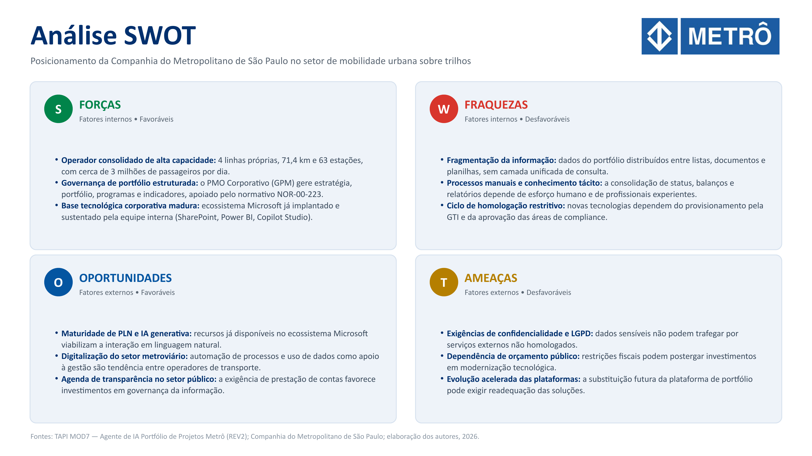
  <p><strong>Figura 01</strong> - Análise SWOT da Companhia do Metropolitano de São Paulo.</p>
  <sup>Fonte: Material produzido pelos autores, 2026.</sup>
</div>

### 2.3.1 Forças

- **Operador consolidado de alta capacidade:** o Metrô opera quatro linhas próprias, somando 71,4 km de extensão e 63 estações, por onde circulam cerca de 3 milhões de passageiros por dia, com reconhecimento internacional pelos resultados de produção e qualidade do serviço prestado.

- **Governança de portfólio estruturada:** o PMO Corporativo (GPM) é responsável pela governança de estratégia, portfólio, programas, projetos e indicadores estratégicos, apoiado por normativo próprio (NOR-00-223) e por processos padronizados de partida, acompanhamento e encerramento.

- **Base tecnológica corporativa madura:** a companhia já dispõe de um ecossistema Microsoft implantado e sustentado pela equipe interna — SharePoint, Power Automate, Power BI e Copilot Studio —, o que reduz o custo de adoção de novas soluções e favorece a autonomia técnica da organização.

### 2.3.2 Fraquezas

- **Fragmentação da informação:** os dados do portfólio estão distribuídos entre listas, documentos, planilhas e normativos, sem uma camada unificada de consulta que relacione as diferentes fontes e permita acesso integrado ao conhecimento institucional.

- **Processos manuais e dependência de conhecimento tácito:** a consolidação de status, balanços mensais e relatórios de fechamento depende de esforço humano e da experiência de profissionais específicos, concentrando a capacidade de consulta e fragilizando a continuidade das atividades.

- **Ciclo de homologação restritivo:** a adoção de novas tecnologias depende do provisionamento de ambiente pela Gerência de Tecnologia da Informação (GTI) e da aprovação das áreas de compliance, o que alonga o tempo entre a concepção de uma solução e sua disponibilização efetiva.

### 2.3.3 Oportunidades

- **Maturidade do Processamento de Linguagem Natural e da IA generativa:** recursos já disponíveis e homologáveis no ecossistema Microsoft viabilizam interfaces de consulta em linguagem natural com baixo custo de sustentação, aproveitando a plataforma tecnológica existente.

- **Digitalização do setor metroviário:** a automação de processos e o uso de dados como apoio à gestão consolidam-se como tendência entre operadores de transporte de alta capacidade, criando referências e fornecedores maduros para iniciativas dessa natureza.

- **Agenda de transparência e eficiência no setor público:** a exigência crescente de prestação de contas, rastreabilidade e uso eficiente dos recursos públicos favorece investimentos em governança da informação e em ferramentas de apoio à decisão.

### 2.3.4 Ameaças

- **Exigências de confidencialidade e proteção de dados:** dados sensíveis de projeto não podem trafegar por serviços externos não homologados pelas áreas técnicas e de compliance, o que restringe o uso direto de soluções de mercado e impõe requisitos adicionais de arquitetura.

- **Dependência de orçamento público:** restrições fiscais e mudanças de prioridade governamental podem postergar investimentos em modernização tecnológica e em projetos de expansão, afetando a continuidade das iniciativas do portfólio.

- **Evolução acelerada das plataformas de mercado:** a eventual substituição ou complementação da plataforma atual de gestão de portfólio — por exemplo, pela adoção do Dynamics Project Operations — pode exigir readequação das soluções construídas sobre o ambiente vigente.

---

## 2.4 Visão do Projeto e do Produto
Este tópico apresenta a visão estratégica do produto proposto, sua proposta de valor e os objetivos que orientam seu desenvolvimento, estabelecendo o alinhamento entre a solução, os desafios identificados pela área de Gestão de Portfólio de Projetos (PMO) do Metrô e as necessidades do negócio. A definição desses elementos busca orientar as decisões arquiteturais, funcionais e de priorização do projeto, delimitando claramente seu escopo, as capacidades esperadas e o valor agregado aos diferentes perfis de usuários.

A proposta surge em um contexto de evolução da plataforma tecnológica utilizada pelo PMO, que já dispõe de ferramentas corporativas para armazenamento, organização e acompanhamento das informações do portfólio, mas ainda depende de atividades manuais para localizar documentos, consolidar informações, interpretar normativos, produzir relatórios e acompanhar o andamento dos projetos. Como consequência, parte significativa do conhecimento institucional permanece distribuída entre diferentes repositórios e depende da experiência dos profissionais para ser acessada de forma eficiente.

Nesse cenário, o produto busca transformar a forma como gestores e colaboradores interagem com esse conjunto de informações, incorporando recursos de Inteligência Artificial capazes de compreender solicitações em linguagem natural, interpretar diferentes intenções de uso e disponibilizar respostas contextualizadas, seguras e fundamentadas nas fontes oficiais da organização.

A solução é construída sobre o ecossistema Microsoft já adotado pela organização, e não ao lado dele. Isso mantém o custo de sustentação dentro do que a equipe interna do Metrô já opera, dispensa a introdução de uma nova plataforma no ciclo de homologação da GTI e permite que novas capacidades sejam incorporadas de forma incremental.

---

### 2.4.1 Visão do Produto

A visão do produto é transformar a interação entre os colaboradores e o portfólio de projetos do Metrô em uma experiência conversacional inteligente, integrada e orientada ao contexto de cada usuário, permitindo que informações estratégicas sejam acessadas por meio de linguagem natural de forma rápida, segura, rastreável e aderente às diretrizes de governança da organização.

Atualmente, embora a gestão do portfólio seja suportada por um conjunto consolidado de ferramentas corporativas, atividades relacionadas ao acompanhamento do avanço dos projetos, consulta a cronogramas, Termos de Abertura do Projeto (TAP), indicadores, documentos normativos e demais registros institucionais ainda exigem navegação entre diferentes plataformas, buscas manuais e interpretação de informações distribuídas em múltiplas fontes. Como consequência, essas atividades tornam-se mais demoradas, suscetíveis a inconsistências e dependentes do conhecimento especializado das equipes.

O produto propõe a criação de um agente inteligente integrado ao ambiente corporativo da organização, atuando como principal ponto de interação entre os usuários e o ecossistema de informações do portfólio. Por meio dessa interface conversacional, gestores e equipes poderão consultar informações dos projetos, esclarecer dúvidas sobre processos e normativos, localizar documentos, acompanhar cronogramas e obter respostas contextualizadas utilizando linguagem natural, reduzindo significativamente a necessidade de navegar entre diferentes sistemas ou conhecer previamente onde cada informação está armazenada.

O núcleo da solução é um mecanismo de Processamento de Linguagem Natural responsável por compreender a intenção de cada solicitação, classificá-la em consulta, transação ou alerta e direcioná-la ao fluxo de tratamento correspondente. É esse mecanismo que sustenta todas as demais capacidades do produto: sem a identificação correta da intenção, nenhuma consulta ou preenchimento assistido funciona.

---

### 2.4.2 Proposta de Valor

A proposta de valor do produto responde a duas condições observadas no PMO do Metrô. A primeira é operacional: as informações do portfólio estão distribuídas entre SharePoint, listas corporativas, Power BI e arquivos Office, e localizá-las exige saber de antemão onde cada uma está. A segunda é de confiança: conforme relatado pelo parceiro, experiências anteriores com IA generativa produziram respostas que nem sempre estavam fundamentadas na documentação oficial da companhia, e isso reduziu a confiança das equipes nesse tipo de recurso.

Essa segunda condição é o que determina a forma do produto. Não basta responder rápido: cada resposta precisa apontar de onde veio e precisa dizer quando não sabe. É por isso que a citação de fonte e a declaração explícita de limitação são requisitos do agente, e não boas práticas opcionais — a confiança que o produto precisa conquistar já foi quebrada uma vez naquele contexto.

Sobre essas duas condições, o produto entrega valor por meio das capacidades abaixo. Cada linha nomeia o que o agente faz e o efeito esperado sobre a rotina de quem usa.

| O que o agente faz | Efeito esperado |
| --- | --- |
| Responde em português corrente sobre status, prazos, entregas, marcos, riscos e normativos do portfólio | Elimina a necessidade de saber previamente em qual repositório cada informação está |
| Cita o documento que sustenta cada resposta e declara quando não há informação suficiente | Torna a resposta verificável e evita que o usuário receba conteúdo sem lastro documental |
| Compara projetos entre si em prazo, avanço, riscos e marcos | Substitui o cruzamento manual entre Power BI, planilhas e relatos dos líderes |
| Conduz entrevista guiada para preencher documentos do ciclo de vida do projeto | Reduz o esforço de preenchimento de formulários estáticos e padroniza o conteúdo registrado |
| Valida regras de preenchimento, como soma dos pesos do cronograma em 100%, coerência entre datas e campos obrigatórios | Impede que a inconsistência entre no registro, em vez de corrigi-la depois na consolidação |
| Aceita entrada por texto ou por voz dentro do Microsoft Teams | Permite consulta e atualização fora da estação de trabalho, em reunião ou deslocamento |
| Ajusta a profundidade da resposta ao perfil do usuário | Entrega síntese executiva à diretoria e detalhe operacional a quem acompanha o projeto |
| Gera prévia de relatório executivo mensal a partir dos dados consolidados | Reduz o tempo do PMO gasto em compilação para produzir material recorrente |
| Aciona lembretes de atualização de avanço e riscos via Teams | Diminui a cobrança manual que hoje o PMO faz aos responsáveis pelos projetos |

O detalhamento dessas capacidades, com a separação entre o que entra no MVP e o que fica para a evolução, está na Seção 2.4.3.

### 2.4.3 O que o Produto Faz e Não Faz

#### O que o Produto Faz

O produto é um agente conversacional disponível no Microsoft Teams que opera sobre a documentação e os dados de portfólio já mantidos pelo Metrô. Ele não substitui as plataformas corporativas: lê o que elas armazenam, responde a partir desse conteúdo e devolve o resultado no canal onde as equipes já trabalham. A arquitetura que sustenta essas capacidades está detalhada na Seção 5.2.

As capacidades estão organizadas em três blocos. Os dois primeiros compõem o MVP validado neste módulo; o terceiro está previsto para depois dele. A fronteira entre eles é a mesma declarada na matriz de priorização da Seção 2.8 e detalhada nos requisitos funcionais da Seção 3.1.

**Bloco 1 — Consulta e análise (MVP)**

| Capacidade | O que o agente faz |
| --- | --- |
| Entrada em linguagem natural | Recebe solicitações em português corrente, por texto ou por áudio transcrito, sem exigir sintaxe, comandos ou nomes técnicos de campos. |
| Identificação e classificação da intenção | Interpreta o pedido e o classifica em consulta, transação ou alerta, direcionando-o ao fluxo de tratamento correspondente. |
| Consulta a informações do projeto | Recupera status, avanço, prazos, entregas, marcos, riscos, indicadores e conteúdo de normativos a partir das fontes disponibilizadas ao pipeline. |
| Comparação entre projetos | Responde a perguntas que envolvem mais de uma iniciativa, confrontando prazo, avanço, riscos e marcos entre projetos do portfólio. |
| Resposta fundamentada com indicação de fonte | Apresenta, junto da resposta, o documento e o trecho que a sustentam, permitindo conferência pelo usuário. |
| Declaração explícita de limitação | Quando a base disponível não contém a informação pedida, responde que não há informação suficiente e indica o que faltou, em vez de preencher a lacuna. |
| Adaptação ao perfil do usuário | Ajusta o nível de detalhamento e o vocabulário da resposta conforme o perfil de quem pergunta, respeitando as permissões associadas a esse perfil. |

**Bloco 2 — Preenchimento assistido de documentos (MVP: Mapa de Benefícios)**

| Capacidade | O que o agente faz |
| --- | --- |
| Entrevista guiada | Conduz o líder do projeto por perguntas sequenciais que cobrem programa ou projeto, entregas, resultados, benefícios e objetivos estratégicos, adaptando as perguntas seguintes às respostas já dadas. |
| Sugestões a partir da base corporativa | Após o líder declarar as entregas, pergunta se ele deseja sugestões e, em caso afirmativo, consulta a base para propor resultados e benefícios relacionados a projetos comparáveis. |
| Validação de regras de preenchimento | Verifica a soma dos pesos do cronograma em 100%, a coerência entre datas de início e término e a presença dos campos obrigatórios antes de fechar o registro. |
| Geração do artefato estruturado | Produz o Mapa de Benefícios preenchido a partir das respostas coletadas e o disponibiliza para revisão e aprovação do líder, que permanece responsável pela validação final. |

O Mapa de Benefícios é o documento piloto deste bloco. A extensão do preenchimento assistido ao Termo de Abertura do Projeto, ao cronograma e aos registros de avanço está prevista como evolução.

**Bloco 3 — Acompanhamento e reporte (previsto para depois do MVP)**

| Capacidade | O que o agente faz |
| --- | --- |
| Lembrete proativo de atualização | Identifica pendências de preenchimento de avanço e de riscos e aciona os responsáveis via Teams, reduzindo a cobrança manual feita hoje pelo PMO. |
| Prévia de relatório executivo mensal | Consolida as informações do período em um relatório de status voltado à diretoria, destacando avanço, riscos e marcos relevantes. |
| Prévia de relatório anual de fechamento | Reúne as informações de encerramento do portfólio e de cada projeto em um documento de fechamento para revisão. |

Além das capacidades deste bloco, ficam fora do MVP a diferenciação da profundidade de pesquisa, o fluxo de avaliação das respostas, a interface personalizada e a geração de apresentações por template. Todas estão registradas na matriz de priorização da Seção 2.8 com a faixa e a justificativa correspondentes.

#### O que o Produto Não Faz

Embora proponha uma evolução significativa na forma como os usuários interagem com o portfólio de projetos, a solução possui um escopo claramente delimitado para esta etapa de desenvolvimento.

O produto não tem como objetivo:

- Substituir as plataformas corporativas atualmente utilizadas para gerenciamento do portfólio;
- Alterar os processos de governança, metodologias ou fluxos organizacionais adotados pelo PMO;
- Executar decisões de negócio ou substituir a atuação dos gestores responsáveis pelos projetos;
- Disponibilizar informações incompatíveis com as permissões de acesso definidas para cada perfil de usuário;
- Integrar-se, nesta etapa, a sistemas externos que não façam parte do ambiente tecnológico disponibilizado pela organização;
- Realizar implantação definitiva em ambiente produtivo, restringindo-se ao desenvolvimento e validação de uma prova de conceito no contexto acadêmico.

Da mesma forma, funcionalidades que envolvam automações de maior complexidade, ampliação das integrações entre processos corporativos ou expansão do escopo funcional do agente serão implementadas de forma incremental, respeitando o roadmap do produto e as prioridades definidas em conjunto com o PMO.

### 2.4.4 Objetivos Estratégicos e Mensuráveis

O sucesso do produto é acompanhado por cinco objetivos. Cada um traz a métrica que o acompanha, a meta assumida para o MVP, o experimento que produz o número e o item de escopo responsável por entregá-lo. A coluna de forma de verificação é a que impede a meta de ser apenas um número escolhido: ela descreve como o resultado será medido.

| Objetivo | Métrica de acompanhamento | Meta inicial do MVP | Forma de verificação | Relação com o escopo |
| --- | --- | --- | --- | --- |
| Reduzir esforço de localização de informações | Tempo médio para encontrar uma informação de projeto | Redução de 50% em cenário controlado | Comparação entre busca manual e consulta ao agente usando os mesmos casos sintéticos | Consulta de informações dos projetos |
| Aumentar confiabilidade das respostas | Percentual de respostas fundamentadas em fontes disponíveis | 100% das respostas do escopo devem indicar base documental ou limitação | Testes com perguntas de consulta, comparação e ausência de informação | Respostas estruturadas e fundamentadas |
| Melhorar autonomia dos usuários | Percentual de solicitações compreendidas sem sintaxe técnica | Pelo menos 80% das solicitações em português devem ser compreendidas ou orientadas para reformulação | Casos de teste com variações de linguagem natural | Entrada textual e interpretação de intenção |
| Apoiar decisões do PMO | Capacidade de comparar projetos, riscos, marcos e indicadores | Consultas analíticas demonstráveis com dados sintéticos | Cenários de comparação entre dois ou mais projetos | Fluxos de consulta e análise comparativa |
| Preservar governança e confidencialidade | Uso de dados sintéticos ou anonimizados e rastreio das interações | 100% da prova de conceito sem dados sensíveis reais | Auditoria da base utilizada e dos registros gerados pelo pipeline | Segurança, rastreabilidade e aderência tecnológica |

Duas observações sobre o recorte desta matriz.

A primeira é que as metas valem para o cenário controlado do MVP, sobre dados sintéticos. Elas medem se o pipeline funciona e se o comportamento esperado do agente se confirma, não o ganho em produção — que só pode ser apurado após a integração com o portfólio real, prevista como evolução.

A segunda é que a redução de 40% no número de consultas manuais a diferentes plataformas, considerada na etapa de entendimento do problema, não integra esta matriz. Ela depende de medir o comportamento das equipes no ambiente corporativo e, por isso, permanece como indicador de acompanhamento pós-implantação, fora do que este módulo consegue verificar.

### 2.4.5 Ownership e Accountability Estratégico

O desenvolvimento da solução envolve responsabilidades compartilhadas entre os representantes do Metrô e a equipe do projeto. A tabela abaixo registra quem responde por cada decisão e cada insumo. Ela existe para tornar visível a dependência entre os dois lados: as responsabilidades listadas na coluna do Metrô são, em vários casos, pré-requisito para que as da equipe possam ser cumpridas no prazo, e a última coluna aponta qual risco da Seção 2.7 se materializa quando a responsabilidade não é cumprida.

| Decisão ou insumo | Responsável pelo Metrô | Responsável pela equipe do projeto | Risco associado |
| --- | --- | --- | --- |
| Escopo e prioridade das funcionalidades | Decidir a prioridade entre funcionalidades concorrentes e aprovar mudanças de escopo | Apresentar o custo e o impacto técnico de cada alternativa antes da decisão | R07 |
| Fontes de informação e documentos | Disponibilizar documentos, normativos e dados de referência necessários ao desenvolvimento | Especificar quais fontes são necessárias, em que formato e até quando | R01, R05 |
| Acesso ao ambiente tecnológico | Prover acesso ao ambiente e conduzir a homologação junto à GTI | Declarar antecipadamente os recursos necessários e operar dentro do que for liberado | R02, R04 |
| Validação das entregas | Validar cada entrega quanto à aderência aos processos do PMO e registrar aceite ou ajuste | Preparar a entrega com evidência de execução e roteiro de validação | R06, R10 |
| Regras de negócio e interpretação de normativos | Confirmar a interpretação correta de normativos e regras do portfólio | Registrar a interpretação adotada e sinalizar divergências identificadas | R10 |
| Confidencialidade e uso de dados | Definir o que pode ser utilizado e sob quais restrições | Operar a prova de conceito apenas com dados sintéticos ou anonimizados | R04 |
| Arquitetura e implementação | Apontar restrições institucionais que limitem escolhas técnicas | Definir a arquitetura, implementar o MVP, testar e documentar as decisões | R02, R08 |
| Disponibilidade para rituais de acompanhamento | Participar das reuniões de validação acordadas no cronograma | Convocar com antecedência e enviar pauta e material prévio | R06 |

Quando uma responsabilidade da coluna do Metrô não é cumprida no prazo acordado, a equipe registra o bloqueio na issue correspondente e comunica o impacto sobre a sprint, conforme o mecanismo de acompanhamento de riscos descrito no documento de gestão de projeto.

---

As capacidades da Seção 2.4.3, as metas da Seção 2.4.4 e a divisão de responsabilidades da Seção 2.4.5 formam o contrato de escopo deste projeto: o que o agente faz, como saberemos se funcionou e de quem depende cada parte. As seções seguintes detalham para quem o produto é construído (2.5), sobre qual processo de negócio ele atua (2.6) e quais riscos podem comprometer essa entrega (2.7).

---


## 2.5 Personas e Jornada do Usuário

As personas desenvolvidas representam diferentes perfis de usuários envolvidos na gestão do portfólio de projetos do Metrô. Elas ajudam a compreender como a solução proposta impacta rotinas distintas, desde a tomada de decisão estratégica até o acompanhamento operacional e a consolidação de informações. Considerando que o projeto propõe um agente inteligente para consulta, análise e apoio à gestão do portfólio, as personas evidenciam necessidades relacionadas à confiabilidade das respostas, redução de tarefas manuais, acesso rápido a indicadores e melhor organização das informações distribuídas entre documentos e plataformas corporativas.

### 2.5.1 Personas

#### 2.5.1.1 Roberto

<div align="center">
  
  <p><strong>Figura 02</strong> - Persona Roberto.</p>
</div>

Roberto é Diretor de Planejamento e Gestão Estratégica, tem 54 anos e atua em São Paulo. Sua rotina é marcada pelo acompanhamento executivo do portfólio de projetos, com foco em decisões estratégicas, riscos, resultados e alinhamento das iniciativas às prioridades organizacionais do Metrô. Por ocupar uma posição de diretoria, Roberto não dispõe de tempo para analisar documentos extensos ou acompanhar detalhes operacionais de cada projeto. Ele precisa receber informações sintetizadas, confiáveis e apresentadas em linguagem executiva, com destaque para projetos críticos, tendências, decisões pendentes e impactos organizacionais. No dia a dia, utiliza ferramentas como Word, Excel, PowerPoint, Teams e SharePoint, mas prefere soluções integradas ao ambiente corporativo que já utiliza.

#### 2.5.1.2 Mariana

<div align="center">
  
  <p><strong>Figura 03</strong> - Persona Mariana.</p>
</div>

Mariana é Analista Sênior de Gestão de Portfólio no PMO do Metrô, tem 38 anos e atua diretamente na qualidade, atualização e desempenho das informações do portfólio. Seu dia a dia envolve consolidar dados de diferentes projetos, identificar inconsistências, acompanhar indicadores e produzir análises para gestores e diretoria. Por ser organizada, analítica e orientada a processos, Mariana valoriza informações claras, rastreáveis e confiáveis, especialmente porque suas entregas dependem da consistência dos dados disponíveis. Entre seus principais desafios estão o esforço manual para comparar projetos, produzir relatórios e obter respostas rápidas sobre status, riscos, marcos e pendências. Ela possui alta afinidade tecnológica, domina o ecossistema Microsoft e utiliza diariamente Power BI, SharePoint, Excel e PowerPoint, embora dependa de ferramentas intuitivas e confiáveis para reduzir retrabalho.

#### 2.5.1.3 Carlos

<div align="center">
  
  <p><strong>Figura 04</strong> - Persona Carlos.</p>
</div>

Carlos é Gerente de Portfólio de Projeto, tem 44 anos e coordena um conjunto de projetos relacionados à sua área de atuação. Sua rotina envolve acompanhar o desempenho do subportfólio, identificar dependências entre projetos, orientar líderes, priorizar recursos e reportar informações ao PMO. Por atuar em uma posição intermediária entre a operação dos projetos e a gestão corporativa, Carlos precisa transformar informações dispersas em uma visão consolidada que apoie decisões táticas. No dia a dia, enfrenta desafios como dependências difíceis de acompanhar, disputa de recursos e demora para reunir informações sobre desvios e impactos. Ele utiliza SharePoint, Power BI, Excel e ferramentas corporativas, interpreta dashboards com facilidade e possui familiaridade intermediária com automações e agentes de IA, valorizando alertas, informações consolidadas e apoio para priorizar ações.

### 2.5.2 Jornadas do Usuário

As jornadas do usuário foram desenvolvidas para representar como diferentes perfis interagem com o processo de gestão e consulta das informações do portfólio de projetos. Elas evidenciam objetivos, ações, pensamentos, dores, emoções e oportunidades em cada etapa da experiência, permitindo compreender com mais clareza onde a solução proposta pode gerar valor. No contexto do agente inteligente para apoio à Gestão de Portfólio de Projetos do Metrô, as jornadas ajudam a identificar momentos em que a centralização das informações, a geração de respostas confiáveis e a redução de consultas manuais podem melhorar a tomada de decisão e a rotina dos usuários.

Foram mapeadas as jornadas das três personas, cobrindo os três níveis de uso da solução: Roberto representa o consumo executivo do resultado, Mariana a produção da informação consolidada e Carlos a coordenação tática entre os dois. A jornada de Mariana é a que se aproxima mais do problema descrito na Seção 2.2, porque é ela quem executa a consolidação dos balanços mensais e dos relatórios — a atividade que concentra o esforço manual que o projeto se propõe a reduzir.

Além dos mapas visuais, as jornadas foram sintetizadas em etapas funcionais para explicitar a relação entre necessidade do usuário, dor observada e oportunidade de produto.

| Persona | Etapa da jornada | Necessidade principal | Dor observada | Oportunidade para a solução |
| --- | --- | --- | --- | --- |
| Roberto | Identificar temas críticos do portfólio | Obter visão executiva rápida sobre riscos, atrasos e decisões pendentes | Relatórios extensos e pouco tempo para análise | Resumo executivo fundamentado em fontes disponíveis |
| Roberto | Avaliar cenários antes de decidir | Comparar impactos e priorizar ações estratégicas | Dependência de consolidação manual pelo PMO | Consulta analítica com diferenciação entre fato recuperado e interpretação |
| Roberto | Acompanhar efeitos das decisões | Verificar mudanças relevantes após direcionamentos anteriores | Dificuldade de recuperar histórico e mudanças recentes | Respostas rastreáveis com referência aos documentos consultados |
| Mariana | Consolidar o balanço mensal do portfólio | Reunir status, avanço, riscos e marcos de todos os projetos do período | Compilação manual a partir de SharePoint, listas, Power BI e planilhas | Consulta única sobre projetos e subportfólios, com consolidação assistida |
| Mariana | Conferir a consistência dos dados | Confirmar que os números usados são os vigentes | Versões divergentes de documentos, datas incoerentes e pesos de cronograma que não fecham | Validação de regras no momento do registro: soma dos pesos em 100%, coerência de datas e campos obrigatórios |
| Mariana | Responder às perguntas de gestores e diretoria | Sustentar cada número com sua origem documental | Baixa confiança em resposta automática sem lastro, após experiência anterior com IA generativa | Resposta com citação da fonte e declaração explícita quando a informação não existe |
| Mariana | Produzir a análise para decisão | Entregar material confiável e pronto para uso executivo | Retrabalho quando um dado muda depois da consolidação | Prévia de relatório executivo mensal gerada a partir dos dados já consolidados |
| Mariana | Acompanhar pendências do ciclo seguinte | Manter a base atualizada sem cobrar pessoa por pessoa | Cobrança manual repetida a cada ciclo mensal | Lembrete proativo via Teams das pendências de avanço e de riscos |
| Carlos | Preparar reunião de acompanhamento | Consolidar status, riscos e dependências do subportfólio | Informações distribuídas em diferentes fontes | Consulta por linguagem natural sobre projetos e subportfólios |
| Carlos | Investigar desvios | Aprofundar atrasos, riscos e impactos antes de acionar líderes | Retrabalho para cruzar Power BI, documentos e relatos | Comparação estruturada entre projetos e recuperação de evidências |
| Carlos | Coordenar ações do subportfólio | Direcionar responsáveis com base em informação confiável | Baixa confiança em respostas sem contexto | Respostas com fonte, limitação explícita e indicação de dados ausentes |

#### 2.5.2.1 Mapa de jornada - Roberto

<div align="center">
  
  <p><strong>Figura 05</strong> - Mapa de jornada do usuário Roberto.</p>
</div>

A jornada de Roberto representa a experiência de um usuário com perfil executivo, que precisa compreender rapidamente quais temas exigem sua atenção e quais decisões estratégicas devem ser tomadas. No início da jornada, Roberto consulta indicadores, verifica pendências e acompanha projetos, mas enfrenta muitas demandas simultâneas e pouco tempo para análise. Em seguida, busca compreender o cenário antes de decidir, recorrendo a relatórios, dashboards, ao Copilot atual e ao apoio do PMO para obter contexto, o que evidencia sua dependência de sínteses e a dificuldade de lidar com relatórios extensos.

Com a introdução da solução, Roberto passa a buscar uma síntese rápida e confiável por meio de consultas ao novo agente, fazendo perguntas por texto ou voz e aprofundando pontos críticos conforme necessário. Nessa etapa, a principal oportunidade está em evidenciar a confiabilidade das fontes, oferecer respostas objetivas e guiar aprofundamentos. Ao avançar para a definição de prioridades e direcionamentos, Roberto compara cenários, discute com gestores e define ações com maior segurança, utilizando a solução para compreender impactos e apoiar decisões de alta responsabilidade. Por fim, ao verificar os impactos das decisões tomadas, ele acompanha mudanças relevantes, indicadores e direcionamentos anteriores, com a expectativa de antecipar novos riscos e avaliar se as decisões produziram os efeitos esperados.

#### 2.5.2.2 Mapa de jornada - Mariana

<div align="center">
  
  <p><strong>Figura 06</strong> - Mapa de jornada do usuário Mariana.</p>
  <sup>Fonte: Material produzido pelos autores, 2026.</sup>
</div>

A jornada de Mariana percorre o ciclo mensal de consolidação do portfólio, a rotina que a Seção 2.2 identifica como a maior consumidora de tempo administrativo do PMO. Ela começa reunindo status, avanço, riscos e marcos de todos os projetos do período, o que hoje exige abrir SharePoint, listas corporativas e Power BI, baixar planilhas e compilar os dados manualmente. A dor dessa etapa não é a análise, é a coleta: o esforço se concentra antes de qualquer raciocínio sobre os números.

Na segunda fase, Mariana precisa confirmar que os dados reunidos são os vigentes. Compara versões de documentos, confere datas e pesos de cronograma e recorre aos líderes de projeto quando algo não fecha. É aqui que aparecem as inconsistências que a Seção 2.2 associa à consulta manual a fontes dispersas: versões divergentes do mesmo documento, datas incoerentes e pesos que não somam 100%. A oportunidade correspondente não é detectar o erro depois, mas impedir que ele entre — validar as regras no momento do registro, como descrito no Bloco 2 da Seção 2.4.3.

A terceira fase é a que mais depende da confiança. Ao consultar o agente para responder às perguntas de gestores e diretoria, Mariana traz consigo a experiência anterior do PMO com IA generativa, em que as respostas nem sempre estavam fundamentadas na documentação oficial. Por isso sua pergunta não é apenas se a resposta está certa, mas se ela consegue mostrar de onde veio. É essa etapa que sustenta a exigência de citação de fonte e de declaração explícita quando a informação não existe na base.

Nas duas fases finais, Mariana produz a análise para decisão e fecha o ciclo. Na quarta, monta o material executivo e revisa números e referências, sujeita a retrabalho sempre que um dado muda depois da consolidação — o que a prévia de relatório executivo mensal, gerada a partir dos dados já consolidados, reduz. Na quinta, levanta as pendências de preenchimento e aciona os responsáveis, tarefa hoje feita pessoa por pessoa a cada mês e que o lembrete proativo via Teams passa a executar. As cinco fases dessa jornada correspondem, nessa ordem, às cinco linhas de Mariana na tabela de etapas apresentada acima.

#### 2.5.2.3 Mapa de jornada - Carlos

<div align="center">
  
  <p><strong>Figura 07</strong> - Mapa de jornada do usuário Carlos.</p>
</div>

A jornada de Carlos representa a experiência de um gerente de portfólio que precisa acompanhar os projetos sob sua responsabilidade e se preparar para reuniões com líderes do subportfólio. Na primeira fase, Carlos busca entender quais projetos exigem atenção, analisando indicadores, verificando entregas e prazos e preparando reuniões. Suas principais dores estão relacionadas à distribuição das informações entre diferentes projetos e à dificuldade de visualizar dependências, o que torna sua rotina mais complexa e exige esforço constante de consolidação.

Ao tentar obter rapidamente o status do subportfólio, Carlos consulta o agente atual, pergunta sobre riscos e atrasos e reformula perguntas para encontrar respostas mais úteis. Nesse momento, surgem frustrações associadas a respostas pouco contextualizadas e à baixa confiança nos resultados. Em seguida, ao confirmar riscos e desvios antes de agir, ele consulta Power BI, documentos e líderes de projeto, além de consolidar informações manualmente, o que revela retrabalho e dificuldade para cruzar fontes distintas. Com a nova solução, Carlos passa a consultar por texto ou voz, aprofundar riscos e dependências e comparar projetos de forma mais integrada. A jornada termina com a antecipação de problemas e a coordenação dos projetos, etapa em que alertas relevantes, histórico de riscos e identificação proativa de desvios ajudam Carlos a direcionar líderes e recursos com mais controle e confiança.


---

## 2.6 Modelagem do Fluxo de Negócio

A modelagem do fluxo de negócio tem como objetivo representar o processo de elaboração do Mapa de Benefícios, permitindo compreender o funcionamento atual da atividade e as mudanças propostas com a utilização do agente inteligente. Para isso, foram utilizados três artefatos complementares: a Cadeia de Valor, que apresenta uma visão consolidada do processo atual e futuro, e os diagramas BPMN dos fluxos AS-IS e TO-BE.

**Por que este processo, entre todos os do portfólio**

A gestão do portfólio do Metrô compreende uma sequência de processos de negócio que existe independentemente desta solução: aprovar o empreendimento, dar partida, executar, reportar avanço mensal, consolidar o portfólio e encerrar. A elaboração do Mapa de Benefícios foi escolhida como recorte de modelagem por três razões.

A primeira é que o parceiro a nomeou explicitamente. Entre os oito documentos do ciclo de vida citados no material de referência do Metrô, o Mapa de Benefícios aparece como o primeiro da lista e é o único acompanhado de uma história de usuário completa, com o roteiro de perguntas que o agente deveria conduzir. Modelar esse processo permite confrontar o fluxo desenhado com o comportamento que o parceiro já descreveu.

A segunda é a posição do artefato no ciclo. O Mapa de Benefícios é elaborado na partida do projeto e é o que liga entregas a resultados, benefícios e objetivos estratégicos. Todos os artefatos posteriores — cronograma, avanço, balanço mensal, relatório de fechamento — reportam contra essa ligação. Um erro de preenchimento aqui se propaga por todo o acompanhamento subsequente.

A terceira é que este processo concentra as duas capacidades que o MVP precisa demonstrar ao mesmo tempo: a consulta à base corporativa, quando o agente busca sugestões de resultados e benefícios em projetos comparáveis, e a transação, quando conduz a entrevista e gera o artefato. Um processo apenas de consulta não exercitaria o segundo caminho.

Os demais processos do portfólio permanecem fora deste recorte de modelagem, mas não fora do produto: as capacidades previstas para eles estão registradas no Bloco 3 da Seção 2.4.3 e na matriz de priorização da Seção 2.8.

O modelo AS-IS representa o processo atualmente realizado, caracterizado principalmente pela execução manual das atividades de levantamento, definição e preenchimento das informações. Já o modelo TO-BE representa o processo proposto pelo projeto, no qual o agente inteligente passa a apoiar o responsável pelo projeto na coleta, organização e geração das informações necessárias para elaboração do Mapa de Benefícios.

A modelagem também evidencia a mudança no papel do responsável pelo projeto. No cenário atual, grande parte do esforço está concentrada na execução operacional do processo, enquanto no cenário futuro o agente inteligente assume parte dessas atividades, permitindo que o responsável concentre sua atuação na interação com o sistema, revisão e validação do resultado.

Dessa forma, o fluxo proposto não busca retirar a participação humana do processo, mas utilizar a inteligência artificial como mecanismo de apoio à elaboração do artefato, mantendo a validação final sob responsabilidade do usuário.

---

### 2.6.1 Cadeia de Valor

A cadeia de valor evidencia como o processo de elaboração do mapa de benefícios evolui entre o cenário atual **(AS-IS)** e o cenário futuro **(TO-BE)**. No processo atual, grande parte das informações necessárias para construir o mapa é obtida manualmente, exigindo consulta a múltiplos documentos, interpretação do conhecimento tácito do gestor e preenchimento manual do artefato. No processo futuro, essas atividades permanecem sob condução do líder do projeto, mas passam a contar com o apoio de um agente inteligente capaz de consultar a documentação corporativa, recuperar informações relevantes, sugerir relações entre entregas, resultados e benefícios e gerar automaticamente o mapa para validação final do usuário.

<div align="center">
  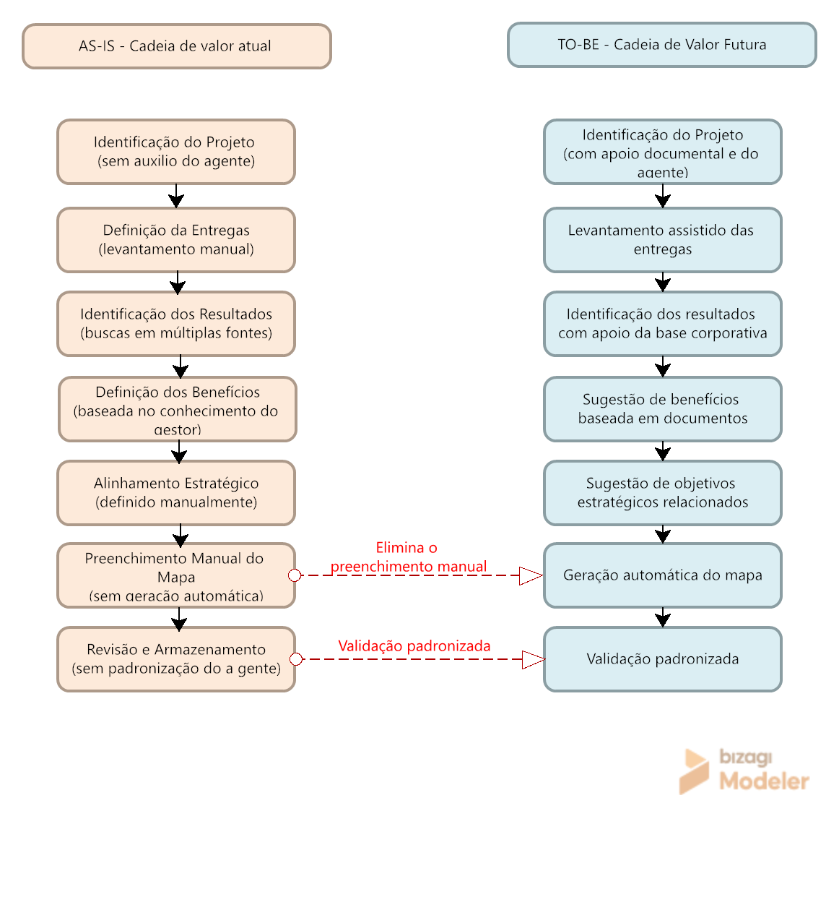
  <p><strong>Figura 08</strong> - Cadeia de valor do processo de elaboração do Mapa de Benefícios.</p>
  <sup>Fonte: Material produzido pelos autores, 2026.</sup>
</div>

No cenário **AS-IS**, o processo é composto pelas etapas de **Identificação do Projeto**, **Definição das Entregas**, **Identificação dos Resultados**, **Definição dos Benefícios**, **Alinhamento Estratégico**, **Preenchimento Manual do Mapa** e **Revisão e Armazenamento**.

Nesse cenário, o processo depende principalmente da atuação manual do líder do projeto. A identificação das informações necessárias ocorre por meio da consulta e análise de diferentes fontes, exigindo a localização, a interpretação e a organização dos dados relevantes para a elaboração do mapa. A definição dos benefícios e o alinhamento estratégico também dependem de seu conhecimento e de sua análise. Ao final, o Mapa de Benefícios é preenchido manualmente e posteriormente revisado e armazenado, sem o mesmo nível de padronização proposto no cenário futuro.

No cenário **TO-BE**, o objetivo do processo permanece o mesmo: elaborar um **Mapa de Benefícios relacionado a um projeto**. A principal mudança está na forma como as informações são obtidas, organizadas e transformadas no artefato final. O agente inteligente passa a apoiar o líder do projeto, principalmente na **consulta da documentação corporativa, recuperação de informações relevantes, geração de sugestões e estruturação do mapa**.

A primeira etapa passa a ser a **Identificação do Projeto com apoio documental e do agente**, permitindo que as informações necessárias para contextualizar o mapa sejam obtidas com auxílio da base corporativa. Em seguida, a **Definição das Entregas** passa a contar com um levantamento assistido, reduzindo a necessidade de realizar manualmente a busca e organização das informações.

Na etapa de **Identificação dos Resultados**, o agente apoia a consulta à base corporativa para localizar informações relacionadas ao projeto e aos seus resultados esperados. A partir dessas informações, também são apresentadas **sugestões de benefícios baseadas nos documentos consultados**, auxiliando o usuário na identificação das relações entre resultados e benefícios.

O **Alinhamento Estratégico** também passa a receber apoio do agente por meio da sugestão de objetivos estratégicos relacionados às informações levantadas. Entretanto, essas sugestões possuem caráter de apoio e não substituem a análise ou a decisão do líder do projeto.

A principal transformação ocorre na etapa de **Geração Automática do Mapa**, que substitui o preenchimento manual do artefato pela geração estruturada do Mapa de Benefícios a partir das informações coletadas e das relações identificadas durante o processo. Dessa forma, o agente reduz o esforço operacional necessário para transformar as informações levantadas em um documento estruturado.

Por fim, a etapa de **Revisão e Armazenamento** do cenário atual é transformada em uma etapa de **Validação Padronizada** no cenário futuro. O líder do projeto continua realizando a conferência e a aprovação do conteúdo gerado, porém o processo passa a estabelecer uma forma mais estruturada e padronizada para a validação e publicação do documento.

Dessa forma, a Cadeia de Valor demonstra que o agente inteligente **não tem como objetivo criar ou gerenciar projetos**, mas apoiar o processo de elaboração do Mapa de Benefícios. Seu impacto está concentrado na redução do esforço manual necessário para **consultar documentos, localizar informações, organizar conhecimento, gerar sugestões e estruturar o artefato final**. As decisões e a validação das informações permanecem sob condução do líder do projeto.


A comparação evidenciada na imagem da cadeia, mostra que a proposta **não altera a finalidade do processo**, que continua sendo a elaboração de um Mapa de Benefícios válido e relacionado ao projeto analisado. A transformação ocorre principalmente na maneira como o conhecimento necessário é obtido e utilizado: atividades que anteriormente dependiam de buscas e organização manuais passam a contar com o apoio do agente inteligente, enquanto a geração e a validação do artefato tornam-se mais estruturadas e padronizadas.

Assim, a Cadeia de Valor complementa os fluxos **AS-IS** e **TO-BE**, demonstrando de forma visual e operacional **onde o agente agrega valor ao processo e quais atividades são impactadas pela sua utilização**.


---

### 2.6.2 Fluxo de Negócio Proposto (AS-IS e TO-BE)

Os fluxos de negócio apresentados a seguir detalham o processo de elaboração do Mapa de Benefícios nos cenários **AS-IS** e **TO-BE**, evidenciando como as atividades são executadas em cada contexto. A modelagem em BPMN complementa a Cadeia de Valor apresentada anteriormente ao representar a sequência das atividades, os participantes envolvidos, as interações com o repositório corporativo e os pontos de decisão que orientam a execução do processo.

Duas convenções de notação orientam a leitura dos diagramas. A primeira é que apenas participantes que executam e decidem aparecem como raia: o líder do projeto e o agente inteligente. O repositório corporativo é representado como **objeto de dados**, e não como raia, porque é consultado e gravado, mas nunca inicia ação — quem consulta é o agente, por meio de tarefas de serviço na própria raia. A segunda é que todo gateway representa uma decisão efetiva, com mais de um caminho de saída; pontos do fluxo que apenas registram informação são modelados como tarefa, não como losango.

### AS-IS — Fluxo Atual

<div align="center">
  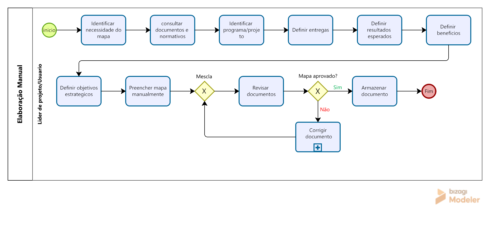
  <p><strong>Figura 09</strong> - Fluxo de negócio AS-IS: elaboração manual do Mapa de Benefícios.</p>
  <sup>Fonte: Material produzido pelos autores, 2026.</sup>
</div>

O fluxo **AS-IS** representa a elaboração manual do Mapa de Benefícios pelo líder do projeto ou usuário responsável. O processo inicia-se com a **identificação da necessidade do mapa**, seguida pela **consulta de documentos e normativos** que fornecem as informações necessárias para contextualizar a iniciativa.

Após essa consulta, o responsável realiza a **identificação do programa ou projeto** que será analisado e, posteriormente, define as **entregas**, os **resultados esperados** e os **benefícios** relacionados à iniciativa. Na sequência, são definidos os **objetivos estratégicos** associados ao mapa.

Com essas informações levantadas, o responsável realiza o **preenchimento manual do mapa**. Após o preenchimento, o documento passa pela etapa de **revisão**.

O fluxo possui um gateway de decisão **XOR** representado pela pergunta **"Mapa aprovado?"**. Caso a resposta seja **"Sim"**, o documento é armazenado e o processo é encerrado. Caso a resposta seja **"Não"**, o documento é encaminhado para **correção** e retorna ao fluxo de revisão, permitindo que o responsável realize novos ajustes até que o mapa seja aprovado.

### TO-BE — Fluxo Proposto

<div align="center">
  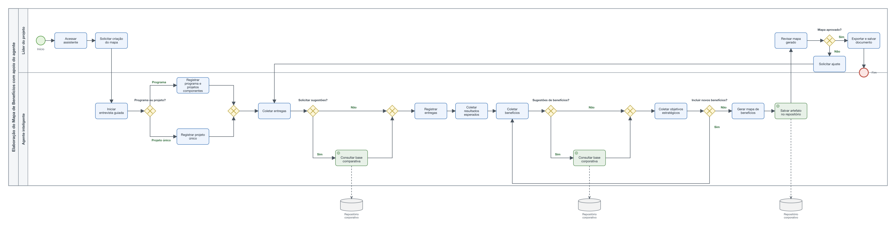
  <p><strong>Figura 10</strong> - Fluxo de negócio TO-BE: elaboração do Mapa de Benefícios com apoio do agente.</p>
  <sup>Fonte: Material produzido pelos autores, 2026.</sup>
</div>

O fluxo **TO-BE** representa o processo de elaboração do Mapa de Benefícios com o apoio do agente inteligente. O diagrama tem duas raias — **líder do projeto** e **agente inteligente** —, que são os dois participantes que executam atividades e tomam decisões. O **repositório corporativo** aparece como objeto de dados, alvo das tarefas de serviço executadas pelo agente.

O processo inicia-se na raia do **líder do projeto**, que acessa o assistente e **solicita a criação do mapa**. Essa solicitação corresponde à elaboração do Mapa de Benefícios para um programa ou projeto existente, não à criação ou desenvolvimento do próprio projeto.

Após a solicitação, o agente inicia a **entrevista guiada**. A primeira decisão do fluxo é o gateway XOR **"Programa ou projeto?"**, que bifurca de acordo com a natureza do componente do portfólio: no caminho **"Programa"**, o agente registra o programa e os projetos que o compõem, coletando um conjunto de informações por projeto; no caminho **"Projeto único"**, registra apenas o projeto e segue adiante. Os dois caminhos convergem antes da coleta das entregas. Essa bifurcação reproduz o comportamento descrito pelo parceiro na história de usuário do Mapa de Benefícios, em que a pergunta sobre os projetos componentes só é feita quando o componente é um programa.

Na sequência, o agente realiza a coleta das **entregas**. Nesse ponto, o gateway XOR **"Solicitar sugestões?"** verifica se o líder deseja apoio da base. Quando a resposta é **"Sim"**, o agente executa a tarefa de serviço **"Consultar base comparativa"**, que lê o repositório corporativo e devolve sugestões para complementar o registro das entregas. Quando é **"Não"**, o fluxo segue direto para o registro.

O processo continua com o registro das entregas e a coleta dos **resultados esperados** e dos **benefícios**. Para os benefícios há novamente a decisão **"Sugestões de benefícios?"**, cujo caminho afirmativo executa a tarefa de serviço **"Consultar base corporativa"** sobre o mesmo repositório.

Depois disso, o agente coleta os **objetivos estratégicos** e o gateway **"Incluir novos benefícios?"** permite retornar à coleta de benefícios quando o líder identifica algum benefício adicional durante a etapa de alinhamento estratégico. Com as informações consolidadas, o agente executa a **geração do Mapa de Benefícios** e a tarefa de serviço **"Salvar artefato no repositório"**.

A partir desse ponto, o fluxo retorna ao **líder do projeto**, que realiza a **revisão do mapa gerado**. O resultado é definido pelo gateway XOR **"Mapa aprovado?"**. Caso o mapa seja aprovado, o líder **exporta e salva o documento**, encerrando o processo. Caso não seja, ele **solicita ajuste** e o fluxo retorna à coleta de entregas, permitindo que as informações sejam complementadas e que um novo mapa seja gerado para revisão.

O código-fonte do diagrama está versionado em [`docs/diagrams/fluxo-to-be.svg`](diagrams/fluxo-to-be.svg).

---

## 2.7 Matriz de Risco do Projeto


A matriz de risco do projeto tem como objetivo registrar, avaliar e acompanhar eventos que possam afetar positiva ou negativamente a execução do desenvolvimento do **Agente de IA para o Portfólio de Projetos do Metrô**.

A identificação dos riscos foi realizada considerando o contexto atual do projeto, suas dependências técnicas e organizacionais, as características do produto proposto e o estágio de desenvolvimento da solução. Entre os principais fatores considerados estão a dependência de informações e documentos disponibilizados pelo parceiro, a utilização do ecossistema Microsoft, a necessidade de integração com diferentes fontes de conhecimento, o controle de acesso às informações e a necessidade de garantir respostas fundamentadas para os usuários.

A matriz também contempla **oportunidades**, representadas por eventos de natureza positiva que, caso ocorram ou sejam adequadamente explorados, podem contribuir para a evolução, qualidade ou eficiência da solução.

Como o projeto encontra-se em etapa de desenvolvimento e consolidação da documentação, os riscos identificados deverão ser revisados periodicamente conforme novas decisões arquiteturais, validações com o parceiro, disponibilização de dados e evolução do escopo.

---

### 2.7.1 Critérios de Avaliação

A avaliação dos riscos utiliza uma escala de **1 a 5** para probabilidade e impacto.

### Probabilidade

| Valor | Classificação | Descrição |
| :---: | --- | --- |
| **1** | Muito baixa | Evento improvável de ocorrer durante o projeto. |
| **2** | Baixa | Evento pouco provável, mas possível. |
| **3** | Média | Evento com possibilidade moderada de ocorrência. |
| **4** | Alta | Evento provável de ocorrer durante o projeto. |
| **5** | Muito alta | Evento muito provável ou recorrente durante o projeto. |

### Impacto

| Valor | Classificação | Descrição |
| :---: | --- | --- |
| **1** | Muito baixo | Consequências praticamente desprezíveis para o projeto. |
| **2** | Baixo | Pequeno impacto sobre uma atividade ou entrega, sem comprometer significativamente o projeto. |
| **3** | Médio | Impacto relevante sobre uma atividade, entrega ou prazo, exigindo intervenção da equipe. |
| **4** | Alto | Pode comprometer uma entrega importante, gerar retrabalho significativo ou afetar o cronograma. |
| **5** | Muito alto | Pode comprometer diretamente objetivos do projeto, funcionalidades centrais ou a viabilidade de uma entrega. |

A **severidade** é calculada pela seguinte regra:

> **Severidade = Probabilidade × Impacto**

A classificação resultante segue as seguintes faixas:

| Severidade | Criticidade | Interpretação |
| :---: | --- | --- |
| **1–4** | 🟢 Baixa | Risco deve ser acompanhado, mas não exige intervenção prioritária. |
| **5–9** | 🟡 Moderada | Requer acompanhamento e ações preventivas quando aplicável. |
| **10–14** | 🟠 Alta | Deve possuir acompanhamento ativo e ações planejadas. |
| **15–25** | 🔴 Crítica | Deve receber tratamento prioritário pela equipe. |

Para as oportunidades, a mesma pontuação é utilizada para representar o **potencial de aproveitamento** do evento positivo.

---

### 2.7.2 Registro dos Riscos e Oportunidades

A matriz abaixo consolida os riscos identificados para o projeto, contemplando riscos negativos e positivos, suas categorias, avaliação, responsáveis, ações planejadas e status.

| ID | Tipo | Categoria | Risco / Oportunidade | P | I | Sev. | Criticidade | Responsável | Status |
| :---: | :---: | --- | --- | :---: | :---: | :---: | --- | --- | --- |
| **R01** | 🔴 Risco | Dados | Indisponibilidade ou baixa qualidade das informações e documentos necessários para alimentar a base de conhecimento do agente. | 4 | 5 | **20** | 🔴 Crítica | Jaime Almeida | Em Monitoramento |
| **R02** | 🔴 Risco | Técnico | Dificuldades ou limitações nas integrações com Microsoft Teams, Power Platform ou demais componentes do ecossistema Microsoft. | 4 | 5 | **20** | 🔴 Crítica | Felipe Teixeira | Em Monitoramento |
| **R03** | 🔴 Risco | Técnico | Respostas inadequadas, imprecisas ou não suficientemente fundamentadas geradas pelo agente de IA. | 4 | 5 | **20** | 🔴 Crítica | Henrique Diniz | Em Monitoramento |
| **R04** | 🔴 Risco | Técnico | Limitações na implementação do controle de autenticação, permissões e acesso às informações conforme o perfil do usuário. | 3 | 5 | **15** | 🔴 Crítica | Wendel Feitosa | Em Monitoramento |
| **R05** | 🔴 Risco | Dados | Alterações, inconsistências ou desatualização das fontes utilizadas pelo agente durante o desenvolvimento. | 4 | 4 | **16** | 🔴 Crítica | Leonardo Ramos | Em Monitoramento |
| **R06** | 🔴 Risco | Stakeholders | Indisponibilidade ou baixa participação dos representantes do Metrô durante validações e esclarecimento de dúvidas de negócio. | 3 | 4 | **12** | 🟠 Alta | Jaime Almeida | Aberto |
| **R07** | 🔴 Risco | Escopo | Ampliação do escopo decorrente da incorporação de novas funcionalidades ou necessidades levantadas durante o projeto. | 4 | 4 | **16** | 🔴 Crítica | Pedro Uchoa | Em Monitoramento |
| **R08** | 🔴 Risco | Cronograma | Tempo insuficiente para implementar, validar e documentar todas as funcionalidades previstas para a solução. | 4 | 4 | **16** | 🔴 Crítica | Felipe Teixeira | Em Monitoramento |
| **R09** | 🔴 Risco | Equipe | Sobrecarga ou indisponibilidade de integrantes para execução simultânea das atividades de análise, documentação, desenvolvimento e validação. | 3 | 4 | **12** | 🟠 Alta | Henrique Diniz | Aberto |
| **R10** | 🔴 Risco | Comunicação | Divergência de entendimento entre equipe e stakeholders sobre requisitos, prioridades ou comportamento esperado do agente. | 3 | 3 | **9** | 🟡 Moderada | Pedro Uchoa | Em Monitoramento |
| **O1** | 🟢 Oportunidade | Técnico | Aproveitamento do ecossistema Microsoft já utilizado pelo parceiro para facilitar integração, adoção e disponibilização do agente. | 4 | 4 | **16** | 🟢 Alta oportunidade | Wendel Feitosa | Em Monitoramento |
| **O2** | 🟢 Oportunidade | Stakeholders / Dados | Disponibilização de fontes oficiais e conhecimento especializado do PMO para aumentar a qualidade e a contextualização das respostas do agente. | 3 | 5 | **15** | 🟢 Alta oportunidade | Leonardo Ramos | Em Monitoramento |
| **O3** | 🟢 Oportunidade | Técnico / Arquitetura | Aproveitamento de uma arquitetura modular e escalável para incorporar progressivamente novos fluxos, integrações e capacidades de IA sem reestruturar integralmente a solução. | 3 | 5 | **15** | 🟢 Alta oportunidade | Henrique Diniz | Em Monitoramento |
| **O4** | 🟢 Oportunidade | Processo | Automação proativa de pendências e acompanhamentos recorrentes, reduzindo cobranças manuais do PMO e aumentando a atualização das informações dos projetos. | 4 | 4 | **16** | 🟢 Alta oportunidade | Jaime Almeida | Em Monitoramento |
| **O5** | 🟢 Oportunidade | Dados / Negócio | Reutilização estruturada do conhecimento institucional para apoiar diferentes fluxos do portfólio, evitando duplicação de informações e ampliando o valor da base de conhecimento. | 3 | 4 | **12** | 🟠 Alta oportunidade | Leonardo Ramos | Em Monitoramento |
| **O6** | 🟢 Oportunidade | Análise / Stakeholders | Ampliação da capacidade analítica do PMO por meio de respostas comparativas, perguntas sugeridas e utilização integrada de indicadores e documentos do portfólio. | 3 | 5 | **15** | 🟢 Alta oportunidade | Pedro Uchoa | Em Monitoramento |

---

### 2.7.3 Ações de Tratamento

### R01  - Indisponibilidade ou baixa qualidade dos dados

**Categoria:** Dados  
**Probabilidade:** 4  
**Impacto:** 5  
**Severidade:** 20  - 🔴 Crítica

A solução depende de informações e documentos institucionais para que o agente consiga responder às consultas de maneira contextualizada e fundamentada. A indisponibilidade, incompletude ou baixa qualidade dessas informações pode comprometer diretamente a capacidade do agente de produzir respostas confiáveis.

**Mitigação:** identificar antecipadamente as fontes necessárias, validar sua disponibilidade com o parceiro e estabelecer critérios mínimos de qualidade e completude para os dados e documentos utilizados.

**Contingência:** restringir temporariamente o escopo das consultas às fontes disponíveis e sinalizar explicitamente ao usuário quando não houver informação suficiente para fundamentar uma resposta.

**Responsável:** Jaime Almeida.  
**Status:** Em Monitoramento.

---

### R02  - Dificuldades nas integrações com o ecossistema Microsoft

**Categoria:** Técnico  
**Probabilidade:** 4  
**Impacto:** 5  
**Severidade:** 20  - 🔴 Crítica

A solução está prevista para operar integrada ao ecossistema tecnológico Microsoft, incluindo Microsoft Teams e componentes da Power Platform. Dependências de configuração, permissões, conectores ou limitações das plataformas podem afetar a implementação do agente.

**Mitigação:** validar antecipadamente as integrações necessárias e realizar provas de conceito dos componentes críticos antes da implementação completa dos fluxos.

**Contingência:** utilizar uma interface ou fluxo alternativo disponível no ambiente de desenvolvimento para validar as funcionalidades centrais do agente, mantendo a integração definitiva como etapa posterior.

**Responsável:** Felipe Teixeira.  
**Status:** Em Monitoramento.

---

### R03  - Respostas inadequadas ou não fundamentadas

**Categoria:** Técnico  
**Probabilidade:** 4  
**Impacto:** 5  
**Severidade:** 20  - 🔴 Crítica

Como a solução utiliza Inteligência Artificial para interpretar consultas e gerar respostas, existe o risco de o agente apresentar informações incorretas, incompletas ou sem fundamentação suficiente. Esse risco é particularmente relevante porque a solução pretende apoiar atividades de gestão e disponibilizar informações provenientes das fontes oficiais do Metrô.

**Mitigação:** utilizar fontes documentais controladas, estruturar adequadamente a base de conhecimento, definir mecanismos de validação da qualidade das interações e estabelecer comportamento explícito para situações nas quais não existam informações suficientes.

**Contingência:** fazer com que o agente informe a ausência de informações suficientes e evite apresentar uma resposta como fato quando não houver fonte adequada para fundamentá-la.

**Responsável:** Henrique Diniz.  
**Status:** Em Monitoramento.

---

### R04  - Limitações de autenticação e controle de acesso

**Categoria:** Técnico  
**Probabilidade:** 3  
**Impacto:** 5  
**Severidade:** 15  - 🔴 Crítica

A solução deverá respeitar os diferentes níveis de acesso às informações do portfólio. Uma implementação inadequada das regras de autenticação ou autorização pode permitir acesso indevido ou limitar o acesso legítimo de determinados usuários.

**Mitigação:** definir previamente os perfis de acesso, as permissões associadas a cada perfil e os limites de informação que podem ser disponibilizados pelo agente.

**Contingência:** restringir o acesso às funcionalidades ou fontes que apresentem problemas de autorização até que a configuração seja corrigida e validada.

**Responsável:** Wendel Feitosa.  
**Status:** Em Monitoramento.

---

### R05  - Alteração ou desatualização das fontes

**Categoria:** Dados  
**Probabilidade:** 4  
**Impacto:** 4  
**Severidade:** 16  - 🔴 Crítica

Informações utilizadas pelo agente podem sofrer alterações, atualizações ou substituições ao longo do projeto. Caso a base utilizada pela solução não acompanhe essas mudanças, o agente poderá responder utilizando informações desatualizadas.

**Mitigação:** estabelecer uma estratégia de atualização das fontes e identificar quais documentos possuem caráter prioritário para atualização.

**Contingência:** suspender temporariamente a utilização de uma fonte identificada como desatualizada e informar a necessidade de atualização antes de utilizá-la novamente como referência.

**Responsável:** Leonardo Ramos.  
**Status:** Em Monitoramento.

---

### R06  - Indisponibilidade dos stakeholders

**Categoria:** Stakeholders  
**Probabilidade:** 3  
**Impacto:** 4  
**Severidade:** 12  - 🟠 Alta

A compreensão dos processos do PMO e a validação da solução dependem da participação dos representantes do Metrô. A baixa disponibilidade desses stakeholders pode atrasar decisões e dificultar a validação das funcionalidades.

**Mitigação:** organizar previamente os pontos que dependem de validação do parceiro e concentrar dúvidas e decisões em momentos de alinhamento previamente definidos.

**Contingência:** registrar as decisões pendentes, utilizar apenas informações previamente validadas e postergar funcionalidades cuja implementação dependa de uma definição do parceiro.

**Responsável:** Jaime Almeida.  
**Status:** Aberto.

---

### R07  - Ampliação do escopo

**Categoria:** Escopo  
**Probabilidade:** 4  
**Impacto:** 4  
**Severidade:** 16  - 🔴 Crítica

O levantamento de novas possibilidades para o agente pode gerar solicitações adicionais ao longo do projeto. A incorporação indiscriminada dessas funcionalidades pode aumentar o esforço de desenvolvimento e comprometer as entregas prioritárias.

**Mitigação:** manter uma priorização formal das funcionalidades e diferenciar claramente capacidades essenciais do MVP de oportunidades de evolução futura.

**Contingência:** retirar ou postergar funcionalidades de menor prioridade quando novas demandas forem incorporadas, preservando as funcionalidades essenciais do MVP.

**Responsável:** Pedro Uchoa.  
**Status:** Em Monitoramento.

---

### R08  - Tempo insuficiente para implementação e validação

**Categoria:** Cronograma  
**Probabilidade:** 4  
**Impacto:** 4  
**Severidade:** 16  - 🔴 Crítica

A quantidade de atividades necessárias para compreender o problema, definir requisitos, estruturar a solução, validar as decisões e produzir a documentação pode superar o tempo disponível para o projeto.

**Mitigação:** priorizar as funcionalidades e entregas de maior valor, acompanhar continuamente o progresso e antecipar atividades que possuam dependências com outras tarefas.

**Contingência:** reduzir o escopo da implementação para preservar as capacidades essenciais e registrar funcionalidades secundárias como oportunidades de evolução.

**Responsável:** Felipe Teixeira.  
**Status:** Em Monitoramento.

---

### R09  - Sobrecarga ou indisponibilidade da equipe

**Categoria:** Equipe  
**Probabilidade:** 3  
**Impacto:** 4  
**Severidade:** 12  - 🟠 Alta

A execução simultânea de atividades de análise, documentação, arquitetura, desenvolvimento e validação pode gerar concentração excessiva de trabalho em determinados integrantes.

**Mitigação:** distribuir responsabilidades antecipadamente, acompanhar a carga de trabalho e compartilhar conhecimento sobre atividades críticas.

**Contingência:** redistribuir tarefas entre os integrantes e priorizar atividades diretamente relacionadas às entregas do ciclo atual.

**Responsável:** Henrique Diniz.  
**Status:** Aberto.

---

### R10  - Divergência de entendimento

**Categoria:** Comunicação  
**Probabilidade:** 3  
**Impacto:** 3  
**Severidade:** 9  - 🟡 Moderada

Diferenças de interpretação entre equipe e stakeholders podem gerar requisitos inconsistentes, retrabalho ou desenvolvimento de funcionalidades diferentes da expectativa do parceiro.

**Mitigação:** registrar decisões, requisitos e validações realizadas e utilizar reuniões de alinhamento para esclarecer pontos ambíguos.

**Contingência:** interromper a implementação do item divergente, revisar o entendimento com os envolvidos e atualizar a documentação antes de prosseguir.

**Responsável:** Pedro Uchoa.  
**Status:** Em Monitoramento.

---

### 2.7.4 Oportunidades

### O1  - Aproveitamento do ecossistema Microsoft

**Categoria:** Técnico  
**Probabilidade:** 4  
**Impacto:** 4  
**Potencial:** 16  - 🟢 Alta oportunidade

A utilização de tecnologias já presentes no ambiente corporativo pode facilitar a integração do agente ao cotidiano dos usuários, reduzir barreiras de adoção e aproveitar recursos existentes na organização.

**Estratégia de aproveitamento:** priorizar componentes do ecossistema Microsoft já adotados pelo parceiro sempre que forem tecnicamente adequados ao escopo, validando antecipadamente suas capacidades e limitações.

**Responsável:** Wendel Feitosa.  
**Status:** Em Monitoramento.

---

### O2  - Disponibilização de fontes oficiais e conhecimento do PMO

**Categoria:** Stakeholders / Dados  
**Probabilidade:** 3  
**Impacto:** 5  
**Potencial:** 15  - 🟢 Alta oportunidade

A disponibilização de documentos oficiais, normativos e conhecimento especializado dos representantes do PMO pode aumentar significativamente a qualidade do contexto utilizado pelo agente e permitir respostas mais alinhadas à realidade organizacional.

**Estratégia de aproveitamento:** priorizar as fontes oficiais disponibilizadas pelo parceiro e utilizar o conhecimento dos stakeholders para validar a interpretação dos conteúdos e orientar a construção da base de conhecimento.

**Responsável:** Leonardo Ramos.  
**Status:** Em Monitoramento.

---

### O3  - Arquitetura modular e escalável

**Categoria:** Técnico / Arquitetura  
**Probabilidade:** 3  
**Impacto:** 5  
**Potencial:** 15  - 🟢 Alta oportunidade

A concepção de uma arquitetura modular e escalável pode permitir que novas capacidades de Inteligência Artificial, fluxos de negócio e integrações sejam incorporados progressivamente sem necessidade de reestruturar integralmente a solução.

Essa oportunidade é coerente com a necessidade de construir uma solução preparada para futuras melhorias e evoluções, mantendo flexibilidade para ampliar suas capacidades ao longo do tempo.

**Estratégia de aproveitamento:** definir componentes e responsabilidades de forma modular, mantendo interfaces e dependências suficientemente desacopladas para permitir substituições ou extensões futuras.

**Responsável:** Henrique Diniz.  
**Status:** Em Monitoramento.

---

### O4  - Automação proativa de pendências

**Categoria:** Processo  
**Probabilidade:** 4  
**Impacto:** 4  
**Potencial:** 16  - 🟢 Alta oportunidade

A solução possui potencial para evoluir de uma experiência predominantemente reativa, baseada em consultas dos usuários, para uma atuação proativa capaz de identificar pendências e apoiar sua resolução.

Essa oportunidade está diretamente alinhada à necessidade identificada para que o agente lembre e ofereça apoio em pendências de preenchimento e acompanhe informações dos projetos.

**Estratégia de aproveitamento:** identificar inicialmente os eventos recorrentes e de maior valor operacional que possam gerar lembretes ou ações proativas, priorizando aqueles que apresentem regras claras e baixo risco de interpretação.

**Responsável:** Jaime Almeida.  
**Status:** Em Monitoramento.

---

### O5  - Reutilização do conhecimento institucional

**Categoria:** Dados / Negócio  
**Probabilidade:** 3  
**Impacto:** 4  
**Potencial:** 12  - 🟠 Alta oportunidade

A organização estruturada do conhecimento utilizado pelo agente pode permitir seu reaproveitamento em diferentes fluxos de gestão do portfólio, reduzindo duplicação de informações e ampliando o valor dos mesmos conteúdos institucionais.

Essa oportunidade pode favorecer a expansão da solução para diferentes necessidades do ciclo de vida dos projetos sem exigir a construção independente de bases para cada nova funcionalidade.

**Estratégia de aproveitamento:** organizar as fontes e conceitos de maneira reutilizável, preservando metadados e relações que permitam sua utilização por diferentes fluxos do agente.

**Responsável:** Leonardo Ramos.  
**Status:** Em Monitoramento.

---

### O6  - Ampliação da capacidade analítica

**Categoria:** Análise / Stakeholders  
**Probabilidade:** 3  
**Impacto:** 5  
**Potencial:** 15  - 🟢 Alta oportunidade

O agente pode evoluir para além de consultas isoladas, apoiando análises comparativas entre projetos, perguntas sugeridas e utilização conjunta de documentos e indicadores do portfólio.

Essa oportunidade é especialmente relevante para aumentar o valor estratégico da solução para o PMO, uma vez que a proposta contempla apoio à análise e comparação de projetos e utilização de perguntas sugeridas para orientar os usuários.

**Estratégia de aproveitamento:** priorizar inicialmente análises com critérios claramente definidos e fontes confiáveis, evoluindo posteriormente para comparações mais abrangentes conforme a qualidade e disponibilidade das informações.

**Responsável:** Pedro Uchoa.  
**Status:** Em Monitoramento.

---

### 2.7.5 Matriz Probabilidade × Impacto

A representação gráfica abaixo utiliza a probabilidade no eixo vertical e o impacto no eixo horizontal. Os identificadores dos riscos são posicionados conforme suas respectivas avaliações:

<div align="center">
  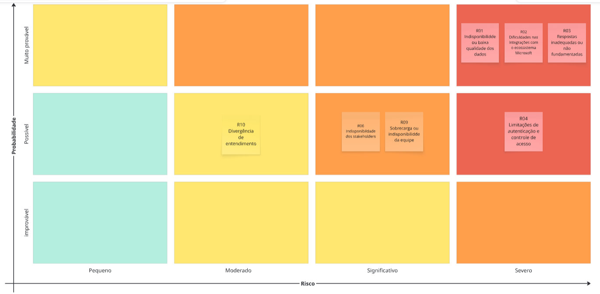
  <p><strong>Figura 11</strong> - Matriz Probabilidade × Impacto.</p>
  <sup>Fonte: Material produzido pelos autores, 2026.</sup>
</div>

---

### 2.7.6 Análise dos Três Itens Mais Críticos

A aplicação da regra **Severidade = Probabilidade × Impacto** identifica três itens com a maior pontuação da matriz: **R01, R02 e R03**, todos com severidade **20**, correspondendo à combinação de probabilidade alta (4) e impacto muito alto (5).

### R01  - Indisponibilidade ou baixa qualidade dos dados

O risco relacionado aos dados é considerado crítico porque o agente responde exclusivamente a partir das fontes que recebe como contexto. Não há conhecimento próprio a que recorrer quando a fonte falha.

Dessa forma, dados incompletos, indisponíveis ou inconsistentes não representam apenas um problema operacional de alimentação da solução, mas podem comprometer diretamente a principal finalidade do produto: disponibilizar informações confiáveis aos usuários.

Por esse motivo, a disponibilidade e a qualidade das fontes devem ser acompanhadas desde as primeiras etapas do projeto.

---

### R02  - Dificuldades nas integrações com o ecossistema Microsoft

A integração tecnológica também possui criticidade elevada porque a solução foi concebida para operar no ecossistema Microsoft, utilizando componentes como **Teams, SharePoint e Power Platform**.

Problemas relacionados a permissões, conectores, configurações ou limitações das plataformas podem impedir que funcionalidades que dependem dessas integrações sejam implementadas conforme planejado. Além disso, uma dificuldade de integração pode gerar impacto simultaneamente sobre desenvolvimento, validação e cronograma.

Por isso, a realização de validações técnicas antecipadas é uma das principais estratégias de redução desse risco.

---

### R03  - Respostas inadequadas ou não fundamentadas

O terceiro risco crítico está relacionado ao próprio comportamento da Inteligência Artificial. O agente deverá interpretar solicitações em linguagem natural e disponibilizar respostas contextualizadas, seguras e fundamentadas nas fontes oficiais.

Uma resposta incorreta ou sem fundamentação pode comprometer a confiança dos usuários na solução e reduzir seu valor para o PMO. Esse risco possui impacto elevado justamente porque a qualidade da resposta é um dos elementos centrais da proposta de valor do produto.

Por esse motivo, a estratégia deve priorizar fontes controladas, mecanismos de fundamentação, validação das respostas e comportamento explícito para situações nas quais não existam informações suficientes.

---

### 2.7.7 Acompanhamento da Matriz

A matriz deverá ser revisada durante a evolução do projeto, especialmente quando ocorrerem mudanças relevantes no escopo, arquitetura, disponibilidade de dados, integração com sistemas corporativos ou entendimento das necessidades dos stakeholders.

A atualização deverá considerar:

- inclusão de novos riscos identificados durante o desenvolvimento;
- alteração da probabilidade ou impacto de riscos existentes;
- atualização dos responsáveis;
- registro das ações de mitigação e contingência realizadas;
- atualização do status dos riscos;
- encerramento de riscos que deixarem de representar ameaça ao projeto;
- registro de novas oportunidades identificadas durante a evolução da solução.

Dessa forma, a matriz não deve ser tratada apenas como um artefato documental, mas como um instrumento de acompanhamento contínuo das condições que podem afetar a execução e os resultados do projeto.

A análise realizada evidencia que os principais pontos de atenção estão concentrados na **qualidade e disponibilidade dos dados, nas dependências de integração tecnológica e na confiabilidade das respostas produzidas pela Inteligência Artificial**. Esses fatores possuem relação direta com a proposta central do produto e, por isso, devem permanecer sob acompanhamento prioritário ao longo das próximas etapas do projeto.

---

## 2.8 Ideação

Esta seção consolida o processo de ideação realizado pela equipe durante as etapas de entendimento do negócio, brainstorming e validação inicial com os representantes do Metrô. O objetivo é registrar as funcionalidades identificadas como oportunidades para o produto, independentemente de sua implementação imediata, preservando um histórico das necessidades levantadas e das possibilidades de evolução da solução.

As ideias foram priorizadas por dois critérios, ambos avaliados em escala de 1 a 5:

- **Importância para o negócio:** potencial de geração de valor para o PMO e para os diferentes perfis de usuários;
- **Viabilidade para o MVP:** possibilidade de implementação dentro do escopo, prazo e recursos disponíveis para a primeira versão da solução.

#### Regra de priorização

A faixa de prioridade é o resultado do produto entre os dois critérios, conforme os intervalos abaixo. A regra é aplicada de forma uniforme a todas as features: nenhuma decisão da tabela foi tomada fora dela.

| Produto (Importância × Viabilidade) | Faixa |
| :---: | --- |
| 16 a 25 | 🔴 Muito Alta |
| 10 a 15 | 🟠 Alta |
| 6 a 9 | 🟡 Média |
| 1 a 5 | 🟢 Evolução |

**Regra de exceção — elevação por pré-requisito ou por escopo contratado.** Uma feature é elevada em uma faixa acima do resultado do produto, ainda que sua viabilidade seja baixa, quando se enquadra em um dos dois casos abaixo. A elevação é sinalizada na coluna de faixa e obrigatoriamente justificada; nenhuma outra feature da tabela foi movida de faixa.

1. **Pré-requisito de uso** — a feature é condição de acesso ao produto ou de aderência ao canal corporativo esperado pelo Metrô. Sua ausência impede o uso das demais, e não apenas reduz o valor entregue. Aplicada à **integração com o Microsoft Teams**, cuja viabilidade é 3 por depender de homologação da GTI, mas que é o canal onde o agente será efetivamente utilizado — sem ela, o produto não tem superfície de entrega.
2. **Escopo contratado** — a feature consta do escopo macro do Termo de Abertura do Projeto Inteli e, portanto, não é negociável por conveniência de implementação. Aplicada à **transcrição de áudio**, que o TAPI define como modalidade de entrada do agente e que, por isso, tem importância 5 mesmo com viabilidade 3. O benchmark de APIs e a escolha do provedor estão registrados na Seção 8.8.

#### Linha de corte do MVP

**A linha de corte do MVP é a faixa Muito Alta.** As sete features nessa faixa compõem o escopo desenvolvido e validado neste módulo e correspondem aos requisitos funcionais RF01 a RF08 da Seção 3.1. As faixas Alta e Média formam o backlog priorizado para depois do MVP: são features aceitas pelo produto, com valor reconhecido, cuja implementação depende de tempo ou de integrações ainda não disponíveis. A faixa Evolução reúne o que depende de condições fora do horizonte do projeto.

#### Matriz de priorização das features

| Feature | Importância | Viabilidade | Produto | Faixa | Escopo | Justificativa da priorização |
| --- | :---: | :---: | :---: | --- | --- | --- |
| Consulta de informações dos projetos | 5 | 5 | 25 | 🔴 Muito Alta | MVP | Resolve a dor central de acesso rápido às informações do portfólio e é a base de funcionamento do agente. |
| Ingestão de informações dos projetos | 5 | 4 | 20 | 🔴 Muito Alta | MVP | Sustenta a base de conhecimento consultada pelo agente, ainda que no MVP opere sobre dados sintéticos. |
| Preenchimento assistido de documentos | 5 | 4 | 20 | 🔴 Muito Alta | MVP | Entrevista guiada que gera o Mapa de Benefícios, artefato piloto das transações e processo modelado na Seção 2.6. |
| Autenticação e definição de perfis | 5 | 4 | 20 | 🔴 Muito Alta | MVP | Condição para que a resposta respeite as permissões de cada usuário, exigência de confidencialidade do parceiro. |
| Perfil de linguagem executivo | 4 | 4 | 16 | 🔴 Muito Alta | MVP | Adapta a profundidade da resposta ao cargo sem ampliar o núcleo funcional já construído. |
| Integração com Microsoft Teams | 5 | 3 | 15 | 🔴 Muito Alta *(elevada)* | MVP | Produto 15 posiciona na faixa Alta; elevada pela regra de exceção por ser o canal corporativo em que o agente é utilizado. |
| Transcrição de áudio | 5 | 3 | 15 | 🔴 Muito Alta *(elevada)* | MVP | Produto 15 posiciona na faixa Alta; elevada pela regra de exceção por ser modalidade de entrada prevista no escopo contratado. Viabilidade 3 reflete a dependência de API externa de transcrição, escolhida na Seção 8.8. |
| Diferença de profundidade de pesquisa | 4 | 3 | 12 | 🟠 Alta | Pós-MVP | Melhora a experiência de consulta, porém só faz sentido depois que a consulta básica estiver estável. |
| Fluxo de avaliação das respostas | 3 | 3 | 9 | 🟡 Média | Pós-MVP | Alimenta a melhoria contínua do agente, mas não bloqueia a validação da prova de conceito. |
| Interface personalizada e intuitiva | 3 | 3 | 9 | 🟡 Média | Pós-MVP | Relevante para a adoção por usuários sem perfil técnico; no MVP a interface é a do próprio Teams. |
| Fluxo de lembretes de atualização dos projetos | 4 | 2 | 8 | 🟡 Média | Pós-MVP | Reduz a cobrança manual do PMO, porém depende de regras de varredura e de integrações transacionais. |
| Relatório anual automático | 4 | 2 | 8 | 🟡 Média | Pós-MVP | Tem valor para a gestão, mas exige templates institucionais e consolidação documental mais madura. |
| Apresentações automáticas por template | 3 | 2 | 6 | 🟡 Média | Pós-MVP | Útil para a rotina executiva, secundária frente ao pipeline de consulta e à geração de documentos. |
| Integração com Power BI | 4 | 1 | 4 | 🟢 Evolução | Evolução | Depende de integração corporativa e de permissões fora do alcance do projeto acadêmico. |
| Edição das configurações do agente por menu | 2 | 2 | 4 | 🟢 Evolução | Evolução | Facilita a manutenção futura, mas não contribui para validar o valor do MVP. |
| Fluxo de notificações de riscos | 4 | 1 | 4 | 🟢 Evolução | Evolução | Exige automações e regras de alerta mais estáveis do que as previstas para a primeira versão. |

---

### 2.8.1 Descrição das Features Priorizadas

As funcionalidades levantadas durante o processo de ideação foram analisadas considerando sua relevância para os objetivos do produto, o valor potencial para os usuários e a viabilidade de desenvolvimento dentro das diferentes etapas do projeto. A seguir, são apresentadas as descrições das features priorizadas, organizadas de acordo com o nível de prioridade estabelecido na matriz de ideação.

#### 🔴 Muito Alta

**Consulta de informações dos projetos**

Permite que o usuário consulte informações relacionadas aos projetos do portfólio por meio de linguagem natural, incluindo dados de acompanhamento, cronogramas, Termos de Abertura do Projeto (TAP), indicadores e demais informações disponibilizadas pelas fontes integradas à solução. Essa funcionalidade constitui o principal ponto de interação entre o usuário e o agente.

**Ingestão de informações dos projetos**

Responsável por incorporar à base de conhecimento da solução as informações provenientes das fontes utilizadas pelo PMO. A funcionalidade permite estruturar os dados e documentos necessários para que o agente consiga realizar consultas contextualizadas e fornecer respostas fundamentadas nas informações disponibilizadas pela organização.

**Preenchimento assistido de documentos**

Conduz o líder do projeto por uma entrevista guiada que coleta programa ou projeto, entregas, resultados, benefícios e objetivos estratégicos, valida as regras de preenchimento e gera o documento estruturado ao final. O Mapa de Benefícios é o artefato piloto desta funcionalidade e o processo que ela apoia está modelado nos fluxos AS-IS e TO-BE da Seção 2.6.

**Autenticação e definição de perfis**

Permite identificar o usuário e associá-lo ao respectivo perfil de acesso, possibilitando que as informações apresentadas pelo agente sejam compatíveis com suas responsabilidades e permissões. A funcionalidade também fornece a base necessária para diferenciação do nível de detalhamento das respostas conforme o perfil de utilização.

**Integração com Microsoft Teams**

Disponibiliza o agente no ambiente Microsoft Teams, utilizando uma plataforma já presente no ecossistema tecnológico da organização como canal de interação com os usuários. A integração busca facilitar a adoção da solução e incorporá-la ao ambiente de trabalho utilizado pelas equipes.

**Transcrição de áudio**

Permite que solicitações realizadas por meio de áudio sejam convertidas em texto para posterior interpretação pelo agente. A funcionalidade amplia as possibilidades de interação com a solução, permitindo consultas em situações nas quais a entrada textual não seja a forma mais conveniente de utilização.

**Perfil de linguagem executivo**

Permite adaptar a forma de apresentação das respostas conforme o perfil do usuário, priorizando uma comunicação mais objetiva e orientada a informações estratégicas para usuários executivos. Para perfis envolvidos diretamente no acompanhamento dos projetos, o agente poderá apresentar informações com maior nível de detalhamento.

#### 🟠 Alta

**Diferença de profundidade de pesquisa**

Permite que o agente realize consultas com diferentes níveis de profundidade, adequando o esforço de pesquisa e o volume de informações apresentado ao contexto da solicitação. Dessa forma, consultas simples podem receber respostas objetivas, enquanto questões mais complexas podem utilizar uma análise mais aprofundada das fontes disponíveis.

#### 🟡 Média

**Fluxo de lembretes de atualização dos projetos**

Possibilita a criação de mecanismos de comunicação para lembrar os responsáveis pela necessidade de atualização das informações dos projetos. A funcionalidade busca apoiar o PMO na manutenção da atualidade da base de informações e reduzir a necessidade de cobranças realizadas manualmente.

**Relatório anual automático**

Permite utilizar as informações consolidadas do portfólio para apoiar a geração automatizada de relatórios anuais. A funcionalidade busca reduzir o esforço associado à consolidação manual das informações e facilitar a preparação de materiais recorrentes utilizados pela gestão.

**Apresentações automáticas por template**

Permite gerar apresentações a partir de informações disponíveis no portfólio, utilizando modelos previamente definidos pela organização. A funcionalidade busca facilitar a preparação de materiais executivos e reduzir atividades repetitivas relacionadas à organização das informações em apresentações.

**Fluxo de avaliação das respostas**

Disponibiliza mecanismos para que os usuários avaliem as respostas fornecidas pelo agente. Os registros obtidos podem ser utilizados para identificar problemas recorrentes, avaliar a qualidade das interações e orientar futuras melhorias da solução.

**Interface personalizada e intuitiva**

Busca proporcionar uma experiência de interação simples, clara e adequada aos diferentes perfis de usuários. No MVP a interface é a do próprio Microsoft Teams, o que já cobre a familiaridade das equipes com o ambiente; a personalização entra depois, quando o volume de uso justificar afastar-se do canal padrão.

#### 🟢 Evolução

**Integração com Power BI**

Possibilita a utilização de informações e indicadores disponibilizados no Power BI como parte da experiência de consulta do agente. A funcionalidade amplia o conjunto de fontes utilizadas pela solução e pode facilitar o acesso conversacional a indicadores estratégicos já existentes no ambiente corporativo.

**Edição das configurações do agente por menu**

Permite que configurações relacionadas ao comportamento e à utilização do agente sejam ajustadas por meio de uma interface funcional, reduzindo a necessidade de alterações diretamente na implementação técnica. Essa capacidade favorece a manutenção e a evolução da solução por usuários responsáveis pela administração do produto.

**Fluxo de notificações de riscos**

Permite identificar situações relacionadas a riscos dos projetos e utilizar essas informações para apoiar o envio de notificações aos responsáveis. A funcionalidade amplia o caráter proativo do agente, passando de um modelo baseado exclusivamente em consultas realizadas pelo usuário para uma experiência capaz de comunicar informações relevantes de forma contextualizada.


O processo de ideação resultou em um conjunto de funcionalidades que contempla tanto as necessidades centrais identificadas para a primeira versão do produto quanto oportunidades de evolução para versões posteriores. A priorização realizada não representa o descarte das funcionalidades classificadas em níveis inferiores, mas estabelece uma sequência de implementação baseada na importância, no valor esperado e na viabilidade de cada iniciativa.

Dessa forma, esta estabelece não apenas um conjunto de funcionalidades possíveis, mas também uma visão evolutiva para o produto, permitindo que novas capacidades sejam incorporadas progressivamente sem perder de vista o objetivo central da solução: **utilizar Inteligência Artificial para tornar o acesso às informações e o acompanhamento do portfólio de projetos mais simples, contextualizado, eficiente e alinhado às necessidades dos diferentes usuários do Metrô.**

---

## 2.9 Canvas de Proposta de Valor

O Canvas de Proposta de Valor funciona como um instrumento estratégico para conectar as funcionalidades de uma solução às necessidades reais dos seus usuários. Por meio dele, torna-se possível compreender com clareza quais são as tarefas, dores e ganhos esperados pelos clientes, permitindo que o produto seja desenhado para gerar valor de forma objetiva, mensurável e aderente ao contexto organizacional.

<div align="center">
  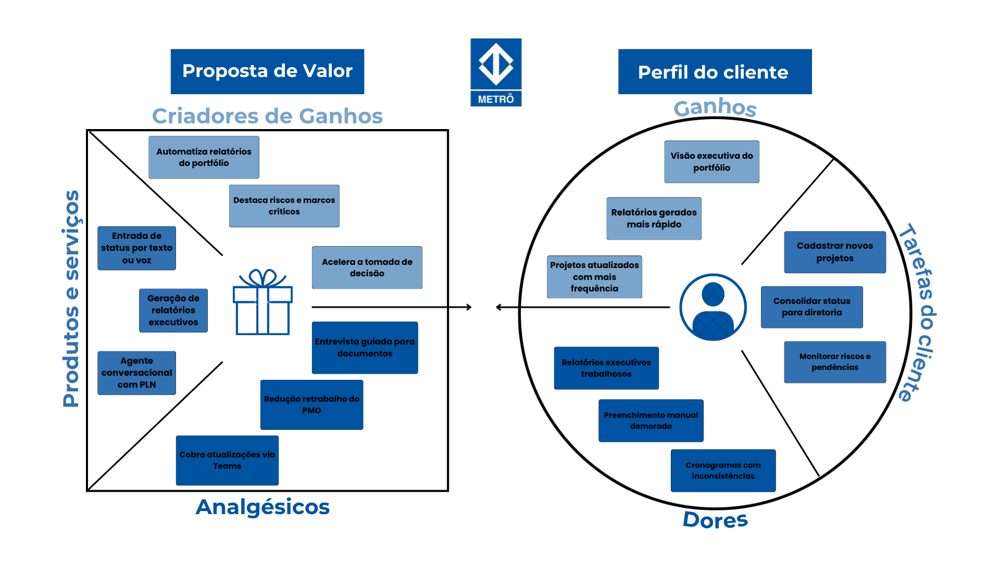
  <p><strong>Figura 12</strong> - Canvas de Proposta de Valor.</p>
  <sup>Fonte: Material produzido pelos autores, 2026.</sup>
</div>

A proposta de valor desenvolvida tem como foco apoiar o Metrô na otimização da gestão de seu portfólio de projetos, utilizando um agente com Processamento de Linguagem Natural integrado ao ecossistema Microsoft. A solução busca reduzir o esforço operacional envolvido no cadastro, acompanhamento e reporte de projetos, ao mesmo tempo em que aumenta a qualidade, a padronização e a disponibilidade das informações para tomada de decisão. Dessa forma, o perfil do cliente contempla principalmente o PMO, os líderes de projeto e a diretoria do Metrô.

Esses grupos correspondem às personas apresentadas na Seção 2.5. A diretoria é representada por Roberto, o PMO Corporativo por Mariana e a gerência de portfólio por Carlos. Os líderes de projeto formam o quarto grupo atendido pela solução e são os responsáveis por alimentar os documentos de cada projeto e manter o avanço atualizado.

**Ganhos esperados**: no canvas, aparecem como visão executiva do portfólio, relatórios gerados mais rápido e projetos atualizados com mais frequência. Eles destacam a busca por maior agilidade na gestão do portfólio, melhor qualidade das informações e maior visibilidade executiva sobre o andamento dos projetos. O principal desejo é transformar dados dispersos em informações confiáveis, acessíveis e acionáveis, permitindo que o PMO acompanhe pendências com mais eficiência, que líderes atualizem seus projetos com menos esforço e que a diretoria receba relatórios objetivos para apoiar decisões estratégicas.

**Tarefas do cliente**: no canvas, aparecem como cadastrar novos projetos, consolidar status para a diretoria e monitorar riscos e pendências. Elas giram em torno da necessidade de estruturar, acompanhar e reportar projetos de forma contínua. Os líderes de projeto precisam preencher documentos como o Termo de Abertura, o Mapa de Benefícios, cronogramas e atualizações de avanço físico-financeiro. O PMO precisa monitorar a qualidade desses registros, cobrar atualizações, consolidar dados e identificar riscos ou atrasos. Já a diretoria precisa consultar resumos executivos claros, com foco em status, riscos, marcos relevantes e evolução dos projetos do portfólio.

**Dores**: no canvas, aparecem como preenchimento manual demorado, relatórios executivos trabalhosos e cronogramas com inconsistências. Elas se traduzem no alto esforço manual para preencher documentos, consolidar planilhas e preparar relatórios executivos. Além disso, há dificuldade em manter as informações atualizadas no SharePoint, risco de inconsistências em cronogramas e avanços, baixa padronização dos registros e dependência de cobranças manuais por parte do PMO. Outro desafio relevante está na necessidade de interpretar rapidamente informações de múltiplas fontes, como arquivos Excel, listas do SharePoint e interações no Teams, sem comprometer a segurança e o controle de acesso corporativo.

Para responder a essas demandas, desenvolvemos uma solução composta por três frentes:

**Analgésicos**: no canvas, aparecem como entrevista guiada para documentos, redução do retrabalho do PMO e cobrança de atualizações via Teams. Eles atuam diretamente na redução das dores identificadas e incluem um agente conversacional capaz de conduzir entrevistas guiadas para preenchimento de documentos, diminuindo a complexidade de formulários estáticos. A solução também valida regras críticas, como a soma dos pesos do cronograma em 100%, coerência de datas e presença de campos obrigatórios. Além disso, o agente envia alertas proativos via Teams para cobrar atualizações de avanço e riscos, reduzindo a dependência de acompanhamento manual pelo PMO.

**Produtos e serviços**: no canvas, aparecem como agente conversacional com PLN, entrada de status por texto ou voz e geração de relatórios executivos. Eles são representados por um agente de IA integrado ao SharePoint, Teams e Excel. Esse agente permite a criação assistida de TAPs, Mapas de Benefícios e cronogramas, interpreta arquivos anexados, recebe atualizações por texto ou voz e gera relatórios executivos de status mensal. A solução também contempla filtros de segurança e escopo, adaptando o nível de detalhamento das respostas conforme o perfil do usuário, como líderes de projeto, PMO ou diretoria.

**Criadores de ganhos**: no canvas, aparecem como automatiza relatórios do portfólio, destaca riscos e marcos críticos e acelera a tomada de decisão. Eles agregam valor ao oferecer maior velocidade, consistência e inteligência ao ciclo de gestão de projetos. O agente gera rascunhos estruturados de documentos, recomenda melhorias no preenchimento, consolida informações físico-financeiras, destaca os principais riscos e marcos recentes e produz relatórios executivos de forma automatizada. Com isso, o PMO ganha tempo para atuar de forma mais estratégica, os líderes reduzem o esforço de atualização e a diretoria passa a contar com uma visão mais clara, confiável e atualizada do portfólio.

O canvas representa a proposta de valor completa do agente, considerando todo o ciclo de vida dos projetos no portfólio. O MVP desenvolvido neste módulo cobre um recorte dessa proposta, formalizado nos requisitos funcionais da Seção 3.1. As funcionalidades mínimas dessa primeira versão são receber comandos em linguagem natural, identificar a intenção do usuário e classificá-la em consulta, transação ou alerta, recuperar as informações dos documentos e dados sintéticos disponibilizados ao pipeline, responder às consultas, comparar informações entre projetos e devolver respostas estruturadas, indicando quando não houver informação suficiente para atender à solicitação.

Esse recorte se justifica por três motivos. O primeiro é que o pipeline de PLN sustenta todos os outros itens do canvas, já que sem a identificação correta da intenção nenhuma consulta ou transação funciona. O segundo é que a validação acontece sobre dados sintéticos, o que permite testar o ciclo completo sem depender da liberação de acesso ao portfólio real e sem tratar informações sensíveis fora de ambiente homologado. O terceiro é que o Mapa de Benefícios foi escolhido como documento piloto das transações do agente, por ser o artefato de entrada do ciclo de vida do projeto e por já estar modelado nos fluxos AS-IS e TO-BE apresentados na Seção 2.6.

Ficam como evolução prevista a integração com o portfólio real do Metrô, a cobrança automática de atualizações via Teams no ambiente corporativo, a extensão do preenchimento assistido aos demais documentos do ciclo e a integração com o Power BI.

Dessa forma, nosso principal objetivo é auxiliar o Metrô a otimizar a gestão de seu portfólio de projetos por meio de um agente inteligente, conversacional e integrado ao ambiente corporativo já utilizado pela organização. A solução fortalece a governança, reduz retrabalho, melhora a qualidade dos dados e apoia decisões mais rápidas e assertivas, contribuindo para uma gestão de projetos mais eficiente, padronizada e orientada por informações confiáveis.

---

## 2.10 Business Drivers

Os Business Drivers representam os principais fatores de negócio que motivam o desenvolvimento da solução e orientam os resultados esperados com sua implementação. No contexto deste projeto, esses direcionadores estabelecem a relação entre as necessidades identificadas na Gestão de Portfólio de Projetos do Metrô e as capacidades proporcionadas pelo Processamento de Linguagem Natural (PLN).

Atualmente, o PMO possui processos estruturados para gestão e acompanhamento do portfólio, porém atividades relacionadas à localização, consolidação e análise das informações ainda dependem de ações manuais. A distribuição das informações entre diferentes documentos e fontes aumenta o esforço necessário para responder consultas, acompanhar projetos e realizar análises envolvendo diferentes iniciativas do portfólio.

A aplicação de PLN busca modificar esse cenário ao permitir que o usuário expresse sua necessidade diretamente em linguagem natural. A solução passa a interpretar a solicitação, identificar sua intenção, recuperar as informações necessárias e produzir uma saída adequada ao contexto identificado. Dessa forma, a tecnologia atua como uma camada de acesso às informações do portfólio, reduzindo a necessidade de o usuário conhecer previamente a localização ou a estrutura dos dados consultados.

Além da eficiência na obtenção das informações, a confiabilidade constitui um aspecto relevante para o negócio. Como as respostas produzidas pelo agente podem ser utilizadas para acompanhamento dos projetos e apoio à tomada de decisão, é necessário reduzir a ocorrência de informações não sustentadas pelos dados disponíveis. Dessa forma, a avaliação da solução considera tanto indicadores positivos de desempenho quanto indicadores negativos, como a taxa de alucinação.

Considerando o problema identificado, os objetivos do projeto e os limites estabelecidos para o MVP, foram definidos os seguintes Business Drivers.

### 2.10.1 Business Drivers do Projeto

| ID   | Business Driver                                   | Necessidade de negócio                                                                                                               | Aplicação de PLN                                                                                                                                                                   | Resultado esperado                                                                                       |
| ---- | ------------------------------------------------- | ------------------------------------------------------------------------------------------------------------------------------------ | ---------------------------------------------------------------------------------------------------------------------------------------------------------------------------------- | -------------------------------------------------------------------------------------------------------- |
| BD01 | Agilizar o acesso às informações dos projetos     | Reduzir o esforço e o tempo empregados na localização e consolidação manual de informações distribuídas nos documentos dos projetos. | Interpretar consultas realizadas em linguagem natural, identificar a intenção do usuário e recuperar as informações relacionadas à solicitação.                                    | Acesso mais rápido às informações necessárias para acompanhamento dos projetos.                          |
| BD02 | Ampliar a capacidade de análise do portfólio      | Facilitar a obtenção de análises que atualmente exigem consulta e consolidação manual de informações de um ou mais projetos.         | Interpretar solicitações analíticas, recuperar informações relevantes e estruturar análises ou comparações entre projetos.                                                         | Maior agilidade na obtenção de informações para acompanhamento do portfólio e apoio à tomada de decisão. |
| BD03 | Aumentar a confiabilidade das respostas           | Reduzir inconsistências e o risco de respostas não sustentadas pelas informações disponibilizadas para processamento.                | Fundamentar as respostas nas informações recuperadas da base utilizada pelo pipeline e identificar situações nas quais não existam dados suficientes para responder adequadamente. | Respostas mais confiáveis, fundamentadas e adequadas às informações disponíveis.                         |
| BD04 | Tornar a interação com o portfólio mais acessível | Reduzir a dependência do conhecimento sobre a estrutura dos documentos e sistemas utilizados para localizar informações.             | Permitir que diferentes formulações em linguagem natural sejam interpretadas e associadas às intenções suportadas pelo agente.                                                     | Maior autonomia dos usuários para consultar informações relacionadas ao portfólio.                       |

### 2.10.2 Indicadores Computacionais

Para avaliar se as capacidades de PLN contribuem efetivamente para os direcionadores definidos, são utilizados indicadores computacionais associados às principais etapas do pipeline. Esses indicadores permitem verificar não apenas o funcionamento técnico da solução, mas também sua capacidade de produzir resultados compatíveis com as necessidades de negócio identificadas.

Os indicadores selecionados concentram-se na capacidade do sistema de compreender corretamente as solicitações, recuperar informações pertinentes, produzir respostas fundamentadas e realizar esse processamento de maneira eficiente. Também é considerada a ocorrência de alucinações como indicador negativo, uma vez que informações não sustentadas pela base utilizada podem comprometer a confiabilidade da solução.

| Indicador                              | O que avalia                                                                                                                                     | Relação com o negócio                                                                                                                                   |
| -------------------------------------- | ------------------------------------------------------------------------------------------------------------------------------------------------ | ------------------------------------------------------------------------------------------------------------------------------------------------------- |
| Acurácia da classificação de intenção  | Percentual de solicitações cuja intenção é corretamente identificada pelo pipeline.                                                              | Indica a capacidade do agente de compreender a necessidade do usuário e direcioná-la ao fluxo adequado.                                                 |
| Precisão da recuperação de informações | Proporção das informações recuperadas que são relevantes para a solicitação realizada.                                                           | Contribui para respostas mais confiáveis e reduz informações irrelevantes durante consultas e análises.                                                 |
| Cobertura da recuperação               | Capacidade de recuperar as informações relevantes existentes na base para determinada solicitação.                                               | Reduz a possibilidade de informações importantes serem omitidas nas respostas.                                                                          |
| Taxa de respostas fundamentadas        | Proporção de respostas cujas informações podem ser relacionadas aos dados utilizados pelo pipeline.                                              | Avalia a confiabilidade e a rastreabilidade das informações apresentadas pelo agente.                                                                   |
| Taxa de alucinação ↓                   | Percentual de respostas que apresentam informações factuais não sustentadas ou contraditórias em relação aos dados disponibilizados ao pipeline. | Indicador negativo a ser minimizado, pois respostas não fundamentadas podem gerar desinformação e comprometer a confiança e a tomada de decisão do PMO. |
| Tempo de processamento                 | Tempo entre o recebimento da solicitação e a disponibilização da resposta.                                                                       | Permite avaliar a agilidade proporcionada pelo novo fluxo de consulta e análise.                                                                        |

A taxa de alucinação é tratada como um indicador negativo de qualidade, portanto, quanto menor seu valor, melhor o desempenho esperado da solução. Sua avaliação é especialmente relevante no contexto do projeto, uma vez que o agente deve utilizar as informações disponibilizadas como fundamento para suas respostas, evitando apresentar como fato informações inexistentes, não recuperadas ou contraditórias em relação à base utilizada.

Os indicadores deverão ser avaliados utilizando os dados sintéticos definidos para a prova de conceito, respeitando a delimitação estabelecida para o MVP. Caso a entrada por áudio seja incorporada à avaliação da solução, poderão ser utilizados adicionalmente indicadores específicos relacionados à qualidade da transcrição.

### 2.10.3 Fluxos de Negócio Impactados

A aplicação de PLN modifica principalmente a forma como os usuários acessam e analisam as informações relacionadas ao portfólio. Em vez de depender exclusivamente da localização manual de documentos e da consolidação das informações encontradas, o usuário passa a iniciar esses processos por meio de uma solicitação em linguagem natural.

Dentro do escopo definido para o MVP, dois fluxos representam diretamente essa transformação: a consulta de informações de um projeto e a análise e comparação de informações entre projetos.

#### 2.10.3.1 Fluxo 1 — Consulta de Informações de Projetos

No processo atual, a obtenção de uma informação específica sobre determinado projeto pode exigir que o usuário identifique onde a informação está armazenada, localize o documento correspondente e consulte seu conteúdo para encontrar o dado desejado. Dependendo da natureza da solicitação, também pode ser necessário consultar diferentes fontes ou consolidar informações manualmente.

Com a solução proposta, o usuário passa a iniciar o processo diretamente por meio de uma solicitação em linguagem natural. Uma pergunta como "Qual o prazo do Projeto XPTO?", por exemplo, é recebida pelo pipeline de PLN, que interpreta o comando, identifica a intenção correspondente, recupera as informações relacionadas ao projeto e estrutura a resposta.

O fluxo proposto pode ser representado da seguinte maneira:

**Solicitação em linguagem natural → processamento da linguagem → identificação e classificação da intenção → recuperação das informações → estruturação da resposta → apresentação ao usuário.**

| Elemento               | Descrição                                                                                                                                                               |
| ---------------------- | ----------------------------------------------------------------------------------------------------------------------------------------------------------------------- |
| Entrada                | Solicitação do usuário em linguagem natural relacionada a informações disponíveis sobre determinado projeto.                                                            |
| Processamento esperado | Interpretação da solicitação, identificação e classificação da intenção, recuperação das informações relevantes e estruturação da resposta.                             |
| Saída                  | Resposta relacionada à informação solicitada e fundamentada nos dados disponíveis.                                                                                      |
| Indicadores            | Acurácia da classificação de intenção, precisão da recuperação, cobertura da recuperação, taxa de respostas fundamentadas, taxa de alucinação e tempo de processamento. |
| Ganho esperado         | Redução do esforço e do tempo necessários para localizar e consultar informações dos projetos, aumentando a autonomia do usuário.                                       |

Esse fluxo está diretamente relacionado aos Business Drivers BD01, BD03 e BD04.

A classificação correta da intenção é especialmente importante nesse processo, pois determina como a solicitação deverá ser tratada pelo pipeline. Da mesma forma, a precisão e a cobertura da recuperação permitem avaliar se o sistema encontrou as informações adequadas, enquanto a taxa de respostas fundamentadas e a taxa de alucinação permitem avaliar a confiabilidade do conteúdo apresentado.

#### 2.10.3.2 Fluxo 2 — Análise e Comparação entre Projetos

Além das consultas individuais, a gestão do portfólio exige a análise conjunta de informações provenientes de diferentes projetos. Atualmente, esse processo pode exigir a localização das informações de cada iniciativa e sua posterior consolidação para permitir a comparação dos elementos relevantes.

Com a utilização de PLN, o usuário poderá formular diretamente uma solicitação analítica, especificando os projetos e os aspectos que deseja comparar. A solicitação pode envolver, por exemplo, a comparação de status, riscos, marcos, prazos ou avanço entre diferentes projetos disponíveis na base utilizada pela solução.

O pipeline deverá interpretar a solicitação, identificar sua intenção, reconhecer os projetos e critérios envolvidos, recuperar as informações correspondentes e estruturar os resultados de maneira que facilite sua interpretação pelo usuário.

O fluxo proposto pode ser representado da seguinte maneira:

**Solicitação analítica em linguagem natural → identificação da intenção → identificação dos projetos e critérios → recuperação das informações → análise e comparação → estruturação dos resultados → apresentação ao usuário.**

| Elemento               | Descrição                                                                                                                                                                      |
| ---------------------- | ------------------------------------------------------------------------------------------------------------------------------------------------------------------------------ |
| Entrada                | Solicitação em linguagem natural contendo os projetos e/ou critérios que deverão ser analisados.                                                                               |
| Processamento esperado | Identificação da intenção analítica, identificação dos projetos e critérios relevantes, recuperação das informações correspondentes, comparação e estruturação dos resultados. |
| Saída                  | Resposta estruturada apresentando as informações relevantes para análise e comparação dos projetos.                                                                            |
| Indicadores            | Acurácia da classificação de intenção, precisão da recuperação, cobertura da recuperação, taxa de respostas fundamentadas, taxa de alucinação e tempo de processamento.        |
| Ganho esperado         | Redução do esforço necessário para consolidar informações e maior agilidade na realização de análises para acompanhamento do portfólio e apoio à tomada de decisão.            |

Esse fluxo está diretamente relacionado aos Business Drivers BD02 e BD03.

Nesse fluxo, a confiabilidade possui importância ainda maior, pois a resposta pode combinar informações provenientes de diferentes projetos. A redução da taxa de alucinação e a manutenção de uma elevada taxa de respostas fundamentadas contribuem para evitar que informações inexistentes ou inferências não sustentadas sejam apresentadas ao usuário como fatos durante uma análise comparativa.

### 2.10.4 Relação entre Business Drivers, Fluxos e Indicadores

Os Business Drivers, fluxos de negócio e indicadores computacionais estabelecem diferentes níveis de avaliação da transformação proposta. Os Business Drivers representam os resultados desejados para o negócio; os fluxos demonstram como a interação atual é modificada pela aplicação de PLN; e os indicadores permitem avaliar quantitativamente o desempenho das capacidades computacionais responsáveis por essa transformação.

| Business Driver                                          | Fluxo relacionado                   | Principais indicadores                                                                                               |
| -------------------------------------------------------- | ----------------------------------- | -------------------------------------------------------------------------------------------------------------------- |
| BD01 — Agilizar o acesso às informações dos projetos     | Consulta de informações de projetos | Acurácia da intenção, precisão e cobertura da recuperação e tempo de processamento.                                  |
| BD02 — Ampliar a capacidade de análise do portfólio      | Análise e comparação entre projetos | Acurácia da intenção, precisão e cobertura da recuperação, tempo de processamento e taxa de respostas fundamentadas. |
| BD03 — Aumentar a confiabilidade das respostas           | Ambos os fluxos                     | Taxa de respostas fundamentadas e taxa de alucinação.                                                                |
| BD04 — Tornar a interação com o portfólio mais acessível | Consulta de informações de projetos | Acurácia da classificação de intenção e capacidade de interpretação das solicitações em linguagem natural.           |

Essa relação permite que a avaliação técnica do pipeline seja associada aos resultados esperados para o negócio. Uma elevada acurácia na identificação das intenções, por exemplo, possui valor para o PMO porque permite que as solicitações sejam direcionadas corretamente. Da mesma forma, uma elevada precisão na recuperação das informações contribui para respostas mais pertinentes, enquanto uma baixa taxa de alucinação contribui diretamente para a confiabilidade das informações apresentadas.

### 2.10.5 Impacto Esperado no Negócio

A principal transformação proposta pelo projeto não consiste na substituição dos processos de gestão de projetos existentes, mas na mudança da forma como os usuários interagem com as informações produzidas e utilizadas nesses processos. O PLN introduz uma camada capaz de transformar solicitações expressas naturalmente pelos usuários em operações estruturadas sobre as informações disponíveis.

Dessa forma, atividades que atualmente exigem busca, leitura e consolidação manual passam a ser apoiadas por um pipeline capaz de compreender a intenção da solicitação, recuperar informações e organizar os resultados. Essa transformação busca reduzir o esforço operacional associado às consultas, aumentar a agilidade das análises e ampliar a autonomia dos usuários no acesso às informações relacionadas ao portfólio.

Ao mesmo tempo, a aplicação de Inteligência Artificial introduz a necessidade de controlar a confiabilidade das respostas produzidas. Por esse motivo, o ganho de eficiência não deve ser analisado isoladamente. A solução deve equilibrar agilidade e qualidade, buscando maximizar indicadores relacionados à correta compreensão das solicitações, recuperação e fundamentação das respostas enquanto minimiza indicadores negativos, principalmente a taxa de alucinação.

No contexto acadêmico do MVP, esses resultados serão avaliados por meio do pipeline de PLN utilizando dados sintéticos. A integração com o portfólio real do Metrô e a execução de processos corporativos sobre dados reais são consideradas evoluções posteriores e não constituem condição necessária para a validação dos Business Drivers nesta etapa.

---

# 3. Requisitos do Projeto

## 3.1 Requisitos Funcionais

Os requisitos funcionais definem as funcionalidades que deverão ser contempladas pela prova de conceito desenvolvida no MVP. Sua definição considera o escopo estabelecido para o projeto e as oportunidades levantadas durante o processo de ideação, priorizando as funcionalidades diretamente relacionadas ao pipeline de Processamento de Linguagem Natural (PLN).

O núcleo do MVP consiste em um pipeline de PLN capaz de receber comandos em linguagem natural, interpretar semanticamente as solicitações dos usuários e identificar a intenção primária de cada interação. O catálogo de intenções determina então a rota de processamento: intenções com fluxo automatizado são executadas diretamente, sem passar por um LLM; intenções pertencentes ao escopo, mas sem automação cadastrada, são encaminhadas ao LLM com contexto estruturado e validado. Nesse segundo ramo, quando a proatividade estiver habilitada, o sistema associa à intenção primária uma intenção secundária compatível e a apresenta como sugestão opcional de próximo passo.

Por se tratar de uma prova de conceito em contexto acadêmico, o funcionamento do MVP será validado sobre dados sintéticos. Integrações com dados reais do portfólio do Metrô de São Paulo e demais funcionalidades corporativas identificadas durante a ideação são consideradas possibilidades de evolução da solução e não constituem requisitos obrigatórios para a validação do núcleo funcional do MVP.

|  ID  | Requisito Funcional                                                                                                                                                                           | Feature relacionada                  | Prioridade |    Status    |
| :--: | --------------------------------------------------------------------------------------------------------------------------------------------------------------------------------------------- | ------------------------------------ | :--------: | :----------: |
| RF01 | O sistema deve receber comandos textuais em linguagem natural relacionados à gestão de projetos e portfólio.                                                                                  | Consulta de informações dos projetos | Muito Alta | Não iniciado |
| RF02 | O sistema deve processar semanticamente os comandos recebidos e identificar a intenção primária expressa pelo usuário.                                                                        | Consulta de informações dos projetos | Muito Alta | Não iniciado |
| RF03 | O sistema deve associar a intenção primária ao catálogo do MVP, incluindo sua categoria e a existência ou não de um fluxo automatizado correspondente.                                           | Consulta de informações dos projetos | Muito Alta | Não iniciado |
| RF04 | O sistema deve recuperar informações relevantes dos documentos e dados sintéticos disponibilizados ao pipeline de acordo com a solicitação realizada.                                         | Ingestão de informações dos projetos | Muito Alta | Não iniciado |
| RF05 | O sistema deve responder a consultas sobre as informações disponíveis nos documentos de projetos utilizados na prova de conceito.                                                             | Consulta de informações dos projetos | Muito Alta | Não iniciado |
| RF06 | O sistema deve realizar análises e comparações entre informações de diferentes projetos quando solicitado pelo usuário.                                                                       | Consulta de informações dos projetos | Muito Alta | Não iniciado |
| RF07 | O sistema deve encaminhar cada intenção pertencente ao escopo para a rota definida no catálogo: fluxo automatizado sem uso de LLM ou LLM com contexto estruturado e validado quando não houver automação correspondente. | Ingestão de informações dos projetos | Muito Alta | Não iniciado |
| RF08 | O sistema deve retornar o resultado da rota executada de forma estruturada e fundamentada, preservando as referências disponíveis e indicando quando não houver informações suficientes.         | Consulta de informações dos projetos | Muito Alta | Não iniciado |
| RF09 | Para intenções sem fluxo automatizado, o sistema deve, quando a proatividade estiver habilitada, associar uma intenção secundária compatível e apresentá-la como sugestão opcional de próximo passo, sem executá-la sem confirmação do usuário. | Consulta de informações dos projetos | Muito Alta | Não iniciado |
| RF10 | O sistema deve permitir ao usuário ativar ou desativar as sugestões proativas sem alterar o processamento da intenção primária.                                                                 | Edição das configurações do agente por menu | Alta | Não iniciado |

### 3.1.1 User Stories dos Requisitos Funcionais

As User Stories apresentadas nesta subseção estão diretamente integradas aos respectivos requisitos funcionais da Seção 3.1. Cada história segue a estrutura "Como [usuário], quero [necessidade], para [valor]", estabelecendo a necessidade que fundamenta o requisito e o benefício esperado pelo usuário.

Os critérios de aceitação estabelecem condições verificáveis para validação das funcionalidades dentro dos limites da prova de conceito, considerando a utilização de dados sintéticos e o desenvolvimento do pipeline de PLN como núcleo do MVP.

### RF01 — Entrada de comandos em linguagem natural

**User Story — US01**

Como usuário da solução, quero realizar solicitações utilizando linguagem natural, para interagir com as informações dos projetos sem precisar utilizar comandos técnicos ou conhecer a estrutura dos dados.

**Critérios de aceitação:**

* O sistema deve aceitar solicitações textuais em linguagem natural.
* O sistema deve aceitar solicitações em áudio, convertendo-as em texto antes do processamento, conforme a modalidade de entrada descrita na Seção 8.8.
* O usuário não deve precisar utilizar uma sintaxe técnica específica.
* A solicitação recebida deve ser encaminhada ao pipeline de PLN para processamento.

**Features relacionadas:** Consulta de informações dos projetos; Transcrição de áudio.

---

### RF02 — Identificação semântica da intenção

**User Story — US02**

Como usuário da solução, quero que o sistema compreenda semanticamente o que desejo realizar, para que minha solicitação seja interpretada de acordo com seu contexto.

**Critérios de aceitação:**

* O sistema deve processar semanticamente a solicitação recebida.
* O sistema deve identificar a intenção primária presente no comando do usuário.
* A intenção identificada deve ser encaminhada para classificação nas categorias suportadas pelo MVP.

**Feature relacionada:** Consulta de informações dos projetos.

---

### RF03 — Classificação e associação da intenção ao catálogo

**User Story — US03**

Como usuário da solução, quero que a intenção primária seja associada ao catálogo de capacidades, para que o sistema determine corretamente como processar minha solicitação.

**Critérios de aceitação:**

* O sistema deve associar a intenção primária a uma entrada do catálogo do MVP.
* O catálogo deve contemplar, no mínimo, as categorias consulta, transação e alerta.
* A entrada do catálogo deve indicar se existe um fluxo automatizado correspondente.
* Quando a intenção não pertencer ao escopo suportado, o sistema deve orientar a reformulação ou informar o limite da solução.

**Feature relacionada:** Consulta de informações dos projetos.

---

### RF04 — Recuperação de informações

**User Story — US04**

Como usuário da solução, quero que o sistema localize informações relevantes nos documentos de projetos, para obter respostas relacionadas ao contexto da minha solicitação.

**Critérios de aceitação:**

* O sistema deve consultar os documentos e dados sintéticos disponibilizados para a prova de conceito.
* O sistema deve recuperar informações relacionadas à solicitação realizada.
* As informações recuperadas devem ser utilizadas como contexto para o processamento da resposta.

**Feature relacionada:** Ingestão de informações dos projetos.

---

### RF05 — Consulta de informações dos projetos

**User Story — US05**

Como usuário da solução, quero consultar informações sobre os projetos utilizando linguagem natural, para acessar rapidamente os dados necessários para acompanhamento e análise.

**Critérios de aceitação:**

* O sistema deve responder a consultas relacionadas às informações disponíveis nos dados sintéticos.
* A resposta deve considerar o projeto ou contexto solicitado pelo usuário.
* A resposta deve utilizar as informações recuperadas pelo pipeline.
* Quando a informação solicitada não estiver disponível, o sistema deve indicar essa limitação.

**Feature relacionada:** Consulta de informações dos projetos.

---

### RF06 — Análise e comparação de projetos

**User Story — US06**

Como gestor do portfólio, quero solicitar análises e comparações entre projetos, para identificar diferenças, semelhanças e informações relevantes que apoiem a tomada de decisão.

**Critérios de aceitação:**

* O sistema deve identificar quando a solicitação exigir análise ou comparação.
* O sistema deve permitir comparar informações disponíveis de dois ou mais projetos.
* A comparação deve considerar os critérios informados pelo usuário quando aplicável.
* O resultado deve ser fundamentado nos dados sintéticos disponíveis.

**Feature relacionada:** Consulta de informações dos projetos.

---

### RF07 — Roteamento híbrido das intenções

**User Story — US07**

Como usuário da solução, quero que minha solicitação siga a rota prevista para a intenção identificada, para que ações conhecidas sejam executadas diretamente e as demais solicitações válidas recebam tratamento pelo LLM.

**Critérios de aceitação:**

* Quando o catálogo indicar um fluxo automatizado, o sistema deve encaminhar a ele a intenção e os parâmetros estruturados necessários.
* Uma solicitação atendida por fluxo automatizado não deve ser enviada ao LLM.
* Quando a intenção pertencer ao escopo, mas não possuir fluxo automatizado, o sistema deve encaminhar ao LLM somente a intenção e o contexto estruturado e validado necessário para produzir a resposta.
* O comportamento das duas rotas deve poder ser demonstrado utilizando dados sintéticos ou simulações controladas.

**Feature relacionada:** Ingestão de informações dos projetos.

---

### RF08 — Geração de respostas estruturadas e fundamentadas

**User Story — US08**

Como usuário da solução, quero receber respostas estruturadas e fundamentadas nas informações disponíveis, para compreender os resultados apresentados pelo agente e utilizá-los com maior confiança.

**Critérios de aceitação:**

* O resultado de um fluxo automatizado deve corresponder à ação executada ou simulada e informar seu estado de conclusão.
* A resposta produzida pelo LLM deve considerar apenas a intenção e as informações estruturadas e validadas disponibilizadas pelo pipeline.
* O sistema não deve apresentar como fato informações que não estejam sustentadas pelos dados disponíveis.
* Quando não houver informações suficientes, o sistema deve indicar a limitação ao usuário.
* O retorno deve ser estruturado de forma coerente com a rota executada e preservar as referências disponíveis.
* Em solicitações analíticas, o sistema deve diferenciar informações recuperadas de interpretações produzidas pelo agente.

**Feature relacionada:** Consulta de informações dos projetos.

---

### RF09 — Sugestão proativa de intenção secundária

**User Story — US09**

Como usuário da solução, quero receber uma sugestão opcional relacionada à minha solicitação, para identificar um próximo passo útil sem perder o controle da interação.

**Critérios de aceitação:**

* A sugestão deve ser considerada somente quando a intenção primária pertencer ao escopo, não possuir fluxo automatizado e a proatividade estiver habilitada.
* O sistema deve selecionar no catálogo uma intenção secundária compatível com a intenção primária e com as capacidades disponíveis.
* A sugestão deve ser apresentada separadamente da resposta principal e identificada como opcional.
* A intenção secundária não deve ser executada sem confirmação explícita do usuário.
* Caso o usuário recuse a sugestão, o sistema deve encerrá-la sem alterar a resposta da intenção primária.
* Quando não existir intenção secundária compatível, o sistema deve retornar somente a resposta principal, sem criar uma sugestão não cadastrada.

**Feature relacionada:** Consulta de informações dos projetos.

---

### RF10 — Controle da proatividade

**User Story — US10**

Como usuário da solução, quero ativar ou desativar as sugestões proativas, para controlar se o agente deve oferecer próximos passos durante minhas consultas.

**Critérios de aceitação:**

* O sistema deve disponibilizar na interface um controle com os estados ativado e desativado.
* O estado selecionado deve ser considerado nas interações iniciadas após a alteração.
* Com a proatividade desativada, o sistema não deve apresentar as sugestões previstas no RF09.
* A desativação da proatividade não deve impedir a identificação, o roteamento nem a resposta da intenção primária.

**Feature relacionada:** Edição das configurações do agente por menu.


### 3.1.2 Modelagem Estática Inicial dos Requisitos Funcionais

A modelagem estática apresentada nesta subseção representa as principais classes de domínio necessárias para descrever o comportamento previsto pelos requisitos funcionais do MVP. O objetivo nesta etapa não é definir integralmente a arquitetura ou a implementação do sistema, mas demonstrar a relação entre as histórias de usuário, os dados manipulados e as responsabilidades necessárias ao funcionamento do pipeline.

A modelagem considera a `Solicitacao` como elemento de entrada do sistema. Cada solicitação possui uma `Intencao` primária, identificada pelo pipeline e associada ao `CatalogoIntencoes`. O catálogo informa ao `RoteadorIntencao` se existe um fluxo automatizado: quando existe, o `ExecutorFluxoAutomatizado` processa a solicitação sem acionar o LLM; caso contrário, o `GeradorLLM` recebe somente o contexto estruturado e validado. Quando a proatividade está ativa, uma `SugestaoProativa` pode associar à intenção primária uma intenção secundária cadastrada, que depende da confirmação do usuário para ser executada.

<div align="center">
  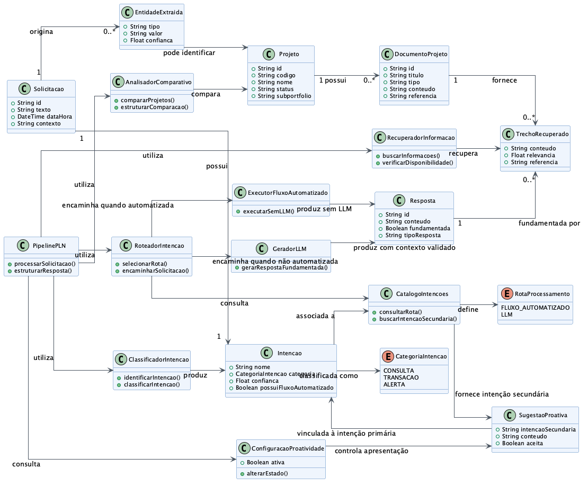
</div>

<p align="center"><strong>Figura 13</strong> - Modelagem estática inicial dos requisitos funcionais.<br><sup>Fonte: Material produzido pelos autores, 2026.</sup></p>

O código-fonte do diagrama está versionado em [`docs/diagrams/modelagem-estatica.puml`](diagrams/modelagem-estatica.puml) e pode ser regerado com PlantUML e Graphviz instalados:

```bash
java -jar plantuml.jar -charset UTF-8 -tpng -o ../img docs/diagrams/modelagem-estatica.puml
```

O modelo estático mantém relação direta com os requisitos funcionais. `Solicitacao` e `PipelinePLN` representam a entrada em linguagem natural prevista no RF01; `Intencao`, `ClassificadorIntencao` e `CatalogoIntencoes` representam os RF02 e RF03; `DocumentoProjeto`, `TrechoRecuperado` e `RecuperadorInformacao` representam o RF04; `Projeto` e `Resposta` sustentam o RF05; e `AnalisadorComparativo` representa o RF06. O `RoteadorIntencao`, as duas rotas e seus executores tornam explícita a separação exigida pelo RF07. As respostas produzidas em ambas as rotas atendem ao RF08. Por fim, `SugestaoProativa` representa a intenção secundária do RF09 e `ConfiguracaoProatividade` representa o controle previsto no RF10.

| Elemento da modelagem                                            | Requisitos relacionados |
| ---------------------------------------------------------------- | ----------------------- |
| `Solicitacao`                                                    | RF01                    |
| `ClassificadorIntencao`, `Intencao` e `CatalogoIntencoes`        | RF02, RF03              |
| `RecuperadorInformacao`, `DocumentoProjeto` e `TrechoRecuperado` | RF04                    |
| `Projeto` e `Resposta`                                           | RF05                    |
| `AnalisadorComparativo`                                          | RF06                    |
| `CategoriaIntencao`, `RoteadorIntencao` e `RotaProcessamento`    | RF03, RF07              |
| `ExecutorFluxoAutomatizado` e `GeradorLLM`                       | RF07, RF08              |
| `Resposta` fundamentada por `TrechoRecuperado`                   | RF08                    |
| `SugestaoProativa`                                               | RF09                    |
| `ConfiguracaoProatividade`                                       | RF10                    |

Essa modelagem representa uma visão inicial do domínio da solução. O modelo de classes definitivo, incluindo decisões de implementação, tipos de persistência, interfaces técnicas e demais entidades identificadas durante o desenvolvimento, será aprofundado na seção de Solução Técnica em uma etapa posterior do projeto.


### 3.1.3 Modelagem Dinâmica Inicial dos Requisitos Funcionais

A modelagem dinâmica apresenta os principais cenários de interação derivados das histórias de usuário. Para esta etapa foram selecionados três fluxos que, em conjunto, representam o funcionamento central previsto para o MVP: consulta de informações de um projeto, análise comparativa entre projetos e roteamento híbrido com sugestão proativa configurável.

Os diagramas representam o comportamento esperado do sistema em nível funcional. Componentes e integrações poderão ser refinados posteriormente conforme a arquitetura definitiva da solução for desenvolvida.

### 3.1.3.1 Cenário 1 — Consulta de informação de um projeto

Este cenário representa uma solicitação como **"Qual o prazo do projeto XPTO?"**, classificada como pertencente ao escopo, mas sem fluxo automatizado cadastrado. O fluxo cobre principalmente os requisitos RF01, RF02, RF03, RF04, RF05, RF07 e RF08.

<div align="center">
  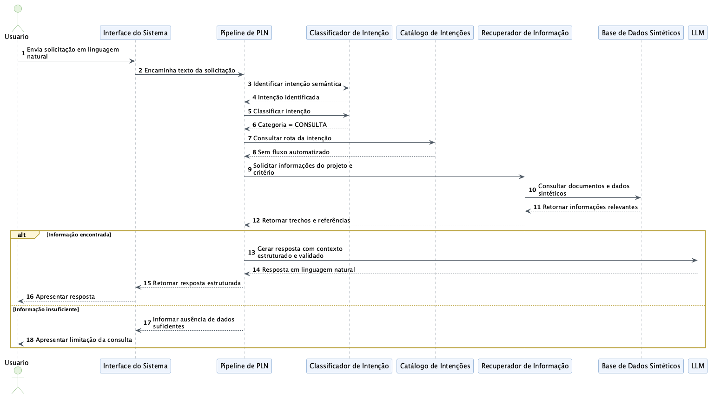
</div>

<p align="center"><strong>Figura 14</strong> - Cenário 1 — Consulta de informação de um projeto.<br><sup>Fonte: Material produzido pelos autores, 2026.</sup></p>

O código-fonte do diagrama está versionado em [`docs/diagrams/sequencia-cenario-1.puml`](diagrams/sequencia-cenario-1.puml) e pode ser regerado com PlantUML e Graphviz instalados:

```bash
java -jar plantuml.jar -charset UTF-8 -tpng -o ../img docs/diagrams/sequencia-cenario-1.puml
```

O cenário começa com o RF01, quando o usuário envia uma solicitação em linguagem natural. O RF02 é representado pela identificação semântica da intenção e o RF03 por sua associação ao catálogo. Como não existe fluxo automatizado, o RF07 determina que somente o contexto estruturado e validado seja encaminhado ao LLM. O RF04 determina a recuperação dos dados relevantes, o RF05 corresponde à resposta sobre o projeto solicitado e o RF08 exige que as informações recuperadas fundamentem o retorno ou que a insuficiência seja declarada.

### 3.1.3.2 Cenário 2 — Análise e comparação entre projetos

Este cenário representa uma solicitação como **"Compare os riscos e os prazos dos projetos XPTO e ABC"**, tratada como intenção analítica sem fluxo automatizado. O fluxo cobre principalmente os requisitos RF01, RF02, RF03, RF04, RF06, RF07 e RF08.

<div align="center">
  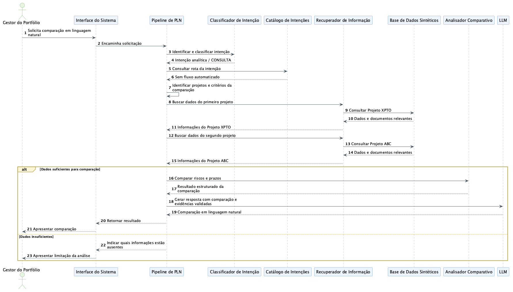
</div>

<p align="center"><strong>Figura 15</strong> - Cenário 2 — Análise e comparação entre projetos.<br><sup>Fonte: Material produzido pelos autores, 2026.</sup></p>

O código-fonte do diagrama está versionado em [`docs/diagrams/sequencia-cenario-2.puml`](diagrams/sequencia-cenario-2.puml) e pode ser regerado com PlantUML e Graphviz instalados:

```bash
java -jar plantuml.jar -charset UTF-8 -tpng -o ../img docs/diagrams/sequencia-cenario-2.puml
```

Nesse cenário, o RF06 diferencia o fluxo de uma consulta simples, pois exige recuperar informações referentes a dois ou mais projetos e aplicar uma etapa adicional de comparação. O RF07 encaminha ao LLM o resultado estruturado dessa análise porque o catálogo não possui automação correspondente. O resultado continua sujeito ao RF08: somente informações sustentadas pelos dados disponíveis devem ser apresentadas como fato.

### 3.1.3.3 Cenário 3 — Roteamento híbrido e sugestão proativa

Este cenário representa o comportamento do pipeline após identificar a intenção primária. O catálogo diferencia uma intenção fora do escopo, uma intenção com fluxo automatizado e uma intenção válida sem automação. Somente o último ramo utiliza o LLM e pode apresentar uma intenção secundária quando a proatividade estiver habilitada. O cenário cobre principalmente RF01, RF02, RF03, RF07, RF08, RF09 e RF10.

<div align="center">
  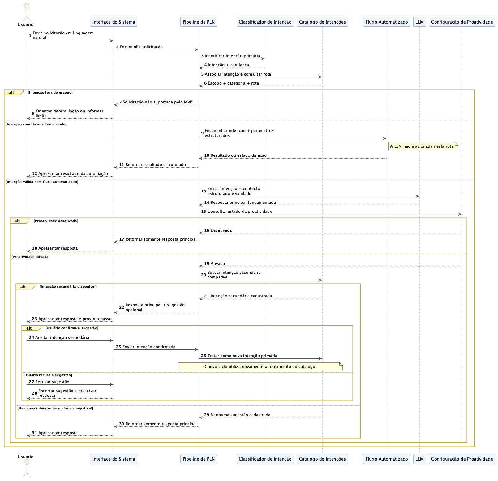
</div>

<p align="center"><strong>Figura 16</strong> - Cenário 3 — Roteamento híbrido e sugestão proativa.<br><sup>Fonte: Material produzido pelos autores, 2026.</sup></p>

O código-fonte do diagrama está versionado em [`docs/diagrams/sequencia-cenario-3.puml`](diagrams/sequencia-cenario-3.puml) e pode ser regerado com PlantUML e Graphviz instalados:

```bash
java -jar plantuml.jar -charset UTF-8 -tpng -o ../img docs/diagrams/sequencia-cenario-3.puml
```

A separação entre identificação, catalogação e roteamento é importante nesse fluxo. O RF02 corresponde à compreensão da intenção primária e o RF03 associa essa intenção à categoria e à rota controladas pelo catálogo. O RF07 garante que a rota automatizada não utilize o LLM e que apenas intenções válidas sem automação recebam tratamento generativo. O RF08 rege o resultado das duas rotas.

No ramo não automatizado, o RF09 permite apresentar uma intenção secundária cadastrada junto à resposta principal, mas exige confirmação antes de executá-la. O RF10 mantém essa iniciativa sob controle do usuário: quando a proatividade está desativada, o sistema continua identificando, roteando e respondendo à intenção primária, mas não oferece o próximo passo. Dessa forma, a proatividade documentada depende da consulta atual e não pressupõe observação contínua da atividade do usuário.


### 3.1.4 Rastreabilidade entre User Stories e Modelagem UML

A tabela a seguir consolida a relação entre os requisitos funcionais, suas histórias de usuário e os elementos de modelagem estática e dinâmica apresentados nesta seção.

| RF   | User Story                                 | Elementos do diagrama de classes                                | Cenário de sequência |
| ---- | ------------------------------------------ | --------------------------------------------------------------- | -------------------- |
| RF01 | US01 — Entrada em linguagem natural        | `Solicitacao`, `PipelinePLN`                                    | Cenários 1, 2 e 3    |
| RF02 | US02 — Identificação da intenção primária  | `ClassificadorIntencao`, `Intencao`                             | Cenários 1, 2 e 3    |
| RF03 | US03 — Associação da intenção ao catálogo  | `Intencao`, `CategoriaIntencao`, `CatalogoIntencoes`             | Cenários 1, 2 e 3    |
| RF04 | US04 — Recuperação de informações          | `RecuperadorInformacao`, `DocumentoProjeto`, `TrechoRecuperado` | Cenários 1 e 2       |
| RF05 | US05 — Consulta de projetos                | `Projeto`, `Resposta`                                           | Cenário 1            |
| RF06 | US06 — Análise e comparação                | `AnalisadorComparativo`, `Projeto`                              | Cenário 2            |
| RF07 | US07 — Roteamento híbrido                  | `RoteadorIntencao`, `RotaProcessamento`, `ExecutorFluxoAutomatizado`, `GeradorLLM` | Cenários 1, 2 e 3 |
| RF08 | US08 — Resposta fundamentada               | `Resposta`, `TrechoRecuperado`, `ExecutorFluxoAutomatizado`, `GeradorLLM` | Cenários 1, 2 e 3 |
| RF09 | US09 — Sugestão de intenção secundária     | `SugestaoProativa`, `CatalogoIntencoes`                          | Cenário 3            |
| RF10 | US10 — Controle da proatividade            | `ConfiguracaoProatividade`                                      | Cenário 3            |

Essa rastreabilidade demonstra que os requisitos funcionais não estão isolados da modelagem: as classes representam os conceitos necessários para sua execução e os diagramas de sequência demonstram como esses elementos colaboram nos principais cenários previstos pelas histórias de usuário.

A modelagem apresentada nesta seção possui caráter inicial e está diretamente associada à Especificação de Requisitos da Sprint 1. Nas etapas posteriores do projeto, os diagramas poderão ser refinados na seção de Solução Técnica, incorporando as decisões definitivas de arquitetura, interfaces, componentes, persistência e implementação.


### 3.1.5 Escopo dos requisitos funcionais

Os dez requisitos funcionais não têm o mesmo horizonte de entrega, e a distinção precisa estar declarada para que a especificação não conflite com a matriz de priorização da Seção 2.8 nem com o recorte do MVP registrado na Seção 2.9.

| Requisito | Escopo | Justificativa |
|---|---|---|
| RF01 a RF08 | **MVP** | Compõem o pipeline de consulta e resposta fundamentada, que é o recorte declarado na Seção 2.9 e sustentado pelas features da faixa Muito Alta da Seção 2.8 |
| RF09 — Sugestão proativa de intenção secundária | **Previsto, pós-MVP** | Decorre da prototipação exploratória da Seção 3.8, cuja questão era o regime de iniciativa do agente. O comportamento proativo está no Bloco 3 da Seção 2.4.3, fora do MVP |
| RF10 — Controle da proatividade | **Previsto, pós-MVP** | Depende da feature "Edição das configurações do agente por menu", classificada na faixa Evolução da Seção 2.8. Sem RF09 implementado, não há proatividade a controlar |

A especificação de RF09 e RF10 nesta sprint é deliberada e não amplia o escopo do MVP. A prototipação exploratória produziu uma decisão de comportamento — o agente pode sugerir, mas nunca executar sem confirmação — e registrar essa decisão como requisito, com critérios de aceitação verificáveis, é o que impede que ela se perca entre sprints. A implementação segue condicionada à priorização da Seção 2.8.

Registra-se também uma lacuna conhecida: nenhum requisito não funcional da Seção 3.2 governa a qualidade da proatividade. O RF09 estabelece que a sugestão aparece separada da resposta principal e exige confirmação, mas não há critério mensurável para intervenção inadequada — a falha que a Seção 3.8.4 identificou como característica do regime proativo. Esse RNF deve ser especificado antes da implementação de RF09.

## 3.2 Requisitos Não Funcionais (RNFs)

Os requisitos não funcionais definem os atributos de qualidade que a solução deve atender durante o desenvolvimento e a validação do MVP. Diferentemente dos requisitos funcionais, que descrevem o que o sistema deve fazer, os RNFs estabelecem condições de segurança, desempenho, confiabilidade, rastreabilidade, manutenibilidade e aderência tecnológica necessárias para que o agente possa ser utilizado de forma adequada no contexto do PMO do Metrô.

| ID | Categoria | Requisito Não Funcional | Critério de verificação | Prioridade | Status |
| :---: | --- | --- | --- | :---: | :---: |
| RNF01 | Confidencialidade | A solução não deve processar dados reais ou sensíveis do portfólio em serviços externos não homologados pelo Metrô. No MVP, o desenvolvimento e os testes devem utilizar dados sintéticos ou anonimizados. | Verificar que 100% da base utilizada na prova de conceito é sintética ou anonimizada e que o pipeline não depende do envio de dados sensíveis para serviços externos não homologados. | Muito Alta | Não iniciado |
| RNF02 | Controle de acesso | A solução deve respeitar os limites de permissão e acesso à informação de cada perfil de usuário. | Validar, em cenários simulados, que 100% das respostas retornadas a usuários com perfis distintos estejam compatíveis com suas permissões e responsabilidades. | Muito Alta | Não iniciado |
| RNF03 | Rastreabilidade | A solução deve registrar as consultas realizadas, a intenção classificada, as fontes consultadas e a resposta retornada, permitindo auditoria técnica das interações. | Verificar que 100% das interações testadas geram registros estruturados contendo identificação do usuário ou perfil simulado, carimbo de tempo, intenção identificada, documentos recuperados e resposta produzida. | Muito Alta | Não iniciado |
| RNF04 | Confiabilidade das respostas | As respostas geradas pelo agente devem ser fundamentadas nas informações recuperadas dos dados disponíveis, evitando apresentar como fato informações não sustentadas pela base. | Em testes com dados sintéticos, atingir taxa de respostas fundamentadas igual ou superior a 90% e taxa de alucinação igual ou inferior a 5% nas solicitações pertencentes ao escopo do MVP. | Muito Alta | Não iniciado |
| RNF05 | Desempenho | O pipeline deve processar solicitações textuais em tempo compatível com uma interação conversacional. | Em ambiente de MVP, responder consultas simples em até 10 segundos e análises comparativas em até 20 segundos, considerando o tempo entre o recebimento da solicitação pela API e o retorno da resposta estruturada. | Alta | Não iniciado |
| RNF06 | Qualidade do PLN | O núcleo de PLN deve apresentar desempenho mínimo aceitável na classificação de intenções e na recuperação de informações. | Em conjunto de teste sintético, atingir F1 macro igual ou superior a 0,80 na classificação de intenções e recall igual ou superior a 0,80 na recuperação de informações. | Muito Alta | Não iniciado |
| RNF07 | Usabilidade conversacional | A interação deve permitir solicitações em linguagem natural, sem exigir que o usuário conheça comandos técnicos, estrutura dos dados ou nomes internos dos componentes. | Validar, por meio de casos de teste e testes com usuários, que pelo menos 80% das solicitações formuladas em português sejam compreendidas corretamente ou recebam orientação adequada para reformulação. | Alta | Não iniciado |
| RNF08 | Aderência tecnológica | A solução deve priorizar tecnologias compatíveis com o ecossistema Microsoft já utilizado pelo Metrô, incluindo Teams, Copilot Studio, Power Platform, SharePoint e Azure. | Verificar que a arquitetura proposta utiliza o Teams como canal principal, API documentada em OpenAPI para integração e componentes compatíveis com o ambiente homologável pelo parceiro. | Muito Alta | Não iniciado |
| RNF09 | Portabilidade | O núcleo de PLN deve ser independente da plataforma final de gestão do portfólio, permitindo substituição futura da camada de dados sem reescrita do pipeline principal. | Verificar que o pipeline consome dados por interfaces ou formatos estruturados e pode ser executado localmente, em contêiner ou em serviço publicado. | Alta | Não iniciado |
| RNF10 | Manutenibilidade | O código e os artefatos técnicos devem ser organizados de forma a facilitar testes, evolução e manutenção pela equipe. | Validar a existência de separação entre interface, lógica de negócio e acesso a dados, documentação da API, testes automatizados e instruções de execução do serviço. | Alta | Não iniciado |
| RNF11 | Disponibilidade e tratamento de falhas | A solução deve tratar falhas de classificação, recuperação, indisponibilidade de fonte ou ausência de informação sem interromper a experiência do usuário. | Verificar que 100% dos cenários de erro previstos retornam mensagens controladas, indicando a limitação encontrada, sem expor detalhes técnicos desnecessários ao usuário final. | Alta | Não iniciado |
| RNF12 | Qualidade dos dados sintéticos | Os dados sintéticos utilizados no MVP devem representar a estrutura dos documentos e informações esperadas no contexto do portfólio do Metrô. | Validar que a massa sintética contempla projetos, subportfólios, marcos, riscos, indicadores e documentos compatíveis com os fluxos de consulta e análise previstos. | Alta | Não iniciado |

### 3.2.1 RNFs descritos como histórias de usuário

Para aproximar os RNFs do mesmo formato usado nos requisitos funcionais, os principais atributos de qualidade também foram descritos como histórias de usuário. Essas histórias não adicionam novas funcionalidades; elas tornam explícitas as condições de qualidade que devem ser observadas durante a implementação e validação dos RFs.

| História de usuário não funcional | RNFs relacionados | Critério de aceite resumido |
| --- | --- | --- |
| Como representante do PMO, quero que a solução use apenas dados sintéticos, anonimizados ou homologados no MVP, para evitar exposição de informações sensíveis do portfólio. | RNF01, RNF08, RNF12 | A base de testes não contém dados sensíveis reais e todos os cenários documentam a origem controlada das informações. |
| Como usuário com perfil definido, quero receber apenas informações compatíveis com minhas permissões, para que a consulta respeite responsabilidades e limites de acesso. | RNF02 | Cenários simulados com perfis distintos retornam respostas compatíveis com cada permissão. |
| Como auditor técnico, quero que cada interação registre intenção, fontes consultadas e resposta produzida, para permitir rastreabilidade das decisões do agente. | RNF03 | Todas as interações testadas geram registro estruturado com usuário/perfil, horário, intenção, documentos recuperados e resposta. |
| Como usuário do PMO, quero respostas fundamentadas e transparentes sobre limitações, para confiar no resultado e saber quando a base não possui informação suficiente. | RNF04, RNF11 | Respostas do escopo indicam fundamento ou limitação, sem apresentar inferências não sustentadas como fato. |
| Como usuário em rotina operacional, quero receber respostas em tempo compatível com uma conversa, para que o agente seja útil durante consultas e reuniões. | RNF05 | Consultas simples retornam em até 10 segundos e análises comparativas em até 20 segundos no ambiente de MVP. |
| Como equipe de desenvolvimento, quero avaliar a qualidade do núcleo de PLN com métricas objetivas, para saber se a classificação de intenções e a recuperação de informações são aceitáveis. | RNF06 | O conjunto sintético de teste atinge F1 macro e recall iguais ou superiores a 0,80. |
| Como usuário sem perfil técnico, quero formular solicitações em português natural, para não depender de comandos internos ou sintaxe específica. | RNF07 | Pelo menos 80% das solicitações testadas são compreendidas corretamente ou recebem orientação adequada de reformulação. |
| Como equipe responsável pela evolução da solução, quero um núcleo organizado e portável, para permitir manutenção, testes e futura troca da camada de dados. | RNF09, RNF10 | O pipeline possui separação entre interface, lógica e dados, além de instruções de execução e testes automatizados. |

As metas numéricas apresentadas nesta seção representam valores iniciais para validação do MVP em ambiente controlado e com dados sintéticos. Esses limites deverão ser revisados nas sprints seguintes conforme a base de testes for ampliada, os dados sintéticos forem validados com o PMO e a solução for aproximada do ambiente tecnológico homologado pelo Metrô.

Os RNFs definidos nesta seção atuam como critérios transversais para a validação do MVP. Assim, eles não se limitam a um único requisito funcional: aspectos como confidencialidade, rastreabilidade, confiabilidade das respostas e controle de acesso devem ser observados em todos os fluxos principais do agente, especialmente nas consultas de informações, análises comparativas e geração de respostas estruturadas.

No contexto da prova de conceito, alguns requisitos serão demonstrados por simulação, principalmente aqueles relacionados à autenticação corporativa, permissões reais do SharePoint e auditoria com valor legal. Ainda assim, a solução deve preservar a arquitetura e os contratos necessários para que esses mecanismos possam ser conectados ao ambiente homologado do Metrô em uma evolução posterior.

## 3.3 Visão Inicial sobre a Solução Técnica de Engenharia

Esta seção apresenta o esboço preliminar da solução como um conjunto de blocos conectados, organizados nas três camadas previstas para o projeto: interface humano-computador, lógica de negócio e acesso a dados e serviços. O objetivo é registrar **como os componentes se relacionam**, ou seja, quais falam com quais, em que sentido e por meio de qual interface. O detalhamento interno de cada bloco fica para as seções de modelagem e de solução técnica das próximas sprints.

O esboço traduz a divisão em dois pilares definida pelo parceiro no Termo de Abertura. O **Pilar 1** corresponde ao núcleo de Processamento de Linguagem Natural, construído e avaliado pela equipe, responsável por interpretar a solicitação do usuário, identificar sua intenção, validar se ela pertence ao catálogo aceitável de interações sobre o portfólio e extrair as entidades necessárias à consulta. O **Pilar 2** corresponde aos recursos de IA generativa do ecossistema Microsoft, aplicados sobre dados já filtrados e estruturados pelo Pilar 1 para produzir a resposta em linguagem natural e os documentos derivados.

### 3.3.1 Organização em camadas

| Camada | Papel na solução | Componentes previstos |
|---|---|---|
| **Interface humano-computador** | Recebe a solicitação do usuário em texto ou áudio e devolve a resposta, sem exigir novo aplicativo ou novo login. | Microsoft Teams (canal), agente no Copilot Studio (orquestrador), conversão de áudio em texto. |
| **Lógica de negócio (Pilar 1)** | Núcleo autoral. Interpreta a linguagem natural e devolve uma resposta estruturada, sem que o texto do usuário transite por serviço externo não homologado. | API de PLN (FastAPI), pré-processamento, classificador de intenções, validador de escopo, extração de entidades, busca semântica e análise comparativa. |
| **Lógica de negócio (Pilar 2)** | Transforma a resposta estruturada em linguagem natural e gera os artefatos solicitados pelo PMO. | Orquestração generativa do Copilot Studio, prompts do AI Builder, Microsoft 365 Copilot. |
| **Acesso a dados e serviços** | Fornece e persiste os dados do portfólio e integra a solução aos serviços já usados pelo parceiro. | Conector personalizado (OpenAPI), Power Automate, SharePoint e Listas, índice vetorial, extratores de documentos, gerador de dados sintéticos, Power BI e Fabric Activator. |
| **Transversal** | Atende dois requisitos que atravessam todas as camadas: permissão por perfil e rastreabilidade das consultas e ações. | Microsoft Entra ID, trilha de auditoria. |

### 3.3.2 Diagrama de Componentes (UML)

A Figura 17 representa os componentes da solução e suas conexões. O diagrama mostra a **estrutura**, isto é, quais componentes se conectam a quais e em que sentido. A sequência de uma solicitação típica está descrita em 3.3.3.

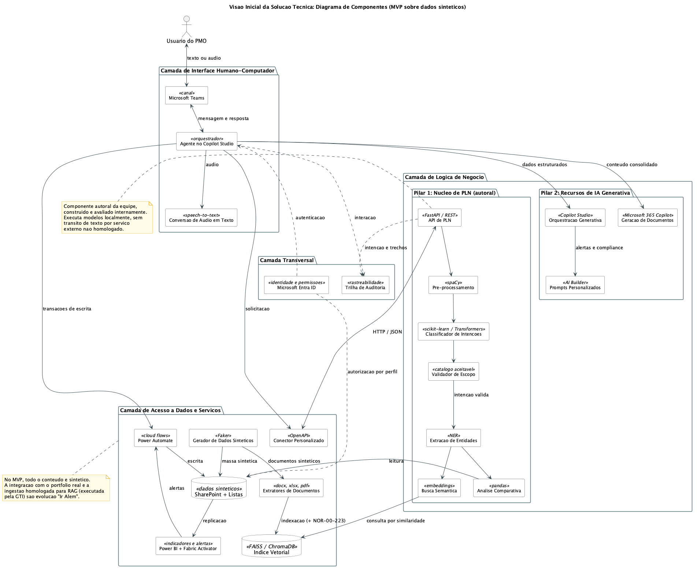

<p align="center"><strong>Figura 17</strong> - Visão inicial da solução técnica: diagrama de componentes do MVP sobre dados sintéticos.<br><sup>Fonte: Material produzido pelos autores, 2026.</sup></p>

O código-fonte do diagrama está versionado em [`docs/diagrams/componentes-mvp.puml`](diagrams/componentes-mvp.puml). Para regerar a imagem é necessário ter o PlantUML e o Graphviz instalados:

```bash
java -jar plantuml.jar -charset UTF-8 -tpng -o ../img docs/diagrams/componentes-mvp.puml
```

### 3.3.3 Fluxo principal entre os componentes

O caminho percorrido por uma solicitação típica, como *"Qual o prazo do projeto XPTO?"*, atravessa as camadas na seguinte ordem:

1. O usuário do PMO envia a mensagem, por texto ou áudio, pelo **Microsoft Teams**. Sendo áudio, o **componente de conversão de áudio em texto** devolve a transcrição em português ao agente.
2. O **agente no Copilot Studio** encaminha o texto ao **conector personalizado**, que chama a **API de PLN** por HTTP.
3. Dentro do Pilar 1, o texto passa pelo **pré-processamento**, é submetido ao **classificador de intenções** e, em seguida, ao **validador de escopo**. Solicitações fora do catálogo aceitável de interações são interrompidas aqui: o usuário é orientado e a solicitação é descartada, sem alcançar os dados do portfólio.
4. Sendo a intenção válida, a **extração de entidades** identifica os elementos da consulta, como código do projeto, período e subportfólio, e aciona a **busca semântica** sobre o índice vetorial ou a **análise comparativa** sobre os dados estruturados.
5. A API devolve uma **resposta estruturada** ao agente. É esse recorte já filtrado, e não o texto original do usuário, que alimenta o Pilar 2.
6. A **orquestração generativa** converte a resposta estruturada em linguagem natural e a devolve ao usuário pelo Teams. Quando a intenção é transacional, o **Power Automate** executa a escrita nas listas do SharePoint. Quando é de geração documental, o **Microsoft 365 Copilot** produz a prévia da apresentação ou do relatório.
7. Em paralelo, o **Entra ID** garante que a consulta respeite as permissões do perfil e a **trilha de auditoria** registra a interação, a intenção identificada e os documentos consultados.

### 3.3.4 Decisões refletidas no esboço

- **O núcleo de PLN é um serviço independente, não um recurso interno do Copilot Studio.** Isso preserva a exigência de autoria e avaliação do Pilar 1 e permite que o pipeline seja testado, medido e evoluído sem depender do provisionamento do ambiente do parceiro.
- **A fronteira de confidencialidade fica no validador de escopo.** Nenhum texto livre do usuário segue para a camada generativa. O que trafega a partir dali é um conjunto estruturado de campos já validados.
- **A camada de dados é substituível.** O acesso ao portfólio ocorre por meio do Power Automate e das listas do SharePoint. Caso a plataforma seja trocada no futuro, o impacto se concentra nesses conectores e o núcleo de PLN é preservado, o que atende à premissa de portabilidade registrada no Termo de Abertura.
- **Rastreabilidade e permissão são componentes, não observações.** Ambas aparecem no diagrama como blocos transversais, por serem requisitos explicitamente nomeados pelo parceiro.

O detalhamento dos componentes internos, das interfaces e dos contratos de dados será desenvolvido nas seções *Solução Técnica (Design)* e *Mapeamento Técnico de Infraestrutura e Implantação* deste documento, ao longo das próximas sprints.

## 3.4 Visão Inicial sobre Tecnologias e Ferramentas

Esta seção apresenta a seleção inicial de tecnologias e ferramentas consideradas para a implementação da solução. As escolhas foram realizadas a partir das restrições, premissas e objetivos definidos no Termo de Abertura do Projeto (TAPI), considerando principalmente a preferência do Metrô pelo ecossistema Microsoft, os requisitos de confidencialidade e rastreabilidade e a necessidade de desenvolvimento autoral do núcleo de Processamento de Linguagem Natural (PLN).

As tecnologias apresentadas nesta seção são classificadas entre aquelas previstas para utilização no **MVP**, desenvolvido e validado sobre dados sintéticos, e aquelas consideradas como alternativas ou possibilidades de evolução. Essa distinção é necessária porque o TAPI estabelece que a integração com o portfólio real do Metrô constitui uma evolução do MVP, não sendo requisito para a validação inicial da solução.

> **Leitura desta seção.** A Seção 3.4 registra a visão de tecnologias formulada na Sprint 1. As decisões de canal permanecem válidas: o agente é entregue no Microsoft Teams, com o Copilot Studio como orquestrador. A Sprint 2 acrescentou o detalhamento que aqui aparece apenas como direção — os requisitos comuns das APIs de voz estão na Seção 8.6, os benchmarks de STT e TTS estão nas Seções 8.7 e 8.8, o benchmark do algoritmo de PLN está na Seção 8.10 e a arquitetura consolidada, com o papel de cada componente, na Seção 5.2.

### 3.4.1 Critérios de seleção

Toda decisão tecnológica desta seção foi avaliada contra os critérios abaixo, extraídos das restrições e premissas do projeto:

| # | Critério | Descrição |
|---|---|---|
| C1 | **Aderência ao ecossistema Microsoft** | Priorizar tecnologias compatíveis com o ambiente já utilizado pelo Metrô, especialmente Microsoft 365, Power Platform e serviços Azure. |
| C2 | **Confidencialidade e segurança** | Evitar o processamento de informações sensíveis por serviços externos não homologados. Durante o MVP, devem ser utilizados dados sintéticos ou anonimizados. |
| C3 | **Autoria do núcleo de PLN** | O pipeline responsável pela identificação de intenções, extração de informações e consulta de fontes deve ser desenvolvido e avaliado pela equipe. |
| C4 | **Confiabilidade e escalabilidade** | Priorizar tecnologias que permitam testes, monitoramento, evolução e ampliação da solução sem necessidade de reestruturação completa. |
| C5 | **Custo e licenciamento** | Considerar as restrições de licenciamento do ambiente Microsoft e evitar dependências que possam gerar custos adicionais desnecessários para o MVP. |
| C6 | **Portabilidade** | Manter o núcleo de IA desacoplado da plataforma de portfólio, permitindo sua adaptação caso o Metrô altere futuramente os sistemas utilizados. |
| C7 | **Integração** | Priorizar tecnologias capazes de se integrar aos serviços existentes, especialmente SharePoint, Power Automate, Power BI e Copilot Studio. |

### 3.4.2 Listagem organizada das tecnologias e ferramentas

A pilha tecnológica é organizada por camadas, considerando a separação entre interface de interação, processamento de linguagem natural, recursos de IA generativa, acesso aos dados, segurança e ferramentas de desenvolvimento.

#### 3.4.2.1 Camada de interface humano-computador

| Tecnologia / Ferramenta | Função na solução | Critérios atendidos |
|---|---|---|
| **Microsoft Copilot Studio** | Canal principal de conversa em linguagem natural. Hospeda o agente, os tópicos e a orquestração generativa. O TAPI define o Copilot Studio como *"camada de orquestração e integração do agente"*. | C1, C5 |
| **Microsoft Teams** | Canal de distribuição do agente para os usuários do PMO, sem exigir novo aplicativo ou novo login. | C1, C4 |
| **Captura de voz nativa do canal (Teams / Copilot Studio)** | Primeira opção para a conversão de áudio em texto prevista no escopo macro, por não exigir provisionamento adicional nem sair do canal já homologado. | C1, C4 |
| **Azure AI Speech (Speech-to-Text, pt-BR)** | Alternativa para a conversão de áudio em texto, caso a captura nativa do canal não atenda ao português ou à qualidade necessária. **A disponibilidade precisa ser confirmada com a GTI.** O documento *Plataforma Tecnológica do Metrô* descreve o Azure AI de forma geral, mas destaca apenas o Azure Machine Learning Studio e o Azure OpenAI, sem citar o serviço de fala. | C1, C2 |

No MVP, a solução utilizará os canais disponibilizados pelo ecossistema Microsoft. Não está previsto o desenvolvimento de uma aplicação web ou mobile independente como interface do produto; o acesso por navegador e por dispositivos móveis ocorrerá pelos canais do Copilot Studio e do Microsoft Teams.

> **Bancada de teste.** Existem no repositório uma interface web em React (`src/frontend`) e um backend FastAPI (`src/backend`) que **não compõem o produto**. Foram construídos como bancada para exercitar isoladamente o caminho de consulta do RAG sobre dados mockados, permitindo medir latência, taxa de sucesso e consumo de tokens sem depender do provisionamento do canal corporativo pela GTI. A bancada utiliza um provedor de LLM específico apenas para viabilizar esse teste; essa escolha não constitui decisão de produto. O provedor a ser adotado será definido por benchmark próprio e submetido à homologação, do mesmo modo que foi feito para a API de transcrição na Seção 8.8. A entrega ao usuário permanece pelo Teams.

> **Base já existente.** O TAPI registra, entre as restrições, que a plataforma atual de portfólio já utiliza *"Copilot Studio para Bot de apoio na obtenção e atualização de status dos projetos e sub portfólios"*, e o documento *Arquitetura Portfólio Metrô* identifica a consulta de situação do portfólio e o suporte de FAQ como recursos "ainda em desenvolvimento". A solução deste projeto, portanto, **não parte de um cenário vazio**. Ela amplia esse agente com o núcleo de PLN autoral e com as transações do Pilar 2. A decisão entre estender o agente existente ou publicar um novo agente no mesmo ambiente será tomada com a GTI na Sprint 2.

#### 3.4.2.2 Camada de lógica de negócio: núcleo de PLN (Pilar 1)

Este é o componente autoral da equipe: recebe o texto transcrito, identifica a intenção, valida se ela pertence ao catálogo aceitável de interações e extrai as entidades necessárias para a consulta.

| Tecnologia / Ferramenta | Função na solução | Critérios atendidos |
|---|---|---|
| **Python 3.11+** | Linguagem do pipeline de PLN. | C3 |
| **Jupyter Notebook** | Ambiente de experimentação, avaliação e documentação executável dos modelos. | C3 |
| **spaCy** (modelo `pt_core_news_lg`) | Pré-processamento em português: tokenização, lematização, *part-of-speech* e reconhecimento de entidades nomeadas (códigos de projeto, datas, valores). | C2, C3 |
| **scikit-learn** | *Baseline* de classificação de intenções (TF-IDF + Regressão Logística / SVM) e cálculo das métricas de avaliação. | C3 |
| **Hugging Face Transformers** + **Sentence-Transformers** | Modelos de linguagem em português (ex.: BERTimbau, `multilingual-e5`) executados localmente para representar sentenças e apoiar a classificação de intenções, a comparação de similaridade e a avaliação do núcleo de PLN. | C2, C3 |
| **Catálogo local de fontes e casos sintéticos** | Organização dos documentos, planilhas, listas simuladas e casos de teste usados pelo núcleo de PLN durante o MVP, sem depender de infraestrutura generativa externa. | C2, C3 |
| **pandas** / **NumPy** | Manipulação dos dados sintéticos e consolidação das análises comparativas. | C3 |
| **FastAPI** | Opção de exposição do núcleo de PLN como API REST documentada em OpenAPI, a ser consolidada conforme o backend do MVP evoluir. | C1, C5 |
| **Docker** | Evolução prevista para empacotamento do serviço de PLN quando houver backend consolidado. Não é requisito da etapa atual do MVP. | C5 |
| **Azure Container Apps** (ou **Azure App Service**) | Destino futuro para execução do serviço de PLN dentro do *tenant* do parceiro, condicionado ao provisionamento da GTI. | C1, C2 |

> **Dependência de provisionamento.** A hospedagem do serviço de PLN em ambiente Azure do Metrô depende da GTI e não estava confirmada na abertura do projeto. Por isso, a implantação em Azure, o empacotamento Docker e a automação de deploy são tratados como evolução. A ausência desse ambiente não bloqueia o desenvolvimento e a avaliação conceitual do núcleo de PLN no MVP.

> **Decisão registrada.** O grupo optou por construir o classificador de intenções com modelos executados localmente, e não delegar a identificação de intenção a um LLM externo. A justificativa é dupla: atende à exigência do Pilar 1 (núcleo autoral e avaliado pela equipe, critério C3) e mantém o texto do usuário fora de serviços não homologados (C2). O uso de LLM fica reservado ao Pilar 2, sobre conteúdo já filtrado.

#### 3.4.2.3 Camada de lógica de negócio: recursos de IA generativa (Pilar 2)

| Tecnologia / Ferramenta | Função na solução | Critérios atendidos |
|---|---|---|
| **Orquestração generativa do Copilot Studio** | Geração das respostas em linguagem natural a partir dos dados estruturados devolvidos pelo pipeline de PLN, e condução de diálogos de múltiplos turnos (ex.: criação de projeto por etapas). | C1, C2 |
| **AI Builder (prompts personalizados)** | Prompts específicos para as transações do Pilar 2, como alertas de risco, verificação de marcos e aderência a normativos. | C1 |
| **Microsoft 365 Copilot** | Geração das prévias de apresentação mensal para a diretoria (PowerPoint) e do relatório de fechamento (Word), a partir do conteúdo consolidado pelo agente. | C1 |

> **Ponto em aberto.** O documento *Plataforma Tecnológica do Metrô* (22/10/2025) registra que o ambiente do parceiro está no Brasil (pt-BR) e que recursos em *preview* habilitados apenas no ambiente americano podiam ainda não estar disponíveis para uso, citando explicitamente o *computer use* (CUA) e o interpretador de Python (*code interpreter*). Como o documento tem quase um ano na data de abertura deste projeto e o Copilot Studio evolui de forma contínua, **o grupo não assume nem descarta a disponibilidade desses recursos. O levantamento do que está efetivamente habilitado no *tenant* do Metrô é uma tarefa da Sprint 2, a ser conduzida junto à GTI.** Nenhuma funcionalidade do MVP depende desses recursos.

#### 3.4.2.4 Camada de acesso a dados e serviços

| Tecnologia / Ferramenta | Função na solução | Critérios atendidos |
|---|---|---|
| **SharePoint Online + Listas** | Fonte de dados do portfólio no ambiente do parceiro. No MVP, é o formato-alvo replicado com dados sintéticos. | C1, C5 |
| **Power Automate (cloud flows)** | Automação dos fluxos de escrita e atualização (registro de status, lembretes de pendências, notificações). O modelo *cloud-flow* é o indicado pelo parceiro, por não haver sistema *on-premises* envolvido. | C1, C4 |
| **Conector personalizado (OpenAPI)** | Ponte entre o Copilot Studio e a API de PLN da equipe, a partir da especificação OpenAPI gerada pelo FastAPI. É a opção principal, por ser o mecanismo consolidado de extensão da Power Platform. | C1, C5 |
| **Model Context Protocol (MCP)**, a avaliar | Alternativa ao conector personalizado, potencialmente com menor acoplamento. Depende de confirmação da GTI quanto ao suporte e ao licenciamento no *tenant* do Metrô, e não é assumida como caminho no MVP. | C1, C5 |
| **Power BI (Microsoft Fabric)** | Painéis de indicadores do portfólio e visualizações citadas nas intenções do usuário (ex.: *dashboard* de compliance financeiro). | C1 |
| **Fabric Activator** | Alertas sobre métricas do portfólio (marcos próximos do vencimento, pendências), com envio via Outlook e Teams pela integração com Power Automate. | C1 |
| **python-docx**, **openpyxl**, **pdfplumber** | Extração de conteúdo dos documentos de projeto (Word, Excel, PDF), incluindo planilhas vinculadas por listas do SharePoint, para consulta estruturada e rastreabilidade das fontes. | C2, C3 |
| **openpyxl** / **python-pptx** (escrita) | Geração dos artefatos de saída solicitados pelo parceiro: exportação do cronograma para Excel e prévia da apresentação mensal para a diretoria. As histórias de usuário do Metrô preveem a pergunta *"Quer exportar para o Excel ou MS Project?"* ao final da construção do cronograma. | C1 |
| **Faker** | Geração da massa de dados sintéticos que substitui as informações reais do portfólio durante todo o MVP. | C2 |

> **Restrição herdada: ingestão no ecossistema Microsoft.** O parceiro informou que a estratégia corporativa de ingestão, organização e permissionamento de arquivos é executada pela GTI e pelo ambiente Microsoft do Metrô. Por isso, no MVP a equipe representa essa estrutura com dados sintéticos e documenta a interface esperada com SharePoint, Copilot Studio e Power Automate, sem assumir uma arquitetura generativa paralela ao ambiente homologado.

> **Restrição herdada: engenharia de dados.** A mesma lógica vale para o Power BI. O documento *Plataforma Tecnológica do Metrô* registra que o grupo responsável pela análise e criação dos painéis *"é um cliente, ou seja, não executa a etapa de engenharia de dados (ingestão/persistir no storage)"*. O MVP, portanto, consome e produz dados no formato das listas do SharePoint, sem assumir responsabilidade por pipelines de ingestão no Fabric.

**Corpus documental do MVP.** A base sobre a qual o agente responde é composta por dois conjuntos. O primeiro são os documentos de projeto gerados sinteticamente no formato dos anexos do parceiro, ou seja, Partida do portfólio, Balanço, Relatório Anual de fechamento do portfólio e Relatório Anual de fechamento de projeto ou programa. O segundo é o normativo **NOR-00-223, Gestão do Portfólio Organizacional**, indicado pelo parceiro nas histórias de usuário como a referência a ser usada para esclarecer dúvidas sobre conceitos e normativos de gestão de portfólio.

#### 3.4.2.5 Camada transversal: identidade, permissões e rastreabilidade

Dois requisitos do TAPI atravessam todas as camadas anteriores e por isso são tratados separadamente. O primeiro é a **rastreabilidade**, listada entre os benefícios esperados como *"registro de todas as consultas e ações realizadas no sistema, com suporte ao não repúdio"* e repetida em todas as intenções do quadro de exemplos do Apêndice. O segundo é a **atuação dentro dos limites de permissão**, item explícito do escopo macro: *"Atuar dentro dos limites de permissão e acesso à informação de cada perfil"*.

| Tecnologia / Ferramenta | Função na solução | Critérios atendidos |
|---|---|---|
| **Microsoft Entra ID** | Identidade corporativa já usada pelos usuários do Metrô. O agente herda a autenticação do canal (Teams), sem login adicional, e a identidade autenticada é propagada até a camada de dados. | C1, C2 |
| **Grupos e permissões do SharePoint** | Autorização efetiva por perfil. A visibilidade de projetos e subportfólios segue as permissões já configuradas nas listas do portfólio, evitando um segundo modelo de permissões paralelo ao do parceiro. | C1, C2 |
| **Lista de auditoria (SharePoint) ou tabela do Dataverse** | Trilha de auditoria da aplicação: registro de cada solicitação recebida, da intenção classificada, dos documentos consultados e da resposta devolvida, com identificação do usuário e carimbo de tempo. | C1, C2 |
| **Logs estruturados do serviço de PLN** (`logging` do Python, formato JSON) | Registro técnico das decisões do pipeline, como intenção identificada, confiança da classificação e trechos recuperados, permitindo auditar *por que* o agente respondeu o que respondeu. | C2, C3 |
| **Application Insights (Azure Monitor)** | Telemetria de disponibilidade, latência e erros do serviço de PLN, quando publicado no ambiente do parceiro. | C1 |

> **Escopo no MVP.** Como o MVP opera sobre dados sintéticos, a trilha de auditoria é implementada de forma funcional, mas sobre a base sintética. O objetivo é demonstrar o mecanismo e deixar a interface pronta, não produzir registros de auditoria com valor legal. A definição da política de retenção e do formato definitivo do registro cabe às áreas de TI e compliance do Metrô.

#### 3.4.2.6 Ferramentas de engenharia, gestão e qualidade

| Ferramenta | Função no projeto |
|---|---|
| **GitLab (`git.inteli.edu.br`)** | Versionamento do código e da documentação, quadro Kanban, *issues*, *merge requests* e registro de contribuições. |
| **GitFlow + Conventional Commits** | Política de branches e padronização das mensagens de commit, detalhadas em `GestaoConfiguracao.md`. |
| **Visual Studio Code** | Ambiente de desenvolvimento, com extensões de Python, Jupyter e Markdown. |
| **Draw.io / Mermaid / PlantUML** | Diagramas UML (componentes e pacotes), BPMN e diagramas de sequência da documentação. |
| **Figma** | Prototipação das interfaces conversacionais e dos fluxos de interação. |
| **pytest** | Biblioteca principal para testes automatizados do pipeline de PLN, das regras de recuperação de contexto e da API FastAPI. |
| **FastAPI TestClient / httpx** | Execução de testes funcionais e de integração contra os endpoints HTTP da API sem necessidade de subir um servidor externo, preservando o contrato OpenAPI gerado pelo próprio FastAPI. |
| **Locust** | Testes de desempenho e carga sobre endpoints HTTP da prova de conceito, com cenários escritos em Python e coleta de latência, vazão e taxa de erro. |
| **Microsoft Forms** | Coleta estruturada do questionário SUS e dos comentários qualitativos dos participantes dos testes de usabilidade, mantendo aderência ao ecossistema Microsoft priorizado pelo parceiro. |
| **scikit-learn (metrics)** | Avaliação do desempenho do núcleo de PLN: acurácia, precisão, revocação e F1 macro para a classificação de intenções, matriz de confusão e métricas de acerto para a consulta de fontes. |
| **Markdown** | Formato de toda a documentação do repositório. |

### 3.4.3 Alternativas avaliadas e não adotadas

O registro das opções descartadas é parte da decisão: ele documenta o que foi considerado e por que não seguiu adiante.

| Alternativa | Por que foi considerada | Por que não foi adotada |
|---|---|---|
| **API de LLM externo** (OpenAI, Anthropic, Google) para **classificação de intenções** | Menor esforço de implementação e boa acurácia sem treinamento. | Viola C2 (trânsito de dados por serviço não homologado) e C3 (o Pilar 1 exige núcleo autoral e avaliado pela equipe). A classificação permanece no pipeline próprio descrito na Seção 8.10. A geração da resposta a partir do contexto recuperado pelo RAG usa um LLM, cujo provedor ainda será definido e homologado. |
| **Azure OpenAI Service** provisionado à parte | Permaneceria dentro do *tenant* Azure do parceiro. | O próprio parceiro registra que o Copilot Studio já conta com os modelos mais recentes, *"não sendo necessário provisionar modelo adicional"*. Custo adicional sem ganho claro no MVP. |
| ***Fine-tuning*** de um modelo de linguagem | Potencial ganho de acurácia no domínio de gestão de portfólio. | O parceiro prioriza recursos homologados do ecossistema Microsoft, especialmente Copilot e Power Platform. Além disso, o volume de dados sintéticos do MVP não sustentaria o treinamento. |
| **Power Apps** como interface principal | Interface visual rica para preenchimento de formulários de projeto. | O escopo do módulo pede interface primariamente em linguagem natural (texto e áudio). Somam-se as restrições de licenciamento (C4), sem conectores premium e com limite de 500 linhas por leitura de lista. |
| **Aplicação web própria** (React/Next.js) fora do ecossistema Microsoft | Liberdade total de implementação e melhor experiência de voz. | Viola C1 e comprometeria a sustentação pela equipe interna do Metrô, que é um benefício esperado explícito do projeto. A interface React existente no repositório é bancada de teste do caminho de RAG, não interface do produto. |
| **Elasticsearch / OpenSearch** para busca | Recurso maduro de busca textual e análise de documentos. | Exigiria infraestrutura adicional a ser provisionada e mantida. Para o MVP, o catálogo local de fontes e a consulta às listas e planilhas simuladas do SharePoint atendem à escala prevista com menor custo operacional. |
| **Azure Machine Learning** como ambiente de treino e *endpoint* | Citado pelo parceiro como recurso disponível. Ofereceria *endpoints* gerenciados de inferência. | Mantido como **evolução prevista**, não como dependência do MVP. O provisionamento depende da GTI e não pode bloquear a Sprint 2. |

### 3.4.4 Riscos e dependências tecnológicas

Os itens abaixo alimentam a seção *Matriz de risco do projeto* deste documento, na categoria técnica.

| Risco / dependência | Impacto no projeto | Encaminhamento |
|---|---|---|
| Disponibilidade de licença e ambiente de Copilot Studio para a equipe Inteli | Sem o ambiente, o Pilar 2 e a integração ficam apenas em especificação. | Confirmar com a GTI logo na Sprint 2 e manter o núcleo de PLN independente do Copilot Studio, testável via API. |
| Recursos do Copilot Studio indisponíveis no ambiente pt-BR | Funcionalidades em *preview* citadas pelo parceiro (CUA, interpretador de Python) podem não existir no *tenant*. | Levantar com a GTI na Sprint 2 o que está habilitado e manter o MVP sem dependência desses recursos. |
| Ausência de ambiente Azure provisionado para hospedar o serviço de PLN | A integração em ambiente corporativo fica apenas especificada. | Manter o desenvolvimento e a validação em ambiente acessível, com Supabase para persistência. Solicitar o provisionamento à GTI como evolução, tratando publicação, Docker e CI/CD como etapas posteriores. |
| Conectores personalizados classificados como *premium* na Power Platform | Custo de licenciamento adicional inviabilizaria a adoção. | Verificar a cobertura pelo licenciamento do Copilot Studio e avaliar MCP como alternativa. |
| Qualidade e representatividade dos dados sintéticos | Modelo com boa métrica em laboratório e desempenho ruim no cenário real. | Derivar a **estrutura** dos dados sintéticos dos anexos do parceiro, com os cinco subportfólios (Turnaround, Expansão da Rede, Desempenho/Eficiência/Segurança Operacional, Receitas Não Tarifárias, Pessoas e Patrimônio), identificadores no padrão `TUR-01` e os campos dos relatórios de partida, balanço e fechamento. As amostras devem ser validadas com o PMO. |
| Modelo de permissões do portfólio mais granular do que o previsto | O agente pode expor a um perfil informação restrita a outro, violando item explícito do escopo macro. | Espelhar as permissões já existentes nas listas do SharePoint em vez de criar um modelo próprio. Validar com o PMO os perfis e o que cada um enxerga antes de implementar as consultas. |
| Desempenho de modelos de linguagem em português executados localmente | Latência ou acurácia insuficientes na classificação de intenções. | Estabelecer o *baseline* leve (TF-IDF + SVM) antes dos modelos maiores, e comparar as métricas antes de decidir. |

### 3.4.5 Fora do escopo do MVP e evolução da solução

O TAPI estabelece que o MVP deve funcionar como uma prova de conceito validada sobre dados sintéticos, enquanto a integração com o portfólio real do Metrô representa uma evolução posterior.

Assim, ficam inicialmente fora do escopo do MVP:

- Integração em produção com o portfólio real do Metrô (SharePoint e Listas do ambiente produtivo)
- Processamento de dados reais e sensíveis fora de ambientes homologados
- Implantação da solução em produção para utilização efetiva pelas equipes do Metrô
- Ingestão homologada de documentos no ambiente Microsoft, executada pela GTI
- Criação de aplicativo mobile próprio
- Criação de uma aplicação web independente do ecossistema Microsoft
- Provisionamento obrigatório de infraestrutura Azure antes da validação do núcleo de PLN
- Utilização obrigatória de modelos generativos externos
- *Fine-tuning* de modelos de linguagem
- Implementação de mecanismos avançados de monitoramento e auditoria de produção

Como possibilidades de evolução, poderão ser consideradas:

- Integração com SharePoint e listas reais do portfólio
- Integração com Power BI e demais serviços analíticos
- Hospedagem do serviço de PLN em infraestrutura Azure homologada
- Empacotamento Docker e pipeline CI/CD após consolidação do backend
- *Endpoints* de inferência gerenciados no Azure Machine Learning
- Microsoft Planner Premium e Dynamics 365 Project Operations, caso a plataforma de portfólio seja substituída
- Expansão da interação por voz, incluindo síntese de fala (*text-to-speech*)
- Integração com MS Project e Businessmap, citados nas histórias de usuário como destinos possíveis de exportação do cronograma. No MVP a exportação é feita para Excel
- Geração automatizada de relatórios e apresentações
- Integração com sistemas externos utilizados pelo portfólio
- Adoção de serviços de IA generativa homologados sobre dados reais e sensíveis

### 3.4.6 Plataforma de execução, confiabilidade e escalabilidade

> Esta subseção consolida a pilha na Sprint 2, incorporando o que foi decidido nas Seções 5.2, 6.2, 8.7 a 8.10. As subseções anteriores permanecem como registro da visão inicial.

**Plataforma de execução**

| Plataforma | Situação | Decisão |
|---|---|---|
| **Web, navegador desktop** | Suportada | O agente é entregue pelo Microsoft Teams em navegador, sem instalação. A bancada de teste em React descrita na Seção 3.4.2.1 roda no mesmo ambiente |
| **Mobile** | Suportada por herança, sem aplicativo próprio | O acesso ocorre pelo aplicativo do Microsoft Teams em iOS e Android, que já está homologado no parceiro. O agente publicado no Teams fica disponível nos três canais sem código específico |
| **Aplicativo mobile próprio** | Fora do escopo | Registrado na Seção 3.4.5. Construir um aplicativo exigiria distribuição, atualização e sustentação próprias, o que contraria o benefício de manutenção pela equipe interna do Metrô |

A decisão de não construir cliente próprio é o que torna o suporte a mobile barato: a entrada por voz descrita na Seção 8.7 usa a captura nativa do canal, e o mesmo endpoint atende navegador e celular sem ramificação de código.

**Linguagens, frameworks e bibliotecas por camada**

| Camada | Tecnologias | Papel |
|---|---|---|
| Canal | Microsoft Teams, Copilot Studio | Interface conversacional e orquestração de tópicos |
| API da aplicação | Python 3.11, FastAPI, Uvicorn | Endpoint HTTP/JSON, validação de entrada e roteamento |
| Núcleo de PLN | scikit-learn, gensim, sentence-transformers, nltk, joblib | Classificação de intenção em dois níveis, conforme a Seção 8.10 |
| Recuperação | Índice vetorial e catálogo local de fontes | Seleção dos trechos que compõem o contexto |
| Voz | Azure AI Speech | Transcrição de entrada e síntese prevista, Seções 8.8 e 8.9 |
| Dados | PostgreSQL gerenciado, Supabase Storage | Persistência do modelo físico da Seção 4.4 |
| Identidade | Microsoft Entra ID | Autenticação e associação de perfil |
| Automação | Power Automate | Execução dos fluxos funcionais |

**Confiabilidade**

| Mecanismo | Onde está documentado |
|---|---|
| Fallback estruturado quando a camada generativa está indisponível | Seção 6.2.5 |
| Validação local de formato, duração e tamanho antes da chamada externa | Seção 8.7.3 |
| Limiares de confiança que impedem acionamento de handler com previsão incerta | Seção 8.10.3 |
| Repetição com espera progressiva nas chamadas ao provedor de transcrição | Seção 6.2.7 |
| Trilha de auditoria persistida, separando falha do usuário de falha do provedor | Seções 6.3.3 e 8.7.6 |

**Escalabilidade**

A escala prevista para o MVP é modesta — dezenas de usuários do PMO, com perguntas curtas — e a arquitetura foi desenhada para crescer sem reestruturação, e não para suportar carga alta desde o início. Três decisões sustentam isso.

A **API é sem estado**. O contexto da conversa vive no banco, em `ai_conversations` e `ai_interactions`, e não em memória do processo. Aumentar a capacidade é acrescentar instâncias atrás de um balanceador, sem sessão fixa.

O **núcleo de PLN é um serviço separado do canal**. O classificador é carregado uma vez e serve as requisições; se a inferência se tornar o gargalo, ela pode ser movida para um endpoint gerenciado sem alterar a API da aplicação, como registrado na Seção 6.3.4.

A **camada de dados é substituível**. O modelo físico é PostgreSQL padrão, sem recurso proprietário, o que mantém a migração para o ambiente Azure do parceiro de baixo atrito quando a GTI provisionar.

O limite conhecido é a franquia gratuita do provedor de transcrição, de cinco horas de áudio por mês, discutida na Seção 8.8.2. Ela é suficiente para a validação do MVP e insuficiente para uso corrente, e por isso a Seção 6.3.4 registra a contratação do nível pago como pendência de evolução, e não como problema em aberto.

### 3.4.7 Referências

**Documentos do parceiro**

- Companhia do Metropolitano de São Paulo. *TAPI: MOD7 ES Agente de IA Portfólio de Projetos Metrô*, rev. 2.
- Companhia do Metropolitano de São Paulo. *Plataforma Tecnológica do Metrô*, 22/10/2025.
- Companhia do Metropolitano de São Paulo. *Arquitetura Portfólio Metrô*, 22/10/2025.
- Companhia do Metropolitano de São Paulo. *História do Usuário: Agente de IA*.
- Companhia do Metropolitano de São Paulo. *NOR-00-223: Gestão do Portfólio Organizacional*.
- Companhia do Metropolitano de São Paulo. Anexos 1 a 4: *Partida do portfólio*, *Balanço do portfólio*, *Relatório Anual de fechamento do portfólio* e *Relatório Anual de fechamento de projeto ou programa*.

> Os documentos acima são de uso restrito e foram disponibilizados pelo Metrô apenas para contextualização do projeto junto ao Inteli. Nenhum conteúdo desses arquivos é reproduzido neste repositório. Os anexos são utilizados como referência de **estrutura** para a geração dos dados sintéticos, e os dois relatórios anuais estão classificados pelo parceiro como *Corporativo* e *Confidencial*.

**Materiais de estudo indicados pelo parceiro**

- Microsoft. *Documentação oficial do Microsoft Copilot Studio*. Disponível em: https://learn.microsoft.com/pt-br/microsoft-copilot-studio/
- Microsoft. *Criar relatórios com o Copilot no Power BI*. Disponível em: https://learn.microsoft.com/pt-br/power-bi/create-reports/copilot-create-desktop-report
- DataCamp. *Power BI Copilot*. Disponível em: https://www.datacamp.com/pt/tutorial/power-bi-copilot

## 3.5 Correlação RFs e RNFs

A matriz cruza os dez requisitos funcionais (Seção 3.1) com os doze requisitos não funcionais (Seção 3.2). O objetivo é tornar explícito onde um atributo de qualidade precisa ser verificado: um RNF sem RF associado não tem onde ser testado, e um RF sem RNF crítico associado tende a ser implementado sem critério de aceitação além do comportamento nominal.

Legenda: **●** correlação forte — o RNF é condição de aceitação do RF; **○** correlação parcial — o RNF incide sobre o RF, mas não o determina.

| | RNF01<br>Confid. | RNF02<br>Acesso | RNF03<br>Rastr. | RNF04<br>Confiab. | RNF05<br>Desemp. | RNF06<br>PLN | RNF07<br>Usab. | RNF08<br>Aderên. | RNF09<br>Portab. | RNF10<br>Manut. | RNF11<br>Falhas | RNF12<br>Dados |
| --- | :-: | :-: | :-: | :-: | :-: | :-: | :-: | :-: | :-: | :-: | :-: | :-: |
| **RF01** Entrada em linguagem natural | ○ | ○ | ● | | ○ | | ● | ● | | | ○ | |
| **RF02** Identificação da intenção | | | ● | | ○ | ● | ● | | ● | | ○ | ○ |
| **RF03** Classificação no catálogo | | | ● | | | ● | ○ | | ● | ○ | ○ | ○ |
| **RF04** Recuperação de informações | ● | ● | ● | ● | ○ | ● | | ○ | ○ | | ● | ● |
| **RF05** Consulta de projetos | ● | ● | ● | ● | ● | | ○ | ○ | | | ● | ● |
| **RF06** Análise e comparação | ● | ● | ● | ● | ● | | ○ | | | | ● | ● |
| **RF07** Roteamento híbrido | | ○ | ● | ○ | ○ | ● | | ● | ● | ○ | ● | |
| **RF08** Respostas fundamentadas | ○ | ● | ● | ● | ○ | | ● | | | | ● | ○ |
| **RF09** Sugestão proativa | ● | ● | ● | ● | | ○ | ● | | | | ○ | ○ |
| **RF10** Controle da proatividade | ● | ● | ● | | | | ● | | | | | |

Três leituras orientam o trabalho das próximas sprints.

**RNF03 é transversal.** A rastreabilidade incide sobre os dez requisitos funcionais, sem exceção. Isso significa que o registro de auditoria não é uma funcionalidade a ser implementada ao final, e sim uma obrigação de cada rota: qualquer caminho que produza resposta precisa gravar solicitação, intenção, fontes e retorno. É a razão de `ai_interactions`, `consulted_sources` e `audit_events` aparecerem no modelo de dados desde a Seção 4.2.

**RF04, RF05 e RF06 concentram as correlações fortes.** São os requisitos que tocam a informação do portfólio, e por isso acumulam confidencialidade, controle de acesso, confiabilidade e qualidade dos dados simultaneamente. São também os que exigem o maior número de cenários negativos no plano de testes da Sprint 3 — não basta verificar que a resposta certa aparece; é preciso verificar que a resposta indevida não aparece para o perfil errado.

**RF09 e RF10 herdam a carga de confidencialidade.** Os dois requisitos de proatividade correlacionam-se fortemente com RNF01 e RNF02, e é exatamente o achado da prototipação exploratória (Seção 3.8.4): um agente que age a partir do que observa precisa observar, e a observação é a superfície que os dois RNFs restringem. A decisão sobre o regime de iniciativa, registrada como aberta no inventário da Seção 3.8.6.1, é portanto também uma decisão sobre o alcance desses dois RNFs.

## 3.6 Casos de Uso

Os casos de uso serão modelados na Sprint 3, junto com a derivação dos testes funcionais, conforme a Seção 8.3.1. A decisão de tratá-los nesse momento é deliberada: o barema da Sprint 3 exige que cada requisito funcional gere ao menos um cenário positivo e um negativo, e o caso de uso é a forma natural de organizar esses cenários antes de convertê-los em teste.

O material de partida já está produzido e versionado:

- as **user stories** de RF01 a RF10, com critérios de aceitação, na Seção 3.1.1;
- a **modelagem estática** das entidades envolvidas, na Seção 3.1.2;
- os **três cenários dinâmicos** iniciais, na Seção 3.1.3, e os **quatro cenários críticos** detalhados em diagramas de sequência na Seção 5.3;
- o **repertório de oito situações** registradas na prototipação exploratória, na Seção 3.8.6.2, incluindo as cinco que o protótipo não conseguiu atender — que são candidatas diretas a casos de uso de exceção.

## 3.7 Casos de Uso x Requisitos Funcionais

Será desenvolvido na Sprint 3, junto com a Seção 3.6. A rastreabilidade entre requisitos funcionais e modelagem UML já existente está registrada na Seção 3.1.4 e será estendida para incluir os casos de uso e, na sequência, os casos de teste.

## 3.8 Prototipação Exploratória

### 3.8.1 Questão de Projeto

**Questão:** De quem parte a iniciativa da interação — o agente age somente quando é explicitamente solicitado, ou age a partir do que observa da atividade que a pessoa está realizando?

**Justificativa.** A documentação produzida até aqui sustenta os dois regimes sem decidir entre eles. Todos os requisitos funcionais partem de um comando formulado pelo usuário (RF01), mas o catálogo de intenções previsto no RF03 e no RF07 inclui a categoria *alerta*, que pressupõe um agente capaz de se manifestar sem ter sido consultado. A jornada de Carlos (2.5.2.3) atribui valor explícito a "alertas relevantes" e à "identificação proativa de desvios", enquanto a visão do produto (2.4.1) descreve o agente como uma interface conversacional acionada por linguagem natural. A resposta altera o comportamento do sistema diante das pessoas em dois pontos: define se o silêncio é o estado padrão do agente ou uma decisão que ele precisa justificar a cada momento, e determina se o sistema precisa observar continuamente a atividade do usuário — o que incide diretamente sobre as restrições de confidencialidade e de controle de acesso estabelecidas no RNF01 e no RNF02.

### 3.8.2 Alternativas e Formatos de Prototipação

As duas alternativas exploradas respondem à mesma questão a partir de regimes opostos de iniciativa. No Protótipo 1, a interação só existe quando a pessoa a inicia; no Protótipo 2, o agente pode iniciá-la a partir do contexto observado. Ambas são defensáveis no contexto do PMO do Metrô e nenhuma foi construída para perder: o regime reativo oferece controle, previsibilidade e rastreabilidade direta entre pergunta e resposta, enquanto o regime proativo oferece cobertura para situações que a pessoa não sabe que precisa consultar.

#### 3.8.2.1 Protótipo 1 — Agente Reativo sob Demanda

O primeiro protótipo explora uma alternativa em que o agente permanece inteiramente silencioso até ser explicitamente acionado. Nesse regime, o sistema não observa a atividade da pessoa, não interpreta o que está na tela e não avalia oportunidades de assistência: ele existe como um canal de consulta que é aberto pelo usuário, responde ao que foi perguntado, indica quando não possui informação suficiente e volta ao silêncio.

A alternativa parte da hipótese de que, no contexto do PMO, o valor do agente está menos em antecipar necessidades e mais em eliminar o esforço de localizar e consolidar informações que já estão distribuídas entre SharePoint, listas corporativas, relatórios e documentos. Sob essa hipótese, a pessoa continua sendo a única responsável por decidir o que precisa saber, e o agente reduz apenas o custo de obter a resposta.

Três argumentos sustentam a alternativa no contexto específico do parceiro. Primeiro, a confidencialidade: um agente que só age quando chamado não precisa observar continuamente a atividade do usuário, o que elimina uma superfície permanente de leitura de contexto e simplifica a aderência ao RNF01 e ao RNF02. Segundo, a rastreabilidade: como toda resposta responde a uma solicitação explícita, o registro exigido pelo RNF03 tem sempre um par pergunta–resposta bem delimitado, sem necessidade de justificar por que o sistema decidiu falar. Terceiro, a confiança: conforme registrado na Seção 2.2, experiências anteriores do parceiro com IA generativa foram prejudicadas por respostas não fundamentadas na documentação oficial; um regime em que o agente nunca se manifesta espontaneamente reduz o número de oportunidades em que ele pode errar sem ter sido solicitado.

O comportamento explorado pode ser representado conceitualmente como:

```text
Pessoa identifica uma necessidade
            ↓
Pessoa formula uma solicitação explícita
            ↓
Agente interpreta a solicitação
            ↓
   Há informação suficiente na base?
         /                         \
       Não                         Sim
        ↓                           ↓
Agente declara a            Agente responde com
limitação encontrada        fonte referenciada
        ↓                           ↓
Pessoa reformula ou       Pessoa aprofunda ou
abandona a consulta       encerra a interação
            ↓                       ↓
        Agente retorna ao silêncio
```

Entre os comportamentos explorados por esta alternativa estão:

- responder exclusivamente ao que foi solicitado, sem ampliar o escopo da resposta;
- declarar explicitamente a ausência de informação em vez de inferir ou completar lacunas;
- manter ou descartar o contexto entre perguntas sucessivas de uma mesma sessão;
- referenciar a fonte consultada em cada resposta;
- permanecer em silêncio diante de informações relevantes que não foram perguntadas;
- tratar solicitações formuladas com vocabulário diferente do utilizado nos documentos da base;
- decidir se, ao não encontrar informação, o agente deve apenas informar a limitação ou orientar uma reformulação.

**Formato de prototipação:** tirinhas ilustradas, mesmo formato utilizado no Protótipo 2.

A escolha do formato é deliberada e responde a duas exigências distintas. A primeira é a exigência do artefato de experimentar um formato não baseado em interface digital: a tirinha não é uma tela navegável nem um protótipo clicável, e por isso não permite que a exploração se transforme em refinamento de interface. Ela obriga o grupo a representar o comportamento do agente por meio do que acontece entre as pessoas e o sistema ao longo do tempo — quem fala primeiro, o que é dito, o que fica sem ser dito e qual é a consequência disso — que é exatamente a dimensão da questão formulada em 3.8.1.

A segunda é a exigência de comparabilidade. Como a questão trata de uma única variável — a origem da iniciativa —, manter o mesmo meio, as mesmas personas e a mesma estrutura de quatro cenários nos dois protótipos permite atribuir as diferenças observadas ao regime de iniciativa, e não ao formato de representação. O custo dessa decisão está registrado na Seção 3.8.5: por utilizar o mesmo meio nas duas alternativas, a exploração não produz comparação entre formatos de prototipação, apenas entre regimes de comportamento.

#### 3.8.2.2 Protótipo 2 — Agente Proativo e Orientado à Jornada

O segundo protótipo explora uma alternativa em que o agente não depende exclusivamente de solicitações explícitas do usuário para iniciar uma interação. Nesse regime, o sistema considera o contexto da atividade realizada pela pessoa, identifica possíveis necessidades relacionadas ao momento da interação e pode apresentar sugestões de conteúdos, informações ou ações pertinentes.

A alternativa parte da hipótese de que um agente capaz de interpretar o contexto de uso e atuar de forma proativa pode reduzir a dependência do usuário de conhecer previamente quais informações ou funcionalidades estão disponíveis. Em vez de limitar sua atuação à resposta de perguntas, o agente passa a participar da jornada realizada pelo usuário, identificando situações nas quais uma intervenção contextual possa agregar valor.

O comportamento explorado pode ser representado conceitualmente como:

```text
Usuário realiza uma atividade
            ↓
Agente identifica o contexto disponível
            ↓
Agente interpreta a situação
            ↓
Existe uma oportunidade relevante de assistência?
         /                         \
       Não                         Sim
        ↓                           ↓
Sem intervenção             Agente apresenta sugestão
                                    ↓
                           Usuário aceita ou recusa
                              /            \
                            Aceita          Recusa
                              ↓               ↓
                    Agente conduz fluxo   Retorna ao
                       relacionado         contexto
```

Nesse modelo, a interação pode ocorrer diretamente no ambiente em que o usuário já está trabalhando, sem depender necessariamente de uma interface conversacional centralizada. Essa possibilidade é exploratória e não constitui compromisso do MVP, que permanece restrito a dados sintéticos e não pressupõe integração produtiva nem observação contínua da atividade. Em uma evolução futura, o agente poderia apresentar informações, sugestões, perguntas de confirmação ou conteúdos relacionados à atividade observada, buscando reduzir a distância entre a necessidade do usuário e a informação ou ação que pode auxiliá-lo.

No contexto do projeto, a abordagem foi explorada a partir de situações em que a pessoa navega por informações do portfólio, consulta documentos ou realiza atividades relacionadas a um projeto. A partir do contexto identificado, o agente sugere recursos relacionados ao que está sendo feito — documentos, conceitos, indicadores, cronogramas, riscos ou próximos passos.

**Formato de prototipação:** tirinhas ilustradas, o mesmo formato utilizado no Protótipo 1.

A justificativa é a mesma registrada na Seção 3.8.2.1 e vale nos dois sentidos. A tirinha não é uma tela navegável nem um protótipo clicável, o que atende à exigência de um formato não baseado em interface digital e impede que a exploração escorregue para refinamento de interface — risco maior justamente aqui, já que a intervenção proativa é visual por natureza e seria tentador desenhá-la em vez de investigá-la. E, por ser o mesmo meio das mesmas personas nas duas alternativas, permite atribuir as diferenças observadas ao regime de iniciativa, e não ao formato de representação.

A pergunta que o formato permite investigar nesta alternativa é específica: *em que momento a intervenção é bem-vinda e em que momento ela é interrupção*. Isso só aparece quando existe um antes e um depois — a atividade que a pessoa estava fazendo, o agente falando, e o que acontece com a atividade em seguida. É a sequência de painéis que torna esse intervalo visível.

Entre os comportamentos explorados por esta alternativa estão:

- identificar situações relevantes durante a atividade do usuário;
- reconhecer quando o contexto disponível é suficiente para justificar uma intervenção;
- apresentar informações relacionadas ao conteúdo ou atividade em andamento;
- sugerir possíveis próximos passos;
- recomendar documentos, conceitos ou conteúdos potencialmente pertinentes;
- utilizar perguntas de confirmação antes de iniciar uma nova ação;
- adaptar a interação de acordo com a resposta do usuário;
- tratar a recusa de uma sugestão sem comprometer a continuidade da atividade;
- preservar ou modificar o contexto quando o usuário alterar sua intenção;
- limitar a frequência e a intensidade das intervenções para evitar que a proatividade se torne excessivamente intrusiva.

### 3.8.3 Construção e Execução dos Protótipos

#### 3.8.3.1 Protótipo 1 — Agente Reativo sob Demanda

O protótipo foi construído e executado a partir de situações em que o agente permanece silencioso até ser explicitamente acionado pela pessoa. Foram utilizadas as mesmas personas e tipos de situação do Protótipo 2 — Carlos em uma atividade de acompanhamento do portfólio e Mariana em uma atividade de análise e consolidação de informações —, preservando a comparação do regime de iniciativa sem afirmar equivalência estrita entre os roteiros. Para cada situação foram produzidas duas tirinhas: uma representando uma execução de sucesso e outra representando uma execução de falha.

As situações foram representadas no mesmo ambiente corporativo considerado na solução. A diferença em relação ao Protótipo 2 está na origem da interação: não existem elementos sobrepostos à tela de trabalho, e o agente só aparece na tirinha depois que Carlos ou Mariana o aciona deliberadamente. Entre uma solicitação e outra, o agente retorna ao silêncio.

O roteiro painel das quatro tirinhas e as regras de representação estão em [`prototipo-1-roteiro.md`](prototipo-1-roteiro.md).

| Tirinha | Persona | Situação | O que a execução investiga |
| :---: | --- | --- | --- |
| 1A | Carlos | Preparação de reunião de acompanhamento do subportfólio | O regime reativo quando a pessoa sabe exatamente o que precisa perguntar |
| 1B | Carlos | Mesma preparação, com uma dependência entre projetos não consultada | O que acontece com a informação relevante que ninguém perguntou |
| 2A | Mariana | Consolidação do balanço mensal | O ganho real quando a solicitação usa o vocabulário dos documentos |
| 2B | Mariana | Mesma consolidação, com vocabulário divergente da base | O custo transferido à pessoa quando a formulação não encontra correspondência |

#### Execução dos cenários de sucesso

##### Cenário 1 — Carlos consulta o agente para preparar a reunião de acompanhamento

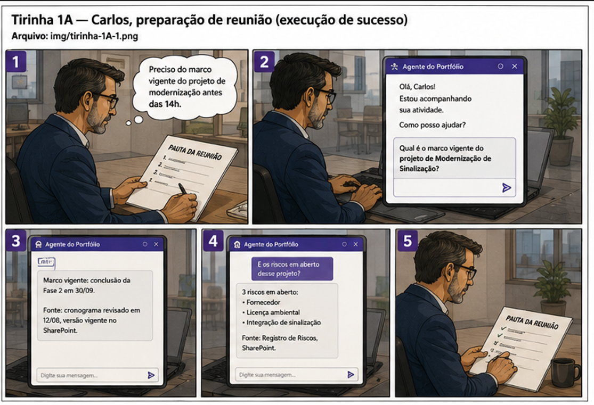

A primeira execução explora a atuação do agente reativo em uma situação na qual Carlos sabe exatamente qual informação precisa obter. Ele está montando a pauta de uma reunião de acompanhamento do subportfólio e identifica, por conta própria, que precisa confirmar o marco vigente de um dos projetos antes de conduzir a conversa com os líderes.

Carlos abre o canal do agente e formula a solicitação. O agente responde com o marco, a data e a referência ao documento consultado, indicando a versão vigente do cronograma. Em seguida, Carlos aprofunda a consulta perguntando pelos riscos em aberto do mesmo projeto, e recebe uma nova resposta igualmente referenciada.

Concluída a consulta, Carlos encerra o canal e retorna à elaboração da pauta. O agente não se manifesta novamente. Nenhum elemento é apresentado sem ter sido pedido e nenhuma interrupção ocorre durante o restante da atividade.

O cenário foi considerado bem-sucedido porque o agente resolveu, em duas solicitações, uma consolidação que exigiria navegação entre o SharePoint, o Power BI e documentos distintos, mantendo a rastreabilidade de cada informação apresentada. O controle sobre o que é consultado permanece integralmente com Carlos, e a relação entre pergunta e resposta é direta o suficiente para que o registro de auditoria previsto no RNF03 seja produzido sem ambiguidade.

##### Cenário 2 — Mariana consolida o balanço mensal a partir de uma solicitação precisa

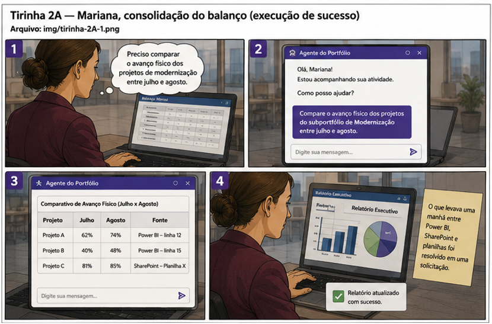

A segunda execução explora uma situação em que Mariana, analista sênior com domínio do vocabulário utilizado nos documentos do portfólio, formula uma solicitação comparativa durante a consolidação do balanço mensal.

Mariana solicita ao agente a comparação do avanço físico dos projetos de um subportfólio entre dois meses. A solicitação é formulada com os mesmos termos empregados nos documentos oficiais, o que permite ao agente localizar as informações correspondentes e retornar uma resposta estruturada, com a fonte de cada item apresentado.

O resultado é utilizado diretamente na elaboração do relatório, sem que Mariana precise consultar manualmente as diferentes plataformas em que essas informações estão distribuídas.

O cenário foi considerado bem-sucedido porque evidencia que o ganho do regime reativo é maior justamente para o perfil que já sabe o que precisa perguntar e como perguntar. Para Mariana, a antecipação de necessidades não representaria um ganho significativo: sua dificuldade não está em identificar a informação necessária, mas no esforço manual de reuni-la.

#### Execução dos cenários de falha

##### Cenário 1 — Informação relevante retida por não ter sido solicitada

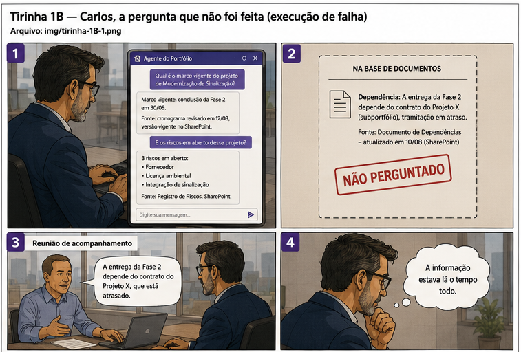

A primeira execução de falha repete a situação do Cenário 1A, novamente com Carlos preparando a reunião de acompanhamento, mas explora o que acontece com a informação que ele não pensou em consultar.

Carlos formula as mesmas solicitações e recebe as mesmas respostas corretas e referenciadas. Nada de anômalo ocorre durante a interação. Entretanto, existe na base um registro indicando que uma das entregas do subportfólio depende de um contrato pertencente a outro projeto, cuja tramitação está atrasada. O agente dispõe dessa informação e não a apresenta, porque ela não foi solicitada e o regime reativo não prevê que ele fale sem ser chamado.

A consequência aparece fora da interação com o sistema: durante a reunião, o líder do outro projeto informa a dependência, e Carlos é surpreendido por um impacto que poderia ter sido antecipado. A informação estava disponível durante toda a preparação.

A execução revela que a falha do regime reativo não é de recuperação nem de fundamentação — o agente não errou, não inventou e não deixou de responder. Trata-se de uma falha de cobertura, cuja característica mais relevante para o projeto é ser invisível no momento em que ocorre. Nenhum indicador do próprio agente a detecta: do ponto de vista do sistema, a interação foi integralmente bem-sucedida.

O cenário torna visível, portanto, uma decisão de projeto que a alternativa reativa não resolve sozinha: se o sistema dispõe de informação relacionada ao que foi perguntado e capaz de alterar a decisão da pessoa, permanece em aberto se o silêncio continua sendo o comportamento adequado.

##### Cenário 2 — Reformulações sucessivas diante de vocabulário divergente


A segunda execução de falha explora uma situação em que Mariana formula sua solicitação com um vocabulário que não corresponde ao utilizado nos documentos da base.

Mariana pergunta quais projetos estão atrasados. O agente responde que não localizou informações correspondentes ao termo empregado. A resposta é adequada ao RNF04 por não inferir nem completar lacunas sem fundamento, mas é insuficiente sob a perspectiva do RNF07, pois não oferece orientação para reformulação. Mariana reformula a solicitação com outro termo e recebe a mesma resposta. Apenas na terceira formulação, ao utilizar a expressão registrada nos documentos, obtém a informação que procurava.

A execução demonstra que a informação estava disponível desde a primeira solicitação, e que o obstáculo não estava na base nem na capacidade de recuperação, mas na correspondência entre a formulação da pessoa e o vocabulário do acervo. O custo de acesso não foi eliminado pelo agente: foi transferido para Mariana, que precisou descobrir por tentativa qual termo o sistema reconhece. Essa dinâmica reproduz uma dor já registrada em sua jornada (Seção 2.5.2.2), na qual a usuária reformula perguntas sucessivamente até obter respostas úteis.

O cenário torna visível a decisão mais consequente identificada nesta alternativa. Ao não localizar a informação, o agente poderia indicar o termo equivalente utilizado na base e resolver a situação na primeira tentativa. Ao fazê-lo, entretanto, passaria a oferecer algo que não foi solicitado. A alternativa reativa, levada ao limite, não se sustenta como categoria pura: existe um grau mínimo de iniciativa sem o qual o regime não funciona para quem não domina o vocabulário do domínio. O RNF07 já previa "orientação adequada para reformulação" sem qualificar esse comportamento como proatividade, o que indica que a fronteira entre os dois regimes é menos nítida do que a formulação da questão sugere.

#### Diário de construção e execução

A construção das tirinhas evidenciou que a dificuldade do Protótipo 1 não está em representar o agente respondendo, mas em determinar o que ele faz — ou deixa de fazer — nos intervalos entre as solicitações.

**Decisão forçada: o que "reativo" significa entre uma pergunta e a seguinte.** Ao construir o Cenário 1A, foi necessário decidir se o agente mantém o contexto da solicitação anterior dentro de uma mesma sessão. A alternativa foi enunciada como "só age quando é chamado", mas isso não determina se, ao receber "e os riscos?", o agente deve entender que a pergunta se refere ao projeto citado antes ou exigir que Carlos repita o nome do projeto. Manter o contexto é uma forma de o agente supor algo que não foi dito, o que já constitui uma decisão de iniciativa, ainda que mínima. A equipe optou por manter o contexto dentro da sessão e registrou a decisão como aberta.

**Ambiguidade: até onde vai o escopo de uma resposta.** No Cenário 1A, Carlos pergunta pelo marco vigente de um projeto. Ao construir a tirinha, a equipe percebeu que a informação poderia estar registrada em dois documentos com datas diferentes — situação explicitamente mencionada na Seção 2.2 como um dos riscos à confiabilidade. Não ficou claro se o agente deve responder com o documento mais recente, apresentar os dois e apontar a divergência, ou recusar-se a responder até que a inconsistência seja resolvida. Nenhuma das três opções contraria a alternativa enunciada, e a escolha altera substancialmente o que a pessoa vê.

**Ambiguidade: o silêncio é um comportamento, não a ausência de comportamento.** O Cenário 1B só pôde ser construído depois que a equipe reconheceu que o agente reativo dispõe da informação sobre a dependência entre projetos e a retém. Isso alterou a leitura da alternativa: não se trata de um agente que sabe menos, mas de um agente que sabe e não fala. A distinção não estava clara quando a alternativa foi enunciada.

**Impossibilidade do formato: a tirinha não mostra a pergunta que não foi feita.** A principal dificuldade de construção do Cenário 1B foi representar visualmente uma omissão. A tirinha mostra o que acontece, e a falha, neste caso, é algo que não acontece. Foi necessário deslocar a consequência para um painel posterior, situado na reunião, no qual a informação ausente aparece pela fala de outra pessoa. O formato obrigou a equipe a materializar a falha em um evento externo à interação com o agente — o que, por sua vez, revelou que essa falha só é observável fora do sistema.

**Decisão forçada: o que o agente faz quando não encontra.** Ao construir o Cenário 2B, ao chegar à terceira reformulação, tornou-se necessário decidir se o agente pode indicar o termo equivalente registrado na base. A equipe optou por representar essa sugestão no último painel como comportamento não definido — hachurada e marcada como tal —, mantendo a lacuna visível em vez de resolvê-la, e registrou a decisão como aberta no inventário da Seção 3.8.6.1.

**Ambiguidade: onde termina uma sessão de consulta.** Ao definir as situações que seriam usadas para forçar o protótipo, a equipe não soube responder o que aconteceria se Carlos retomasse a conversa no dia seguinte com uma referência vaga ao projeto consultado. O Cenário 1A trata o contexto como preservado, mas não estabelece por quanto tempo. A duração e o limite de uma sessão permaneceram indefinidos.

**Impossibilidade do formato: a tirinha não mede o acúmulo.** O Cenário 2B representa três reformulações em três painéis. Na prática, o custo do regime reativo é cumulativo e depende de quantas vezes por dia a pessoa erra o vocabulário. A tirinha representa o episódio, não a frequência, e a diferença entre um episódio isolado e uma ocorrência diária é justamente o que determinaria se a alternativa é sustentável.

#### 3.8.3.2 Protótipo 2 — Agente Proativo e Orientado à Jornada

O protótipo foi construído e executado a partir de situações em que o agente atua de maneira contextual durante uma atividade realizada pela pessoa. Para explorar tanto os comportamentos esperados quanto seus limites, foram produzidas duas tirinhas para cada situação: uma representando uma execução de sucesso e outra representando uma execução de falha.

As situações foram representadas considerando o ambiente tecnológico já utilizado no contexto da solução, especialmente o ecossistema corporativo baseado em SharePoint. A proatividade do agente foi representada por intervenções dinâmicas na própria interface utilizada pela pessoa, por meio de elementos sobrepostos à tela, sem exigir que o usuário abandone a atividade em andamento para iniciar uma conversa independente.

Todas as quatro tirinhas usam o mesmo projeto — **Modernização do Sistema de Sinalização** — para que a variação entre os cenários fique restrita ao comportamento do agente, e não ao conteúdo consultado.

| Tirinha | Persona | Situação | O que a execução investiga |
| :---: | --- | --- | --- |
| 1A | Carlos | Elaboração do Mapa de Benefícios, com o campo "Benefícios" ainda vazio | A intervenção proativa quando o contexto na tela é inequívoco |
| 1B | Carlos | Mesma elaboração, ainda na etapa de levantamento das entregas | O que acontece quando o agente confunde etapa intermediária com pendência |
| 2A | Mariana | Consulta à aba de Riscos do projeto, com um risco de alta criticidade aberto | O ganho da proatividade quando a informação é crítica e pertinente ao que está na tela |
| 2B | Mariana | Consulta a documentos de entrega, com o agente supondo análise de riscos | O custo de uma interpretação incorreta da intenção |

Um traço comum às quatro tirinhas merece registro, porque não foi planejado: em todas elas o agente **anuncia que está observando** — "Estou acompanhando sua atividade", seguido de um bloco "Contexto identificado". A equipe representou assim porque, sem esse anúncio, o leitor da tirinha não teria como saber de onde veio a intervenção. A consequência apareceu depois: tornar a observação visível é o que expõe, para a pessoa, que o sistema lê continuamente sua tela — exatamente a superfície que o RNF01 e o RNF02 restringem. A decisão de representação acabou revelando uma decisão de produto.

#### Execução dos cenários de sucesso

##### Cenário 1 — Pendência identificada durante a elaboração do Mapa de Benefícios

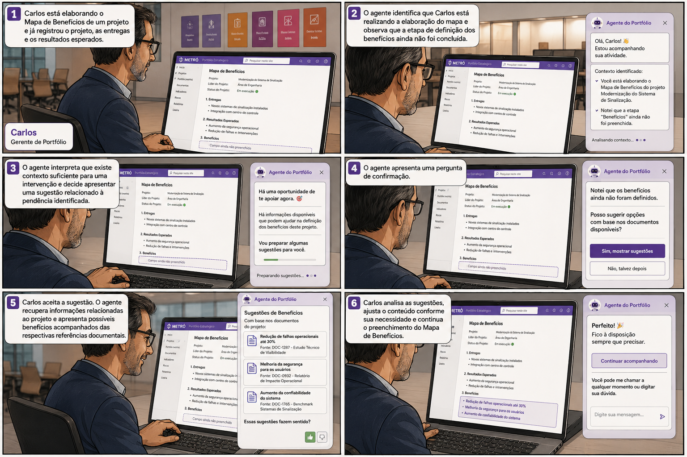

Carlos está preenchendo o Mapa de Benefícios do projeto Modernização do Sistema de Sinalização no Portal Estratégico. Já registrou o projeto, as entregas e os resultados esperados; o campo "Benefícios" permanece vazio na tela.

O agente observa a atividade e identifica dois elementos concretos: o documento aberto e a seção não preenchida. Com base neles, anuncia o contexto identificado e informa que há informação disponível que pode ajudar na definição dos benefícios daquele projeto. Antes de apresentar qualquer conteúdo, faz uma pergunta de confirmação — "Posso sugerir opções com base nos documentos disponíveis?" — com as alternativas *Sim, mostrar sugestões* e *Não, talvez depois*.

Carlos aceita. O agente devolve três benefícios candidatos, cada um com a fonte documental correspondente: redução de falhas operacionais até 30% (DOC-1287, Estudo Técnico de Viabilidade), melhoria da segurança para os usuários (DOC-0932, Relatório de Impacto Operacional) e aumento da confiabilidade do sistema (DOC-1765, Benchmark Sistemas de Sinalização). Carlos ajusta o conteúdo conforme sua necessidade e segue preenchendo o mapa. O agente encerra a intervenção e permanece disponível.

O cenário foi considerado bem-sucedido por três razões observáveis na tirinha. A intervenção se ancora em um elemento visível e inequívoco — um campo obrigatório vazio no documento aberto —, e não em inferência sobre a jornada. A confirmação antecede o conteúdo, de modo que a decisão de receber a sugestão permanece com Carlos. E cada item apresentado carrega a fonte, o que mantém a rastreabilidade exigida pelo RNF03 mesmo quando o agente fala primeiro.

O que o cenário **não** resolve, e ficou registrado como decisão em aberto: um campo vazio é evidência suficiente para intervir, mas nem todo campo vazio é uma pendência — é exatamente essa a hipótese que o Cenário 1B coloca à prova.

##### Cenário 2 — Informação relevante identificada durante uma atividade de acompanhamento

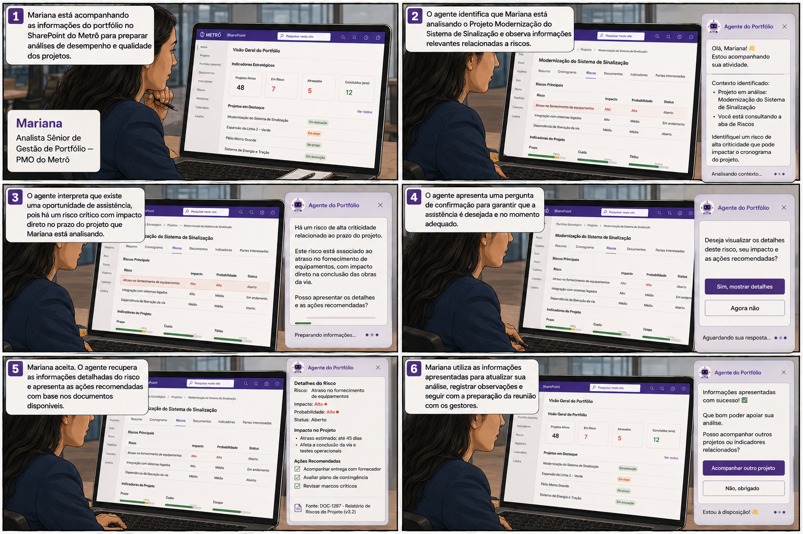

Mariana parte da Visão Geral do Portfólio no SharePoint — 48 projetos ativos, 7 em risco, 5 atrasados — para preparar análises de desempenho e qualidade. Abre o projeto Modernização do Sistema de Sinalização e navega até a aba de Riscos.

O agente identifica o projeto em análise e a aba consultada, e localiza ali um risco de alta criticidade em aberto: "Atraso no fornecimento de equipamentos", com impacto Alto e probabilidade Alta, ligado diretamente ao prazo do projeto. Apresenta a observação e pergunta se Mariana deseja ver os detalhes, o impacto e as ações recomendadas.

Mariana aceita. O agente devolve o detalhamento — atraso estimado de até 45 dias, afetando a conclusão da via e os testes operacionais — com três ações recomendadas: acompanhar a entrega com o fornecedor, avaliar o plano de contingência e revisar os marcos críticos. A fonte é declarada: DOC-1287, Relatório de Riscos do Projeto (v3.2). Mariana usa o conteúdo para atualizar sua análise e seguir para a preparação da reunião com os gestores.

O cenário foi considerado bem-sucedido porque a informação apresentada não é apenas pertinente ao domínio: ela é o item de maior criticidade dentro exatamente da aba que Mariana abriu. A proatividade, aqui, não adivinha a necessidade — ela hierarquiza o que já está na tela. É a condição mais favorável possível para o regime proativo, e serve de contraste para o Cenário 2B, em que o agente erra a atividade que Mariana está realizando.

O cenário também mostra o limite do que a tirinha consegue afirmar: ela representa uma intervenção. Se o mesmo agente repetisse essa oferta a cada aba aberta ao longo de uma manhã de trabalho, o julgamento seria outro, e o formato não distingue os dois casos.

#### Execução dos cenários de falha

##### Cenário 1 — Intervenção prematura diante de contexto insuficiente


A situação é deliberadamente quase idêntica à do Cenário 1A: Carlos, o mesmo Mapa de Benefícios, o mesmo campo "Benefícios" vazio. A diferença é o momento. Aqui ele acabou de iniciar a elaboração e informou apenas o projeto e algumas entregas — está na etapa de levantamento, não na de preenchimento dos benefícios.

O agente observa a mesma tela e chega a registrar, no painel 2, que os sinais são insuficientes: "Informações ainda parciais", "Não há confirmação da intenção de receber sugestões", e declara que aguardará novos sinais. No painel seguinte, porém, interpreta a ausência de benefícios como pendência que exige intervenção imediata, e apresenta a sugestão mesmo assim — antes que Carlos conclua a etapa anterior, interrompendo o fluxo da atividade.

Carlos recusa: "Ainda não. Estou pesquisando as informações das entregas." O agente responde que vai aguardar novos sinais e oferece duas alternativas — *Acompanhar atividade* e *Resumir o que foi preenchido*.

É no painel 6 que a execução falha de fato. O agente precisa decidir como se comportar depois da recusa, e o protótipo não define esse comportamento. O painel foi desenhado explicitamente como **"Situação não definida no protótipo"**, listando as quatro opções que a equipe não soube escolher — encerrar a intervenção, aguardar e observar, perguntar novamente mais tarde ou sugerir outra forma de apoio — e marcando a lacuna identificada: *estratégia de resposta após recusa inicial*.

A execução revela que a mesma evidência observada no Cenário 1A — um campo obrigatório vazio — sustenta tanto uma intervenção bem-sucedida quanto uma inadequada. O que separa os dois casos não está na tela: está na etapa do trabalho em que a pessoa se encontra, e essa etapa o agente não observa. É a decisão de **quando** intervir, e não a de **o que** oferecer, que a alternativa proativa deixa sem resposta.

Vale registrar o improviso: nos painéis 2 e 3 o agente primeiro reconhece que não tem sinais suficientes e em seguida intervém assim mesmo. A equipe manteve a contradição no desenho em vez de corrigi-la, porque ela é o próprio achado — não havia critério disponível para decidir entre "aguardar" e "intervir", e o protótipo teve de escolher um dos dois para que o painel seguinte existisse.

##### Cenário 2 — Intervenção baseada em interpretação incorreta do contexto

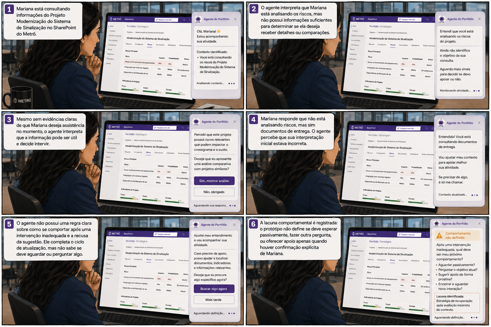

Mariana está no mesmo projeto do Cenário 2A, com a aba de Riscos aberta na tela. O agente identifica o contexto e conclui que ela está analisando os riscos do projeto — a leitura mais óbvia possível do que está visível.

A conclusão está errada. Mariana abriu aquela aba de passagem: sua atividade naquele momento são os documentos de entrega. O agente, sem evidência clara da intenção, decide intervir mesmo assim e oferece uma análise comparativa dos riscos com projetos similares. Mariana recusa e corrige a interpretação.

O agente ajusta o contexto — "Entendido! Você está consultando documentos de entrega" — e completa o ciclo de atualização. Mas o painel 5 registra que ele não possui regra sobre o que fazer em seguida: oferece uma nova busca sem saber se deveria estar oferecendo algo. O painel 6 formaliza a lacuna, marcado como **"Comportamento não definido"**, com as quatro opções em aberto — aguardar passivamente, perguntar o objetivo atual, sugerir apoio de forma proativa ou encerrar e aguardar nova interação — e a lacuna nomeada: *estratégia de recuperação após avaliação incorreta do contexto*.

A execução demonstra que uma informação pode ser correta, crítica e pertencente ao projeto certo e ainda assim ser inadequada, porque o critério que falhou não é o de relevância, e sim o de intenção. É a mesma informação do Cenário 2A, na mesma tela, para a mesma pessoa — e o resultado se inverte apenas porque a atividade real era outra.

Isso expõe o limite estrutural da alternativa proativa: a tela mostra **onde** a pessoa está, não **o que** ela está tentando fazer. O agente só tem acesso ao primeiro, e as duas coisas coincidem com frequência suficiente para que a proatividade pareça funcionar — e divergem com frequência suficiente para que ela erre sem aviso.

A comparação entre 2A e 2B foi o achado mais direto da execução, e ele não estava previsto: a equipe esperava que os cenários de falha revelassem problemas de recuperação de informação, e o que apareceu foi um problema de leitura de intenção, que nenhuma melhoria no RAG resolveria.

#### Diário de construção e execução

A construção das tirinhas evidenciou que a principal dificuldade do Protótipo 2 não está em representar a intervenção proativa em si, mas em definir as condições que autorizam o agente a decidir **quando**, **como** e **com que intensidade** iniciar uma interação. Nenhuma dessas três condições estava determinada quando a alternativa foi enunciada, e todas precisaram ser resolvidas painel a painel para que a tirinha pudesse ser desenhada.

**Decisão forçada: qual evidência de contexto autoriza o agente a falar.** Ao construir os cenários de sucesso, não bastou dizer que o agente "identifica o contexto": foi preciso decidir o que exatamente ele estaria vendo no painel anterior para que a intervenção seguinte parecesse justificada. A equipe optou por ancorar cada intervenção em um elemento visível na tela da pessoa — o documento aberto, o campo em preenchimento — e não em histórico ou inferência sobre a jornada. A decisão não foi planejada: ela apareceu porque, sem um elemento visível no painel, o leitor da tirinha não tem como saber por que o agente falou. Ficou registrada como aberta, porque restringe o agente a um contexto raso.

**Decisão forçada: onde a intervenção aparece na tela.** A alternativa foi enunciada sem definir a forma da intervenção. Ao desenhar, foi necessário escolher entre um elemento sobreposto ao ambiente de trabalho e uma interface conversacional separada. A equipe escolheu a sobreposição, porque é o que representa um agente que acompanha a jornada sem exigir que a pessoa abandone a atividade. A escolha, porém, é a que torna a intervenção interruptiva — as duas propriedades vêm juntas, e isso não estava claro antes de desenhar.

**Ambiguidade: informação correta não é o mesmo que momento adequado.** Ao construir os cenários de falha, a equipe percebeu que não sabia dizer o que diferencia uma oportunidade legítima de assistência de uma etapa intermediária de uma atividade em andamento. Nos dois casos o agente dispõe de informação pertinente ao domínio; a diferença está apenas no instante. Não houve critério que a equipe pudesse enunciar para separar os dois, e a tirinha 1B existe justamente porque essa distinção não foi encontrada.

**Ambiguidade: o que o agente faz depois de uma recusa.** A recusa foi representada, mas o painel seguinte não pôde ser desenhado com convicção. Recusar não significa rejeitar a assistência em definitivo: pode significar apenas que aquela sugestão não servia naquele momento. Permaneceu indefinido se o agente deve encerrar a intervenção, pedir esclarecimento, atualizar o contexto ou aguardar novos sinais — e, sem isso, não há como saber quando ele pode voltar a falar.

**Impossibilidade do formato: a tirinha não representa frequência nem intensidade.** É o limite mais consequente desta alternativa. Cada tirinha mostra uma intervenção isolada, e uma intervenção isolada quase sempre parece razoável. O que determina se a proatividade é aceitável ou insuportável é quantas vezes ela ocorre ao longo de um dia de trabalho, e isso o meio não representa. A mesma sugestão do Cenário 1A, repetida seis vezes em uma hora, seria outro sistema — e a tirinha desenha os dois de forma idêntica.

**Impossibilidade do formato: a tirinha não mostra a intenção da pessoa.** O Cenário 2B depende de Mariana estar fazendo uma coisa enquanto o agente supõe outra. Só que a intenção dela não é observável: foi preciso escrevê-la em uma fala explícita para que a falha ficasse legível. Na situação real, essa fala não existiria — o agente erraria sem que ninguém dissesse por quê. O formato obrigou a tornar visível exatamente aquilo que, no sistema real, é invisível, e é por isso que o critério de intervenção não pôde ser derivado da tirinha.

Como resultado, a execução dos cenários não validou uma implementação: tornou visíveis decisões comportamentais em aberto — o nível mínimo de contexto para intervir, a forma e o lugar da intervenção, o tratamento da recusa e os limites de frequência —, todas registradas no inventário da Seção 3.8.6.1.


### 3.8.4 Comparação das Alternativas

A comparação apresentada nesta seção decorre dos cenários e dos diários de construção e execução dos dois protótipos (Seções 3.8.3.1 e 3.8.3.2). Como as alternativas foram representadas com as mesmas personas, tipos de situação e formato de tirinha, as diferenças observadas dizem respeito principalmente à origem da iniciativa da interação. Os roteiros não são estritamente idênticos; por isso, a comparação é analítica, e não uma validação experimental isolada. A exploração não determina a adoção de uma alternativa; ela explicita as condições, os riscos e as decisões que cada uma transfere para a solução.

#### O que cada protótipo tornou visível

O Protótipo 1 tornou visível que o silêncio é um comportamento com consequências, e não a ausência de comportamento. Nos Cenários 1A e 2A, o regime reativo funciona bem quando a pessoa sabe o que precisa consultar e consegue formular a solicitação com os termos reconhecidos pela base: o agente reduz a busca manual, mantém a fonte associada à resposta e não interrompe a atividade. Já os Cenários 1B e 2B mostraram seus limites: uma informação relevante pode permanecer retida por não ter sido solicitada, e uma informação disponível pode não ser encontrada quando o vocabulário da pessoa diverge do vocabulário do acervo.

O Protótipo 2 tornou visível que o valor da proatividade depende menos de recuperar uma informação potencialmente útil do que de justificar a intervenção naquele instante. Nos Cenários 1A e 2A, a sugestão contextual reduz o esforço de localizar informações sem retirar da pessoa a decisão de aceitá-la ou utilizá-la. Nos Cenários 1B e 2B, uma informação correta e pertinente ao domínio se mostrou insuficiente para justificar a intervenção: o contexto pode ainda estar incompleto, ou a atividade observada pode não corresponder à intenção atual da pessoa.

#### Comparação dos efeitos observados

| Aspecto | Protótipo 1 — reativo sob demanda | Protótipo 2 — proativo e orientado à jornada |
| --- | --- | --- |
| Onde demonstrou valor | Consulta objetiva, com fonte, quando a pessoa conhece sua necessidade e sabe formulá-la. | Oferta de apoio no próprio fluxo de trabalho quando há contexto suficiente e a sugestão pode ser recusada sem interromper a atividade. |
| Falha característica | Omissão silenciosa: o agente pode ter a informação relevante e não apresentá-la; a consequência só aparece depois, fora da interação. | Intervenção inadequada: a sugestão é visível e pode interromper, distrair ou não corresponder à intenção da pessoa. |
| Principal incerteza de comportamento | Quanto contexto manter entre perguntas; como tratar documentos divergentes; e se, ao não localizar uma formulação, deve orientar a reformulação. | Qual evidência de contexto é suficiente para intervir; como tratar recusa ou correção; e qual frequência de intervenções é aceitável. |
| Rastreabilidade e governança | O par pergunta–resposta é delimitado e simplifica o registro previsto no RNF03. Não requer observação contínua da atividade. | Exige registrar também o contexto e a justificativa da intervenção. A observação da atividade amplia as implicações de confidencialidade e controle de acesso previstas no RNF01 e no RNF02. |
| Custo deslocado para a pessoa | Identificar a necessidade, iniciar a consulta e, em caso de vocabulário divergente, reformular até obter correspondência. | Avaliar, aceitar ou recusar sugestões e lidar com eventuais interrupções no fluxo de trabalho. |

#### O que surpreendeu o grupo

**A alternativa reativa não se sustenta como categoria pura.** A expectativa inicial era de que “reativo” e “proativo” fossem regimes mutuamente excludentes. O Cenário 2B mostrou o contrário: para que o regime reativo funcione com quem não domina o vocabulário do acervo, ele precisa ao menos orientar uma reformulação, por exemplo indicando o termo equivalente registrado na base. Essa orientação foi deixada explicitamente como comportamento não definido na tirinha. Como o RNF07 já prevê orientação para reformulação, a decisão não é binária: a iniciativa deve ser tratada como uma escala.

**As duas alternativas dependem de interpretar a intenção e o contexto.** No regime proativo, essa interpretação é necessária antes de o sistema falar. No reativo, ela aparece ao resolver referências em perguntas sucessivas, delimitar o escopo de uma resposta e reconhecer formulações diferentes para a mesma necessidade. A diferença está em quem arca primeiro com o erro: no proativo, o sistema pode interromper a pessoa; no reativo, a pessoa pode precisar reformular ou descobrir o vocabulário reconhecido pela base.

**Um regime falha em silêncio e o outro falha em voz alta.** A intervenção inadequada do Protótipo 2 é imediatamente perceptível, pode ser recusada e gera um sinal para avaliação. A falha do Protótipo 1, por sua vez, pode passar inteiramente despercebida: no Cenário 1B, nada indica que uma informação deixou de ser apresentada até que a consequência apareça fora do sistema. Portanto, métricas usuais do MVP, como fundamentação, alucinação e qualidade da recuperação, não medem automaticamente a cobertura de informações que a pessoa não chegou a pedir; essa cobertura exigirá casos de referência ou acompanhamento de uso específico.

**A confiabilidade não se resolve apenas pela iniciativa.** A ambiguidade observada no Cenário 1A — documentos potencialmente divergentes sobre o mesmo marco — afeta ambos os regimes. Seja por resposta sob demanda ou por sugestão proativa, a solução ainda precisa definir se prioriza a fonte mais recente, explicita a divergência ou limita a resposta. A origem da iniciativa não substitui a política de tratamento de evidências.

#### O que o formato tornou possível observar

A representação em tirinha obrigou a equipe a explicitar o intervalo entre uma interação e outra. Foi nesse intervalo que apareceram as falhas mais relevantes: o painel em que o agente reativo dispõe da informação e não a apresenta, e o painel em que o agente proativo decide intervir antes que a necessidade esteja caracterizada. O formato também permitiu manter visível uma lacuna de comportamento — a orientação de reformulação no Cenário 2B — sem transformá-la indevidamente em uma funcionalidade já definida.

O formato também impôs um limite que se tornou um achado: a tirinha não é capaz de representar a pergunta que não foi feita. Para construir o Cenário 1B foi necessário deslocar a consequência para fora da interação com o agente, e essa impossibilidade do meio revelou uma propriedade do próprio regime — a falha por omissão só é observável fora do sistema.

### 3.8.5 Limites da Exploração

Esta seção declara o que os protótipos produzidos, nos formatos utilizados, não são capazes de informar.

**Nenhum usuário real participou.** As quatro tirinhas de cada protótipo foram construídas e lidas pelos próprios integrantes do grupo. As falas atribuídas a Carlos e Mariana foram escritas pela equipe a partir das personas documentadas na Seção 2.5, que são hipóteses de projeto e não observação de campo. A exploração não informa se profissionais do PMO reconheceriam essas situações como representativas de sua rotina, nem se reagiriam às intervenções do Protótipo 2 da forma representada.

**O perfil executivo não foi explorado.** Roberto não aparece em nenhum dos oito cenários produzidos. Como sua jornada (Seção 2.5.2.1) é caracterizada por escassez de tempo e demanda por síntese, é plausível que o equilíbrio entre os dois regimes seja diferente para ele, mas os protótipos não oferecem nenhuma evidência a respeito.

**O vocabulário do Cenário 2B é uma suposição.** A divergência entre o termo empregado por Mariana e o registrado nos documentos foi inventada pela equipe. Não sabemos se os documentos do portfólio do Metrô efetivamente empregam vocabulário distinto daquele utilizado pelas pessoas ao formular perguntas, nem qual a extensão dessa divergência. Essa é uma hipótese verificável na massa documental real e ainda não verificada.

**A frequência das falhas é desconhecida, e é ela que decidiria a questão.** Cada tirinha representa um episódio. O que determinaria a adequação de cada regime é a taxa: quantas vezes por semana uma informação relevante deixa de ser consultada, e quantas vezes por dia uma intervenção proativa é inadequada. Um regime cuja falha ocorre uma vez por mês e outro cuja falha ocorre cinco vezes por dia produzem decisões de projeto opostas, e os protótipos são silenciosos quanto a isso. Apenas o uso continuado, ao longo de semanas, responderia.

**O custo cumulativo não é representável.** Pelo mesmo motivo, a exploração não informa o efeito acumulado das reformulações sucessivas sobre a disposição da pessoa em continuar utilizando o agente, nem o efeito acumulado das interrupções sobre sua tolerância a novas intervenções. Ambos são fenômenos de uso prolongado.

**Não há comparação entre formatos de prototipação.** Os dois protótipos utilizaram tirinhas, decisão tomada deliberadamente para isolar o regime de iniciativa como única variável entre as alternativas (Seção 3.8.2.1). O custo dessa decisão é que a exploração informa o que a tirinha revela, mas não informa o que outro formato revelaria. Comportamentos que dependem de ritmo, de simultaneidade ou da sensação de ser interrompido no meio de uma tarefa provavelmente apareceriam em uma encenação e não apareceram aqui.

**Nada foi verificado quanto à viabilidade técnica.** Os protótipos representam o comportamento desejado, não a capacidade do sistema de produzi-lo. Se o pipeline consegue identificar o contexto da atividade com a precisão que o Protótipo 2 pressupõe, ou reconhecer formulações divergentes com a cobertura que o Protótipo 1 exigiria, são perguntas que dependem de experimentação com o núcleo de PLN e das métricas previstas no RNF06.

**A aceitação institucional da observação contínua não foi avaliada.** A exploração tornou visível que o regime proativo exige que o sistema acompanhe a atividade da pessoa, e que isso incide sobre as restrições de confidencialidade e controle de acesso do parceiro. Se essa observação seria admissível pelas áreas técnicas e de compliance do Metrô é uma questão a ser tratada com o parceiro, e não algo que os protótipos possam responder.

### 3.8.6 Insumos para a Equipe

#### 3.8.6.1 Inventário de Decisões em Aberto

| Decisão em aberto | Alternativas identificadas | O que está em jogo |
| --- | --- | --- |
| Contexto entre perguntas e duração da sessão | Manter o contexto somente na sessão; exigir nova explicitação; ou definir expiração por tempo. | Equilibrar continuidade da conversa, precisão da referência e controle da pessoa sobre o escopo. |
| Resposta diante de fontes divergentes | Priorizar a fonte mais recente; explicitar a divergência; ou interromper a resposta até validação. | Preservar a confiabilidade e a transparência sem ocultar inconsistências documentais. |
| Orientação quando não houver correspondência de vocabulário | Informar apenas a ausência; sugerir termos equivalentes; ou solicitar esclarecimento. | Atender simultaneamente ao RNF04, sem alucinar, e ao RNF07, orientando a reformulação. |
| Informação relevante não solicitada | Permanecer em silêncio; apresentar relação contextual sob demanda; ou sugerir a informação proativamente. | Definir o grau de iniciativa aceitável e reduzir falhas de cobertura sem gerar intrusão. |
| Gatilho e frequência da intervenção proativa | Intervir com evidência mínima; exigir sinais adicionais; e limitar novas intervenções após recusa. | Evitar interrupções e, ao mesmo tempo, não deixar de oferecer apoio em situações relevantes. |
| Tratamento de recusa ou correção | Encerrar a sugestão; pedir esclarecimento; ou atualizar o contexto e aguardar novos sinais. | Manter a pessoa no controle e evitar repetição de intervenções inadequadas. |

#### 3.8.6.2 Repertório de Situações

O repertório reúne as oito situações efetivamente rodadas nas Seções 3.8.3.1 e 3.8.3.2. A última coluna registra o que o protótipo **não** conseguiu atender — que é o material de trabalho para a equipe. A coluna "Improviso" indica as situações em que alguém precisou decidir na hora algo que o protótipo não definia.

| # | Situação e pedido registrado | Protótipo / Persona | Improviso | O que o protótipo não conseguiu atender |
| :---: | --- | --- | :---: | --- |
| S1 | Preparação de reunião: consulta ao marco vigente de um projeto, seguida de “e os riscos?” | P1 · Carlos | Sim | Não define se “os riscos” se referem ao projeto citado antes ou exigem nova explicitação. Contexto mantido por improviso, sem regra de duração de sessão. |
| S2 | Mesma preparação, com uma dependência de contrato atrasado existente na base e não consultada | P1 · Carlos | Não | Não apresenta a informação, porque ninguém perguntou. A falha não é detectável pelo sistema: do ponto de vista dele, a interação foi bem-sucedida. |
| S3 | Consolidação do balanço mensal: comparação do avanço físico entre dois meses, com o vocabulário dos documentos | P1 · Mariana | Não | Nada a registrar — é o caso em que o regime reativo funciona plenamente. Serve de contraste para S4. |
| S4 | Mesma consolidação, formulada como “quais projetos estão atrasados” | P1 · Mariana | Sim | Responde apenas que não localizou, sem indicar o termo equivalente da base. Foram necessárias três reformulações. O painel de sugestão de termo ficou hachurado como comportamento não definido. |
| S5 | Elaboração do Mapa de Benefícios, com pendência identificada pelo agente a partir da tela | P2 · Carlos | Sim | Não define qual evidência de contexto é suficiente para autorizar a intervenção. Funcionou porque a equipe escolheu, por improviso, ancorar em um elemento visível na tela. |
| S6 | Atividade de acompanhamento do portfólio, com informação relacionada oferecida durante a navegação | P2 · Mariana | Não | Não define limite de frequência. Uma intervenção isolada parece adequada; o protótipo não representa a repetição. |
| S7 | Acompanhamento ainda em curso, com o agente intervindo antes de a necessidade estar caracterizada | P2 · Carlos | Sim | Não há critério que separe uma oportunidade legítima de assistência de uma etapa intermediária da atividade. A distinção foi decidida caso a caso ao desenhar. |
| S8 | Navegação alternando entre informações, com o agente interpretando incorretamente a atividade | P2 · Mariana | Não | Não define o comportamento após a recusa ou correção: encerrar, pedir esclarecimento, atualizar o contexto ou aguardar novos sinais. O painel seguinte ficou sem definição. |

Sete das oito situações terminam em algo que o protótipo não resolve. A única exceção é S3, em que o vocabulário da solicitação coincide com o dos documentos e o regime reativo funciona sem lacuna — e é por isso que ela serve de contraste para S4, sua situação gêmea com vocabulário divergente.

Quatro situações exigiram improviso, ou seja, alguém precisou decidir na hora algo que o protótipo não definia: S1, S4, S5 e S7. Nas demais, a lacuna apareceu sem que fosse necessário contorná-la para seguir — em S8, inclusive, a equipe optou por registrar o comportamento como não definido no próprio painel, em vez de escolher um. A concentração das lacunas fora das condições favoráveis é o principal insumo que a exploração entrega para a Sprint 3.

---

# 4. Modelagem de Dados

Esta seção apresenta a modelagem de dados da solução em três níveis complementares: conceitual, lógico e físico. A modelagem foi definida para o MVP do agente inteligente de Gestão de Portfólio de Projetos do Metrô, considerando os requisitos funcionais e não funcionais descritos na Seção 3, a arquitetura de componentes apresentada na Seção 5.2 e a estrutura observada no SharePoint do parceiro.

O objetivo da modelagem é representar, de forma simples e implementável, os dados necessários para que o agente consiga receber solicitações em linguagem natural, classificar intenções, consultar informações de projetos, acessar documentos e planilhas vinculadas no SharePoint, preparar contexto controlado para o Copilot, respeitar permissões por perfil e registrar auditoria das interações.

## 4.1 Especificação da Base de Dados

A base de dados do MVP foi desenhada para funcionar como uma camada intermediária entre o agente conversacional, o núcleo de PLN, o Copilot Studio, os fluxos do Power Automate e as fontes simuladas do SharePoint. Como o projeto utiliza dados sintéticos, a modelagem não replica dados reais do Metrô; ela replica a estrutura necessária para representar projetos, subportfólios, artefatos documentais, cronogramas, atualizações de status, riscos, mudanças, intenções e registros de auditoria.

A decisão de modelagem adotada foi reduzir a complexidade para um MVP, evitando uma tabela para cada página, lista ou biblioteca do SharePoint. Em vez disso, documentos, links, listas, prompts, normativos e planilhas são representados pela tabela `project_artifacts`. Quando o artefato for uma planilha de cronograma vinculada em uma lista do SharePoint, seus metadados ficam registrados em `project_artifacts` e suas linhas relevantes são extraídas para `schedule_items`.

Essa abordagem contempla o funcionamento observado no ambiente do parceiro: algumas listas do SharePoint apresentam linhas com links para arquivos Excel, especialmente cronogramas. No MVP, o link da planilha é armazenado em `project_artifacts.sharepoint_url`; a aba e o intervalo de leitura são indicados por `excel_sheet_name` e `excel_table_or_range`; e cada linha relevante do cronograma é normalizada em `schedule_items`, preservando a origem por meio de campos como `source_sheet_name`, `source_row_number` e `source_cell_range`.

O modelo também suporta a avaliação do núcleo de PLN implementado no notebook `src/notebooks/classificador_intencoes_metro.ipynb`. Esse notebook trabalha com um catálogo hierárquico de intenções em dois níveis: `macrointencao` (`CONSULTA`, `TRANSACAO`, `ALERTA` e `FORA_DE_ESCOPO`) e intenção específica, totalizando 31 classes na execução de referência. Por isso, a tabela `intent_catalog` registra tanto a macrointenção quanto a intenção específica, o fluxo associado, o handler previsto e os limiares de confiança usados para decidir entre roteamento, acionamento de handler específico ou resposta de limitação.

A tabela `intent_test_cases` armazena exemplos rotulados derivados dos templates do notebook, preservando `template_id`, variação superficial, texto normalizado e split (`treino`, `validacao`, `teste`). Isso mantém a rastreabilidade do protocolo sem vazamento usado no classificador, em que a divisão é feita por template e não por frase. As interações reais ou simuladas são registradas em `ai_interactions`, incluindo macrointenção prevista, confiança da macro, intenção específica prevista, confiança da intenção, handler selecionado, alternativas top-k e eventual resposta de limitação. As fontes consultadas são rastreadas por `consulted_sources`, permitindo verificar quais documentos, extratos, planilhas ou linhas foram usados para compor o retorno ao usuário.

O modelo físico inicial está implementado em [`src/database/sql/01_create_database.sql`](../src/database/sql/01_create_database.sql). A documentação operacional dos artefatos de banco, incluindo o papel futuro dos scripts de inserção e rollback, está registrada em [`src/database/docs/README.md`](../src/database/docs/README.md).

## 4.2 Modelo Conceitual de Dados

O modelo conceitual é uma representação abstrata de alto nível, focada nas regras do negócio e no entendimento das entidades que precisam existir para a solução. Neste nível, não são definidos tipos de dados, chaves primárias, chaves estrangeiras ou detalhes de implementação.

As principais entidades conceituais do MVP são:

| Entidade | Descrição de negócio |
|---|---|
| Subportfólio | Categoria estratégica que agrupa projetos do portfólio, como Turnaround, Expansão da Rede Metrô e Gestão e Finanças. |
| Projeto | Iniciativa acompanhada pelo PMO, associada a um subportfólio e composta por documentos, cronograma, status, riscos e mudanças. |
| Artefato do Projeto | Fonte de informação vinculada ao projeto, podendo ser TAP, cronograma, relatório, planilha, lista SharePoint, prompt ou normativo. |
| Extrato de Fonte | Parte extraída de um documento, lista ou planilha para consulta, referência e montagem de contexto controlado no Copilot. |
| Item de Cronograma | Linha estruturada extraída de um cronograma, inclusive quando a origem for uma planilha Excel vinculada no SharePoint. |
| Atualização de Status | Registro de avanço, situação, impedimentos, próximos passos e resumo executivo de um projeto. |
| Risco ou Problema | Evento de risco ou problema materializado que afeta um projeto. |
| Mudança | Registro de alteração de prazo, escopo, custo, prioridade ou outro aspecto relevante do projeto. |
| Usuário | Pessoa que interage com o agente, vinculada a um perfil como Diretoria, PMO, Líder de Subportfólio ou Equipe de Projeto. |
| Regra de Acesso | Definição conceitual de quais informações um usuário ou perfil pode consultar, alterar ou exportar. |
| Intenção | Necessidade identificada pelo núcleo de PLN, organizada em macrointenção e intenção específica conforme o notebook do classificador. |
| Template de Prompt | Prompt padronizado utilizado para orientar fluxos de resposta, geração documental ou consultas recorrentes. |
| Conversa | Agrupamento das interações realizadas por um usuário em um canal conversacional. |
| Interação | Pergunta/resposta auditável, contendo solicitação, intenção classificada, rota de processamento e resposta. |
| Fonte Consultada | Documento, extrato, planilha, linha ou lista usada para explicar a origem das informações devolvidas ao usuário. |
| Evento de Auditoria | Registro técnico ou funcional gerado durante o processamento da interação. |
| Solicitação Fora de Escopo | Pergunta que não pertence ao catálogo suportado pelo agente, mas deve ser registrada para análise futura. |
| Caso de Teste de Intenção | Exemplo rotulado usado para avaliar o desempenho do classificador, preservando template, split e texto normalizado. |

<div align="center">
  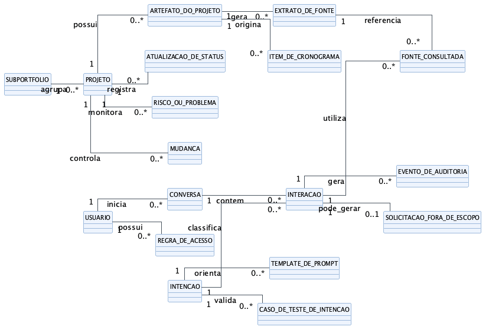
</div>

<p align="center"><strong>Figura 18</strong> - Modelo conceitual de dados.<br><sup>Fonte: Material produzido pelos autores, 2026.</sup></p>

O código-fonte do diagrama está versionado em [`docs/diagrams/modelo-conceitual.puml`](diagrams/modelo-conceitual.puml) e pode ser regerado com PlantUML e Graphviz instalados:

```bash
java -jar plantuml.jar -charset UTF-8 -tpng -o ../img docs/diagrams/modelo-conceitual.puml
```

## 4.3 Modelo Lógico de Dados

O modelo lógico detalha o modelo conceitual em formato de tabelas, atributos principais, chaves primárias e chaves estrangeiras. Ele ainda não representa o código final do banco, mas define a estrutura lógica que deve ser implementada.

Para manter o escopo adequado ao MVP, a modelagem lógica foi consolidada em 18 tabelas:

| Tabela | PK | FKs principais | Finalidade |
|---|---|---|---|
| subportfolios | id | - | Armazena os subportfólios estratégicos. |
| projects | id | subportfolio_id → subportfolios.id | Armazena os projetos do portfólio. |
| project_artifacts | id | project_id → projects.id | Representa documentos, listas, links, planilhas, prompts e normativos vindos do SharePoint ou da massa sintética. |
| source_extracts | id | artifact_id → project_artifacts.id, project_id → projects.id | Armazena extratos consultáveis de documentos, listas e planilhas para composição de contexto no Copilot e rastreabilidade de fontes. |
| schedule_items | id | project_id → projects.id, artifact_id → project_artifacts.id, parent_item_id → schedule_items.id | Armazena linhas estruturadas de cronograma, inclusive extraídas de Excel. |
| project_status_updates | id | project_id → projects.id, artifact_id → project_artifacts.id | Armazena avanço, situação e resumo de status dos projetos. |
| risk_issue_items | id | project_id → projects.id, source_artifact_id → project_artifacts.id | Armazena riscos e problemas em uma estrutura unificada. |
| change_records | id | project_id → projects.id, source_artifact_id → project_artifacts.id | Armazena registros de mudanças. |
| users | id | - | Armazena usuários simulados ou autenticados via Entra ID em evolução futura. |
| access_rules | id | user_id → users.id, subportfolio_id → subportfolios.id, project_id → projects.id | Armazena regras de acesso por usuário, perfil e escopo. |
| intent_catalog | id | - | Armazena macrointenção, intenção específica, fluxo, handler e limiares do classificador. |
| prompt_templates | id | intent_id → intent_catalog.id | Armazena templates de prompts padronizados para Copilot, Power Automate, M365 Copilot e PLN local. |
| ai_conversations | id | user_id → users.id | Armazena sessões conversacionais. |
| ai_interactions | id | conversation_id → ai_conversations.id, user_id → users.id, intent_id → intent_catalog.id, prompt_template_id → prompt_templates.id | Armazena pergunta, macrointenção, intenção específica, confianças, handler, alternativas, rota, resposta e status da interação. |
| consulted_sources | id | interaction_id → ai_interactions.id, artifact_id → project_artifacts.id, extract_id → source_extracts.id, project_id → projects.id | Armazena as fontes consultadas para compor uma resposta. |
| audit_events | id | interaction_id → ai_interactions.id, user_id → users.id | Armazena eventos de auditoria técnica e funcional. |
| out_of_scope_requests | id | interaction_id → ai_interactions.id, reviewed_by → users.id | Armazena perguntas fora do escopo suportado. |
| intent_test_cases | id | intent_id → intent_catalog.id | Armazena exemplos rotulados com template_id, variação, texto normalizado e split agrupado. |

<div align="center">
  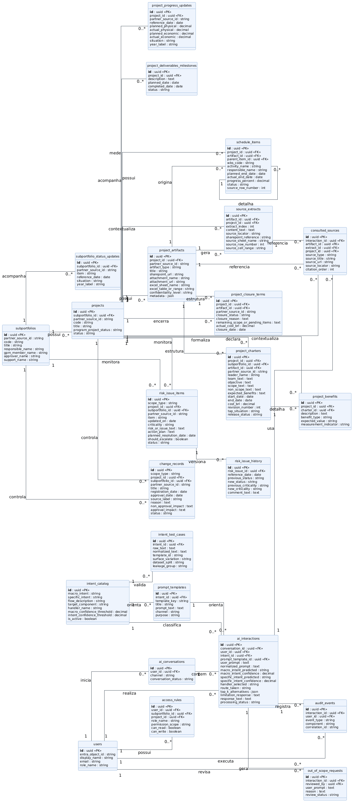
</div>

<p align="center"><strong>Figura 19</strong> - Modelo lógico de dados.<br><sup>Fonte: Material produzido pelos autores, 2026.</sup></p>

O código-fonte do diagrama está versionado em [`docs/diagrams/modelo-logico.puml`](diagrams/modelo-logico.puml) e pode ser regerado com PlantUML e Graphviz instalados:

```bash
java -jar plantuml.jar -charset UTF-8 -tpng -o ../img docs/diagrams/modelo-logico.puml
```

As principais regras de integridade do modelo lógico são:

- todo projeto deve pertencer a um subportfólio;
- todo cronograma extraído deve apontar para um projeto e, quando houver origem documental, para um artefato de origem;
- todo extrato consultável deve apontar para um artefato e pode apontar para um projeto quando o conteúdo for específico de uma iniciativa;
- toda resposta que utilizar informação documental, lista ou planilha deve possuir ao menos uma fonte em consulted_sources;
- toda interação deve registrar a intenção classificada ou o motivo de falha/fora de escopo;
- classificações abaixo dos limiares definidos pelo classificador devem preservar a macrointenção, a confiança, as alternativas e a resposta de limitação;
- casos de teste de intenção devem preservar template_id e dataset_split para evitar vazamento entre treino, validação e teste;
- o agente deve consultar access_rules antes de retornar informações restritas;
- perguntas fora do catálogo devem gerar registros em out_of_scope_requests;
- leituras, classificações, consultas a fontes, respostas do Copilot e acionamentos de fluxos devem gerar eventos em audit_events.

## 4.4 Modelo Físico de Dados

O modelo físico corresponde à implementação real do banco de dados. Para o MVP, ele foi materializado em um script SQL executável para PostgreSQL 14+, contendo tipos de dados exatos, tamanhos de campos, chaves primárias, chaves estrangeiras, restrições, índices e comentários.

O script físico está em:

- [`src/database/sql/01_create_database.sql`](../src/database/sql/01_create_database.sql)

A documentação técnica dos scripts de banco está em:

- [`src/database/docs/README.md`](../src/database/docs/README.md)

Essa documentação serve como ponto de entrada para os scripts de banco da solução. Além do script de criação, ela foi preparada para contemplar futuramente o script de inserção de dados sintéticos e o script de rollback.

O modelo físico adota as seguintes decisões:

- uso de `UUID` como chave primária nas tabelas;
- uso de `JSONB` para metadados flexíveis, como atributos vindos do SharePoint, entidades extraídas pelo PLN e payloads de auditoria;
- armazenamento dos campos produzidos pelo classificador do notebook, incluindo `macro_intent`, `specific_intent`, confiança de macrointenção, confiança de intenção específica, handler, alternativas e resposta de limitação;
- preservação de `template_id`, texto normalizado e split agrupado em `intent_test_cases`, em alinhamento com o protocolo de avaliação sem vazamento do notebook;
- uso de `CHECK CONSTRAINTS` para domínios controlados, como status de projeto, tipo de artefato, tipo de fonte e perfil de usuário;
- uso de `FOREIGN KEYS` para preservar integridade entre projetos, artefatos, cronogramas, interações, fontes consultadas e auditoria;
- uso de índices para os principais caminhos de consulta do MVP, como projeto, subportfólio, status, artefato, cronograma, intenção, interação e eventos de auditoria;
- compatibilidade com o ecossistema Microsoft, registrando o componente alvo da intenção, os prompts usados por Copilot/Power Automate/M365 Copilot e as fontes consultadas a partir do SharePoint.

O tratamento das planilhas Excel vinculadas em listas do SharePoint também foi contemplado fisicamente. A tabela `project_artifacts` armazena o link da planilha, a aba e o intervalo de leitura; a tabela `schedule_items` armazena as linhas normalizadas do cronograma, incluindo a referência à aba, linha e intervalo de células de origem; a tabela `source_extracts` preserva extratos textuais ou estruturados quando a planilha também precisar ser usada como fonte consultável; e a tabela `consulted_sources` registra qual documento, extrato, planilha, linha ou intervalo foi utilizado para compor a resposta.

# 5. Solução Técnica (Design)

## 5.1 Diagrama de Classes

Esta seção **evolui** a modelagem estática apresentada na Seção 3.1.2, e não a substitui. Aquela modelagem, produzida na Sprint 1, representa o pipeline de processamento: como uma `Solicitacao` percorre classificação, roteamento e geração de resposta. Ela permanece válida e continua sendo a referência da rastreabilidade da Seção 3.1.4.

O que a Sprint 2 acrescentou foi a camada que faltava: o **domínio persistido**. A modelagem de dados das Seções 4.2 a 4.4 introduziu as entidades do portfólio, do conhecimento consultável e da auditoria, que a modelagem inicial não precisava representar porque ainda não havia banco. O diagrama abaixo une as duas camadas e explicita onde elas se tocam.

### 5.1.1 Modelo consolidado

<div align="center">
  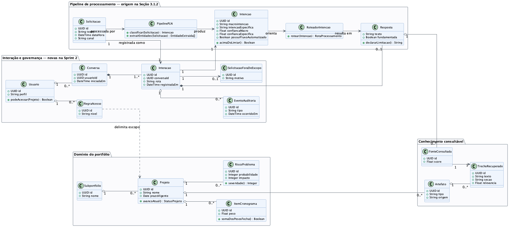
</div>

<p align="center"><strong>Figura 20</strong> - Diagrama de classes consolidado, unindo o pipeline de processamento e o domínio persistido.<br><sup>Fonte: Material produzido pelos autores, 2026.</sup></p>

O código-fonte do diagrama está versionado em [`docs/diagrams/classes-consolidado.puml`](diagrams/classes-consolidado.puml). Para regerar a imagem, com PlantUML e Graphviz instalados:

```bash
plantuml -charset UTF-8 -tpng -o ../img docs/diagrams/classes-consolidado.puml
```


### 5.1.2 O que mudou em relação à Seção 3.1.2

| Classe da Sprint 1 | Situação na Sprint 2 | Motivo |
|---|---|---|
| `Solicitacao`, `PipelinePLN`, `Intencao`, `RoteadorIntencao`, `Resposta` | Mantidas | Continuam descrevendo o caminho de processamento e sustentam a rastreabilidade da Seção 3.1.4 |
| `ClassificadorIntencao`, `RecuperadorInformacao`, `AnalisadorComparativo`, `ExecutorFluxoAutomatizado`, `GeradorLLM` | Movidas para a Seção 5.2 | São componentes de arquitetura, não entidades de domínio. O diagrama de componentes é o lugar correto para elas |
| `CategoriaIntencao`, `RotaProcessamento` | Absorvidas como atributos | `macrointencao` e `rota` passaram a ser valores de `Intencao` e `Interacao`, persistidos em `intent_catalog` e `ai_interactions` |
| `DocumentoProjeto` | Renomeada para `Artefato` | O modelo lógico da Seção 4.3 usa `project_artifacts`, e a entidade cobre documentos, listas, planilhas e normativos, não apenas documentos |
| `TrechoRecuperado` | Mantida | Corresponde a `source_extracts` e é o que a `FonteConsultada` referencia |
| `EntidadeExtraida` | Mantida na Seção 3.1.2 | Existe no pipeline, mas não é persistida no MVP; não aparece no modelo de dados |
| `SugestaoProativa`, `ConfiguracaoProatividade` | Mantidas na Seção 3.1.2 | Sustentam RF09 e RF10, cujo escopo está declarado na Seção 3.1.5 |
| — | `Interacao`, `Conversa`, `Usuario`, `RegraAcesso`, `FonteConsultada`, `EventoAuditoria`, `SolicitacaoForaDeEscopo` | Novas. Vieram do modelo de dados: sem persistência, a Sprint 1 não precisava representá-las |
| — | `Subportfolio`, `Projeto`, `ItemCronograma`, `RiscoProblema` | Novas. Domínio do portfólio, introduzido com o modelo conceitual da Seção 4.2 |

### 5.1.3 Decisões refletidas no diagrama

- **`Resposta` é composição de `Interacao`, e não entidade independente.** Uma resposta não existe fora da interação que a originou, e `declararLimitacao()` materializa o comportamento exigido pelo RF08: sem fonte suficiente, a resposta declara a limitação em vez de completar a lacuna.
- **`FonteConsultada` liga a resposta ao `TrechoRecuperado`, e não ao `Artefato`.** A rastreabilidade exigida pelo RNF03 precisa apontar o trecho utilizado, não apenas o documento de origem.
- **`Intencao` carrega os limiares e as confianças.** Os valores de 0,550 e 0,700 definidos na Seção 8.10.3 pertencem ao catálogo, não ao código, de modo que possam ser ajustados sem nova implantação, à medida que novas execuções do benchmark recalibrem os limiares. `acimaDoLimiar()` é o que decide se um handler é acionado.
- **`RegraAcesso` é classe, e não atributo de `Usuario`.** O mesmo usuário pode ter níveis diferentes por subportfólio ou por projeto, o que o RNF02 exige e um atributo simples não representaria.
- **`ItemCronograma.somaDosPesosFecha()` está no domínio.** A validação de que os pesos fecham em 100%, prevista na Seção 2.4.3, é regra de negócio e não de interface.
- **`SolicitacaoForaDeEscopo` é entidade própria.** Registrar o que o agente não soube responder é insumo para evoluir o catálogo, e não um estado descartável da interação.

### 5.1.4 Correspondência com o modelo de dados

A relação com as tabelas da Seção 4.3 não é de um para um. `Resposta`, por exemplo, é persistida em colunas de `ai_interactions`, porque não tem ciclo de vida próprio no banco.

| Classe | Tabelas correspondentes |
|---|---|
| `Subportfolio`, `Projeto` | `subportfolios`, `projects` |
| `Artefato`, `TrechoRecuperado` | `project_artifacts`, `source_extracts` |
| `ItemCronograma`, `RiscoProblema` | `schedule_items`, `risk_issue_items` |
| `Usuario`, `RegraAcesso` | `users`, `access_rules` |
| `Intencao` | `intent_catalog`, `prompt_templates` |
| `Conversa`, `Interacao`, `Resposta` | `ai_conversations`, `ai_interactions` |
| `FonteConsultada` | `consulted_sources` |
| `EventoAuditoria` | `audit_events` |
| `SolicitacaoForaDeEscopo` | `out_of_scope_requests` |

As tabelas `project_status_updates`, `change_records` e `intent_test_cases` não aparecem como classes: as duas primeiras são registro histórico consultado por relatório, e a terceira pertence ao ciclo de avaliação do classificador descrito na Seção 8.10.1, não ao runtime.

## 5.2 Diagrama de Componentes da UML

O Diagrama de Componentes representa a **estrutura lógica e técnica dos principais módulos da solução e suas interações**, consolidando a arquitetura atualmente adotada para o agente inteligente do Metrô. A representação evidencia as fronteiras entre o Microsoft Teams como canal de interação, o backend da aplicação, o núcleo autoral de Processamento de Linguagem Natural (PLN), a camada de recuperação aumentada por geração (RAG), o Microsoft Copilot Studio e os serviços corporativos e de Inteligência Artificial utilizados pela solução.

A arquitetura parte do **Microsoft Teams**, canal corporativo por onde o usuário interage com o agente sem precisar de novo aplicativo ou novo login, e de uma **API da aplicação**, que centraliza o recebimento das mensagens, o gerenciamento da conversa e a integração com os demais componentes. A entrada pode ocorrer por texto ou, quando habilitada, por voz, cuja transcrição é realizada pelo serviço de Speech-to-Text antes do processamento do núcleo da aplicação.

O processamento da solicitação é realizado pelo **Pilar 1 — Núcleo de PLN e Roteamento**, responsável pelo pré-processamento, identificação e classificação da intenção, validação de escopo e extração das entidades necessárias. A intenção identificada é associada ao **catálogo de intenções da solução**, que relaciona as solicitações às capacidades e funcionalidades previstas para o produto.

A partir dessa classificação, a conversa é encaminhada para a capacidade correspondente. Solicitações de **consulta ou dúvida documental** seguem pela rota de **RAG**, na qual o recuperador consulta o índice vetorial e as fontes documentais do SharePoint, reúne os trechos relevantes e monta o contexto utilizado na geração da resposta. O contexto recuperado é então encaminhado ao **LLM**, que produz a resposta em linguagem natural.

Solicitações associadas a **funcionalidades ou fluxos específicos** são encaminhadas ao **Microsoft Copilot Studio**. Nesse caminho, o Copilot Studio atua como mecanismo de orquestração, selecionando o tópico correspondente à intenção identificada e acionando, quando necessário, fluxos do **Power Automate** para leitura, escrita, atualização ou execução de automações sobre os serviços corporativos.

A Figura 21 apresenta a estrutura descrita. Dessa forma, os componentes mantêm responsabilidades distintas: o **PLN interpreta e roteia**, o **RAG recupera conhecimento**, o **LLM gera respostas fundamentadas a partir do contexto recuperado** e o **Copilot Studio executa e orquestra os fluxos funcionais associados às intenções**. O SharePoint permanece como fonte documental e de dados corporativos, enquanto identidade, configuração e rastreabilidade atravessam os demais componentes.

<div align="center">
  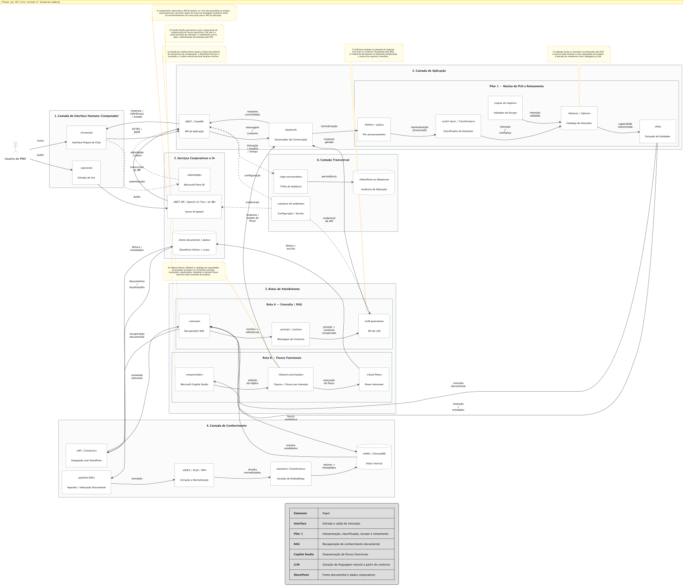
  <p><strong>Figura 21</strong> - Diagrama de componentes da arquitetura atual da solução.</p>
  <sup>Fonte: Material produzido pelos autores, 2026.</sup>
</div>

O código-fonte do diagrama está versionado em [`docs/diagrams/componentes-metro-5.2.puml`](diagrams/componentes-metro-5.2.puml). Para regerar a imagem, utilizando PlantUML e Graphviz instalados no ambiente:

```bash
java -jar plantuml.jar -charset UTF-8 -tpng -o ../img docs/diagrams/componentes-metro-5.2.puml
```

### 5.2.1 Componentes e responsabilidades

| Componente | Responsabilidade |
|---|---|
| **Microsoft Teams** | Canal de interação com o usuário: recebe as solicitações e apresenta respostas, referências e resultados dos fluxos executados, dentro do ambiente de trabalho já utilizado pelas equipes. |
| **API da Aplicação** | Expor o ponto de entrada HTTP/JSON, centralizar a comunicação entre interface, processamento e retorno das respostas. |
| **Gerenciador de Conversação** | Manter o contexto necessário da interação e consolidar os resultados produzidos pelas diferentes rotas de processamento. |
| **Pré-processamento** | Normalizar e preparar o texto para as etapas posteriores do pipeline de PLN. |
| **Classificador de Intenções** | Identificar a intenção expressa pelo usuário e atribuir a categoria correspondente com sua confiança. |
| **Catálogo de Intenções** | Associar as intenções reconhecidas às capacidades e funcionalidades disponíveis, determinando o próximo fluxo de processamento. |
| **Validador de Escopo** | Verificar se a solicitação pertence ao conjunto de interações suportadas pela solução antes do acesso às fontes e aos fluxos. |
| **Extração de Entidades** | Identificar entidades relevantes para a execução da intenção, como projeto, subportfólio, período e critérios de análise. |
| **Recuperador RAG** | Buscar conteúdo relevante para consultas documentais a partir do índice vetorial e das fontes integradas. |
| **Ingestão / Indexação Documental** | Preparar os documentos utilizados pela solução para posterior recuperação semântica. |
| **Extração e Normalização** | Extrair e organizar o conteúdo proveniente dos documentos utilizados na base de conhecimento. |
| **Geração de Embeddings** | Transformar os trechos normalizados em representações vetoriais utilizadas na busca semântica. |
| **Índice Vetorial** | Armazenar embeddings e metadados para permitir a recuperação dos conteúdos mais relevantes. |
| **Integração com SharePoint** | Intermediar o acesso aos documentos, listas e metadados disponibilizados pelo SharePoint. |
| **Microsoft Copilot Studio** | Orquestrar os tópicos e fluxos associados às intenções funcionais identificadas pelo PLN. |
| **Tópicos / Fluxos por Intenção** | Implementar os comportamentos específicos associados às funcionalidades previstas no catálogo de intenções. |
| **Power Automate** | Executar automações e operações de integração necessárias aos fluxos funcionais. |
| **API de LLM** | Gerar respostas em linguagem natural a partir do contexto recuperado pelo RAG. O provedor não está definido: a integração é feita por interface HTTP substituível, e a escolha será registrada quando o benchmark for realizado. |
| **Azure AI Speech** | Consumir a API de Speech-to-Text documentada para converter entradas de voz em texto em português brasileiro antes do processamento pelo backend. |
| **Microsoft Entra ID** | Fornecer a identidade do usuário e apoiar o controle de acesso às funcionalidades e informações. |
| **Trilha de Auditoria** | Registrar eventos relevantes da interação, incluindo intenção, fontes consultadas e fluxos acionados. |
| **Configuração / Secrets** | Armazenar configurações e credenciais necessárias aos serviços integrados sem expô-las à interface. |

### 5.2.2 Fluxo de interação entre os componentes

O fluxo de uma solicitação conversacional típica ocorre da seguinte forma:

1. O **usuário** envia uma mensagem pelo **Microsoft Teams**. Quando a entrada é realizada por voz, o áudio pode ser encaminhado ao **Azure AI Speech**, que devolve a transcrição em texto.
2. A **API da aplicação** recebe a solicitação por HTTP/JSON e a encaminha ao **gerenciador de conversação**.
3. O **Pilar 1 — Núcleo de PLN e Roteamento** realiza o pré-processamento, identifica e classifica a intenção, valida se a solicitação está no escopo suportado, associa a intenção ao catálogo de capacidades e extrai as entidades relevantes para o fluxo selecionado.
4. Após a validação de escopo, o **catálogo de intenções** associa a intenção reconhecida à capacidade responsável pelo processamento da solicitação.
5. Quando a intenção corresponde a uma **consulta ou dúvida documental**, o **Recuperador RAG** busca os conteúdos relevantes no índice vetorial e, quando necessário, na integração com o **SharePoint**. Os resultados são organizados pelo componente de **Montagem de Contexto**.
6. O contexto recuperado é enviado ao **LLM**, que produz a resposta em linguagem natural. O resultado retorna ao gerenciador de conversação.
7. Quando a intenção corresponde a uma **funcionalidade estruturada**, a solicitação é encaminhada ao **Microsoft Copilot Studio**, que ativa o tópico ou fluxo correspondente. Quando necessário, o fluxo utiliza o **Power Automate** para executar operações sobre SharePoint, listas ou outros serviços corporativos.
8. O resultado produzido pela rota escolhida é consolidado pelo **backend** e devolvido ao **Microsoft Teams**.
9. Durante o processamento, os componentes de **identidade e auditoria** registram os elementos necessários para controle de acesso e rastreabilidade da interação.

### 5.2.3 Relação entre o catálogo de intenções e os fluxos da solução

O catálogo de intenções atua como elemento de ligação entre o **núcleo de PLN** e as capacidades funcionais do agente. Em vez de vincular a conversa diretamente a uma única tecnologia, a classificação identifica a necessidade do usuário e determina qual componente deve assumir o processamento.

A arquitetura suporta dois grandes grupos de roteamento:

| Tipo de intenção | Destino principal | Objetivo |
|---|---|---|
| **Consulta / dúvida documental** | RAG → LLM | Recuperar informações das fontes documentais e produzir uma resposta fundamentada em linguagem natural. |
| **Fluxo funcional / transação / automação** | Copilot Studio → tópico/fluxo → Power Automate | Executar uma capacidade estruturada associada à intenção identificada. |

O catálogo pode, portanto, evoluir juntamente com as funcionalidades priorizadas do produto, mantendo a mesma estrutura de interpretação e roteamento. A inclusão de uma nova capacidade exige principalmente o registro da nova intenção e a implementação do fluxo correspondente, sem necessidade de alterar a interface de chat ou o mecanismo central de classificação.

### 5.2.4 Decisões arquiteturais refletidas no diagrama

- **O canal de interação é desacoplado da lógica de negócio.** O Teams entrega a mensagem à API da aplicação, que controla o roteamento e a consolidação da resposta. Trocar ou acrescentar um canal não exige reestruturar o núcleo de PLN nem as rotas de atendimento.
- **O núcleo de PLN permanece independente dos modelos generativos.** A identificação da intenção, o controle de escopo e o roteamento são responsabilidades do Pilar 1.
- **O catálogo de intenções funciona como mecanismo de roteamento.** A mesma entrada conversacional pode ser direcionada a diferentes capacidades conforme a intenção identificada.
- **O Copilot Studio permanece como componente da arquitetura.** Seu papel é executar e orquestrar tópicos e fluxos específicos, não substituir o canal de interação nem o núcleo de PLN.
- **RAG e geração são componentes distintos.** O SharePoint fornece o conhecimento documental, o mecanismo de recuperação seleciona o contexto relevante e o LLM produz a resposta a partir desse contexto.
- **A credencial do LLM é protegida no backend.** A interface não acessa diretamente a API generativa nem recebe suas credenciais.
- **A camada de conhecimento é desacoplada dos canais e da geração.** A fonte documental e o índice podem evoluir sem exigir mudanças estruturais na interface ou no mecanismo de roteamento.
- **Identidade e rastreabilidade são transversais.** O controle de acesso e os registros de auditoria devem acompanhar as interações independentemente da rota escolhida.
- **A arquitetura permanece modular.** Novos tópicos, integrações ou capacidades de RAG podem ser adicionados ao catálogo de intenções sem reestruturar integralmente a solução.

### 5.2.5 Limite de representação

O diagrama de componentes concentra-se nas dependências, responsabilidades e interações entre os módulos da solução. A representação detalhada da infraestrutura física, dos containers, nós de execução e ambientes de implantação deve permanecer no **Diagrama de Implantação da UML**, apresentado na Seção 6.1.

---

## 5.3 Diagramas de Sequência da UML

Os diagramas desta seção, como os demais do documento, são gerados a partir de arquivos-fonte em PlantUML versionados em `docs/diagrams/`. Para regerar qualquer um deles, com PlantUML e Graphviz instalados:

```bash
plantuml -charset UTF-8 -tpng -o ../img docs/diagrams/<arquivo>.puml
```


Os diagramas de sequência desta seção detalham a ordem das interações entre os principais componentes da solução nos cenários críticos definidos para a arquitetura atual. Enquanto a modelagem dinâmica inicial da Seção 3.1.3 apresenta os fluxos em nível funcional, os diagramas desta seção incorporam as decisões técnicas consolidadas na solução, especialmente a utilização do Microsoft Teams, o serviço de Speech-to-Text, o núcleo autoral de PLN, o catálogo de intenções, a arquitetura RAG, a geração de respostas pelo LLM e o acionamento de fluxos específicos por meio do Copilot Studio.

A seleção dos cenários considera os caminhos centrais da solução: consultas documentais fundamentadas, análises comparativas, direcionamento para fluxos funcionais e entrada por voz. Em todos os casos, o PLN permanece responsável pela interpretação e classificação da solicitação, enquanto o catálogo de intenções determina a capacidade que deverá processá-la. A partir desse roteamento, a solicitação segue para a recuperação e geração de resposta ou para o tópico/fluxo correspondente no Copilot Studio.

As interações de identidade, autorização e auditoria são tratadas como capacidades transversais. A identidade do usuário deve ser validada antes do acesso às fontes ou da execução de ações, e os eventos relevantes da interação devem ser registrados para fins de rastreabilidade.

### 5.3.1 Consulta documental via RAG

Este cenário representa uma consulta textual sobre informações disponíveis na base utilizada pelo MVP, como **"Qual o prazo do projeto XPTO?"**. O fluxo demonstra o caminho completo desde o canal de interação até a recuperação de informações relevantes e a geração da resposta por meio do LLM.

No contexto do MVP, a fonte utilizada para validação é a **base sintética associada ao índice vetorial**. A integração com SharePoint representa a evolução arquitetural prevista e não deve ser interpretada como dependência do conjunto de dados reais do Metrô.

<div align="center">
  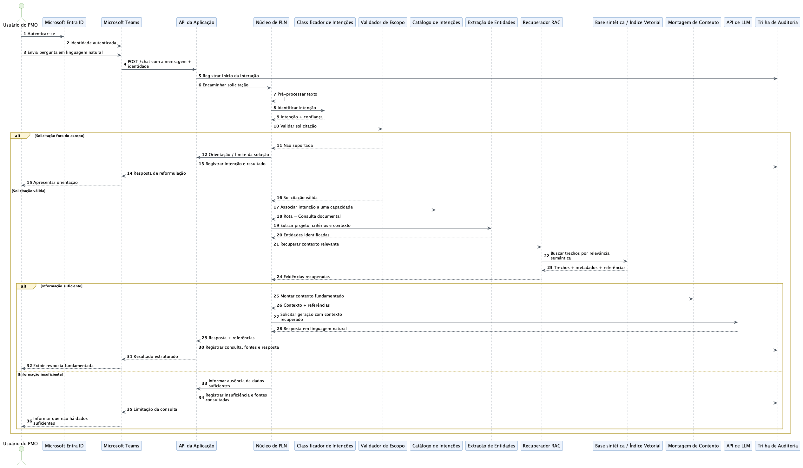
</div>

<p align="center"><strong>Figura 22</strong> - Sequência: consulta documental via RAG.<br><sup>Fonte: Material produzido pelos autores, 2026.</sup></p>

O código-fonte do diagrama está versionado em [`docs/diagrams/sequencia-rag-consulta.puml`](diagrams/sequencia-rag-consulta.puml) e pode ser regerado com PlantUML e Graphviz instalados:

```bash
java -jar plantuml.jar -charset UTF-8 -tpng -o ../img docs/diagrams/sequencia-rag-consulta.puml
```

O fluxo evidencia que o LLM não acessa diretamente a fonte documental. A aplicação recupera previamente os conteúdos relevantes e utiliza esses trechos como contexto para a geração da resposta. No MVP, essa recuperação ocorre sobre a base sintética e o índice vetorial; a integração com SharePoint permanece como caminho de evolução para a utilização das fontes corporativas homologadas.

O cenário também explicita o tratamento de informação insuficiente, evitando que a ausência de evidências seja convertida automaticamente em uma resposta generativa. A identidade é validada antes da consulta e os elementos necessários à rastreabilidade são registrados na trilha de auditoria.

### 5.3.2 Análise e comparação entre projetos via RAG

Este cenário representa uma solicitação analítica, como **"Compare os riscos e os prazos dos projetos XPTO e ABC"**. Diferentemente da consulta simples, o pipeline precisa identificar múltiplos projetos e consolidar as informações recuperadas antes da geração da resposta.

Assim como no cenário anterior, o MVP utiliza a **base sintética associada ao índice vetorial**. A eventual integração com SharePoint ocorre em uma etapa posterior, mediante os mecanismos homologados pelo parceiro.

<div align="center">
  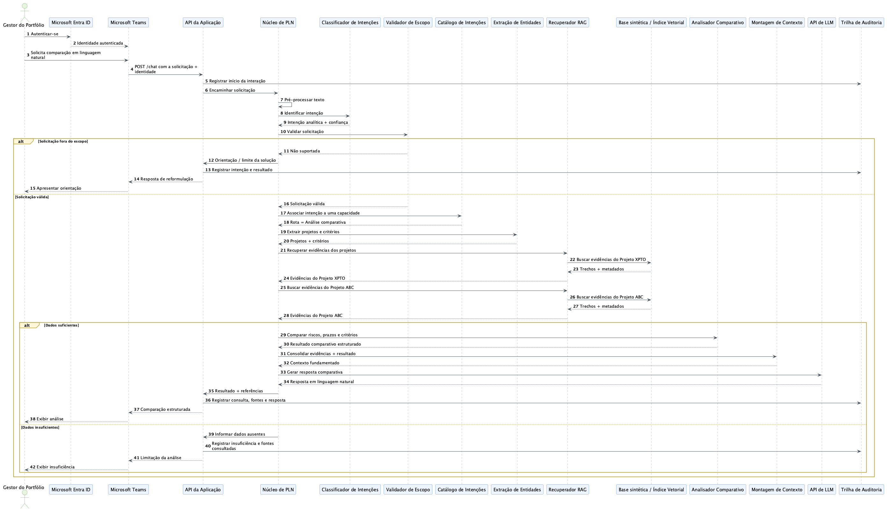
</div>

<p align="center"><strong>Figura 23</strong> - Sequência: análise e comparação entre projetos via RAG.<br><sup>Fonte: Material produzido pelos autores, 2026.</sup></p>

O código-fonte do diagrama está versionado em [`docs/diagrams/sequencia-rag-comparacao.puml`](diagrams/sequencia-rag-comparacao.puml) e pode ser regerado com PlantUML e Graphviz instalados:

```bash
java -jar plantuml.jar -charset UTF-8 -tpng -o ../img docs/diagrams/sequencia-rag-comparacao.puml
```

A sequência preserva a diferenciação entre **fato recuperado** e **resultado interpretativo da comparação**. A análise é executada sobre as informações recuperadas e o LLM é responsável pela apresentação em linguagem natural, mantendo as referências associadas às evidências utilizadas.

A validação de identidade antecede a recuperação e os eventos da interação são registrados na auditoria, mantendo o cenário alinhado aos requisitos transversais de controle de acesso e rastreabilidade.

### 5.3.3 Direcionamento para fluxo funcional via Copilot Studio

Este cenário representa uma solicitação cuja intenção corresponde a uma capacidade funcional específica do produto. O PLN identifica a intenção e o catálogo a associa ao tópico ou fluxo correspondente. A partir desse ponto, o Copilot Studio assume a execução do tópico selecionado e pode acionar o Power Automate quando houver uma operação automatizada ou integração com serviço corporativo.

<div align="center">
  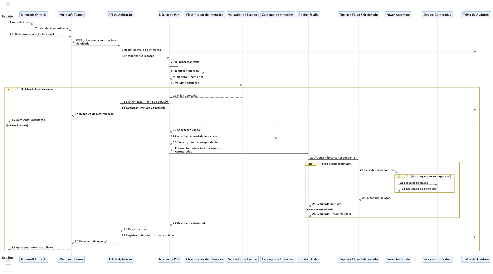
</div>

<p align="center"><strong>Figura 24</strong> - Sequência: direcionamento para fluxo funcional via Copilot Studio.<br><sup>Fonte: Material produzido pelos autores, 2026.</sup></p>

O código-fonte do diagrama está versionado em [`docs/diagrams/sequencia-copilot-fluxo.puml`](diagrams/sequencia-copilot-fluxo.puml) e pode ser regerado com PlantUML e Graphviz instalados:

```bash
java -jar plantuml.jar -charset UTF-8 -tpng -o ../img docs/diagrams/sequencia-copilot-fluxo.puml
```

Neste cenário, o **Copilot Studio não é responsável por descobrir a intenção do usuário**. A decisão já foi tomada pelo núcleo de PLN e pelo catálogo de intenções. O Copilot Studio atua como plataforma de execução do tópico ou fluxo selecionado.

O retorno do **Power Automate** ocorre somente quando o tópico efetivamente o aciona. No ramo puramente conversacional, o tópico retorna diretamente ao Copilot Studio, evitando a associação de um resultado de automação a uma operação que não foi executada.

A identidade do usuário é validada antes da execução do fluxo e a auditoria registra a intenção identificada, o fluxo acionado e seu resultado.

### 5.3.4 Entrada por voz com Speech-to-Text

Este cenário demonstra a entrada por áudio utilizando a API de **Azure AI Speech** documentada no projeto. A responsabilidade do serviço de Speech-to-Text termina na produção de uma transcrição utilizável; depois disso, o conteúdo segue pelo mesmo pipeline utilizado para entradas textuais.

<div align="center">
  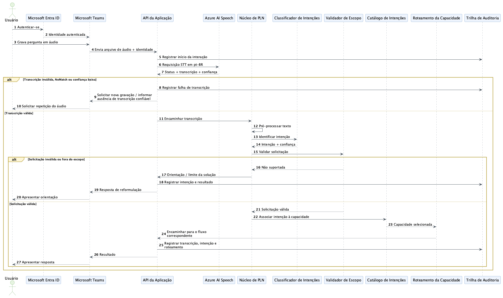
</div>

<p align="center"><strong>Figura 25</strong> - Sequência: entrada por voz com Speech-to-Text.<br><sup>Fonte: Material produzido pelos autores, 2026.</sup></p>

O código-fonte do diagrama está versionado em [`docs/diagrams/sequencia-voz-stt.puml`](diagrams/sequencia-voz-stt.puml) e pode ser regerado com PlantUML e Graphviz instalados:

```bash
java -jar plantuml.jar -charset UTF-8 -tpng -o ../img docs/diagrams/sequencia-voz-stt.puml
```

O diagrama evidencia que o áudio não cria um fluxo de negócio independente: após uma transcrição válida, a solicitação torna-se equivalente a uma entrada textual para o restante da arquitetura. O Azure AI Speech atua exclusivamente na etapa de Speech-to-Text, enquanto a interpretação, validação e definição da capacidade permanecem sob responsabilidade da aplicação.

O ramo de falha contempla situações documentadas para o serviço de STT, como ausência de correspondência ou transcrição com confiança insuficiente. Nesses casos, a solicitação não deve avançar automaticamente para o PLN como se houvesse texto confiável.

### 5.3.5 Considerações sobre os cenários

Os quatro cenários apresentados cobrem os principais caminhos de interação da arquitetura atual. A **consulta documental** representa o fluxo central de recuperação e geração fundamentada; a **análise comparativa** acrescenta a consolidação e interpretação de informações de múltiplos projetos; o **direcionamento para fluxos funcionais** demonstra a integração entre o núcleo de PLN, o catálogo de intenções, o Copilot Studio e os serviços de automação; e a **entrada por voz** demonstra a utilização da API de Speech-to-Text como modalidade alternativa de entrada.

Em todos os cenários, o núcleo de PLN permanece como ponto comum de interpretação e decisão. A diferença entre os caminhos ocorre somente após a identificação e validação da intenção: consultas e análises documentais seguem para recuperação de contexto e geração de resposta, enquanto intenções funcionais são encaminhadas para o tópico ou fluxo associado no Copilot Studio.

Os cenários também incorporam os requisitos transversais de **identidade, autorização e rastreabilidade**. A autenticação por Microsoft Entra ID antecede as operações protegidas, o acesso às fontes ou serviços deve respeitar as permissões aplicáveis e os eventos relevantes da interação são registrados na trilha de auditoria. No caso de fontes corporativas, a autorização efetiva deve permanecer alinhada ao modelo de permissões do ambiente do Metrô.

Por fim, a utilização da **base sintética / índice vetorial** nos cenários de recuperação explicita a delimitação do MVP. A arquitetura permanece preparada para receber as fontes corporativas, inclusive SharePoint, em uma evolução posterior, sem fazer da integração com o portfólio real uma dependência da validação inicial.

---

# 6. Mapeamento técnico de infraestrutura e implantação

Esta seção documenta a estratégia de implantação prevista para a solução, considerando que o projeto ainda está em estágio de PoC acadêmica e que a equipe não possui garantia de acesso a uma assinatura Azure corporativa. Portanto, a implantação descrita aqui não representa um deploy produtivo nem uma pipeline de CI/CD já implementada. O objetivo é registrar uma estratégia reprodutível e simples, capaz de orientar a publicação futura do MVP sem bloquear o desenvolvimento atual.

A decisão principal é separar o que faz parte do MVP do que deve permanecer como evolução. Para o MVP, a nuvem comercial efetivamente assumida é o **Supabase Cloud**, utilizado como banco PostgreSQL gerenciado e ponto de persistência da trilha de auditoria. A aplicação, por sua vez, pode ser executada localmente durante o desenvolvimento e, quando houver código consolidado suficiente, publicada em uma hospedagem simples com domínio público temporário. O empacotamento em Docker, a criação de uma pipeline de deploy e a migração para Azure ficam documentados como evolução futura.

O escopo atual de implantação contempla:

| Componente | Situação no MVP | Papel na estratégia |
|---|---|---|
| Interface web | Em desenvolvimento pela equipe em `src/frontend` | Interface própria para interação com o agente durante a demonstração. |
| API da aplicação | Planejada para expor os endpoints do MVP | Ponte entre frontend, classificação de intenção, recuperação de dados e integrações. |
| Núcleo de PLN | Definido conceitualmente e avaliado no notebook do classificador | Responsável por classificar intenções e orientar o roteamento da solicitação. |
| Banco de dados | Supabase Cloud | Persistência dos dados sintéticos, catálogo, interações e auditoria. |
| Armazenamento | Supabase Storage | Área prevista para documentos sintéticos e, futuramente, artefatos do modelo. |
| Autenticação | Microsoft Entra ID | Mecanismo previsto para autenticação do usuário no MVP. |
| Orquestração | Copilot Studio | Integração prevista para tópicos e fluxos conversacionais. |
| Automação | Power Automate | Evolução para execução de fluxos funcionais sobre dados sintéticos ou homologados. |
| Docker e pipeline de deploy | Fora do escopo atual | Evolução futura, quando houver serviço suficientemente estável para empacotamento e publicação automatizada. |

Como o provedor de LLM externo ainda não está definido nem homologado, conforme registrado na Seção 5.2, a implantação do MVP não deve depender de API generativa externa. Quando a camada do Copilot Studio não estiver disponível, o MVP deve retornar uma resposta estruturada com base nos dados sintéticos recuperados.

## 6.1 Diagrama de implantação da UML

A Figura 26 apresenta a visão de implantação da PoC. O diagrama separa o ambiente atualmente viável para o MVP dos componentes que dependem de desenvolvimento posterior ou provisionamento pela GTI.

<div align="center">
  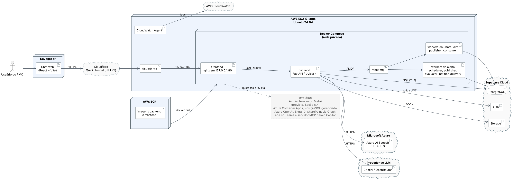
</div>

<p align="center"><strong>Figura 26</strong> - Diagrama de implantação planejada da PoC.<br><sup>Fonte: Material produzido pelos autores, 2026.</sup></p>

O código-fonte do diagrama está versionado em [`docs/diagrams/implantacao-poc.puml`](diagrams/implantacao-poc.puml).

## 6.2 Justificativa das escolhas de implantação

As escolhas de implantação priorizam simplicidade, baixo custo e aderência ao estágio real do projeto. Como ainda não há um serviço final estabilizado para produção, esta seção evita tratar Docker, pipeline de CI/CD ou Azure como entregas já concluídas.

### 6.2.1 Estratégia de hospedagem

No estágio atual, a execução da aplicação deve permanecer simples: desenvolvimento local, banco em nuvem via Supabase e possibilidade de publicação manual em domínio temporário quando a equipe consolidar o código do MVP. Essa abordagem é adequada porque:

- não exige acesso a uma conta Azure corporativa;
- evita criar uma pipeline de build antes de haver serviço estável;
- permite demonstrar a solução com dados sintéticos;
- mantém o caminho aberto para empacotamento futuro;
- reduz o risco de falhas de CI/CD não relacionadas ao objetivo acadêmico da entrega.

O Docker permanece como evolução recomendada, mas não como requisito atual. Quando o backend estiver consolidado, a equipe poderá criar um `Dockerfile`, validar o build localmente e só então habilitar uma pipeline de build e publicação.

### 6.2.2 Banco de dados e armazenamento

O banco definido para o MVP é o **Supabase Cloud**, usando PostgreSQL gerenciado. Essa escolha permite manter o banco em nuvem sem configurar infraestrutura própria e aproveita o modelo físico já documentado na seção de modelagem de dados.

O Supabase será utilizado em dois papéis:

- **PostgreSQL:** armazenamento dos dados sintéticos, catálogo de intenções, conversas, interações, fontes consultadas, eventos de auditoria e demais tabelas previstas no modelo físico.
- **Supabase Storage:** armazenamento de documentos sintéticos e, futuramente, artefatos auxiliares do modelo de PLN ou índice vetorial, caso esses arquivos sejam necessários para a demonstração.

Os dados iniciais entram por script de inicialização, aproveitando a estrutura existente em `src/database`. A ingestão documental completa permanece como processo separado e não é tratada como etapa obrigatória deste deploy.

**Aderência aos critérios de seleção.** O Supabase é uma dependência externa ao ecossistema Microsoft, priorizado pelo critério C1 da Seção 3.4.1, e por isso a escolha é declarada aqui de forma explícita. Ela atende ao critério C2, que exige o uso de dados sintéticos ou anonimizados durante o MVP e é o que esta seção estabelece: nenhum dado real do portfólio trafega pelo serviço. O destino de homologação continua sendo o ambiente Azure do Metrô, cujo provisionamento depende da GTI e está registrado como pendência na Seção 6.3.4. O modelo físico documentado na Seção 4.4 é PostgreSQL padrão, o que mantém a migração de baixo atrito quando o ambiente corporativo for disponibilizado.

### 6.2.3 Modelo de PLN e artefatos

Para o MVP, a documentação assume o caminho mais simples: o classificador e a lógica de PLN são tratados como componentes em desenvolvimento, com avaliação registrada no notebook do projeto. A publicação de um serviço de inferência separado, o armazenamento versionado de artefatos e o carregamento automatizado de modelos em ambiente remoto ficam como evolução.

Quando essa evolução for implementada, a estratégia recomendada é:

| Item futuro | Estratégia sugerida | Justificativa |
|---|---|---|
| Classificador serializado | Armazenar em Supabase Storage ou incluir no pacote do backend | Facilita reprodução e versionamento. |
| Word2Vec e encoder BERT | Registrar versão usada pelo MVP | Mantém rastreabilidade entre avaliação e execução. |
| Índice vetorial | Começar em arquivo controlado e migrar se o volume crescer | Evita adicionar infraestrutura antes da necessidade. |
| Versionamento do modelo | Usar identificador simples, como `mvp-YYYYMMDD` | Suficiente para rastrear demonstrações acadêmicas. |
| Endpoint gerenciado | Avaliar Azure Machine Learning após provisionamento da GTI | Caminho mais adequado para homologação futura. |

### 6.2.4 Interface, autenticação e integração

A interface principal do MVP é a aplicação própria desenvolvida pela equipe em `src/frontend`, construída com React, Vite, TypeScript e Tailwind CSS. Ela representa o canal de demonstração da solução enquanto a integração corporativa completa não estiver disponível.

A autenticação prevista é o **Microsoft Entra ID**, pois essa decisão mantém alinhamento com o ambiente do Metrô e permite evoluir para controle de acesso por perfil. Como o MVP usa dados sintéticos, a autenticação tem papel principalmente demonstrativo e de rastreabilidade.

O **Copilot Studio** deve ser integrado ao backend por API/OpenAPI quando o serviço estiver consolidado. O papel do Copilot Studio é executar tópicos e fluxos conversacionais associados às intenções identificadas, sem substituir o núcleo autoral de PLN.

O **Power Automate** permanece como caminho para fluxos funcionais. No MVP, esses fluxos podem ser simulados ou executados apenas sobre dados sintéticos, evitando dependência de SharePoint real ou permissões corporativas.

### 6.2.5 Estratégia de fallback

Como não há provedor de LLM definido para o produto e a camada generativa do Copilot Studio pode depender do ambiente disponível, o MVP deve prever um fallback simples. Nesse cenário, a aplicação retorna uma resposta estruturada contendo:

- intenção identificada;
- nível de confiança;
- entidades extraídas, quando houver;
- fontes sintéticas consultadas;
- resposta objetiva baseada nos dados disponíveis;
- indicação de limitação quando não houver evidência suficiente.

Esse fallback permite demonstrar o fluxo principal sem introduzir dependência de serviços generativos externos.

### 6.2.6 Processo reprodutível proposto

O processo recomendado para a PoC é:

1. **Criar o projeto no Supabase Cloud.** Criar organização/projeto e obter URL, chave pública e chave de serviço para scripts administrativos.
2. **Executar os scripts de banco.** Aplicar os scripts de criação e carga inicial presentes em `src/database`.
3. **Cadastrar dados sintéticos.** Inserir somente dados aprovados pela liderança para uso na demonstração.
4. **Configurar variáveis de ambiente.** Definir credenciais do Supabase, ambiente de execução e parâmetros de integração disponíveis.
5. **Executar a aplicação localmente.** Rodar frontend e backend em ambiente de desenvolvimento, enquanto o serviço final não estiver estabilizado.
6. **Validar a persistência.** Confirmar que interações, fontes consultadas e eventos de auditoria são gravados no Supabase.
7. **Configurar autenticação Microsoft.** Registrar a aplicação no Entra ID quando houver URL de callback definida.
8. **Preparar integração com Copilot Studio.** Documentar ou expor a especificação OpenAPI quando a API estiver estável.
9. **Publicar em domínio temporário.** Realizar publicação manual em serviço simples somente quando houver versão demonstrável.
10. **Registrar pendências de evolução.** Docker, pipeline CI/CD, Azure, Azure Machine Learning e Application Insights devem permanecer como próximos passos.

### 6.2.7 Variáveis de ambiente previstas

As variáveis mínimas planejadas para reprodução do MVP são:

| Variável | Camada | Descrição |
|---|---|---|
| `SUPABASE_URL` | Backend/frontend | URL do projeto Supabase. |
| `SUPABASE_ANON_KEY` | Frontend/backend | Chave pública para operações permitidas pelas políticas do Supabase. |
| `SUPABASE_SERVICE_ROLE_KEY` | Backend/scripts | Chave administrativa para carga inicial e rotinas internas. Não deve ser exposta no frontend. |
| `MICROSOFT_CLIENT_ID` | Frontend/backend | Identificador da aplicação registrada no Entra ID. |
| `MICROSOFT_TENANT_ID` | Frontend/backend | Tenant usado para autenticação. |
| `MICROSOFT_REDIRECT_URI` | Frontend | URL de retorno após login. |
| `COPILOT_STUDIO_ENABLED` | Backend | Indica se a integração com Copilot Studio está ativa. |
| `COPILOT_STUDIO_ENDPOINT` | Backend | Endpoint usado quando a integração estiver disponível. |
| `APP_ENV` | Backend/frontend | Ambiente de execução, como `local`, `dev`, `hmg` ou `main`. |

Exemplo de arquivo `.env` planejado para o backend:

```bash
APP_ENV=local
SUPABASE_URL=https://exemplo.supabase.co
SUPABASE_ANON_KEY=ey...
SUPABASE_SERVICE_ROLE_KEY=ey...
MICROSOFT_CLIENT_ID=00000000-0000-0000-0000-000000000000
MICROSOFT_TENANT_ID=00000000-0000-0000-0000-000000000000
COPILOT_STUDIO_ENABLED=false
COPILOT_STUDIO_ENDPOINT=
```

### 6.2.8 Comandos de execução local

Enquanto não houver empacotamento Docker nem pipeline de deploy, a reprodução deve se limitar à execução local da aplicação e à conexão com o Supabase.

Execução local do backend, quando disponível:

```bash
cd src/backend
python -m venv .venv
source .venv/bin/activate
pip install -r requirements.txt
uvicorn app.main:app --host 0.0.0.0 --port 8000
```

No Windows PowerShell:

```powershell
cd src/backend
python -m venv .venv
.venv\Scripts\python.exe -m pip install -r requirements.txt
.venv\Scripts\python.exe -m uvicorn app.main:app --host 0.0.0.0 --port 8000
```

Execução local do frontend:

```bash
cd src/frontend
npm install
npm run dev
```

Build local do frontend:

```bash
cd src/frontend
npm install
npm run build
```

## 6.3 Considerações sobre desempenho e segurança

Como a implantação é uma PoC acadêmica com dados sintéticos, as decisões de segurança e desempenho são proporcionais ao risco do MVP. Ainda assim, a arquitetura preserva pontos importantes para futura homologação: autenticação via Microsoft Entra ID, separação entre frontend e backend, proteção de chaves no servidor e persistência de auditoria no Supabase.

### 6.3.1 Desempenho

As métricas obrigatórias para o MVP são:

| Métrica | Objetivo | Onde medir |
|---|---|---|
| Latência média do endpoint `/api/chat` | Verificar se a interação permanece compatível com uso conversacional. | Backend FastAPI e painel do frontend. |
| Taxa de sucesso das requisições | Identificar falhas de API, falhas de conexão com Supabase e erros de integração. | Backend e registros de auditoria. |
| Tempo de resposta da recuperação de dados | Avaliar o impacto das consultas à base sintética. | Backend e registros de auditoria. |
| Confiança da macrointenção e da intenção específica | Monitorar a qualidade do roteamento do PLN. | Tabela `ai_interactions`. |
| Quantidade de respostas por fallback | Verificar indisponibilidade da camada generativa/Copilot ou ausência de evidência suficiente. | Tabela `ai_interactions` e logs. |
| Quantidade de fontes recuperadas por consulta | Avaliar se o RAG está encontrando evidências suficientes. | Tabela `consulted_sources`. |

Para a PoC, as métricas devem ser simples e associadas aos fluxos já implementados. Métricas mais avançadas de carregamento de modelo, consumo de memória, imagem Docker e telemetria de contêiner devem ser adicionadas somente quando o serviço de PLN estiver empacotado para publicação.

### 6.3.2 Segurança

O MVP utiliza dados sintéticos ou anonimizados, portanto não há tratamento de informações reais do portfólio produtivo. Mesmo assim, a implantação deve seguir as seguintes regras mínimas:

- credenciais do Supabase e do Entra ID não devem ser versionadas no repositório;
- a chave `SUPABASE_SERVICE_ROLE_KEY` deve existir apenas no backend e em scripts administrativos;
- o frontend deve usar somente chaves públicas apropriadas;
- o backend deve validar a identidade recebida antes de registrar a interação;
- toda interação deve gerar registro de auditoria no Supabase;
- documentos sintéticos devem ser aprovados pela liderança antes de entrarem na base da demonstração;
- endpoints administrativos de carga, se existirem, não devem ficar expostos publicamente sem autenticação.

Como a aplicação terá domínio público temporário e todos os dados são sintéticos, o acesso pode ser liberado para avaliadores, equipe e demais participantes do MVP. Para uma evolução com dados reais, essa regra deixa de valer: o acesso deverá ser restrito por Entra ID, grupos, permissões do SharePoint e políticas definidas pela GTI.

### 6.3.3 Auditoria

A trilha de auditoria deve ser persistida no Supabase. O registro mínimo de cada interação deve incluir:

- usuário autenticado ou identificador de sessão;
- data e hora da solicitação;
- texto enviado pelo usuário;
- macrointenção prevista;
- intenção específica prevista;
- confiança das classificações;
- handler ou rota selecionada;
- fontes sintéticas consultadas;
- resposta devolvida;
- indicação de fallback, erro ou informação insuficiente.

Esses campos já se alinham ao modelo de dados documentado, especialmente às entidades `ai_conversations`, `ai_interactions`, `consulted_sources` e `audit_events`.

### 6.3.4 Limitações e pendências de provisionamento

A seção de implantação deve deixar explícito que alguns itens dependem de decisão ou provisionamento externo e não bloqueiam a PoC:

| Item | Situação no MVP | Encaminhamento |
|---|---|---|
| Azure corporativo do Metrô | Pendente de provisionamento pela GTI. | Manter como evolução para homologação. |
| Docker e pipeline CI/CD | Fora do MVP atual. | Criar apenas quando houver backend consolidado para empacotamento e publicação automatizada. |
| Azure Machine Learning | Fora do MVP. | Usar futuramente para endpoint gerenciado ou governança de modelos. |
| Application Insights/Azure Monitor | Não obrigatório na PoC sem Azure. | Substituir por logs e métricas persistidas no Supabase; ativar em Azure no futuro. |
| SharePoint real | Fora do MVP. | Usar apenas base sintética/anonimizada. |
| Fluxos reais de Power Automate | Podem ser simulados no MVP. | Ativar fluxos reais apenas com dados e permissões homologadas. |
| Camada generativa do Copilot Studio | Integração prevista no MVP, sujeita ao ambiente disponível. | Usar fallback estruturado se indisponível. |

### 6.3.5 Checklist de conclusão da implantação

Para considerar a estratégia de deploy reprodutível, a equipe deve validar:

- [ ] banco Supabase criado em nuvem;
- [ ] scripts de criação e carga inicial executados;
- [ ] backend FastAPI executando localmente;
- [ ] endpoint `/health` respondendo;
- [ ] frontend Vite consumindo o backend;
- [ ] autenticação Microsoft Entra ID configurada ou documentada para o ambiente disponível;
- [ ] interação gravada nas tabelas de auditoria;
- [ ] fallback estruturado funcionando sem API generativa externa;
- [ ] endpoint OpenAPI preparado para conexão com Copilot Studio;
- [ ] Docker e pipeline registrados como evolução futura, sem arquivos de build ativando CI/CD nesta etapa;

# 7. Projeto Visual da Solução

O projeto visual será desenvolvido na Sprint 5, junto com o frontend completo, conforme a estratégia de entrega da Seção 8.3.3. A Sprint 3 entrega apenas a interface básica de teste descrita na Seção 8.3.1, cuja finalidade é validar o fluxo de integração e não definir a identidade visual do produto.

## 7.1 Desenvolvimento de Wireframes

Será desenvolvido na Sprint 5.

## 7.2 Desenvolvimento de Mockups

Será desenvolvido na Sprint 5.

## 7.3 Guia Visual

Será desenvolvido na Sprint 5.

# 8. Desenvolvimento do Projeto

## 8.1 Arquitetura de Codificação e Estrutura de Diretórios

O código-fonte fica em `src/`, separado por responsabilidade. A divisão segue as camadas do diagrama de componentes da Seção 5.2: o canal e a interface ficam no `frontend`, a orquestração e as integrações no `backend`, o núcleo de PLN em `notebooks` e o esquema de dados em `database`.

```text
src/
├── backend/                    API FastAPI — orquestração e integrações
│   ├── app/
│   │   ├── main.py             rotas /health e /api/chat
│   │   ├── gemini/             cliente do provedor de LLM
│   │   │   ├── client.py       chamada, retry com backoff e mapeamento de erro
│   │   │   └── schemas.py      contratos de entrada e saída (Pydantic)
│   │   ├── rag/                recuperação de contexto
│   │   │   ├── sharepoint.py   carga, busca e montagem do prompt com fontes
│   │   │   └── data/sharepoint/ exports JSON simulados de listas do SharePoint
│   │   └── tests/              testes automatizados (Seção 8.4)
│   ├── requirements.txt
│   └── .env.example            variáveis esperadas, sem segredos
├── frontend/                   interface React + TypeScript (Vite)
│   ├── src/
│   │   ├── components/         componentes de tela e biblioteca de UI
│   │   ├── hooks/              hooks reutilizáveis
│   │   ├── lib/                cliente HTTP do backend e utilitários
│   │   └── App.tsx
│   └── vite.config.ts          proxy de /api para o backend em desenvolvimento
├── database/
│   ├── sql/                    criação, carga inicial e rollback
│   └── docs/                   documentação dos scripts
└── notebooks/                  núcleo de PLN
    ├── classificador_intencoes_metro.ipynb
    └── artefatos/              dataset, catálogo, modelo e métricas da execução
```

Três convenções sustentam essa organização.

**Segredo não entra no repositório.** O backend lê credenciais de `.env`, versionado apenas como `.env.example`. A chave do provedor de LLM existe somente no servidor: o frontend chama `/api/chat` e nunca o provedor diretamente.

**O contrato é declarado uma vez e replicado.** Os tipos de `app/gemini/schemas.py` têm correspondência direta em `frontend/src/lib/gemini-api.ts`. Quando um campo muda no backend, o `tsc --noEmit` do frontend acusa a divergência no build.

**Dado sintético fica junto do código que o consome.** Os exports simulados de listas do SharePoint ficam em `app/rag/data/sharepoint/`, e não em uma base externa, para que a bancada de teste rode sem provisionamento. O diretório é substituível por variável de ambiente (`SHAREPOINT_MOCK_DATA_DIR`) quando houver fonte real.

## 8.2 Modelo de Recomendação

A solução não emprega um modelo de recomendação no sentido clássico — não há ranqueamento de itens por afinidade de usuário nem filtragem colaborativa, porque o produto não recomenda conteúdo: ele responde a solicitações sobre um portfólio de projetos.

O componente de aprendizado de máquina do projeto é o **classificador de intenções**, documentado em detalhe na Seção 8.10. Ele cumpre a função que, na arquitetura, antecede qualquer recomendação: identifica o que a pessoa pediu, em dois níveis — macrointenção e intenção específica —, e decide para qual rota a solicitação segue (RF07).

Existe um segundo mecanismo com característica de ranqueamento, descrito na Seção 5.3.1: a recuperação de contexto do RAG, implementada em `src/backend/app/rag/sharepoint.py`. Ela pontua os documentos disponíveis por sobreposição de termos com a pergunta, com peso adicional para correspondência no título, e devolve os mais bem pontuados como fontes da resposta. É recuperação de informação, não recomendação: o objetivo é fundamentar a resposta com origem declarada, e não sugerir conteúdo que a pessoa não pediu.

A sugestão proativa de conteúdo — que seria, essa sim, uma recomendação — é o objeto do RF09 e do RF10, e permanece como decisão em aberto após a prototipação exploratória, conforme o inventário da Seção 3.8.6.1.

## 8.3 Planejamento estratégico de desenvolvimento

O desenvolvimento das features será conduzido de forma incremental nas Sprints 3, 4 e 5, usando como insumo os artefatos já concluídos nas Sprints 1 e 2. Esses artefatos anteriores não compõem novas entregas neste planejamento; eles funcionam apenas como referência para orientar implementação, integração, testes e fechamento do projeto. A entrega será organizada para reduzir riscos de integração: primeiro serão implementados os fluxos essenciais de entrada, processamento e consulta; em seguida, serão estabilizadas as integrações, o banco de dados, os webhooks, o deploy e a execução dos testes sistêmicos; por fim, a solução será consolidada, documentada e preparada para apresentação final.

Essa estratégia considera que a solução deve evoluir como uma prova de conceito funcional, usando dados sintéticos ou anonimizados, preservando a rastreabilidade entre requisitos, testes e componentes implementados. Ao final de cada sprint, a documentação técnica deverá ser atualizada junto com o código, evitando que arquitetura, APIs, decisões de implementação e evidências de teste fiquem desconectadas da versão real do sistema.

| Sprint | Foco principal | Principais frentes de trabalho | Qualidade e validação | Resultado esperado |
| --- | --- | --- | --- | --- |
| Sprint 3 | Implementação inicial e planejamento de testes | API de recebimento de áudio, início da integração Speech-to-Text e NLP, frontend básico e preparação do fluxo mínimo integrado | Definição dos testes funcionais, RNFs, integração, desempenho e usabilidade, com critérios de aceitação e estratégia de evidências | Primeira versão funcional da PoC e plano de testes sistêmicos pronto para execução |
| Sprint 4 | Integração, estabilização e execução dos testes | Webhooks, banco de dados, persistência, integração entre componentes e início do deploy em ambiente controlado | Execução dos testes planejados, registro de logs, evidências, falhas, correções e análise de cobertura | Solução demonstrável, principais integrações operando e diagnóstico claro de qualidade |
| Sprint 5 | Finalização, consolidação e entrega final | Frontend completo, mensageria assíncrona, integração frontend-backend, ajustes finais e revisão técnica/documental | Complementação ou reexecução dos testes, validação final da documentação, conformidade do repositório e preparação da apresentação | PoC integrada, documentada, testada e pronta para apresentação aos stakeholders |

### 8.3.1 Sprint 3

Na Sprint 3, o foco será aplicar as definições técnicas e visuais já existentes em uma primeira versão funcional da solução, suficiente para validar os fluxos principais e sustentar o planejamento dos testes sistêmicos. A equipe deverá priorizar a implementação da API de recebimento de áudios, o início da integração entre Speech-to-Text e o algoritmo de NLP, e uma interface básica para envio de texto ou áudio e visualização dos resultados retornados pelo backend.

Como esta sprint será a base para a validação do sistema, o planejamento de testes será tratado como uma entrega central. A equipe deverá derivar os cenários de teste a partir dos requisitos funcionais e não funcionais, contemplando casos positivos, casos de falha, testes de integração entre componentes, testes de desempenho e roteiro de usabilidade com usuários externos. Também deverão ser definidos os critérios de aceitação, as ferramentas de automação, a forma de registro de evidências e a estratégia de uso de cache para chamadas externas, quando aplicável.

Ao final da sprint, espera-se que exista um fluxo mínimo integrado entre frontend, backend e processamento de linguagem natural, mesmo que ainda incompleto. Esse fluxo servirá como base concreta para executar testes na Sprint 4, identificar riscos técnicos antecipadamente e ajustar o escopo da Sprint 5 com maior previsibilidade.

### 8.3.2 Sprint 4

Na Sprint 4, a prioridade será ampliar e estabilizar a solução iniciada na Sprint 3, com foco na integração entre componentes e na execução dos testes planejados. O desenvolvimento deverá avançar na implementação dos webhooks definidos pelo grupo, na criação e população do banco de dados com dados sintéticos ou anonimizados, na integração das operações de leitura e escrita e no início do processo de deploy da prova de conceito em ambiente controlado.

Essa sprint será marcada pela execução dos testes sistêmicos planejados anteriormente. A equipe deverá rodar os testes funcionais, de requisitos não funcionais, de integração e de usabilidade, registrando evidências, logs, falhas encontradas, ajustes realizados e limitações de cobertura. O objetivo não será apenas demonstrar que a solução funciona em cenários esperados, mas também identificar problemas antes da consolidação final, especialmente em pontos críticos como comunicação entre frontend e backend, processamento de áudio/texto, persistência de dados e respostas do agente.

Ao final da sprint, a solução deverá estar mais próxima de uma versão demonstrável, com integrações principais em funcionamento, documentação técnica atualizada e um diagnóstico claro da qualidade atingida. Os resultados dos testes deverão orientar a priorização da Sprint 5, separando correções obrigatórias, melhorias desejáveis e itens que ficarão como evolução futura.

### 8.3.3 Sprint 5

Na Sprint 5, o foco será a finalização do projeto e a consolidação da prova de conceito. A equipe deverá completar o desenvolvimento do frontend, finalizar a integração frontend-backend, implementar o sistema de mensagens assíncronas integrado aos webhooks e complementar os testes sistêmicos que não tenham sido concluídos ou que precisem ser reexecutados após correções da Sprint 4.

Também será a sprint de fechamento técnico e documental. A documentação do projeto deverá ser revisada para refletir a solução efetivamente implementada, incluindo componentes e tecnologias utilizadas, funcionalidades entregues, benefícios alcançados, custos estimados, análise financeira, feedbacks incorporados, arquitetura revisada, aperfeiçoamentos futuros e relação com os ODS aplicáveis. A equipe também deverá verificar a conformidade do repositório, a organização dos arquivos, a reprodutibilidade da execução e a consistência entre código, testes e documentação.

Ao final da Sprint 5, a entrega esperada é uma solução integrada, demonstrável e documentada, acompanhada das evidências de teste, instruções de implantação e apresentação final para stakeholders. O objetivo principal será encerrar o projeto com qualidade, deixando claro o que foi implementado, quais limitações permanecem, quais aprendizados foram obtidos e quais caminhos de evolução podem ser seguidos após a prova de conceito.

## 8.4 Testes Unitários e de Integração

A Sprint 2 entregou a primeira bateria de testes automatizados do projeto, cobrindo a bancada de teste do caminho de consulta: recuperação de contexto e chamada ao provedor de LLM. O plano completo de testes sistêmicos — funcionais, de RNFs, de integração e de usabilidade — é entrega da Sprint 3 e será registrado na Seção 9.

**Estratégia adotada.** Os testes isolam a fronteira de rede. A chamada HTTP ao provedor é substituída por um duplo de teste que injeta a resposta ou o erro desejado, de modo que a suíte roda sem chave de API, sem acesso à internet e de forma determinística. O que está sob teste é o código do projeto — mapeamento de contrato, política de retry, tratamento de erro e regra de recuperação —, e não a disponibilidade do serviço externo.

**Ferramentas.** `pytest` como executor, `monkeypatch` para substituir `urlopen` e variáveis de ambiente, e os próprios modelos Pydantic para validar os contratos de entrada e saída.

| Módulo | Teste | O que verifica |
| --- | --- | --- |
| `rag/sharepoint.py` | `test_loads_mock_sharepoint_list_exports` | Carrega os 9 itens das três listas simuladas, com identificador e URL preenchidos. |
| | `test_retrieves_relevant_sharepoint_items` | Uma pergunta sobre objeto perdido recupera o procedimento correspondente como primeiro resultado. |
| | `test_does_not_inject_context_for_unrelated_question` | Pergunta fora do domínio não recupera nada e o prompt segue sem contexto injetado — é a proteção contra fundamentar resposta em fonte irrelevante. |
| | `test_builds_prompt_with_source_labels_and_disclaimer` | O prompt carrega o rótulo `[Fonte N]`, o aviso de dado fictício e a pergunta original, atendendo ao RNF04. |
| `gemini/client.py` | `test_generate_chat_response_maps_text_context_and_usage` | Texto, identificador da interação e contagem de tokens são mapeados corretamente da resposta da API. |
| | `test_generate_chat_response_requires_api_key` | Ausência de credencial falha de forma explícita, sem chamada de rede. |
| | `test_generate_chat_response_injects_retrieved_sharepoint_context` | O contexto recuperado chega ao provedor dentro do prompt enviado. |
| | `test_generate_chat_response_retries_with_exponential_backoff` | Falha transitória é repetida com espera crescente. |
| | `test_generate_chat_response_stops_after_configured_retries` | O número de tentativas respeita o limite configurado, sem laço infinito. |
| | `test_generate_chat_response_does_not_retry_permanent_http_error` | Erro permanente falha na primeira tentativa, sem consumir franquia do provedor. |

**Execução.**

```bash
cd src/backend
python -m venv .venv
.venv/bin/python -m pip install -r requirements.txt
.venv/bin/python -m pytest app/tests -v
```

**Resultado da última execução:** 10 testes, 10 aprovados, em 0,21 s.

```text
app/tests/test_gemini_client.py::test_generate_chat_response_maps_text_context_and_usage PASSED
app/tests/test_gemini_client.py::test_generate_chat_response_requires_api_key PASSED
app/tests/test_gemini_client.py::test_generate_chat_response_injects_retrieved_sharepoint_context PASSED
app/tests/test_gemini_client.py::test_generate_chat_response_retries_with_exponential_backoff PASSED
app/tests/test_gemini_client.py::test_generate_chat_response_stops_after_configured_retries PASSED
app/tests/test_gemini_client.py::test_generate_chat_response_does_not_retry_permanent_http_error PASSED
app/tests/test_sharepoint_rag.py::test_loads_mock_sharepoint_list_exports PASSED
app/tests/test_sharepoint_rag.py::test_retrieves_relevant_sharepoint_items PASSED
app/tests/test_sharepoint_rag.py::test_does_not_inject_context_for_unrelated_question PASSED
app/tests/test_sharepoint_rag.py::test_builds_prompt_with_source_labels_and_disclaimer PASSED

============================== 10 passed in 0.21s ==============================
```

**Verificação do frontend.** O build executa `tsc --noEmit` antes do empacotamento, o que valida a aderência ao contrato do backend, e o lint roda com `--max-warnings=0`. Ambos passam sem erro nem aviso. Testes unitários por componente e automação de testes de interface são entrega da Sprint 5, conforme a Seção 8.3.3.

**Cobertura ainda não atingida.** Não há teste do endpoint HTTP de ponta a ponta, nem teste de integração com serviço externo real, nem teste do pipeline de PLN dentro do serviço. Os três dependem de itens da Sprint 3 — endpoint de áudio, credencial do Azure AI Speech e carregamento do classificador no backend — e estão registrados no backlog da Seção 6.2 do `GestaoProjeto.md`.

## 8.5 Documentações automáticas

O backend é implementado em FastAPI, que gera a especificação OpenAPI a partir dos modelos Pydantic declarados em `app/gemini/schemas.py`. Nenhuma anotação adicional é necessária: os contratos usados em tempo de execução são a mesma fonte que produz a documentação, o que impede que ela divirja do código.

Com o servidor em execução, ficam disponíveis:

| Recurso | Endereço local | Conteúdo |
| --- | --- | --- |
| Swagger UI | `http://127.0.0.1:8000/docs` | Documentação navegável, com formulário para executar as rotas. |
| ReDoc | `http://127.0.0.1:8000/redoc` | Referência em formato de leitura, adequada para consulta. |
| Especificação OpenAPI | `http://127.0.0.1:8000/openapi.json` | Contrato em JSON, utilizável para gerar clientes ou testes de contrato. |

Para subir o servidor:

```bash
cd src/backend
.venv/bin/python -m uvicorn app.main:app --reload
```

O título, a descrição e a versão exibidos são os declarados na instância `FastAPI` em `app/main.py`. Quando o endpoint de áudio da Seção 8.7 for implementado na Sprint 3, ele passará a aparecer automaticamente nas três interfaces, sem edição manual de documentação.

No frontend não há geração automática de documentação: a descrição de estrutura, componentes e instruções de uso é entrega da Sprint 3, registrada no backlog da Seção 6.2 do `GestaoProjeto.md`.

## 8.6 Requisitos das APIs de voz (STT/TTS)

### 8.6.1 Objetivo e delimitação

Esta seção consolida os requisitos usados para avaliar interfaces de *Speech-to-Text* (STT) e *Text-to-Speech* (TTS), com base na especificação da Sprint 1. O levantamento define o que cada API deve receber e devolver, quais formatos e restrições precisam ser conhecidos e quais critérios orientam a comparação entre provedores. As decisões e os contratos específicos de STT e TTS são detalhados, respectivamente, nas Seções 8.7 e 8.8.

Os dois serviços ocupam posições diferentes no fluxo de voz:

1. o **STT** recebe o áudio enviado pelo usuário e produz a solicitação textual encaminhada ao pipeline de PLN;
2. o **TTS** recebe a resposta textual final produzida pelo agente e sintetiza um áudio que poderá ser devolvido pelo canal de interação.

Essa distinção preserva a delimitação da Sprint 1. A arquitetura inicial prevê solicitações por texto ou áudio e um componente de conversão de áudio em texto, enquanto os critérios de aceitação do RF01 exigem, no MVP, que o pipeline aceite solicitações textuais. A Seção 8.8 detalha o STT previsto na solução atual. A Seção 8.9 registra a avaliação e o contrato técnico de TTS, mas sua implementação continua classificada na Seção 3.4.5 como evolução; documentar a API não altera o escopo do MVP.

### 8.6.2 Entradas, saídas e formatos

| Serviço | Entrada esperada | Saída esperada | Formatos e metadados adotados ou exigidos | Destino no fluxo | Situação no escopo |
|---|---|---|---|---|---|
| **STT** | Fala em português do Brasil (`pt-BR`), capturada pelo canal como arquivo ou fluxo de áudio. O caso de uso atual é uma pergunta curta do usuário. | Transcrição textual estruturada. Quando disponível, a resposta deve expor o estado do reconhecimento, o texto normalizado e a confiança ou as alternativas retornadas pelo provedor. | A avaliação deve registrar contêiner, codec, taxa de amostragem, número de canais, duração e tamanho máximos, envio binário ou multipart e suporte a processamento síncrono ou streaming. No contrato adotado na Seção 8.8, usa-se preferencialmente WAV com PCM, 16 kHz e mono; OGG com OPUS, 16 kHz e mono também é aceito pelo endpoint documentado. | O texto final é encaminhado ao pipeline de PLN como uma solicitação textual; o STT não classifica a intenção nem gera a resposta do agente. | Componente previsto na arquitetura e detalhado na Seção 8.8. A disponibilidade no ambiente do parceiro ainda depende de confirmação com a GTI. |
| **TTS** | Resposta textual final do agente em português do Brasil, codificada em um documento SSML válido após a aplicação das regras de acesso e fundamentação. | Bytes do áudio sintetizado, acompanhados do tipo de mídia correspondente ao formato solicitado. | O contrato da Seção 8.9 adota `application/ssml+xml` na entrada e `audio-24khz-48kbitrate-mono-mp3` na saída, adequado à reprodução direta. `riff-24khz-16bit-mono-pcm` (WAV) é a alternativa documentada para processamento sem perdas. Devem ser respeitados os limites de tamanho do SSML, duração e taxa de requisições do provedor. | O áudio é devolvido pela camada de interface sem alterar o conteúdo textual fundamentado, que permanece como resposta canônica do agente. | Contrato técnico documentado na Seção 8.9; a implementação permanece como evolução e não é requisito de entrega do MVP. |

Para ambas as APIs, o contrato técnico deve documentar autenticação, parâmetros obrigatórios, exemplo de requisição e resposta, códigos de erro, limites de uso e comportamento quando não for possível processar a entrada. No caso de STT, uma transcrição utilizável é o dado de entrada do restante do pipeline. No caso de TTS, a síntese acrescenta uma modalidade de apresentação e não modifica o conteúdo produzido pelo pipeline.

### 8.6.3 O que é buscado nas APIs

Os critérios abaixo orientam a pesquisa e a comparação de serviços de voz. Eles consolidam as necessidades registradas na arquitetura, nos RNFs e nas documentações específicas de STT e TTS.

| Critério | O que deve ser verificado |
|---|---|
| **Português do Brasil** | Reconhecimento de fala em `pt-BR` para STT e disponibilidade de vozes em `pt-BR` para TTS. |
| **Adequação ao fluxo conversacional** | Modos de processamento compatíveis com perguntas e respostas curtas e com o envio ou a reprodução pelo Teams. A Sprint 1 não define uma meta isolada de latência para STT ou TTS; qualquer medição deve separar o tempo do serviço de voz do tempo do pipeline textual previsto no RNF05. |
| **Entrada, saída e limites explícitos** | Formatos, codecs, taxas de amostragem, quantidade de canais, duração ou caracteres máximos, tamanho de requisição, simultaneidade, cotas e formas de entrega devem estar documentados pelo provedor. |
| **Qualidade observável** | Para STT, retorno do texto normalizado e, quando suportado, confiança e alternativas de reconhecimento. Para TTS, possibilidade de validar inteligibilidade, naturalidade e adequação da voz em português. A Sprint 1 não estabelece limiar numérico de acurácia, confiança ou qualidade de síntese. |
| **Integração e portabilidade** | Interface documentada, preferencialmente HTTP, que possa ser encapsulada por um contrato interno e substituída sem alterar o pipeline de PLN. Devem ser conhecidos os métodos de autenticação e os tipos de conteúdo enviados e recebidos. |
| **Aderência tecnológica** | Compatibilidade com o ecossistema Microsoft já utilizado pelo Metrô e possibilidade de homologação no ambiente do parceiro, conforme o RNF08. |
| **Segurança e confidencialidade** | Nenhum dado real ou sensível pode ser enviado a serviço externo não homologado. Credenciais devem ser mantidas fora do código-fonte e a integração não pode contornar permissões definidas para o usuário. |
| **Tratamento de falhas** | Respostas controladas para entrada inválida, formato não suportado, ausência de fala, texto ou SSML inválido, falha de autenticação, limite excedido e indisponibilidade, em concordância com o RNF11. |
| **Custo e sustentabilidade** | Existência de faixa gratuita ou crédito para o desenvolvimento, limites dessa gratuidade e modelo de cobrança previsível após a franquia, sem tratar valores públicos como cotação contratual. |
| **Documentação e validação** | Documentação oficial suficiente para reproduzir chamadas e possibilidade de teste com amostras representativas antes de confirmar qualidade, latência e custo efetivos. |

### 8.6.4 Restrições e condições de validação

- A captura de voz nativa do Teams/Copilot Studio é a primeira opção indicada na Seção 3.4.2.1. A escolha do Azure AI Speech na Seção 8.8 é a recomendação técnica para a integração STT quando o recurso nativo não atender à qualidade ou ao português necessário; o uso no ambiente do parceiro depende de disponibilidade e homologação pela GTI.
- Os benchmarks de STT e TTS das Seções 8.7 e 8.8 são documentais. Não devem ser apresentadas conclusões empíricas de acurácia, naturalidade ou latência antes da existência de amostras padronizadas e representativas do projeto.
- Os limites de 60 segundos e os formatos WAV/PCM e OGG/OPUS descritos na Seção 8.8 pertencem ao endpoint de áudio curto selecionado para STT e não devem ser generalizados como limites de todos os provedores.
- O SSML, o MP3 adotado e o WAV alternativo descritos na Seção 8.9 pertencem ao contrato do endpoint Azure selecionado para TTS e não constituem exigências universais para outros provedores.
- As APIs de voz não devem receber dados reais ou sensíveis em serviço não homologado. Durante a prova de conceito, aplicam-se as exigências de dados sintéticos ou anonimizados do RNF01.
- A trilha prevista no RNF03 continua baseada na solicitação textual, na intenção, nas fontes e na resposta produzida. Este levantamento não cria uma nova obrigação de armazenar gravações ou áudios sintetizados.
- A escolha técnica do Azure AI Speech para TTS na Seção 8.9 permite reutilizar o recurso e a autenticação do STT, mas não antecipa sua implementação: a síntese de fala permanece fora do escopo do MVP, conforme a Seção 3.4.5.

## 8.7 API de recebimento de áudio

Esta seção documenta a API **da própria solução**, que recebe o áudio enviado pelo usuário. Ela não se confunde com a API de transcrição da Seção 8.8: aquela é um serviço de terceiro consumido pelo backend, enquanto esta é o ponto de entrada da aplicação, responsável por validar o arquivo, encaminhá-lo à transcrição e devolver o texto ao pipeline de PLN.

### 8.7.1 Posição no fluxo

O caminho de uma solicitação por voz é o seguinte:

1. o canal envia o áudio à API da aplicação;
2. a API valida formato, duração e tamanho antes de qualquer chamada externa;
3. quando a integração estiver habilitada, o áudio aprovado é encaminhado ao serviço de Speech-to-Text descrito na Seção 8.8;
4. a transcrição retorna à API, que a submete ao pipeline de PLN da Seção 8.10;
5. a resposta segue o mesmo formato das solicitações textuais, conforme o RF08.

A validação anteceder a chamada externa é decisão de projeto, e não detalhe de implementação: cada requisição rejeitada localmente é uma requisição que não consome a franquia gratuita do provedor nem expõe conteúdo a serviço externo.

### 8.7.2 Endpoint

| Operação | Método | Rota | Autenticação |
|---|---|---|---|
| Enviar áudio para transcrição e processamento | `POST` | `/api/audio` | Token do usuário autenticado, conforme o RNF02 |
| Consultar o estado do serviço | `GET` | `/health` | Não requer |

### 8.7.3 Formatos aceitos e limites

Os limites derivam do endpoint de áudio curto do provedor selecionado na Seção 8.8. A API da aplicação rejeita localmente o que o provedor rejeitaria, evitando uma ida à rede para receber erro.

| Restrição | Valor | Origem |
|---|---|---|
| Contêiner e codec | `WAV` com `PCM` ou `OGG` com `OPUS` | Formatos aceitos pelo endpoint de áudio curto |
| Taxa de amostragem | 16 kHz | Configuração adotada na Seção 8.8 |
| Canais | 1, mono | Configuração adotada na Seção 8.8 |
| Duração máxima | 60 segundos | Limite do endpoint de áudio curto |
| Tamanho máximo do arquivo | 2 MB | Decorrente de 60 s a 16 kHz, 16 bits, mono, com margem para cabeçalho |
| Idioma | `pt-BR` | RNF exige atendimento em português do Brasil |
| Requisições simultâneas por usuário | 1 | Evita consumo concorrente da franquia gratuita |

### 8.7.4 Requisição

O envio é `multipart/form-data`, com o arquivo no campo `audio`. O cabeçalho
`Authorization` deve usar o esquema `Bearer`; a ausência do token, um esquema
distinto ou token não reconhecido no mapa de identidades simulado resulta em
`401 Unauthorized`.

```http
POST /api/audio HTTP/1.1
Host: <HOST-DA-APLICACAO>
Authorization: Bearer <TOKEN>
Content-Type: multipart/form-data; boundary=----limite
Content-Length: <TAMANHO>
```

| Campo | Obrigatório | Descrição |
|---|:---:|---|
| `audio` | Sim | Arquivo binário de áudio. A extensão e o `Content-Type` informado no formulário não substituem a validação do conteúdo do arquivo. |
| `conversation_id` | Não | Texto que identifica uma conversa existente. É devolvido sem alteração; se ausente, a API gera um UUID. |
| `language` | Não | Idioma a ser enviado à futura integração STT. O padrão é `pt-BR`. |

Exemplo com cURL:

```bash
curl --request POST \
  --url https://<HOST-DA-APLICACAO>/api/audio \
  --header 'Authorization: Bearer <TOKEN>' \
  --form 'audio=@pergunta.wav;type=audio/wav' \
  --form 'conversation_id=1f5c9a24-1c2e-4a8f-9a3e-2b6d8c0f1a77'
```

### 8.7.5 Resposta de sucesso

`200 OK`. Nesta entrega, o endpoint confirma o recebimento e a validação local
do arquivo. A integração com Speech-to-Text e com o pipeline de PLN ainda é
uma etapa separada; por isso, a resposta traz `pipeline_status: "stubbed"`, a
transcrição permanece vazia e os campos de intenção são valores temporários.
O cliente deve usar esse status para não apresentar o conteúdo como uma
transcrição real.

```json
{
  "conversation_id": "1f5c9a24-1c2e-4a8f-9a3e-2b6d8c0f1a77",
  "interaction_id": "8b3e0d51-77aa-4c19-9f2b-5e1c7a4d3e90",
  "transcription": {
    "text": "",
    "confidence": 0.0,
    "duration_seconds": 4.8
  },
  "intent": {
    "macro": "FORA_DE_ESCOPO",
    "specific": "pipeline_nao_implementado",
    "confidence_macro": 0.0,
    "confidence_specific": 0.0
  },
  "answer": {
    "text": "Audio recebido e validado. A transcricao e a resposta do agente ainda nao estao disponiveis: a integracao com o Speech-to-Text (Secao 8.8) e o pipeline de PLN sao implementados em uma task separada.",
    "sources": []
  },
  "pipeline_status": "stubbed"
}
```

| Campo | Tipo | Descrição |
|---|---|---|
| `conversation_id` | `string` | Valor recebido no formulário ou UUID gerado pela API se o campo não foi enviado. |
| `interaction_id` | `string` | UUID gerado para a interação. |
| `transcription.text` | `string` | Vazio enquanto a transcrição real não estiver integrada. |
| `transcription.confidence` | `float` | `0.0` enquanto a transcrição real não estiver integrada. |
| `transcription.duration_seconds` | `float` | Duração extraída do arquivo e arredondada para duas casas decimais. |
| `intent` | `object` | Placeholder do pipeline de PLN; `macro` é `FORA_DE_ESCOPO` e `specific` é `pipeline_nao_implementado` nesta entrega. |
| `answer.text` | `string` | Mensagem que informa que o áudio foi validado e que STT/PLN ainda não foram integrados. |
| `answer.sources` | `array` | Vazio nesta entrega. |
| `pipeline_status` | `string` | `stubbed` enquanto o resultado for temporário; será `completed` após a integração completa. |

### 8.7.6 Códigos de resposta e tratamento de erro

O corpo de erro segue estrutura única, para que o canal possa exibir a mensagem sem interpretar cada caso.

```json
{
  "error": {
    "code": "AUDIO_FORMAT_UNSUPPORTED",
    "message": "Formato de áudio não suportado. Envie WAV/PCM ou OGG/OPUS a 16 kHz, mono.",
    "detail": { "received": "audio/mpeg" }
  }
}
```

| Código HTTP | `code` | Situação |
|---|---|---|
| `200 OK` | — | Áudio transcrito e solicitação processada. |
| `400 Bad Request` | `AUDIO_MISSING` | Campo `audio` ausente na requisição. |
| `400 Bad Request` | `AUDIO_FORMAT_UNSUPPORTED` | Contêiner, codec, taxa de amostragem ou número de canais fora do previsto. |
| `400 Bad Request` | `AUDIO_TOO_LONG` | Gravação acima de 60 segundos. |
| `401 Unauthorized` | `UNAUTHENTICATED` | Token ausente, inválido ou expirado. |
| `413 Payload Too Large` | `AUDIO_TOO_LARGE` | Arquivo acima de 2 MB. |
| `422 Unprocessable Entity` | `NO_SPEECH_DETECTED` | Áudio válido, mas sem fala reconhecível. |
| `429 Too Many Requests` | `RATE_LIMITED` | Já existe uma requisição de áudio em processamento para o mesmo usuário. |
| `502 Bad Gateway` | `STT_PROVIDER_ERROR` | Falha na chamada ao serviço de transcrição. |
| `503 Service Unavailable` | `STT_PROVIDER_UNAVAILABLE` | Serviço de transcrição indisponível; aplica-se o fallback da Seção 6.2.5. |

O código `403 OUT_OF_SCOPE_FOR_PROFILE`, previsto para a autorização por
`access_rules`, ainda não é retornado por esta rota: essa verificação depende
da persistência e será acrescentada em tarefa própria. Os erros do endpoint
usam sempre o envelope acima; o campo opcional `detail` contém somente dados
seguros da própria requisição, como tipo de mídia recebido, duração ou limite
de tamanho, e nunca detalhes internos do servidor.

### 8.7.7 Situação de implementação

O endpoint está implementado em `src/backend/app/main.py` e pode ser consultado
também pela documentação interativa do FastAPI (`/docs`). Ele valida o
`Authorization: Bearer <TOKEN>`, aceita uma solicitação em processamento por
usuário e realiza todas as validações locais antes de qualquer integração
externa. Na prova de conceito, quando a variável `AUDIO_SIMULATED_IDENTITIES`
não é configurada, qualquer token Bearer não vazio identifica o usuário de
forma estável; quando ela é configurada, apenas os tokens mapeados são aceitos.

O upload, a validação e os retornos de erro desta seção estão concluídos. A
transcrição real, a autorização de escopo e o processamento de PLN continuam
fora desta entrega; até essas integrações existirem, respostas aprovadas terão
`pipeline_status` igual a `stubbed`.

## 8.8 Speech-to-Text

### 8.8.1 Introdução

Speech-to-Text (STT), ou reconhecimento automático de fala, é a tecnologia responsável por converter a fala presente em um áudio para texto. O serviço recebe um arquivo ou fluxo de áudio, identifica os trechos falados e devolve a transcrição reconhecida. Dependendo da configuração, a resposta também pode incluir pontuação, normalização de números, alternativas de reconhecimento e um índice de confiança.

No projeto, o STT é utilizado como modalidade de entrada do agente. O usuário grava uma pergunta, o áudio é convertido em texto e a transcrição resultante é encaminhada ao pipeline de Processamento de Linguagem Natural. Portanto, a responsabilidade desta etapa é somente reconhecer a fala e produzir o texto da solicitação.

Os requisitos considerados para a escolha da API foram:

- suporte a português do Brasil (`pt-BR`);
- resposta rápida para perguntas curtas;
- disponibilidade de uma faixa gratuita para o desenvolvimento inicial;
- custo previsível após o término da faixa gratuita;
- integração por uma interface HTTP que possa ser substituída por outro provedor;
- retorno estruturado com texto e confiança do reconhecimento.

### 8.8.2 Benchmark das APIs

O benchmark a seguir é documental, baseado nas funcionalidades e nos preços publicados pelos fornecedores em 19 de agosto de 2026. Não foram atribuídas métricas de acurácia ou latência porque ainda não existe um corpus padronizado de áudios do projeto para um teste empírico.

#### Comparação funcional e de custo

| API | `pt-BR` | Modos disponíveis | Custo para desenvolvimento inicial | Custo após a gratuidade | Portabilidade e integração |
|---|---|---|---|---|---|
| **Azure AI Speech** | Sim | Tempo real, áudio curto, transcrição rápida e lote | **5 horas de áudio por mês no nível Free (F0)**. A franquia gratuita é recorrente, mas limitada à transcrição em tempo real e a uma requisição simultânea. | O nível Standard (S0) é cobrado pelo tempo de áudio, em incrementos de segundo. O valor varia por região, moeda e contrato e deve ser consultado na calculadora Azure. | Disponibiliza API REST e SDKs. O endpoint de áudio curto permite uma integração HTTP direta, mas utiliza formatos e autenticação específicos do provedor. |
| **Google Cloud Speech-to-Text V2** | Sim | Síncrono, assíncrono e streaming | A API V2 não apresenta franquia mensal recorrente na tabela vigente; novos clientes podem utilizar créditos promocionais da plataforma. | Reconhecimento padrão: **US$ 0,016 por minuto** até 500 mil minutos/mês. O lote dinâmico custa **US$ 0,003 por minuto**. Armazenamento e outros recursos podem gerar cobranças adicionais. | Oferece REST, gRPC e bibliotecas para diferentes linguagens, com operações síncronas e assíncronas que favorecem diferentes formas de implantação. |
| **Amazon Transcribe** | Sim | Lote e streaming | **60 minutos por mês durante os primeiros 12 meses**, contados a partir da primeira solicitação. A franquia não é permanente. | Cobrança por segundo de áudio, com mínimo de 15 segundos por solicitação e preço dependente da região e da faixa de uso. | Oferece APIs e SDKs, porém usa assinatura AWS nas requisições e, no processamento em lote, depende de arquivos no Amazon S3. |
| **OpenAI Audio API** | Sim | Arquivo e transcrição em tempo real | Não possui franquia recorrente gratuita para uso da API. | Entre os modelos comparados, `gpt-4o-mini-transcribe` tem custo estimado de **US$ 0,003 por minuto**; outros modelos têm preços diferentes. | Possui endpoint REST simples para envio direto de arquivos, o que reduz o acoplamento da integração à infraestrutura de um provedor específico. |

Os valores acima são referências públicas, não cotações. Impostos, câmbio, região, armazenamento, tráfego e condições contratuais podem alterar o custo efetivo.

#### Matriz de decisão com prioridade ao custo inicial

Cada opção recebeu uma nota de 1 (baixa aderência) a 5 (alta aderência). Como o objetivo inicial é desenvolver sem custo, esse critério recebeu o maior peso.

| Critério | Peso |
|---|---:|
| Gratuidade e custo inicial | 35% |
| Suporte funcional a `pt-BR` | 25% |
| Modos de transcrição e adequação a perguntas curtas | 15% |
| Recursos para vocabulário do domínio | 10% |
| Portabilidade e facilidade de integração | 10% |
| Qualidade da documentação | 5% |

| API | Custo 35% | `pt-BR` 25% | Modos 15% | Vocabulário 10% | Portabilidade 10% | Docs 5% | Nota ponderada |
|---|---:|---:|---:|---:|---:|---:|---:|
| **Azure AI Speech** | 5 | 5 | 5 | 4 | 4 | 5 | **4,80** |
| **Amazon Transcribe** | 4 | 5 | 5 | 4 | 3 | 5 | **4,35** |
| **Google Cloud Speech-to-Text V2** | 2 | 5 | 5 | 5 | 5 | 5 | **3,95** |
| **OpenAI Audio API** | 3 | 4 | 4 | 4 | 5 | 4 | **3,75** |

A nota ponderada é calculada por `Σ(nota × peso)`. O Azure AI Speech é a opção recomendada para o desenvolvimento inicial porque oferece a maior franquia gratuita recorrente entre as alternativas avaliadas, suporta `pt-BR` e fornece um endpoint REST adequado às perguntas curtas do projeto.

#### Vencedor sem considerar a gratuidade

Para deixar explícita a decisão técnica além da fase gratuita, a matriz também foi recalculada removendo o critério de custo e normalizando os 65% restantes.

| API | Nota sem o critério de custo |
|---|---:|
| **Google Cloud Speech-to-Text V2** | **5,00** |
| **Azure AI Speech** | **4,69** |
| **Amazon Transcribe** | **4,54** |
| **OpenAI Audio API** | **4,15** |

Sem o critério de custo, o **Google Cloud Speech-to-Text V2 é o vencedor do benchmark documental**, devido à combinação de modalidades de transcrição, adaptação de vocabulário, suporte a `pt-BR` e interfaces REST e gRPC. Esse resultado não substitui uma comparação empírica de acurácia e latência com áudios representativos do projeto.

Para a fase inicial, permanece selecionado o **Azure AI Speech**, pois a orientação do projeto prioriza uma alternativa gratuita e sua franquia recorrente de cinco horas mensais é suficiente para o desenvolvimento. A aplicação deve acessar o serviço por uma interface interna genérica, de modo que o provedor possa ser substituído sem alterar o restante do pipeline.

### 8.8.3 API escolhida: Azure AI Speech

Para o desenvolvimento inicial será utilizada a **API REST do Azure AI Speech para áudio curto**, compatível com o nível Free (F0). Esse endpoint recebe uma gravação de até 60 segundos e retorna o resultado final de forma síncrona, o que atende às perguntas curtas enviadas ao agente.

#### Endpoints relevantes

| Finalidade | Método HTTP | Endpoint | Uso no projeto |
|---|---|---|---|
| Converter áudio curto em texto | `POST` | `https://<NOME-DO-RECURSO>.cognitiveservices.azure.com/stt/speech/recognition/conversation/cognitiveservices/v1` | Endpoint principal do desenvolvimento inicial. |
| Obter token temporário | `POST` | `https://<NOME-DO-RECURSO>.cognitiveservices.azure.com/sts/v1.0/issueToken` | Opcional; troca a chave do recurso por um token válido por 10 minutos. |
| Transcrever arquivo com a API rápida | `POST` | `https://<NOME-DO-RECURSO>.cognitiveservices.azure.com/speechtotext/transcriptions:transcribe?api-version=2025-10-15` | Disponível no nível Standard (S0) para uma futura ampliação dos limites. |

O endpoint de áudio curto é o único necessário para a funcionalidade atual. O endpoint de token é utilizado somente quando a aplicação opta por não enviar a chave diretamente em cada requisição. A transcrição rápida não está disponível no nível Free (F0), por isso não é adotada no desenvolvimento inicial.

#### Requisição de transcrição

```http
POST /stt/speech/recognition/conversation/cognitiveservices/v1?language=pt-BR&format=detailed&profanity=masked HTTP/1.1
Host: <NOME-DO-RECURSO>.cognitiveservices.azure.com
Ocp-Apim-Subscription-Key: <CHAVE-DO-RECURSO>
Content-Type: audio/wav; codecs=audio/pcm; samplerate=16000
Accept: application/json

<CONTEÚDO-BINÁRIO-DO-ÁUDIO>
```

##### Parâmetros de consulta

| Parâmetro | Tipo | Obrigatório | Valores | Descrição |
|---|---|---:|---|---|
| `language` | `string` | Sim | `pt-BR` | Idioma falado no áudio. A ausência desse parâmetro resulta em erro HTTP `4xx`. |
| `format` | `string` | Não | `simple` ou `detailed` | Formato da resposta. O padrão é `simple`. O projeto utiliza `detailed` para obter alternativas e confiança. |
| `profanity` | `string` | Não | `masked`, `removed` ou `raw` | Define o tratamento de linguagem ofensiva. O padrão e a configuração adotada são `masked`. |

##### Cabeçalhos

| Cabeçalho | Obrigatório | Descrição |
|---|---:|---|
| `Ocp-Apim-Subscription-Key` | Condicional | Chave do recurso. Deve ser enviado este cabeçalho **ou** `Authorization`, nunca é necessário enviar ambos. |
| `Authorization` | Condicional | Token no formato `Bearer <TOKEN>`, usado como alternativa à chave. |
| `Content-Type` | Sim | Para WAV adotado no projeto: `audio/wav; codecs=audio/pcm; samplerate=16000`. Também é aceito `audio/ogg; codecs=opus`. |
| `Accept` | Recomendado | Deve ser `application/json`. |
| `Transfer-Encoding` | Não | Usar `chunked` quando o áudio for enviado em partes. |
| `Expect` | Condicional | Usar `100-continue` quando houver transferência em partes. |

##### Corpo e limites de entrada

O corpo da requisição contém somente os bytes do áudio; não é enviado JSON. A API aceita:

| Formato | Codec | Taxa de bits | Taxa de amostragem |
|---|---|---:|---|
| WAV | PCM | 256 kbps | 16 kHz, mono |
| OGG | OPUS | 256 kbps | 16 kHz, mono |

O áudio enviado diretamente pode ter no máximo **60 segundos**. Para o projeto, recomenda-se WAV PCM, 16 kHz e mono, pois esse formato é simples de validar e evita incompatibilidades de codec.

##### Exemplo de requisição com cURL

```bash
curl --location --request POST \
  "https://${AZURE_SPEECH_RESOURCE}.cognitiveservices.azure.com/stt/speech/recognition/conversation/cognitiveservices/v1?language=pt-BR&format=detailed&profanity=masked" \
  --header "Ocp-Apim-Subscription-Key: ${AZURE_SPEECH_KEY}" \
  --header "Content-Type: audio/wav; codecs=audio/pcm; samplerate=16000" \
  --header "Accept: application/json" \
  --data-binary "@pergunta.wav"
```

As variáveis `AZURE_SPEECH_RESOURCE` e `AZURE_SPEECH_KEY` devem ser configuradas no ambiente de execução. A chave não deve ser escrita no código-fonte nem versionada no repositório.

#### Resposta de sucesso

Status HTTP esperado: `200 OK`.

```json
{
  "RecognitionStatus": "Success",
  "Offset": 500000,
  "Duration": 38200000,
  "NBest": [
    {
      "Confidence": 0.93,
      "Lexical": "qual é o avanço do projeto tur zero um",
      "ITN": "qual é o avanço do projeto tur 01",
      "MaskedITN": "qual é o avanço do projeto tur 01",
      "Display": "Qual é o avanço do projeto TUR-01?"
    }
  ]
}
```

O conteúdo é ilustrativo: o texto e a confiança variam conforme o áudio recebido.

##### Campos da resposta detalhada

| Campo | Tipo | Descrição |
|---|---|---|
| `RecognitionStatus` | `string` | Resultado do reconhecimento. `Success` indica que uma transcrição foi produzida. |
| `Offset` | `integer` | Instante de início da fala, em unidades de 100 nanossegundos. |
| `Duration` | `integer` | Duração da fala reconhecida, em unidades de 100 nanossegundos. |
| `NBest` | `array` | Alternativas de reconhecimento ordenadas pelo serviço. |
| `NBest[].Confidence` | `number` | Confiança da alternativa, entre 0 e 1. |
| `NBest[].Lexical` | `string` | Forma lexical, próxima das palavras efetivamente reconhecidas. |
| `NBest[].ITN` | `string` | Texto após normalização inversa, como conversão de números falados para algarismos. |
| `NBest[].MaskedITN` | `string` | Forma normalizada com o filtro de linguagem ofensiva aplicado. |
| `NBest[].Display` | `string` | Texto final com capitalização, pontuação e normalização. Este é o campo encaminhado ao pipeline de PLN. |

Quando `format=simple`, a resposta é reduzida:

```json
{
  "RecognitionStatus": "Success",
  "DisplayText": "Qual é o avanço do projeto TUR-01?",
  "Offset": 500000,
  "Duration": 38200000
}
```

#### Estados e respostas HTTP esperadas

Mesmo com HTTP `200`, `RecognitionStatus` pode indicar que não houve uma transcrição utilizável:

| `RecognitionStatus` | Significado |
|---|---|
| `Success` | Reconhecimento concluído; o texto está presente. |
| `NoMatch` | Houve detecção de fala, mas nenhuma correspondência foi encontrada. |
| `InitialSilenceTimeout` | O áudio começou apenas com silêncio e excedeu o tempo de espera. |
| `BabbleTimeout` | O início continha ruído e o serviço não identificou fala válida. |
| `Error` | O serviço encontrou um erro interno. |

| HTTP | Resposta esperada |
|---:|---|
| `200 OK` | Requisição processada; o corpo contém o objeto JSON de reconhecimento. |
| `400 Bad Request` | `language` ausente ou inválido, idioma sem suporte ou áudio incompatível. |
| `401 Unauthorized` | Chave, token, região ou endpoint inválido. |
| `403 Forbidden` | Cabeçalho de autenticação ausente ou acesso proibido. |

#### Requisição de transcrição rápida no nível Standard

Caso o projeto ultrapasse os limites do desenvolvimento inicial, o Azure AI Speech continua sendo a API escolhida, mas pode utilizar o endpoint de transcrição rápida do nível Standard (S0). Ele aceita um arquivo por requisição e devolve o resultado de forma síncrona.

| Entrada | Local | Tipo | Obrigatório | Descrição |
|---|---|---|---:|---|
| `api-version` | Query string | `string` | Sim | Versão da API. Usar `2025-10-15`. |
| `Ocp-Apim-Subscription-Key` | Cabeçalho | `string` | Sim, quando usada chave | Chave do recurso Azure AI Speech. |
| `audio` | `multipart/form-data` | Arquivo binário | Sim | Arquivo a ser transcrito. |
| `definition` | `multipart/form-data` | JSON serializado | Sim no projeto | Configuração da transcrição; deve informar `{"locales":["pt-BR"]}`. |

```bash
curl --request POST \
  --url "https://${AZURE_SPEECH_RESOURCE}.cognitiveservices.azure.com/speechtotext/transcriptions:transcribe?api-version=2025-10-15" \
  --header "Ocp-Apim-Subscription-Key: ${AZURE_SPEECH_KEY}" \
  --form "audio=@pergunta.wav;type=audio/wav" \
  --form 'definition={"locales":["pt-BR"]}'
```

Resposta esperada: `200 OK`.

```json
{
  "durationMilliseconds": 4320,
  "combinedPhrases": [
    {
      "text": "Qual é o avanço do projeto TUR-01?"
    }
  ],
  "phrases": [
    {
      "offsetMilliseconds": 160,
      "durationMilliseconds": 3820,
      "text": "Qual é o avanço do projeto TUR-01?",
      "locale": "pt-BR",
      "confidence": 0.93
    }
  ]
}
```

#### Requisição opcional de token

Para trocar a chave por um token temporário:

```http
POST /sts/v1.0/issueToken HTTP/1.1
Host: <NOME-DO-RECURSO>.cognitiveservices.azure.com
Ocp-Apim-Subscription-Key: <CHAVE-DO-RECURSO>
Content-Type: application/x-www-form-urlencoded
Content-Length: 0
```

Resposta esperada: `200 OK`, com o token no corpo como texto. O token é válido por 10 minutos e deve ser enviado na transcrição como:

```http
Authorization: Bearer <TOKEN>
```

## 8.9 Text-to-Speech

### 8.9.1 Introdução

Text-to-Speech (TTS), ou síntese de fala, é a tecnologia responsável por converter um texto em um áudio falado. O serviço recebe um texto (eventualmente marcado com SSML — *Speech Synthesis Markup Language*) e devolve um arquivo ou fluxo de áudio com a fala sintetizada, podendo variar a voz, o idioma, a velocidade e a entonação.

No projeto, o TTS é previsto como modalidade de saída do agente: depois que a resposta textual é gerada pelo pipeline de PLN, esse texto é convertido em áudio e devolvido ao usuário. A responsabilidade desta etapa é somente sintetizar a fala a partir de um texto já pronto, de forma simétrica ao papel do STT na entrada.

**Delimitação de escopo.** Esta seção especifica a API a ser utilizada, com benchmark, decisão e contrato técnico, mas a implementação da síntese de fala permanece como evolução, conforme registrado na Seção 3.4.5. O texto continua sendo a resposta canônica do agente; o áudio acrescenta uma modalidade de apresentação, sem alterar o conteúdo fundamentado produzido pelo pipeline.

Os requisitos considerados para a escolha da API foram:

- suporte a português do Brasil (`pt-BR`) com vozes naturais;
- resposta rápida para respostas curtas geradas pelo agente;
- disponibilidade de uma faixa gratuita para o desenvolvimento inicial;
- custo previsível após o término da faixa gratuita;
- integração por uma interface HTTP que possa ser substituída por outro provedor;
- controle básico de prosódia (velocidade, ênfase, pausas) quando necessário;
- formato de áudio compatível com reprodução direta no frontend (ex.: MP3 ou WAV).

### 8.9.2 Benchmark das APIs

O benchmark a seguir é documental, baseado nas funcionalidades e nos preços publicados pelos fornecedores em 27 de agosto de 2026, mantendo os mesmos quatro provedores comparados no benchmark de STT (Seção 8.8.2) para preservar a consistência entre as duas decisões. Não foram atribuídas métricas de naturalidade percebida ou latência porque ainda não existe um corpus padronizado de respostas do agente para um teste empírico.

#### Comparação funcional e de custo

| API | `pt-BR` | Modos disponíveis | Custo para desenvolvimento inicial | Custo após a gratuidade | Portabilidade e integração |
|---|---|---|---|---|---|
| **Azure AI Speech** | Sim, com múltiplas vozes neurais dedicadas (ex.: `pt-BR-FranciscaNeural`, `pt-BR-AntonioNeural`) | Síntese em tempo real via REST/WebSocket, além de lote (*batch*) | **0,5 milhão de caracteres por mês no nível Free (F0)**, no mesmo recurso já provisionado para o STT. | Nível Standard (S0): cobrado por caractere sintetizado; a documentação oficial estima a faixa de **US$ 15 por milhão de caracteres** para vozes neurais, mas o valor exato varia por região e deve ser consultado na calculadora Azure. | Disponibiliza API REST simples (corpo em SSML) e SDKs; usa cabeçalhos e autenticação específicos do provedor, iguais aos já usados no STT. |
| **Google Cloud Text-to-Speech** | Sim, nas vozes Standard, WaveNet, Neural2, Studio e Chirp 3: HD | Síncrono via REST/gRPC | Franquia gratuita recorrente por tipo de voz: **4 milhões de caracteres/mês** (Standard e WaveNet) ou **1 milhão de caracteres/mês** (Neural2, Studio, Chirp 3: HD). | Standard/WaveNet: **US$ 4 por milhão de caracteres**; Neural2: **US$ 16 por milhão**; Chirp 3: HD: **US$ 30 por milhão**; Studio: **US$ 160 por milhão**. | Oferece REST e gRPC, com autenticação via conta de serviço (OAuth2), exigindo mais configuração inicial que uma chave simples. |
| **Amazon Polly** | Sim, com vozes Standard e Neural (ex.: `Camila`, `Vitória`, `Ricardo`) | Síncrono (tempo real) e assíncrono (lote, para Long-Form e Generative) | Standard: **5 milhões de caracteres/mês** (faixa contínua do *Always Free*); Neural: **1 milhão de caracteres/mês nos primeiros 12 meses**. A franquia das vozes neurais não é permanente. | Standard: **US$ 4 por milhão de caracteres**; Neural: **US$ 16 por milhão**; Long-Form: **US$ 100 por milhão**; Generative: **US$ 30 por milhão**. | Oferece APIs e SDKs, mas as requisições usam assinatura AWS (SigV4), o que aumenta o acoplamento à infraestrutura AWS em comparação com uma chamada HTTP direta. |
| **OpenAI Audio API** | Sim, o texto em `pt-BR` é sintetizado pelas vozes multilíngues do provedor (não há vozes dedicadas ao português) | Arquivo (síncrono), com streaming do áudio de saída | Não possui franquia recorrente gratuita para uso da API. | O modelo `gpt-4o-mini-tts` é cobrado por texto de entrada (**~US$ 0,60 por milhão de caracteres**) e áudio de saída (**~US$ 12 por milhão de tokens de áudio**), resultando em uma estimativa da comunidade de desenvolvedores de **~US$ 0,015 por minuto** de áudio gerado — valor não é uma cotação oficial de tabela. | Endpoint REST único (`POST /v1/audio/speech`) e autenticação simples por chave de API, o que reduz o acoplamento da integração a um provedor específico. |

Os valores acima são referências públicas, não cotações. Impostos, câmbio, região, armazenamento, tráfego e condições contratuais podem alterar o custo efetivo.

#### Matriz de decisão com prioridade ao custo inicial

Cada opção recebeu uma nota de 1 (baixa aderência) a 5 (alta aderência), com os mesmos pesos usados no benchmark de STT, trocando o critério "recursos para vocabulário do domínio" por "controle de prosódia e customização", mais relevante para síntese de fala.

| Critério | Peso |
|---|---:|
| Gratuidade e custo inicial | 35% |
| Suporte funcional a `pt-BR` | 25% |
| Modos de síntese e adequação a respostas curtas | 15% |
| Controle de prosódia e customização (SSML, léxico) | 10% |
| Portabilidade e facilidade de integração | 10% |
| Qualidade da documentação | 5% |

| API | Custo 35% | `pt-BR` 25% | Modos 15% | Controle 10% | Portabilidade 10% | Docs 5% | Nota ponderada |
|---|---:|---:|---:|---:|---:|---:|---:|
| **Google Cloud Text-to-Speech** | 5 | 5 | 5 | 5 | 4 | 5 | **4,90** |
| **Azure AI Speech** | 4 | 5 | 5 | 5 | 5 | 5 | **4,65** |
| **Amazon Polly** | 4 | 5 | 4 | 4 | 3 | 5 | **4,20** |
| **OpenAI Audio API** | 1 | 3 | 4 | 3 | 5 | 4 | **2,70** |

A nota ponderada é calculada por `Σ(nota × peso)`. Diferente do benchmark de STT, o Google Cloud Text-to-Speech obtém a maior nota ponderada, por oferecer a maior franquia gratuita recorrente entre as alternativas e suporte completo a `pt-BR` em várias camadas de qualidade de voz.

#### Vencedor sem considerar a gratuidade

Recalculando a matriz sem o critério de custo e normalizando os 65% restantes, como feito no benchmark de STT:

| API | Nota sem o critério de custo |
|---|---:|
| **Azure AI Speech** | **5,00** |
| **Google Cloud Text-to-Speech** | **4,85** |
| **Amazon Polly** | **3,92** |
| **OpenAI Audio API** | **3,54** |

Sem o critério de custo, o **Azure AI Speech** se destaca por combinar controle fino de prosódia via SSML, portabilidade equivalente à das demais opções e a maior variedade de vozes neurais dedicadas ao `pt-BR` entre os provedores avaliados.

#### Decisão

Apesar de o Google Cloud Text-to-Speech obter a maior nota ponderada, a fase inicial do projeto adota o **Azure AI Speech** pelos mesmos motivos estratégicos que levaram à escolha do STT (Seção 8.8.2): a franquia de 0,5 milhão de caracteres por mês é suficiente para o desenvolvimento e os testes do agente, e — mais importante — **o TTS pode reutilizar o mesmo recurso Azure (mesma chave `AZURE_SPEECH_KEY`, mesma região e o mesmo padrão de autenticação)** já provisionado para o STT, evitando manter credenciais, contas e integrações de dois provedores diferentes para voz de entrada e de saída. Assim como no STT, a aplicação deve acessar o serviço por uma interface interna genérica, de modo que o provedor possa ser substituído (por exemplo, pelo Google Cloud TTS) sem alterar o restante do pipeline, caso a franquia gratuita se torne insuficiente.

### 8.9.3 API escolhida: Azure AI Speech

Para o desenvolvimento inicial será utilizada a **API REST do Azure AI Speech para síntese de voz**, compatível com o nível Free (F0) e com o mesmo recurso Azure já usado no STT.

#### Endpoints relevantes

| Finalidade | Método HTTP | Endpoint | Uso no projeto |
|---|---|---|---|
| Sintetizar fala a partir de texto/SSML | `POST` | `https://<REGIAO>.tts.speech.microsoft.com/cognitiveservices/v1` | Endpoint principal do desenvolvimento inicial. |
| Obter token temporário | `POST` | `https://<NOME-DO-RECURSO>.cognitiveservices.azure.com/sts/v1.0/issueToken` | Opcional; o mesmo endpoint de token já documentado para o STT (Seção 8.8.3) também vale para o TTS. |

O endpoint de síntese aceita até **10 minutos de áudio por requisição**, muito acima do necessário para respostas curtas do agente.

#### Requisição de síntese

```http
POST /cognitiveservices/v1 HTTP/1.1
Host: <REGIAO>.tts.speech.microsoft.com
Ocp-Apim-Subscription-Key: <CHAVE-DO-RECURSO>
Content-Type: application/ssml+xml
X-Microsoft-OutputFormat: audio-24khz-48kbitrate-mono-mp3
User-Agent: agente-metro-portfolio

<speak version='1.0' xml:lang='pt-BR'>
  <voice xml:lang='pt-BR' xml:gender='Female' name='pt-BR-FranciscaNeural'>
    O projeto TUR-01 está com setenta e cinco por cento de avanço.
  </voice>
</speak>
```

##### Cabeçalhos

| Cabeçalho | Obrigatório | Descrição |
|---|---:|---|
| `Ocp-Apim-Subscription-Key` | Condicional | Chave do recurso. Deve ser enviado este cabeçalho **ou** `Authorization`, nunca é necessário enviar ambos — igual ao STT. |
| `Authorization` | Condicional | Token no formato `Bearer <TOKEN>`, obtido no endpoint `/sts/v1.0/issueToken`. |
| `Content-Type` | Sim | Deve ser `application/ssml+xml`; o corpo é sempre SSML para vozes pré-construídas. |
| `X-Microsoft-OutputFormat` | Sim | Formato do áudio de saída. O projeto adota `audio-24khz-48kbitrate-mono-mp3` por gerar um arquivo compacto, adequado para tocar diretamente no frontend; `riff-24khz-16bit-mono-pcm` (WAV) é a alternativa caso seja necessário processamento adicional do áudio sem perdas. |
| `User-Agent` | Sim | Identificador da aplicação, com até 255 caracteres. |

##### Corpo da requisição (SSML)

O corpo contém um documento SSML válido: a tag `<voice>` define a voz utilizada (nome, idioma e gênero) e envolve o texto a ser sintetizado. Caracteres especiais de XML presentes na resposta do agente (`&`, `<`, `>`, `"`, `'`) precisam ser escapados antes de montar o SSML.

##### Exemplo de requisição com cURL

```bash
curl --location --request POST \
  "https://${AZURE_SPEECH_REGION}.tts.speech.microsoft.com/cognitiveservices/v1" \
  --header "Ocp-Apim-Subscription-Key: ${AZURE_SPEECH_KEY}" \
  --header "Content-Type: application/ssml+xml" \
  --header "X-Microsoft-OutputFormat: audio-24khz-48kbitrate-mono-mp3" \
  --header "User-Agent: agente-metro-portfolio" \
  --data "<speak version='1.0' xml:lang='pt-BR'><voice xml:lang='pt-BR' name='pt-BR-FranciscaNeural'>O projeto TUR-01 está com setenta e cinco por cento de avanço.</voice></speak>" \
  --output resposta.mp3
```

As variáveis `AZURE_SPEECH_REGION` e `AZURE_SPEECH_KEY` devem ser configuradas no ambiente de execução, reaproveitando o mesmo recurso do STT. A chave não deve ser escrita no código-fonte nem versionada no repositório.

#### Resposta de sucesso

Status HTTP esperado: `200 OK`. O corpo da resposta não é JSON: são os **bytes brutos do áudio**, no formato indicado por `X-Microsoft-OutputFormat`, com o `Content-Type` correspondente (ex.: `audio/mpeg` para MP3 ou `audio/wav` para PCM/WAV). O áudio deve ser encaminhado como está para o frontend, que o reproduz diretamente (ex.: elemento `<audio>` ou Web Audio API).

#### Estados e respostas HTTP esperadas

| HTTP | Resposta esperada |
|---:|---|
| `200 OK` | Requisição processada; o corpo contém os bytes do áudio sintetizado. |
| `400 Bad Request` | SSML malformado, parâmetro ausente/inválido ou cabeçalho malformado. |
| `401 Unauthorized` | Chave, token ou região inválidos. |
| `415 Unsupported Media Type` | `Content-Type` diferente de `application/ssml+xml`. |
| `429 Too Many Requests` | Limite de taxa excedido — no nível Free (F0), o limite é de 20 requisições a cada 60 segundos. |
| `502 Bad Gateway` / `503 Service Unavailable` | Erro de rede ou indisponibilidade momentânea do serviço. |

#### Limites relevantes

| Limite | Free (F0) | Standard (S0) |
|---|---|---|
| Requisições de síntese em tempo real | 20 a cada 60 segundos | 30 TPS por padrão (ajustável até 1.000 TPS) |
| Duração máxima de áudio por requisição | 10 minutos | 10 minutos |
| Tamanho máximo da mensagem SSML por conexão | 64 KB | 64 KB |
| Tags `<voice>`/`<audio>` distintas por SSML | 50 | 50 |

#### Requisição opcional de token

Idêntica à já documentada para o STT (Seção 8.8.3): trocar a chave por um token Bearer válido por 10 minutos, usando o mesmo endpoint `/sts/v1.0/issueToken` do mesmo recurso Azure.

### 8.9.4 Referências

- Microsoft. [Preços do Azure AI Speech](https://azure.microsoft.com/en-us/pricing/details/speech/). Acesso em: 27 ago. 2026.
- Microsoft. [Quotas e limites do Azure AI Speech](https://learn.microsoft.com/en-us/azure/ai-services/speech-service/speech-services-quotas-and-limits). Acesso em: 27 ago. 2026.
- Microsoft. [API REST de conversão de texto em fala](https://learn.microsoft.com/en-us/azure/ai-services/speech-service/rest-text-to-speech). Acesso em: 27 ago. 2026.
- Microsoft. [Lista de vozes e idiomas suportados (Speech)](https://learn.microsoft.com/pt-br/azure/ai-services/speech-service/language-support?tabs=tts). Acesso em: 27 ago. 2026.
- Google. [Preços do Text-to-Speech](https://cloud.google.com/text-to-speech/pricing). Acesso em: 27 ago. 2026.
- Amazon Web Services. [Preços do Amazon Polly](https://aws.amazon.com/polly/pricing/). Acesso em: 27 ago. 2026.
- OpenAI. [Guia da API de Text-to-Speech](https://platform.openai.com/docs/guides/text-to-speech). Acesso em: 27 ago. 2026.
- OpenAI. [Preços da API](https://platform.openai.com/docs/pricing). Acesso em: 27 ago. 2026.


## 8.10 Escolha de algoritmo PLN

Esta seção registra a escolha atual do pipeline de Processamento de Linguagem Natural responsável por classificar a solicitação do usuário. A implementação e o benchmark reproduzível estão no notebook [`classificador_intencoes_metro.ipynb`](../src/notebooks/classificador_intencoes_metro.ipynb).

Embora seja referido de forma abreviada como “modelo híbrido”, o componente é tecnicamente um pipeline: a representação híbrida — TF-IDF de palavras e de caracteres reduzidos por SVD, Word2Vec treinado no corpus do projeto e embeddings BERT congelados — gera os atributos de entrada, e classificadores lineares realizam a previsão em dois níveis, macrointenção e intenção específica.

### 8.10.1 Objetivo e protocolo de avaliação

O classificador organiza os pedidos em quatro macrointenções (`CONSULTA`, `TRANSACAO`, `ALERTA` e `FORA_DE_ESCOPO`) e 31 intenções específicas. A macrointenção determina o fluxo geral do agente, enquanto a intenção específica identifica o handler mais adequado.

O conjunto possui 5.353 exemplos, separados em 3.062 para treino, 1.156 para validação e 1.135 para teste. A separação é agrupada por `template_id`: variações geradas a partir do mesmo template permanecem no mesmo conjunto. Esse cuidado reduz o vazamento que ocorreria se frases quase equivalentes fossem distribuídas aleatoriamente entre treino e teste. Os vetorizadores, escaladores, Word2Vec e demais transformadores são ajustados somente com os dados de treino.

A seleção segue três etapas:

1. escolha do pré-processamento por validação cruzada agrupada somente sobre o treino;
2. comparação das representações e classificadores no conjunto de validação, usando como critério principal o F1-macro da intenção específica;
3. avaliação do pipeline escolhido no teste, que não participa da seleção.

### 8.10.2 Benchmark e decisão

O notebook compara TF-IDF de palavras, TF-IDF de caracteres, Word2Vec, embeddings BERT congelados e três combinações híbridas, cada uma com regressão logística e LinearSVC — quatorze combinações no total. A tabela é produzida pelo próprio script e ordenada pelo F1-macro de intenção na validação, de modo que a escolha não é definida previamente por preferência tecnológica.

Esta é a tabela da execução de referência, na íntegra:

| # | Representação | Classificador | Acc. intenção | **F1-macro intenção** | Acc. macro | F1-macro macro |
| :-: | --- | --- | ---: | ---: | ---: | ---: |
| 1 | **Híbrido completo** | **LogReg** | 0,5415 | **0,5425** | 0,8036 | 0,8280 |
| 2 | Híbrido W2V+BERT | LogReg | 0,5355 | 0,5332 | 0,8529 | 0,8486 |
| 3 | BERT congelado | LogReg | 0,4905 | 0,4966 | 0,8391 | 0,8543 |
| 4 | TF-IDF caracteres | LinearSVC | 0,4801 | 0,4878 | 0,7370 | 0,7543 |
| 5 | TF-IDF caracteres | LogReg | 0,4784 | 0,4792 | 0,7517 | 0,7703 |
| 6 | Híbrido completo | LinearSVC | 0,4645 | 0,4745 | 0,6964 | 0,6887 |
| 7 | Híbrido W2V+BERT | LinearSVC | 0,4749 | 0,4670 | 0,7353 | 0,7396 |
| 8 | TF-IDF palavras | LinearSVC | 0,4628 | 0,4652 | 0,7673 | 0,7721 |
| 9 | BERT congelado | LinearSVC | 0,4567 | 0,4576 | 0,7656 | 0,7122 |
| 10 | TF-IDF palavras | LogReg | 0,4394 | 0,4535 | 0,7292 | 0,7373 |
| 11 | Híbrido lexical (palavras+chars) | LinearSVC | 0,4325 | 0,4421 | 0,6678 | 0,6786 |
| 12 | Híbrido lexical (palavras+chars) | LogReg | 0,4291 | 0,4348 | 0,6877 | 0,6883 |
| 13 | Word2Vec | LogReg | 0,4040 | 0,4052 | 0,7154 | 0,7087 |
| 14 | Word2Vec | LinearSVC | 0,3469 | 0,3613 | 0,6462 | 0,6534 |

A alternativa vencedora foi o **Híbrido completo** com regressão logística, que concatena quatro blocos de atributos: TF-IDF de palavras e de caracteres reduzidos por SVD, o Word2Vec treinado no corpus do projeto e os embeddings BERT congelados.

A tabela sustenta três leituras que não eram evidentes antes de medir.

**Nenhum bloco isolado vence.** O Word2Vec sozinho é a pior alternativa da tabela (0,4052), e ainda assim sua presença separa o primeiro colocado do segundo. O BERT congelado sozinho fica em terceiro (0,4966), acima de qualquer representação puramente lexical. A combinação supera cada parte porque os sinais são complementares: o lexical captura a forma escrita, incluindo abreviação e erro de digitação; o BERT aproxima formulações diferentes com significado semelhante.

**A margem sobre o segundo colocado é estreita.** O Híbrido completo supera o Híbrido W2V+BERT por 0,0093 de F1-macro — diferença pequena o bastante para não sustentar afirmação de superioridade robusta. O que a tabela autoriza dizer é que o vencedor é uma combinação híbrida, e não qual delas em definitivo. Vale notar que o segundo colocado tem F1-macro de macrointenção superior ao do primeiro (0,8486 contra 0,8280), o que reforça a leitura de empate técnico no nível macro.

**A regressão logística supera o LinearSVC em quase toda a tabela.** A exceção é o TF-IDF de caracteres, onde o LinearSVC fica marginalmente à frente. Como o roteamento depende de confiança calibrada para aplicar limiares — e não apenas do rótulo previsto —, a saída probabilística da regressão logística é também a que serve ao RF07.

Em seguida, o script compara as duas arquiteturas usando a representação vencedora:

| Arquitetura | Acc. intenção | F1-macro intenção | Acc. macro | F1-macro macro |
| --- | ---: | ---: | ---: | ---: |
| Plana (31 classes) | 0,5415 | 0,5425 | 0,8036 | 0,8280 |
| **Hierárquica (macro → específica)** | **0,6306** | **0,6282** | **0,9196** | **0,9037** |

O ganho da arquitetura hierárquica é substancial e maior que qualquer diferença entre representações: 0,0857 de F1-macro na intenção específica. A explicação é estrutural — prever primeiro a macrointenção e depois acionar um especialista treinado apenas com as intenções daquele grupo reduz o número de classes concorrentes na segunda etapa, e alinha o modelo ao roteamento que o agente de fato executa.

### 8.10.3 Configuração e resultados atuais

A configuração selecionada na execução de referência foi:

| Elemento | Valor selecionado |
|---|---|
| Pré-processamento | `config_22` |
| Caixa | conversão para minúsculas |
| Tokenizador | expressão regular `[^\W_]+` |
| Stopwords | preservadas |
| Pontuação | removida |
| Morfologia | stemming Snowball em português |
| Representação | Híbrido completo (TF-IDF palavras + TF-IDF caracteres + Word2Vec + BERT congelado) |
| Arquitetura | hierárquica |
| Classificador | regressão logística |
| Hiperparâmetros | `C=0.5`; `class_weight=balanced` |
| Limiar de macrointenção | 0,550 |
| Limiar de intenção específica | 0,700 |

A `config_22` foi escolhida por validação cruzada agrupada sobre o treino, entre 72 combinações avaliadas, com F1-macro de 0,3532. A preservação de stopwords é relevante porque palavras como "qual", "quando", "quanto" e "quem" carregam informação útil para distinguir solicitações — e a grade confirma o efeito: as quatro melhores médias por família de configuração mantêm stopwords, e as quatro piores as removem.

Os limiares não foram arbitrados: são calibrados na validação por um procedimento que busca a maior cobertura compatível com uma acurácia-alvo entre os pedidos aceitos. O de macrointenção mirava 97% de acerto e chegou a 93,2% com 97,4% de cobertura — a meta **não** foi atingida, e isso está registrado na saída do notebook. O de intenção específica mirava 80% e atingiu 80,7%, com cobertura de 57,7%.

| Conjunto | Acurácia da intenção | F1-macro da intenção | Acurácia da macro | F1-macro da macro |
|---|---:|---:|---:|---:|
| Validação | 0,6332 | 0,6270 | 0,9135 | 0,9115 |
| Teste | **0,7383** | **0,7401** | **0,9551** | **0,9477** |

Os resultados indicam que o primeiro nível está mais maduro: no teste, a macrointenção atingiu F1-macro de 0,9477, enquanto a intenção específica atingiu 0,7401. O pipeline já apresenta sinal forte para o roteamento geral, mas desempenho moderado na escolha do handler específico.

O desempenho por macrointenção no teste é homogêneo, com precisão entre 0,932 e 1,000:

| Macrointenção | Precisão | Recall | F1 | Suporte |
|---|---:|---:|---:|---:|
| ALERTA | 1,000 | 0,946 | 0,972 | 202 |
| CONSULTA | 0,940 | 0,963 | 0,952 | 492 |
| FORA_DE_ESCOPO | 0,932 | 0,891 | 0,911 | 46 |
| TRANSACAO | 0,955 | 0,957 | 0,956 | 395 |

**Aderência ao RNF06.** O requisito exige F1-macro igual ou superior a 0,80 na classificação de intenções. No nível de macrointenção o critério é atendido com folga (0,9477). No nível de intenção específica, **não é**: 0,7401 está abaixo do limiar exigido. É por isso que o limiar de confiança existe — ele converte a incerteza em fluxo genérico em vez de handler errado. Fechar essa lacuna é trabalho da Sprint 3.

**Efeito prático dos limiares no teste.** Aplicando 0,550 e 0,700 aos 1.135 pedidos do conjunto de teste:

- 14 pedidos (1,2%) ficam abaixo do limiar de macrointenção e recebem a resposta de limitação;
- 305 pedidos (26,9%) são roteados pela macrointenção mas tratados pelo fluxo genérico, sem acionar um handler específico de baixa confiança;
- entre os aceitos, a acurácia sobe de 0,7383 para 0,8775 na intenção específica e para 0,9634 na macrointenção.

Esse é o comportamento conservador exigido pelo RNF04 e pelo RNF11: o custo de 26,9% de cobertura reduzida no handler específico compra um ganho de quase 14 pontos de acurácia entre as decisões efetivamente tomadas.

A execução de referência gerou o classificador serializado (13.472 KB), o modelo Word2Vec (922 KB), o catálogo de intenções, o conjunto de dados e o arquivo de métricas. Dois componentes **não** estão embutidos no arquivo `joblib` e devem ser carregados separadamente pelo ambiente de inferência: o encoder BERT pré-treinado e o modelo Word2Vec. O `joblib` guarda os vetorizadores TF-IDF, as reduções SVD, os escaladores ajustados, o classificador hierárquico, os limiares e o mapa de intenção para macrointenção.

### 8.10.4 Bibliotecas, configuração e exemplos de código

O pipeline é implementado em Python no notebook [`src/notebooks/classificador_intencoes_metro.ipynb`](../src/notebooks/classificador_intencoes_metro.ipynb), e os artefatos da execução de referência estão em `src/notebooks/artefatos/`.

**Bibliotecas utilizadas**

| Biblioteca | Papel no pipeline |
|---|---|
| `scikit-learn` | Vetorização TF-IDF, redução por SVD, normalização, regressão logística, LinearSVC, busca de hiperparâmetros com `PredefinedSplit` e métricas |
| `gensim` | Treinamento do Word2Vec sobre o corpus do projeto |
| `sentence-transformers` | Extração dos embeddings BERT congelados |
| `transformers` e `torch` | Alternativa de extração de embeddings quando o `sentence-transformers` não está disponível |
| `nltk` | Stemming Snowball em português e listas de stopwords |
| `pandas` e `numpy` | Manipulação do conjunto de dados e das matrizes de atributos |
| `scipy` | Empilhamento de matrizes esparsas na composição das representações híbridas |
| `joblib` | Serialização do classificador e dos transformadores ajustados |

**Passos de configuração**

```bash
python -m venv .venv
source .venv/bin/activate          # Windows: .venv\Scripts\activate
pip install scikit-learn gensim sentence-transformers torch nltk pandas numpy scipy joblib
python -c "import nltk; nltk.download('stopwords'); nltk.download('punkt')"
jupyter notebook src/notebooks/classificador_intencoes_metro.ipynb
```

A semente é fixada em todas as etapas que envolvem aleatoriedade, de modo que a execução seja reproduzível.

**Treinamento do Word2Vec sobre o corpus do projeto**

O modelo é treinado **somente com o conjunto de treino**, para que nenhuma informação de validação ou teste vaze para a representação.

```python
W2V_DIM = 200

w2v = Word2Vec(
    sentences=tokens_treino,   # apenas o split de treino
    vector_size=W2V_DIM,
    window=5,
    min_count=1,
    sg=1,                      # skip-gram
    negative=10,
    epochs=60,
    workers=2,
    seed=SEED,
)
```

**Embeddings BERT congelados**

O encoder é utilizado como extrator, sem ajuste supervisionado, e recebe o texto cru — o stemming aplicado às demais representações não é usado aqui, porque o BERT tem tokenizador próprio.

```python
MODELO_BERT = "sentence-transformers/paraphrase-multilingual-MiniLM-L12-v2"

def embeddings_sentence_transformers(textos, modelo):
    return modelo.encode(
        list(textos),
        batch_size=64,
        convert_to_numpy=True,
        normalize_embeddings=True,
    )
```

**Arquitetura hierárquica**

A primeira etapa prevê a macrointenção; a segunda usa um especialista treinado apenas com as intenções daquele grupo, reduzindo o número de classes concorrentes.

```python
class ClassificadorHierarquico:
    """Etapa 1: macrointenção. Etapa 2: especialista da macro predita."""

    def __init__(self, fabrica=novo_clf):
        self.fabrica = fabrica
        self.macro_clf = None
        self.especialistas = {}

    def fit(self, X, y_macro, y_int):
        self.macro_clf = self.fabrica()
        self.macro_clf.fit(X, y_macro)
        for macro in np.unique(y_macro):
            mask = y_macro == macro
            self.especialistas[macro] = self.fabrica().fit(X[mask], y_int[mask])
        return self
```

**Seleção de hiperparâmetros sem vazamento**

A busca usa `PredefinedSplit`, que força o ajuste no treino e a avaliação na validação, em vez de embaralhar os dois.

```python
test_fold = np.concatenate([
    -np.ones(len(y_treino_int), dtype=int),   # treino: nunca avaliado
    np.zeros(len(y_val_int), dtype=int),      # validação: sempre avaliada
])

busca = GridSearchCV(
    LogisticRegression(max_iter=4000, random_state=SEED),
    {"C": [0.5, 1.0, 2.0, 5.0, 10.0, 20.0], "class_weight": [None, "balanced"]},
    scoring="f1_macro", cv=PredefinedSplit(test_fold), n_jobs=-1, refit=False,
)
```

**Exemplo de entrada e saída da inferência**

A vetorização de inferência reaplica exatamente as transformações ajustadas no treino, o que evita divergência entre o que o modelo viu e o que recebe em produção.

```python
def vetorizar(textos):
    """Aplica exatamente as mesmas transformações ajustadas no treino."""
    toks = [preprocess_text(t, **MELHOR_CONFIG) for t in textos]
    partes = [SCALERS[n].transform(bloco(n, textos, toks)) for n in REP_BLOCOS[MELHOR_REP]]
    return np.hstack(partes)

modelo = joblib.load("artefatos/classificador_intencoes.joblib")
X = vetorizar(["qual o prazo do projeto de modernização da linha 1"])
print(modelo.predict_proba(X).max(), modelo.predict(X))
```

Saída real da execução de referência, reproduzida do notebook:

```text
[CONSULTA       1.00] quanto já foi gasto na obra da Linha 6?
    -> handler:consulta_orcamento_custo (conf. intenção = 1.00)
       alternativas: [('consulta_orcamento_custo', 0.9978), ('consulta_visao_portfolio', 0.0006), ...]

[ALERTA         1.00] me avisa se o projeto de sinalização atrasar mais de uma semana
    -> handler:alerta_prazo_atraso (conf. intenção = 1.00)
       alternativas: [('alerta_prazo_atraso', 0.9999), ('alerta_gerenciar_inscricao', 0.0001), ...]

[CONSULTA       0.74] prorroga o prazo do PRJ-0442 até março
    -> handler:consulta_cronograma_prazo (conf. intenção = 0.73)
       alternativas: [('consulta_cronograma_prazo', 0.7321), ('transacao_atualizar_cronograma', 0.1417), ...]

[TRANSACAO      1.00] gera um relatório executivo do subportfólio de modernização
    -> handler:transacao_gerar_relatorio (conf. intenção = 1.00)

[FORA_DE_ESCOPO 1.00] bom dia, tudo certo?
    -> fluxo genérico
```

| Entrada | Macrointenção | Intenção específica | Confiança | Encaminhamento |
|---|---|---|---:|---|
| "quanto já foi gasto na obra da Linha 6?" | `CONSULTA` | `consulta_orcamento_custo` | 1,00 | Rota de consulta com RAG |
| "me avisa se o projeto de sinalização atrasar mais de uma semana" | `ALERTA` | `alerta_prazo_atraso` | 1,00 | Fluxo de alerta |
| "gera um relatório executivo do subportfólio de modernização" | `TRANSACAO` | `transacao_gerar_relatorio` | 1,00 | Fluxo funcional no Copilot Studio |
| "compare a execução orçamentária da Linha 2 com a da Linha 15" | `CONSULTA` | `comparacao_entre_projetos` | 0,98 | Rota de comparação com RAG |
| "bom dia, tudo certo?" | `FORA_DE_ESCOPO` | — | 1,00 | Resposta de limitação, registrada em `out_of_scope_requests` |
| "prorroga o prazo do PRJ-0442 até março" | `CONSULTA` | `consulta_cronograma_prazo` | 0,73 | Acima do limiar de 0,700, mas é um **erro de classificação** |

O último caso merece registro porque é um erro real, e não um exemplo escolhido para ilustrar sucesso. "Prorroga o prazo" é um pedido de alteração — deveria ser `TRANSACAO` / `transacao_atualizar_cronograma`, que aparece como segunda alternativa com 0,1417. O modelo classificou como consulta de cronograma com 0,73 de confiança, acima do limiar de 0,700, de modo que o handler **seria acionado**. É exatamente o tipo de confusão que o F1-macro de 0,7401 na intenção específica resume, e a razão pela qual a Seção 8.10.5 trata a validação com solicitações reais como pré-requisito, e não como refinamento.

### 8.10.5 Limitações e próximos passos

Os números atuais devem ser interpretados com as seguintes ressalvas:

- os prompts são majoritariamente sintéticos e derivados de templates; o agrupamento por `template_id` reduz o vazamento entre variações, mas não substitui uma avaliação externa com solicitações reais;
- o vocabulário do corpus é pequeno — 577 termos no TF-IDF ajustado só com o treino —, e o Word2Vec treinado sobre 3.062 exemplos herda esse limite, com 6,2% de tokens fora do vocabulário no teste;
- o BERT é usado como extrator de embeddings congelado, sem ajuste supervisionado para as intenções do projeto; o notebook prevê o fine-tuning do BERTimbau, mas a célula permanece desativada por exigir GPU;
- a vantagem do Híbrido completo sobre o Híbrido W2V+BERT é de 0,0093 de F1-macro, insuficiente para afirmar superioridade robusta entre as duas combinações;
- o F1-macro de 0,7401 na intenção específica **não atende** ao mínimo de 0,80 exigido pelo RNF06; apenas o nível de macrointenção atende;
- o limiar de macrointenção não alcançou o alvo de 97% de acurácia entre os aceitos, ficando em 93,2%;
- os limiares priorizam segurança e custam cobertura: 26,9% dos pedidos do teste são tratados pelo fluxo genérico em vez de um handler específico;
- o desempenho agregado oculta intenções individuais fracas — `analise_tendencia_desempenho`, por exemplo, tem F1 de 0,299 no teste, e `alerta_estouro_orcamento` tem recall de 0,548 apesar de precisão 1,000;
- a inferência depende do carregamento coordenado de três artefatos — o `joblib`, o Word2Vec e o encoder BERT —, aspecto que deverá ser formalizado no serviço de produção.

Como próximos passos, o grupo deve coletar solicitações reais com usuários do domínio, manter um conjunto externo de teste, revisar as classes com maior confusão — em especial a fronteira entre consulta e transação evidenciada no exemplo de erro da Seção 8.10.4 —, avaliar o fine-tuning do BERTimbau e medir cobertura e acurácia após a aplicação dos limiares. Até essa validação, o híbrido completo deve ser entendido como o **vencedor do benchmark atual** e a escolha do grupo para o MVP, não como um modelo validado para produção.

**Reprodutibilidade.** Os resultados desta seção vêm de uma execução completa do notebook, cujas saídas estão versionadas nas células do próprio arquivo. A semente é fixada em todas as etapas com aleatoriedade. O ambiente da execução de referência usou Python 3.9, scikit-learn 1.6.1, gensim 4.4.0, torch 2.8.0 e sentence-transformers 5.1.2. Quando `gensim` ou `torch` não estão disponíveis, o notebook degrada silenciosamente: as representações que dependem deles são removidas da comparação e o benchmark elege um vencedor entre as restantes. Uma execução nessas condições produz números diferentes dos registrados aqui, e a tabela da Seção 8.10.2 deixa de conter as linhas de Word2Vec, BERT e híbridos.

A célula do Word2Vec emite em `stderr` a linha `Exception ignored in: 'gensim.models.word2vec_inner.our_dot_float'`. É um aviso conhecido da rotina compilada do `gensim` em combinação com a versão do NumPy do ambiente, e não interrompe o treinamento: o vocabulário é construído com os 577 termos do treino e os vetores são gerados nas dimensões esperadas, conforme a saída da própria célula. O aviso está preservado na execução versionada em vez de suprimido, para que o registro corresponda ao que a execução produziu.

# 9. Planejamento e Execução de Testes

O planejamento dos testes sistêmicos é entrega da Sprint 3, e a execução ocorre na Sprint 4, conforme as Seções 8.3.1 e 8.3.2. As tasks correspondentes já estão detalhadas, estimadas e sequenciadas no backlog da Seção 6.2 do `GestaoProjeto.md`.

Os testes automatizados já existentes nesta sprint — da bancada de teste do caminho de consulta — estão documentados na Seção 8.4.

Antes da escrita dos planos específicos, o projeto fixa o ferramental de teste a ser utilizado. Essa definição evita que os planos descrevam formas de execução incompatíveis com a stack registrada na Seção 3.4 e com a estrutura atual do repositório, composta por backend em Python/FastAPI, bancada web em React para validação do fluxo de consulta, scripts SQL PostgreSQL e notebook de avaliação do classificador de intenções.

| Tipo de teste | Ferramenta ou biblioteca adotada | Aplicação no projeto | Justificativa |
|---|---|---|---|
| Testes funcionais | `pytest` com `fastapi.testclient.TestClient` | Validar endpoints da API, respostas HTTP, contratos de entrada e saída, tratamento de erros e comportamento esperado dos fluxos principais do MVP. | O backend já utiliza Python e FastAPI, e a suíte existente usa `pytest`. O `TestClient` permite exercitar a aplicação FastAPI diretamente, com chamadas equivalentes a requisições HTTP, mantendo os testes automatizados, rápidos e reprodutíveis. |
| Testes de integração | `pytest`, `TestClient` e duplos de teste para fronteiras externas | Verificar a integração entre API, camada Gemini, recuperação de contexto em dados simulados do SharePoint e regras de composição da resposta, sem depender de chave externa ou internet durante a execução padrão. | A estratégia já adotada na Seção 8.4 isola chamadas de rede e testa o código do projeto. Isso protege a reprodutibilidade, respeita o uso de dados sintéticos e evita que falhas de serviços externos sejam confundidas com falhas da aplicação. |
| Testes de desempenho | `Locust` | Simular usuários concorrentes acessando os endpoints HTTP da prova de conceito, especialmente o fluxo de chat/consulta, registrando tempo de resposta, taxa de erro e comportamento sob carga controlada. | O Locust é compatível com a stack Python, descreve cenários em código e é adequado para APIs HTTP. A escolha permite reaproveitar conhecimento da equipe, versionar cenários no repositório e comparar execuções entre sprints. |
| Testes de usabilidade | Microsoft Forms | Coletar respostas do questionário SUS, percepção dos participantes e comentários qualitativos após a execução dos roteiros de teste. | A solução prioriza o ecossistema Microsoft do parceiro. O Forms permite distribuição por link ou Teams, controle de respondentes quando necessário e consolidação simples das respostas para análise posterior. |

As ferramentas escolhidas também respeitam os requisitos não funcionais já definidos: os testes automatizados devem usar dados sintéticos ou anonimizados, a validação funcional deve preservar rastreabilidade entre cenário e requisito, e os testes de desempenho devem registrar evidências objetivas de latência e falha. Chamadas a provedores externos, quando indispensáveis para uma validação específica, devem ser tratadas como execução controlada, separada da suíte determinística padrão.

## 9.1 Testes Funcionais

### 9.1.1 Planejamento

O plano de testes funcionais será desenvolvido na Sprint 3 a partir dos requisitos funcionais RF01 a RF10, contemplando cenários positivos, negativos e de limitação de escopo. A execução automatizada deverá utilizar `pytest` e `TestClient` para acionar os endpoints FastAPI, validando códigos de status, estrutura das respostas, mensagens de erro, fontes retornadas e aderência aos contratos definidos pelos modelos Pydantic.

Os cenários funcionais devem cobrir, no mínimo, consultas textuais ao agente, recuperação de contexto em dados sintéticos, ausência de informação suficiente, propagação de erros controlados e preservação do formato de resposta esperado pelo frontend de bancada. Quando o comportamento depender de serviços externos, o plano deve prever duplos de teste para manter a execução padrão independente de credenciais, disponibilidade de rede ou consumo de serviços pagos.

### 9.1.2 Resultados

Será executado na Sprint 4.

## 9.2 Testes de RNFs

### 9.2.1 Planejamento

O plano de RNFs será desenvolvido na Sprint 3 com foco nos requisitos de confidencialidade, confiabilidade, desempenho, qualidade do PLN, usabilidade conversacional, rastreabilidade e manutenibilidade. A parte automatizável continuará apoiada em `pytest`, especialmente para validar regras de erro, isolamento de dados sintéticos, comportamento sem credenciais externas e preservação dos limites de entrada.

Os testes de desempenho serão planejados e executados com `Locust`. Os cenários deverão simular requisições HTTP aos endpoints críticos da prova de conceito, com massa de prompts sintéticos representativa dos fluxos de consulta e comparação. As evidências mínimas esperadas são tempo médio de resposta, percentis de latência, taxa de erro, número de usuários simulados, duração da execução e configuração do ambiente. O critério de aprovação deverá ser declarado no próprio plano antes da Sprint 4, para evitar avaliação retrospectiva sem meta objetiva.

Para o RNF06, a avaliação do classificador de intenções continuará usando as métricas do `scikit-learn`, conforme Seção 8.10, com atenção especial ao F1 macro. Essa avaliação não substitui os testes da API: ela valida o desempenho do núcleo de PLN, enquanto os testes funcionais e de integração validam o comportamento do serviço exposto.

### 9.2.2 Resultados

Será executado na Sprint 4.

## 9.3 Testes de Usabilidade

### 9.3.1 Planejamento

O plano de usabilidade será desenvolvido na Sprint 3 com roteiro de tarefas, perfis dos cinco participantes externos e questionário SUS. A coleta será feita por Microsoft Forms, preferencialmente distribuído por link ou Teams, para manter alinhamento com o ambiente de trabalho previsto para os usuários do Metrô.

O formulário deverá registrar as respostas do SUS, comentários qualitativos, dificuldades percebidas e observações sobre clareza das respostas, confiança nas fontes apresentadas e facilidade de formular perguntas em linguagem natural. Os dados coletados devem ser consolidados de forma agregada na Sprint 4, evitando exposição de informações pessoais desnecessárias e preservando o uso de cenários sintéticos ou anonimizados durante a avaliação.

### 9.3.2 Resultados

Será executado na Sprint 4.

# 10. Procedimentos de Implantação

O processo de implantação proposto, as variáveis de ambiente previstas, os comandos de execução local e as pendências de provisionamento estão registrados na Seção 6.2. Esta seção recebe os procedimentos efetivamente executados, com capturas de tela e evidências, quando o deploy for realizado na Sprint 4, conforme a Seção 8.3.2.

## 10.1 Implantação e Configuração do Banco de Dados

O script de criação do modelo físico está versionado em [`src/database/sql/01_create_database.sql`](../src/database/sql/01_create_database.sql) e descrito na Seção 4.4. Os scripts de carga inicial e de rollback estão previstos no mesmo diretório e serão preenchidos junto com a massa sintética, conforme registrado em [`src/database/docs/README.md`](../src/database/docs/README.md). O registro da execução em ambiente de nuvem será feito na Sprint 4.

## 10.2 Implantação do Protótipo para uso por equipe de desenvolvimento

As instruções de execução local do backend e do frontend estão na Seção 6.2.8. O manual de implantação da PoC será consolidado na Sprint 4.

# Referências
- Microsoft. [Preços do Azure AI Speech](https://azure.microsoft.com/en-us/pricing/details/speech/). Acesso em: 19 ago. 2026.
- Microsoft. [Quotas e limites do Azure AI Speech](https://learn.microsoft.com/en-us/azure/ai-services/speech-service/speech-services-quotas-and-limits). Acesso em: 19 ago. 2026.
- Microsoft. [API REST de conversão de fala em texto para áudio curto](https://learn.microsoft.com/pt-br/azure/ai-services/speech-service/rest-speech-to-text-short). Acesso em: 19 ago. 2026.
- Microsoft. [Transcriptions — Transcribe, API 2025-10-15](https://learn.microsoft.com/en-us/rest/api/speechtotext/transcriptions/transcribe?view=rest-speechtotext-2025-10-15). Acesso em: 19 ago. 2026.
- Microsoft. [Suporte a idiomas do Azure AI Speech](https://learn.microsoft.com/pt-br/azure/ai-services/speech-service/language-support). Acesso em: 19 ago. 2026.
- Microsoft. [Regiões do Azure AI Speech](https://learn.microsoft.com/pt-br/azure/ai-services/speech-service/regions). Acesso em: 19 ago. 2026.
- Google. [Preços do Speech-to-Text](https://cloud.google.com/speech-to-text/pricing). Acesso em: 19 ago. 2026.
- Google. [Idiomas do Cloud Speech-to-Text V2](https://docs.cloud.google.com/speech-to-text/docs/speech-to-text-supported-languages). Acesso em: 19 ago. 2026.
- Amazon Web Services. [Preços do Amazon Transcribe](https://aws.amazon.com/transcribe/pricing/). Acesso em: 19 ago. 2026.
- Amazon Web Services. [Idiomas do Amazon Transcribe](https://docs.aws.amazon.com/pt_br/transcribe/latest/dg/supported-languages.html). Acesso em: 19 ago. 2026.
- OpenAI. [Preços da API](https://platform.openai.com/pricing). Acesso em: 19 ago. 2026.
- OpenAI. [Audio API — Create transcription](https://platform.openai.com/docs/api-reference/audio/createTranscription). Acesso em: 19 ago. 2026.

<p xmlns:cc="http://creativecommons.org/ns#" xmlns:dct="http://purl.org/dc/terms/"><a property="dct:title" rel="cc:attributionURL" href="https://git.inteli.edu.br/graduacao/2026-2a/t17/g05">[nome do projeto]</a> by <a rel="cc:attributionURL dct:creator" property="cc:attributionName" href="https://git.inteli.edu.br/graduacao/2026-2a/t17/g05">INTELI, [aluno 1], [aluno 2], [aluno 3], [aluno 4], [aluno 5], [aluno 6], [aluno 7]</a> is licensed under <a href="http://creativecommons.org/licenses/by/4.0/?ref=chooser-v1" target="_blank" rel="license noopener noreferrer" style="display:inline-block;">Attribution 4.0 International</a></p>
