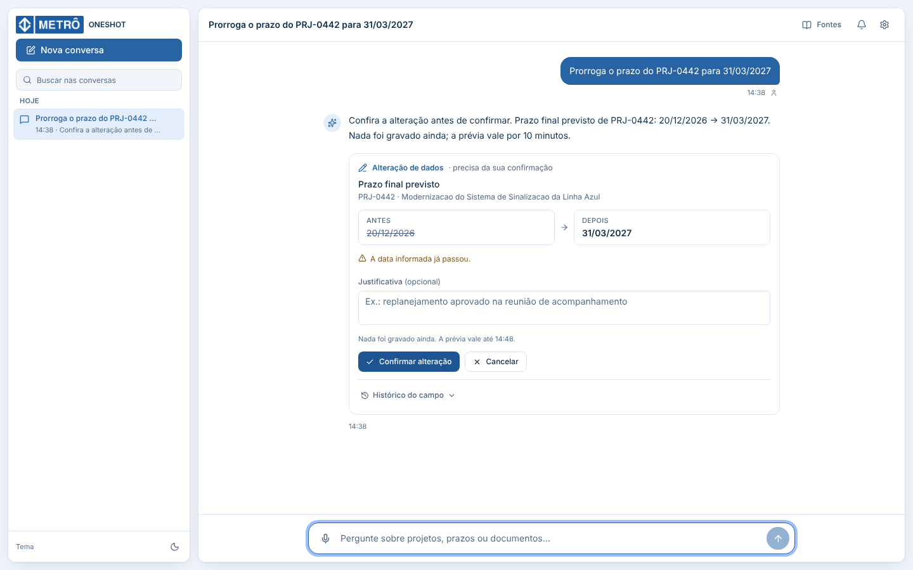
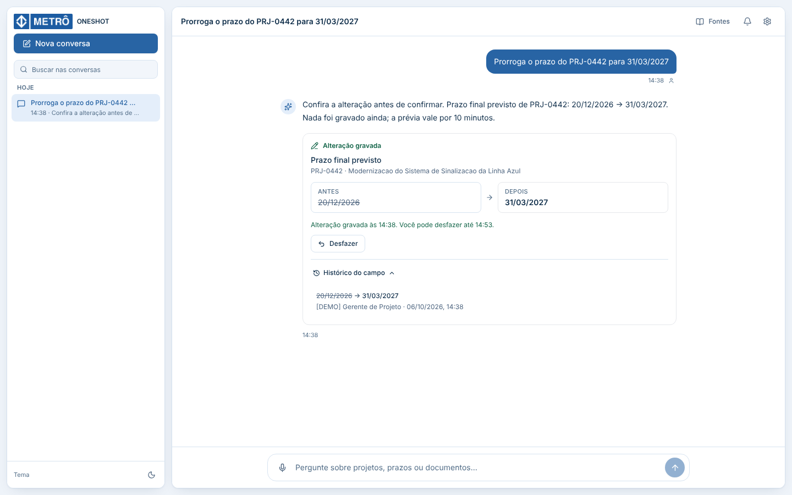
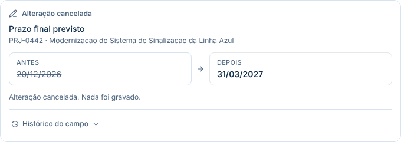
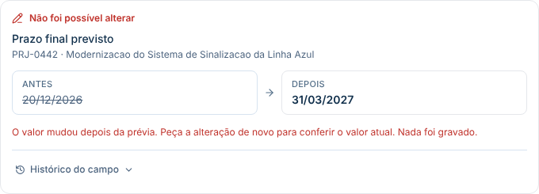
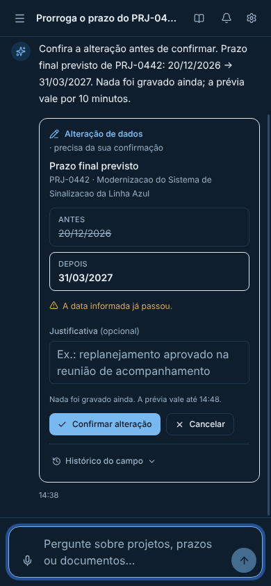
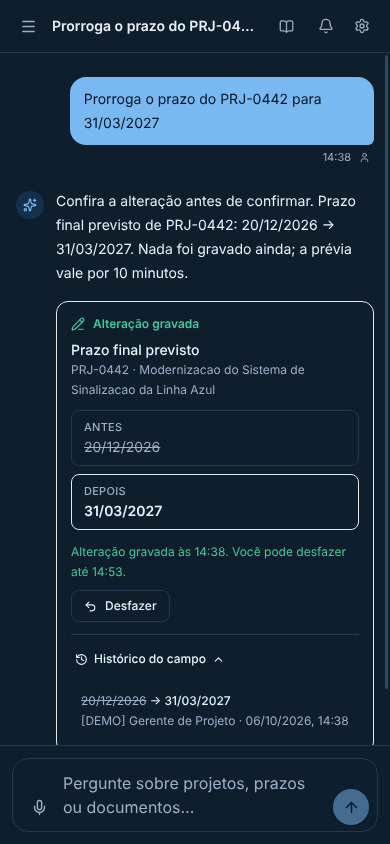

# S5-07 (#261) — Prévia, confirmação e histórico da alteração na interface

Interface da alteração de dados pelo chat, sobre o contrato da
[Seção 8.5.13 do `Projeto.md`](../../Projeto.md#8513-contrato-de-alteração-de-dados-pelo-chat-s5-05)
e a API da S5-06 (#260).

## O que foi entregue

| Item | Onde |
|---|---|
| Cartão **Alteração de dados**: prévia, confirmação, cancelamento, erro, desfazer e perguntas | `src/frontend/src/components/chat/data-change-card.tsx` |
| Histórico do campo, carregado ao abrir | `src/frontend/src/components/chat/data-change-history.tsx` |
| Cliente das rotas do cartão e tradução de erros | `src/frontend/src/lib/api/data-changes.ts` |
| Tipos espelhados de `app/data_changes/schemas.py` | `src/frontend/src/lib/api/schemas.ts` |
| Fase do cartão guardada na mensagem | `DataChangeState` em `lib/domain.ts` e `updateDataChange` em `state/chat-store.tsx` |
| Mensagem do backend preservada no erro (`serverMessage`) | `src/frontend/src/lib/api/client.ts` |

Comportamento:

- **Prévia.** Mostra o campo, o registro, o projeto, o valor antes (riscado) e
  depois, os avisos e até quando a prévia vale. Também traz a justificativa
  opcional e os botões **Confirmar alteração** e **Cancelar**. O texto deixa
  claro que nada foi gravado ainda.
- **Confirmação.** É a única chamada que grava. Mostra o horário da gravação e
  oferece **Desfazer** até o fim da janela de 15 minutos; depois disso, o botão
  some.
- **Cancelamento.** Encerra o cartão sem ações: "Alteração cancelada. Nada foi
  gravado."
- **Erro.** Exibe a mensagem do backend (por exemplo, `STALE_PREVIEW`). **Tentar
  de novo** só aparece quando repetir adianta, como em falha de rede ou
  `503`. Prévia expirada, desatualizada ou sem permissão encerra o cartão.
- **Perguntas.** Candidatos de projeto ou registro viram botões, e o valor que
  faltar vira um campo. A escolha cria a prévia por `POST /api/data-change-previews`.
- **Histórico.** **Histórico do campo** consulta `GET /api/data-changes` ao ser
  aberto e é atualizado depois de confirmar ou desfazer.
- **Persistência na sessão.** A fase fica na mensagem: reabrir a conversa
  depois de confirmar não oferece confirmar de novo.
- **Acessibilidade.** O cartão é uma região nomeada, e o resultado recebe o foco
  quando os botões somem. Status usam `role=status` e erros, `role=alert`; os
  rótulos "Antes" e "Depois" não dependem do riscado.

## Capturas

| Estado | Captura |
|---|---|
| Prévia (desktop, claro) |  |
| Confirmação com histórico aberto |  |
| Cancelamento |  |
| Erro final (`STALE_PREVIEW`) |  |
| Prévia (celular, escuro) |  |
| Confirmação (celular, escuro) |  |

## Testes

```bash
cd src/frontend
npx vitest run src/components/chat/data-change-card.test.tsx src/components/chat/data-change-flow.test.tsx
npx playwright test e2e/alteracao-dados.spec.ts
```

| Arquivo | Testes | O que cobre |
|---|---:|---|
| `data-change-card.test.tsx` | 14 | Os quatro estados da DoD (prévia, confirmação, cancelamento, erro final) e também o erro transitório, o desfazer, a janela vencida, a prévia expirada, os avisos, o histórico, a recusa e as perguntas com candidato e com valor inválido. |
| `data-change-flow.test.tsx` | 2 | O cartão na aplicação real, depois de confirmar, trocar de conversa e voltar; a resposta sem `data_change` não desenha cartão. |
| `e2e/alteracao-dados.spec.ts` | 9 | Prévia, confirmação, histórico e desfazer nos temas claro e escuro, mais cancelamento e erro final, em desktop, tablet e celular, com axe e verificação de rolagem horizontal. |

Resultados em 06/10/2026:

| Verificação | Resultado |
|---|---|
| `tsc --noEmit`, `eslint --max-warnings=0` e `prettier --check` | Sem erros |
| Vitest | 105 de 106 aprovados (a develop tem 89 de 90). A falha é a mesma da develop, `client.test.ts › baixa o DOCX…`, que depende do `object.stream` ausente no ambiente. |
| Playwright | 36 de 36 aprovados: os 27 existentes e os 9 novos |
| `npm run build` | Concluído |

A auditoria axe encontrou um problema durante o desenvolvimento: o cartão
cancelado era esmaecido com `opacity-70`, e o texto ficava com contraste de
3,1:1. O esmaecimento foi removido; o estado já é indicado pelo título e pela
mensagem.

## Limites

- **Depende da S5-06 (#260)** para funcionar de ponta a ponta. Sem
  `data_change` na resposta do chat, nenhum cartão aparece, e a interface atual
  não muda. A ordem de merge é S5-06 e depois S5-07.
- O servidor E2E só autentica a persona PMO e não tem as rotas da S5-06. Por
  isso a resposta do chat e as rotas do cartão foram simuladas com `page.route`.
  A permissão de escrita por perfil é testada no backend da S5-06.
- O teste de ponta a ponta com o backend real e os perfis negados é a S5-08 (#262).
