# Imagens originais da sessão RNF07 — P01

Dezessete capturas localizadas na pasta `OneDrive/Imagens/Screenshots`
e conferidas visualmente contra os anexos desta conversa. Copiadas sem
recorte, edição ou recompressão. Os nomes no repositório seguem a ordem
de recebimento e identificam as frases. Os nomes originais e hashes
SHA-256 estão em [manifesto-imagens.json](manifesto-imagens.json).

As pendências de incorporação dos binários nos registros anteriores
ficam resolvidas por esta inclusão. As pendências de confirmação do
protocolo e revisão independente permanecem. RNF09 tem evidências
automatizadas próprias; estas capturas pertencem somente ao RNF07.

[Resultados consolidados](../../../../../docs/testes/sprint5/consolidacao-s5-31.md)

## Imagem 1 — P01

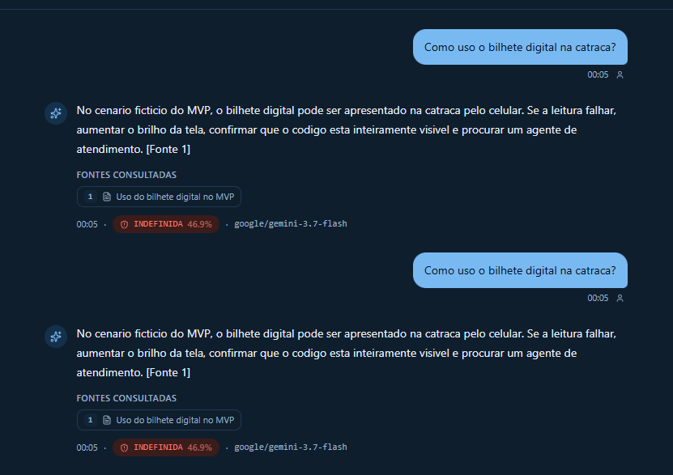

## Imagem 2 — P04, P05

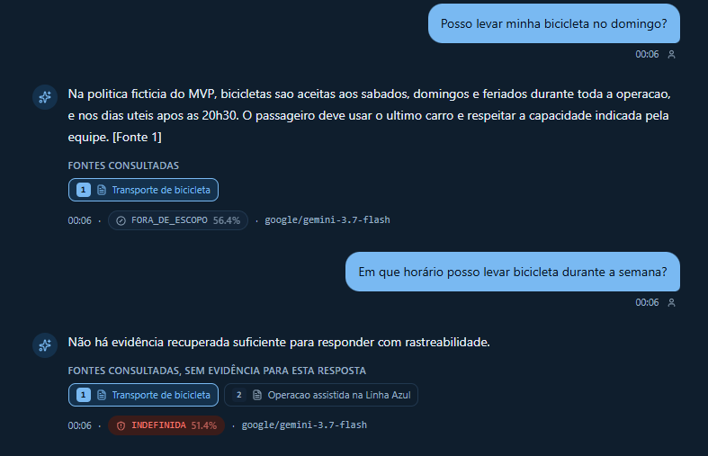

## Imagem 3 — P02

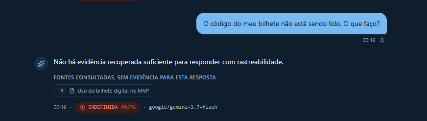

## Imagem 4 — P03

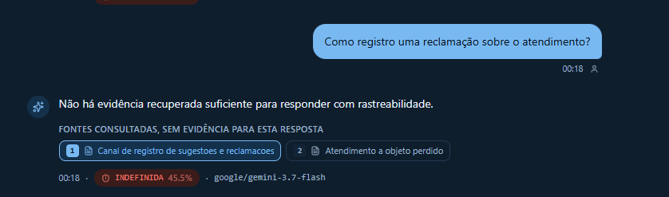

## Imagem 5 — P06, P07

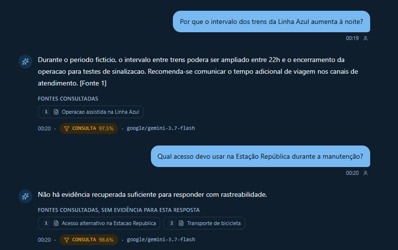

## Imagem 6 — P08

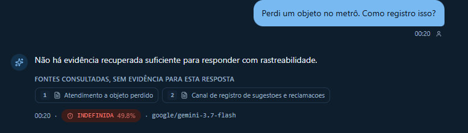

## Imagem 7 — P09, P10

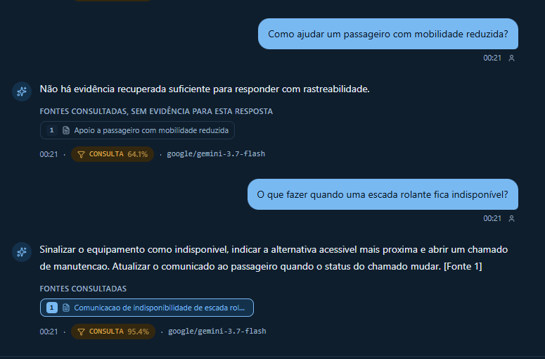

## Imagem 8 — N01

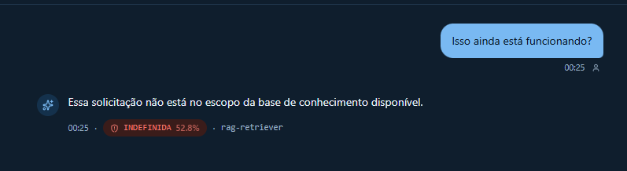

## Imagem 9 — N02

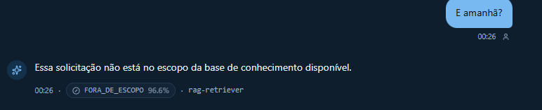

## Imagem 10 — N03

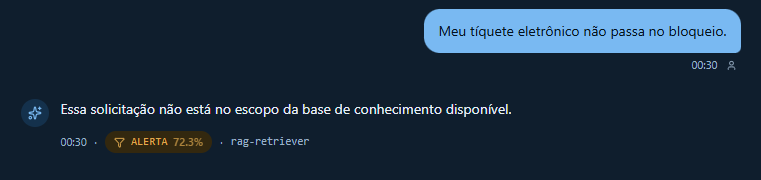

## Imagem 11 — N04

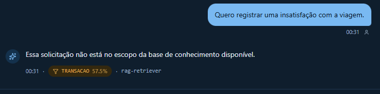

## Imagem 12 — N05

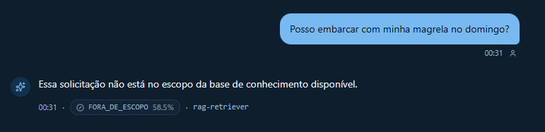

## Imagem 13 — N06

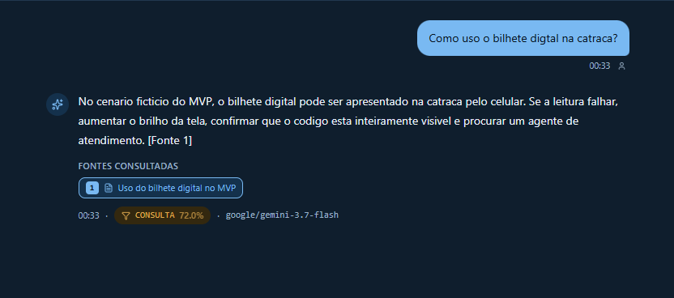

## Imagem 14 — N07

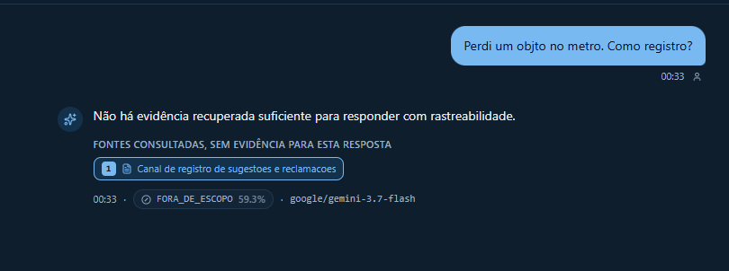

## Imagem 15 — N08

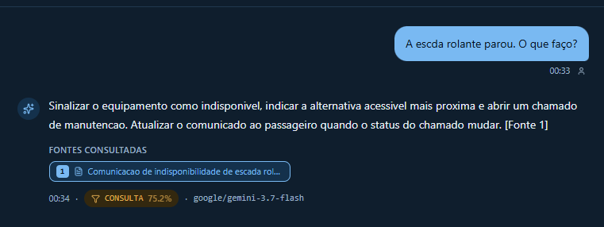

## Imagem 16 — N09

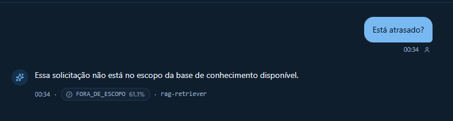

## Imagem 17 — N10

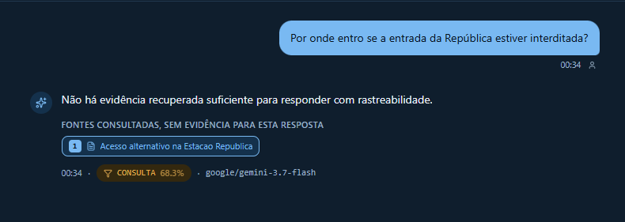
