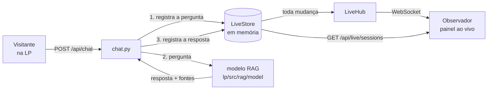

# Backend ao vivo — `lp/src/rag/backend`

Serviço em Python (FastAPI) que sustenta duas coisas na landing page:

1. **A sala ao vivo.** Várias pessoas podem conversar com o agente ao mesmo
   tempo, e qualquer pessoa pode acompanhar essas conversas acontecendo, no
   espírito de acompanhar um participante no Miro. É o que alimenta o painel
   de presença que a LP já tem em `?ao-vivo=N`.
2. **A ponte com o modelo RAG.** Uma única rota de chat que registra a
   pergunta na sala, consulta o modelo e devolve a resposta com as fontes.

> **O modelo RAG não está aqui e ainda não existe.** Ele será construído em
> `lp/src/rag/model`, com os documentos de `lp/src/rag/documentsRAG`, quando o
> material da sprint estiver completo. Este serviço foi escrito para ser
> ligado a ele depois, sem reescrita: a rota `/api/chat` já existe e responde
> `503` com o motivo enquanto o modelo não estiver configurado. **Nada é
> inventado** — nenhuma resposta falsa é devolvida no lugar, justamente para
> que na apresentação seja impossível confundir o que veio dos documentos com
> o que veio do nada.

---

## Como rodar

```bash
cd src/lp/src/rag/backend

python -m venv .venv
# Windows: .venv\Scripts\activate
source .venv/bin/activate

pip install -r requirements.txt
python run.py           # ou: uvicorn app.main:app --reload
```

O serviço sobe em `http://localhost:8000` **sem precisar de nenhuma variável
de ambiente**. Copie `.env.example` para `.env` só quando quiser mudar algo.

Documentação interativa das rotas: `http://localhost:8000/docs`.
Estado do serviço (inclusive se o modelo já está ligado): `GET /health`.

### Ligando a landing page

A LP lê o endereço do backend de `VITE_LIVE_BACKEND_URL`:

```bash
cd src/lp
cp .env.example .env.local     # e preencha:
# VITE_LIVE_BACKEND_URL=http://localhost:8000
npm run dev
```

Sem essa variável, a LP se comporta exatamente como antes: o painel ao vivo
continua no modo simulado de `?ao-vivo=N`, sem depender de backend nenhum.

---

## Arquitetura

```text
backend/
├── app/
│   ├── main.py          monta o serviço, o lifespan e a faxina de sessões
│   ├── config.py        toda a configuração ajustável, lida do ambiente
│   ├── schemas.py       ⭐ o contrato com o frontend
│   ├── dependencies.py  acesso à sala, ao hub e ao modelo via Depends
│   ├── documents.py     catálogo de documentsRAG e link de download
│   ├── live/
│   │   ├── store.py     a sala em memória (única fonte de verdade)
│   │   └── hub.py       os WebSockets abertos, e o envio para todos
│   ├── model/
│   │   └── client.py    ⭐ a fronteira com lp/src/rag/model
│   └── routers/
│       ├── health.py    GET /health
│       ├── live.py      /api/live/* e /ws/live
│       ├── chat.py      POST /api/chat
│       └── documents.py /api/documents/*
├── tests/               32 testes, rodam sem rede e sem o modelo
├── requirements.txt
├── run.py               atalho para `uvicorn app.main:app --reload`
└── .env.example
```

Três objetos vivem enquanto o processo estiver de pé, criados no `lifespan` e
guardados em `app.state`:

| Objeto  | Papel |
| ------- | ----- |
| `store` | A sala: quem está presente e o que foi dito. Toda escrita passa por aqui, serializada por um `asyncio.Lock`. |
| `hub`   | Os observadores conectados por WebSocket. |
| `model` | A implementação escolhida do modelo RAG. |

O hub é **inscrito** no store na subida. Por isso nenhuma rota precisa se
lembrar de avisar os observadores: qualquer escrita na sala — entrada, saída,
mensagem, mudança de estado — vira um envio automaticamente.



---

## Rotas

| Método | Rota | Para quê |
| --- | --- | --- |
| `GET` | `/health` | Estado do serviço, modelo ligado, nº de sessões e observadores. |
| `POST` | `/api/live/sessions` | O visitante entra na sala. Devolve a sessão — **guarde o `id`**. |
| `GET` | `/api/live/sessions` | A sala inteira. É o corpo que o polling da LP consome. |
| `POST` | `/api/live/sessions/{id}/heartbeat` | Sinal de vida; opcionalmente muda o estado (`typing`/`thinking`/`idle`). |
| `DELETE` | `/api/live/sessions/{id}` | Saída explícita (o visitante fechou a aba). |
| `WS` | `/ws/live` | Canal de observação: a sala agora e a cada mudança. |
| `POST` | `/api/chat` | Pergunta ao agente, registrada na sala. |
| `GET` | `/api/documents` | O que existe hoje em `documentsRAG`. |
| `GET` | `/api/documents/{id}/download` | Baixa o arquivo original de uma fonte. |

### Exemplo do fluxo de um visitante

```bash
# 1. entra na sala
curl -X POST localhost:8000/api/live/sessions \
     -H 'Content-Type: application/json' -d '{"name":"Felipe"}'
# {"id":"5d98d414c096","name":"Felipe","color":"#818cf8",
#  "status":"idle","lastSeen":1788984209442,"messages":[]}

# 2. está digitando (opcional, e serve de sinal de vida)
curl -X POST localhost:8000/api/live/sessions/5d98d414c096/heartbeat \
     -H 'Content-Type: application/json' -d '{"status":"typing"}'

# 3. pergunta
curl -X POST localhost:8000/api/chat -H 'Content-Type: application/json' \
     -d '{"session_id":"5d98d414c096","message":"Qual o status do XPTO?"}'
```

O `heartbeat` precisa ser repetido enquanto a aba estiver aberta — sugestão de
30 s, com o TTL padrão de 90 s. Sem ele, a sessão sai da sala sozinha, que é o
que impede o painel de encher de gente que já foi embora.

O `session_id` é opcional: sem ele o chat responde normalmente, mas a conversa
**não aparece** no painel. Se a sessão informada já tiver expirado, a rota
responde `404` — o cliente deve entrar de novo e repetir a pergunta.

---

## O contrato com o frontend

`app/schemas.py` é a fronteira, e dois detalhes ali não são estética:

- **`lastSeen` em camelCase.** É o nome que `lp/src/lib/useLivePresence.ts` e o
  cartão de presença leem. Internamente o campo é `last_seen`; o apelido de
  serialização faz a tradução.
- **Tempo em milissegundos.** `lastSeen` e `at` são epoch em **ms**, iguais ao
  que `Date.now()` devolve, porque o cartão calcula "há 12s" subtraindo um do
  outro. Mandar segundos faria a interface exibir "há 55 anos".

O `GET /api/live/sessions` e o `/ws/live` devolvem **exatamente o mesmo objeto
de sessão**. É o que permite trocar de transporte sem tocar em componente
nenhum — e é o que o hook da LP faz sozinho: ele sobe fazendo polling, para o
polling assim que o WebSocket abre, e volta a fazer polling (tentando
reconectar) se o canal cair.

Mensagens do `/ws/live`:

```json
{ "type": "snapshot", "sessions": [ ... ] }   // ao conectar
{ "type": "sessions", "sessions": [ ... ] }   // a cada mudança
```

Sempre a sala inteira, nunca um diff: com algumas dezenas de sessões o corpo é
pequeno, e o cliente só precisa substituir o que tinha. O canal é de mão
única — nada que o observador enviar é interpretado.

---

## A fronteira com o modelo RAG

`app/model/client.py` define o que o backend precisa que o modelo saiba fazer,
e traz duas implementações:

| `RAG_MODEL_BACKEND` | Implementação | Comportamento |
| --- | --- | --- |
| `none` (padrão) | `NotConfiguredModel` | Recusa a chamada; `/api/chat` vira `503` com a explicação. |
| `http` | `HttpRagModel` | Chama `RAG_MODEL_URL`. Serve para o modelo em Python **ou** em TypeScript, desde que publicado como serviço. |

**O que a próxima task precisa entregar**, para o chat funcionar sem mudar uma
linha deste serviço: um endpoint que aceite

```json
{ "question": "Qual o status do XPTO?", "previous_interaction_id": null }
```

e responda

```json
{
  "text": "Em andamento...",
  "model": "gemini-2.x",
  "interaction_id": "abc",
  "sources": [
    { "id": "1", "title": "TAP do Portfólio XPTO", "document": "TAP.pdf",
      "excerpt": "…", "score": 0.91 }
  ]
}
```

Só `text` é obrigatório — uma primeira versão do modelo já funciona devolvendo
apenas ele. Em `sources`, basta o modelo informar o **nome do arquivo** em
`document`: este serviço descobre sozinho o `download_url` correspondente em
`documentsRAG`, que é o que torna a fonte baixável na interface.

Se o modelo acabar sendo um módulo Python importável em vez de um serviço, o
caminho é acrescentar uma terceira implementação ao lado das duas existentes e
um valor novo em `build_model` — nenhuma rota muda.

---

## Testes

```bash
pytest        # a partir desta pasta
```

Os 32 testes rodam sem rede, sem o modelo e sem servidor: cobrem o contrato do
JSON (inclusive o `lastSeen`), a expiração de sessões, o limite da sala, o
descarte das mensagens antigas, o `/ws/live` recebendo as mudanças, a recusa
honesta quando não há modelo, a sessão que não fica presa em "aguardando
resposta…" quando o modelo falha, o preenchimento do link de download e o
adaptador HTTP do modelo.

---

## Decisões e limites conhecidos

**A sala vive só em memória.** É deliberado: o painel é uma vitrine do que está
acontecendo agora, e reiniciar o servidor limpar a sala é aceitável nesta
etapa. Toda a persistência está confinada em `LiveStore` — trocar por
PostgreSQL/Supabase depois é substituir aquela classe, porque as rotas só
conhecem os métodos públicos dela.

**Não há autenticação.** Qualquer pessoa entra na sala, e quem observa vê as
conversas de todo mundo — que é justamente o efeito pretendido na
apresentação. O que existe de proteção é o que evita estrago acidental: teto de
sessões simultâneas, teto de mensagens por sessão, expiração automática e
identificadores opacos nos downloads (o `id` de um documento não é um caminho,
então não há como pedir um arquivo fora de `documentsRAG`). Antes de qualquer
uso com dado real do Metrô, isto precisa de identidade (Entra ID), CORS
fechado nas origens conhecidas e limite de requisições.

**Ainda falta ligar o chat do visitante na LP.** O painel de observação já
consome o backend; a janela de chat da landing page ainda roda com a conversa
roteirizada de `components/chat/messages.ts`. Ligá-la é seguir o fluxo do
visitante descrito acima — entrar na sala, mandar `heartbeat` e chamar
`/api/chat` — e faz sentido fazer isso na mesma task em que o modelo RAG
entrar, que é quando haverá resposta de verdade para exibir.
