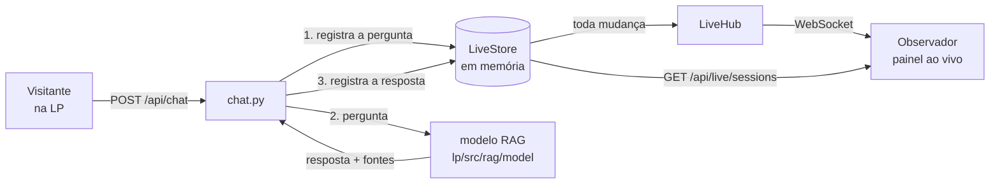

# Backend ao vivo — `lp/src/rag/backend`

Serviço em Python (FastAPI) que sustenta duas coisas na landing page:

1. **A sala ao vivo.** Várias pessoas podem conversar com o agente ao mesmo
   tempo, e qualquer pessoa pode acompanhar essas conversas acontecendo, no
   espírito de acompanhar um participante no Miro. É o que alimenta o painel
   de presença que a LP já tem em `?ao-vivo=N`.
2. **A ponte com o modelo RAG.** Uma única rota de chat que registra a
   pergunta na sala, consulta o modelo e devolve a resposta com as fontes.

> **O modelo RAG não está aqui e ainda não existe.** Ele será construído em
> `lp/src/rag/model`, com os documentos de `lp/src/rag/documentsRAG`, quando o
> material da sprint estiver completo. Este serviço foi escrito para ser
> ligado a ele depois, sem reescrita: a rota `/api/chat` já existe e responde
> `503` com o motivo enquanto o modelo não estiver configurado. **Nada é
> inventado** — nenhuma resposta falsa é devolvida no lugar, justamente para
> que na apresentação seja impossível confundir o que veio dos documentos com
> o que veio do nada.

---

## Como rodar

```bash
cd src/lp/src/rag/backend

python -m venv .venv
.venv/Scripts/python.exe -m pip install -r requirements.txt   # Windows
# Linux/macOS:  .venv/bin/python -m pip install -r requirements.txt

.venv/Scripts/python.exe run.py                               # Windows
# Linux/macOS:  .venv/bin/python run.py
```

Chamar o Python do venv pelo caminho completo **dispensa ativar o ambiente** — e
é o que evita o erro mais comum aqui, `uvicorn: command not found`, que aparece
quando o venv não foi ativado ou quando as dependências não chegaram a ser
instaladas. Se preferir ativar, o comando muda com o terminal:

| Terminal | Ativar |
| --- | --- |
| Git Bash (o prompt começa com `$`) | `source .venv/Scripts/activate` |
| PowerShell | `.venv\Scripts\Activate.ps1` |
| cmd | `.venv\Scripts\activate.bat` |
| Linux/macOS | `source .venv/bin/activate` |

Depois de ativar, `pip install -r requirements.txt` e `python run.py` funcionam
sem prefixo. Para conferir se o ambiente está de pé:
`.venv/Scripts/python.exe -c "import uvicorn, fastapi; print('ok')"`.

O serviço sobe em `http://localhost:8000` **sem precisar de nenhuma variável
de ambiente**. Copie `.env.example` para `.env` só quando quiser mudar algo.

Documentação interativa das rotas: `http://localhost:8000/docs`.
Estado do serviço (inclusive se o modelo já está ligado): `GET /health`.

### Ligando a landing page

A LP lê o endereço do backend de `VITE_LIVE_BACKEND_URL`:

```bash
cd src/lp
cp .env.example .env.local     # e preencha:
# VITE_LIVE_BACKEND_URL=http://localhost:8000
npm run dev
```

Sem essa variável, a LP se comporta exatamente como antes: o painel ao vivo
continua no modo simulado de `?ao-vivo=N`, sem depender de backend nenhum.

---

## Arquitetura

```text
backend/
├── app/
│   ├── main.py          monta o serviço, o lifespan e a faxina de sessões
│   ├── config.py        toda a configuração ajustável, lida do ambiente
│   ├── schemas.py       ⭐ o contrato com o frontend
│   ├── dependencies.py  acesso à sala, ao hub e ao modelo via Depends
│   ├── documents.py     catálogo de documentsRAG e link de download
│   ├── live/
│   │   ├── store.py     a sala em memória (única fonte de verdade)
│   │   └── hub.py       os WebSockets abertos, e o envio para todos
│   ├── model/
│   │   └── client.py    ⭐ a fronteira com lp/src/rag/model
│   ├── static/
│   │   └── bancada.html página de teste multiusuário
│   └── routers/
│       ├── health.py    GET /health
│       ├── live.py      /api/live/* e /ws/live
│       ├── chat.py      POST /api/chat
│       ├── documents.py /api/documents/*
│       └── bench.py     GET /teste (bancada)
├── tests/               40 testes, rodam sem rede e sem o modelo
├── requirements.txt
├── run.py               atalho para `uvicorn app.main:app --reload`
└── .env.example
```

Três objetos vivem enquanto o processo estiver de pé, criados no `lifespan` e
guardados em `app.state`:

| Objeto  | Papel |
| ------- | ----- |
| `store` | A sala: quem está presente e o que foi dito. Toda escrita passa por aqui, serializada por um `asyncio.Lock`. |
| `hub`   | Os observadores conectados por WebSocket. |
| `model` | A implementação escolhida do modelo RAG (hoje, o pipeline local). |

O hub é **inscrito** no store na subida. Por isso nenhuma rota precisa se
lembrar de avisar os observadores: qualquer escrita na sala — entrada, saída,
mensagem, mudança de estado — vira um envio automaticamente.



---

## Rotas

| Método | Rota | Para quê |
| --- | --- | --- |
| `GET` | `/health` | Estado do serviço, modelo ligado, nº de sessões e observadores. |
| `POST` | `/api/live/sessions` | O visitante entra na sala. Devolve a sessão — **guarde o `id`**. |
| `GET` | `/api/live/sessions` | A sala inteira. É o corpo que o polling da LP consome. |
| `POST` | `/api/live/sessions/{id}/heartbeat` | Sinal de vida; opcionalmente muda o estado (`typing`/`thinking`/`idle`). |
| `DELETE` | `/api/live/sessions/{id}` | Saída explícita (o visitante fechou a aba). |
| `WS` | `/ws/live` | Canal de observação: a sala agora e a cada mudança. |
| `POST` | `/api/chat` | Pergunta ao agente, registrada na sala. |
| `GET` | `/api/documents` | O que existe hoje em `documentsRAG`. |
| `GET` | `/api/documents/{id}/download` | Baixa o arquivo original de uma fonte. |
| `GET` | `/teste` | Bancada de teste multiusuário (só desenvolvimento). |

### Exemplo do fluxo de um visitante

```bash
# 1. entra na sala
curl -X POST localhost:8000/api/live/sessions \
     -H 'Content-Type: application/json' -d '{"name":"Felipe"}'
# {"id":"5d98d414c096","name":"Felipe","color":"#818cf8",
#  "status":"idle","lastSeen":1788984209442,"messages":[]}

# 2. está digitando (opcional, e serve de sinal de vida)
curl -X POST localhost:8000/api/live/sessions/5d98d414c096/heartbeat \
     -H 'Content-Type: application/json' -d '{"status":"typing"}'

# 3. pergunta
curl -X POST localhost:8000/api/chat -H 'Content-Type: application/json' \
     -d '{"session_id":"5d98d414c096","message":"Qual o status do XPTO?"}'
```

O `heartbeat` precisa ser repetido enquanto a aba estiver aberta — sugestão de
30 s, com o TTL padrão de 90 s. Sem ele, a sessão sai da sala sozinha, que é o
que impede o painel de encher de gente que já foi embora.

O `session_id` é opcional: sem ele o chat responde normalmente, mas a conversa
**não aparece** no painel. Se a sessão informada já tiver expirado, a rota
responde `404` — o cliente deve entrar de novo e repetir a pergunta.

---

## Testar com vários dispositivos

Antes de o modelo RAG existir já dá para exercitar a parte multiusuário, que é
independente dele. O backend serve uma **bancada** em `/teste`: uma página só,
que entra na sala, manda mensagem e mostra o painel ao vivo. Ela vem da mesma
origem da API, então **não há endereço para configurar no celular** — é só
abrir a URL.

> A bancada não faz parte do produto. Ela existe porque a janela de chat da
> landing page ainda roda com a conversa roteirizada, e sem ela nenhum
> dispositivo entraria na sala de verdade. Desligue com
> `ENABLE_TEST_BENCH=false` fora do desenvolvimento — ela entra na sala sem
> autenticação nenhuma.

### Passo a passo (Windows, celular no mesmo Wi-Fi)

```powershell
# 1. descubra o IP da máquina na rede local
ipconfig
#    procure "Endereço IPv4" do adaptador Wi-Fi — algo como 192.168.0.42

# 2. suba o backend ouvindo a rede, não só o próprio computador
cd src\lp\src\rag\backend
.venv\Scripts\python.exe -m uvicorn app.main:app --host 0.0.0.0 --port 8000
```

No Git Bash o mesmo comando é:

```bash
cd src/lp/src/rag/backend
.venv/Scripts/python.exe -m uvicorn app.main:app --host 0.0.0.0 --port 8000
```

O `-m uvicorn` roda o módulo dentro do venv, sem depender de ele estar no PATH.

No computador e no celular, abra `http://192.168.0.42:8000/teste` (com o **seu**
IP). Dê um nome a cada aparelho e observe: cada um aparece no painel do outro,
digitar em um acende "digitando…" no outro, a pergunta enviada aparece nos dois
e fechar a aba tira o aparelho da sala na hora.

Para testar a **landing page** com presença real, além da bancada:

```powershell
# src\lp\.env.local  — o IP da máquina, nunca localhost:
#   localhost no celular aponta para o próprio celular.
VITE_LIVE_BACKEND_URL=http://192.168.0.42:8000

npm run dev -- --host      # o --host faz o Vite ouvir a rede
```

Aí o celular abre `http://192.168.0.42:5173`. Cada aba que abre a página entra
na sala; o painel de presença só aparece quando há **outra** pessoa além de
você, e sua própria linha vem marcada com "você".

### Se não conectar

| Sintoma | Causa quase sempre |
| --- | --- |
| `uvicorn: command not found` | O venv não foi ativado, ou as dependências não foram instaladas nele. Use `.venv/Scripts/python.exe -m uvicorn ...`, que não depende de ativação. |
| O celular não abre a página | Firewall do Windows. Ele pergunta na primeira execução — é preciso permitir em **Rede privada**. Se foi negado: `New-NetFirewallRule -DisplayName "OneShot 8000" -Direction Inbound -LocalPort 8000 -Protocol TCP -Action Allow -Profile Private` (PowerShell como administrador). |
| A página abre mas a sala fica vazia | `VITE_LIVE_BACKEND_URL` com `localhost` em vez do IP da máquina. |
| Nada se enxerga, mesmo com tudo certo | Wi-Fi corporativo ou de escola costuma isolar os clientes entre si. Suba um ponto de acesso pelo celular e conecte o computador nele. |
| O painel diz "polling" e não "WebSocket" | O canal caiu e a interface caiu para o polling — funciona, só atualiza a cada 2,5s. O log de eventos da bancada mostra o motivo. |

### O que já foi verificado

Um navegador de verdade, com duas abas (uma em viewport de celular), exercitou
a bancada de ponta a ponta: WebSocket abrindo nos dois, presença cruzada,
"digitando…" atravessando, a pergunta chegando ao painel do outro, o `503`
honesto do modelo e a saída imediata ao fechar a aba. O hook da landing page foi
testado sob `StrictMode` — uma aba vira exatamente uma sessão, sem sessão órfã.

Detalhe de desenvolvimento: como o `StrictMode` monta cada efeito duas vezes, o
contador de nomes pula (a primeira aba pode nascer "Convidado 2"). A sessão
extra é removida na hora; só a numeração fica com buraco, e só em
desenvolvimento.

---

## Publicar (LP na Vercel, backend com processo próprio)

O arranjo é: a **landing page** na Vercel e o **backend** num host que mantenha
um processo vivo (Render, Railway, Fly.io). O QR da página aponta para a URL da
Vercel, então quem escaneia entra pela rede do próprio aparelho — o Wi-Fi do
local deixa de importar, que era o problema a resolver.

### Por que o backend não vai junto na Vercel

Não é falta de suporte: a Vercel hoje roda FastAPI sem configuração e aceita
WebSocket em funções Python. O impedimento é **a sala estar na memória do
processo**. A documentação da própria Vercel é explícita: novas conexões não têm
garantia de chegar à mesma instância da função, e a recomendação é guardar
presença, salas e pub/sub em um armazenamento externo. Com pouca gente talvez
caísse tudo numa instância só e parecesse funcionar — "talvez" não serve para
uma apresentação.

Note que isso **não** se resolve trocando WebSocket por polling: cada requisição
pode ir para uma instância diferente do mesmo jeito. O que precisa sair do
processo é o estado.

Para migrar depois, o trabalho está contido: `LiveStore` passa a guardar as
sessões no Redis (o TTL de 90s vira `EXPIRE`) e `LiveHub` usa pub/sub para
alcançar as outras instâncias. Nenhuma rota muda — elas só conhecem os métodos
públicos do store, que foi desenhado assim de propósito.

### Antes de publicar

```bash
cd src/lp/src/rag
python verificar.py
```

Um comando com todas as conferências: índice em dia com a documentação, nenhum
documento sem carregador, toda fonte indexada disponível para download, os dois
conjuntos de testes e a chave no ambiente. Ele termina dizendo o que commitar.

### O backend

| Campo | Valor |
| --- | --- |
| Root directory | `src/lp/src/rag/backend` |
| Build command | `pip install -r requirements.txt` (já puxa as do modelo) |
| Start command | `uvicorn app.main:app --host 0.0.0.0 --port $PORT --workers 1` |
| Health check | `/health` |
| Instâncias | **1** (ver "Escala" abaixo) |

O `Procfile` já traz esse start command, e hosts que o leem o pegam sozinhos.
Para hosts que rodam contêiner, o `Dockerfile` da pasta faz o mesmo.

Variáveis de ambiente:

```bash
RAG_MODEL_BACKEND=local
GEMINI_API_KEY=<a chave do Gemini>
CORS_ALLOW_ORIGINS=https://SEU-PROJETO.vercel.app
CORS_ALLOW_ORIGIN_REGEX=https://.*\.vercel\.app   # os previews de cada branch
ENABLE_TEST_BENCH=true                             # enquanto o chat da LP não
                                                   # estiver integrado
```

**Cuidado com o plano gratuito.** Vários hosts hibernam o serviço após alguns
minutos sem tráfego, e a primeira requisição depois disso leva perto de um
minuto. No meio de uma demonstração isso é pior do que não ter deploy nenhum.
Ou use um plano que não hiberna, ou abra a página alguns minutos antes — com a
LP aberta o polling/WebSocket segura o serviço acordado.

### A landing page na Vercel

| Campo | Valor |
| --- | --- |
| Root directory | `src/lp` |
| Framework | Vite (detectado sozinho) |
| Variável | `VITE_LIVE_BACKEND_URL=https://SEU-BACKEND` |

Duas armadilhas conhecidas:

- **A variável é de build, não de execução.** O Vite grava o valor dentro do
  bundle. Mudou a variável, precisa **refazer o deploy** — só salvar nas
  configurações não muda a página publicada.
- **O backend precisa ser HTTPS.** A LP é servida por HTTPS, e uma página HTTPS
  não pode chamar um backend HTTP. Os hosts citados já dão HTTPS por padrão. O
  endereço do WebSocket é derivado do mesmo valor, então `https://` vira `wss://`
  sozinho.

### Escala

O `--workers 1` e a instância única não são economia: **a sala vive na memória
do processo**. Um segundo worker teria a própria sala, e as pessoas parariam de
se enxergar dependendo de qual atendesse cada requisição. Enquanto o estado não
for para o Redis, um processo é o limite — o que é bastante para dezenas de
pessoas simultâneas, já que o teto configurado de sessões é 50.

### O QR code

A seção de convite (`src/components/live/join-qr.tsx`) gera o código a partir de
`window.location.origin` — a URL em que a página está de fato publicada. O mesmo
componente funciona em `localhost`, no preview e em produção sem ninguém
atualizar link nenhum. Ele aparece só em telas grandes: num celular, um QR para a
página que a pessoa já está vendo não serviria para nada.

---

## O contrato com o frontend

`app/schemas.py` é a fronteira, e dois detalhes ali não são estética:

- **`lastSeen` em camelCase.** É o nome que `lp/src/lib/useLivePresence.ts` e o
  cartão de presença leem. Internamente o campo é `last_seen`; o apelido de
  serialização faz a tradução.
- **Tempo em milissegundos.** `lastSeen` e `at` são epoch em **ms**, iguais ao
  que `Date.now()` devolve, porque o cartão calcula "há 12s" subtraindo um do
  outro. Mandar segundos faria a interface exibir "há 55 anos".

O `GET /api/live/sessions` e o `/ws/live` devolvem **exatamente o mesmo objeto
de sessão**. É o que permite trocar de transporte sem tocar em componente
nenhum — e é o que o hook da LP faz sozinho: ele sobe fazendo polling, para o
polling assim que o WebSocket abre, e volta a fazer polling (tentando
reconectar) se o canal cair.

Mensagens do `/ws/live`:

```json
{ "type": "snapshot", "sessions": [ ... ] }   // ao conectar
{ "type": "sessions", "sessions": [ ... ] }   // a cada mudança
```

Sempre a sala inteira, nunca um diff: com algumas dezenas de sessões o corpo é
pequeno, e o cliente só precisa substituir o que tinha. O canal é de mão
única — nada que o observador enviar é interpretado.

---

## O modelo RAG

O modelo **existe** e roda dentro deste processo: `app/model/local.py` importa o
pipeline de [`lp/src/rag/model`](../model/README.md), que responde a partir da
documentação do projeto e devolve as fontes. Um deploy só, sem rede entre
backend e modelo.

```bash
RAG_MODEL_BACKEND=local
GEMINI_API_KEY=...        # a mesma de src/backend/.env
```

Antes da primeira pergunta é preciso construir o índice — sem ele o chat
responde `503` explicando o que fazer:

```bash
cd ../                      # src/lp/src/rag
python -m model.index
```

`app/model/client.py` mantém as três implementações:

| `RAG_MODEL_BACKEND` | Implementação | Comportamento |
| --- | --- | --- |
| `local` | `LocalRagModel` | **O que o projeto usa.** Pipeline no mesmo processo. |
| `http` | `HttpRagModel` | Chama `RAG_MODEL_URL`, se um dia o modelo virar serviço à parte. |
| `none` (padrão) | `NotConfiguredModel` | Recusa com `503` e a explicação. |

As fontes chegam com o **nome do arquivo** em `document`, e é por ele que este
serviço descobre o link de download em `documentsRAG` — que é o que torna a
procedência clicável na interface. A ordem das fontes acompanha a numeração
`[Fonte N]` do texto da resposta, então ela não é deduplicada.


---

## Testes

```bash
pytest        # a partir desta pasta
```

Os 40 testes rodam sem rede, sem o modelo e sem servidor: cobrem o contrato do
JSON (inclusive o `lastSeen`), a expiração de sessões, o limite da sala, o
descarte das mensagens antigas, o `/ws/live` recebendo as mudanças, a recusa
honesta quando não há modelo, a sessão que não fica presa em "aguardando
resposta…" quando o modelo falha, o preenchimento do link de download e o
adaptador HTTP do modelo.

---

## Decisões e limites conhecidos

**A sala vive só em memória.** É deliberado: o painel é uma vitrine do que está
acontecendo agora, e reiniciar o servidor limpar a sala é aceitável nesta
etapa. Toda a persistência está confinada em `LiveStore` — trocar por
PostgreSQL/Supabase depois é substituir aquela classe, porque as rotas só
conhecem os métodos públicos dela.

**Não há autenticação.** Qualquer pessoa entra na sala, e quem observa vê as
conversas de todo mundo — que é justamente o efeito pretendido na
apresentação. O que existe de proteção é o que evita estrago acidental: teto de
sessões simultâneas, teto de mensagens por sessão, expiração automática e
identificadores opacos nos downloads (o `id` de um documento não é um caminho,
então não há como pedir um arquivo fora de `documentsRAG`). Antes de qualquer
uso com dado real do Metrô, isto precisa de identidade (Entra ID), CORS
fechado nas origens conhecidas e limite de requisições.

**O chat da LP está ligado.** A janela de chat da landing page chama
`/api/chat` com o id da sessão ao vivo, então a pergunta do visitante aparece no
painel de quem está acompanhando no mesmo instante, e a resposta traz a pasta de
fontes com os documentos baixáveis. A conversa roteirizada de
`components/chat/messages.ts` continua sendo a que roda na revelação por
rolagem; ela some assim que o visitante digita.

**O índice precisa ir para o repositório.** O serviço publicado carrega
`model/artifacts/` do disco — reconstruir na subida exigiria a chave no
ambiente de build e alguns minutos a cada deploy. Rode `python -m model.index
--check` antes de publicar: ele diz se a documentação mudou desde a última
indexação.
