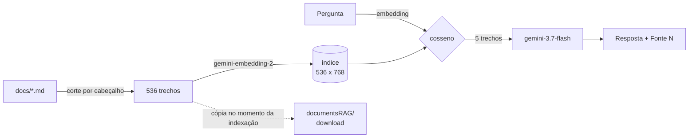

# Modelo RAG — `lp/src/rag/model`

Responde perguntas sobre o projeto do Agente de IA para o Portfólio do Metrô a
partir da **documentação do próprio projeto**, citando de onde veio cada
informação e devolvendo o documento original para download.

O modelo roda **dentro do processo do backend** (`lp/src/rag/backend`), não como
serviço separado: um deploy só, sem rede entre os dois, uma origem de falha a
menos na apresentação.

---

## Como funciona



Três decisões explicam o resto:

**O corte é por cabeçalho, não por tamanho fixo.** A documentação é markdown com
hierarquia — `## 8.7 Contrato da API`, `### 8.7.6 Erros` — e essa hierarquia já
é a divisão semântica que um cortador cego por caracteres tentaria adivinhar.
Cortar por cabeçalho dá trechos que começam e terminam em fronteiras de assunto,
e dá **a citação de graça**: o caminho de cabeçalhos é exatamente o que a
resposta precisa mostrar como fonte.

**O caminho de cabeçalhos entra no texto vetorizado.** Um trecho que diz apenas
"o limiar é 0,550" não casa com "qual o limiar do classificador?". Prefixado com
`Projeto.md — Classificador de intenções > Limiares`, casa. É a diferença entre
recuperar por acaso e recuperar por assunto.

**Não há banco vetorial.** São 536 trechos: uma matriz de 536×768 ocupa 1,6 MB e
a busca é uma multiplicação de matriz que leva menos de um milissegundo. Um
Chroma ou um pgvector aqui só acrescentaria um serviço para manter de pé, um
formato para migrar e um modo de falhar a mais.

---

## Construir o índice

```bash
cd src/lp/src/rag
backend/.venv/Scripts/python.exe -m pip install -r model/requirements.txt

# A chave já existe no projeto, em src/backend/.env
GEMINI_API_KEY=$(grep '^GEMINI_API_KEY=' ../../../backend/.env | cut -d= -f2- | tr -d '\r') \
  backend/.venv/Scripts/python.exe -m model.index
```

O comando lê `docs/`, corta em trechos, vetoriza, grava `model/artifacts/` e
**copia os documentos indexados para `documentsRAG/`**. A cópia acontece no
momento da indexação de propósito: garante que o arquivo que o usuário baixa é
exatamente o que foi vetorizado, e não uma versão que mudou depois.

### Reindexar quando a documentação mudar

```bash
python -m model.index --check    # a documentação mudou desde a última indexação?
python -m model.index --stats    # o que há no índice atual
python -m model.index            # reconstrói
```

O `--check` compara a impressão digital do corpus guardada no índice com a da
documentação em disco e sai com código 1 se divergirem. **É a salvaguarda contra
apresentar com índice velho** — rode antes de subir o deploy.

> Tanto `model/artifacts/` quanto `documentsRAG/` precisam ir para o
> repositório: o serviço publicado carrega o índice do disco, não o reconstrói
> na subida (reconstruir exigiria a chave no ambiente de build e alguns minutos
> a cada deploy).

---

## Arquivos

```text
model/
├── config.py       toda a configuração ajustável, lida do ambiente
├── corpus.py       ⭐ carregador (despacho por extensão) e corte por cabeçalho
├── embeddings.py   cliente do gemini-embedding-2, com concorrência e retry
├── store.py        o índice: matriz normalizada, cosseno, ida e volta ao disco
├── generator.py    ⭐ o prompt e a chamada de geração
├── pipeline.py     pergunta → trechos → resposta com fontes
├── index.py        python -m model.index
├── artifacts/      índice gerado (index.npz + index.json)
└── tests/          28 testes, sem rede e sem chave
```

O carregador **despacha por extensão**. Hoje só o ramo de markdown existe; se
algum documento vier em PDF ou planilha, é uma função nova em `corpus.py` e uma
linha em `LOADERS` — não uma reescrita do pipeline. Arquivos sem carregador não
somem em silêncio: o comando de indexação os lista como pendência.

---

## O contrato com o backend

`app/model/local.py`, no backend, importa `RagPipeline` e traduz a resposta.
Basta configurar:

```bash
RAG_MODEL_BACKEND=local
GEMINI_API_KEY=...
```

O backend recebe `text`, `model`, `interaction_id` e uma lista de fontes com
`document` (nome do arquivo) — e é por esse nome que ele descobre sozinho o link
de download em `documentsRAG`. **A ordem das fontes acompanha a numeração do
prompt**: `[Fonte 2]` no texto é a segunda fonte da lista. Por isso a lista não
é deduplicada, mesmo quando dois trechos vêm do mesmo arquivo — deduplicar
desalinharia a citação.

O `previous_interaction_id` encadeia os turnos pelo próprio Gemini, sem o
backend guardar histórico de conversa.

---

## Configuração

| Variável | Padrão | Para quê |
| --- | --- | --- |
| `GEMINI_API_KEY` | — | Obrigatória. Já existe em `src/backend/.env`. |
| `GEMINI_EMBEDDING_MODEL` | `gemini-embedding-2` | Modelo de embedding. |
| `GEMINI_EMBEDDING_DIMENSIONS` | `768` | Tamanho do vetor. |
| `GEMINI_MODEL` | `gemini-3.7-flash` | Modelo de geração. |
| `RAG_TOP_K` | `5` | Quantos trechos vão para o prompt. |
| `RAG_MIN_SCORE` | `0.30` | Piso de similaridade. Abaixo dele o trecho é ruído, e o modelo responde que não encontrou em vez de usar o que estiver menos longe. |
| `RAG_MAX_CHUNK_CHARS` | `1800` | Teto por trecho (~450 tokens). |
| `RAG_CORPUS_DIR` | `docs/` na raiz | Onde está a documentação. |

---

## Testes

```bash
cd src/lp/src/rag/model
pytest
```

Os 28 testes rodam **sem rede e sem chave**: as dependências externas
(vetorizar e gerar) entram pelo construtor do pipeline, então recuperação,
ordenação, corte por piso e montagem das fontes são exercitados com dublês. O
que eles cobrem: hierarquia de cabeçalhos, cabeçalho dentro de bloco de código,
seção vazia descartada, seção longa dividida com sobreposição, âncora no estilo
do GitHub, impressão digital do corpus, ordenação por similaridade, ida e volta
ao disco, e o alinhamento entre `[Fonte N]` e a lista de fontes.

---

## Limites conhecidos

**A qualidade da recuperação precisa de ajuste com perguntas reais.** Os
parâmetros que mais mudam o resultado são `RAG_TOP_K` (quantos trechos o modelo
vê) e `RAG_MIN_SCORE` (o quanto ele aceita antes de dizer que não sabe). A
vantagem aqui é que a equipe escreveu os documentos: dá para avaliar de cabeça
se a seção recuperada é a certa.

**Perguntas numéricas e comparativas são o ponto fraco.** Recuperação por
similaridade encontra o trecho que *fala sobre* cronograma; ela não soma
valores nem compara projetos. Isso vale para o produto final com dados do
portfólio, não tanto para perguntas sobre a documentação do projeto.

**Sem cache.** Cada pergunta gasta uma chamada de embedding e uma de geração. É
irrelevante numa demonstração e vira assunto se o uso crescer.
